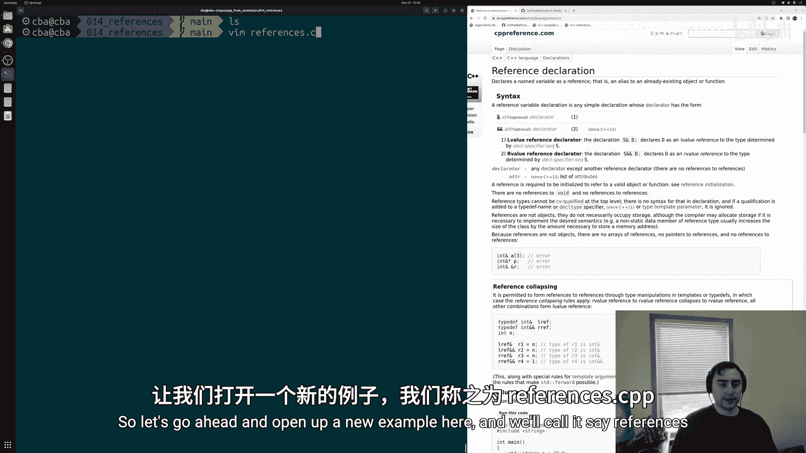
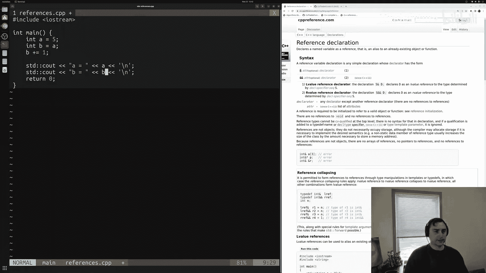
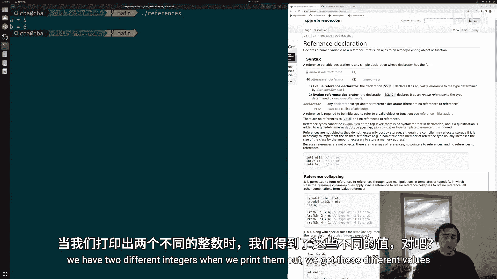
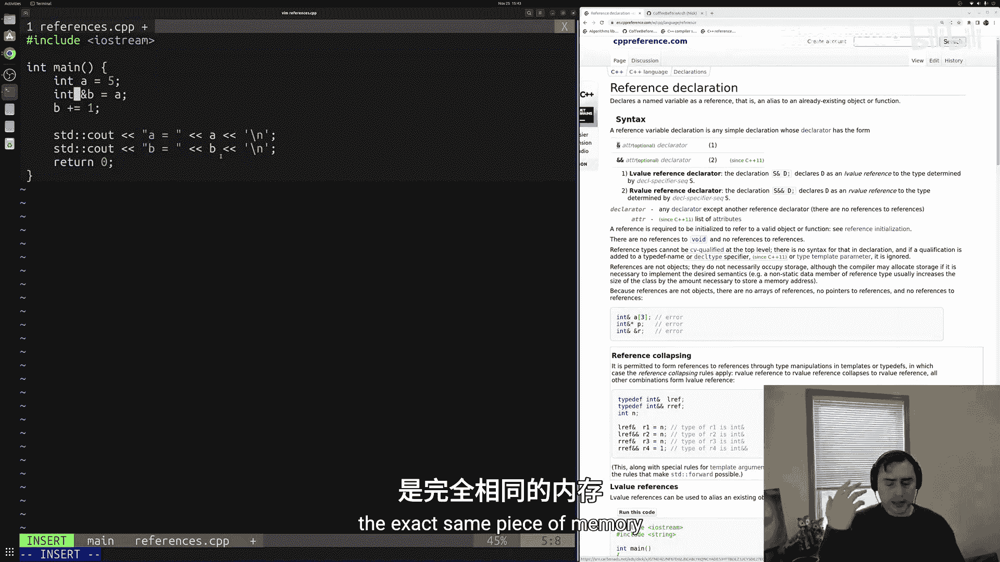
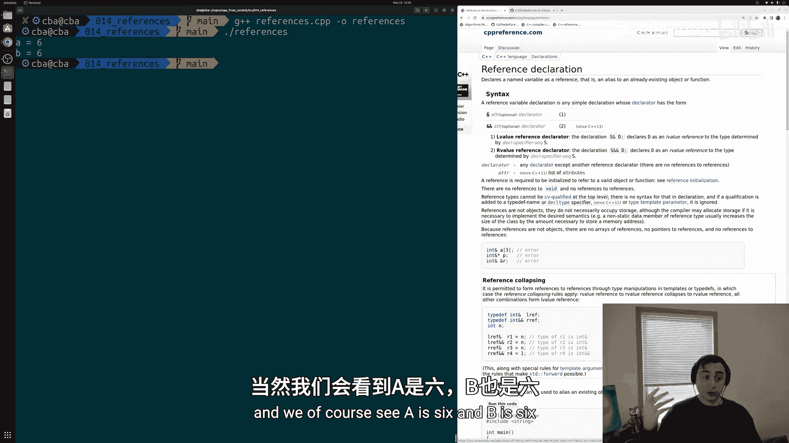
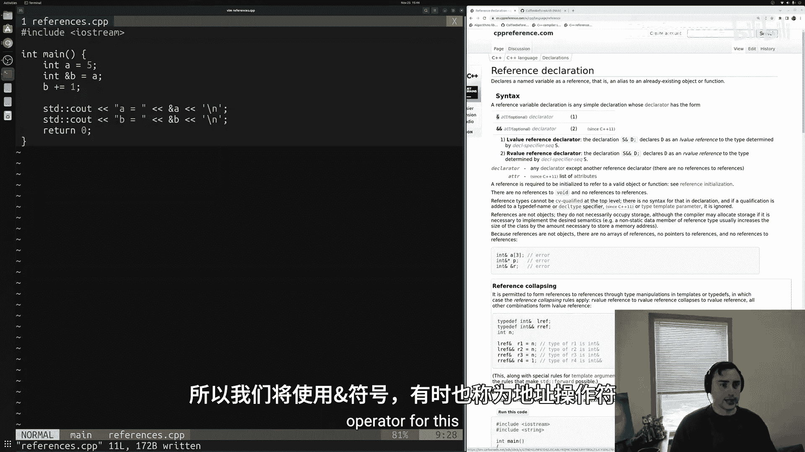
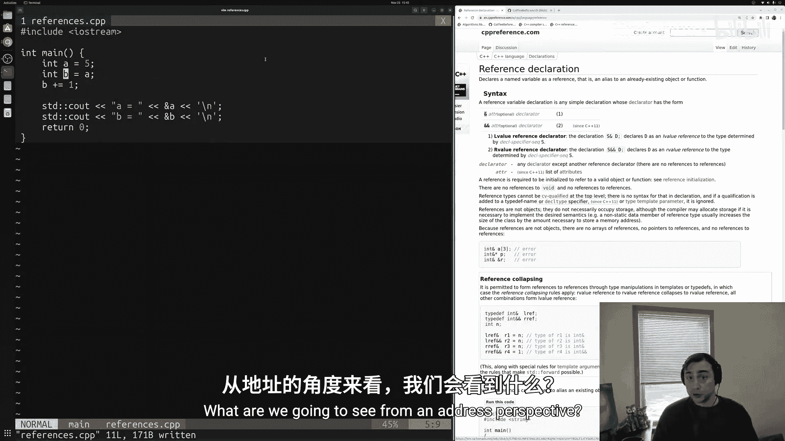
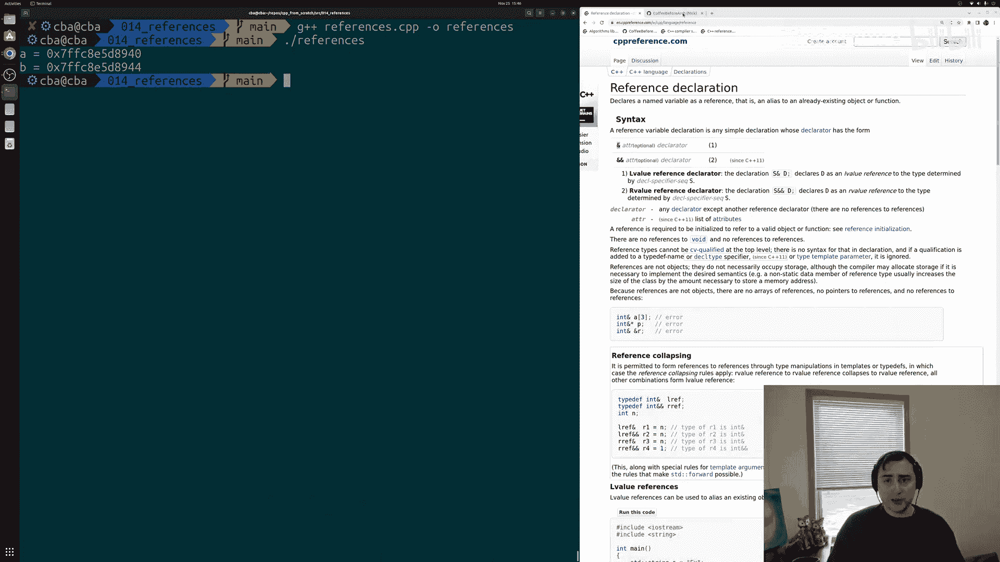
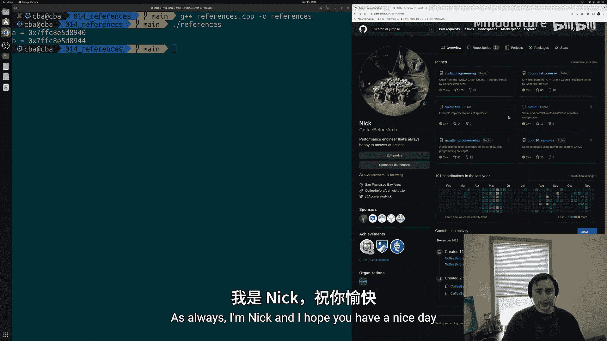

# C++入门教程｜CoffeeBeforeArch-p15-P15-References--BV1nbRUYSEUu_p15-

Hey everyone， I'm Nick， and this is C plus Plus from scratch。 So in this episode of the series。

 we're going to be talking about references。So there's oftentimes in programming where we want to prevent a copy from occurring now this might be for functional reasons like in the case of a lock。

 or it might be for performance reasons， so copying say an integer is pretty cheap。

 but copying a vector of 10，000 integers is going to be pretty expensive。Now。

 one of the ways that we can avoid copying inside of C++ is using this thing called references and declaring references。

 so that's what we're going to be looking at today。

So let's go ahead and open up a new example here and we'll call it say referenceences。 CBP。

And inside of here， we'll start by including IO Stream because we're going to do some printing。

 and I'll go ahead and write a simple main function here and write the core of our C++ programs。

So let's start up by just creating a couple variables， so we'll create some variable A， some integer。

 and set it equal to 5， and we'll create another integer B and set it equal to A。

 and then let's say update B， so we'll do B plus equals 1， we'll just increment it by one。

So what exactly is going on inside of a program so far。

 So we're asking for some memory here for an integer that we're going to call a and setting the contents of that memory equal to the value 5。

Then we're doing a very similar thing with B。But we're setting equal to a here。 Now。

 all this really means is I want to copy the value of a and store it inside of this new variable。

 this new integer B。 that's what's going on here。Then I'm just updating， you know。

 the piece of memory I have this integer B by adding one to the contents。

 So now a is going to be 5 and B is going to be 6， but I have two pieces of memory here。

 I have a piece of memory for my variable A and a piece of memory for my variable B。

So let's go ahead and print out these values here to just give us a good baseline。

 So we'll do say stood sea out。And then we'll print out， say a is equal to。

We'll print to the value of a followed by a new line character。And then we'll go ahead and copy this。

And we'll print out B as well。 So let's go ahead and save this example。

 We'll compile references do cP， and we'll create an output executable named references。

Now， when we go ahead and run this program， we get the expected A is 5， B B is 6。

 We have two different integers when we print them out， we get these different values here。

 because we updated B using this increment and we didn't do anything with A。 A is still just5。

Now， let's say instead of creating a new integer， I want to create a reference to an integer。

 So instead of creating a new integer B， I want B to just reference A instead of asking for a new piece of memory。

😊，Now， the way that we do that。In C++ is through a reference declaration。

 so you know what we want to do is create an alias to an already existing object or function。

 so another name that refers to something that already exists。Now we can use the Ampersand sign。

 this ampersand operator in order to do this So instead of B being an integer。

 we can make it an integer reference using this ampersand sign。

 So we're not asking for a piece of memory anymore to store a new integer for B here。

 What we're doing is saying I'm going to refer to this integer A using B now B is going to be a reference to a。

 it's going to be an alias of this existing variable A。

 So underneath the hood it's going to be the exact same piece of memory。

 We're not asking for a new piece of memory here。So when I do something like b plus equals1 here。

 really underneath the hood， I'm updating A because B is not a new integer。

 we're just referring to this integer A right， it's an alias。

So what we should expect out from this print is that A and B are both equal to 6。

 the exact same piece of memory。

So we'll go ahead and save this， and we'll recompile。Using G++ and we'll run this and we。

 of course E A is 6 and B is 6。

So one thing that can be useful to help try to understand references a little bit more is to just inspect the addresses of these different variables。

 so where is A in memory and where is B in memory。Now the way that we can do that。

Is by using the Ampers hand sign again。 So instead of printing out the value of a and the value of B。

 we can print out the address of a and the address of B。 So where are A and B。

 these two variables stored in memory。So we'll go ahead and you know。

 you can Ampers stand sign sometimes called the address of operator for this。

And let's go ahead and minimize this。 and then we'll recompile references done CPP。

 And when we run it， we see that both A and B have the exact same memory address。

 So you know A is stored in this big long address， ending in 5，5，6 C。

 and then B is the exact same address， ending in 5，5，6 C here。So you know B is just a reference to A。

 we got a piece of memory to store an integer A， and then B is just referring to A。

 it's the exact same piece of memory underneath the hood， that's where an integer is being stored。

Okay， so if we go ahead and go back into a program。And we were to get rid of this Ampersen sign。

 so instead of having a reference now， we just have two different integers。

 what are we going to see from an address perspective？

So we'll save this and we'll recompile our program。And what do we see。

 We see we now have two different addresses for A and B。

 right So A is storeded some address ending in 8，9，4，0， and then B is 4 bys away at 8，9，4，4。

 So we have two different variables now being stored in two different pieces of memory， right。

 we don't have a reference anymore， right， So we have two different variables。

 They're each in their own spot， right， somewhere inside of a computer's memory。Okay。

 so that's going to go ahead and do it for today that's kind of the basics of references and these reference decorations and the next video we'll look at one of the practical ways in which we use references and that's going to be with our functions in this thing called pass by reference。

😊，But that's going to go and do it for today， I'll go ahead and link down reference declaration。

 the CBP reference page below the video and you can of course find any of these examples at github。

com/coffeebe arch， but like I said， that's going to go ahead and do it for today as always I'm Nick and I hope you have a nice day。

