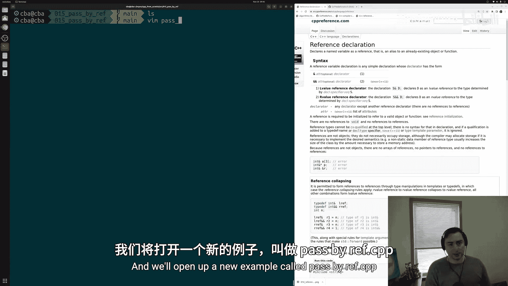
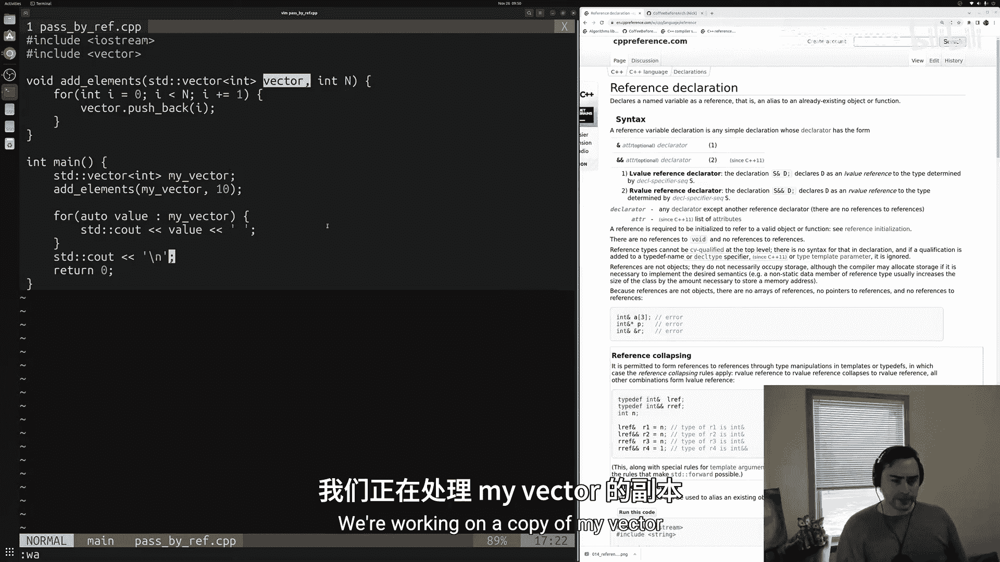
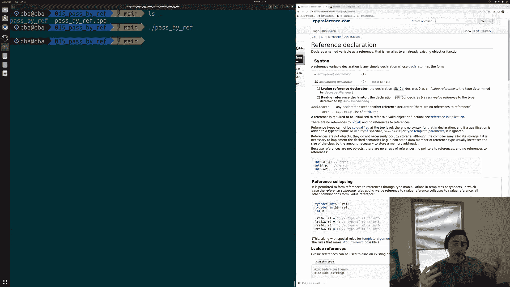
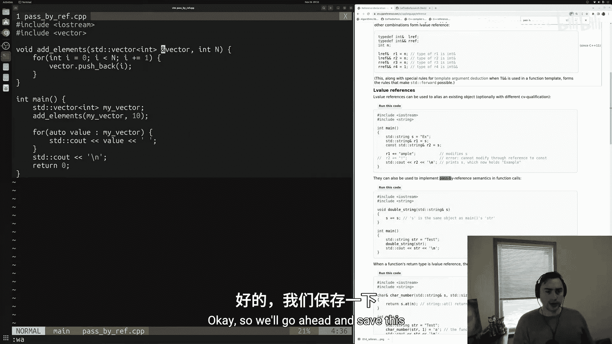
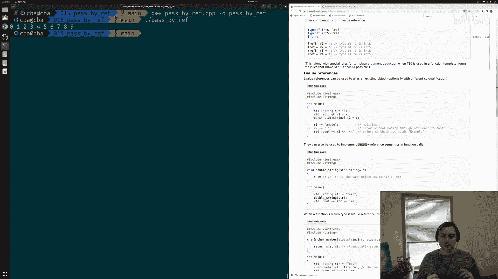
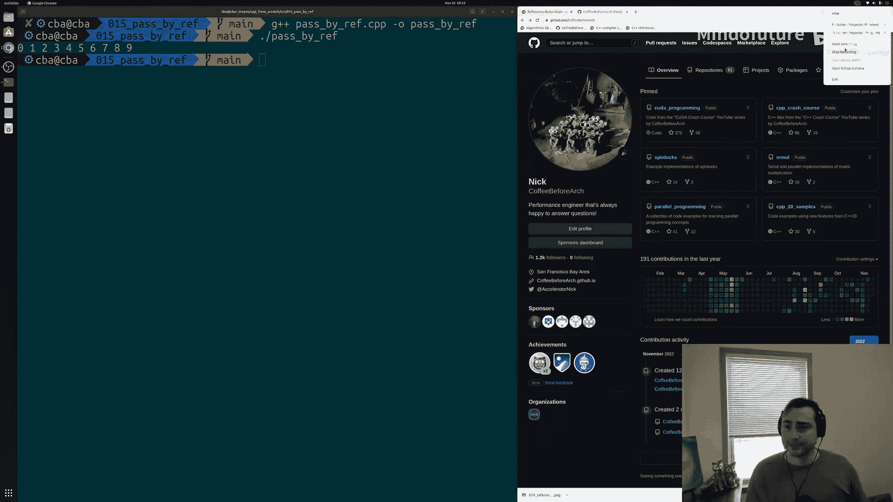

# C++入门教程｜CoffeeBeforeArch-p16-P16-Pass-by-Reference--BV1nbRUYSEUu_p16-

Hey everyone， I'm Nick and this is C++ from scratch。

 so in this episode of the series we're going to be talking about the practical use case 4 references and that's going to be this thing called pass by Ref with our functions in C++。

So by default in C++ our functions use this thing called pass by value。

 so whenever we call a function， what happens is we copy the values from our arguments into the parameters of our function。

Now we might not want to do this for a number of reasons。

 and that might be either for some functional reason， like we have a lock or some performance reason。

 like we have you know some large vector of integers that we don't necessarily want to perform a copy on right we just want to use our vector directly instead of making a copy。

So that's what we're going to be looking at today， kind of the basics of how we use references with our functions with this thing called pass by Ref。

So let's go ahead and get started and we'll open up a new example called pass by reff。

cppP and inside of here， we'll include a couple things to start off with。

 we'll include io streamams so we can do some printing and we'll also play around with our stood vector today。

 so we'll include vector as well。

Now let's say we have a function we want to implement。

 let's say you take some student vector of integers and pushes back in elements into this vector。

 so let's go ahead and kind of sketch out what that function is going to look like。

So we'll go ahead and make it avoid function and or avoid return type for this function。

 and we'll call it an elements。And it will take some stood vector。

Of integers that we can call vector and some number of elements in right that we're going to push back into this vector。

Then we can just do a simple for loop here and push back elements into vector。

So we'll do something like  four in to I is equal to 0。

 I is less than n I plus plus or I plus equals 1， either works。

And then we'll just do vector dot push back I。 So we're just going to add the elements of 0 to n-1 into this vector。

 right， So in， so in this case， right， maybe we'll call add elements with some vector and the number 10。

 So we should add the elements 0 through 9 into our vector。Okay。

 so now that we have that set up let's kind of play around with it and call it。

 so we'll start by creating a main function here， core of our C++ programs。

And we'll create a vector as well， so we'll create a st vector of integers that we'll just call my vector。

So not initializing it or anything， we just have an empty vector here。

So then let's call add elements， and we'll pass our my vector。And we'll just pass the number 10。

 right， so we're going to push back 10 elements into this vector 0 through9。

Then to see what happened with our vector， after we call this function。

 we can go ahead and do a simple for loop to print out the contents of my vector。

So maybe be something like for auto。Value in my vector。 So we're doing a range based for loop。

We can do stood sea out whatever the value is， followed by space。And then a new line character here。

Okay， so a pretty simple program so far。 All we're doing is creating a vector。

 calling our add elements function to push back 10 elements into my vector and then printing out the contents。

 But what do we exactly expect to get printed out down here。 Now， like I said earlier。

 bind default and C plus plus functions operate with its idea of pass by value。

 So when we copy it or when we call a function like this。

 What happens is we copy the values from our arguments into the parameters of our function。

 So what we're working on inside of our function here。 It't my vector。

 It's the value we copied from my vector right when we called add elements Likewise， we're not you。

Modifying this immediate value 10 right inside of our program。

 We just copied this value 10 into this integer in here。

 So we're working on a completely new vector of integers and a completely new integer in here inside of our function。

 right， We're not directly working on either of these arguments。So after this function runs。

 what we'll see is that my vector actually hasn't been updated at all because we're not working on my vector inside of add elements yet。

 All that's happened is we've copied the value of my vector into this function because by default and C plus plus functions operate with pass by value。

 we copy the values from our arguments to our function and we operate on those copies instead。Okay。

 so let's go ahead and you know save this and we'll go ahead and compile it and see what we get printed out。

 and we should really expect nothing to be printed out except for a new line character。

 We're not modifying my vector directly。 We're working on a copy of my vector。

So we'll save this and then we'll go ahead and compile pass by ref。cppP。

 and we'll create an output executable called something like pass by ref。

And we can go ahead and run this executable。 And what do we see just a new line character。

 Our vector called my vector was completely empty。 So despite the fact that we called our function and we use my vector as an argument by default and C plus plus we're using pass by value。

 So we're just copying the value of that vector rather than using it directly。

Now if we want to use say our value or our my vector directly。

 what we can instead do is do this thing called pass by reference。

 so we can make vector up here this parameter， a reference to whatever add elements is being called with and the way that we do that is very simple。

 it's just like we did when were playing around with integers and integer references in our main function in the last video。

 we just need to change the type a little bit and add an ampers sand here。

So instead of vector just being a stood vector of integers。

 now it's a reference to a stood vector of integers。

 So now vector is going to be an alias of whatever vector we're calling add elements with。

 So in this case， we're calling add elements with this vector my vector。

 So now vector is going to be a reference to my vector down here。

 So when we're doing this vector do pushback I， what we're really doing is a pushback into our my vector from our main function。

 vector isn't a copy anymore。 it's a reference to an existing vector coming from our main function in this case。

 And on the right hand side of the screen， I've got the CBP reference page for reference declaration up again。

 and you can kind of control F on this page and look up something like pass by reference。

 and you can find some examples here to try to understand this better。Okay。

 but let's go ahead and think about what our program is going to do now。

 right now that we've made vector a reference instead of just a new vector。

So we create this empty vector called my vector， then we call add elements with my vector and the number 10。

So then we're going to run add elements， and this is going to push back 10 elements into my vector this time。

 right because vector is now aliasing my vector。Then when we go ahead and do this printout of the contents of my vector。

 we should see a printout of0 through9 right， the contents of my vector right my vector is actually being updated in this case because we passed it by reference to this function。

Okay， so we'll go ahead and save this。

And we'll go ahead and recompile our application pass by Ref。 And we can go ahead and run it。

 And we see that， hey， we get 0 through 9 printed out， right。

 those in numbers that we pushed back into our vector。Okay。

 so that's going to go ahead and do it for today kind of the basics of pass by reference and how we can use it and how it differs a bit from pass by value。

 So pass by reference is one of the most common ways we see references used in C+ plus right either for functional reasons because we don't want to copy something like a lock or for performance reasons because we don't want to copy。

 say some giant vector of integers right copying a vector of 10。

000 integers is going to be pretty expensive。

But like I said， that's going to do it for today， you can find any of these examples at Github。

 co s coffeeoffee before arch， as always， I'm Nick， and I hope you have a nice day。

