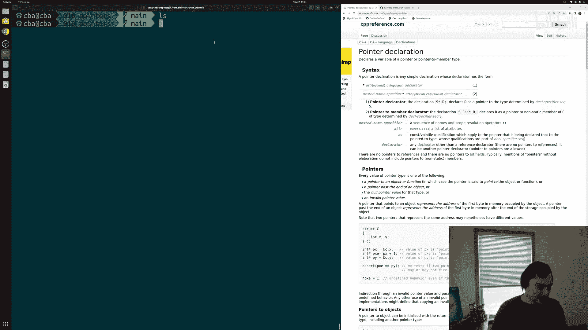
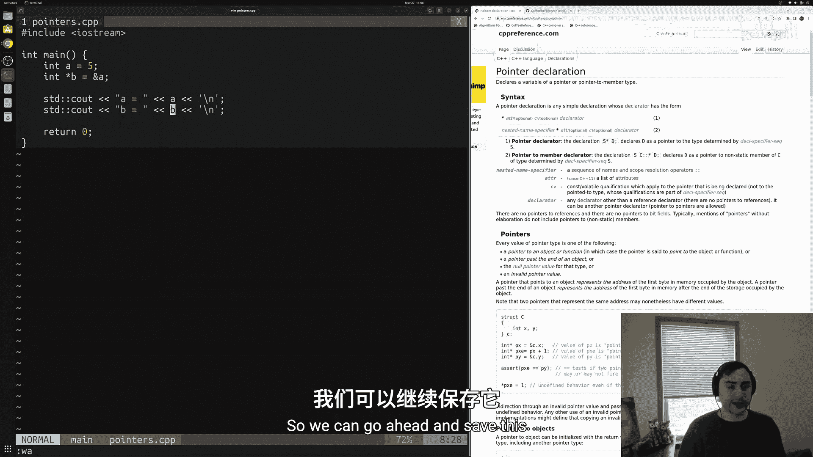
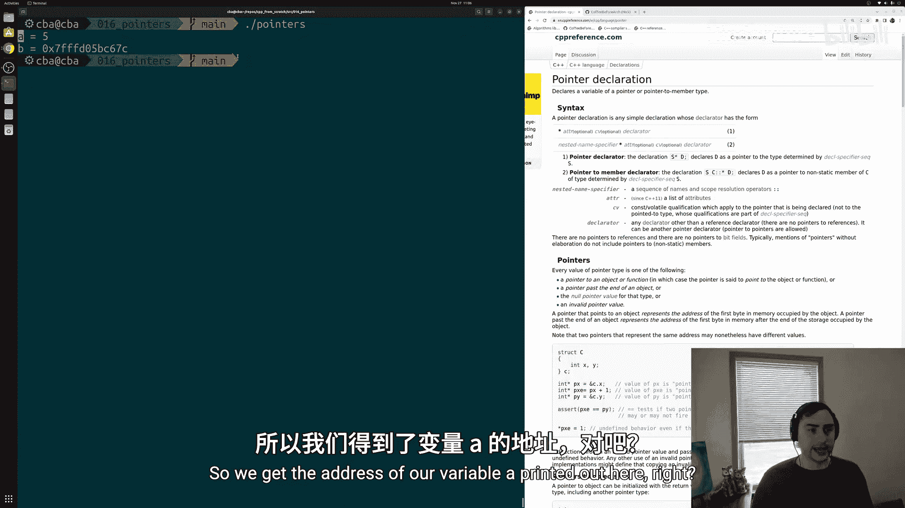
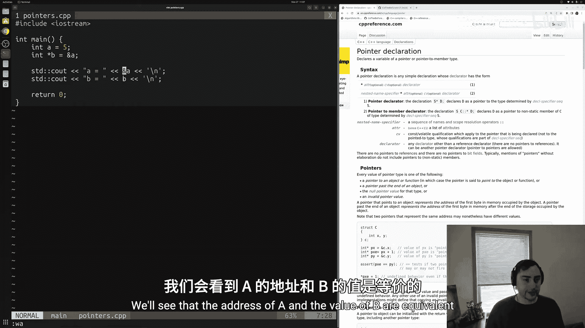
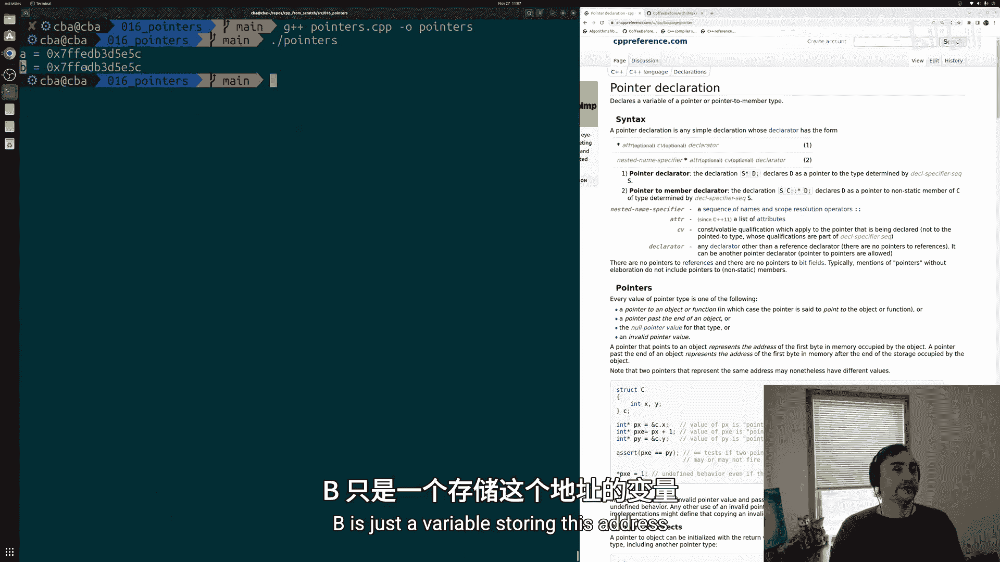
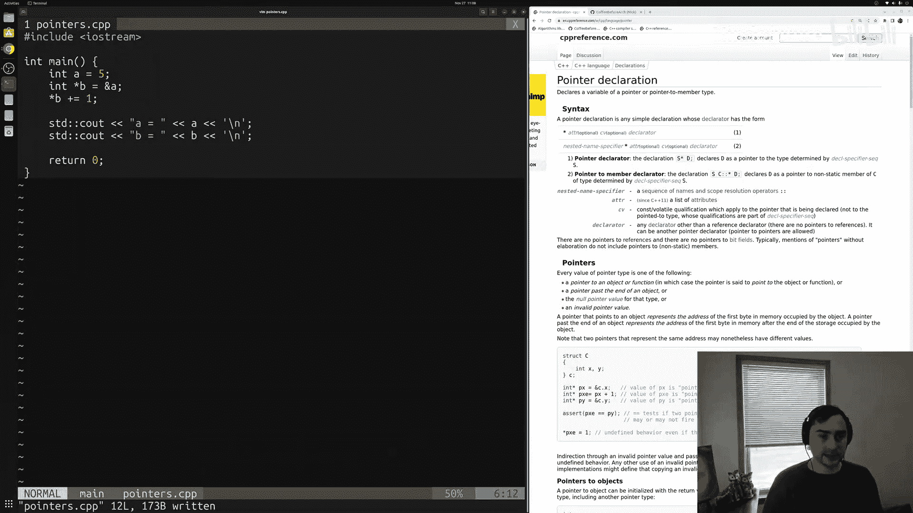
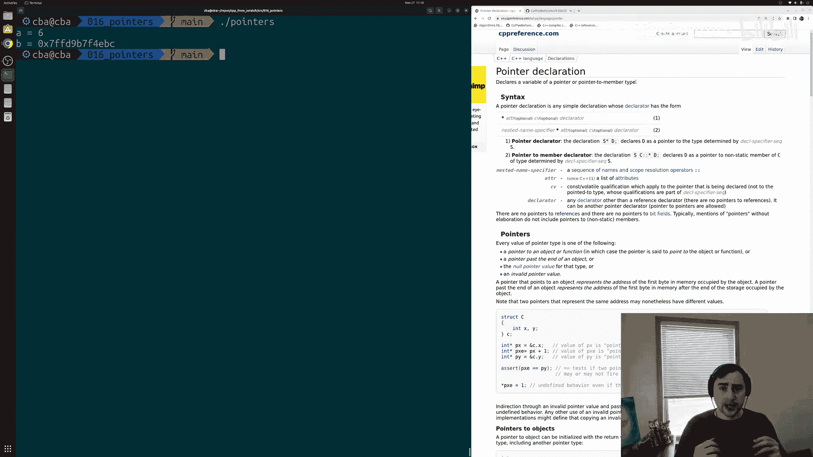
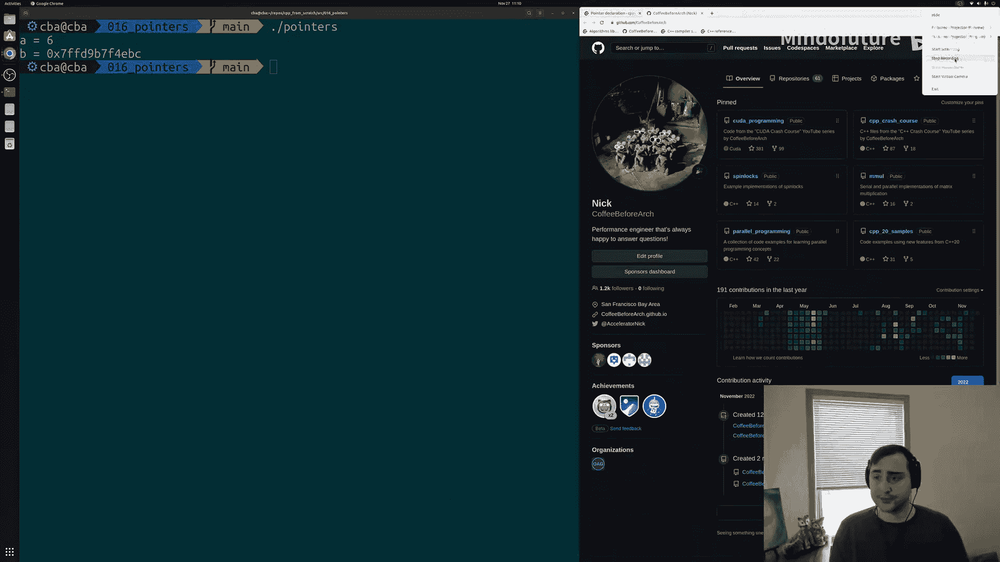

# C++入门教程｜CoffeeBeforeArch-p17-P17-Pointers--BV1nbRUYSEUu_p17-

Hey everyone， I'm Nick， and this is C++ from scratch。 So in this episode of the series。

 we're going to be talking about pointers。So in past few videos we've been looking at references and one of the things that we brought up was this ampersand or address of operator。

 and we showed how we could use this to get say the address of some variable like an integer。

Now a natural question to have is， you know， can we sort this address in some location and the answer to that question is yes。

 right， and we that we call that kind of type a pointer a pointer just stores the address。

 say of some type So for example， we can have a pointer to an integer。

 a pointer to a floating point number， a pointer to a vector and even pointers to other pointers in there's even cases where we can have more general kinds of pointers with these things called void pointers。

Now what we're going to be looking at today is kind of the basics of how we play around with this。

 you know address type， these pointers， and how we can use them and just try to understand them a little bit better。

So let's go ahead and get started and we'll open up a new example called pointers。cppP。

And inside of here， we'll go ahead and include Io streamam so we can do some printing and we'll create a main function。

Wr the core ver C++ programs。Now inside of here we can go ahead and create say some integer a and say set it equal to 5 just like we did inside of a reference example。

 and we know that we can say create a reference to a by creating some reference type。

 so integer ampersan and then we can create a reference named B and make a reference to a right so now B is a reference to a here B is an alias of a so whenever I change a or I change B。

 I'm really just changing the memory location of this variable A here。Now。

 instead of having a reference here， right， I may want to store， say the address of a。

 And the way that I can do that is by creating this pointer type here。

 So instead of this ampersand here， I'm going to have this star sign， and this is saying， you know。

 for this variable， I want the type to be a memory address to an integer。 So underneath the hood。

 B is going to store the address of an integer。 and they'll also change the right hand side here。

 So instead of storing a， which is an integer。 it needs to store a memory address。

 So we can use this ampersand or address of operator here。 So now we have a pointer to an integer B。

 that is storing the address of our integer A here。😊，Okay。

 so let's go ahead and go them here and let's print out both of these。

 So do to see out and we'll print out you know a is equal to， we'll print out the value of a。

 which is an integer 5。I'll print out a new line character。

 and then we'll do the exact same thing with B as well。But B， in this case is not an integer。

 It's a pointer to an integer。 It's a memory location。 So when we print out the value of B here。

We're going to see an address， right， because again， B has the type of a pointer。

 It's pointing to an anteger。 It's during the address of an antigenteger here。

 So we'll see the address of a get printed out when we do this。 So we can go ahead and save this。

 We can compile pointers CBP call the output executable， say pointers。

And when we go ahead and run this， we can see that A is an integer。

 So we get an integer printed out here 5。 and then B is our pointer。 right。

 It's storing a memory address。 So we get the address of our variable a printed out here。

 because inside of our program， we said we wanted to store inside of a pointer， the address of a。

 So in fact， if we go ahead and just print out the address of a instead of the value of a here。

We will see that the address of A and the value of B are equivalent。

 B is just storing the address of A。

So let's go ahead and make that change， recompile a program and run it。

 and we see that the address of a and the value of B are identical right B is just a variable storing this address。

Okay， now a useful thing to do with pointers is of course， to access the value beneath them。

 very similar to how we want to access the value underneath iterators。

 so you'll see a decent amount of parallel between iterators and pointers here。

So in order to access the value right beneath the pointer。

 we want to dereference it and we do that with the star operator。

So to say access the value being pointed to by B。So B。

 in this case is storing the address of an integer。 If you wanted to access the integer。

 add that memory address， we would use this star sign， so we would say star sign B。

 or we would dereence our pointer B。 and then we can play around with this integer stored at this memory location。

 So I can do say you D reference B plus equals1 here。 So what are we actually doing here。 Well。

 we're setting a equal to5 here。 So some integer A setting equal to the value 5。

Then restoring the address of a inside of B。 So we have the memory address of A saved inside as variable B。

 and then I'm changing A here through B， right， So B is storing the location of a。

 and then I'm changing that integer A through that memory address and adding one to it。

 So if I go ahead and print out a in this case right down here， I should see 6 now。

 because we're updating that integer at the location of a。 So we're updating a。😊。

So let's go ahead and save this and we can go ahead and recompile pointers。

cbP and we can run it so you can see that through the address of a。

 we were able to modify the value of a right through that dereence operator so we access the integer stored at this memory location。

 so that's where a is stored and we updated it by incrementing it by one。

 so we were able to change a through this pointer。

Okay， so that's a little bit on the basics of pointers。

 I'll go ahead and link down this page from CPP reference all about pointer declaration below the video。

 as you can see there's quite a lot of information to get through here pointers to functions。

 pointers to avoid pointers to objects etc ce， etc ce。

 I will of course have to do a bit of a caveat here and say that oftentimes in C plus plus we don't like using raw pointers。

 but I think it's important to kind of introduce the concept that way makes it easier to discuss。

 say the alternatives we have to raw pointers。 and we're talking about raw pointers we're talking about things like this。

 this integer pointer things where we're just storing raw memory addresses， say inside of variables。

 So I think it's important to kind of understand what pointers are before we start talking about some of their safer alternatives。

 but that's gonna go ahead and do it for today you can of course find any of these examples at github do co slashco before arch but as always I'm Nick and I hope you have a nice day。

