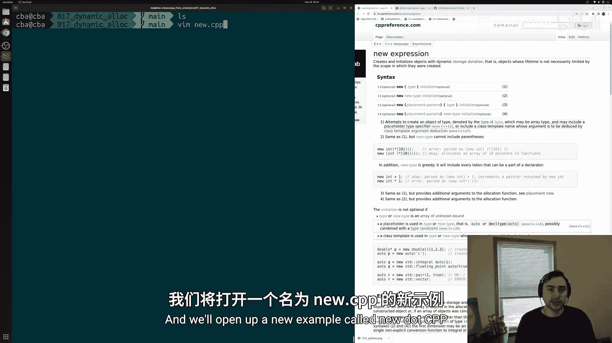
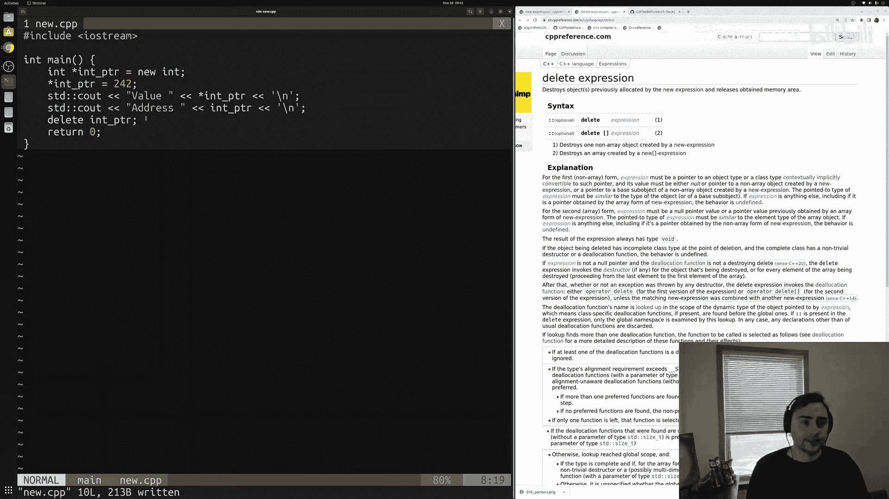
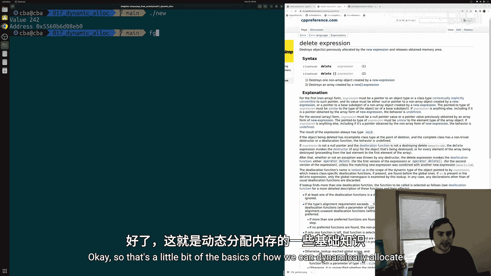
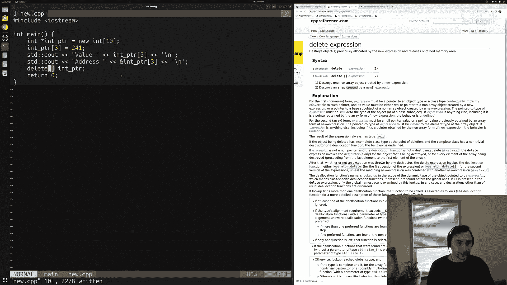
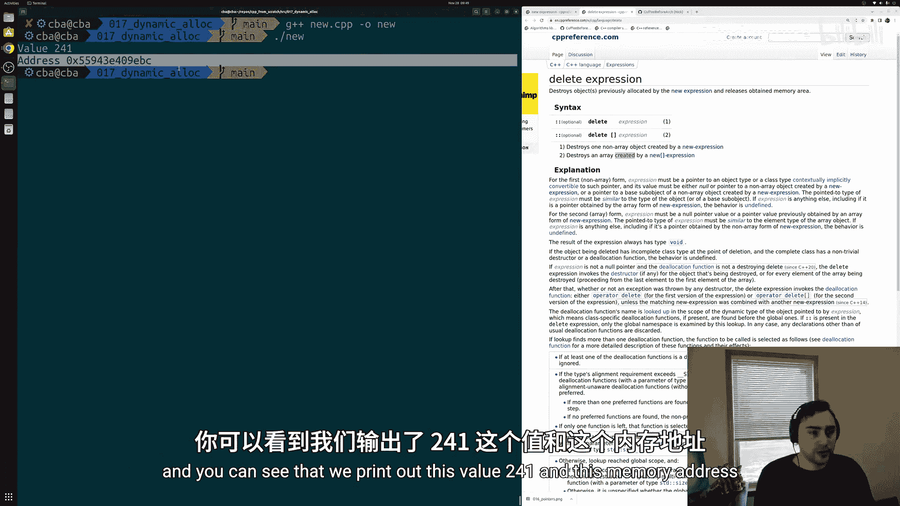
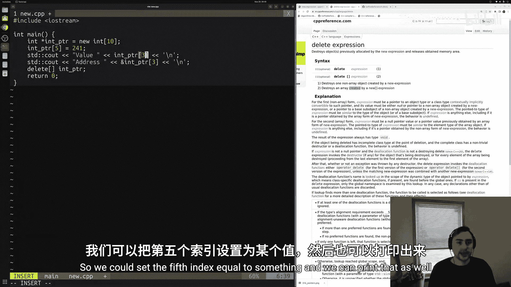
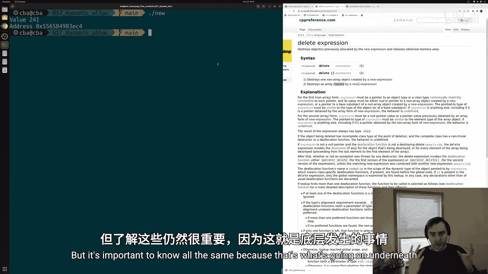
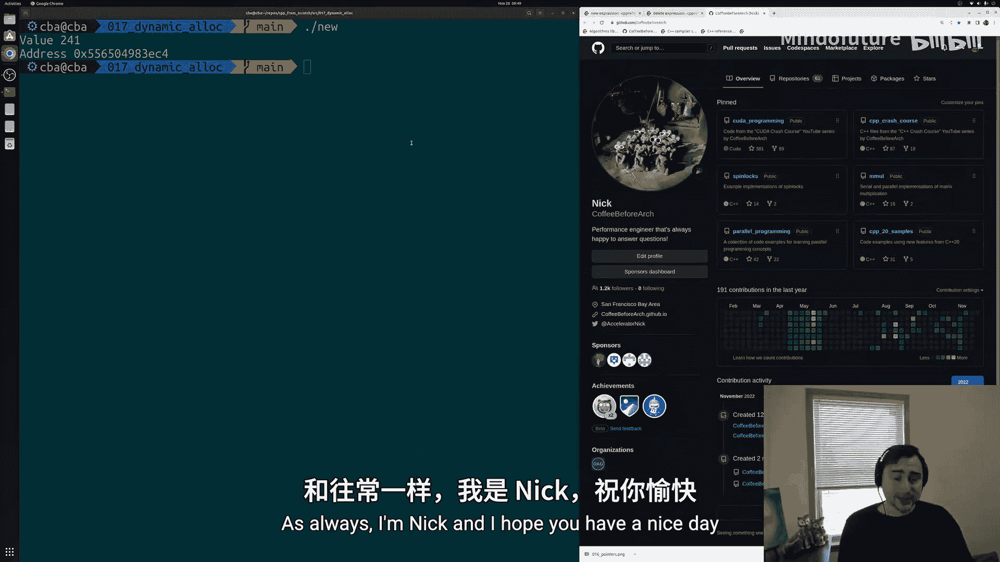

# C++入门教程｜CoffeeBeforeArch-p18-P18-Dynamic-Allocation--BV1nbRUYSEUu_p18-

Hey， everyone， I'm Nick， and this is C Plus Plus from scratch。 So in this episode of series。

 we're going to be talking about dynamic allocation。

So there's oftentimes inside programs where we want to preserve some memory at runtime。

 and we've already seen one example of this with our standard template library containers。

 specifically our stood vector， so for the stood vector we could just push back elements inside of our vector and our vector would take care of the allocation of memory for us as well as the freeing of memory after we're done with it。

Now I think it's important that we understand kind of the basics of what's going on underneath the hood there。

 it's also there's also some situations where we need to manually manage memory。

 so we need to know a bit about allocation and free。

So what we're going to be looking at today is one of the ways that we do that in C++。

 and that's going to be with our new expression and our delete expression for allocating memory and freeing memory respectively。

So let's go ahead and get started and we'll open up a new example called New docppP。

And inside of here， we can just go ahead and start off by including Iostream so we can do some printing and writing a simple main function here。

 core of our C plus+ programs。Now， in the last video， we looked at the basics of pointers。

 pointers we could use to store the address right of a piece of memory。Now。

 our new expression here that we use to allocate memory。 What that will return is a pointer。

 It returns a pointer to the piece of memory that we just allocated。 So， for example。

 if we're allocating space for an integer， it will return integer pointer。

 So let's go ahead and see how that works。 So here we'll go ahead and create some integer pointer that we'll just call in pointer abbreviating pointer to Pr instead set it equal to our new expression here。

 So we'll just set it equal to new。😊，So what this is doing here is requesting space for a single integer。

 then we'll allocate space for that integer and return the address of that integer and store that an end pointer。

 so in pointer is going to contain the address of the integer that we just allocated。Now。

 after we've allocated this integer， we can play around with it just like we could。

 any other integer that we have allocated。So for example。

 we can set the contents by dereferencing this pointer so we can say， you know。

 dereference in pointer equal to 242， right， And then from here we can print out， say， you know。

 this 242 value of this integer， as well as the address。 So where is this integer located。

So we can do something like St sea out。You can print out value。

And will print out the dereference pointer and pointer。Called by new line character。

And then we'll do the same thing for address。But we'll just get rid of this de reference。

 So we can just print out where that integer is located at right that's being stored by this in pointer variable。

Now， one thing that's important to do whenever we have say dynamically allocated memory and we're managing it ourselves is we have to make sure to free our memory when we're done with it。

 and we do that with our delete expression here。So the basic way that we use is delete expression is we just。

 you know called delete。 and then we pass our pointer to our allocated piece of memory。

 So here we just pass int pointer to free up that memory。 Now。

 why is it important that we free our memory after we're done with it。 Well。

 if we just have a program that allocates memory and allocates memory and just keeps allocating memory and never frameing it。

Eventually， we're going to run out of memory or computer simply finite amount of memory。

 So we'll end up hittingtting something like an out of memory error。

 So that's why it's important that we free memory after we're done with it。

 And this is also a good motivating reason about why we often use things like stood vector with something like stood vector。

 We don't have to worry about freeing memory， right， or even allocating memory。

 that all gets taken care of underneath the hood for us。

 We never have to manually free the memory of our stood vector。😊。

Okay， so now that we have this simple example， let's just go ahead and save this。

 We can compile new do cP call our output executable new， and we can go ahead and run it。

 and you can see that our integer that we dynamically allocated。 we set the contents is equal to 242。

 and it's located at this address the0 x 5，5，60， blah， blah， blah Okay。

 so that's a little bit of the basics of how we can dynamically allocate memory。

 but it doesn't just stop there。 we can also allocate an array of element similar to what our vector does。

 So oftentimes we want to allocate more than just a single integer。

 maybe want allocate space for10 integers。 and the way that we do that。

E is just with these square brackets， so instead of saying I want a new integer。

 we can say I want a new array of say，10 integers here。So now， instead of this pointer。

 just pointing to a single integer that we have allocated。

 Now it's pointing to the first element of an array of 10 integers that we have allocated。

 So we've allocated 10 integers here instead of just a single integer。Now。

 if we just do something like dereference our pointer and set it equal to some value。

 what we're really just doing is setting the first element in this array equal to some value。

 So this dereence end pointer equals 242 is the exact same thing as this end pointer 0 and this indexing operator。

0 equals 242， Those two things are equivalent。So we can set more than just the first element so we can say so the fifth element。

 the sixth element， know the third element， et cetera， equal to some value right。

 so maybe 241 in this case。Now we can also say， you know， print out the value of this third element。

And we can also print out the address of this element， so we can。Use the address of operator。

For our intpointers third element here。Right so here we're indexing into in pointer to printed the third element。

 and then we're taking the address of that third element and we're printing out there。Now。

 one final thing to note here before we go ahead and compile this is we've changed our new operator here to allocate。

 say， 10 elements instead of a single element。 but we haven't updated delete yet。

 So that's another thing that we're going to have to need to manage。

So you can see that we have the different syntax。For delete here。

 for array elements created by these new bracket expressions。

 So we use this normal delete where we just pass a pointer。

 if we want to delete one non array object， and then we use this one with brackets here。

 If we want to delete an array created by this new bracket expression。 So if we just call。

 say delete on endpointer， All all we're going to be doing is freeing up that first integer。

 not the entire array。 So if we want to free the entire array。

 we have to use this delete square brackets here。 and that will free up all 10 integers that we've allocated here。

😊。

Okay， so let's go ahead and save this and we can go ahead and compile new do cP and run new and you can see that we print out this value 241 and this memory address。

 we can also play around and you know set different values here so we could set the fifth index equal to something and we can print that as well so we can save this recompile it and run it right。

 and we'll just set a different piece of memory right equal to that value。

Okay， so that's a bit of the basics on how we allocate memory and free memory and C+ plus。

 Like I said， in many cases， we prefer to use things like standard template library containers that manage our memory for us so we don't have to worry about you know freeing our memory after we're done with it。

 but it's important to know all the same because that's what's going on underneath the hood。

So that's going to go ahead and into it for today， as always you can find any of these examples at github。

com scobe arch， as always， I'm Nick， and I hope you have a nice day。

