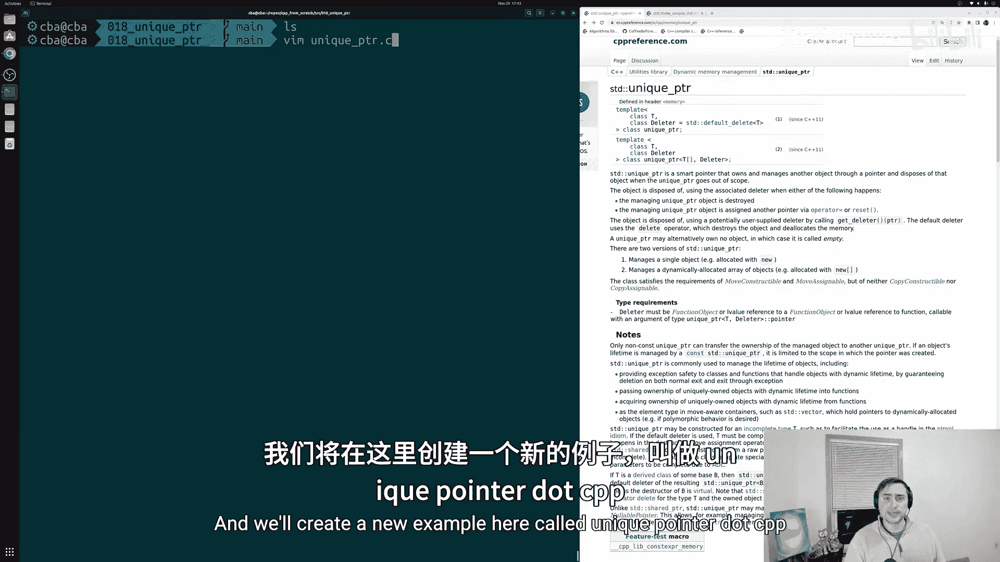
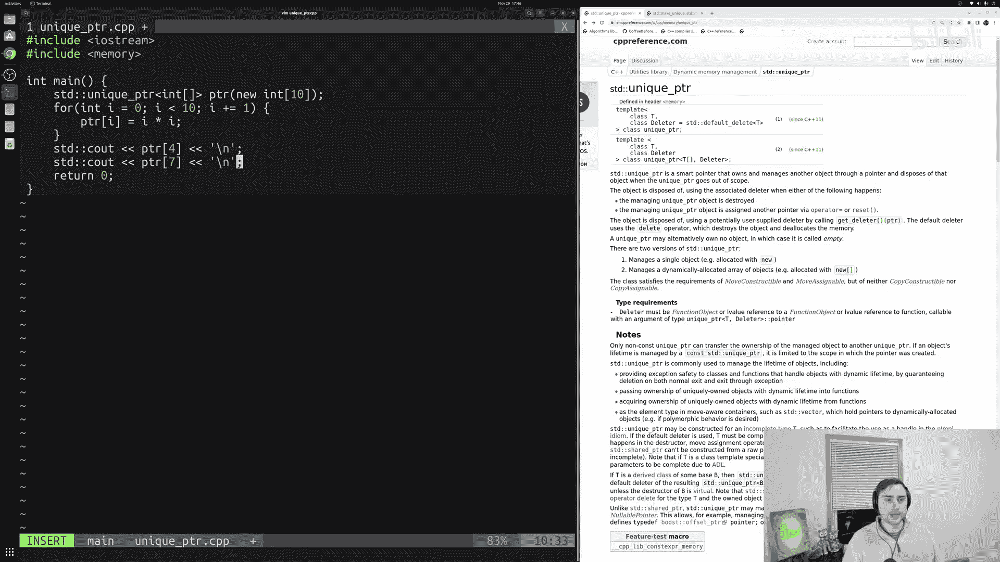
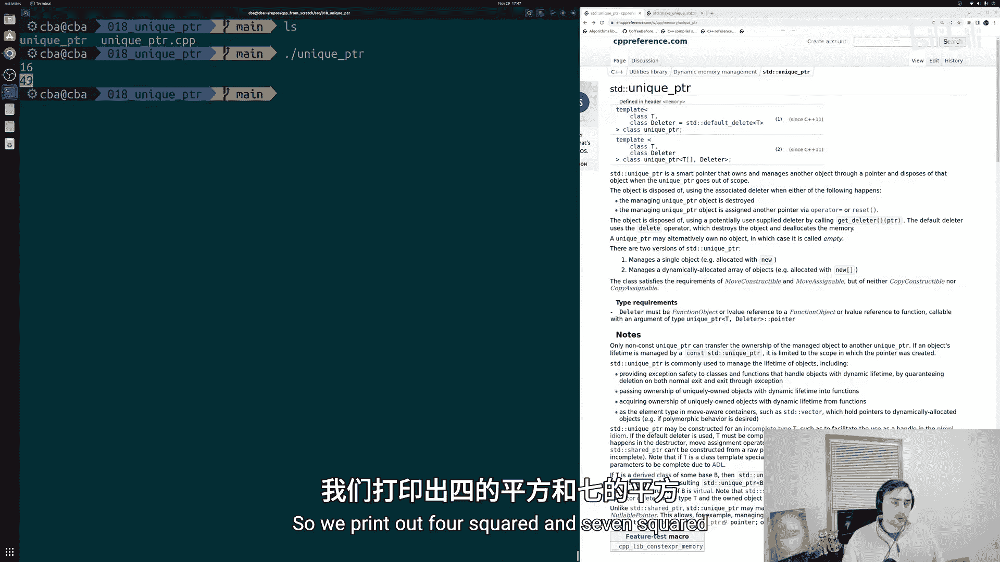
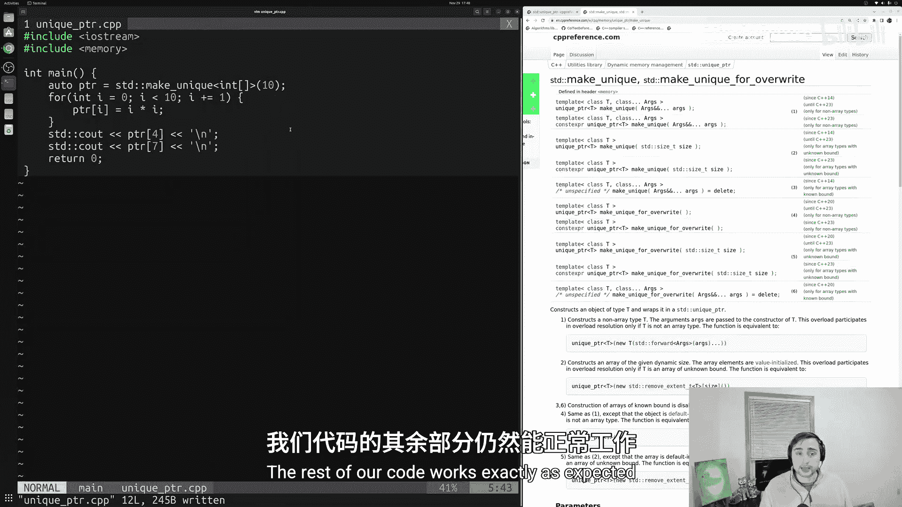
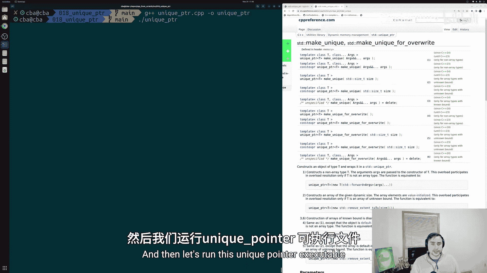
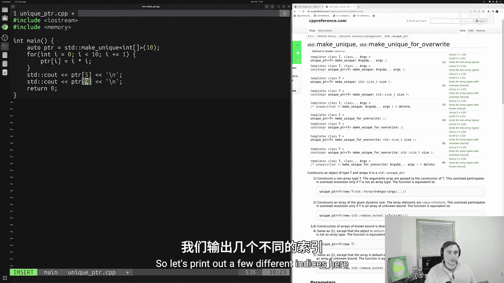
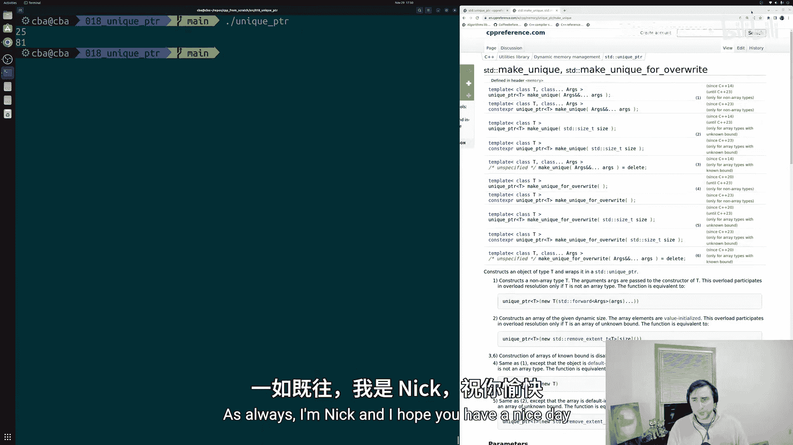

# C++入门教程｜CoffeeBeforeArch-p19-P19-std----unique_ptr--BV1nbRUYSEUu_p19-

Hey， everyone， I'm Nick， and this is C plus Plus from scratch。 So in this episode of the series。

 we're going to be talking about one of our smart pointers in C plus plus。

 and that's going to be the stood unique pointer。So in our last video we looked at the basics of dynamic allocation and in that video we were using these raw pointers now raw pointers are something that we often discourage the use of in modern C++ and there are a few good reasons for this。

So one of the reasons is that our raw pointer as a type isn't all that expressive。 So， for example。

 if we have， say an end pointer， we don't know if it's pointing to say。

 a single element or an array of say 10 or 100 elements。 that's not expressed by the type。

Now another reason why we often like to avoid raw pointers is that we have no safety when it comes to the freeing of our memory with raw pointers。

 So for example， if I dynamically allocate a memory using new and store that pointer inside of a raw pointer。

 I have no guarantee that that memory is going to be free later on in our program right unless I manually write delete somewhere。

Now， this can be a pretty big problem， right， If we have a program that forgets to write this delete。

 we might be allocating and allocating and allocating memory and never freeing it。

 And this can lead to things like out of memory errors inside of our programme。

Now we have a few different ways in C++ that we can try to tackle this problem。

 so one of the ways is of course using our STL container。

 so something like stood vector Ve will take care of the allocation for us as well as the freeing of memory when our vector goes out of scope。

And another way that we have to kind of tackle this problem of raw pointers is with our smart pointers。

 so something like stood unique pointer here。So if we go ahead and look at CPP reference on the right hand side of the screen。

 we can see this description of such unique pointer and that it's a smart pointer that owns and manages another object through a pointer and disposes of that object when the unique pointer goes at a scope so we can basically tell our unique pointer。

To， know go ahead and manage some dynamic piece of dynamic allocation that we've made。

 And our unique pointer will then be responsible for freeing that memory when we're done with it or basically when this unique pointer goes out of scope。

 right We don't have to manually write， delete anywhere anymore more。

 We've shifted that responsibility over to this unique pointer， which is pretty nice。

 So that's what we're going playing around with today。

 kind of the basics of creating these unique pointers and playing around with them。

So let's go ahead and get started here。And we'll create a new example here called unique pointer do cP。

 And inside of here we'll include a couple headers。

 So we'll go ahead and include our Io stream header so we can do some printing。

 and then we'll also include this memory header。 So if we go ahead and look at the top part of CP reference over here。

 you can see that stood unique pointer is defined in the header memory。

 So we'll have to include that。

And then let's also go ahead and write our main function， the core of our C++ programs。Okay。

 so let's go ahead and dynamically allocate a memory。

 but instead of storing that pointer instead of just raw pointer。

 let's go ahead and give it off to our unique pointer so that it can manage it。

So let's go ahead and dynamically allocate， say an array of 10 antigentegers here。

So let's go ahead and make a stood unique。Pointer。And then as the templateular parameter here。

 we're going to specify the type that this unique pointer is going to manage。 So in this case。

 because it's an array of integers here， we'll pass at this integer array type。 If。

 if it was just a pointer to a single integer that we wanted it to manage。

 it would just be this int type。 But in this case， because we want an array of integers。

 it'll be this integer array type。Okay， so from there we can go ahead and just give her variable in names of something like pointer。

 and then we'll pass a pointer here， the pointer that we want our unique pointer to manage。

 So let's go ahead and do a dynamic allocation right in these prints so we can say new int10 here。

 brackets 10。So inside of these prints， we're dynamically allocating an array of 10 integer。

 but we're passing it off to our unique pointer so that our unique pointer is responsible for this array's lifetime。

 So when this unique pointer goes out of scope， it'll go ahead and free this memory for us。

 We don't have to write delete anywhere inside of her program， which is pretty nice。😊。

And that's really all it takes to create this unique pointer。So from here。

 we can use this pointer much the same way as we could。 You know， just a raw pointer。 So。

 for example， we can just index into it。 So let's just create a simple for loop here。

 So we'll say for in I equals 0。 I less than 10。 The number of elements inside of our dynamically allocated array。

And then I plus equals 1。 We'll go ahead and fill the contents of this array。

 So we'll say pointer of I is equal to I times I。 So we'll just fill it with some squares here。

 So 0 squared，1 squared，2 squared all the way up to 9 squared。 So for a 10 total elements。

And then we can go ahead and say just print out a couple of these values so we can say do stood C out for。

 you know， pointer of4。And then we'll go ahead and maybe do the same thing。For another index here。

 so maybe pointer of7。

Okay， so let's go ahead and save this compile it and we can go ahead and run it。

So we'll go ahead and minimize this， We'll use G plus plus on Uni pointer。 CBP。

 anchor an output excutable that we'll just call something like unique pointer。

Then from there we have our executable up here， let's go ahead and run it。

And you can see we print out a few squares that were in that dynamically allocated array。

 so you print out four squared and 7 squared， so 16 and 49 respectively。

Okay， so that's a bit of the basics and one way that we can create a unique pointer。

 Another way that we can create a unique pointer that completely gets rid of this call to new is with this stood make unique that we can use。

 So let's go ahead and see how we can use that interface。So here。

 instead of defining our type to be a stood unique pointer， let's just use automatic type deduction。

So we'll say auto pointer。Is equal to stood， make unique。

So we're going to make a unique pointer here。That's going to manage the type of an integer array。

And then what we're going to pass as an argument is the number of elements here。

 say inside of this array。 So in this case， we'll go ahead and say put tin here。

 So this is going to return back to us a unique pointer that dynamically allocate space for 10 integers here。

 right So we completely gotten rid of， you know， a call to new altogether。 Instead。

 we're just using stood make unique here。 And that's really the only thing that we have to change here。

 right， The rest of our code works exactly as expected。

So we can go ahead and save this。 We can recompile our program。

 So G plus plus on unique pointer do CPP。And then let's run this unique pointer executable。 Again。

 we see R 16 and 49。 maybe let's just have some fun here and change up these values。

 So let's print out a few different indices here。 So 5 and 9。😊。

Three compiled real quick and run it and see now we're printing out five squared and9 square。

 so 25 and 81。Okay， so that's a little bit of the basics of this you stood unique pointer and how we can use this stood make unique to create these unique pointers and how we can use them instead of raw pointers and how they you know help us out a bit with this management of this memory lifetimes。

Now， there's a lot more that we can talk about with unique pointer。

 So if we go ahead and go down here to say the member functions that unique pointer has。

 it's quite a bit more detailed than say， just a raw pointer here。 So with our unique pointers。

 we can say。You know， call things like release to return a pointer to the manage object and release ownership so we can tell our unique pointer we don't want you to manage whatever you have at this moment and we can just get a pointer back to it。

We can also replace what our unique pointer is managing using reset and even swap it using this swap。

 we can also just get a pointer to the manage object using this using this get method or member function over here。

 So there's a lot more inside of this CPP reference that you can take a look at and I'll link that below the video as well as this documentation for this StMakeake unique but like I said。

 that's going to go and do it for this time， you can find this or any of my other examples at github do co slash coffee before arch。

 but that's going to go and do it for today as always I'm Nick and I hope you have a nice day。

