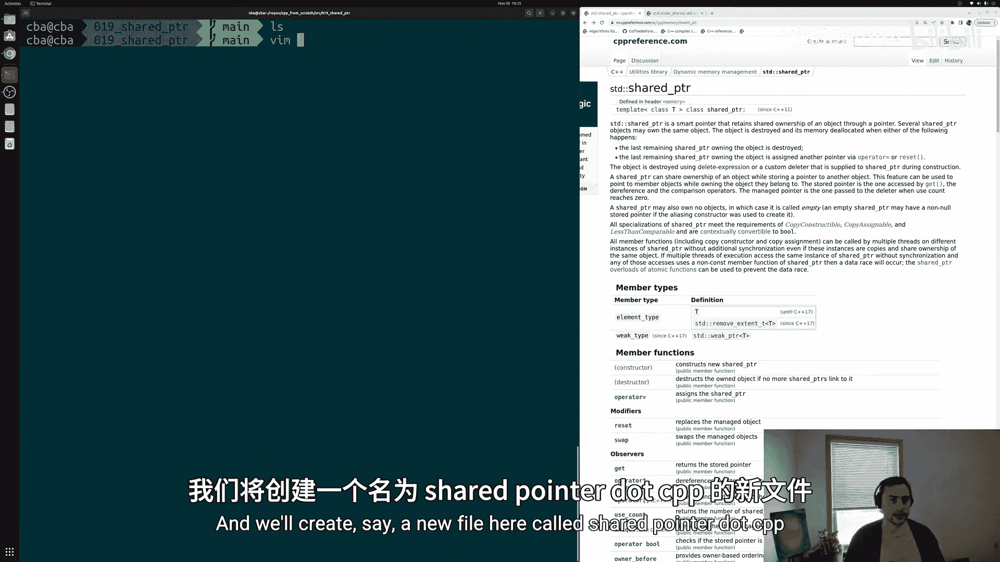
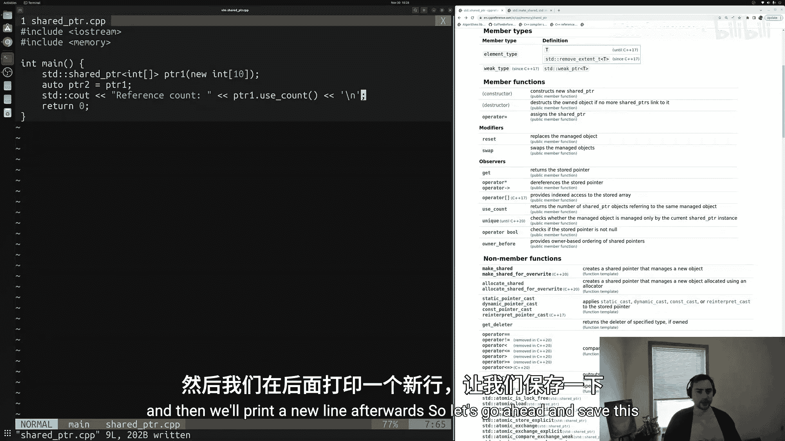
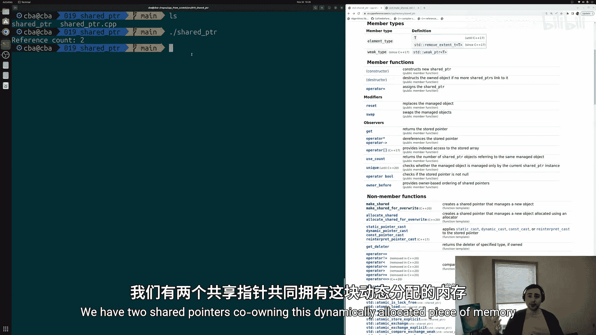
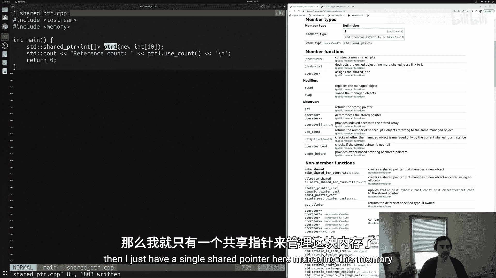
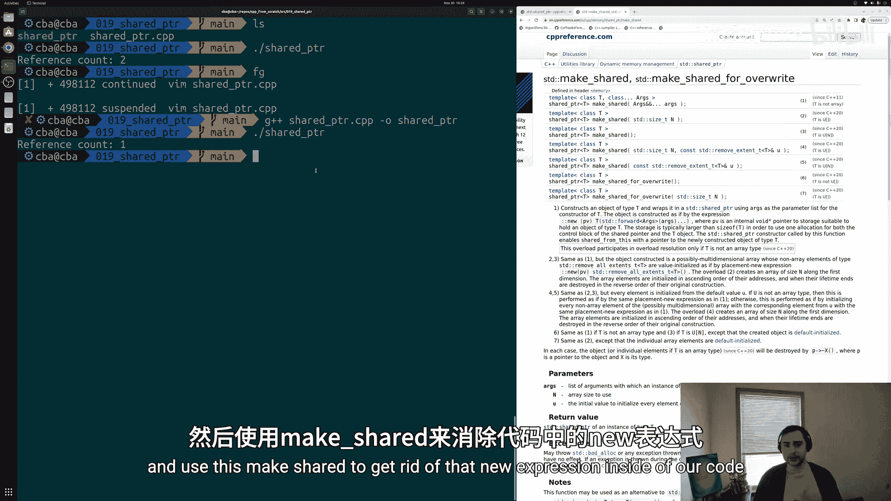
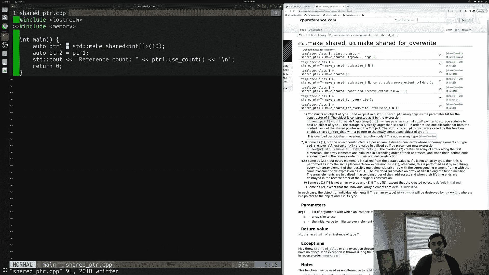
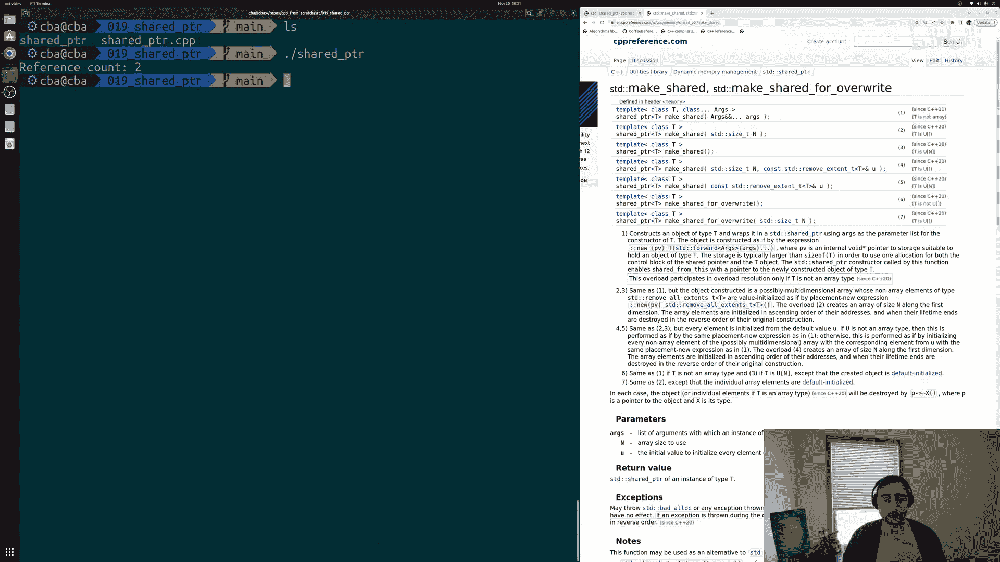
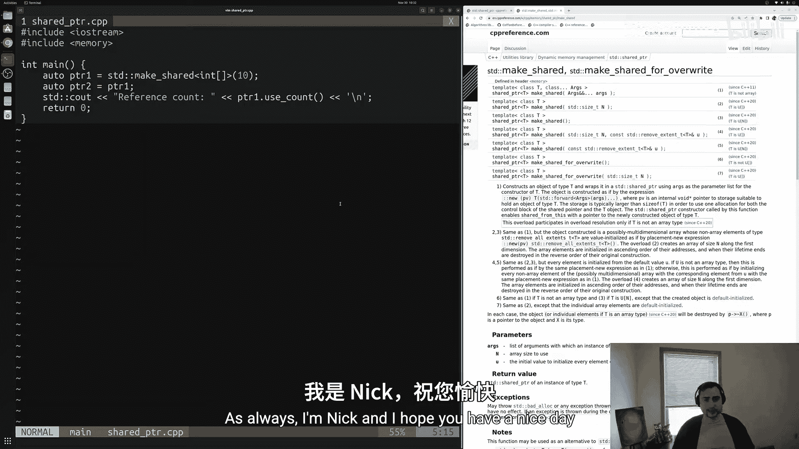

# C++入门教程｜CoffeeBeforeArch-p20-P20-std----shared_ptr--BV1nbRUYSEUu_p20-

Hey everyone， I'm Nick and this is C++ from scratch， So in the episode of this series。

 we're going to be talking about another one of our smart pointers in C++。

 and that's going to be our stood shared pointer。So in our last video。

 we looked at our stood unique pointer and we used this for unique ownership of some， say。

 dynamically allocated piece of memory or some object。Now， the nice thing about using。

 say a smart pointer like this was that we didn't have to worry about freeing this memory when we were done with it。

 when we were done with our shared pointer and say it went out of scope。

 it automatically freed our memory for us。 But one of the things we often want to do inside of our programs is have multiple pointers to the same piece of memory。

 So we want to have kind of shared ownership over some object。

 And we want to make sure that that object say isn't freed until we're completely done with it。

 So there are no more references to this object。😊，Now we can't use a unique pointer for that because that's for unique ownership。

 It's kind of managing this memory's lifetime on its own。

 And we don't have to resort to something like raw pointers right。

 Then we have kind of no guarantee that that memory will get freed。

 So one of the things we can use in modern C+ plus for this。 is our stood shared pointer。

 and our stood shared pointer is for this kind of co-own of some resource。

 So we can see here on the right hand side of the screen。 the CPP reference for shared pointer。

 It says stood shared pointer is a smart pointer that retains shared ownership of an object through a pointer and that several shared pointers。

 shared pointer objects may own the same object。So with our shared pointer we have this kind of guarantee that our memory is not going to be freed or deleted until there are no more references to that memory。

 so until that last shared pointer say goes out of scope or decides to release。

 say what it's owning that memory is going to stick around right it can't be deleted by someone else。

Okay， so that's what we're going to be looking at today。

 kind of the basics of creating and using these shared pointers and playing around with them。

 So let's go ahead and get started and we'll create， say， a new file here called Sha pointer do CBP。

Inside of here well include a couple things， so we'll include io streams， we can do some printing。

 and then we'll also include memory again， right， So just like our stood unique pointer。

 our stood shared pointer is defined in the header memory。And then after this， we can， of course。

 create our main function。So let's say we want to kind of co manage some dynamically allocated array of integers。

 just a simple example here。 So one way we could create this with a shared pointer is just by creating a type。

 write this stood shared pointer type。Let's say we want it to manage， say， an array of integers here。

 So very much the same syntax as a unique pointer Just swapping it out with shared pointer。

We can create a variable name， say pointer  one in this case。

 And we can pass that the pointer to the object we want the shared pointer to manage。

 So say an allocation for 10 integers here。 So we'll just do new and 10， right。

 So this dynamically allocated array of 10 integers。

 And that's all we need to do to create a shared pointer。 So we've dynamically allocated some memory。

 And we're asking our shared pointer to manage it or co manage it with other shared pointers。

So unlike our unique pointer， we can create a shared pointer to the same piece of memory so I can do something like auto pointer 2 is equal to pointer 1 right So now I have two shared pointers to the same piece of memory。

 I have two references to this array of 10 integers that we've dynamically allocated。

 So this is something we can't do with unique pointer because unique pointer is for solo ownership of say some resource。

 but our shared pointer， we can have multiple pointers to the same resource and they'll comanage it。

So this array of 10 integers will only get freed， right。

 or deleted when both of these shared pointers kind of go at a scope or release this memory。

 but not until then。Okay， so we've talked to decent a bit about。

 you know how we have multiple shared pointers kind of co-owning things and as part of the member functions for our shared pointer。

 we can even see a use count so we can keep track of you know the number of shared pointer objects referring to the same managed objects。

 So in this case， right we have two shared pointers co-owning this array of 10 integers that we've dynamically allocated。

So we can go ahead and print out that use count and we should see two。

So we can go ahead and do stood， see out， and then we can print out， say， reference count。

And then we'll print out either pointer one。Or pointer2， it really doesn't matter in this case。

 The both will give us the same value。 So we'll just print out a pointer1 dot use count to see how many shared pointers there are co managing this resource。

And then we'll print a new line afterwards。So let's go ahead and save this and we can compile this with G++。

 we can color output executable something like Sha pointer。

And then let's go ahead and run our executable here。

 And we can see that the reference count here is two， right。

 We have two shared pointers co owning this dynamically allocated piece of memory。

 And if I were to get rid of， say this， you know， pointer2 right here。

 then I just have a single shared pointer here managing this memory。

So I can go ahead and save this。Recompile。And run it， right。

 And you can see now the reference count is one instead of two。Now。

 we can use our shared pointers much the same way as we can。

 Uni pointers in terms of doing things like indexing。

 So you can see we have this indexing operator right here。

 So index indexed access to the stored array We have methods like reset， swap and get。

 just like we kind of did with our unique pointer。 and one of the other things we have very similar to say。

 our unique pointer is we have stood make share， just like we have stood make unique。Now。

 the kind of equivalent form to make unique is really only supported in very modern C++ so since C++ 20。

And that's where we can say， oh， I want a shared pointer to some type。

 and I want an array of say in of you that type。 So just like we kind of got rid of our new expression with our make unique。

 we can do the same thing with make shared but only in very modern C++ and with our modern compilers that support it。

Okay， so let's go ahead and try that out and use this make Share it right to get rid of that new expression inside of our code。

Okay， so we can go ahead and bring back our pointer2 here。

 but let's go ahead and get rid of this shared pointer type and said we'll use automatic type deduction and let's get rid of this new int10。

And instead of this， we'll use stood， make shared。And we'll give it this int array type because it's an array of 10 integers。

And let's pass a  tin0 here。 So we're still going make an array of 10 integers for this shared pointer right here。

 at the equal sign。 put that in there。 So this is only going to be supported in very modern c plus plus unless c plus plus 20。

 So by default， my compiler on this machine for you G plus+ S version is a Gcc or g plus plus 11。

 So it doesn't even support it。 But I also have g plus plus 12 on here。

 And this does support this very modern feature or form of make share。

 So let's go ahead and compile with G plus plus 12 instead。

So we'll do G++ 12， we'll pass sharedpointer。cP， and then O shared pointer。

 and then let's set the standard equal to C++ 20， right， otherwise you'll probably complain at us。

And you can see it compiles just fine right with this very modern compiler and when we run it。

 we see this reference count of two， so we were able to completely get rid of that new expression and just like with make unique。

 we were able to use this make shared to get access to a dynamically allocated array of integers through a shared pointer and again。

 we're making say copies of that shared pointer so we can pass those around as well。

Okay， so that's some of the basics of this shared pointer and how we can use kind of make shared。

 So it's another way we can have kind of safer memory management in C plus plus without resorting to say rawpointers and manually managing that memory Instead we can defer our ownership to these smart pointers or in other cases just our STl containers。

 but that's going to go ahead and do it for today。 I'll link down these cP reference pages below the video and you can find this or any of my other examples at Github com s coffeeoff before arch but like I said。

 that's going to go ahead and do it for today as always I'm Nick and I hope you have a nice day。

