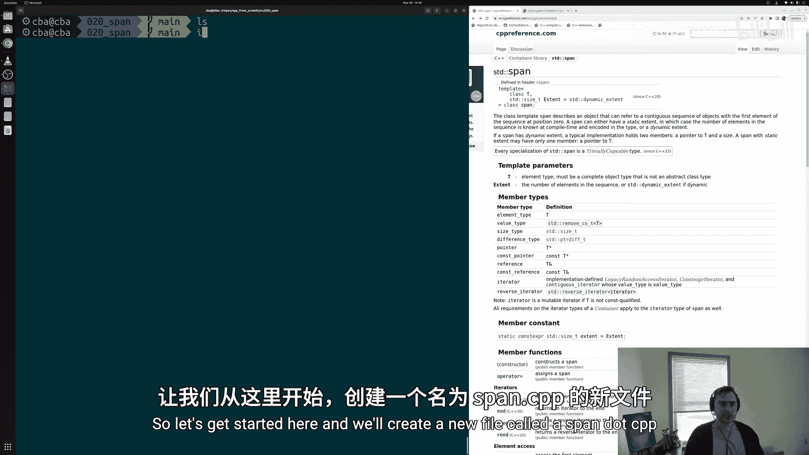
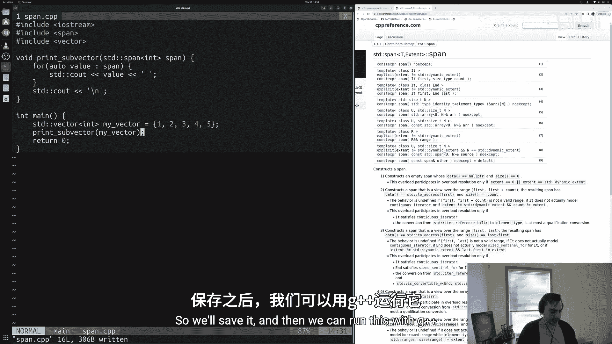
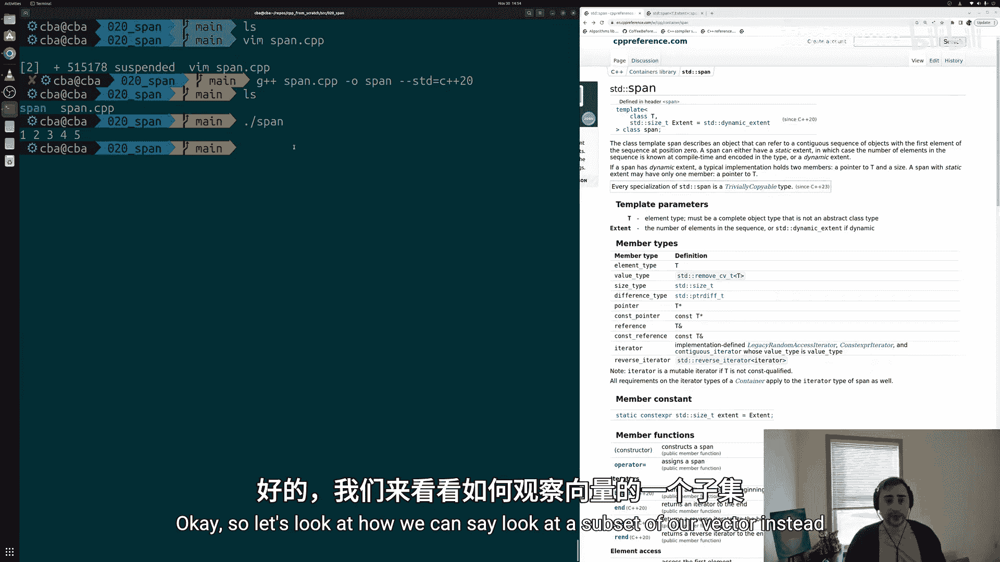
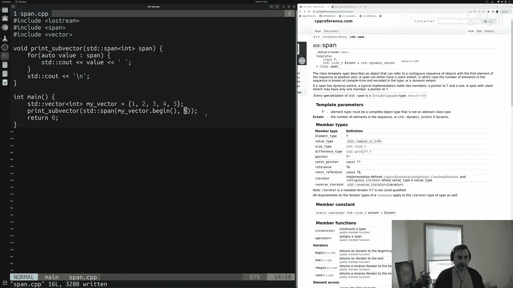
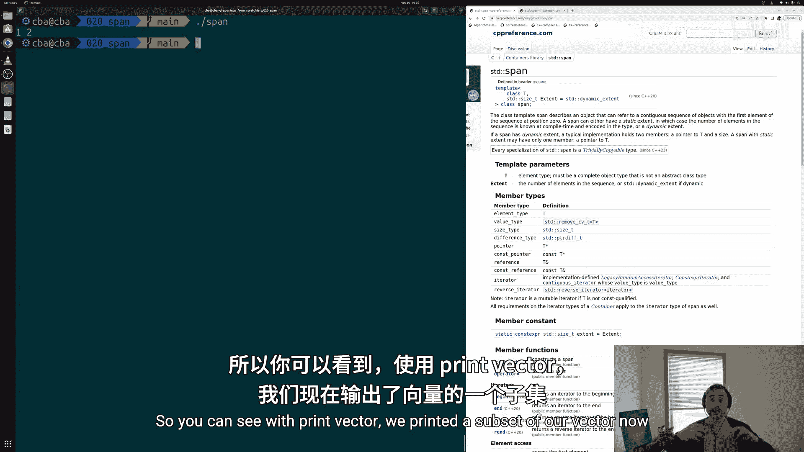
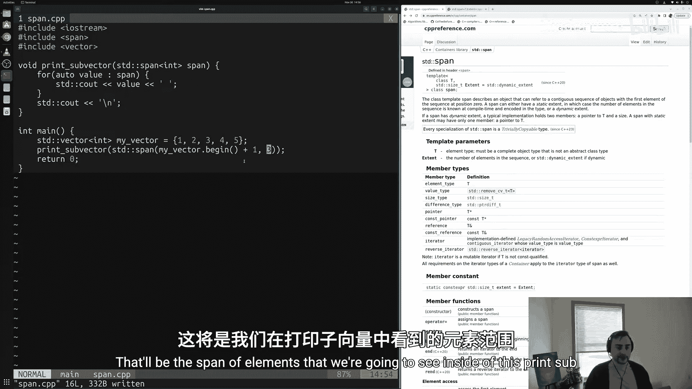
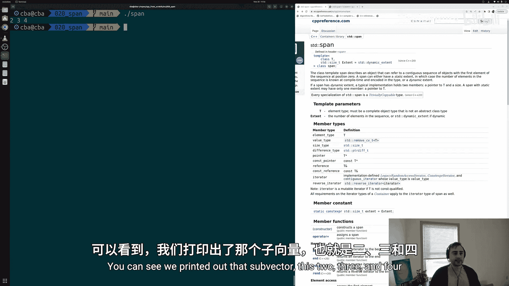
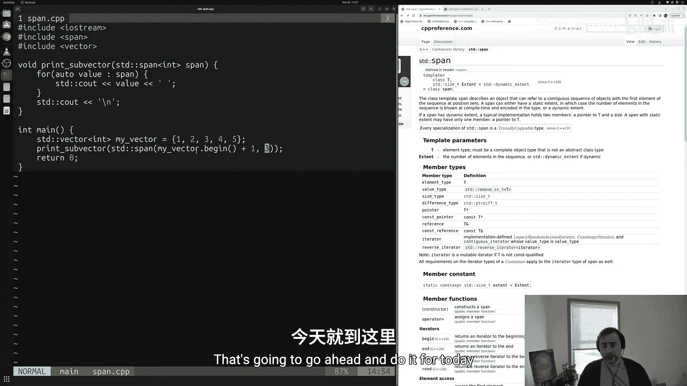

# C++入门教程｜CoffeeBeforeArch-p21-P21-std----span--BV1nbRUYSEUu_p21-

Hey everyone， I'm Nick and this is C++ from scratch， so in this episode of this series。

 we're going to be talking about one of our containers inside of C++ and that's going to be the stood span。

Now， up until this point， we've been largely looking at containers that only underlying memory。 So。

 for example， we looked at things like stoodoo vector， which will do dynamic allocations for us。

 as well as free that memory when we're done with it。

 And we've also looked at a few different kinds of smart pointers。

 So we looked at things like stood unique pointer or stood shared pointer。

 that we give ownership over， say some piece of memory that we've allocated。

 And those pointers become responsible for freeing that memory when we're done with it。😊，Now。

 there are times where we want the nice abstractions of a container。

 but we don't necessarily want ownership of the underlying memory。 So， for example。

 we may just want to look at a subset of a vector so just maybe some of the elements of a vector。

 we don't want to actually own that memory inside of a new container。

 We just want to kind of look into our vector。 Now the way that we do that in modern c plus plus starting from C plus plus 20 at least is through this stood span So the stood span describes an object that can refer to a contiguous sequence of objects with the first element starting at zero。

 and it can be either a static extent or a dynamic extent。

 So basically the stood span gives us a way to look into or having a reference to some sequence of objects。

 but without actually owning the underlying memory so we can look at a subset of a vector without owning that memory that we're looking at。

 So let's go and see how we can use the basics of using this stood span and why it can be kind of helpful。

So let's get started here and we'll create a new file called a span。 CBP。

 and this side of here will include a few headers， so'll include something like IO streamams。

 we can do some printing and we'll also include span here。 So you can see from CPP reference。

 unsurprisingly stood span is defined in the header span。

And then we can also include something like vector that we've seen before。So， you know。

 an example of where we might use Sp is if you want to look at a subset of a vector without actually owning that memory。

So let's create a main function， core of our C++ programs。

 and let's say we want to implement a simple function that prints out a subset of our vector here。

So for example， let's go ahead and kind of write the shell of this， so void return type。

 it's just a print function， doesn't need to return anything we can call this function something like print sub vector。

And then it's going to take some parameter here， and we're going to print out， say， part of a vector。

Now， one thing we could of course do is， you know， just pass say our vector by reference here。

 make sure there's no copy going on so we could just pass a stood。

Vectctor of integer say by reference and call this vector。But then we need to say， you know。

 what part of vector do we want to actually print out？

 So one thing we could do is we could just print out an end point that we want to print out。 So。

 for example， we could pass some integer end that represents the last element we want to print out。

 So maybe we just want to print from the beginning of our vector to some end point。

 or maybe we want to pass both a beginning and end point of our vector that we want to print out。

 or we could just pass， say， you know a pair of iterators from our vector that represents the beginning and end we want to print。

 But what you see here is now weve wound up with， say。

 two or three parameters that we're passing to this function。 So we're not really expressing。

 say the range or contiguous range of values that we want to print all that well。

 And especially with passing， say， this container vector。

 we know vector to be this dynamically sized container。 We don't need the whole vector。

 We just want kind of a subset of it。So instead of passing a vector and a start an endpoint or a pair of iters。

 what we can instead pass is a stood span。Of say， integers in this case。

 and we'll just call this span。Now， we can work with a span in much the same way。

 we can work with any of our containers so we can use something like a range based for loop so we can say for。

 you know， auto。Value inside of our span。We can go ahead and print out this value， this integer。

Followed by a space and then print out a new line character afterwards， right。St he out and then。

A new line character。And the nice thing about this is that Stpan is not going to own the underlying memory here。

 It's just a way of expressing， hey， I want to pass to this function。 a range of integers。

 I don't really care where that's coming from。 As far as this function is concerned。

 It's just a range of integers that I'm going to print out。 I don't own any of the underlying memory。

 So it's a better way of kind of expressing our intent here。

So let's see how this is going to look from just say a calling point of view。

 so how do we actually call， say a function that takes this stood span as a parameter。

So let's start by creating of course， vector right， something that we want to take a subset of。

 so we can create a stood vector here of integers。And we'll call it something like my vector。

And here we'll just set it equal to some ascending values， say  one，  two， three，4， and five。

 so we have a vector with five elements inside of it。Okay。

 and from there we can go ahead and call our function here， this print sub vector。

So a nice thing about kind of modern C plus plus and this idea of ranges。

 So remember when we looked at stood sort and this stood ranges sort。

 we could just treat our vector as a range of values。

 And our range of values can be converted into a span。

 So I'm not copying my vector inside of this function。

 I'm just looking into the contents with this stood span。

 So if we go ahead and take a look at stood span。😊，And say the different constructors。

 you can see down here that our stood span can take， you know。

 we can create it using a range of values here。 So number7 in this list。

So that's a very nice thing we can do。 We can just pass。

 say a vector if we want to just print out the entire vector。 but without copying it。

 So let's go ahead and save this and compile it。 So we'll save it。

 And then we can run this through G plus plus。 So span do CPP called the output executable span。

 and then we'll set the standard equal to c plus plus 20 since this is a very modern feature。

And you'll need a new compiler or relatively new compiler if you want to use this。

So we'll go ahead and compile this we have our executable span here and let's go ahead and run it and you can see that we took as our span。

 you know， the full vector of integers here， and we didn't copy that vector。

 We're just looking into that vector。 We're treating it as a span of values。

 Our span doesn't own this underlying memory。 We're just kind of looking at it through this container。

Okay， so let's look at how we can say look at a subset of our vector instead， so in this case。

 instead of passing our vector as a range of values here。

 let's create a stood span that we're going to pass。

So I can just do stood span。And I can say the starting point for my span so I can say， you know。

 my vector dot begin。And then I can see how many elements I want to have in this span。 so I can say。

 you know， just two elements。 So starting from beginning of my vector， I want two elements。

 So I'm passing， you know one and two basically as a span to my print sub vector here。 Now remember。

 a span doesn't own this memory。 but span is just going to see， you know。

 a span of two elements here。

Okay， so we can go ahead and save this。 And let's go ahead and recompile our program with C plus+ 20 and run it。

 So you can see with print vector， we printed a subset of our vector now， So one and two。

 but we didn't have to do any nasty business up here inside of our print sub vector function in terms of figuring out the range of values to print。

 right， that was all figured out for us from creating this span when we were calling this function。

 right， our function itself doesn't need to know the details about where the span is coming from。

And of course， we don't have to just say print starting from the beginning of our vector so we can do。

 you know， the beginning of our vector and some offset。

 So let's print out kind of the middle three elements of this vector。 So starting at begin plus one。

 So that'll be this two number， and then we're going to print out three elements here。 So2。

3 and 4 right that'll be the span of elements that we're going to see inside of this print sub vector。

Okay， so we can go ahead and save this and we can recompile。With C plus plus 20， of course。

And run it， you can see we printed out that sub vectorctor， this two， three， and four。

Okay so that's going to go and do it for this episode。

 It's a brief introduction to using stoodud span and some of the benefits right sometimes we just want this container level abstraction without owning the underlying memory and we can get that nice abstraction here using a stoodud span。

 we no longer have to keep track of say starting an endpoints inside of our functions here that take a stud span they can just take this kind of abstract span and at the culs site we can determine or set kind of the span of elements we want to pass to this function。

But like I said that's going to do it for today， I'll put links down to say Stoopan and this information with the constructor of Stoopan below the video。

 and you can find this in any of my other examples at github。

com scoffeebe arch that's going to go ahead and do it for today。 As always。

 I'm Nick and I hope you have a nice day。

