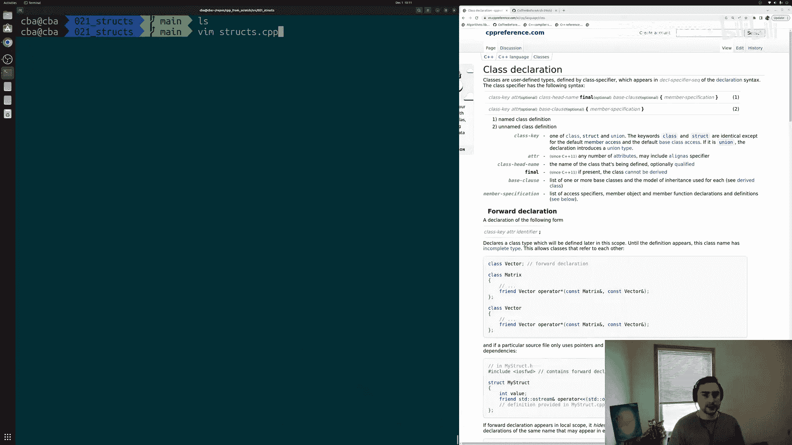
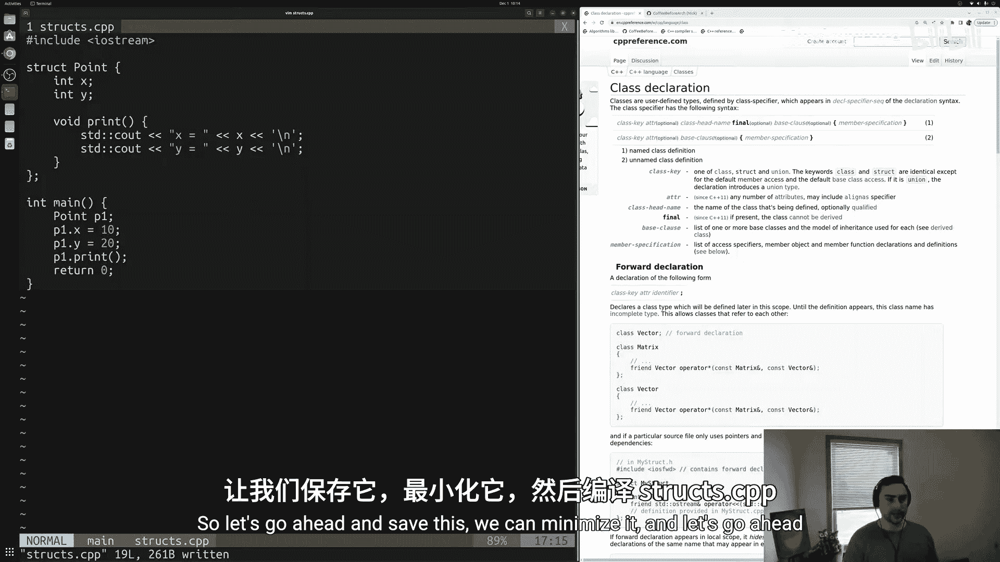
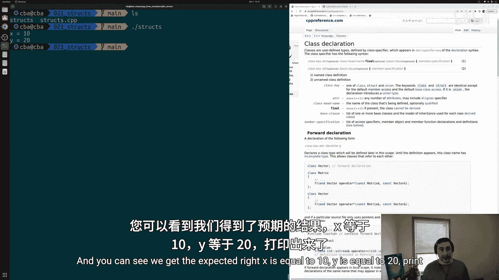
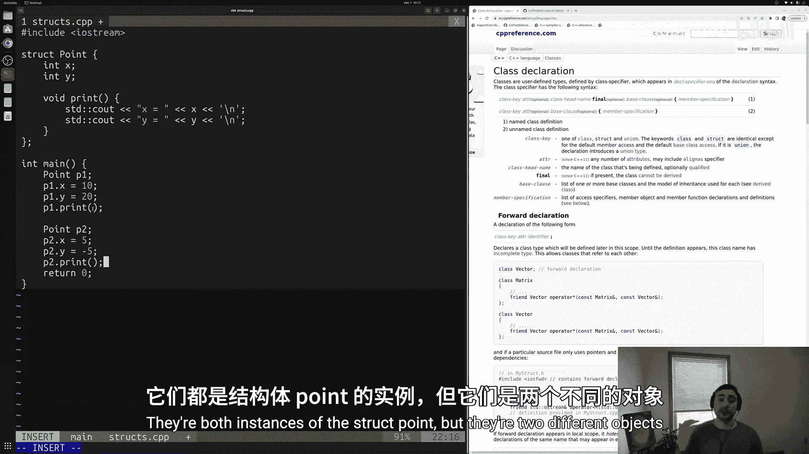
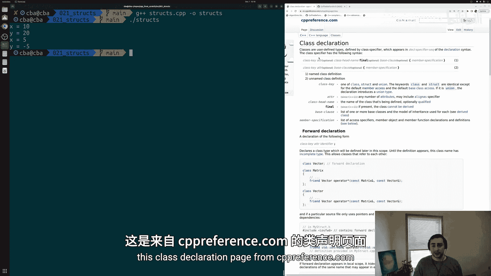
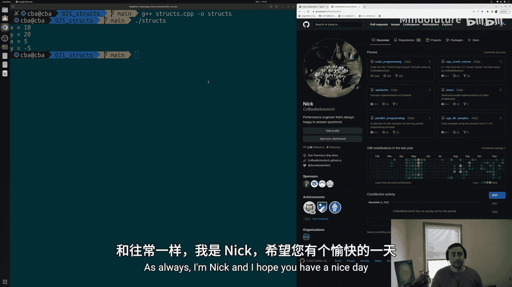

# C++入门教程｜CoffeeBeforeArch-p22-P22-Structs--BV1nbRUYSEUu_p22-

Hey， everyone， I'm Nick， and this is C++ from scratch。 So in this episode of the series。

 we're going to be talking aboutstructs in C++。So there's oftentimes programming where we want the ability to define our own types。

 Now this may be because we find some， say SL container to be insufficient and we want to implement our own with some different optimizations。

 or it may be because the type that we want just doesn't exist inside the language at all。

 so we want the ability to create that type。Now the way that we handle this in C++ is through definingstructs and classes Now in reality。

structs and classes are almost identical， but in this video we're just going to focus on kind of the basics and the core ofstructs and we'll get more into classes in these subtle differences in the next video。

So let's go ahead and get started and we'll create an example of creating a type using a struct in this filestructux。

cppP。

And inside of here， we'll start off by just including Io stream so we can do some printing。

And we'll create a main function as well。Now let's say our target application is you know we're working with some sort of plotting or graphing。

 so we may want to have a type that represents some point in that graph or some coordinate。

 maybe some X Y position， so let's create a new type using astruct so using thestruct keyword and we'll call this type point。

So then we'll just do some open and close curly brackets and ending with the semicolon。

 and that's what we need to do to create ourstruct point。

Now inside of ourstruct we can add data members and we can also add， say member functions。

 so the nice thing about creating our own types is that we can tie together our data and our methods that operate on that data so we can group them together。

So in this case， we have some point that represents， say， an Xy coordinate。

 so let's add a couple of data members for x and y， so we'll create maybe some integer x。

And some anger Y here that are going to be the data members of this point。Now like I said。

 we can also add member functions so we can add functions that operate on the data of our point。

So let's go ahead and create， say some simple print function to avoid return type doesn't take any parameters。

And inside of here， it'll just print out， say the value of x and y。

So it'll do say x is equal to print out the value of x followed by new line character。

And then we'll do the exact same thing for Y， so we'll just copy and paste this。And swap out X for Y。

So we've created a simple struct here called Point， it's got a couple data members X and Y。

 and a simple member function that prints out X and Y。So how exactly do we use this。

 say inside of our main function or anywhere else inside of our program， Well。

 we can create a variable using point just like we would any other variable。 So we can say， you know。

 just like we can create an integer X or an integer Y， we can create some point。

Let's just call it say P1 in this case， so when we create an instance of say a structure or class。

 we're creating what we call an object and that's just an instance of some structure class that we have defined。

So here we can set the x and y of this object p1 equal to some value。

 and we can do that through say the member axis operator。

 so that's just going to be this dot operator so we can say p1。 x is equal to 10 and p1。

 y is equal to 20， right？So what we're doing here is we're accessing X that is a member of P1 here。

 right， So that's all this dot operator is doing。 We're accessing a member of this object， P1。

 And you can see we have these two data members here， X and Y。Now， with our member access operator。

 we can also access our member functions。 and we've seen that a couple times in the past。 So。

 for example， withted vector， we had things like pushback or reserve And we access those through this member access operator。

 We're accessing a member function。 So let's go ahead and call our member function print here to print out X and Y。

 So we'll go ahead and do P1 do print here。Now， what exactly is this going to do。

 So it's going to print out the X and y associated with this object。

 So we have an instance of our struct point called P1 For that instance of this struct this object。

 we've set x is equal to 10 and y is equal to 20。 So when we call print for this object。

 we should see x is equal to 10， y is equal to 20。So let's go ahead and save this。

 we can minimize it， and let's go ahead and compile the Strucuxt CPP， you call the output executable。

 just something likestructs。

Okay， we've compiled a program， we have our executable there， let's go ahead and run it。

And you can see we get the expected， right x is equal to 10， y is equal to 20 printed out。

So the nice thing about defining， saystructs or classes is that we can tie together our data and our methods or functions that operate on that data。

 so we don't have to pass anything to print in order to print out X and Y here。

 X and Y are just part of this struct point so we can print them out without having to pass anything to this function。

Okay， so let's go ahead and try one more thing before we call it for today。

 and let's create another point so we'll create another point， say P2 here。And we'll set p2。

 x is equal to say 5， and then p2。y is equal to say negative 5， and then we can call p2 dot print。

So what's going to get printed out in this case Well， in this case。

We're creating an instance of ourstruct point called P1 and setting X and Y for that instance to 10 and 20。

 And then we're going to print it out。But then here。

 we're creating a new instance of our struck point。

 So this is completely separate from P1 being stored in a completely different part of memory here。

 It's a new object。And we're setting x and y for this object P2 equal to 5 and negative 5 respectively。

So when we call P2 dot print， we'll see a printout of 5 and negative 5， right。

 So we should see four total prints here。 We should see x is equal to 10。 Y is equal to 20。

 and then for our object， P2。 We should see x is equal to 5。 Y is equal to negative 5。

 So we have two different objects here。 P1 and P2。 They're both instances of the struct point。

 but they're two different objects。

Okay， so let's go ahead and save this and we can recompile ourstruct。

 cP and we can run that executable and you can see we get all four of our prints x is equal to 10 y is equal to 20 for our instance of our point called P1。

 and then we see x is equal to 5 and y is equal to negative 5 for that object p2。Okay。

 so that's gonna go and do it for today。 This is a very basic introduction to kind of whatstructs are and how we can use them to tie together you know data members and our member functions。

 So we're tying together data and functions that operate on that data。

 Now there's certainly a lot more that we're going to be talking about with you know related to objects and things like constructors and destructors and move constructors and copy constructors etc。

 as well as kind of the subtle differences between classes but that will be coming up inside of these later videos。

 So I'll go ahead and link down link below this video。This class declaration page from CPPreference。

com and as always， you can find this in any of my other examples at github。com/coffeebe arch。

 but that's going to go ahead and do it for today， as always I'm Nick and I hope you have a nice day。

