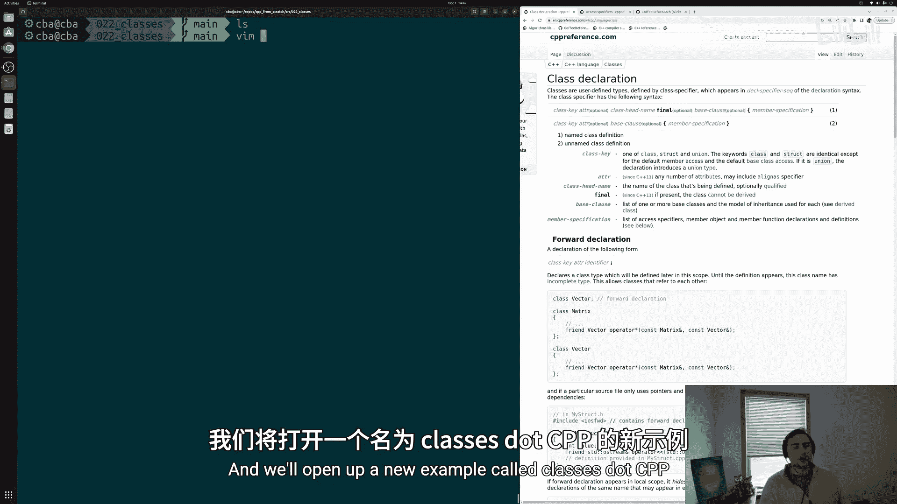
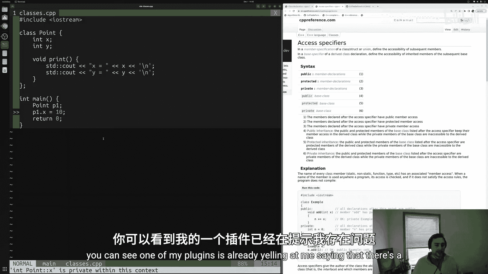
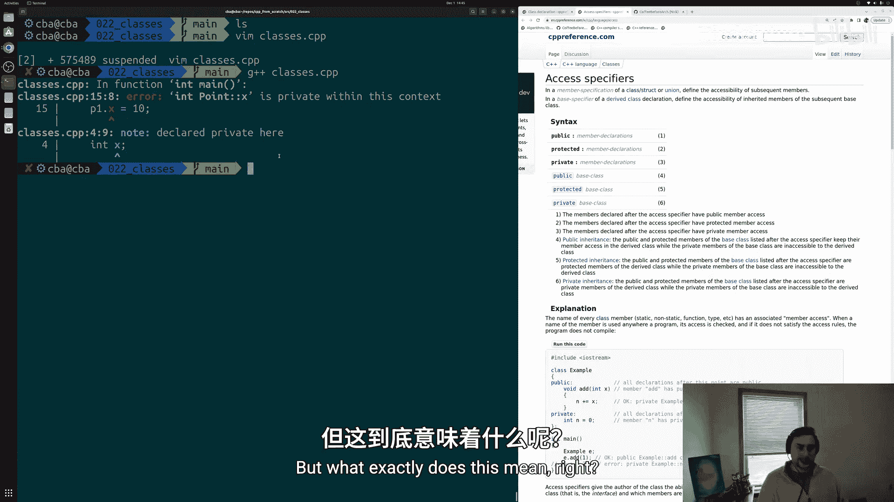
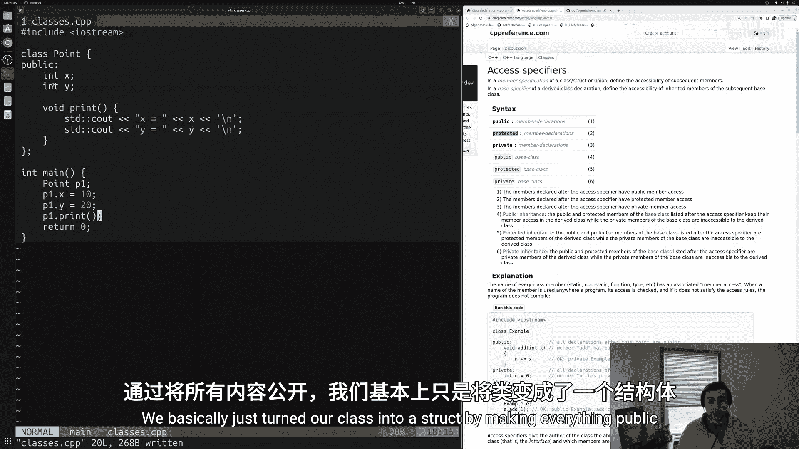
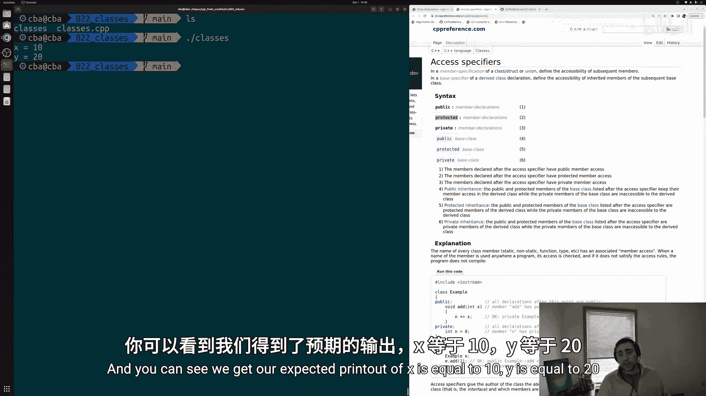
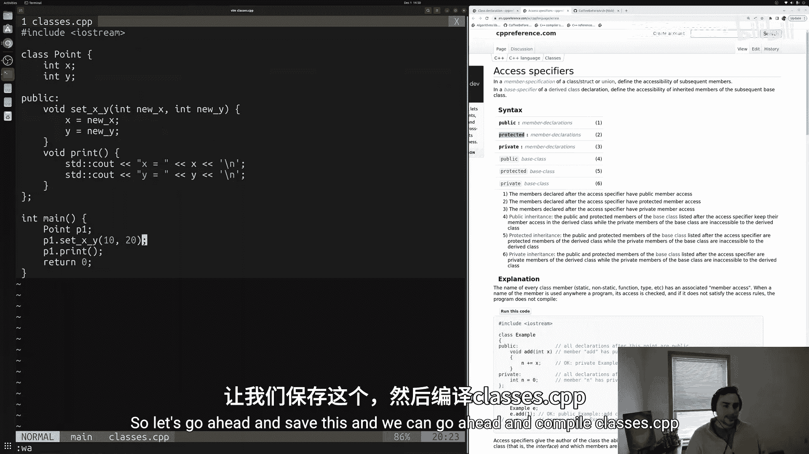
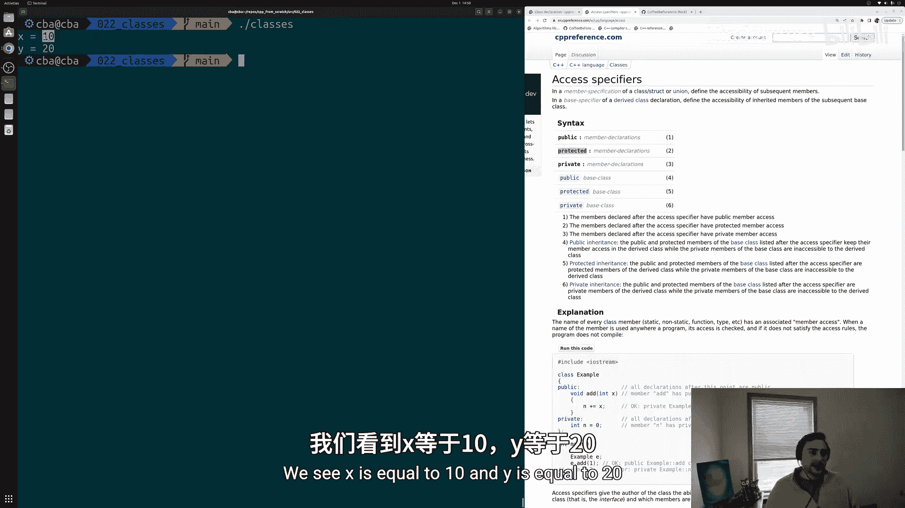
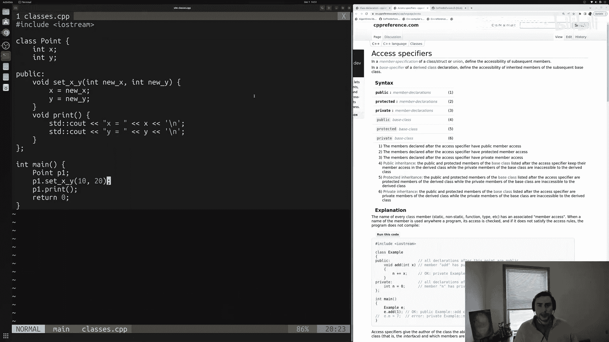
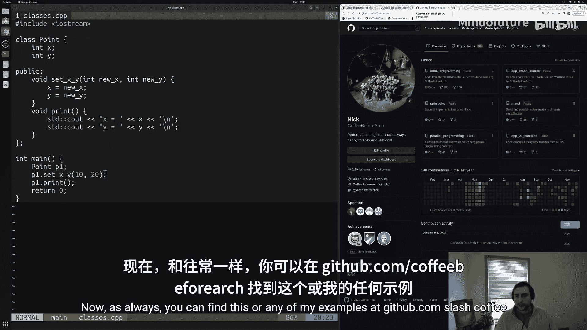
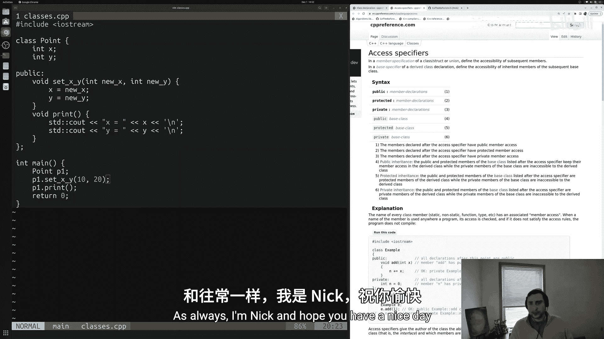

# C++入门教程｜CoffeeBeforeArch-p23-P23-Classes--BV1nbRUYSEUu_p23-

Hey everyone， I'm Nick， and this is C++ from scratchrach。 So in this episode of the series。

 we're going to be talking about classes in C++。So in our last video。

 we looked at the basics ofstructs， and we use these to define our own types。 Now。

 one of the things that I mentioned in the last video was thatstructs and classes are pretty much identical。

 Now， the way that they differ is with their default access specifier。

 which basically dictates who can access the members of， say， a class or a struct。

So what we're going to be looking at today is kind of the basics of how we write classes as well as learning a little bit more about these access specifiers。

So let's go ahead and get started and we'll open up a new example called classes。cpp。

And inside of here， we can start off with just creating， or rather。

 including IOStream as header so we can do some printing。

 and we'll go ahead and write a main function here core of our C++ programs。

Now what we're going to be implementing as a class is the same or is thestruct that we looked at last time。

 so we said that we maybe we were working with some plotting or some graphing。

 so we might want a type that represents say a coordinate or a point， So some X Y coordinate。

 So let's go ahead and create a class called point。Right， with open and close curly brackets here。

 So we've defined a class in much the same way that we defined our struct here。

 We just really swap the keywords。Now inside of this class， we can specify data members。

You can also specify member functions。 So we're tying together again our data and our methods that work with that data。

 So here we can add， say a coordinate x in some coordinate y， so just two integers。

 and then we can recreate our print method or member function from our struct So that was just a simple print function with a void return type and inside of here we just did stood C out and print out X is equal to the value of x followed by new line character。

 and then we did the exact same thing for y right So we printed out X and y。Okay。

 so how exactly do we use a class so we can use a class in much the same way as we used our struct so we can use our class。

To create a variable with the type， say point here， so here I can create an instance of this class。

 so an object， so some point， and then we'll just call this a P1 here。

So I've created an instance of my class called P1。Now the main difference between astructing a class is how we can access the members of that instructor class by default。

So that cut into these access specifiers that we have in C++。

So in our last video we said we could just change， you know say the value of x and y using our member access operator so I could do something like p1 do x is equal to 10。

 However， this isn't going to work by default with her class。 So if I go ahead and try to save this。

 you can see one of my plugins is already yelling at me saying that there's a problem And if I trying to just compile classes CBP you can see it gives me the same error here。

 It says that this integer X coming from this point class is private within this context and it shows me where I'm trying to access this member of this point class and also where that integer X is defined within our point class and it says note declared private here。

 So online four of my file。

But what exactly does this mean rent and， how does this differ from， say， astruct？

So over here on the access specifiers we can see that there's three main specifiers here。

 there's this public one， this protected one and this private one Now we're not going to get it protected today that's mainly relevant when we start talking about inheritance。

 so we're going to focus on public and private。So by default with astruct。

 the access specifier for all the members inside of ourstruct。

 so our data members and our member functions is public， and by default for our classes。

 our access specified for all of our members， so both our data members and our member functions is private and what that basically means is that we cannot access members of this class from outside this class。

So， for example。My print member function that is a member of this class point can access X and Y right because it's a member of class point。

 However， I can't just use this member access operator outside of this class so I can't directly access say this integer X or this integer Y or even this member function print。

 I can't call those from outside the class here。 And this is largely just a way that we can design say our classes and ourstructs。

 So sometimes we want to prevent people from being able to access maybe the data of a class or the data of a struct and we want to force them to go through。

 say some set interfaces So we can use access bestifiers to accomplish this。 And by default。

 our access specify for classes is private and for ourstructs its public So with a public access specifier that really just means that anyone can access these members so。

That can be accessed from within the class restruct or outside the class restruct。

Now we can change the access specifyifier for class or for a struct by marking this public or private or protected within this class or struct。

So， for example， I could go ahead and above these data members and member functions。

 I could specify all of these things to be public。 So this public access specifier。

 And now I can access X or Y or this print method from outside of the class here。So for example。

 I can change p1。 x equal to 10， I can change p1。y is equal to 20， and I can call p1。 print here。

 right？And all of this will work 100% correctly here because now everything is public in here。

 we've basically just turned our class into astruct by making everything public。

So let's go ahead and compile this。 So we'll go ahead and compile classes do cP。

Create an output executable called classes。Theirs are executable， and we can go ahead and run it。

And you can see we get our expected printout of x is equal to 10， y is equal to 20。

Now we often actually use this public or private， say， within our classes or ourstructs。

 so these access specified keywords can be used both within structure or classes。

But one of the ways that we often use them is we protect， say our data members here。 So， for example。

 if we don't want users people to directly access X or y and we want them to go through a set interface。

 we might leave our data members as private and just say some of our member functions as public right And then instead of directly being able to set X and Y。

 we might implement what are known these things that are known as setters or getters or and getters。

 So setters and getters are just interfaces for， say setting or interacting with or getting say our data members。

 So for example， we can create a simple function here called you know set X Y that take some anteger。

 we'll call it new X and another answerger called new Y。And we'll use this to set， you know。

 X is equal to new X。And then is equal to new y right。

 So we're setting our data members x and y equal to two values that we're passing in here from this method。

 new X and new Y。So down here， instead of directly accessing， say P1。 x and P1。 y。

 I can go through this new setter function。 so I can just call sayP1 dot set X。

 Y and pass and say 10 and 20 here。So I've created a setter function that sets some values of these data members。

So let's go ahead and save this and we can go ahead and compile classes。cpp。

And we get a rather unexciting or， expected result here， we see x is equal to 10。

 and y is equal to 20。

Now， in this case， it's pretty trivial to， you know just implement a setter that just directly copies you know whatever these values are and sets our data members to these values。

 But there are cases where it might make sense to have say a setter function or a getter function So for example。

 inside of your set function you might want to do some checks about these new values So you want you might want to make sure that these new values fall within some expected range right or perform some verification that the inputs are valid。

 So instead of allowing people to just directly access these data members。

 you might want them to go through some set interface that will perform these checks for them。

 So that's one reason why you might say protect， say your data members and only expose。

 say some set interface like a setter or a getter a getter would just be something almost equivalent but instead set of settings。

 say your data members， it returns them to say the user right and you might perform some checks there as well。

Okay， so that's going to go ahead and do it for today。

 that's kind of the basics of implementing say these classes as well as the basics of these access specifiers so we can specify you know whether we want a data member or member function to be public or private or even this protected that we'll get into in later videos when we start talking about inheritance。

Now， as always， you can find this or any of my examples at Gitthub。

com/cooffpybearch and I'll go ahead and link down these two CBP reference pages below the video。

 but that's going to go and do it for today， as always I'm Nick and hope you have a nice day。

