# C++入门教程｜CoffeeBeforeArch-p24-P24-Constructors--BV1nbRUYSEUu_p24-

Hey everyone， I'm Nick and Mr is C+ Plus from scratchratch， so in this episode of the series。

 we're going to be talking about constructors。So in our pastsco of videos。

 we've been looking atstructs and classes and how we can use them to create objects。

Now one of the things we haven't talked about so far is how we can say initialize our data members right without having to manually access them through that access that member access operator or that dot operator Now the way that we do this in Z++ is through a constructor so we can specify how we want our objects to be constructed using these functions。

So let's go ahead and see how we can write some simple constructors today。

So we'll go ahead and open up this example called constructors。

cppP and inside of here I've just copy pasted what we used for ourstruct example。

 so here we've created some simple struct called point that takes or that has two data members。

 these integers X and Y， so say some X Y coordinate。

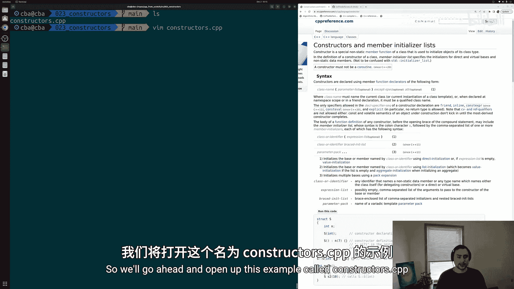

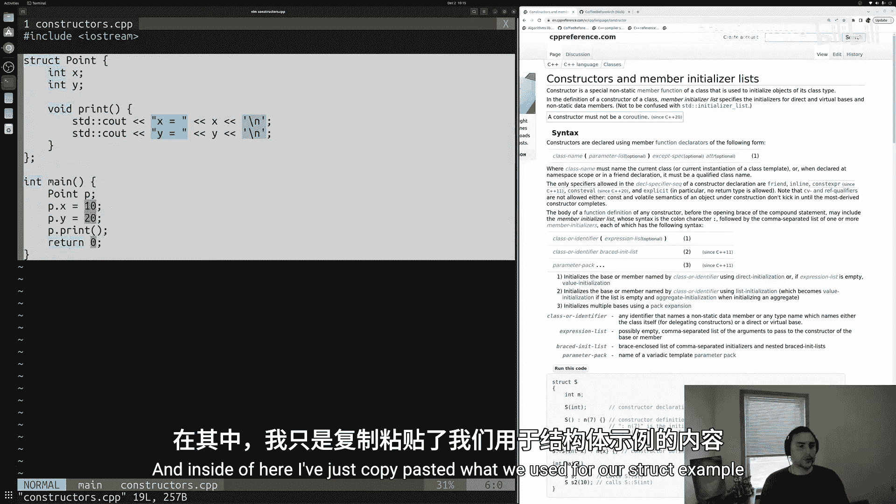

And then it has a simple method called print here that prints out X and y。

Now in our main function down here， we create some point P， so we create an instance of ourstruct。

 so an object， then we set x and y equal to 10 and 20 respectively。

By directly accessing these members。And then we call this member function print here to print out X and Y。

Now the bit of an awkward thing that we have going on here is that we're initializing X and y kind of after the fact we've created our object and then we started initializing things。

 so this is a bit awkward here and you know it's going to make things more error pro so it'd be nice if we could initialize these things when we were creating our object。

Now， one way we can do this without even getting into say constructors is through default member initialization。

 so for example， I can just give my instegers x and y here some default to initialize to so I can say x is equal to 10 and y is equal to 20 here。

 so now whenever I create an instance of thisstruct point x will be 10 and y will be 20。

 I don't have to set anything after I create， say my point p unless I want to。

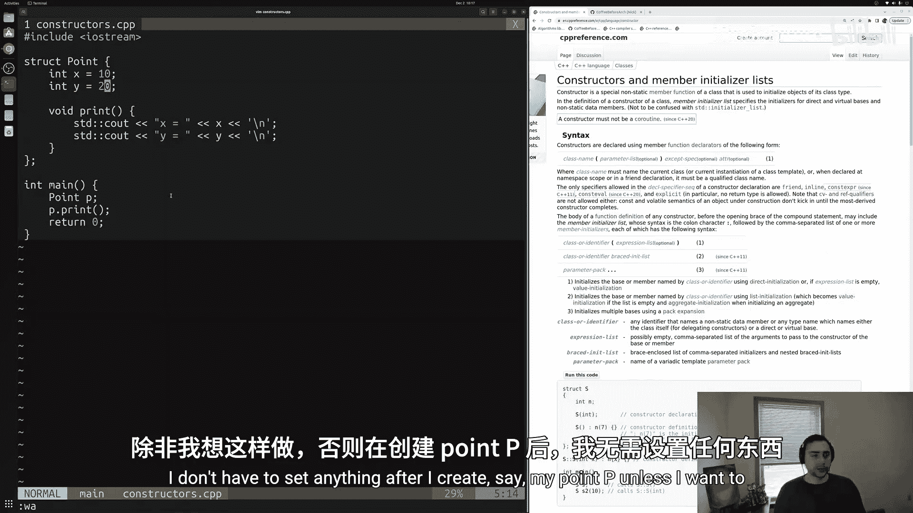

So here let's go ahead and save this and we'll compile this constructors。

cppP and call our output executable something like constructors。

And let's go ahead and run this executable and we see unsurprisingly。

 x is equal to 10 and y is equal to 20， so we create an instance of ourstruct and it had those defaults。

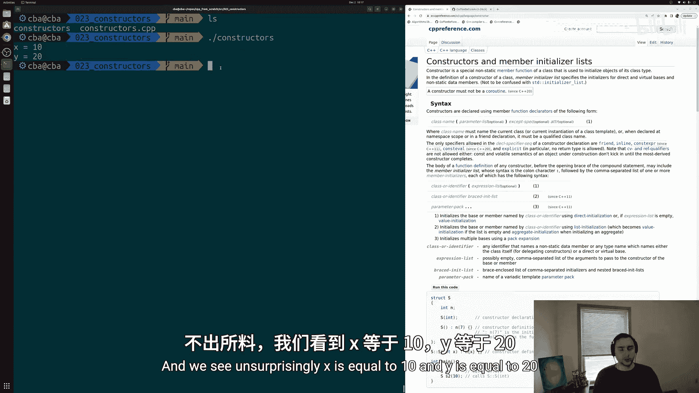

Now another way that we can initialize， say， our data members is through a constructor right。

 so a constructor is just this member function that's a little bit special that we can use to initialize our object that we're creating。

So our constructor is going to have the same name as ourstruct or class。

 so in this case I have a struct called Point， so we'll have a constructor called Point。

And then in this case， I'll just create astruct or a constructor that doesn't take any parameters here。

 So just an empty parameter list， and then we'll have some function body here inside of these curly brackets。

 Now， a bit of a special thing about our constructors here。

 Our constructors do not have a return type， They don't return anything and we don't have to specify something like void here either。

 Another thing here is we don't call our constructors directly。

 So we're never going to call this uppercase point constructor method。

 That's going to happen when we create our objects here。 So it gets called kind of indirectly。Okay。

 so the first way in which we can use a constructor to initialize things is by just filling out say this function body。

 So inside of here I can say， you know x is equal to you know 20 y is equal to 10。

And let's just go ahead and print out stood sea out， you know？That we're in the constructor， right。

 so we'll print out constructor with an exclamation point。can't forget that semicolon。Al right。

 so let's go ahead and save this and whenever we create this point P。

 it's going to call this constructor here， this constructor that doesn't take any parameters to start off with。

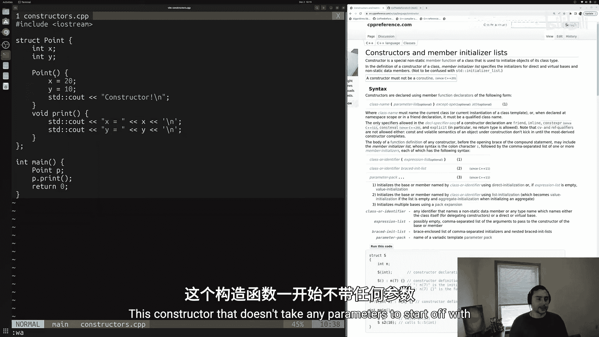

Alright， so we'll save this， we'll recompile constructors。 cP。

 and we'll run that executable and we see that we ran our constructor so we see that print and we got x is equal to 20 and y is equal to 10。

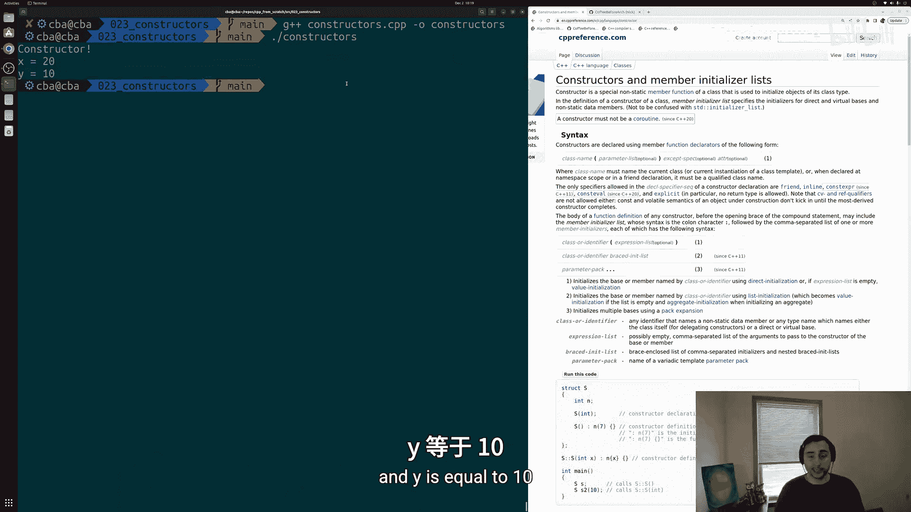

Now another way that we can initialize things with our constructor is with this default member initializer list。

 so for example， you know without even filling out this function body。

 what I can do is write this default member initializer list between say these prints and these curly brackets here separated by this colon so here I can say I want to set x is equal to 10 and then a comma I want to set y is equal to 20 here。

So this initialization will occur before we run our function， or this constructor body right here。

So let's go ahead and save this and then we can go ahead and compile and we should see x is equal to 10 and y is equal to 20。

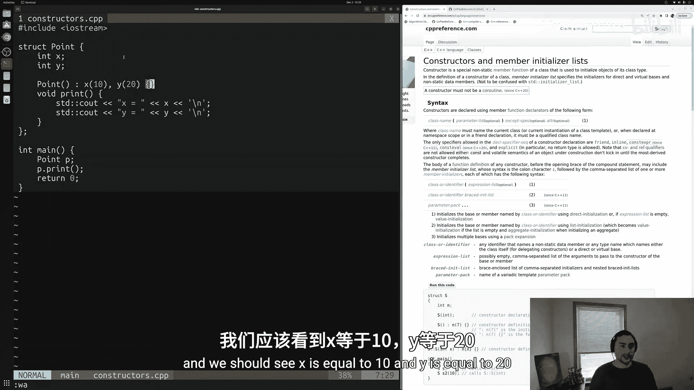

So we'll save this。Compile and we'll go ahead and run constructors and we see the expected output。

 the initialization of x and Y。

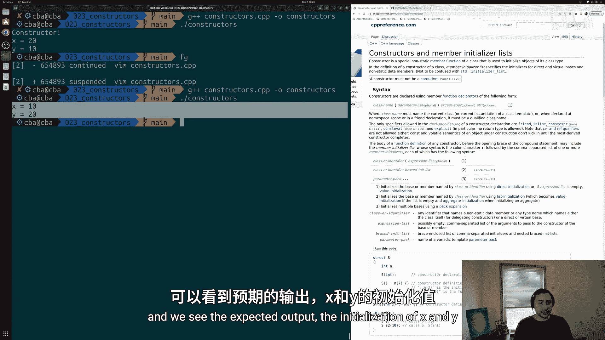

Now， a good question to of course， ask here is， when should I use say a member initializeizer list and when should I do something。

 say inside of the body of a constructor？ Well， if I need to do something more complicated than just say initialize some data members to some values。

 well you might need to use say the body of your constructor。 However。

 if you have something like a constant variable that we can't do assignment to inside of say the body of a constructor。

 we can still initialize it using， say， a member initializer list like this。

 another good reason is that we can also havestructs or classes or objects as data members So if we want to avoid。

 say like some default initialization followed by some further initialization inside of the body of a constructor。

 we might do that inside of this default this default or rather this member initializer list here for our constructor。

 So there are a few different ways that or few different， things we have to consider whether。

For when we're choosing between， say this member initializer list and the body of our constructor。

 but I'll go ahead and link down， save this link below the video。

 this page from CPP reference on constructors and member initializer lists below the video so you can see some more details on that。

Okay， so we've looked at some simple constructors here。

That are setting say some defaults for say X and y， but of course。

 there's going to be times where we want to specify our own。

 say x and y that we want to set whenever we're creating a point So we can create multiple versions of multiple constructors here。

 and we can create constructors that take parameters here。 So， for example。

 I can have a constructor called say point here that takes， say to integer。

 So say some integer new x and some integer new Y here。And inside of say， this constructor。

 I can say x is equal to new x and then y is equal to new y。

 very similar to how we had that setter function when we were talking about classes。

Except this time right I don't have to call a separate method， this is just a constructor here。

 So instead of using this constructor that takes no parameters。

 I can use the one that takes two parameters here， these two integers so I can go ahead and set you know x to be5 and then y to be you know maybe7 in this case。

 so now instead of calling this constructor that has zero parameters here。

 I'm going to be calling this constructor that takes these two inger parameters so I'm setting x and y at the same time I'm creating this object here using this constructor I don't have to set these values Neil later on using that member access operator。

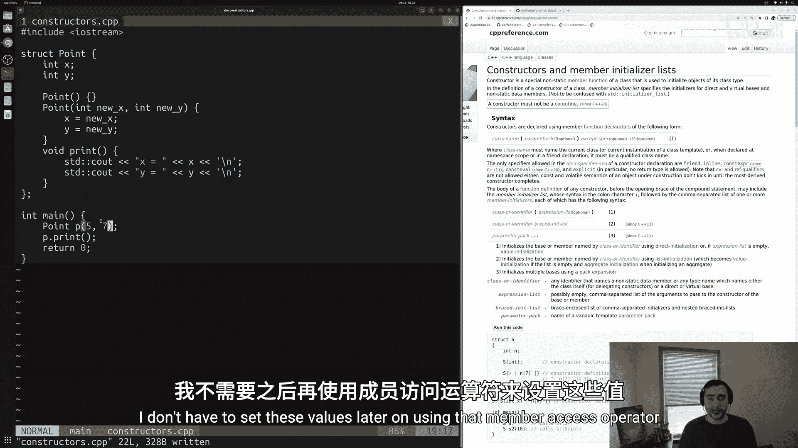

So we'll go ahead and save this and we'll compile constructors。cppP and we'll run it。

 and you can see x is equal to5 and y is equal to7。

 so we use that alternate constructor that we created that takes these two parameters here。

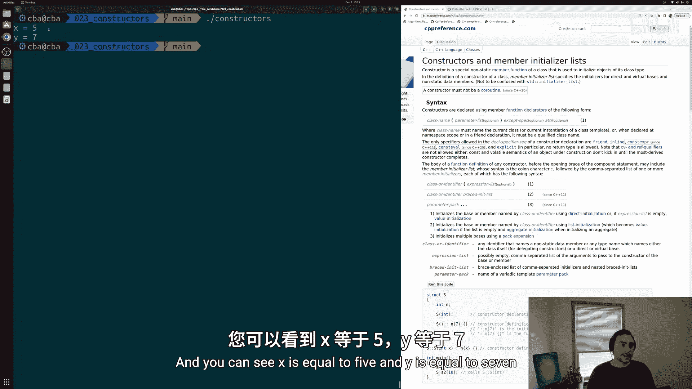

Now of course we don't have to initialize these values inside of our body of our constructor here。

 we can of course use our member initializer list so we can say I want to create or initialize X using new X。

 and I want to initialize Y using new Y here。So I'm perfectly capable of doing that as well。

 and it's absolutely allowed， so we can save this again and run it and we get the same result x is equal to 5 and y is equal to 7。

 but now we initialize it using this member， initialize your list instead of relying on this function body。

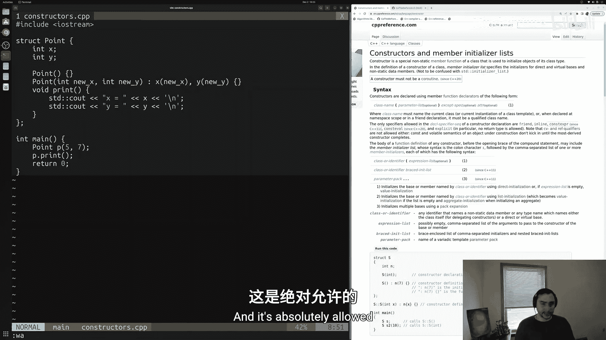

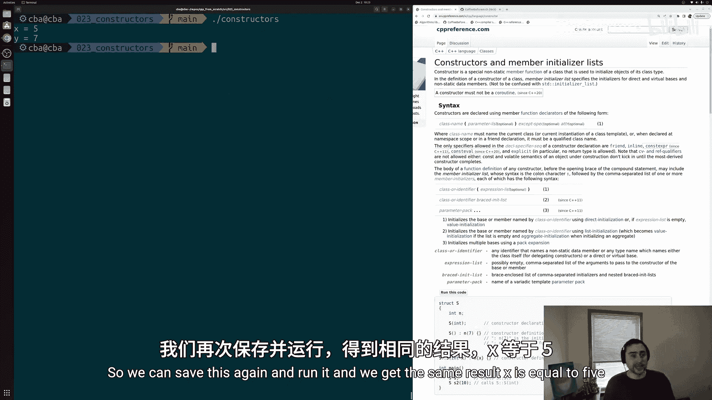

Okay， now one final thing to know before we go ahead and call it for today is that once we start calling or creating our own constructors。

 we're going to run into。You know kind of a subtle maybe problem with our compiler here or rather our compiler is going to stop doing some things for us。

 So for example， as soon as we default any constructor here。

 our compiler is going to stop generating the default constructor so for example。

 if we go ahead and create this constructor here that takes these two integers。

 our compiler is no longer going to generate one that takes say zero parameters here。

 So now if I go ahead and you know get rid of and try to use some default constructor here to create my object。

 you can see I'm going to get an error right so if I go ahead and try to compile。

 say constructors cP you can see we get this error of no matching function for function for call to point point so this default constructor here so we only have now our constructor that takes two integers。

 our compiler is no longer generating a default constructor for us however。

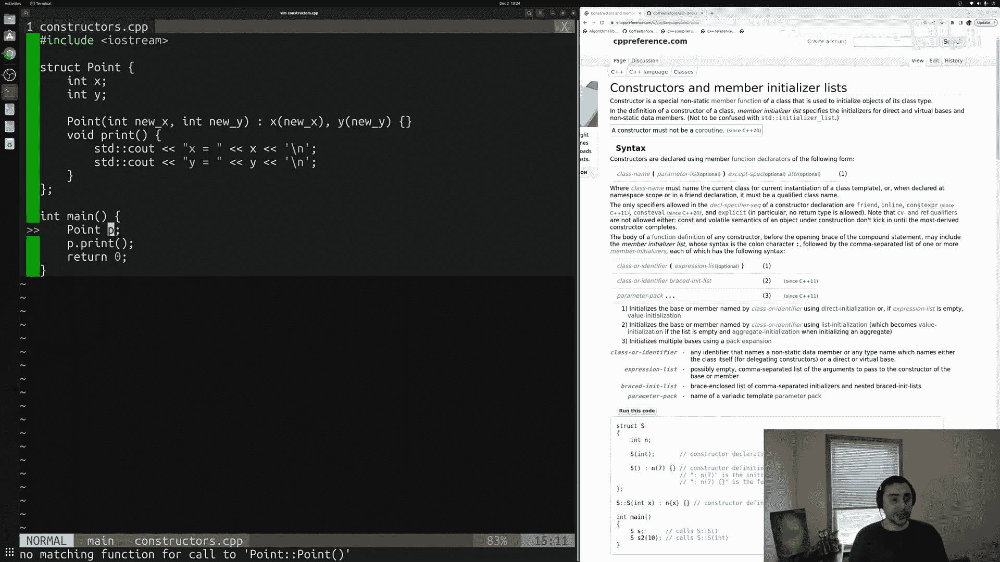

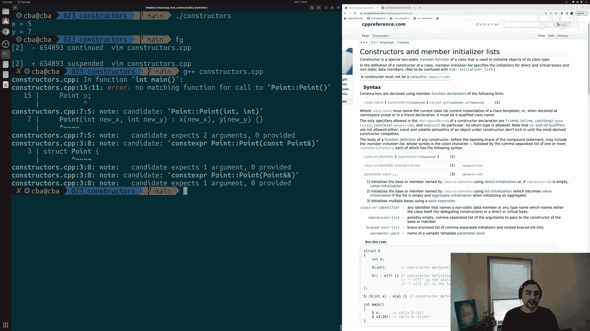

Can also always tell our compiler to you know hey， go ahead and still generate that default constructor by doing this point is equal to default right so we can still default this constructor if we want to or rather point with friends is equal to default。

 So then this is going to be valid again right， we're telling our compiler hey。

 you can still go ahead and generate this even though I'm creating my own constructors as well。Okay。

 so that's a lot to take in， but this is still just a brief introduction to constructors and again constructors aren't just for saystructs。

 you can also use constructors with classes as well。

 but you have to watch out for those member accessspecifiers but that's going to go ahead and do it for today you can find this or any of my other examples at Github。

com scooffee before arch as always on Nick and hope you have a nice day。

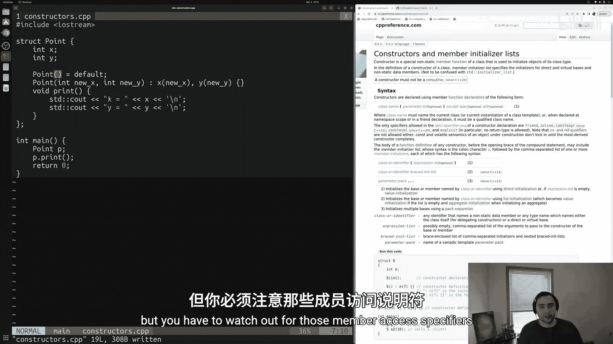

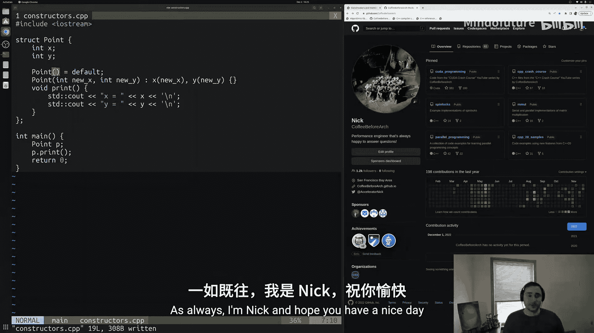