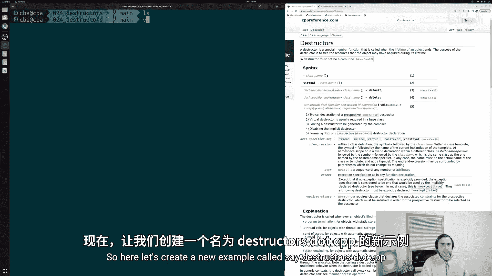
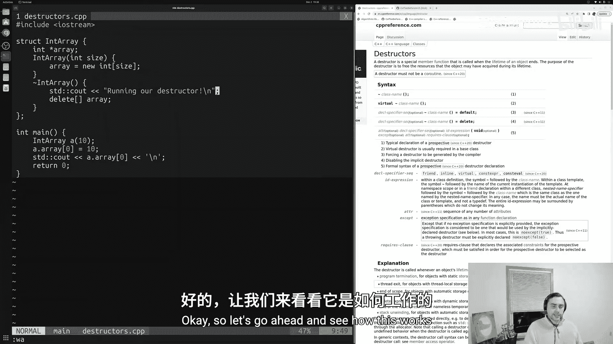
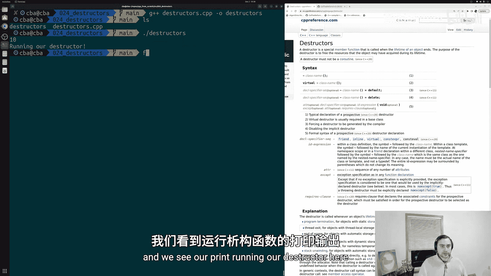
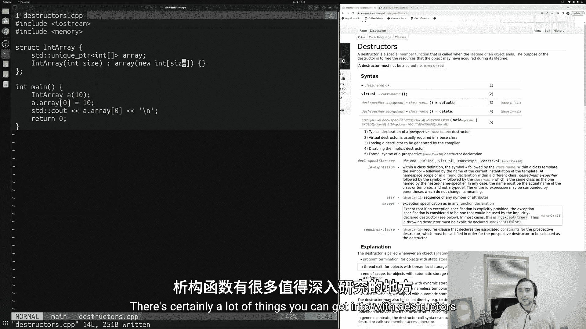
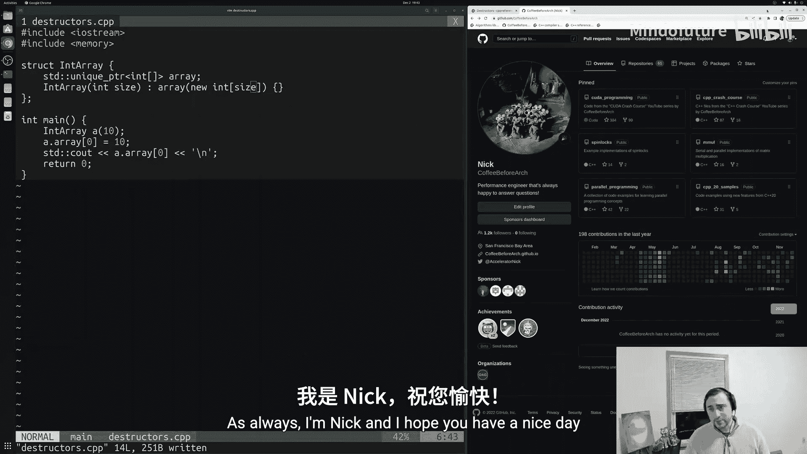

# C++入门教程｜CoffeeBeforeArch-p25-P25-Destructors--BV1nbRUYSEUu_p25-

Hey， everyone， I'm Nick， and this is Cs Plus from scratch。 So in this episode of the series。

 we're going to be talking about des。 So in our last video， we looked at the basics of constructors。

 and we used these special functions as part of ourstructs and classes to help initialize our objects when we were creating them。

😊，So when we create an object， we would run our constructor to say initialize some data members。Now。

 another thing we might want to do with our objects is something special when we're getting rid of an object。

 So say an object is going out of scope at the end of a function， or we have， say。

 some objects that are dynamically allocated。 And we're calling that delete operator to get rid of them。

 So we might want to do something special to clean up after objects。 Now， for this。

 we can use another special function。 as part of ourstructs in our classes。

 And that's called a destructor。 And this will run when we're getting rid of， say our objects。😊。

So let's go ahead and look at a simple use of a distractor here and kind of how these things work。

 So here let's create a new example called say deors。cP And inside of here。

 we can start off by including IO stream so we can do some printing and of course we'll need a main function here。

 core of our C++ programs。

So let's say we want to you know， create a new struct here for， say， a you know an integer array。

 So maybe we want to create our own type for a dynamically allocated array of integers。

 So here I'll just create a struct。Called say int array。I'll define thisstruct。And inside of here。

 you know， we can add， say， you know， a data member that's just an integer pointer called array here。

 So this will store our pointer to a dynamically allocated array of integers。

Then I can go ahead and create a constructor here。 So our constructor again will have the same name as our class or our struct。

 So just enter in this case。 No return type。And in this case。

 I'll create a constructor that takes one parameter， maybe some integer size。

 and the number of elements we want to dynamically allocate for this array。

So inside the body of our constructor， I can just set array equal to new andt， say size。

So we'll dynamically allocate space for size integers and store a pointer to that memory inside of our array pointer here。

Now， from here， I can go ahead and use my defined struct here。 so I can say， you know。

 create a variable that is of this type in array。 So I can create an instance of the struct So an object。

 and let's just call it say a and I'll pass to our constructor maybe something like 10。

 So we're going to create a dynamically allocated array of 10 integers here。And of course， from here。

 I can just access this dynamically allocated array through remember access operator。 So。

 for example， I can do a dot array， and I can access say element 0 here and set it equal to 10。

 right， So I'm just indexing into this dynamically allocated array that's part of my object。And。

 of course， we can say， you know， maybe print out that value。 So here， I'll just do stood， see out。

And print out this value10 that we set for the zero index， So a dot array， index0。

 and then a new line character afterwards。 So we get a new line afterwards。Now。

 one of the things that we haven't taken care of here。As we're not cleaning up after ourselves。

 we've dynamically allocated some memory， but we're not freeing it anywhere。

 So we have a memory leak going on。 So in order to say， handle this cleanup。

 one of the things we can do is write a deor。 So if we go ahead and look at the CP reference page on the right hand side of the screen。

 So this is for des， you can see that it says a de is a special member function that is called when the lifetime of an object ends。

 and the purpose of the structure is to free the resources that an object may have acquired during this lifetime。

 So during the lifetime。 This object， we acquired some memory here。 So we did a dynamic allocation。

 So inside of our de， we probably want to free that memory so that someone else can use it。😊。

So let's go ahead and write a deor here。 Now， our deor is similar to a constructor and that it's going to have the exact same name as say instructor or class。

 The one difference compared or constructor， though， is that it's going to have a till day out front。

 So we'll have this till day。Int array。 and this is going to be our constructor。

 and it's not going to take any parameters here。So similar to our constructor。

 it doesn't have a return type， and we can't call it directly here。

 gets's called kind of indirectly when something's going out of scope， or if we're say deleting。

 say objects that were dynamically allocated。Okay， so inside of our de here。

 this is where we can do our cleanup for say our object。

So here we've dynamically allocated an array of integers。

 so let's go ahead and free up that memory so we can do this array delete here。

 so delete square brackets and then pass our array pointer here。

And then just to show that this is running， we'll just do a quick print out here。

 So we'll do stood sea out and we'll print， you know， running。Our destructor。

With an excimation point for some fun。Okay， so there we have it， we have a very simple program here。

 We create our in array of 10 integers here。 we run our constructor and dynamically allocate a size or an array of 10 integers。

We set the first element equal to value 10。 We print out that element， and then we return 0 here。

 So we eggs out of this function。 And when that happens， our destructor will fire here。

 So this tillday inter destructor here will run。 we'll see this print out of running our deor and it will free our memory for our array。

😊，Okay， so let's go ahead and see how this works。 so we' save this， and go ahead and compile Des。cP。

 and we'll call the output executable， just something like destructors here。

So then you can see we have our executable， and let's go ahead and run this。

So you can see we have a print out right from our dynamically allocated array of integers that we made。

 And then after this print out， right， when our object goes out of scope here and it gets destroyed。

 we see our deor fires here， and we see our print running our deor here。

And then after that， we would have had our free of our memory here。 So our memory got freed。

 You know， Our object cleaned up after itself after it went out of scope。

KNowow this kind to design pattern that you're seeing here， where。You know。

 an object may acquire some resources when we construct it and get rid of those resources when this object is freed。

 this is often referred to as RAII， or resource acquisition is initialization。

And the basic concept of this is that， you know， when we create objects that grab some resource and when they go out of scope or get deleted。

 they free up that resources。 So the user doesn't have to do any kind of manual management of resources there。

 So this same kind of thinking goes along with， say， our standard library containers。

 So something like a stood vector。 right， A stood vector。

 We don't have to worry about the underlying dynamic allocation。

 It will do some dynamic allocation for us， and then it will free that memory when we're done with that vector。

 The same is true for a number of the other containers and types that we have in C plus plus。Now。

 I think another good thing to think about here is kind of the design of our class。

 So even though here we're showing off kind of the basic ways of using des and why we might want to use the deor。

 I think it's important to note that we should consider why we needed deor in the first place。

 so in this case， we have a raw pointer here and we're manually managing memory。😊，So with C++。

 we really don't need to do this。 And in fact， we can get away with writing pretty much this exact same class。

 but without needing to manually manage this memory or even need a deor here。

 So what exactly do we need to do。So here， let's just go ahead and get rid of our deor here。

 We don't need this anymore。And instead of having， say， a raw pointer here。

 why don't we use something that we looked at just a few videos again。

 Why don't we use a stood unique pointer and give that object ownership over our dynamically allocated memory。

So here I'll go ahead and include memory。So we can use this stood unique pointer。

Instead of an array here or an integer pointer， we'll create the type stood unique pointer。

To an array of integers。And then instead of having this constructor here that calls new int。

 you know， what we can go ahead and do is just use this member initialr list here。

 and we can directly initialize array with new int of size， right。Now。

 this will work pretty much identically to our previous example here。

 except instead of using a raw pointer， we get to use our unique pointer and we don't even need to worry about writing a deor。

 right when our object goes out of scope， our unique pointer will go out of scope and the destructor for that unique pointer will handle that free of memory for us。

Okay， so that's a bit of the basics of using deors and some things to think about in terms of。

 you know why are we writing des in the first place and do we really need to write a deor。

 There are cases where we certainly do need to write a deor。

 but there are other cases where we can you know get around it by using， say。

 some of our modern features of C+ plus like these unique pointers and or SL containers。

Now below the video I'll link the CBP reference page to our Des so I think this is a good thing to look at to try to understand things more there's certainly a lot of things you can get into with deors and of course any of these examples can be found at github。

com/coffee before arch but that's going to go into into it for today as always I'm Nick and I hope you have a nice day。

