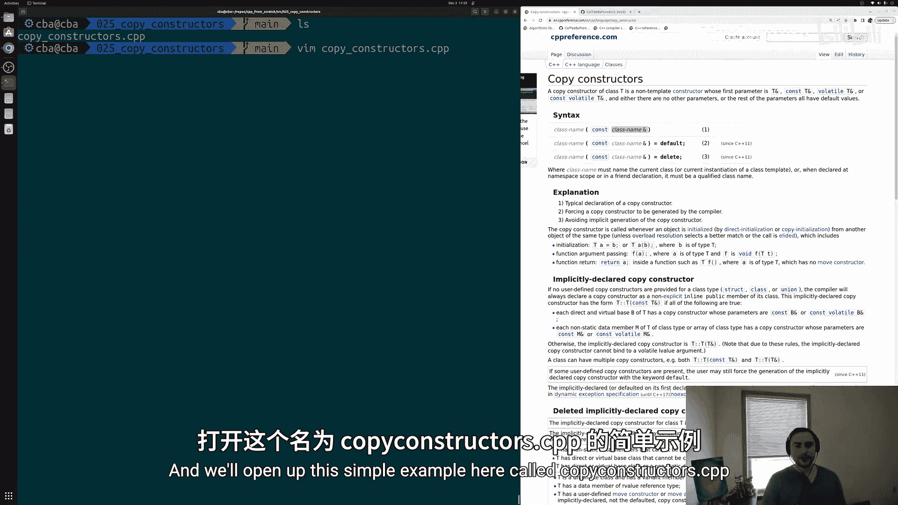
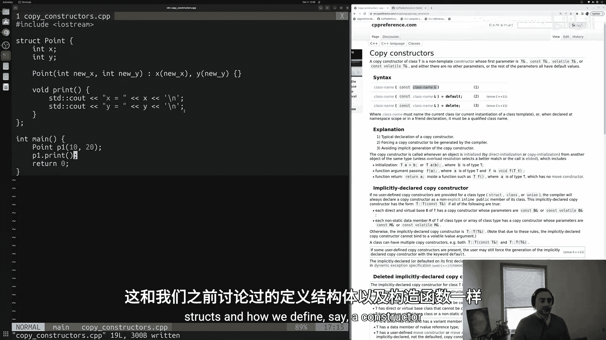
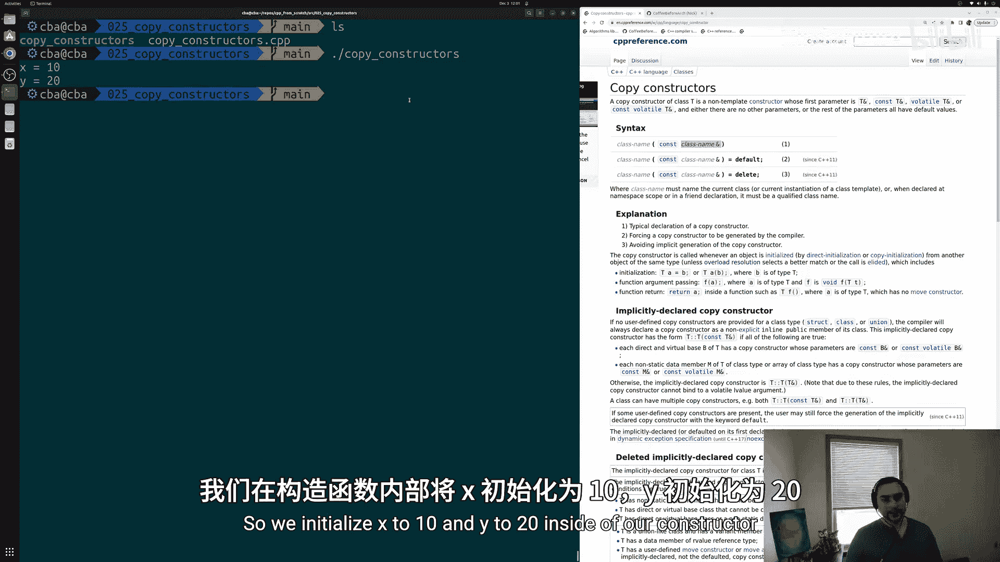
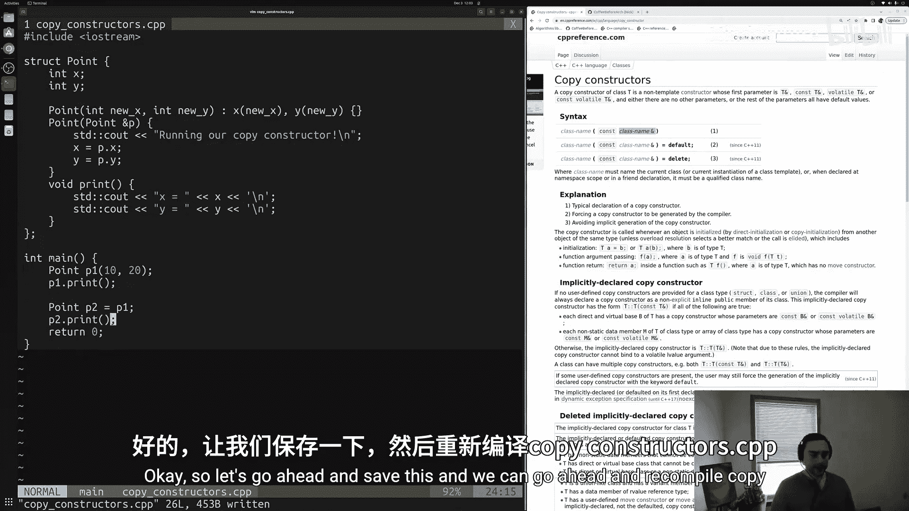
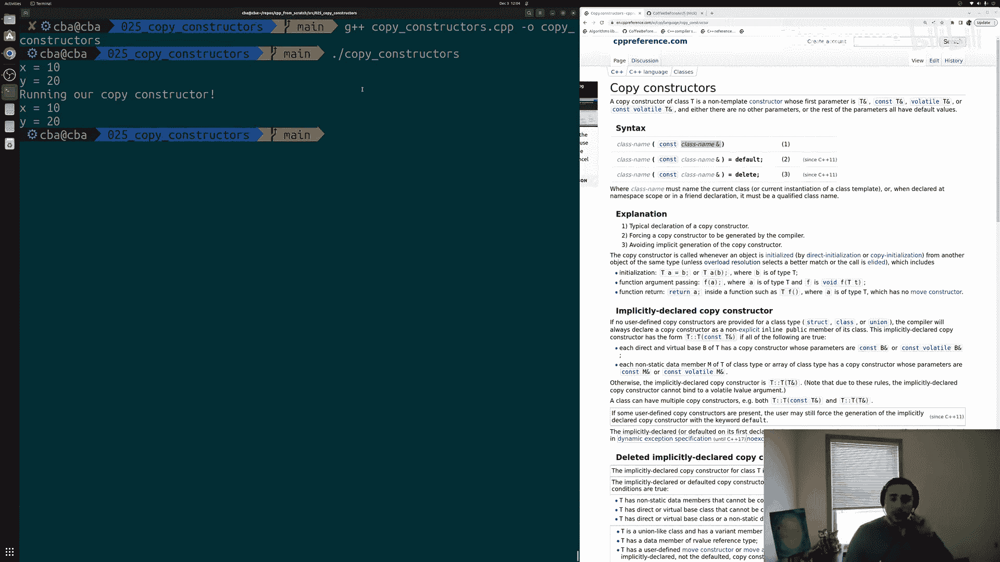
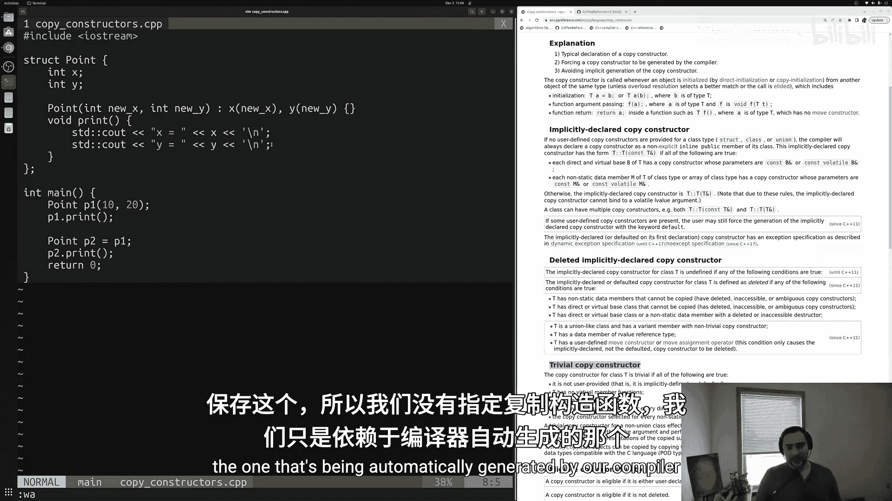
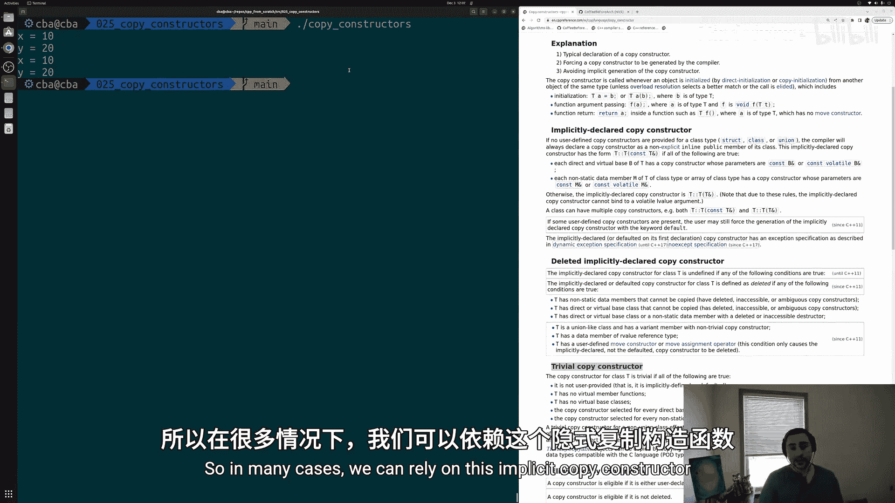
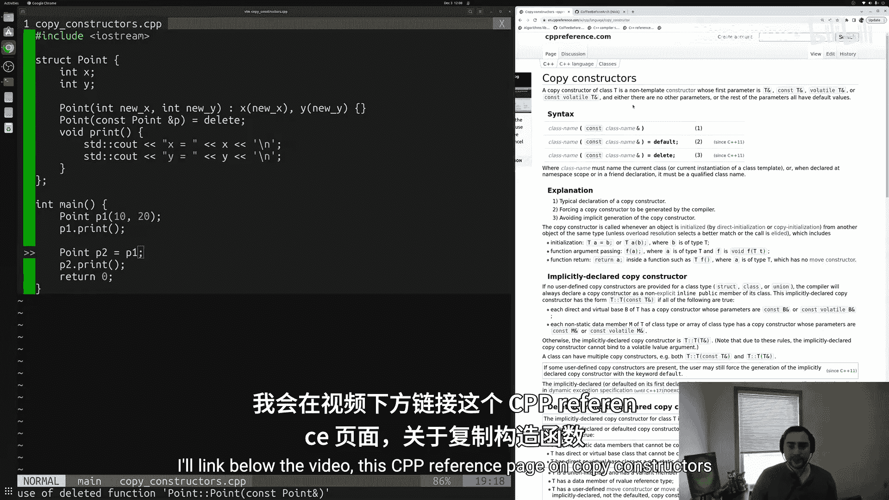
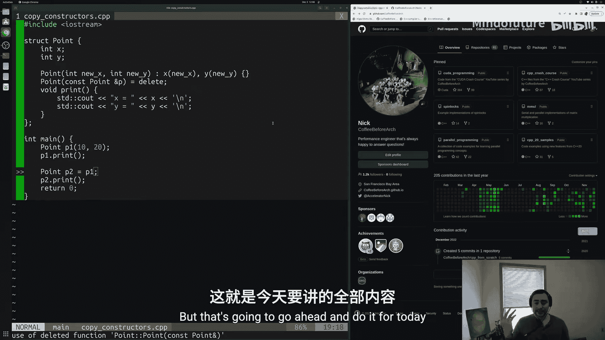

# C++入门教程｜CoffeeBeforeArch-p26-P26-Copy-Constructors--BV1nbRUYSEUu_p26-

Hey， everyone， I'm Nick， and this is C Plus Plus from scratch。 So in this episode of the series。

 we're going to be talking about copy constructors。So in a previous video。

 we looked at the basics of constructors， which were these helpful member functions of our classes andstructs for creating and initializing objects。

Now， one thing that we often want to do in programming is say create a new object based on an object that already exists。

And the way we can specify how this happens is through a copy construct。

 So that's what we're going to look at today。 So let's go and get started and we'll open up this simple example here called copyconstructors cP。

And inside of here， I really just cop and pasted our example from when we first looked atstruct。

So we've defined a very simplestruct here called point， so it represents， say some Xy coordinate。

 So we have， say， two data members， x and y， these two integers。

And we have one member function called print that just prints out， you know。

 x is equal to and y is equal to。Okay， so let's go ahead and make some minor modifications to thisstruct that we have to。

 So， for example， we can start off with just writing a constructor。

 So just a normal constructor here。So it'll have the same name as our structure class。

 and then let's write a constructor that takes in a couple of parameters here。

 so let's say it takes some integer new X and some integer new y。

 so we want to initialize x and y whenever we're creating an instance of thisstruct point。

So then we can go ahead and initialize X and Y， say using our member initializeizer list。

So we can initialize X with new X。And we can go ahead and initialize Y with new Y， right。

 So now we can go ahead and create a point and initialize X and y at the same time。So here。

 let's go down to our main function and let's go ahead and create some point P1。

And we'll initialize X and Y to say 10 and 20 respectively。 And then let's just call P1 but print。

Okay， so this is all pretty simple。 It's what we've looked at before when we talked about。

 you know how we definestructs and how we define， say， a constructor。

 But let's go ahead and use this as a baseline。 So we'llll save this and then let's go ahead and compile copy constructors。

 CBP。 let's call our output executable the same thing， just copy constructors。

Okay， so theirs are executable， let's go ahead and run it。

 and unsurprisingly we see x is equal to 10 and y is equal to 20。

 to initialize x to 10 and y to 20 inside of our constructor。

Now let's say we want to create， say an instance of ourstruct point。Based on this point， P1。

 So we don't want to say pass， you know a new inste X and y。

 right as parameters here and run our constructor again。

 We just want to kind of copy P1 and create a new object based on this existing object P1。

 And for that， we can use a copy constructor。 So let's kind of write our own to start off with。

So here we'll write our own copy constructor， so just like our constructor and our destructor。

 it'll have the same name as our instructor or class。But as a parameter， it's going to take。

 you know， something of the type， you know， point reference， right， as as an input。

 So it's going to take some point。By reference。 And let's just call that， say P， right。

 So this is what we're trying to copy here。 Some point P。

 we're trying to create a new point based on some existing point that we're passing in by reference here。

Now， inside of the body of our copy instructor， we can do whatever we want to say initialize our new point。

 right based on some existing one that we're passing in by reference。So for example， we can say。

 okay， I wanted to initialize x equal to p do x， and I want to initialize y equal to p do y right。

 so using that member X as operator to copy the value of x and y into our new point that we're creating using this copy constructor so we're constructing a new object based on say a copy here right so we're copying say P and you know what we want out of P to create a new object。

And let's go ahead and add， say a simple print in here to show that it's actually running。

So we'll do stood C out， and then we'll do running our copy constructor with an exclamation point for fun。

Okay， so let's go back down to our main function。To actually use this copy construct。So this time。

 we're going to create some point P2 in this case， but we're going to base it off of some existing one P1。

 So we'll just say point P2 is equal to P1 right， So I'm creating a new object P2 based on an existing object。

 P1。Okay， and then I can just do P2 dot print here。And what I should expect to see is， you know。

 I'll first see the print out of x is equal to 10 y is equal to 20 from this P1 dot print。

Then we're creating a new object using our copy constructor here。

 so I should see running our copy constructor。And then I should see P2 do print。

 so we should see that print out of x is equal to 10 and y is equal to 20 again。

 we're just copying the values of x and y here directly right not modifying them at all。Okay。

 so let's go ahead and save this and we can go ahead and recompile copyconstructors。

cP and run this executable and what we see is kind of what we expect。

 we see our printout from our first object that we created using just a normal constructor Then we created that new object P2 based on our existing object P1。

 and we see that we get this running our copy constructor printed out followed by our call to P2 dot print that prints out x is equal to 10 and y is equal to 20。

So we created a new object based on an existing object。Okay。

 so let's go ahead and go back in and talk about a few things before we wrap things up。

So number one was something like a copy construct。One thing thing you'll often see。

 so if we go ahead and look at the right hand side here on CPPreference co is you'll see a lot of times you know with our copy construct the you know say point in this case if we passing in by reference is qualified with this this keyword con here So a lot of times you'll see this as say con point by reference P or whatever the type is getting passed in and there's a specific reason for this So in many cases you know we want to make sure that you know a copy construct isn't modifying our original point P So we're creating a new point。

Based on an existing one that we're passing in by reference。

 but I don't necessarily want my new point to change my old point here so a lot of times for safety。

 it'll be passed in by con reference here so it'll be qualified with cons to specify that hey。

 this is read only right you can read and say copy。

 say the data members but you can't modify this existing point here this point P so a lot of times you'll see this by con passed in by cont reference。

Now， another thing here is that for trivial cases where we just say have， you know。

 some integers or something like this， we don't even need to specify you know。

 something like a a copy construct， the， you know， default copy construct。 So if we we go ahead and。

Look down here in these implicitly declared copy constructors and these trivial copy constructors。

 we can get away with just not defining one and rely on our。

Our copy constructor that you we generated for us by our compiler。

 and we'll see we'll at the exact same result in this case， you know of the one that we define。

 except without that print of， you know， of running our copy constructor。

So we'll go ahead and save this， so we haven't specified a copy constructor。

 we're just going to rely on the one that's being automatically generated by our compiler。 So here。

 exact encode in our main function will recompile copy constructors cP and we'll run it and you can see if we get a print out of you know x is equal to 10 y is equal to 20 from our first object p1 and we created an object p2 that also has x is equal to 10 and y is equal to 20 right so in many cases。

 we can rely on this。

This implicit copy constructor。Okay， now one final thing I'd like to mention is that sometimes we don't want a copy constructor。

So just like we could say， you know， set something like a constructor equal to default to make sure that our compiler still generates that。

 we could also set it equal to you know these special member functions equal to delete so I could do something like point。

You know， con。Point by。By reference P here， and then I could set this equal to delete。

And what this is basically saying is that I don't want the compiler to generate a copy construct at all。

 So you can see that now we get this error down here when we try to create some point P2 based on P1 using this copy construct right we see that it's no longer allowed。

 And there's times that this is exactly what we want。

 And I think a great example of this is with our unique pointer our stood unique pointer has exclusive ownership over some memory。

 So we don't want the ability to copy it。 So what you'll see is that in the actual implementation for unique pointer。

 it deletes the move or it deletes the copy construct here。

 It makes sure that a unique pointer cannot be copy right， because it has exclusive ownership。

 So there are cases where we want to say delete or copy constructs when we don't want there to be say multiple versions of say。

 some point right in this case。Okay， so that's going to go and do it for today。

 It's kind of the basics of these copy constructs and how we can manually define them or just rely on our compilers version。

 I'll link below the video， this CPP reference page on copy constructors and of course you can find this and any of the other examples at Github。

 co slashcooffee before arch but that's going to go and do it for today as always I'm Nick and I hope you have a nice day。

