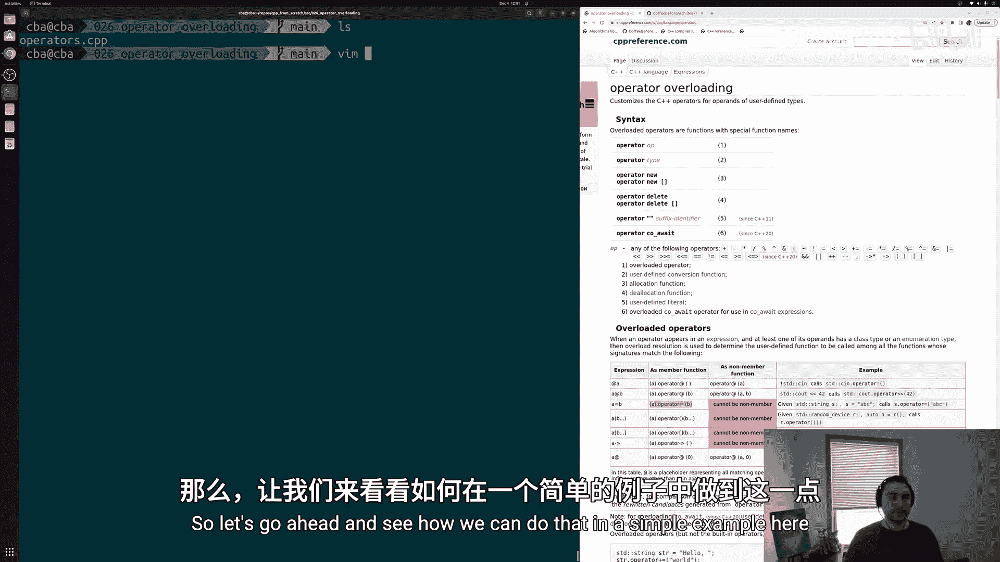
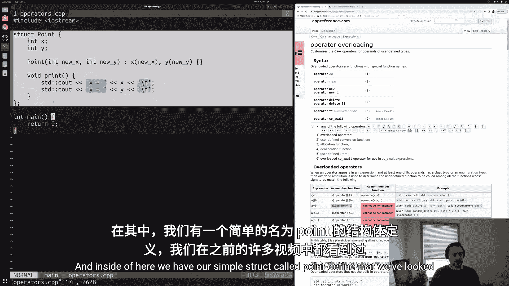
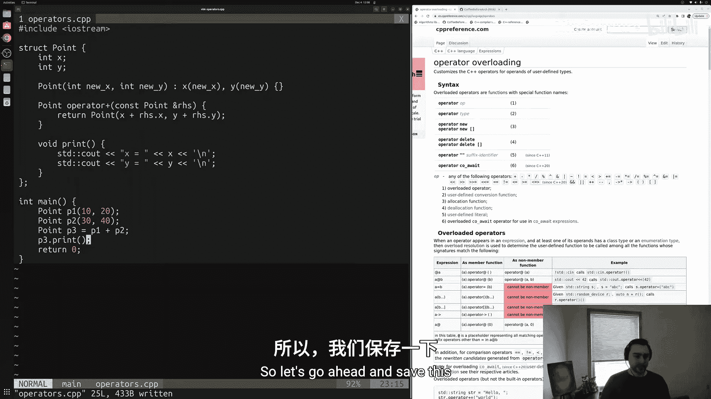
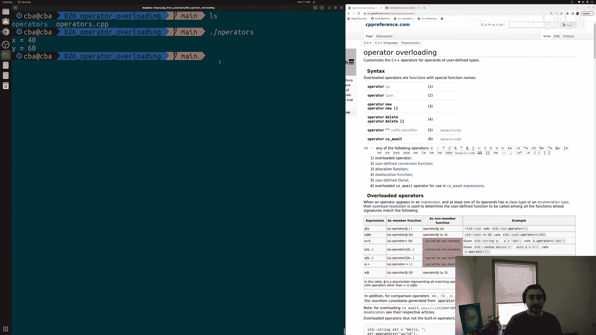
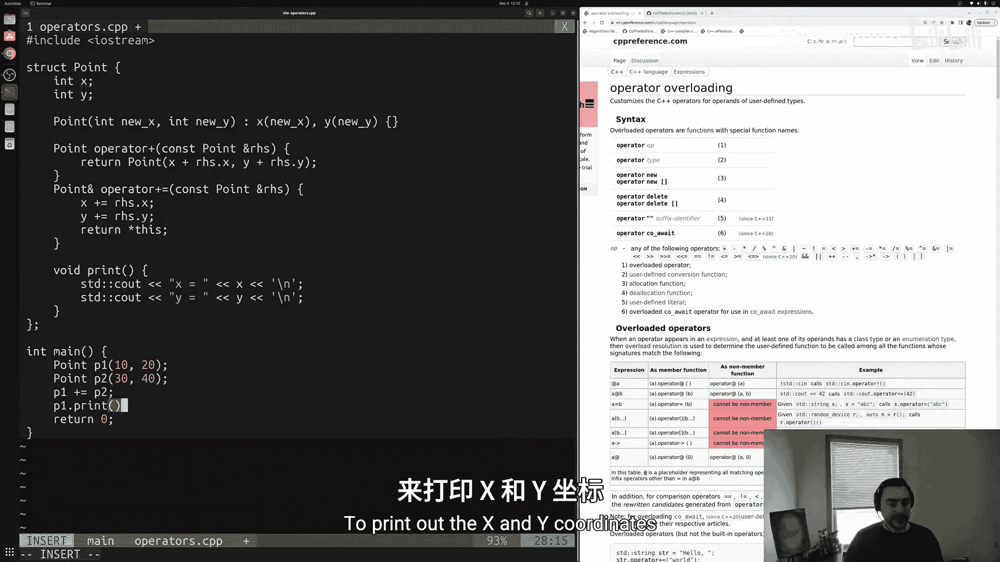
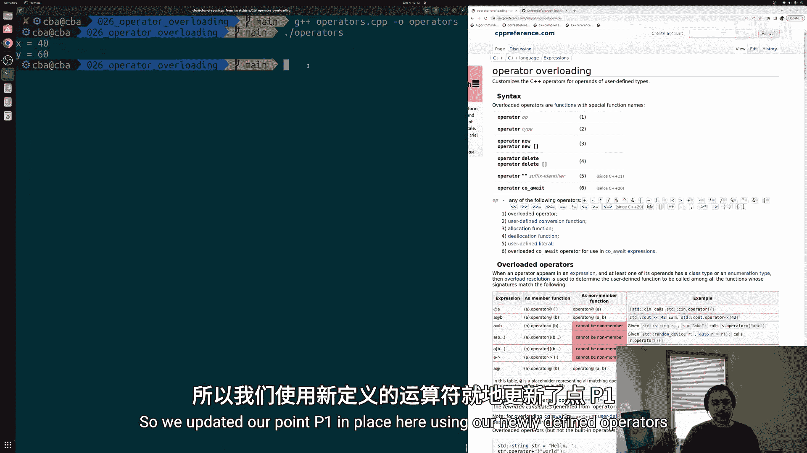
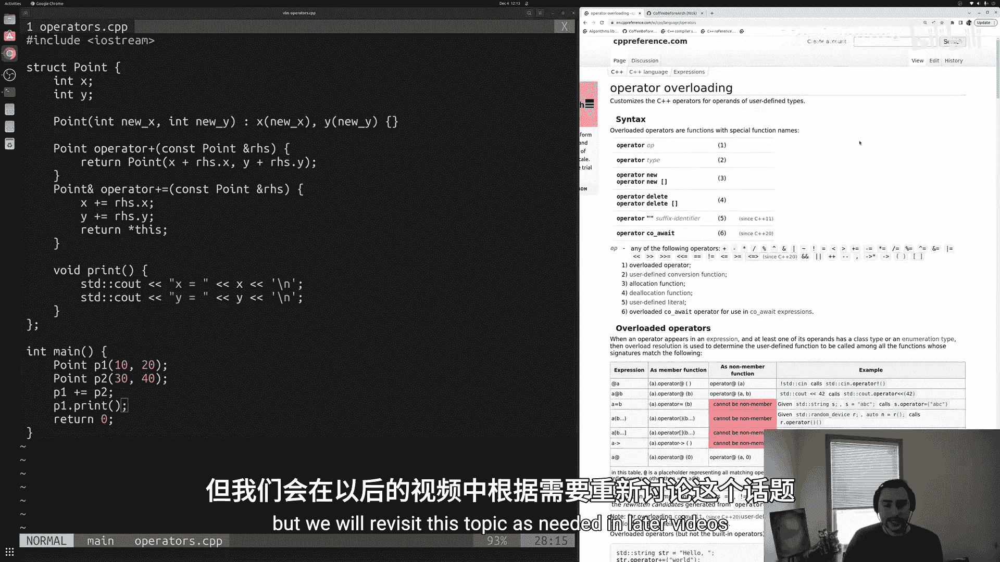
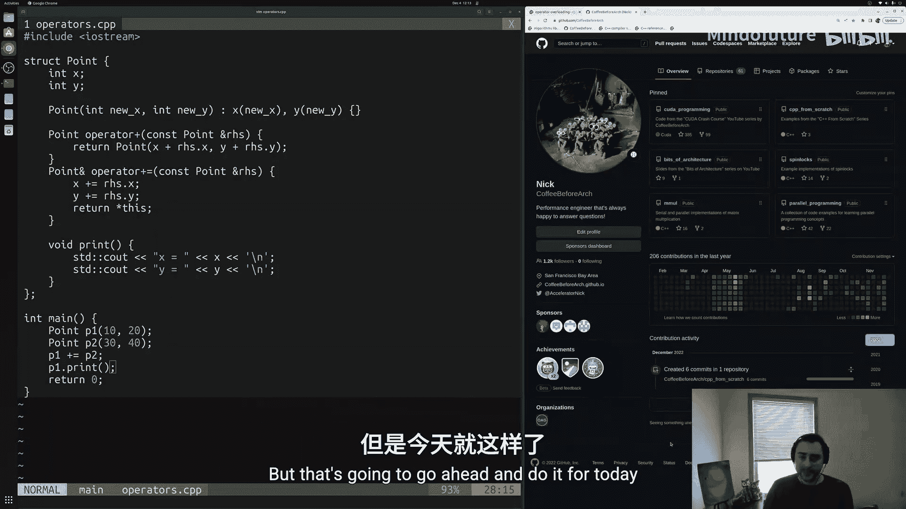

# C++入门教程｜CoffeeBeforeArch-p27-P27-Operator-Overloading--BV1nbRUYSEUu_p27-

Hey， everyone， I'm Nick， and this is C Plus Plus from scratch。 So in this episode the series。

 we're going to be talking about operator overloading。So in the previous videos。

 we've been looking at how we can define our own types usingstructs and classes。

So one thing that would make our types nice to work with would be if we could use our operators with our types。

 so something like the plus or the minus operators or maybe even something more advanced like the indexing or call operators。

Now， the reason why we can't use these things by default is because our compiler really really doesn't know what these operators mean in the context of our new objects。

 so the way that we teach our compiler about what to do with these operators and how to use them is through operator overloading and implementing these operators as methods within ourstructs and classes。

So let's go ahead and see how we can do that in a simple example here。

 so we'll open up this operators。cppP。

And inside of here， we have our simple struct called point Def that we've looked at in a number of the previous videos。

So it's just some struct that maybe represents some XY coordinate， so we have a couple data members。

 these integers X and Y， we have a constructor here that just initializes x and y to some values。

 and then we have some member function print right that just prints out the values of x and Y。

So let's say we want to implement this plus operator here。

 so we want the ability to add two points together to create some new point。

 so maybe we want to add the X coordinates together and the Y coordinates together and initialize some new point with those results。

So let's go ahead and see what that would look like maybe from a usage perspective。

 So we might create some point P1， initialize it to something like 10 and 20 for x and Y respectively。

Then create some point P2 initialized to maybe something else， So maybe 30 and 40。

 And what we'd ideally like to be able to write is， say point P3 is equal to P1 plus P2 here， right。

We'd like to be able to use this operator plus to add our points together。

 which would create some new point P3 with maybe the value of x of 10 plus 30。

 So add the x values together。 So 40 in this case。 and then add the y value together。

 So 20 plus 40 is 60。 Now， the problem is， by default。

 Our compiler doesn't know what this plus operator means right and even yells us about it。

 It said that there's no match for operator plus for these opera types of point and point。

 So we have to teach our compiler what to do in the case of say this operator plus here。

 And the way that we do that is by implementing it as a member function within our struct or our class here。

So let's go ahead and do that right so first we have to think about what is our return type going to be for this operator？

So we're adding two points together and we're creating a new point right as a result。

 So a return type should just be some point， right， something of type point。

Then what we're going to use as a name for our operator when we use a special name of operator followed by whichever operator we're implementing。

 So the plus operator in this case， then just like a member function will have a some prints here where we can put our parameter list or a list of parameters rather。

So in this case， what are we going to put inside of a parameter list。 Now。

 what are we doing here when we do P1 plus P2， We're really doing P1 calling the operator plus of P1 in passing P2 as an argument。

 So up here， what we're really doing is passing some other point P2。

 Now we don't necessarily want to copy P2。RightInto this function and we don't want to modify P2 either。

 We're just adding the values together。 We're not modifying P1 or P2。

 So let's go ahead and pass it into this operator plus by Kongs to reference。

So some constant point by reference YaP2 here， or perhaps we could be a little bit better in terms of and more general by calling this RHS。

 which stands for right hand side。So why are we calling this right hand side here Well。

 very simply because it's the right hand side of this operator we're implementing P1 is the left hand side。

 we're calling operator plus for P1 and on the right hand side of this plus is P2 right That's what we're passing in as an argument here it's going to take the place of this parameter so we can generalize this name to just RHS or right hand side。

And then we'll have some curly brackets here where we can implement what operator plus means just like any normal function。

Now to help explain a bit more about why P2 is this parameter here where we're passing it in as an argument to this plus operator。

 we can go ahead and rewrite this shorthand form of plus here to something a little more of verbose but exactly equivalent。

So in this case， instead of doing P1 plus P2， this is exactly equivalent to P1 dot operator plus with P2 as an argument。

RightAt the end of the day， this operator plus is really just a member function of ourstruct point here。

 that we're implementing right here。 So P2 is going to be our argument and we're calling operator plus from P1 here。

 And if you go ahead and look on the right hand side of the screen So the CBP reference page for operator overloading you can see these different expressions for operators and what they look like as these member functions here so this is a good reference to look at。

Okay。So let's go ahead and go back to the shorthand form。

 hopefully that helps explain why P2 right is getting passed in here。

So let's go ahead and implement this operator plus though。

So what we want to do is create some new point， right， So we're not modifying P1 or P2。

 We're creating some new point P3， right， So what we can do is we can return some new point。

So we'll put this type point here。And we'll go ahead and initialize it right。

 so we'll call our constructor for point and we'll return that new object that we're creating。Now。

 we'll create this and initialize X to what we want our result to be and y what we want our result to be of adding our x coordinates together and our y coordinates together respectively。

So we'll initialize our x for a new point with x plus right hand side x。And we'll initialize y 2。

 y plus right hand side y。 right So we're returning some new point with an x value of P1 x plus P2 x and a value of y of P1 y plus P2 y。

 P P1 y just being the y of the current object that we're inside of calling this operator plus。

And P2Y being from this right hand side here， what we're passing in is an argument to our operator plus down here。

 so the right hand side of this expression。Okay， so we're returning turning this new point。

And we're setting p3 equals to this new point down here。

So let's go ahead and make sure that we did the right thing here and that our operator is working as expected。

 so to do that we can just call something like p3 do print。

 right our print method to print out the values of x and y， and we should see x is equal to 40。

 so 10 plus 30 and that y is equal to 60， so 20 plus 40 adding the x coordinates together and the y coordinates together。

So let's go ahead and save this， and then we can go ahead and compile operators。

cppP and call our output executable something like operators。

And we can go ahead and run our executable here。 So we'll go ahead and run it。

 And you see that x is equal to 40 and y is equal to 60。 We got our expected result。

Alright， so that's kind of the basics of you know implementing operators in C++ let's go ahead and do one more before we call it for today。

 So instead of creating say some new point P3， let's say we want to modify an existing point here。

 So instead of at you know using some plus operator maybe we want to do plus equals。

So let's get rid of P3 here， and instead we want to do something like p1 plus equals p2。

 so we want to add， say the x and y coordinates of P2 to our x and y coordinates of P1 and modify P1 in place here。

Now， again， this operator isn't implemented by default。

 So you see that we have no match for operator plus equals for upper n types point and point。

 So this is another operator we'd have to implement in ourstruct if we want to use it。

So let's go ahead and do that。Now， the first thing we have to think about is the return type here。

So what are we going to return from this plus equals operator， Well， we're not going to return。

 say a new point here。 right， We're just modifying an existing point。 So P1 in this clay。

 in this case。And here， right we can think about this plus equals a little bit differently。

 This P1 plus equals is really equal to P1 is equal to P1 plus P2。

 right That's how we can kind of rewrite this plus equals right in our head。

So what we're going to really return here is just P1。 right We're just modifying P1 in place。

 so we'll just return， say， a reference to our current point that we're working on。

 So some point reference。Okay， then we'll go ahead and add our operator names or operator plus equals。

And then in our parameter list， itll be the exact same as operator plus here。

 The right hand side we're passing in this P2， and we don't want to modify P2。

 we don't want to copy it。 So we'll just pass it in by con reference。

 So some con reference for a point。That we'll call right hand side。

 It's the right hand side of our operator。 And again。

 we could write this as P1 dot operator plus equals with P2 as an argument， right。

 Those things are equivalent。 It's just a member function。

So what are we going to do inside of the body of this member function here for this operator， Well。

 we want to update， right， our current objects P1， right。

 That's the object that's calling this plus equals operator。

 So we can do that by just doing x plus equals and then P2 x。

 So we're passing in here is right hand side。 So we'll just do x plus equals right hand side X。

Likewise， we can do the exact same thing for y， right。

 So we'll just do x plus equals right hand side X and y plus equals right hand side y。Now。

 we have one final thing to take care of here。 and that's going to be our return type。

 So how do we return， say a reference to the object that we're currently inside of right。

 So P1 is copying this operator or is running this operator plus equals here。

 It's calling this operator plus equals。So how do we return this reference to our current object here？

Well we do that through a special keyword in C++， and that's going to be the this keyword。

So this this keyword is a bit special here。 It's going to be a pointer to our current object， right。

 So in this case， we're calling plus equals for this P1 object。

 So this is going to point to P1 here right inside of this operator。

So what we can do is we can return this， but de referenceenced here。 So， you know， by default here。

 this is a pointer。 right， we don't want to return a pointer here。

 We're returning some point by reference。 So we'll de just dereference our pointer this here。

 So this is a pointer to our point P1。 And we're dereferencing that to get our point that gets returned by reference here。

 So remember， we're updating P1 in place。 So we're just going to return P1 here。

 So we'll return this dereenced。Okay。So let's go ahead and save this。And then down here。

 let's go ahead and make sure that P1 got updated from this plus equals operator。

 so we'll do P1 and then dot print right to print out the X and Y coordinates。

So we'll go ahead and save this， and then we'll go ahead and recompile operators。 CBP。

 call our output executable operators， and we'll go ahead and run it。

 and you see that x is equal to 40 and y is equal to 60。

 So we updated our point P1 in place here using our newly defined operators。

Okay， so that's going to go ahead and do it for today。

 as you can probably tell by looking at this operator overloading page on CPP reference。

 there's quite a bit you can get into in many situations where we would use or implement these different operators and we're not going to cover them all today。

 but we will revisit this topic as needed in later videos but I'll link this document below the video and as always you can find this in any of my other examples at Github。

 co scoffeebe arch but that's going to go ahead and do it for today as always on Nick and hope you have a nice day。

