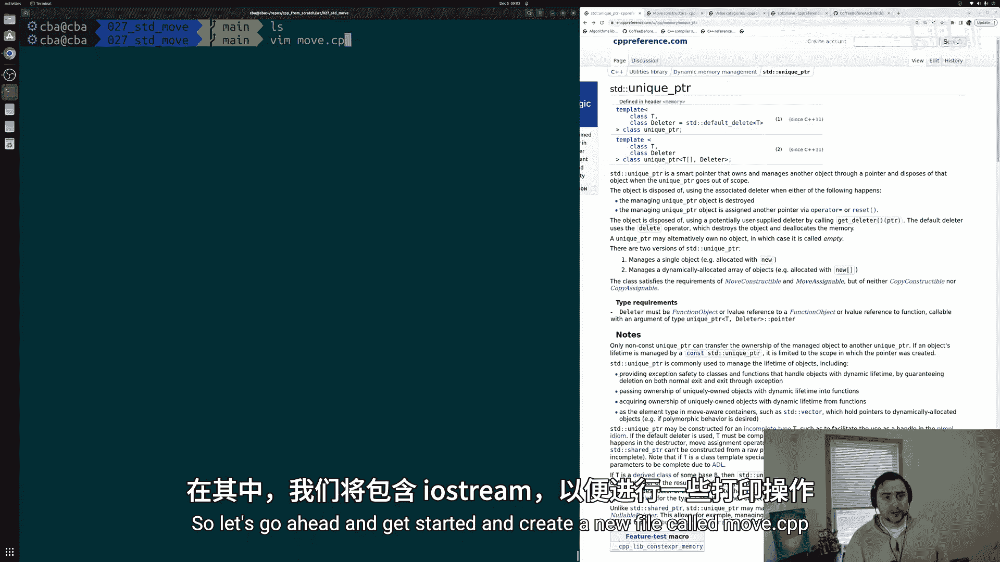
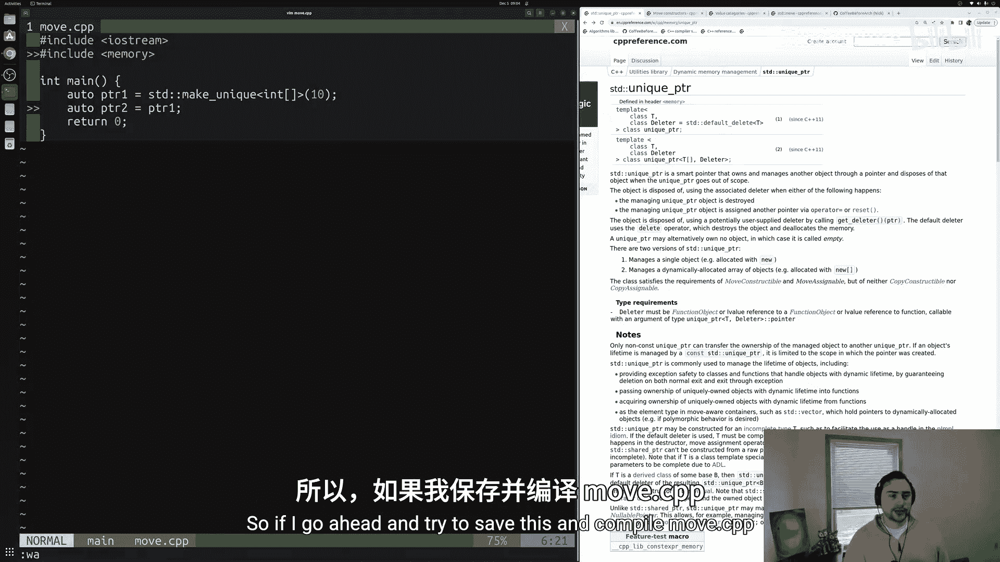
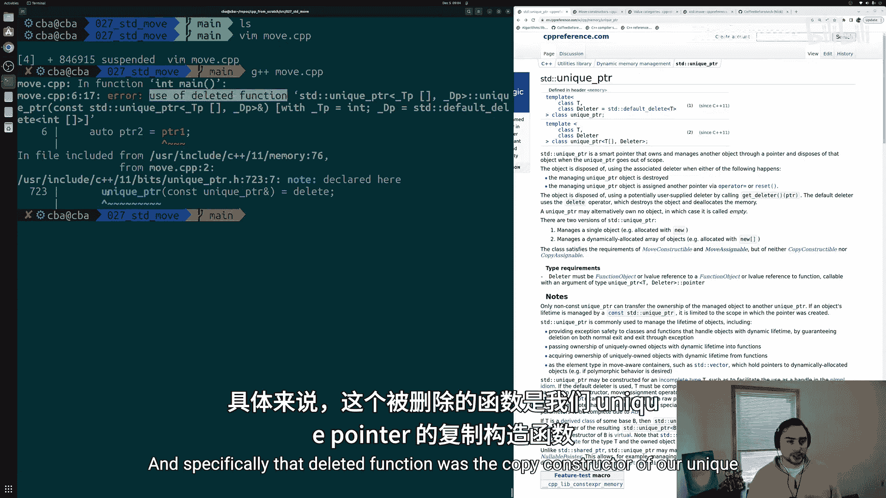
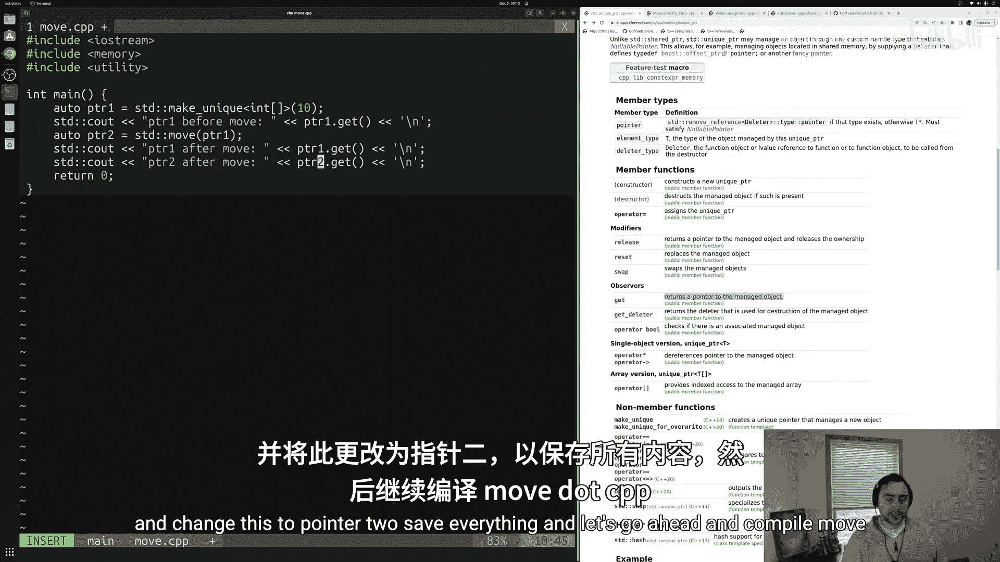
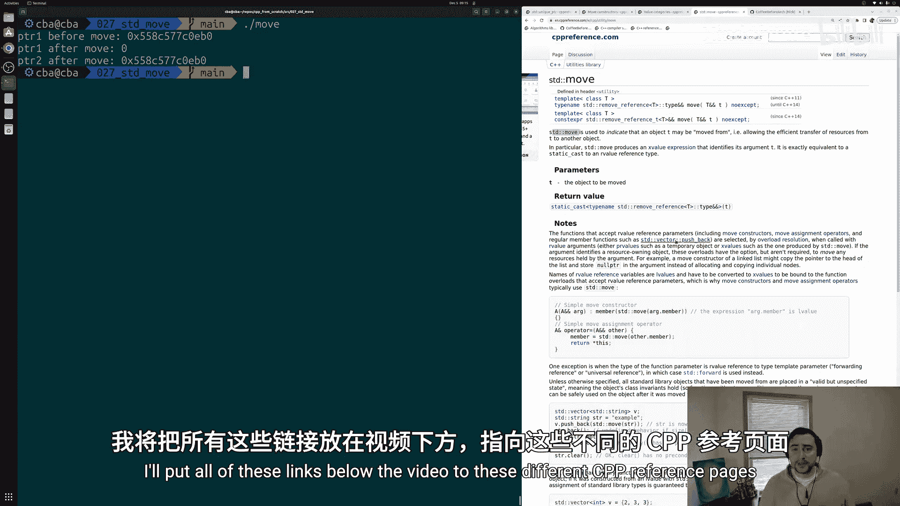
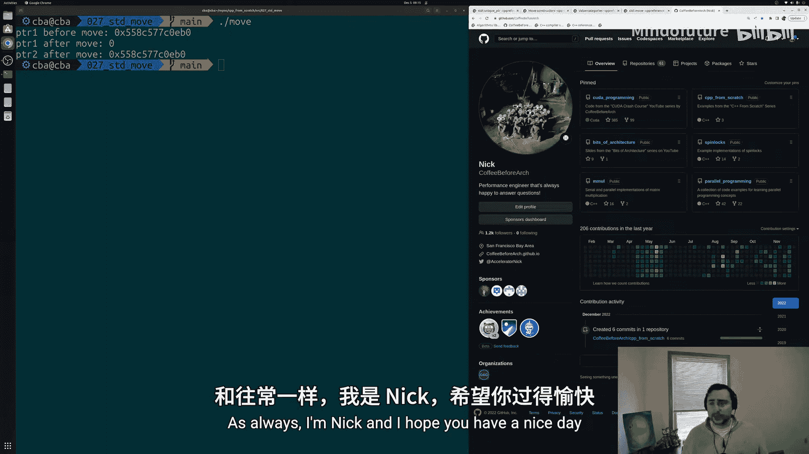

# C++入门教程｜CoffeeBeforeArch-p28-P28-std----move--BV1nbRUYSEUu_p28-

Hey everyone， I'm Nick， and this is C++ from scratch。

 so in this episode of the series we're going to be talking about the basics of stood moveve and move semantics。

So in previous videos， we've talked about how we sometimes want to prevent copies inside of our programs。

 and this might be for functional reasons， like the case with pseudo uniqueique pointer that can't be copied。

 or it might be for performance reasons， say we have a very large vector that would be expensive to copy。

Now one of the ways that we have around copying and Z++ is this idea of moving and move semantics。

 where instead of copying some resource to say a new object or different object。

 we can steal the underlying resources so that's what we're going to be looking at today with some simple examples。

So let's go ahead and get started and create a new file called moveve。cppP。

And inside of here， we're going to include Io streams so we can do some printing。

 and we'll also include memory right so we can play around with our stood unique pointer here。Then。

 of course， we'll need a main function core of our C++ program。

So let's go ahead and start off by just creating a unique pointer to it is going to manage some dynamically allocated array of integers。

 So then create some pointer one instead the sequence to stood， make a unique。

Let's go to manage an array of integers， and let's just say 10 integers here。

so we've created a unique pointer。 Now， something that we can't do with our unique pointer。

 as we kind have mentioned earlier， is we cannot copy it。

 so I can't do something like auto pointer 2 is equal to pointer 1， right。

 I can't use the copy constructor of my unique pointer because it simply doesn't exist。

So if I go ahead and try to save this and compile Mo。cP。

 we can see that my compiler yells at me a bit， it says error use of a deleted function。

 and specifically that deleted function was the copy constructor of our unique pointer。

Now， even though you we cannot copy， say a unique pointer。

 there are still cases where we might want to give up the resources that our unique pointer is managing and shift it over to say a new unique pointer or unique pointer may be coming from somewhere else。

 and we want to move that contents right or that underlying memory that it's managing to say a new unique pointer。

And the way that we do this in C plus plus is through this idea of moving and move semantics。

 So to go ahead and look at the CPP reference page for a unique pointer here。

 we can see that our unique pointer class satisfies the requirements of move constructable and move assignable So we can move our unique pointer。

 So we can't copy it。 So it doesn't satisfy copy constructable or copy assignable。

 But what exactly do we mean by this move constructable。

 So I think the best way to kind of discuss that is by looking at the CPP reference page for move constructors。

 So move constructors look very similar to our our copy constructors they have some class name or name right as the name of the method and then they take something of type of whatever class it is。

 But instead of by reference here， it takes it by this our value reference that we haven't seen before。

 So this double amberpers and sign。 So we'll talk about that in just a little bit。

 but let's go ahead and look at the explanation for。How these move constructors work。

So the idea behind move constructors is that they steal the resources held by the argument。

So we're creating a new object based on some other object， but instead of copying the resources。

 so say copying some memory， what we're going to do is steal that memory away from what currently has it。

So in the case of you know our unique pointer here pointer1 is managing this array of 10 integers right if you're going to move it using move construction to pointer2 pointer one would no longer have this array of 10 integers here。

 it's going to be stolen away and given to pointer2 but this doesn't just apply to say dynamically allocated memory。

 it could be some other resource like a TCP socket。

 Io streamams or even running threads right but the idea here is that we're stealing away resources from one object and giving it to another instead of making a copy of them。

Now one of the things when we do a move is that it says specifically it leaves our argument right so whatever we're doing a move from in a valid but otherwise indeterminate state now should what does that really mean in practice Now all that really means is that you know we're still able to use say our pointer one here but we shouldn't use the value that pointer one used to have before we did a move here so we shouldn't rely on this underlying pointer still being valid here。

And some of our SDL containers right have say a fully specified state after doing something like a move。

 but other containers don't， so something like a stood string or a st vector may be empty after we do a move after we steal away those underlying resources。

 but they may not， so it's not something that we should rely upon so we can still use the container。

 but we shouldn't rely on the value right being what it was before the move。However。

 there are containers and objects so things like stood unique pointer that we're working with that do have a fully specified move from state。

 So after we move and you move the underlying resource from a unique pointer。

 the state of our unique pointer is fully specified and we can rely on that。

 and we'll look at that in just a little bit。But before we get into that， we have to talk about。

 you know how exactly do we use this move constructor right you know all we have so far is you know we're trying to use our copy constructor here。

 but how do I tell our compiler that we want to use a move constructor？

And that requires us to talk a little bit about these value categories and L values in R values。

So we have these five major value categories in C++ that describes the values inside of a program Now we're going to keep things at a pretty high level here and not really deep dive into what a GL value is。

 a PR value and x value， etc cea， et ceter we're going to mainly focus on L values and R values。

Because I think these can be fairly intuitive， right at least at a very high level。

So as it says here on CPP reference， L values are historically called L values because they are on the they were typically on the left hand side of some assignment expression so there are some say name thing so something like this pointer one or pointer two variable they have an address and they can be assigned to right now on the other side of things we have things like R values right which are typically on the right hand side of these assignment expressions and say they don't have names right so they might be some nameless temporary or they might be some immediate values so some integer like8 and these are things that we typically do not assigned to right。

So， you know， for example a pointer1 and pointer 2 are going to be considered L values here and stood make unique。

 right， this return value from this called a stood make unique， that would be an R value over here。

 or we'd consider in that class of things。Now， one of the main differences that we have between L values and R values is how we treat them in terms of copying and moving So by default with our L values。

 we can have references to these things， but we typically copy them we don't move them。

 but things like these nameless temporaries and like return values or things that we do move we do move things like R values。

 Now we have a bit of a special case here with things like you know some of our L values。

 So some of our L values we can convert to be types of r values are R value references that we can move and the way that we do that is through something like stood move here So stood move。

 you can see as it says in description， stood move is used to indicate that an object T maybe move from to allow the efficient transfer of resources from one object to another。

 So it's a way that we can tell our compiler， hey， you are allowed to move this even though。

It's not a type of value that you're typically allowed to move， you know， provided that。

 know it has specified something like a move constructor right。

 so it it says how it can actually be moved。So let's go ahead and see how we can do that with our our unique pointer here。

 so what we can do is we can include utility right that's where this should move is defined。

 so we'll go ahead and include utility。And then instead of just doing this assignment here。

 we'll change the value category for this pointer one here by using this stood move on pointer 1。

 now again。Stoodmove isn't forcing right our compiler to move pointer1。

 What it's doing is saying you're allowed to move this。 So in this case。

 what we'll see is that we're no longer going to get a compiler error anymore。

 Our compiler is going to move pointer 1 and do this move construction of pointer 2。

 So it's going to steal away this underlying resource。

 And we can actually see that my stood unique pointer。

 as it mentioned inside of our move constructors。APage from CPP reference has a fully specified state that we can rely on after moving。

So one thing we can do is we can just print out the underlying pointer right for our unique pointers here。

So we can do something like stood， see out， and we can print out， you know。Pointer1， the4 move。

And we'll go ahead and print out pointer 1 dot get。

So we'll use get method down here of our unique pointer。To get the pointer to the managed object。

 this dynamically allocated array of integers。Foled by new line character。

Then we'll go ahead and print this again after we do the move。

 So we'll see what our the state pointer two is in after the move。

So let's go ahead and change this to pointer1。After move。

 and then let's go ahead and look at pointer 2， right after we've done this move。

And see what the underlying pointer is for our new unique pointer here。

So let's go ahead and change this to pointer two， save everything and let's go ahead and compile move。

cppP and call our output executable to something like move。

And then we can go ahead and run this。And what we end up seeing is that pointer one before a move。

 right， it has some pointer to some dynamically allocated array of memory that we got from make Share。

But after we do the move， we see that the pointer is null out。

 it's zero now that underlying resource was stolen away right， and it was given to pointer2。

 so you can see that pointer2 the pointer that it's managing。

After we do this move is the same one that pointer1 used to have。

 So pointer 2 just stole the underlying resource of pointer1 right through that move construction here。

 So moving is just a way that we can transfer resources from say。

 one object to another instead of copying them。 And there are a number of places where we might want to do that。

 So， for example， in a loop。 we may be calling some function to get some results or set some object。

 right， So we don't want to copy that result into， say something like a vector， right。

 So maybe we're constantly adding things to a vector。 So we get something from a function。

 Then we add it to a vector。 instead of just， you know copying that value into a vector over and over and over。

 we could move that value into a vector， right， and just steal those underlying resources。

 So that's one of the things that we could do and why moves are important。Okay。

 so there's a lot to take in here。 and this is just a brief introduction to this idea of moving and move semantics and how we used stood moveve。

 So again， we used stoodmove to just tell our compiler hey， you're allowed to move something。

 and this works great with say or StL containers like Stoo vector or stood string or even things like stood unique pointer right and we can also specify things like these move constructors for our classes。

 Now that's going to go ahead and do it for today。 I'll put all of these links below the video to these different cP reference pages and of course。

 you can find out more about you can find out more of these examples and play around them at Github co s coffee before arch but that's gonna go ahead and do it for today As always I'm Nick and I hope you have a nice day。

😊。

