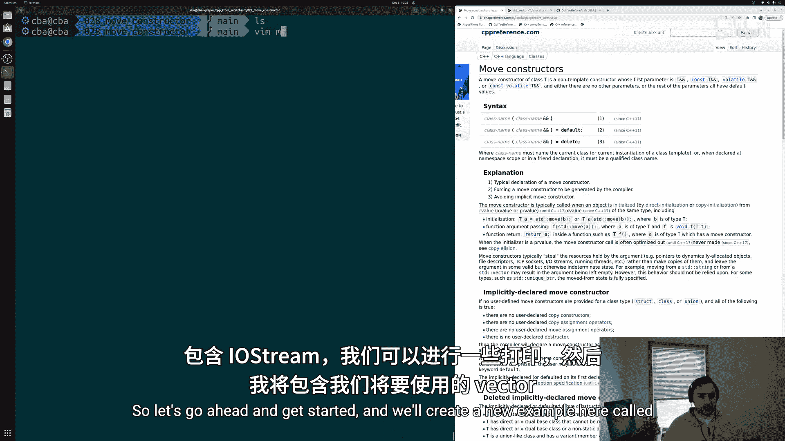
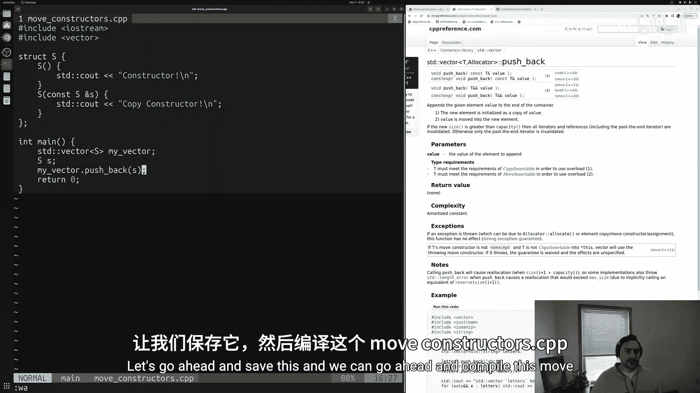
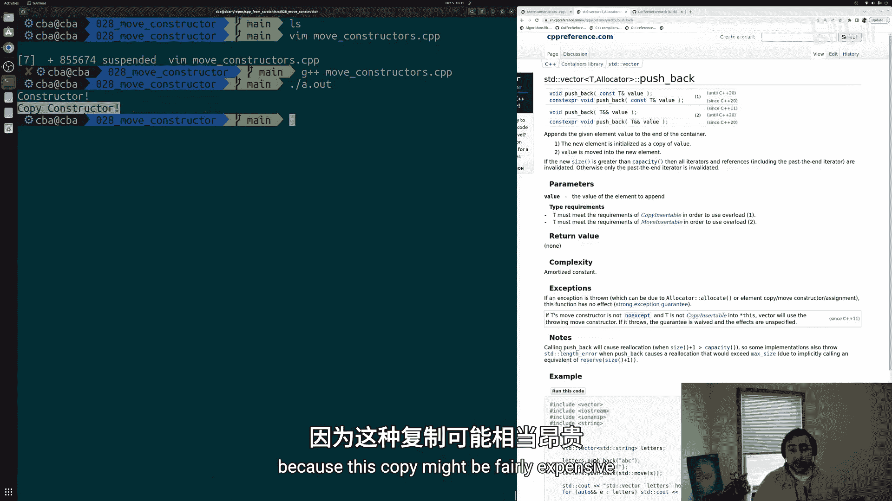
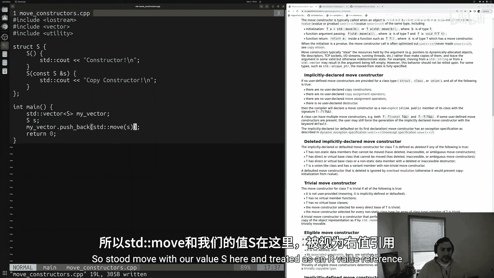
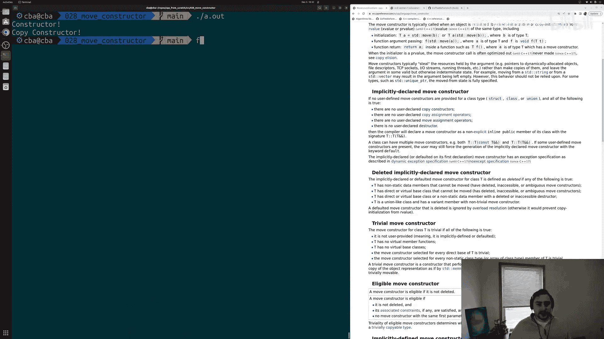
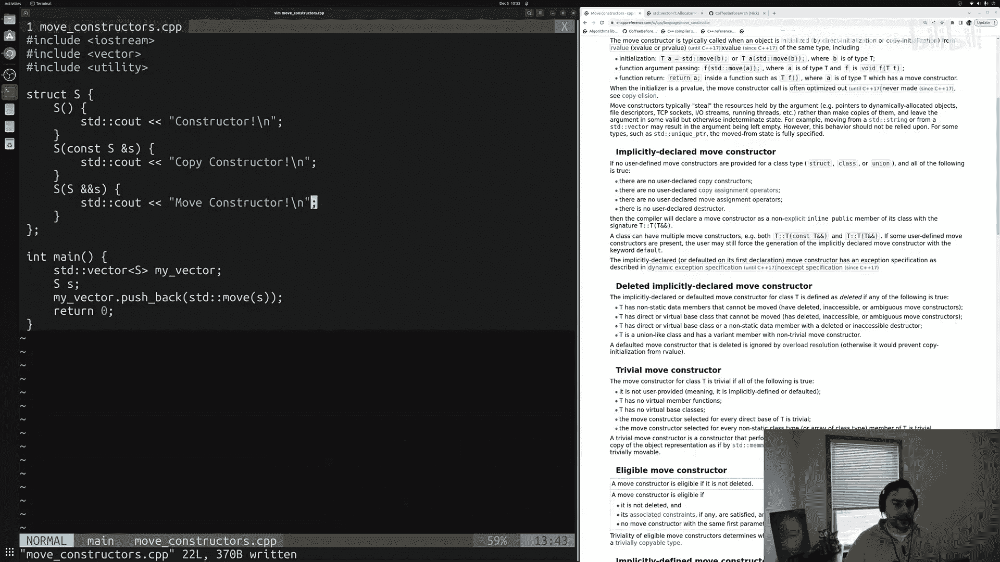
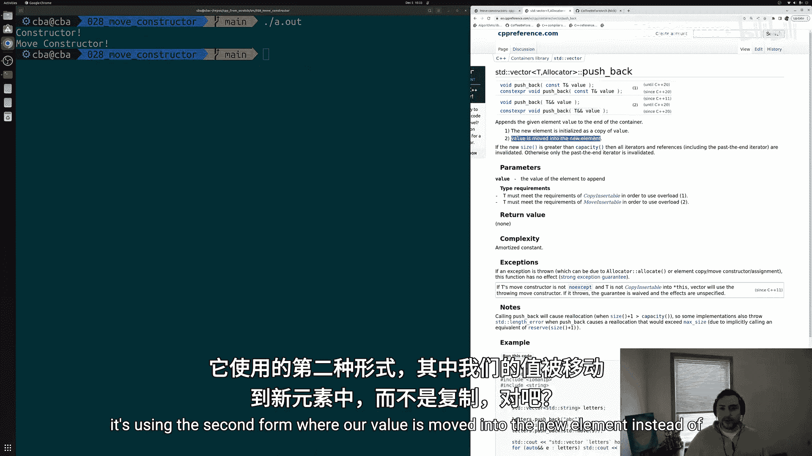
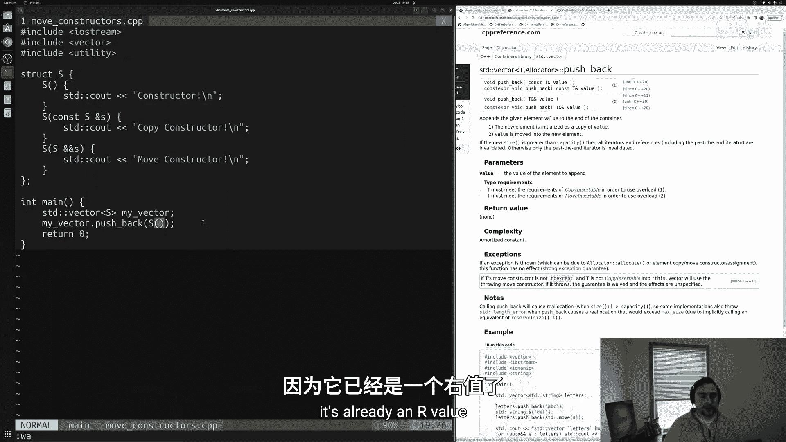
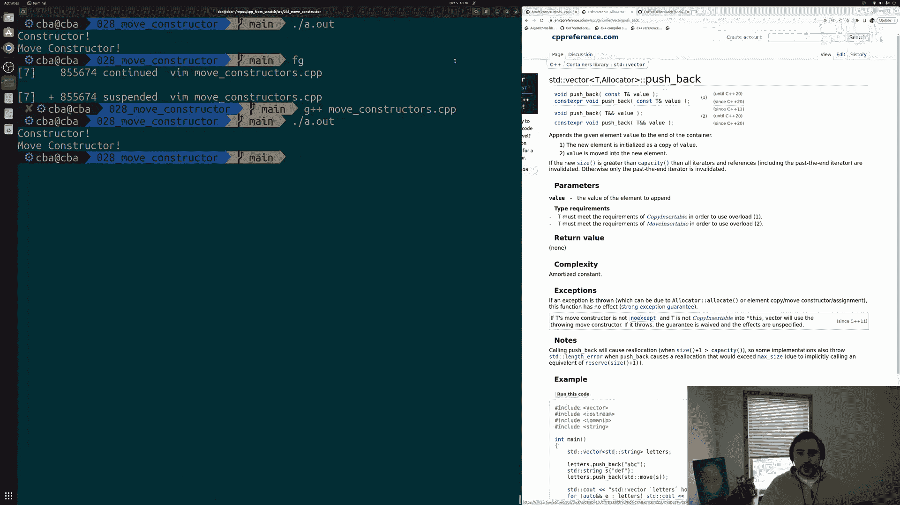
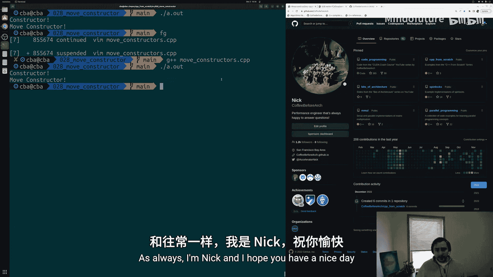

# C++入门教程｜CoffeeBeforeArch-p29-P29-Move-Constructors--BV1nbRUYSEUu_p29-

Hey， everyone， I'm Nick， and this is C Plus Plus from scratch。 So in this episode of the series。

 we're going to be talking about the basics of move constructors and how we can define our own in ourstructs and our classes。

So as we discussed in the last video， we have this idea of moving and move semantics and C++。

 so instead of say copying a value， what we can do is move the underlying resources from one object to another。

 but how exactly do we do that with our own classes orstructs that we define？

So specifically we're going to be looking at today in the context of our stood vector right so a lot of times we're getting these values and these objects from multiple different places and we might be putting them inside of some container here。

 but not every single one of our objects can be copied right so for example。

 a unique pointer can be copied。And another thing is that。

 copying all of these objects might be very expensive。

 So instead of copying right the underlying contents。

 we may just want to move the underlying contents into something like our vector。

 So we're going to look at the basics of that today。

 So let's go ahead and get started and we'll create a new example here called move constructors do CPP。

And inside of here， I'll include a couple things， so'll include IO streamams so we can do some printing。

 and I'll go ahead and include our vector here that we're going to be using。

Then I'll go ahead and write our main function。Now let's go ahead and say we want to create some new type S right here。

 so we'll define somestruct called S。And inside of here， we're going to keep it pretty simple。

 we're just going to define some things like a simple constructor here that just prints out that we're calling the constructor。

 so it just prints out something like constructor with an exclamation point。

Then we can also implement something like our copy constructor。 So this will be know the same name S。

 but it will take some S by cont reference， right， so some cons S by reference。

 it will just call small S and it will do something similar。 itll just print out， in this case。

 copy constructor。So we'll know whenever we're copy constructing something of type S。Okay。

 so let's go ahead and go down to our main function and create a vector of type S， right。

 So here we'll create some stood vector。 And as the template parameter will say that it'll contain something of type S。

And then we'll call this say my vector。Then we can go ahead and maybe just create some instance of ourstruct S to an object。

 So we'll create some S。 and this will end up calling our constructor here。

 So we should see a printout of constructor。And then finally。

 what we'll do is we'll try to push this element back into our vector。

 So we'll do my vector dot push back。Of S。And what exactly is going to happen in this case。

 So if we go ahead and look at the CPP reference page for our vector here。

 we can see that our pushback has two signatures， something that takes as reference and something that takes us our value reference here。

Now in this case， S is going to be an is an L value here right， It's this named value。

 And so we're going to end up calling this first signature。

 And if we go ahead and see what this one is， it says it's going to create this new element and add to the end of our container。

But this new element is going to be initialized by a copy of value。 So basically。

 when we do this pushback of some L value like this。

 we're going to get our copy constructor get called right。

 So we should see a printout of our constructor when we first create S and then a copy constructor from this called a pushback with our vector。

 So we're creating a new instance of thisstruct S this type S inside of our vector that's being initialized by a copy。

Okay， so let's go ahead and save this and we can go ahead and compile this moveconstructors。

 cP right。

And then we can go ahead and run this and we see exactly what we expect。

 we get a constructor from when we create our object and a copy constructor from our called pushback。

Now this copy is what we sometimes want to avoid， either because we have something like a unique pointer that doesn't even have a copy constructor or because this copy might be fairly expensive。

 so we just want to move the underlying contents here。

So let's go ahead and see how we can do that in C++。Now because we have a copy constructor。

 we're not going to get a move constructor by default， in fact。

 if we look at move constructors and we look at you know when we have implicitly declared move constructors or when they're deleted implicitly。

 we can see that we only get this implicitly declared move constructor if there are no user defined copy constructors here right so here we've defined a copy constructor。

 so we're not going to get a move constructor。So if we do something like， you know。

 include utility up here。So that we had access to our stood move that we looked at in the last video。

And we try to use stood move with S here。 So stood move。

With our value S here and pre as an R value reference。

And we can go ahead and compile this。You can see that we still get this call to this copy constructor here so again stood move doesn't force a move to occur。

 it just says that you're allowed to move this， but because you knowstruct S here does not have a move constructor and it wasn't implicitly declared because we have a copy constructor already。

 we can see that we just get a copy occurring。

So let's go ahead and declare our own move constructor here and what is that going to look like？

So here we're going to。You know， go ahead and have something of。This name S here。

 so it's going to look a lot like our copy constructor， except instead of taking some S by reference。

 it's going to take some type S by R value reference and it's not going to be constant here when we're having a move constructor we're stealing the underlying resources of our argument here so it's not constant。

And then we can go ahead and put here， you know， stood sea out。You know。

 move construct right to show that this is what we're calling。

Okay， so let's go ahead and save this。We're going compile moveconors cP and we can run this。

 and you can see that now we're getting this move constructor call。

 So we're constructing our object S and then we're moving it into our vector here So if we go ahead and go into our vector or look at our vector pushback reference on CPP reference。

 you can see we're now using this second form of pushback here that takes some R value reference and whenever we're passing this R value reference to pushback it's using the second form where our value is moved into the new element instead of copyied right。

 so because we implemented this we implemented this move constructor right here and we told our compiler that you're allowed to move this object of s which is you normally an L value。

 something that we can't move。

It's able to do this move right into our vector here so that's kind of the basics of how we can implement these move constructors。

So let's go ahead and talk a little bit more about this in situations where we might still get a move。

 f， even if we don't use something like stoodoo move。So let's go ahead and get rid of this object S。

That we've created an instance of， and instead let's just create something of type S right directly here。

So what's going to happen in this case So we're creating some instance of our struct S here。

 so some object， and that's being pushed back into our vector。

 but we don't have a name for this value right here。

 we're just creating some object of type S here So what's going to happen or we're going to get a copy are we going to get a move。

Well， this is going to be an R value right， it's something that doesn't have a name right it's a value without name。

 it's something that's typically on the right hand side of some expression here。So by default。

 we're going to get this move constructor happen， it already is or already will be considered to be this R value reference。

 so we should see we'll first build this object and then we'll move it into a vector even without having to specify you know stood move right because it's not an L value here。

 it's already an R value。

So we can go ahead and save this and we can compile move constructors cP and we can run this。

 And you can see that first， our object gets created with this constructor。

 and then it gets moved into our vector here。 So we still need to create our objects or our constructor still gets called。

 but it doesn't get copy right， It gets moved， even though we didn't specify stood move And again。

 this goes back back to our value categories here。 right This is an our value that we're trying to move here。

 right it's only L values that we want to move that we have to call the stood move for to tell our compiler it's okay to move it。

Okay， so that's going to go ahead and do it for today。

 that's kind of the basics of defining our own move constructors in situations where we'll get moves versus copies with Sat Ve。

 which is just a very common container in C++ code。

Now， of course， I'll link these reference pages below the video and you can find this in any of the other examples at Github。

 com s coffeeee before arch， but that's going to go ahead and do it for today。 As always， I'm Nick。

 and I hope you have a nice day。

