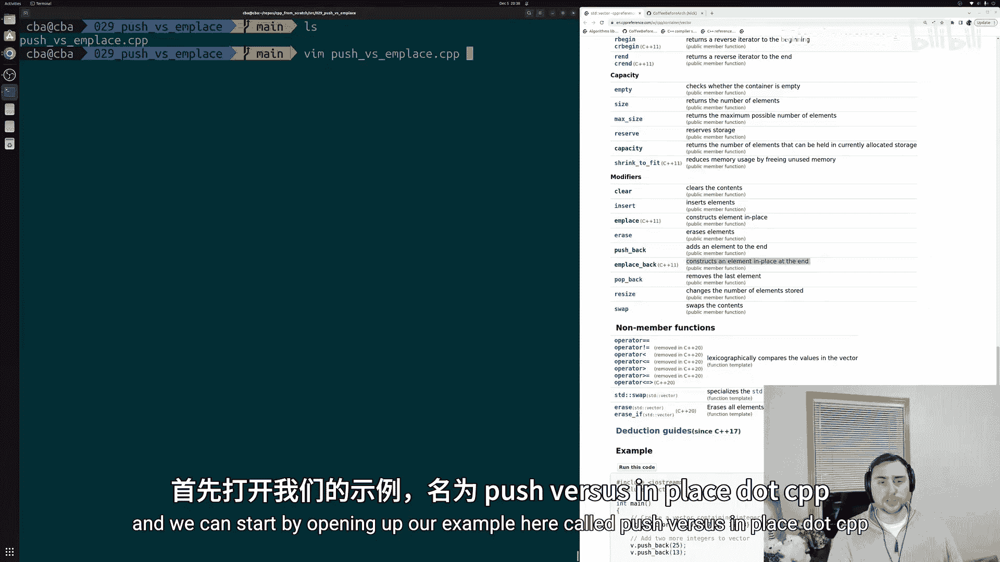
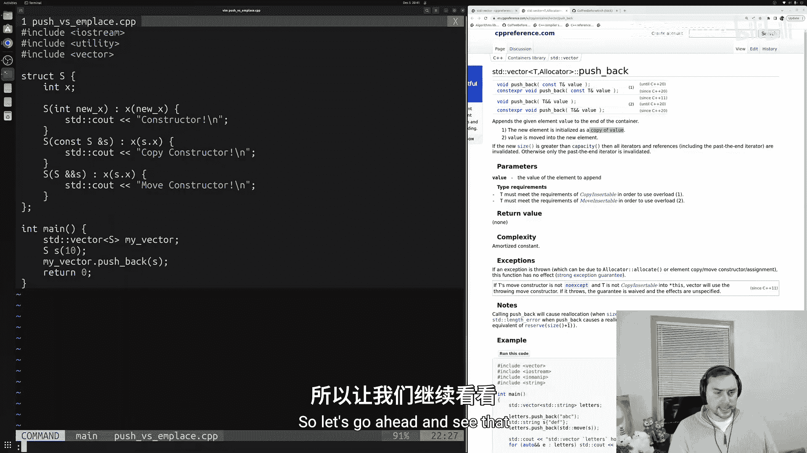
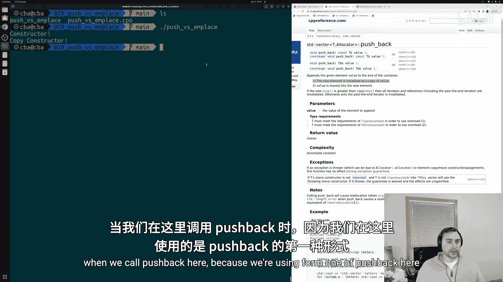
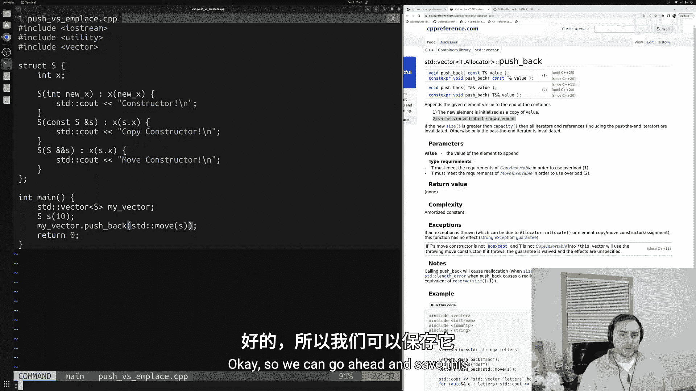
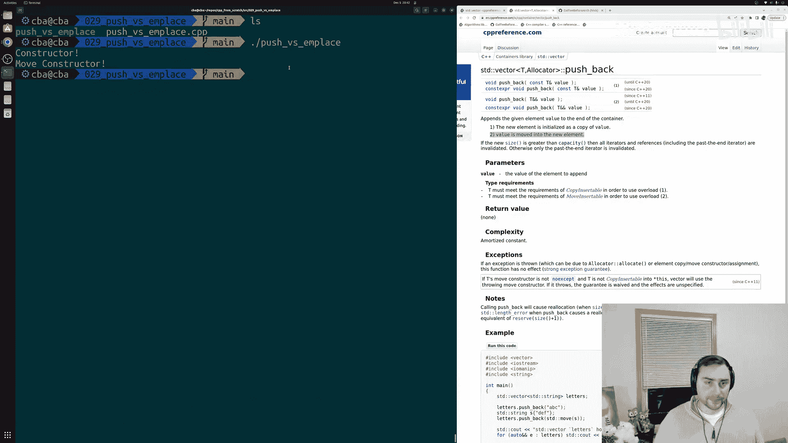
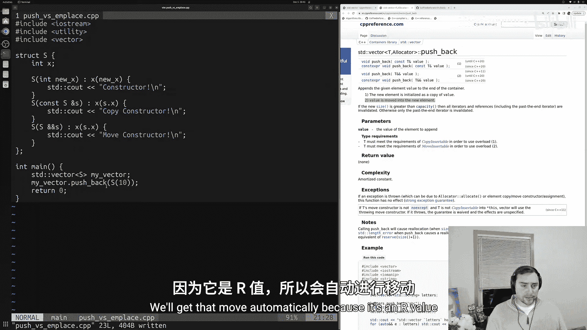
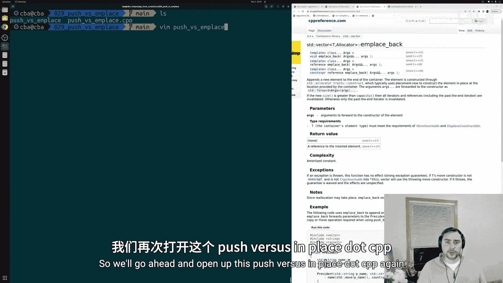
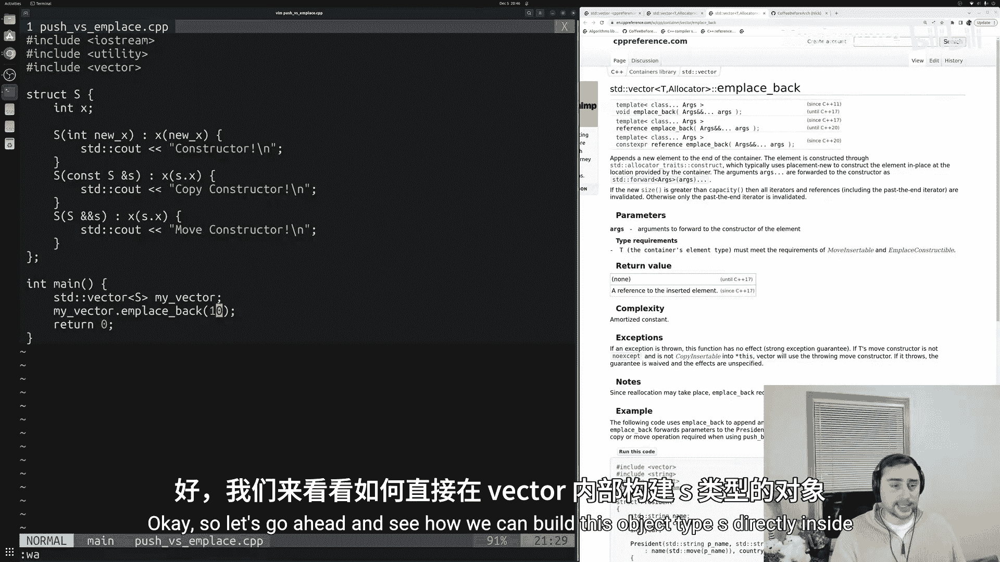
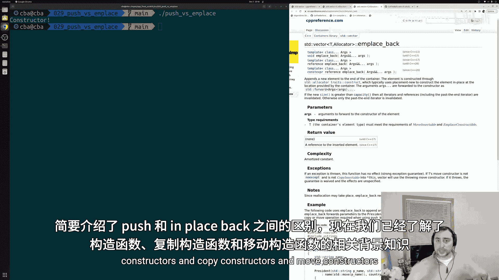
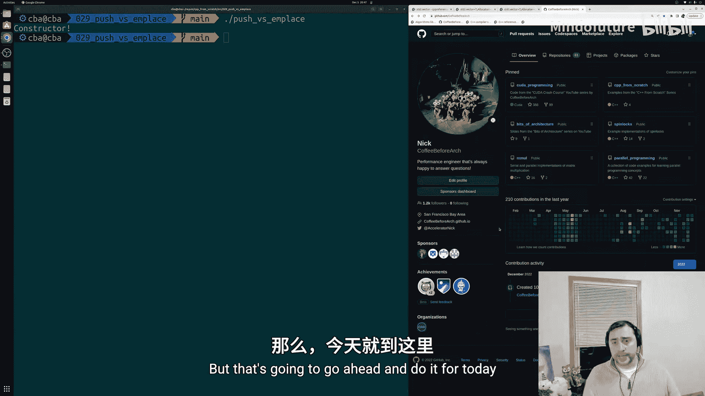

# C++入门教程｜CoffeeBeforeArch-p30-P30-push_back-vs.-emplace_back--BV1nbRUYSEUu_p30-

Hey， everyone， I'm Nick and Missus Ses Plus from scratch。 So in this episode of the series。

 we're going to be talking about the difference between push and in place back within the context of her stood vector。

Now we've talked about the stood vector in a number of our previous videos and there's a very good reason for this St vector just happens to be one of if not the most commonly used STL container right so it just so happens that dynamically sized arrays are very useful inside of our programs。

Now， because the stood vector is so useful and so ubiquitous。

 it's important that we know how to use this container well。

 and part of that is going to be understanding the methods that this container has。Now。

 specifically today， we're going to be looking at the difference between。

Two of our methods for modifying our container or adding elements to our container。

 which are pushback and in placeback。Now， we looked at pushback in the first video that we did on this vector to add elements to the end of our container。

And we said that we look it and place back at another time。

 so now that we have some more context aboutstructs and classes and things like constructors。

 copy constructors and move constructors。I think it's a great time to revisit the topic。

So let's go ahead and get started here， and we can start by opening up our example here called pushushvers inplace。

cppP。

And inside of here， we have a couple things already written for us， so we've included a few headers。

 so IO streams so we can do some printing utility so that we can use stood move like we looked at in the last two videos。

And then vector， of course， so we can play around with our vectors。

Now another thing that we have defined in here is our substruct S right and this is just a very simple struct here。

 it's got a single data member， this integer X， and then we have a constructor。

 a copy constructor and a move constructor and each of these methods announces who they are right so we'll be able to see when we calling each of these different kinds of constructors inside of a code。

Okay， so if we go down to our main function here， all we've done so far is create some vector that will hold objects of type S。

 Now we can start by playing around with our pushback method。

 So let's go and open up that page on CBP reference。Now we know from our past couple。

Of videos related to move and move constructors that we have two different forms of pushback。

 one that takes just a normal reference here and one that will take this R value reference。

 And the difference between them is that one of them will end up doing a copy and the other one will do a move。

 So let's go ahead and take a look at these two forms of pushback。

So we can start off by just creating some object of type S。

 so we'll create some object called S and we'll initialize x， that data member of our object to 10。

And then we can go ahead and push back this object into our vector so we can do something like my vector dot pushback。

And then we'll use S as an argument here。Now in this case， S is just a regular L value here。

 So when we pass it to pushback， what we're going to get is form1 here right we're going to get the version of pushback that is doing a copy So what we'll see is first we we construct this object we'll see a call to our constructor and then we're getting our copy constructor get called so our vector is going to reserve some space and then we're going to copy the value here so we're going to do a copy constructor to construct that element inside of our vector where it's reserved some memory。

So let's go ahead and see that we'll save this， and then we'll compile with G++ push versus inplace。

cP， and we'll call our output executable roughly the same name， so push verse in place。

Then we can go ahead and run this executable and we see what we expect。 We first color constructor。

 So when we were creating that object S， and then we see our copy constructor right when we call pushback here。

 because we're using form one of pushback here。

Okay， now in the last video， we've talked about move constructors here so we can move an L value like this that has。

 say a copy constructor defined by wrapping it instead move here。

 So here we're just telling our compiler， right， I know this thing is an L value。

 but treat it like an R value reference here。So in this case， when we're doing this pushback right。

 we'll now see that we're going to get a move right， we're going to move from our current object。

 this S into our object that was allocated inside of the vector right so we're creating a new object inside of the vector using this move right instead of a copy now。

Okay， so we can go ahead and save this。

And now we can go ahead and recompile our program， and let's go ahead and run it。 So of course。

 we see our constructor first， we create that object of type S。

 but instead of getting a copy constructor call here when we're creating that element inside of our vector。

 we get a move constructor。 so we're just moving our resources from our existing object to the new one that we're creating inside of our vector here。

Now， one final thing that we can look at with our pushback here is using unnamed temporary。

 So something that's already in our value。 So here we can get rid of this L value。

 this object S that we're creating。 and we can just create an object directly in the parentheses here。

 So we'll create some object of type S， and we'll initialize。The data member x equals to 10 here。

 so that'll be our constructor。Okay， now in this case， we don't have to do anything like stood move。

This object here is already going to be an R value。

 so we'll see first a constructor called when we create this object and then the move constructor get called when it gets moved into our vector。

 we'll get that move automatically because it's an R value。

Okay， so we'll go ahead and save this。And we'll recompile and we see the same two print outs as last time。

 but now we didn't have to write that stood move here。

 right because we were already using an R value。So a constructor to first create that object and then a move to move it into our vector。

Now， the common thing that we've seen with all of these examples with pushback is that we always have two pieces of memory。

 We have the memory where our current object is located。

 and then we have the memory that's allocated by our vector， right。

 And we're always seeing either a copy from our object to the space inside of our vector or a move from our object to the space inside of our vector。

 So we always have these two pieces of memory。 And you might wonder。

 is there a cost associated with this or is there a way around it。 And there is a way around it。

 right， And there is a cost associated with doing these copies。

 And the way around it that we have is with another method of vector。

 and that's going to be this in place back。😊，So let's go ahead and take a look at this in place back method of our stood vector here。

 so we'll open it up on CBP reference。Now starting out， it looks very similar to pushback。

 so it depends a new element to the end of our container here。

 but where it differs is in the construction of this element。

So here we can see that unlike our pushback， where we were doing something like a copy or a move。

Our in place back is going to construct the element in place at the location provided by the container。

And what we're taking is arguments here are instead of you know some object of type T here。

 now we're taking arguments right and these are going to be the arguments to say our constructor。

 So now instead of say creating an object and moving it or copying it into our vector。

 Now we're just going to create the object in place inside of a vector。

 So we're not going to call something like a copy constructor or a move constructor。

 we'll just construct the object inside of the memory allocated by our vector。

 So let's go ahead and see that。So we'll go ahead and open up this push versus inplace。cvp again。

And inside of here， let's go ahead and get rid of this call to push back。And instead。

 we're going to add a call to in placeback。And instead of passing some object right of type S here。

 what we're going to pass is the arguments to our constructor here。

 so just say an antigenteger like 10。So what we're doing here is instead of creating some object ahead of time and copying it or moving it into our vector。

 Now， we're just going to call our constructor at the place inside of our vector where it's going to live。

 right， that way we don't have to do anything like a copy or a move， right？

 We're just forwarding these arguments to our constructor to build it inside of our vector。Okay。

So let's go ahead and see how we can build this object to type S directly inside of our vector。

 so we'll save this and we'll go ahead and recompilele push verses in place。

And we can go ahead and run it。 And you can see instead of seeing a constructor followed by a move or a copy。

 Now， we just see a single constructor get called。 We're just constructing our object of type S directly inside of our vector Now。

 using this method in placeback， So this can be a big performance win， right。

 by forwarding these arguments to say our constructor using something like in placeback rather than doing。

 say moves or copies。Okay， so that's going to go go ahead and do it for today that's。

brief look at these difference the difference between push in and place back now that we have all the right context surrounding these constructors and copy constructors and move constructors Now as always。

 you can find this in any of the other examples at github。

 co s coffee before arch but that's going to go ahead and do it for today as always。

 I'm Nick and hope you have a nice day。

