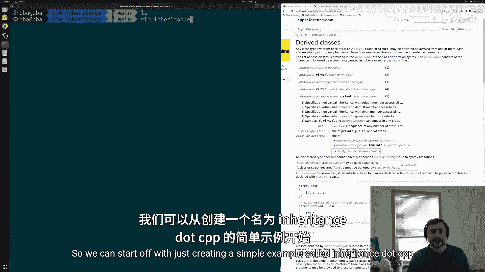
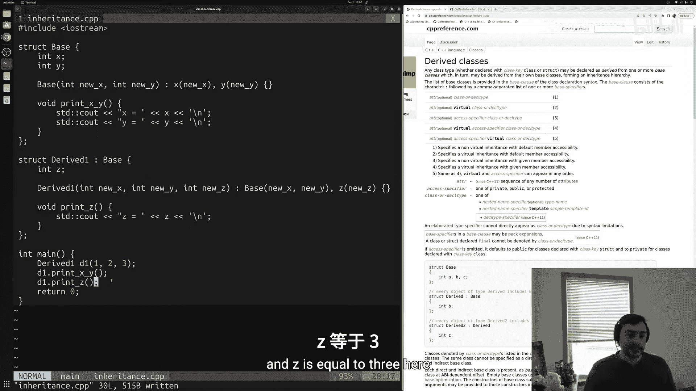
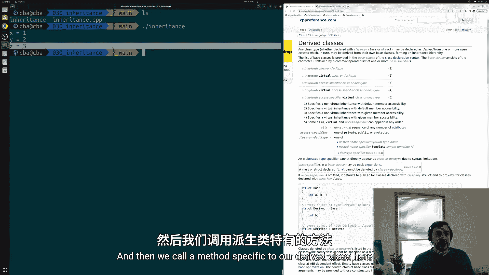
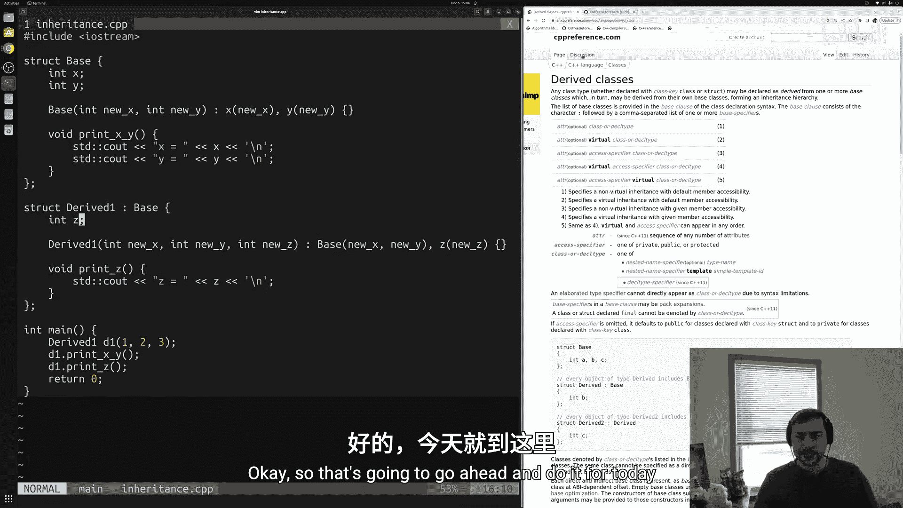
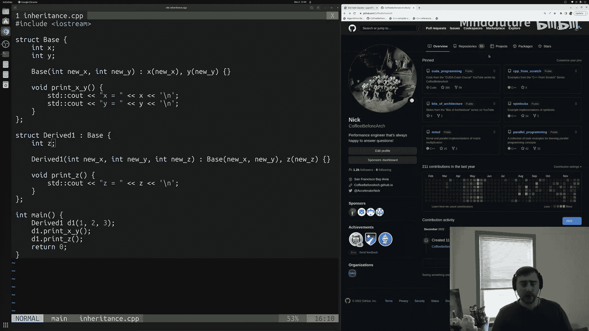

# C++入门教程｜CoffeeBeforeArch-p31-P31-Inheritance--BV1nbRUYSEUu_p31-

Hey everyone， I'm Nick， and this is C++ from scratch。 So in this episode of the series。

 we're going to be talking about inheritance and derived classes。So up until this point。

 we've been just defining these individualstructs in classes in C++。However。

 there are oftentimes where ourstructs center our classes may have some overlap。

 either in terms of the methods that they implement or maybe in terms of the data that they contain。

Now， one of the ways that we have to handle this， right and you have some way of getting rid of this code duplication is through inheritance and derived classes。

 So what we can do is define some sort of base class that implements some common set of data members and methods and have other classes inherit right from that base class。

 And we call these other classes derived classes。 So we're going to be looking at the basics of that today in C plus plus。

 So let's go ahead and get started。So we can start off with just creating a simple example called inheritance。

cppP， and inside of here we'll just include Io streams so we can do some printing。

And of course， we're going to need a main function here。

And what we're going to start doing is just implementing。

 we're just going to define a simple base class or a base struct。

So we'll define some struct called base， so some struct。Base， so know。

 our base class is just going to look like any other class。 What's going to differ is how we use it。

And inside of here we can just define a couple things we might want so we can know maybe add a couple of data members that might be common to multiple classes that we want to define。

 so maybe we'll create some data member， some integer X and then be another integer Y here。

 we can also write a constructor for a base class so。

It's called base and maybe they'll take two integers here。

 write some new x and some new y here and we'll go ahead and initialize x with new X。

And why with a new Y。And we'll just leave the body of this constructor empty。

And then we can go ahead and maybe just give our base class a simple method here to print out X and Y。

So some function with a void return type called print X， Y。ItDoesn't take any parameters。

 and we'll just print out。The value of the x is equal to。

X followed by the value of x followed by new line character。

 and we'll do the exact same thing for y here， right？Keep things pretty simple。

Now let's say if we want to build off this base class。

 we want to use this base class for multiple derived classes。

 so the way that we can do that is by defining another class down here。

 so let's go ahead and define another instructor class this time we'll call it something like derived one here。

And then we'll do a colon and say， you know which structure class we want to inherit from。

 So in this case， you know， we'll say we want to inherit from our base class here。 Now。

 what exactly does it mean to define astruct like this。 Well， this says that， you know。

 I want to use the data and the methods of our base class， But I want to build on top of it， right。

 without having to modify this base class So I can specialize our base class and build on top of it inside of this derived class。

So for example， I can add another data member， so it something like some integer Z in this case。

And then I can go ahead and create my own constructor for this this derived class。

 so we'll create some constructor called know derived one in this case。

 and maybe it'll take three parameters， right an x Y and z value that we want to initialize。

 So we'll pass in some int new X。New Y and New Z here。

And then we can go ahead and initialize everything。

 and we'll use this initialize this member initializer list here。

So we can directly call our constructor for our base class。

 So remember derived one is just building on top of our base class so we can initialize the base component right of this derived class here by just calling the constructor for base directly。

So we can just initialize space and we can pass in this new X and new y， right。

 And what this will do is it will run this constructor here that initializes x and y。

And then of course， we can initialize our Z value here， so we'll initialize Z with new Z。

And we'll just have an empty body of our constructor here。Okay。

 now one final thing we can do here is maybe implement another print method right this time to print out our member that's specific to derived one。

 so we can do something like another void function called something like print Z doesn't take any parameters and we'll just do stood C out。

You know， you know， z is equal to and then the value of z。Followed by a new line character， right？

So we've created a derived class here， so let's go ahead and kind of summarize things before we start using it。

 so we started out with this base class here that has a couple data members。

 a constructor and a member function， and then we built on top of it by defining another struct that we set inherits from base。

 right。Then we built on top of it by adding another data member。

 so not only do we have the data members of our base class， we've added on top of it。

So here we also have another data member， this integer Z。

 we added a constructor here and with our constructor we can both initialize the base class part of our derived class and then also initialize say something like our own data members that we have for this derived class。

 so Z in this case。And then we can add more member functions on top of the ones that we already get from our base class。

 so we have print X Y from our base class and we added it on top of it this print Z that's specific to this derived class。

So let's go ahead and see how we can use this class here。So one thing we can do is， of course。

 just create some variable of type derived1 here， and we'll call it say D1。

 And then we'll initialize it by calling this constructor with an x， a y and a z value here。

 So here we can go ahead and maybe we'll just do1，2 and 3 for simplicity here。

 really doesn't matter what the values are。Then you using this object。

 right we can call both methods from our drive class that we have defined。

And methods from our base class here。So we can call both this print X， Y and also print Z。

 So we'll do D1 dot print。X， Y first， and then followed by D1 dot print。Z， right。

So what we should see out is a printout of x is equal to 1， y is equal to 2 and z is equal to3 here。

Okay， so we'll go ahead and save this and we'll go ahead and compile this inheritance。

cP with G++ and we'll call our output executable just something like inheritance。

Then we can go ahead and run inheritance and what we see， well we get the expected print here。

So we get x is equal to 1 and y is equal to 2 that's coming from our method that's implemented in our base class。

 and then we call a method specific to our derived class here。

So we see this z is equal to three right from that print Z method。Okay。

 so that's a little bit of the basics about these derived classes and inheritance。

 So we have the ability to inherit from some， say common base class that way we can build multiple different classes based on some base。

 right？ So， for example， here， we could create anotherstruct called drive to that also inherits from base and implement different things here。

 So maybe it takes some floating point number。 And maybe it initializes base with some constants rather than arguments here。

 right So we could build kind of whatever we want off of this base class as well。 Now。

 one final thing to note here is that we can also specify our。😊。

These these default or these member access specifiers for our inheritance， right， So， for example。

 we can specify if we want say public inheritance or private inheritance or some sort of protected inheritance from。

 say some class that we're inheriting from。 That's something that we can specify as well。

 And it's going to be different between different betweenstructs and classes right。

 remember Strs typically have this access specifier of public and classes have this access specifier of private。

 right， But that's something that we can talk about in later videos。

 when we start getting to the design of these classes and these hierarchies。 Okay。

 so that's going go ahead and do it for today。 you can find this in any of the other examples at Github dot com such coffee before arch。

 But as always， I'm Nick。 and I hope you have a nice day。

