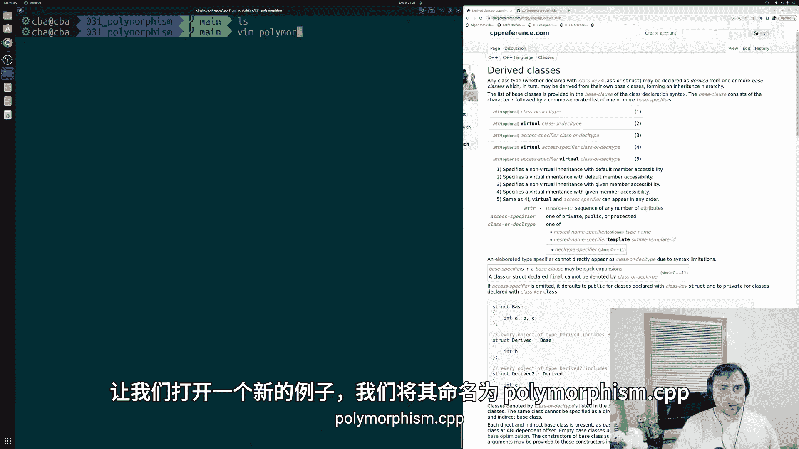
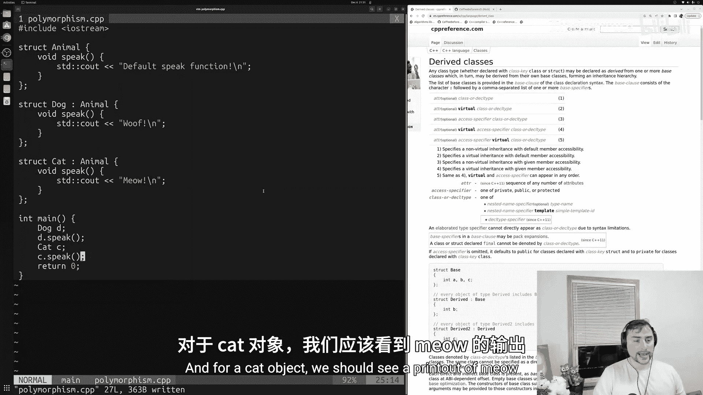
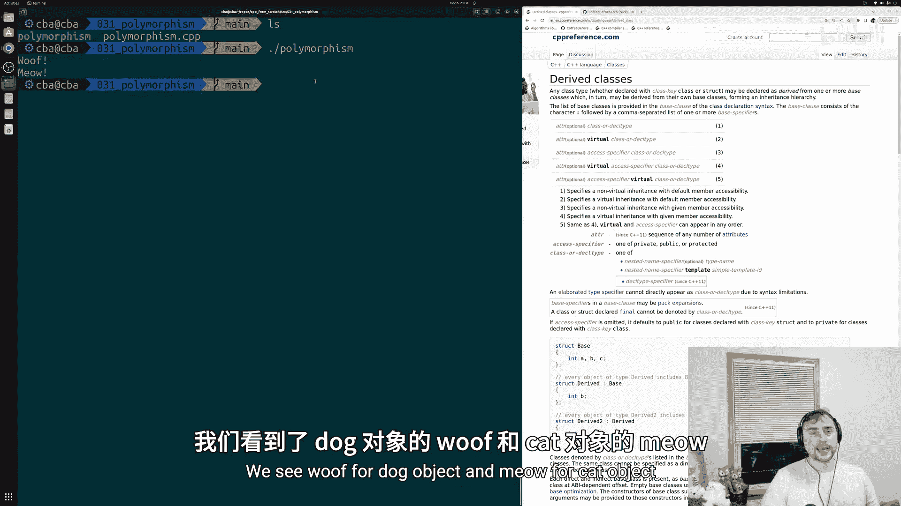
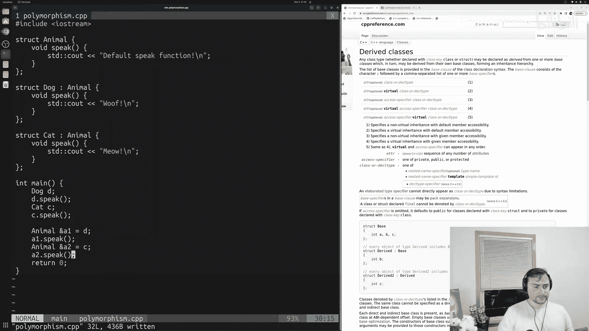
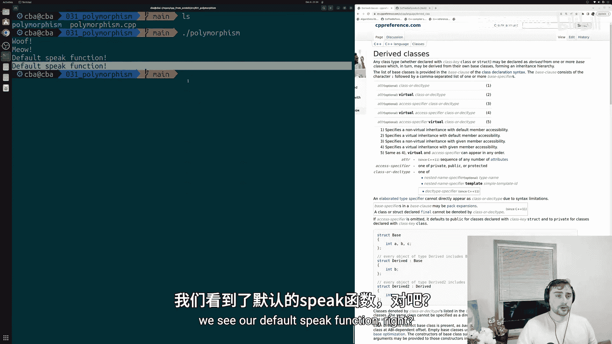
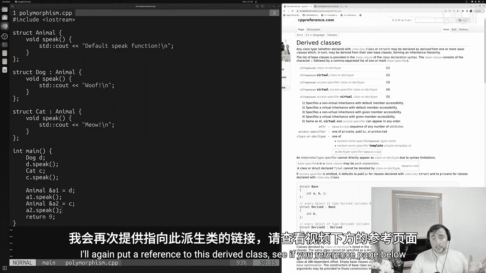
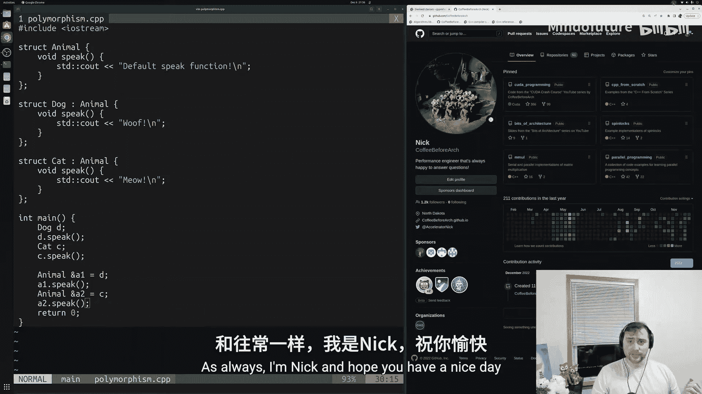

# C++入门教程｜CoffeeBeforeArch-p32-P32-Polymorphism--BV1nbRUYSEUu_p32-

Hey everyone， I'm Nick， and this is C plus Plus from scratch。 So in this episode of the series。

 we're going to be talking about the basics of polymorphism。So in our previous video。

 we looked at inheritance in this idea of derived classes so we could create some base class with some common member functions and data members。

And we could implement multiple derived classes that build off of this base class and in these data members and member functions。

Now in a situation like this， one of the things that might be useful would be if we could say group together these different derived class types。

 right so we could group together all of these different types that inherent from the same base class right。

 this might be a very useful thing to do。 and one of the ways that we can do that in C+ plus is through this idea of polymorphism。

😊，So polymorphism can be translated to mean mini shapes or mini shaped。

 and when we're talking about it in the context of inheritance。

 we're typically referring to this idea that we can treat objects of different types as say the same type and what we typically mean by this is that we can treat objects of the same derived class as their base class and this makes things very nice because we can put objects of the say the same base class type together inside of our STL containers。

Okay， so what we're going to be looking at today is kind of the basics of this polymorphism and how we can treat these objects of different types as say the same base class type。

So let's go ahead and open up a new example here， and we'll call it polymorphism。cppP。

And inside of here， we'll start off by just including IO Str。So we can do some printing。

And of course， we're going to need a main function。Okay。Now。

 we're going to be using a classic example of inheritance today。

 So one of these classical examples is that we create some base class for animals。

 and then we implement multiple derived classes for different kinds of animals that all inherent from this base class。

So we can start off by implementing our base class so we can create some， say，struct called animal。

And then inside of here， we can say implement a single member function。

 so maybe we'll just create some you know member function called speak here。That for our， you know。

 at least for our base class here or base struck， it will just print out something， some default。

 right， So maybe it'll just print out default。Speak function， right， with the excation point。Okay。

 then we can go about implementing our derived classes for different animals so for example。

 we could implement some struck dog here。Inherits from our animal based class。

 So we have this logical relationship here where our dog is a type of animal right so our dog inherits from this animal based class。

So we'll go ahead and create this type here。 and just like we can with our normal functions。

 we can do things like this member function overloading so I can overload this function speak here。

And we can implement our own for our dog， a derived class hero or derivedstruct。So in this case。

 I want my member function speak for our dog derived class or derived struck。To say something like。

Something more specific to a dog。Then I can go ahead and say copy this completely and paste it。

 and what we can go ahead and do is just create one more derived class for say， type cat here。

And instead of saying， wof here， it'll go ahead and say something like meow。Okay。

 so we have a simple example here， right， We have a base class called animalim and then multiple derived classes that inherit from this base class。

 So dog and cat， and each of these derived classes arestructs， overloads the speak method。

 so they have their own custom speak method for the specific animals。Okay。

 so let's go ahead and go through some basics here just creating some objects and calling these overloaded member functions。

 so for example we can create some some object of type dog here so some dog D and we can call D do speakak to call the speak member function of our dog and we can do the exact same thing for cat so we'll create some cat C and then call C dot speakak here。

And what should we expect to happen here？Well， both dog and cat are overloading this speakak member function。

 so for our dog object we should see printout of Wolfof。

 and for a cat object we should see a printout of Miow。

And if we go ahead and save this， and we compile polymorphism。 CP with G plus+。

 create an output executable just called something like polymorphism。Okay。

 so we have our executable here， let's go ahead and run it。And we see kind of what we expect。

 we seewoof for a dog object and meow for a cat object。

Now， one thing that might be useful to do would be if we could interpret both of these derived classes as our base class。

 So remember when we have these containers like our stood vector。

 our stood vector can only hold objects of the same type so it has a single template parameter so our vectors can only hold things of say type dog or type cat。

 So that presents us with a bit of a problem here。If we say have multiple different kinds of animals here。

 like dogs and cats， we might want to group them together somehow because they're all animals。

So let's go ahead and see how we can say interpret our dog as our base class as is animal here。

And one simple way we can do that is just with a simple reference。 So instead of creating， say。

 you know， a reference to something of type dog here and set it equal to our dog object。 Instead。

 what I'm going to do is create a reference to our base class here。

 or rather of this animal base class type。 So I'll create a reference to some。Animal。

And we'll call this a a1 here。 And then we'll set it equal to our dog object here。

So what exactly are we doing in this expression？So we're creating a reference to something of type animal。

But we're passing it。 this dog object。 And the reason why we can do this is because animal， right。

 is being inherited by dog。 So what we can do is we can interpret our dog object as this base class here。

 as this animal。 right， So this is perfectly valid。 And I can even do something like a one。

 not speak here。Now， what are we going to print out in this case？ Well。

 now we're interpreting our dog object like an animal。

 So we're now going to see the animal speak method。 So again。

 we're not creating a new object of type animal here。 This is just a reference。

 We're just creating an alias to our dog object here。

 But we're going to treat it as our base class now， right。

 And we can do this because dog inherits from this base class animal。

 We have to remember here that this dog derived class is just building on top of this base class animal。

 right， And because it's building off of this base class， we can reinterpret it as the base class。

Okay， and we can do the exact same thing for our cat。 our cat derived class as well。

 so we can create some reference to say， say a2 and send it equal to our cat object。

 and then we can do。A2 dot speak down here。So we're creating a reference to both our dog and our cat objects。

 but now we're treating them like they're of this animal type here。

Okay， so let's go ahead and minimize this。 and we can go ahead and compile recompil our example with G plus plus。

K， everything completed successfully。And we can go ahead and run our excutable hero。

 And what do we see now。Well， from our dog object， we again see this wolf printed out and from our cat object。

 we again see this Miow text printed out。But now from our two references here。

 So our reference to our dog object that we're treating like an animal。

 we see default speak function。 and for a reference to our cat object that we're treating like this animal base class。

 we see our default speak function。

So we're taking our derived class type and we're treating it like our base class and when we're doing this with these functions here。

 these overloaded functions， we're going to get in the case of these references down here。

 we're going to end up using our base class speak member function up here。

 the one that says default speak function。Okay， so that's a little bit about the basics of polymorphism here so we can treat our classes of these derived types like our base class type。

 and a lot of times this idea is called upcasting。 So we're casting from a drive type back up to say a base class type。

 and this is a very important thing when we get to say wanting to store these different objects together in some container like a vector。

Now， so far， you know， what we're looking at in the context of polymorphism is this idea of static polymorphism。

 So really， all of this polymorphism and。You know， reinterpreting of these objects is occurring at compile time。

 right。 So a compiler knows that retreating some object of type dog like an animal right here。

 And it's making the decision of which which method to call or which member function to call at compile time。

 Now， there's cases where we want to be able to make this decision at run time。 So say， you know。

 if retreat treatinging these different objects of type dog in type cat as our animal。

 we still might want them to act like a dog or a cat object and called the speak method for type dog and type cat。

And for that， we have to get into this idea of virtual functions and this idea of dynamic polymorphism。

 But that's something that we're going to be talking about in the next video。 Okay。

 so that's going to go into it for today。 I'll again， put a reference to this derived class。

 See you your reference page below the video。 And as always。

 you can find this and any other example at Github dot com slash Co before arch。 But again。

 that's going to go ahead into it for today。 As always， I'm Nick and hope you have a nice day。😊。

