# C++入门教程｜CoffeeBeforeArch-p33-P33-Virtual-Functions--BV1nbRUYSEUu_p33-

Hey everyone， I'm Nick and this is C++ from scratch。 So in this episode of the series。

 we're going to be talking about virtual functions。

So in a previous video we looked at the basics of polymorphism。

 and that in that example we saw how we could reinterpret some derived class to look like a base class using a reference。

Now that was an example of what we call static polymorphism。

 where all of the information about the types of our objects were known by our compiler at compilation time。

 but our compiler doesn't know everything about what happens at runtime。

 so we can be left in a situation in our code where we have， say。

 a pointer or reference to some base class type and we don't know what the underlying derived class type is We might have some object that's been upcasted。

However， we still want， say the behavior of that underlying derived class type in these situations。

 So， for example， you know， we often do this upcasting just so we can group objects that inher from the same base class together。

 but we still want those objects to behave like themselves to behave like their underlying derived class type。

 And the way that we get this in C plus+ is through virtual functions。

So on the right hand side of the screen here， I have the CPP reference page up for our virtual function Specifier。

 so this virtual keyword。And there's a great explanation about what exactly these virtual functions are and what they do。

So if we go ahead and read this， we see that virtual functions are just member functions whose behavior can be overridden in derived classes and that opposed to non virtual functions。

The overriding behavior is preserved。Even if there is no compile time information about the actual type of the class。

So what this really means is that， you know if we have some derived class that's been upcasted and we have。

 say， a pointer or reference to a base class。If we call some overridden virtual function using that pointer or reference。

 we would still invoke the behavior of the derived class。

And this is something that we call a virtual function call or a virtual call。

 So it's saying that even if we've upcast it， right some object to the base class type。

 we're still going to get the behavior of the derived type or the derived class when we call our overriding member functions。

Okay， so let's go ahead and open up our simple example here and see how we can use these virtual functions and this virtual functions Bestfire。

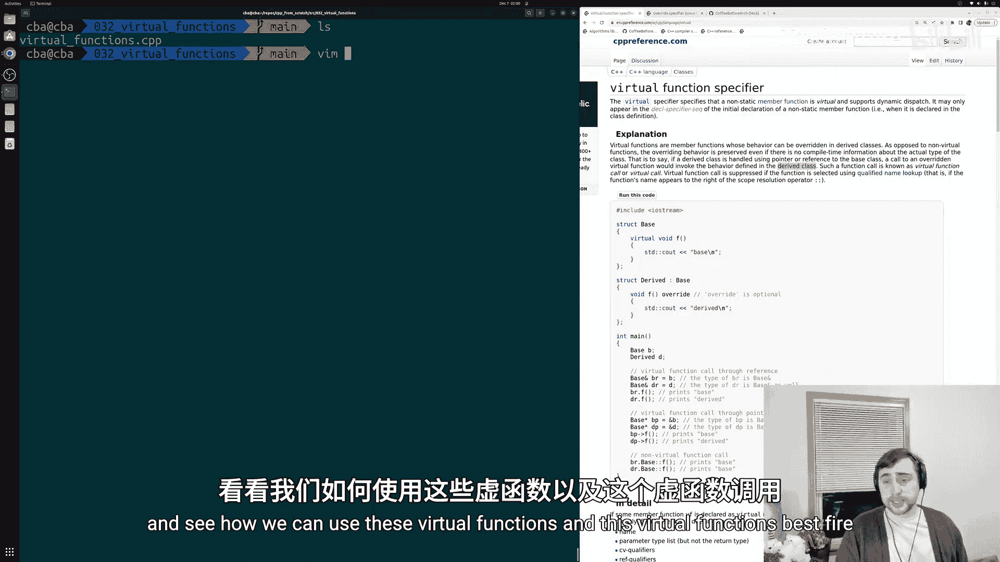

So we'll open up virtual functions at CPP and we see a lot of our code from last time。So we have。

 you know a few simplestructs to， so some base class animal that implements some speak method。

 and then a few derived classes， so our struck dog that inherits from animal， but overrides speak。

 and then our struct cat that you know inherits from animal and then overrides or overloads this speak member function here。

Now inside of our main function， we just create an object of type dog and cat。

 and we call speakak for both of those objects， so we should seewoof and Miow for dog and cat respectively。

And then over here， we have for example， of static polymorphism。

So we reinterpret our dog through this reference to an animal。

 and then we reinterpret cat through a reference to an animal。

 and we call speak for both of these references。 And what we saw was that we get this call to or this printout of default speak function。

 for these reinterpreted objects here。 So if we go ahead and minimize this and compile our virtual functions on CP and call our output executable just virtual functions and run it。

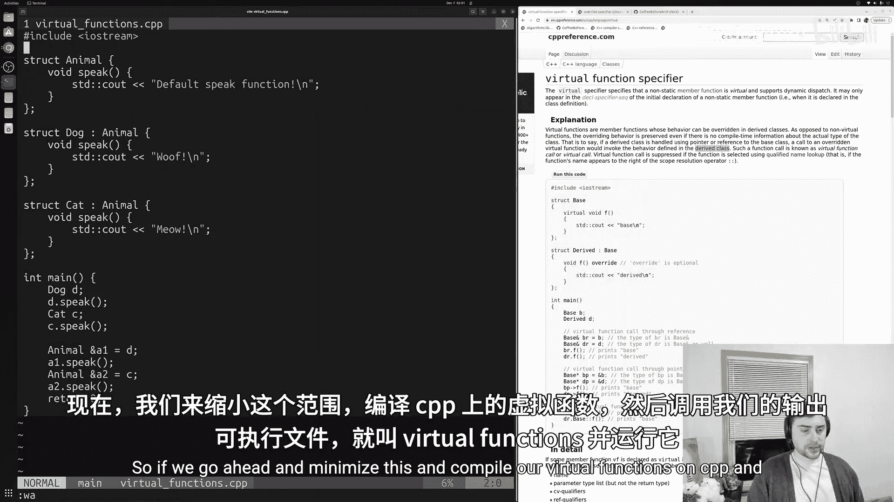

We see that， of course， we got， you know， goofin Miow for our dog object and our cat object。

 But when we did that up casting to our base class， we got default speak function。

 right for both of our， both our dog object in our cat object。 So underneath the hood。

 right with this reference， we still have a dog object。 and we still have a cat object。

 But now it was behaving like our base class here。

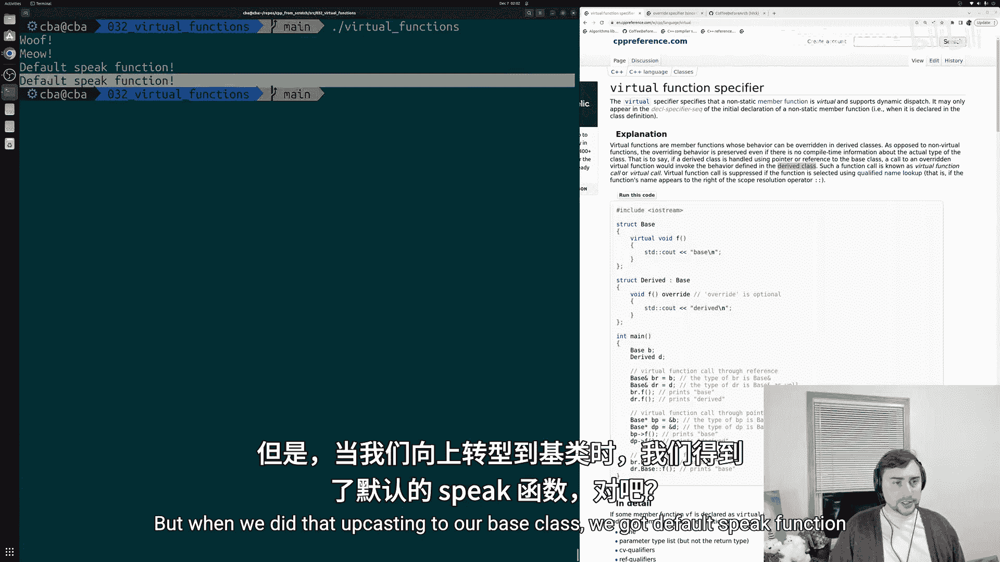

Now， if we don't want that to happen， we can make our Sp member function a virtual function。

 and we do that using the virtual keyword like we saw on the right hand side of the page。So here。

 before void， we can go ahead and declare this function to be virtual。

Now how exactly does this change our behavior？So like we said down here， it says that， you。

 when we have， say a pointer or a reference to some base class。

 and we call some over in virtual function， we would invoke the behavior defined in the derived class here。

So even though down here， I'm reinterpreting， say， a dog to be an animal or cat to be an animal。

 This is saying that because I'm using a virtual function now。

 I'm still going to get the behavior of dog and cat here。 So when I call a1 dot speak。

 I'm going to get the speak method from dog。 Likewise， when I do a two dot speak。

 I'm going to get the speak method for cat。 So I'm still going to get the behavior of the derived classes。

So let's go ahead and save this and let's go ahead and recompile our program now that we've added this virtual functions bestfire。

 and we can run this。 And what we see is we getwoof and meow and wolf and meow。

 So from our dog object， we getwoof from our cat object。

 we get meow from our reference to animal for our dog object， we get Wof。

 and for our reference to animal for our cat object， we get meow。

 So we still got the behavior of those underlying derived classes。

 even though we were reinterpreting them as our base class or we were upcasting them。

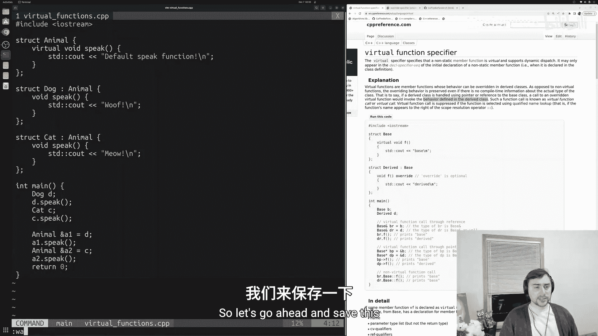

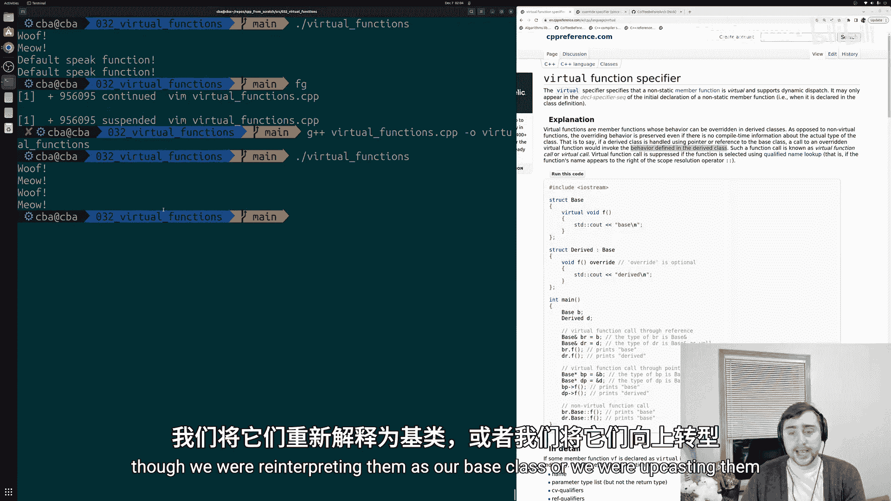

Now， a good question to ask here is how exactly is this going on underneath the hood， right。

 and how does this typically occur， Well， a lot of these decisions about which function to call。

 they now have to occur at runtime， So at runtime right when we're reinterpreting。

 say some derived class to look like a base class and we call some function。

 We have to look up exactly which function should we call， Should we call， speak for animal。

 should we call speak for dog or should we call， speak for cat。

 So there sometimes can be some overhead related to these virtual function calls。

 but we'll probably talk about that in later videos as a more advanced topic。

Now there's a good practice here that we can do with our virtual functions。

 and that relates to another keyword we have in the language since C++ 11。

 and that's going to be this override specifier， and that's a simple specifier that says that。

 you know some function that we have overrides another virtual function here。

So let's go ahead and see how we can do that。Or use this。So for example， right after speak here。

 because speak is overriding this virtual function from our base class speak， we can write override。

 right。And we can do the exact same thing for cat here。 we can write override。Now。

 this doesn't really do anything to change what Speak does， whatsoever。

 but it's a great way to prevent errors inside of our code。

So what this does is it tells our compiler to expect speak to override something from our base class。

 So it makes it so that we can't make a mistake right when we're creating the speak method。So。

 for example， if I do something like accidentally， Misspell speak here。 So now it's， you know。

 I've written spec instead， I forgot the E。And I try to save this。

 My compiler is going to yell at me。So you can see it says that void dog SP marked as override。

 but it's not overriding anything。 It's saying that， hey。

 you said you were going to be overr some member function here。

 Some virtual function from our year base class。 But there's no virtual function called SPAC inside of the base class。

 So that's going to be an error， right。 So if we go ahead and try to recompile this application。

 It ends up failing， right， with that exact same error that we saw。

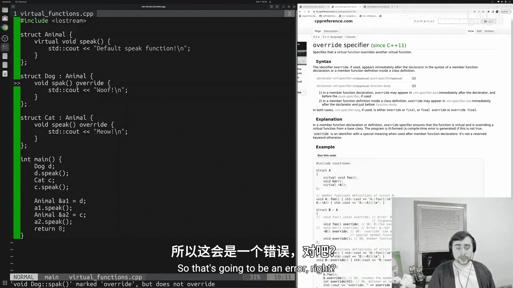

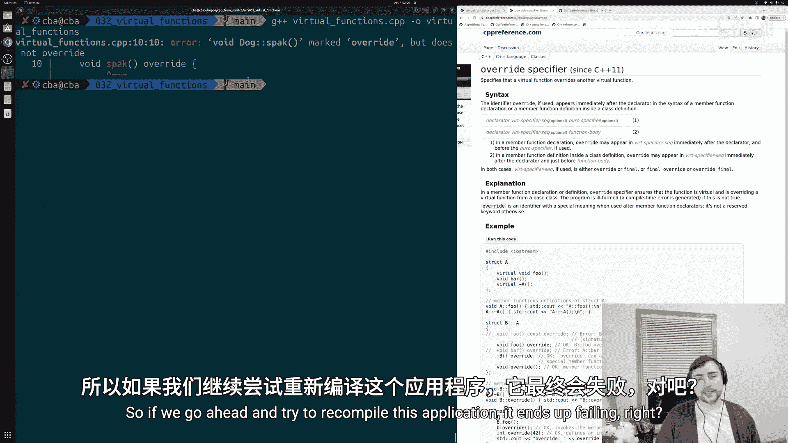

Now， if we didn't have this override method。This would actually be perfectly okay。

This error could go through completely silently here。

 because all this looks like to the compiler is that we defined a new member function here。

 Our compiler just says， oh， you wanted to create a member function called Spak inside of your derived class dog here。

So later on， when we call you know， D do speak here， we're just going to be using the。

 you know member function of our base class here and we're not going to be using this SP member function whatsoever。

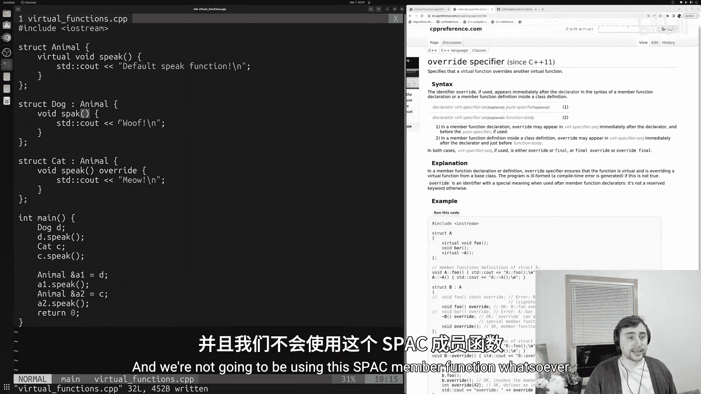

So we go and compile this。 And you can see that now we get some weird behavior here that we weren't necessarily intending as programmers。

 Now， all of our dog speak calls print out this default speak function。

 And it's because we have this typo in here of spaAC。

 And this could all be prevented by using this keyword override。 That's just telling our compiler。

 hey。

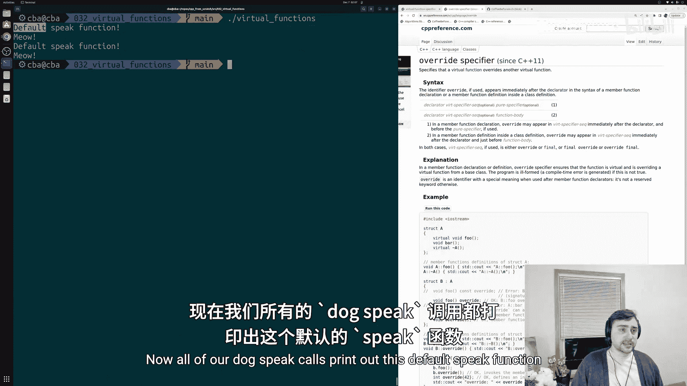

This is to supposed to be overriding someha， some virtual function in say， a base class。

So it helps us catch these silly kind of errors。 So it's good practice to use。Okay。

 so that's going to go into it for today。 It's got a brief introduction to our virtual functions and also this override specifier。

 as always， you can find this and any of the other examples at Github。com s coffeeoffeebe arch。

 but that's going to go ahead and do it for today， as always I'm Nick。

 and I hope you have a nice day。

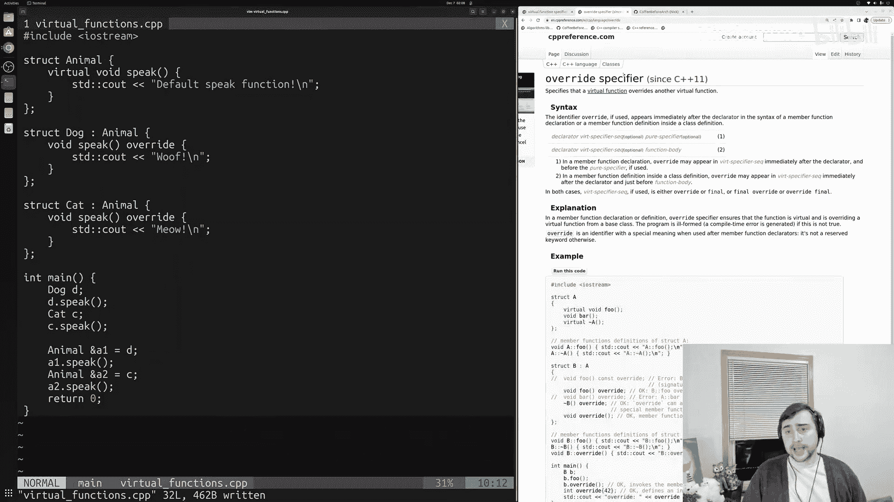

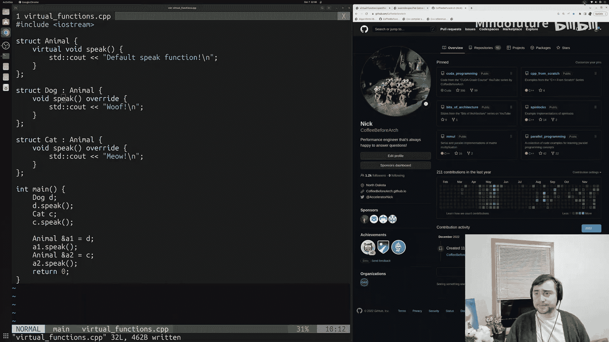