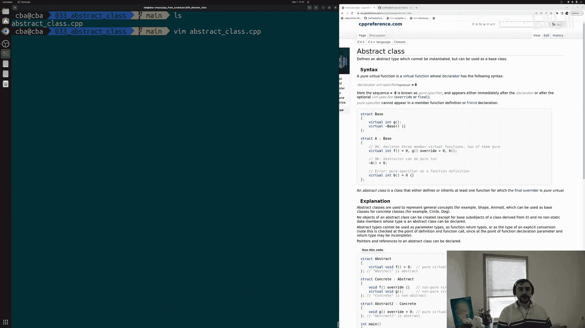
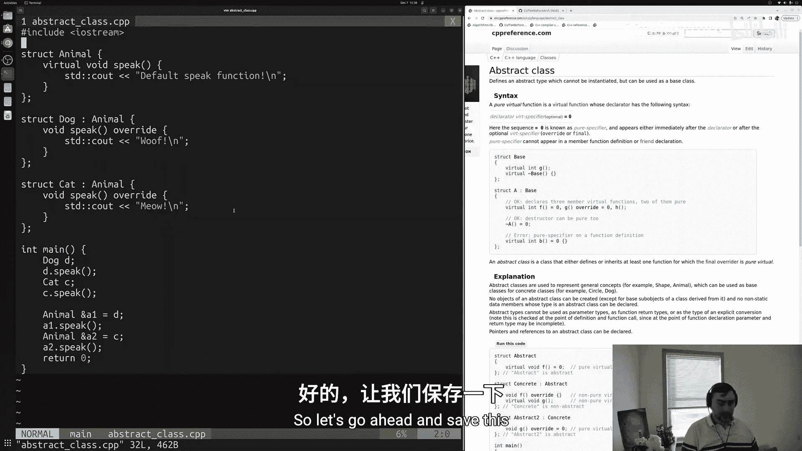
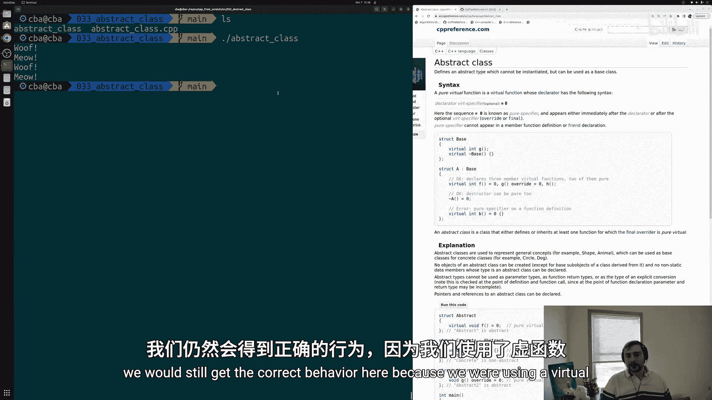
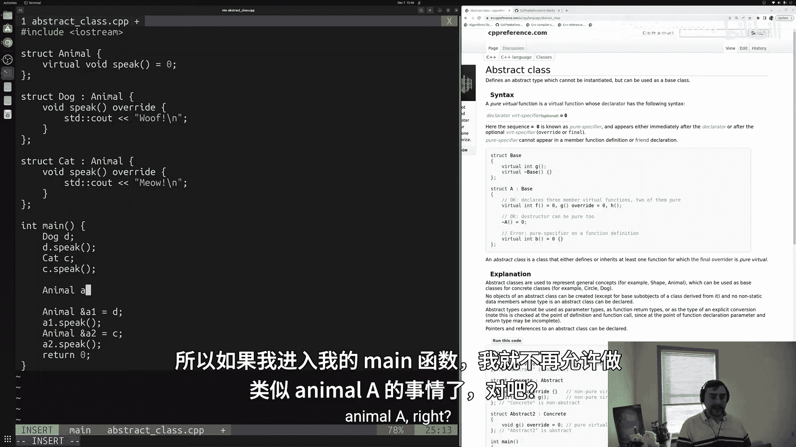
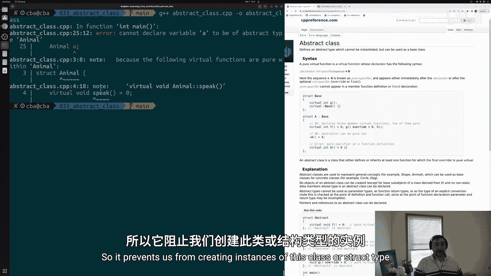
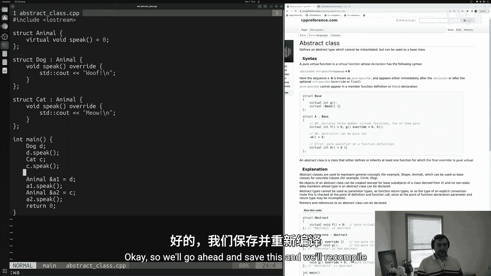
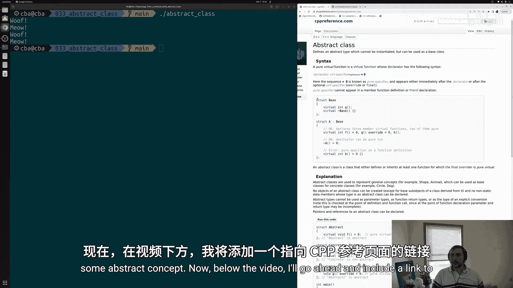
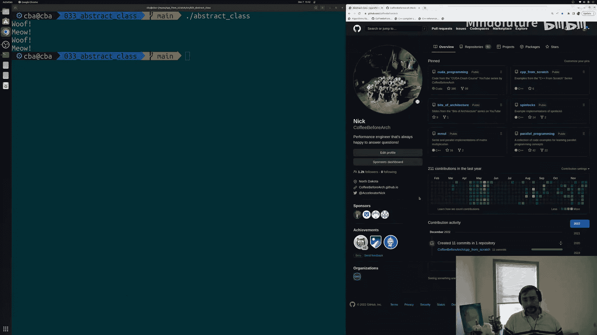

# C++入门教程｜CoffeeBeforeArch-p34-P34-Abstract-Classes--BV1nbRUYSEUu_p34-

Hey， everyone， I'm Nick， and this is Cs Plus from scratch。 So in this sub of the series。

 we're going to be talking about abstract classes。So in the last few videos。

 we've been looking at the basics of inheritance and polymorphism。

 so we would do things like create some base class and then multiple derived classes that inherent from the space class。

Now there are times when we're doing this where our base class represents some abstract concept。

 so maybe it represents something like animal right and we have these derived classes like dog and cat。

Now in situations like this， we never really want an instance of our base class type。

 so we never want an object of type animal here， animal just represents this abstract concept。Now。

 one way that we have to prevent users from creating objects of this type right that's an abstract concept is by declaring R say base class to be what we call an abstract class。

So if you go ahead and look at the right inside of the screen here。

 I have the CPP reference page for abstract classes up。

 and you can see that it says that our abstract class defines an abstract type that cannot be instantiated。

 but it can be used as a base class。 So defining something as an abstract type just means。

Programrs won't be able to either purposely or accidentally create an object of this abstract type。

 but it can still be used as something that we can inherit from and build on top of。

Now the way that we do this is through pure virtual functions。

 so you know a class orstruct will be an abstract class if it contains at least one of these pure virtual functions and it's really just a virtual function that instead of implementing we do this assignment equal to zero it's just a way of saying that you know thisstruct class is not going to implement this member function and some derived class。

 you needs to implement it in order for this not to be an abstract class anymore。

So you can see down here it says an abstract class defines or inherits at least one function。

For which the final overrider is pure virtualr。Okay。

 so let's go and take a look at an example of creating same abstract class。

So we can go ahead and open up this abstract class at CPP。

And inside of here， we've got our code from last time when we were looking at。Virtual functions。

 So we have a few simplestructs to find， So some base class or bassstruct called animal that has a single virtual function called speakak。

 and then we have two derived classes dog and cat that both they both inherit from the base class animal。

 and they both override the speak method。 So dog speak method sayswoof and cat speak method says meaow。

Now inside of our main function down here， core of our C++ programs。

 we create instances of our dog and our cat strs， so we create these objects and we call Speak for both of them。

 so we should see a printout ofwoof followed by Miow。

Then what we do is we create a reference to our base class type of our objects dog and cat。

 So a1 and A2 here。 And what we saw last time was that if we still called the speak methods that even though that we had these references to our base class type because we were using our virtual function here or we had a virtual function that we were overriding inside of our derived classes。

 we would get the speak from our derived classes here。 So for example， when we called a1 speak。

 we would get Wolf and a2 speak， we would get meow。

 So let's go ahead and save this and we can go ahead and quickly compile this abstract class CBP。

 And call the up exel just something like abstract class。 just to。

 you know give us good foundation where we were last time。😊。

So we see Wof and Miow when we directly call those member functions for our objects of type dog and cat respectively。

 and then even if we upcast those objects to our base class type。

 we would still get the correct behavior here right because we were using a virtual function。

Now in this case， with this simple hierarchy where we have a base class of animal in these derived classes。

 our animal is really this abstract type here。Right it's this abstract concept that we never really want to instantiate an object for。

 so we never really want to create some general animal down here。 So we never want to write。

 say some animal A write and call a dot speak。This is something that know we're perfectly allowed to do here with the way that we've written things so far。

 but this really doesn't make a lot of sense and in fact， we want to prevent， say。

 you know software engineers from being able to do this in the first place。

 because animal is this abstract concept and we really only care about these derived classes。

And the way that we can do that is by declaring some pure virtual function inside of animal。Now。

 a good candidate for that is our speak method here。 So there is no kind of general， you know。

 speak or thing that all animals will say。 So it makes sense to implement this as a pure virtual function。

 So every animal will have to implement their own speak method， right。 So dog， say。

 implements Wolf cat implements meow。So let's go ahead and do that。

 So what we can do is you know we'll get rid of， you know the body of this function here。

And then what we can do is just set this virtual function equal to zero。

 and this declares it to be purely virtual right like the syntax says up here。

So now that this is purely virtual， we're no longer allowed to create instances of this type animal anymore。

 but we can still inherit from it。So if I go down into my main function。

 I'm no longer allowed to do something like animal A right I' no longer create an instance of this type。

 So if I try to compile this， so we'll recompile abstract class on CPP。 you can see the begin error。

 so cannot declare variable A to B of abstract type animal。

 and it says that we can't do this because of the following virtual functions are pure within animal。

 So it shows us that our animal speak member function here。

 So is a pure virtual function right So it prevents us to from creating instances of this class or struck type。

Okay， so let's go back in here and let's go ahead and get rid of this creation of an object of type animal and we just have the exact same code as we did in the previous video we're still just creating a dog and cat and then we're upcasting them to our base class type here so we can still do this upcasting even though you know this is an abstract class right the only thing that's really changed is that we can't create instances or objects of this class or struck type here but we can still do this upcasting。

Okay， so we'll go ahead and save this and we'll recompile and you can see that we get our the exact same output as we did last time。

 So we got wolfof and meow for our dog and our cat objects。

 and then wolf and meow from our dog and our cat objects that were upcasted to our base class type。

Okay， so that's a little bit about the idea behind these abstract classes。

 sometimes called abstract base classes， so it's a way that we have of preventing programmers from creating instances of this base class type that represents。

 say some abstract concept。Now below the video I'll go ahead and include a link to this CPP reference page and as always you can find any of these examples at github。

com/cooffbe arch， but that's going to go ahead and do it for today。

 as always I'm Nick and hope you have a nice day。

