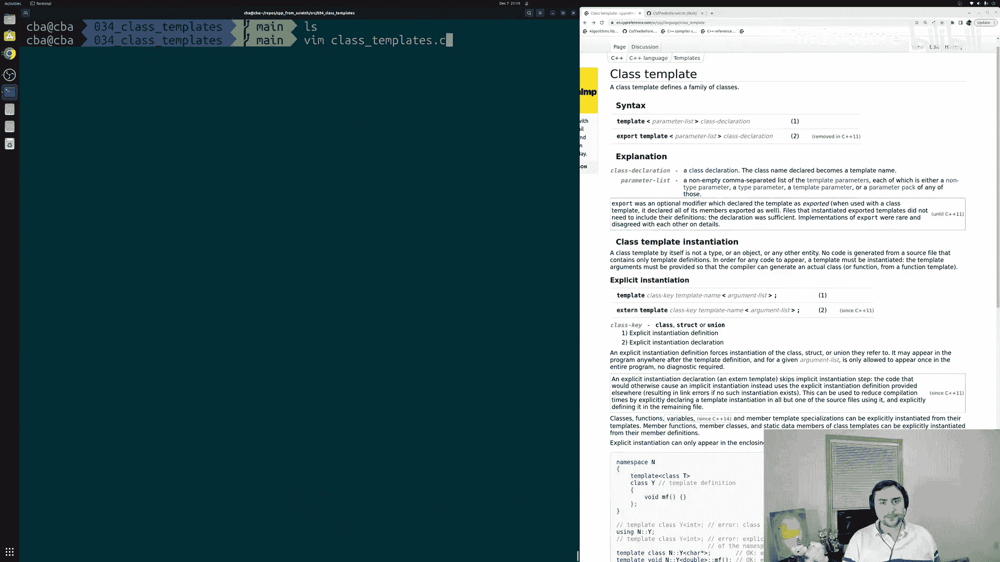
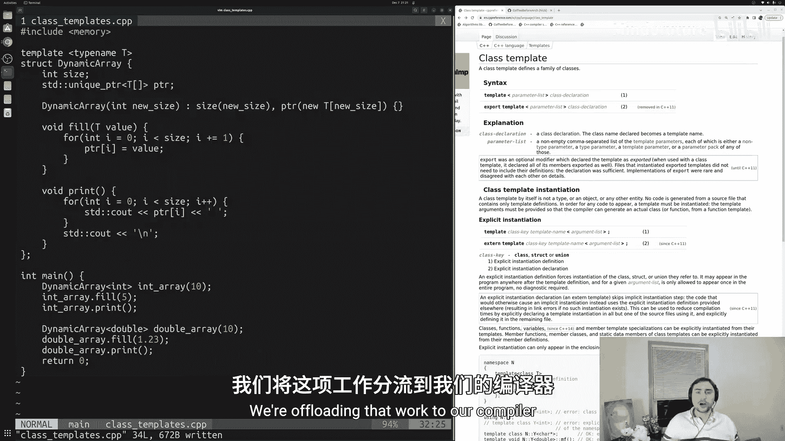
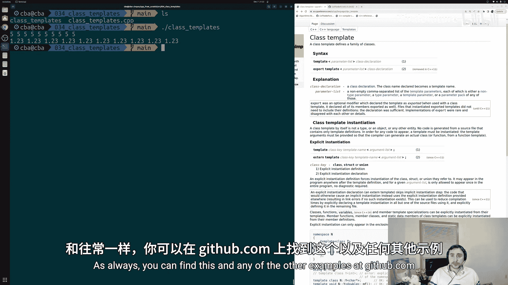
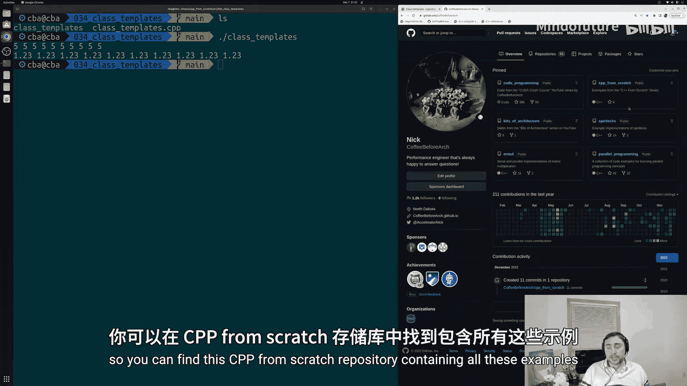
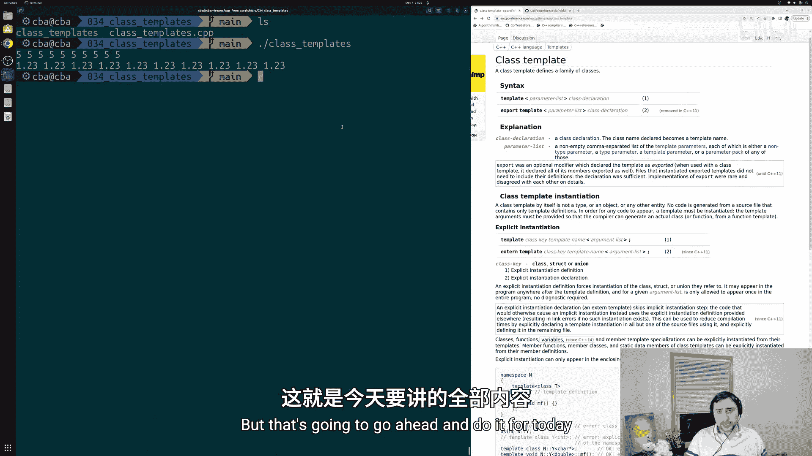

# C++入门教程｜CoffeeBeforeArch-p35-P35-Class-Templates--BV1nbRUYSEUu_p35-

Hey everyone， I'm Nick and this is Cs Plus from scratch。 So in this episode of the series。

 we're going to be talking about class templates。So in one of our previous videos。

 we looked at the basics of function templates and we said that this was a nice and useful feature because it allowed us to offload some of our work to our compiler。

 so instead of say having to implement multiple different versions of some function for different types。

 we could instead write a template and generate these different versions using our compiler。

Now we can do the same kind of thing using these class templates so we can create more generic objects and containers。

Now we've already seen a number of examples of this exact concept。

 and that's through our STL containers。 So STL just stands for standard T library。

 Soto Vector is a good example of this。So at the end of the day。

 student vector is just a class template that we can instantiate with different types so we can have a dynamically sized array of integers or one of floats or one of doubles or one of some user defined type with structure class because it is just a template right this stood vector is just a class template。

So let's go and see how we can write our own class templates today。

So let's go ahead and open up a new example here called class templates。

And we'll go ahead and start by including a few headers。

 We'll include Io stream so we can do some printing。

 and it'll also include our memory header so we can use our stood unique pointer to manage some dynamically allocated memory。

Then I'll go ahead and write a main function here， the core of our C plus plus programs。

Now let's say we want to define some class template for a dynamic array。

 so we want dynamic arrays of any number of types， so of integers of doubles of floats or of otherstructs or classes。

So let's go and see how we can define that here。So we'll start off by just defining somestruct called dynamic array。

And then to make this a template class template， what we can do is above ourstruct hereer or class if we were using classes。

 we can just use our template keyword。 and just like with our function templates。

 we can use this type name T thing。In order to say that our class template here has one template parameter T。

 right， so we can create different versions of this dynamic array for different types T that we can specify later。

Okay， so for a dynamic array， we might want a couple of data members。

 so we might want to keep track of the size of our array so we can have some integer， say size here。

And then we can go ahead and use something like a unique pointer to manage our memory for us。

So we can have some stood， unique pointer that's going to manage a dynamically allocated array of type T here。

 right， our template parameter。 And we can just call this pointer。So then we can go about。

 say creating a constructor for our struct here。 So it'll just have the same name as our struct。

 So dynamic array， and maybe it takes a single parameter here。 So some integer size， right。

 the number of elements we want to dynamically allocate for。

Then we can go ahead and initialize both size and or pointer using our member initializer list。

So we can go ahead and， you know， let's go ahead and rename this to new size here so we don't have any confusion on names so we can go ahead and initialize size with this integer new size here。

 that's our parameter， and we can go ahead and initialize our stood unique pointer here。

With a pointer to some dynamically allocated memory。 So an array。

Of type T with new size elements here。Okay， so we have a constructor here。

 right we're initializing our size data member and our pointer data member to some with some pointer to a dynamically allocated array of type T with new size elements。

All right。 So below this， we can say， write a few helper methods or member functions that we might want for a dynamic array。

 So， for example， we might want a fill method。The take some value of type T。

And we're going to fill our dynamically allocated array with this value。

 so we can just have a simple for loop in here。 So for int I0 I less than size。

 the number of elements inside of our array， and then I plus equals 1。

We can go ahead and index into our array here， through this pointer。

So we can do pointer of i is equal to value。So every element inside of array will be set to value that is of type T。

Okay。So let's go ahead and write one more kind of helper function or member function here that we'll call say print。

 and this will just say print out the contents of our array。 So again。

 we'll just use another for loop。 So for into is equal to0。Ies less than size than I plus plus here。

 We'll just do stood sea out。Point of eye， right。 So each element of our array separated by a space。

 And then afterwards， one new line character， right， So that we get a new line afterwards。Okay。

 so this is going to be our simple class template here or the struck template。

 So we've created some type dynamic array that's templated with this type T here。

We have two data members， some size， so the number of elements inside of our array。

 and then some unique pointer managing an array of type T here。

Then we have a constructor here that takes some parameter new size。

 So the number of elements we want to dynamically allocate。

 So we initialize size with this integer new size， and we initialize our unique pointer with a pointer to some dynamically allocated memory。

 So a dynamically allocated array of type T with new size elements。

Then we go ahead and you know we have a couple member functions。

 so a member function called fill to fill our dynamically allocated array with some value of type T that we pass in。

 and then we have some print methods to just print out the contents of our dynamically allocated array。

Okay， so let's see how we can use this templated class or struct with our different types here so we can instantiate different versions of our dynamic array。

 So for example， we can create some dynamic array of integers。

 we'll use these open closedsed angle brackets here to specify this template parameter T here。

 this type we want to instantiate dynamic array with。😊，So we can have， say。

 a dynamic array of antegers that we'll call inray。

And we'll go ahead and create an in array with 10 elements here so we'll pass that to our constructor。

Then we can do say intar do fill， so we can use our fill method。

 maybe we'll fill our array with the values5。And then we can go ahead and say print out from our array so we can do inter array。

 print so we can call that other function or member function。

So let's go ahead and instantiate one more version of our dynamic array。

So instead of a dynamic array of integers， we can do a dynamic array of say doubles。

 right say double precision floating point numbers， random we'll call this double array。

So here we'll also have， say 10 elements。And then we can go ahead and fill this double array。

So we can call double array do fill with， say some double precision number， so 1。23 for example。

And then we can call double array dot print， right， to print out the contents of this double array。

Okay， so that's going to be the basics of our example here。

 So we defined some class template here called dynamic array right using the struct here。

 we have a couple of data members， a constructor here， a couple member functions。

 We create a version of our dynamic array for the type integer and call our methods。

 And then we create a version of our dynamic array for type double here and call those methods here。

 So what we're doing is we're relying on our compiler to generate different versions of the struct for these different types that we've specified down here。

 We're offloading that work to our compiler。😊。

Okay， so let's go and save this and we can go ahead and compile this class templates with G+ plus and call our output executable。

 just something like class templates。Then we can go ahead and run this example。

 And what do we see Well for inray。 right we have 10 elements here， all integers。

 and we use that fill method to set all the values to 5。

 and we did something similar for our double array here。

 So our dynamic array using this double precision type， and we print out all 10 of these 1。

23 values that we filled that array with。 Okay， so that's going to be the basics of how we can create and use these class templates。

 So these class templates are an incredibly powerful thing。

 and we see them all over C plus plus namely with our standard template library。😊，Now， of course。

 there's a lot more that we can get into here with our class templates and how we can define these templated classes and how we can specialize them。

 but we'll reserve those for later videos in the series Now as always。

 you can find this and any of the other examples at Github。

 com such coffee before arch so you can find this CPP from scratch at repository containing all these examples and I'll also make sure to link down this CPP reference page for class templates below the video but that's going to go ahead and do it for today。

 As always， I'm Nick and I hope you have a nice day。😊。

