# C++入门教程｜CoffeeBeforeArch-p36-P36-Default-Comparisons--BV1nbRUYSEUu_p36-

Hey everyone， I'm Nick， and this is C++ from scratch。 So in this episode of the series。

 we're going to be talking about default comparisons and the three way comparison operator in C++。

So in a previous video， we looked at how we could overload operators and implement our own custom operators for ourstructs and our classes。

Now one thing that can be a little bit annoying in this regard is if we have to implement multiple kind of trivial operators。

 so say or comparison operators right we have a lot of different kinds of comparisons we can do。

 we can check equality， we can check if something is less than greater than less than or equal to greater than or equal to etc。

 so it can just be a bit annoying having to implement every single one of these member functions right if we need them that is。

Now fortunately with C++ 20， we got a little bit of help with this and that's through these default comparisons and our threeway comparison operator and we can use these to offload a lot of this work。

 just like we do with things like our templates， we can offload this work to our compiler and have our compiler。

 take care of generating these comparison operators for us。

So let's go ahead and see how that works with a simple example。

 so we'll go ahead and open up a new file here called say default compared on CPP。

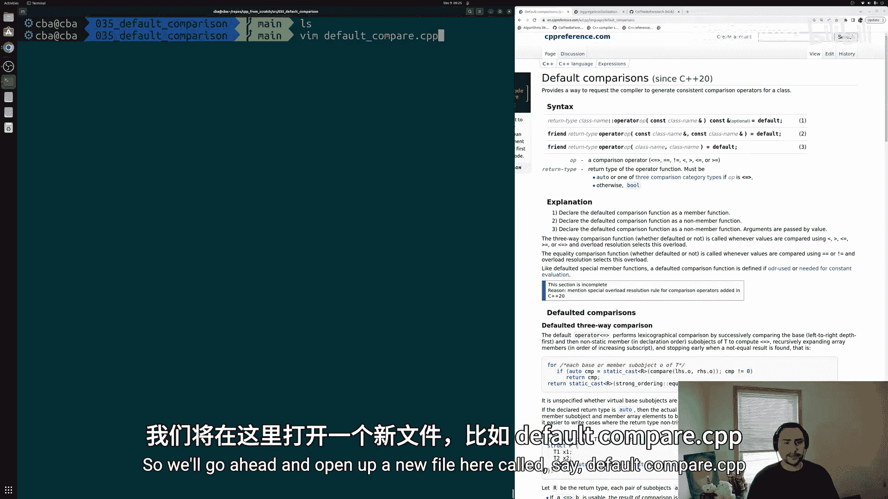

And inside of here， we'll go ahead and include Io streams so we can do some printing， and of course。

 we're going to need a main function。Now。Let's go ahead and define somestruct S here， right。

 this will be the thing that we want to compare， but we don't want to have to write out all of these member functions right to overload these compare operators。

So we'll define somestruct S。That has a couple of data members。

 so maybe some integer A and also some integer B here。And then down here in our main function。

 let let's go ahead and initialize and create a couple objects of type S so we'll create some s1 here that we'll initialize using aggregate initializations。

' initialize A and B to one and2 respectively。 So if we want to learn more about aggregate initialization。

 I'll go ahead and link down this CPP reference page below the video， but high level idea here。

 we're just initializing our data members in order here。

 So a is going to be set equal to1 B is going to be set equal to2。Okay。

 and we'll do something similar for S2 here。We'll initialize this to say one and three this time。

 right， so slightly different。 And let's say we want to be able to print out。

 say if S1 is equal to S2 here， a simple equality comparison。

With a new line character printed out afterwards and you can see if we try to do this。

 we actually get a compiler error immediately and the reason is is that we haven't implemented this equals operator for our type S here that we've defined right so no match for operator equals for opera and types S and S here。

So we could of course go in here and implement our own version of this equality operator just comparing all of the data members of S1 with all of the data members of S2 so we could certainly manually implement that but you know that's a decent amount of work especially if we have a whole lot of data members so it's much nicer if we can just default it and have our compiler take care of that work for us and that's exactly what we can do with these default comparisons so you can see here we can implement these operators and set them equal to default to have our compiler generate them for us。

 similar to how we saw in the past how we could default。

 say a copy constructor or a move constructor etc etc。So here let's go ahead and do that。

 so we'll have a bo return type so whether or not our two objects are equal。

 then we're implementing this operator equals。And it's going to take some constant S by reference here。

The method itself is or member function is going to be cons right。

 It's not going to be updating anything。 And then we'll go ahead and set it equal to default right So we're telling our compiler that we want it to generate this operator equals method for us And you can see that my compiler error went away here right It's no longer complaining that struck S this type here doesn't define。

 say this a operator right now that we've defaulted it。 our compiler is generating it for us。

 It's responsible for this operator。Okay， so let's go and see what happens here when we do this equality。

 So what it's going to do is a member wise equality。

 so it's going to compare the data member A for both objects and the data member B for both objects。

 if it ever finds that one of these is not equal， it'll return false。

 if it goes through and finds that they're all equal， it'll return true。

 so either zero or one respectively。So let's go ahead and save this。

 We'll compile this default compare cP with G+ plus and call our output executable just something like default compare and you can see if we try to do this by default。

 our compiler is going to complain with us because this is a relatively modern feature so it says that we need to compile with stoodoo equal C++ 20 or stood goodnu plus plus 20 for Gcc here so we have to tell our compiler that we want to use this modern version of C+ plus so we'll just put stood equals C+ plus 20 here to get around this error。

 so you'll need a modern compiler for this， I believe Gcc at least Gcc10 will support this。

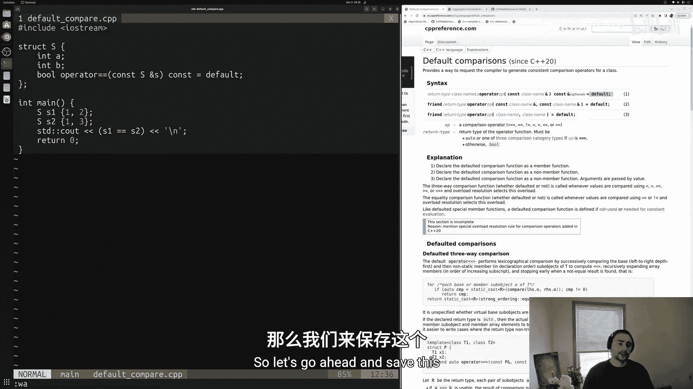

And you can see that now that we added that flag， we get our default compare executable。

So we can go ahead and run this and what do we see Well， we see a return of0 here。

 which is equivalent to false here right S1 is not equal to S2。

 so this compare return false right S1 has1 and 2 for A and B respectively and S2 has one and3 so this return false。

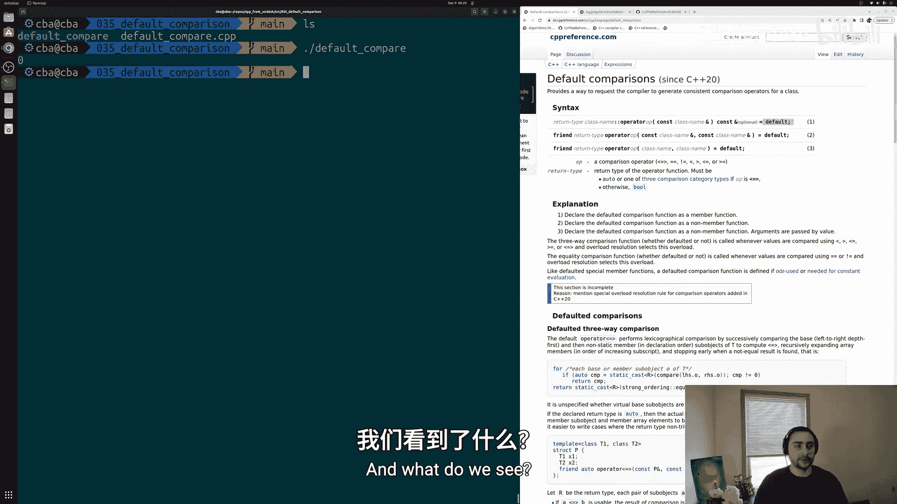

If we go you know went ahead and made them exactly equal。

 so both say one and two for A and B respectively， and we recomped this and ran this。

 of course we get one returned here， so true。

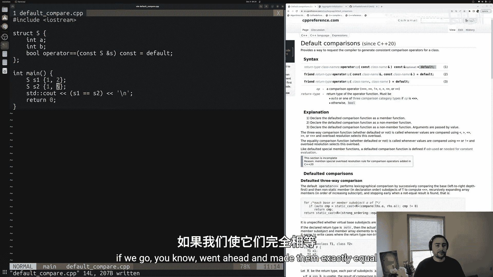

Okay。

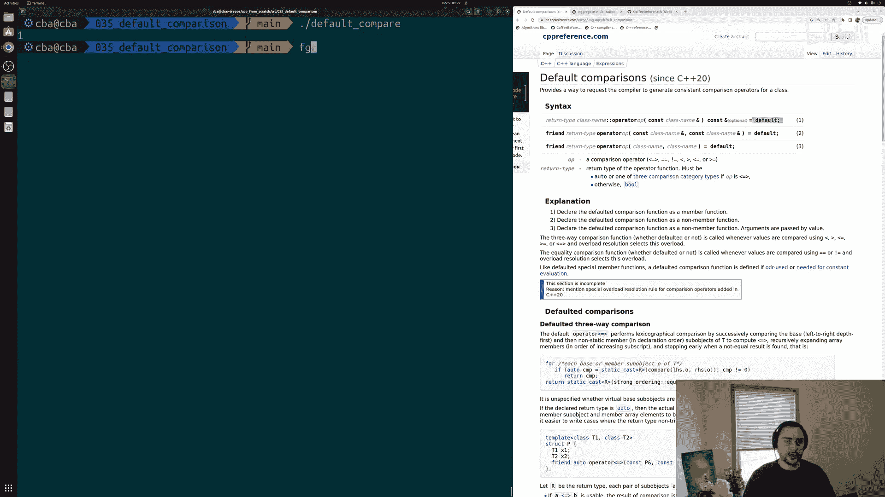

So let's say we want to do other kinds of comparisons here。

 So maybe we also want to do greater than or equal to or maybe just greater than something like this。

 Well， I'm going to get this compiler error again。 It's going to say。

 no match for operator whatever it is greater than greater than or equal to less than less than or equal to etc。

 because we haven't implemented these operators。 we just defaulted this equality operator here。

 So we're going to get compiler errors here， when we try to compiler application when we use these different types of comparison。

 Now there are cases where we want to implement， say all of these comparison operators and but we don't want to have to do this manual and we don't have to list out every single operator that we want to implement。

 So instead what we can use is this three-way comparison operator sometimes called the spaceship operator So it looks a bit like a spaceship or a flying sauce here here。

 it's this less than equal to greater than symbol。😊。

And we can use this to Telecompilr that I want you to implement all of our comparison operators for us。

So let's see how we can do that。 So here we'll go ahead and make our return type auto here。

And then instead of operator equals， we'll do operator。This three way comparison operator。

 so this less than equal to greater than。And then the rest of our operator here is going to be exactly the same。

We're still going to be taking in this some object of type S by reference。

 by cons reference that is it's still going to be a con member function here。

 it's not going to be updating anything about our object and we still want it defaulted。

But now you can see it gets rid of our compiler error for our greater than comparison。

 and it also gets rid of it for greater than or equal to you can still use a quality here。

That still perfectly works， we can use less than all of these different things。

 all of these operators work because we have them defaulted up here using this three way comparison operator。

So let's go ahead and maybe do one of these comparisons。

 maybe we'll check to see if S1 is greater than S2 here。

So we'll go ahead and revert our change S2 here。 So S1 has one and2 for the data members respectively。

 and S2 has one and3。 so we would expect this to be false here because when it's doing this memberwise comparison。

 it's going to see that B is actually less than the B of S2 here， so we should see false。

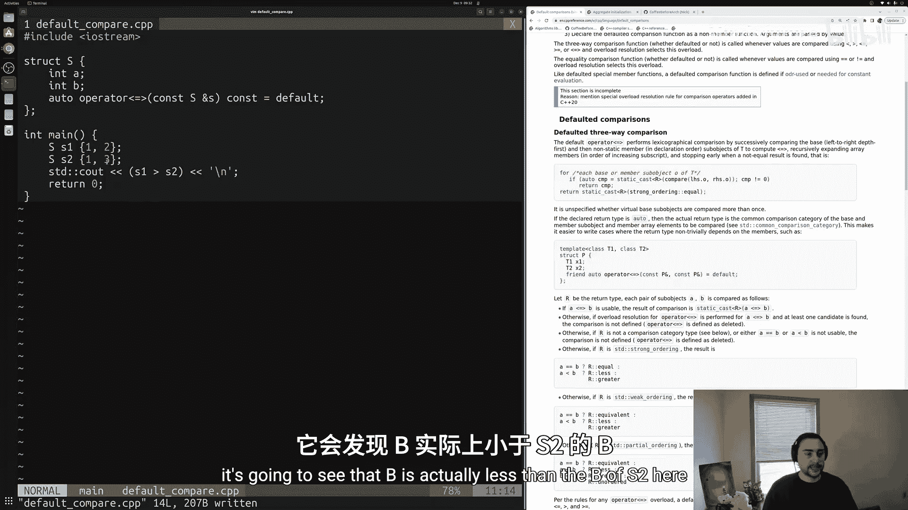

So we'll save this。And we'll recompile default compare it about CPP and we'll run it and we get false。

 right， we get this zero printed out。

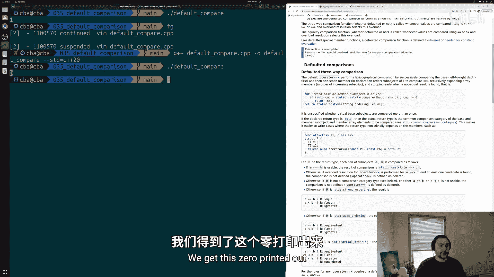

But if we were to change this to something like 20 instead。

And we change say the first member to be say 10 right remember we're doing this memberwise comparison so we're going to check okay is S1 a greater than S1 or S2a。

 and then we're going to check if S1B is greater than S2B so in this case right we're going to check the A's first and we'll see that okay that's bigger so we can move on to the next element and then we see that B is bigger as well。

 so we'll return true in this case。

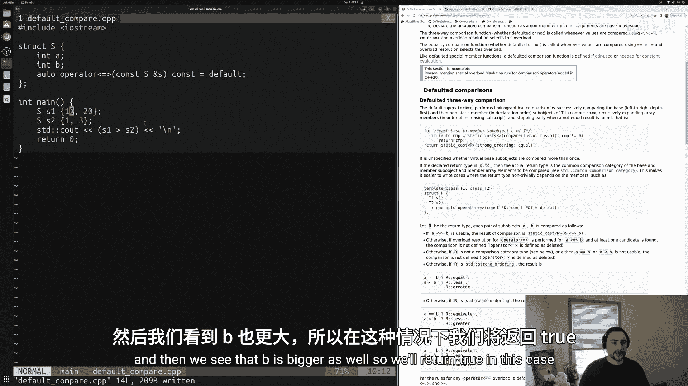

Okay， so let's go ahead and recompile this and run it and we see we get true printed out or we get this one printed out。

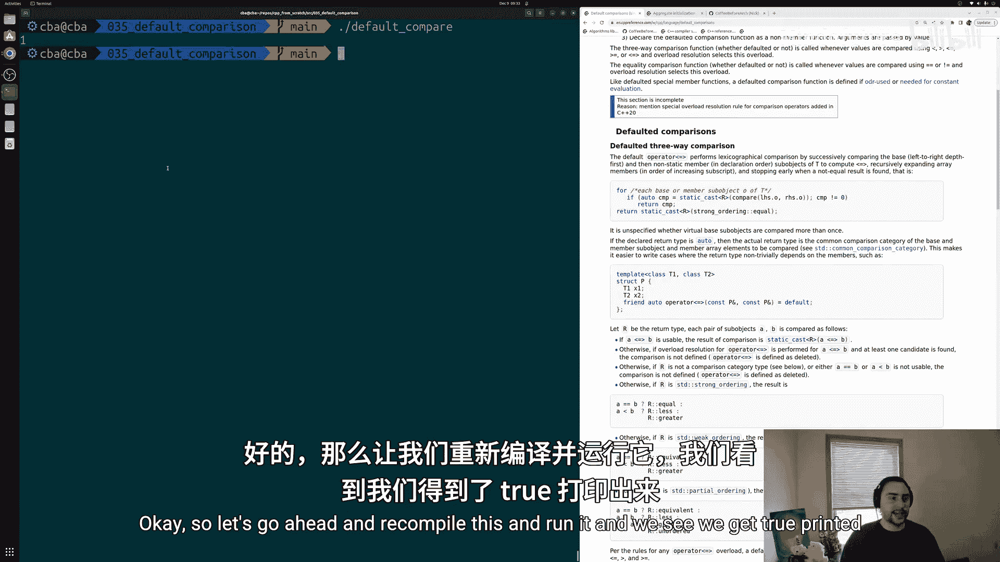

Okay so that's going go ahead and do it for this video it's a bit of the basics on how we can default these comparison operators now there's a lot more we can get into around threeway comparison so there's all of these things we can talk about related to these partial orderings and weak orderings and how we actually define comparison between different objects if we want something a little more special than just you know comparing element wise。

 all of these members right if we want to do something a little more special here in define what this means a little bit more precisely。

But we'll go ahead and leave it here for today right in many cases。

 we just want these simple kinds of comparison operators。

 right ones that just member wise compare all of the elements。 Now， of course。

 you can find this in any of my other examples at Github。

com scoffeebe arch and you can find them in this CPP from Scch repo and that's going to go ahead and do it for today as always I'm Nick and hope you have a nice day。

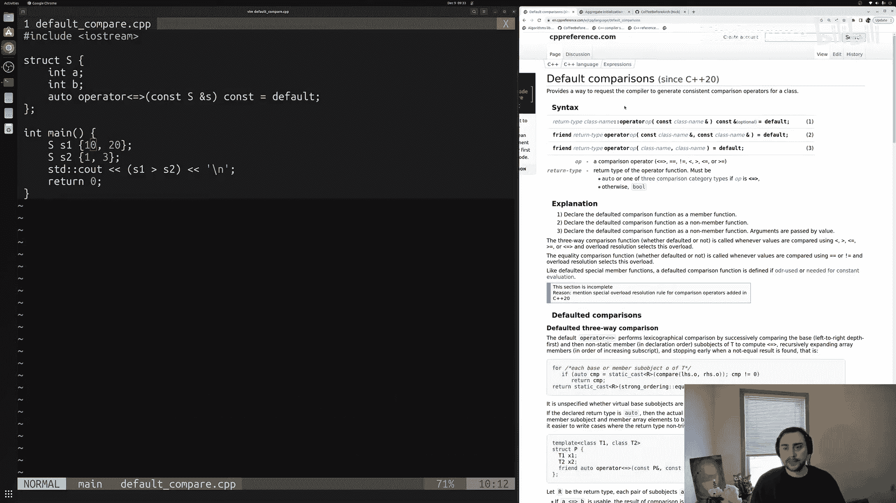

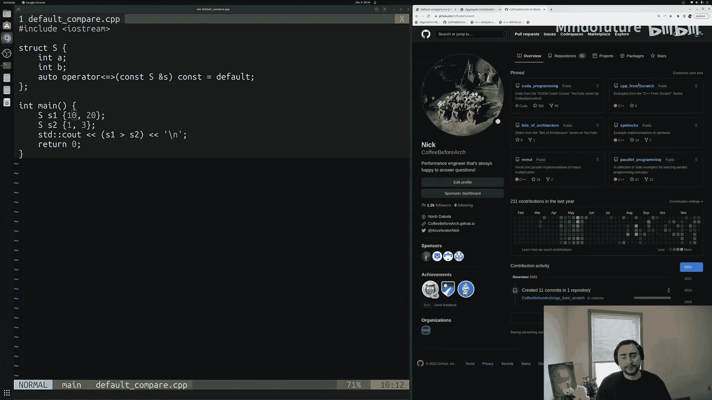