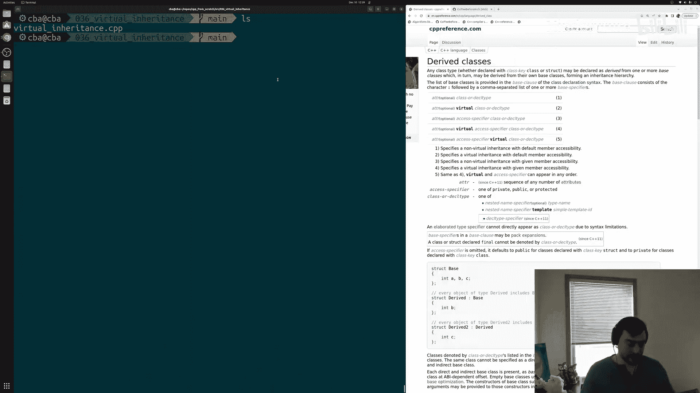
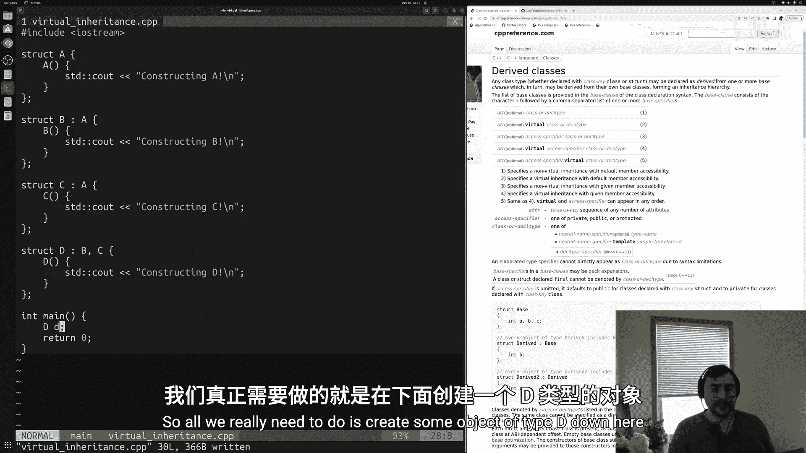
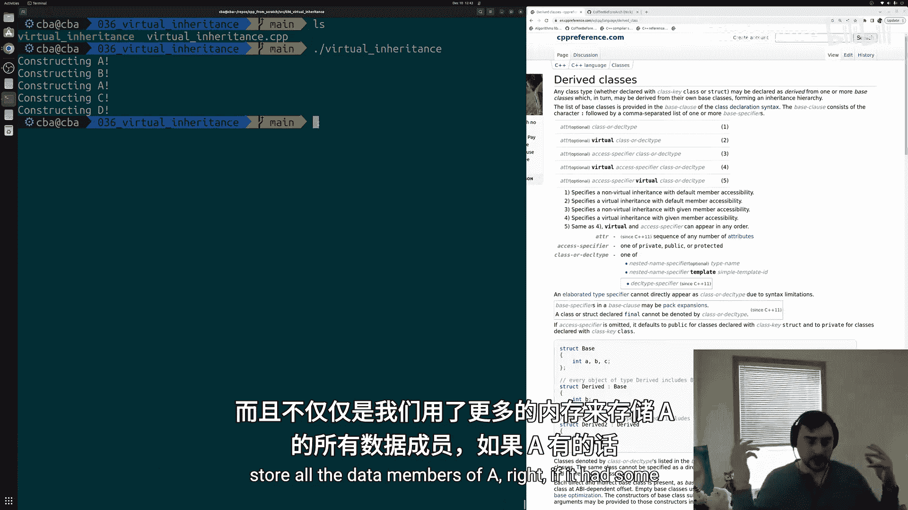
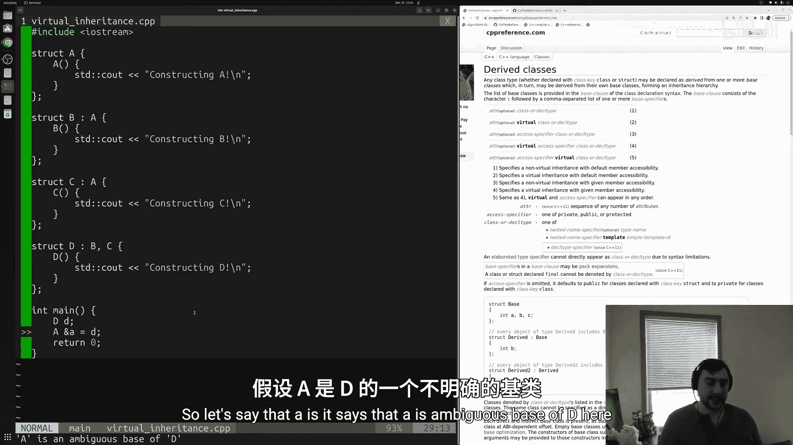
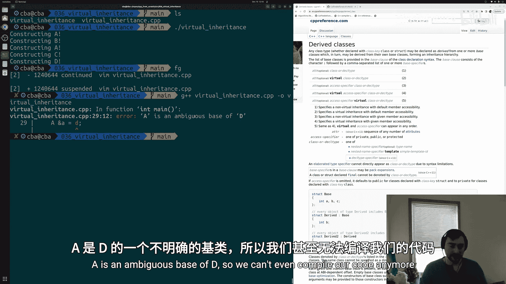
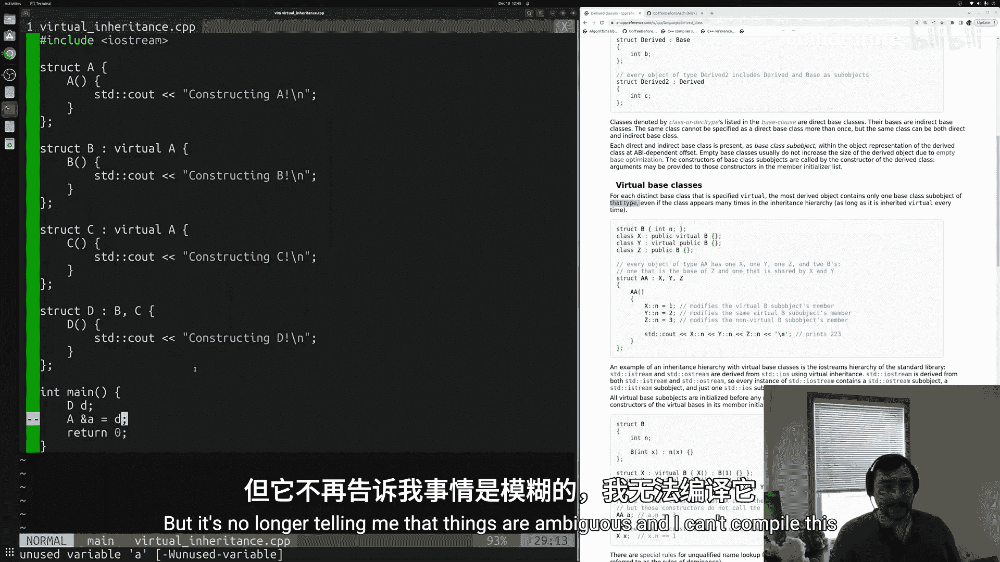
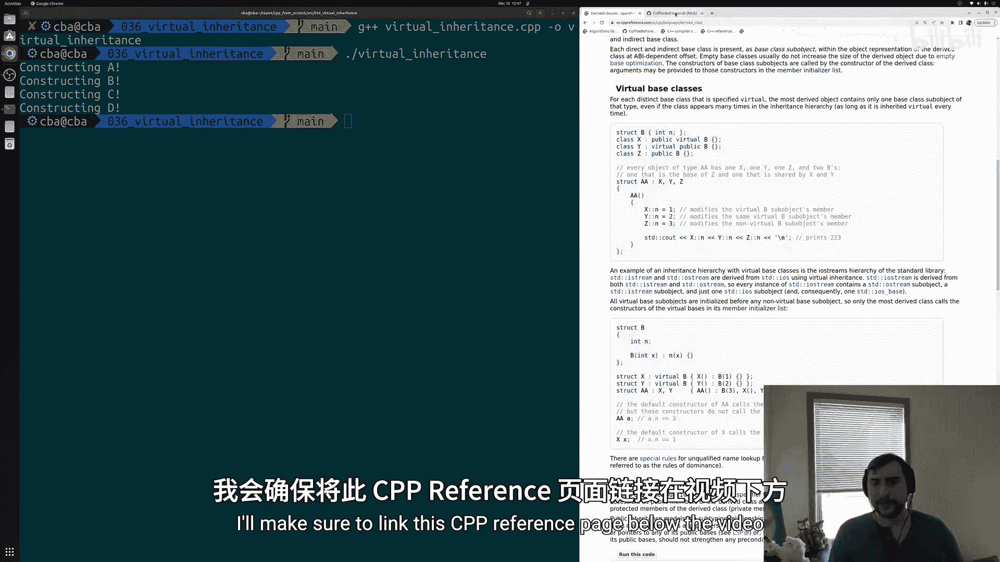
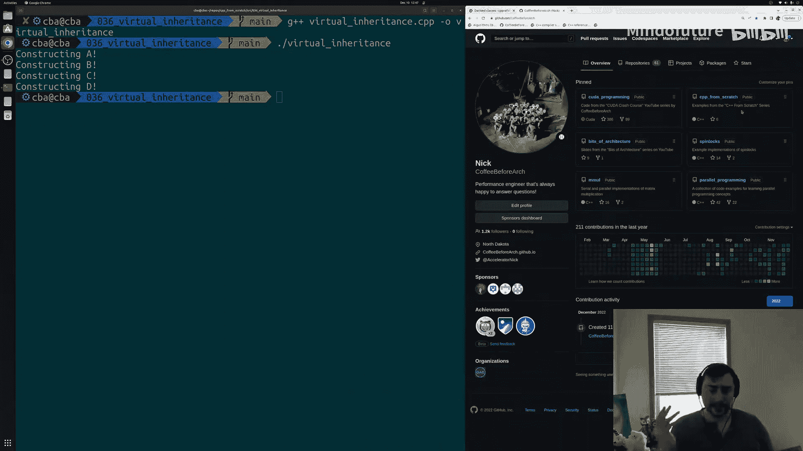

# C++入门教程｜CoffeeBeforeArch-p37-P37-Virtual-Inheritance--BV1nbRUYSEUu_p37-

Hey everyone， I'm Nick， and this is C Plus Plus from scratch。 So in this episode of the series。

 we're going to be talking about virtual inheritance。So in a previous video in the series。

 we looked to the basics of inheritance and derived classes。

 so we saw how we could inherit from some base class inside of derived class。

 so inherent things like the data members and member functions。Now， there are times since I've code。

 where we'll have， you know， a decently complex hierarchy of inheritance。

 So we'll have multiple levels of inheritance and even derive classes that inherit from multiple base classes。

 Now， one problem that can occur during all of this is this then called the diamond problem of inheritance。

 And this is where we accidentally inherit from some base class multiple times。

 So what we're going to be looking at today is the basics of this diamond problem。

 And also how we can get around it using these virtual base classes and the idea of virtual inheritance。

😊。

So let's go ahead and get started and we'll open up this virtual inheritance CBP example。

 The example here is pretty simple。 All we really have is four differentstructs defined that do some inheritance。

So we have some basestruct A that just has a simple constructor that prints out constructing A。

Then we have to derive classes of A， so thesestructs B and C， and both of these inherit from A。

 and they print out constructing B and C respectively。

And then we have some most derived class A or D here。

So this astruct D just print out constructing D and an inheritance from both B and C。

 So we form kind of a diamond pattern of inheritance here。 at the very top。

 we have some base class A then that fans out into two derived classes B and C and then some final most derived class D that inherits from B and C right So we form this kind of diamond pattern Now what exactly is wrong with this or what's a problem with you know how we've constructed things so far Well。

 the problem is is that D is accidentally inheriting from a twice once through B and once through C here。

So how exactly is this happening。 So we have to remember kind of what inheritance means。

 So when we say that B is inheriting from a up here。

 what we really mean is I'm building on top of this base class A with a new object B。

 But a is going to be a sub object of B。 Likewise， with somestruct C here， the same is true。

 So a is going to be a subob of C。 So what happens when D inheritance from both B and C。 Well。

 that means B is going to be a subob of D and C is going to be a subobject of D。 But both B and C。

 have a is a subob， which means that we're getting two subob of this type A here inside of my object D。

 right， So this is the problem that we're talking about with this diamond problem of inheritance。

 We're accidentally inheriting from this base class A multiple times inside of our most derived class here。

 So let's go ahead and see how that looks by kind of tracing back calls to these constructors。

 So all we really need to do is create some object。😊，Of type D down here。

So we'll go ahead and do that and we'll save this and then let's go ahead and compile virtualinheritance。

cppP and call our output executable virtual inheritance。So we've compiled it。

 we have our executable here， let's go ahead and run it。

And let's see the printouts that we get for constructing an object of type D。 Now， of course。

 at the very end， right， we have our call to constructing D here from our D struct。

Then because we're inheriting from bothstruct C andstruct B， right。

 we'll see calls to those constructors as well。 So constructing C and constructing B。 Now。

 as we remember， C inherits from a and also B inherits from a。 So in constructing our subobject C。

 we're also constructing some object A。 And likewise， when we're constructing the sub object B。

 we're constructing some subject A。 So we end up constructing the subobject A twice。

 we have two a subobject inside of our object D here。 So that's the problem that we have。

 And it's more than just the fact that we're using up， say more memory to say。

 store all the data members of a， right if it had some。

 the issue also comes with up upcasting and polymorphism。

 So one thing that this prevents is the idea that we can or it prevents us from upcasting D to B of this type A here。

So for example， we can't do something like create some reference to A。Based on D， right。

 we end up getting a compiler error here。 So it's say that a is it says that a is ambiguous base of D here。

So we can go ahead and just try to compile this with G++。And we can see we get that exact same error。

 A is an ambiguous base of D， so we can't even compile our code anymore。

And the reason for this is that we have two subob of a inside of D。

 and our compiler doesn't know which one we actually mean to use when we do this upcasting here。

 It's ambiguous and in ambiguous situations。 Our compiler just puts up his hands and it says。

 I don't know what you mean。 So I'm just not going to compile your code。

 That's typically what your compiler does。Okay， so how do we get around this problem how do we fix this this problem of or this diamond problem of inheritance？

 Well one way we can get around it is through the idea of these virtual base classes here。

 So on this derived class page on CPP reference， it's got this section on virtual base classes。

 and it says that for each distinct base class that is specified virtual the most derived object contains only one base class sub objectject of that type here。

 So it's saying that if I call a here， a virtual base class， that in my most derived class。

 I'm only going to get one subobject of a， if I inherit from B and C。

 because we've declared a as a virtual base class during this inheritance here。😊。

So let's go ahead and see how that looks， right， so we can go ahead and declare a to be a virtual base class just using this keyword virtual。

And we'll do that again with our struct C here。 So we'll call this a a to be a virtual base class here。

And you can see that instead of getting an error down here when I do this upcasting with this reference of type A。

 it no longer gives me an error。 It gives me a warning， right。

 And it's just a warning that I haven't used this， this type A here。

 So it it's telling me that I just have an unused variable。

 but it's no longer telling me that things are ambiguous and I can't compile this。

Al right， so let's go ahead and save this and let's recompile virtualinheritance。

cppP and run our example and look at those different calls to those constructors。

So now what we see is that when we're constructing D right our objective of type D that inherits from both B and C。

 we get objects of type C and type B created or constructed。

 but we only get one subobject of type A constructed here。

 even though B inherits from A and C inherits from A， right。

 we said that a was going to be a virtual base class in both our objects B and C。

 so we only got one instance of it per the definition over here of these virtual base classes and this idea virtual inheritance。

Okay， so that's going to be the simple example here and I think this drive class page on CPP reference is very nice because it also gives us an example of where this idea of virtual inheritance comes into play in the actual standard library so you can see here there's a nice little segment on this and it says that an example of an inheritance hierarchy with a virtual base class is with IO streams right what we used to print。

And it says that， know both this I stream and this O stream are derived from some base class stood iOS using virtual inheritance。

And that our stood Io stream right this at the very bottom here is derived from both ISt and O stream。

 right so it uses virtual inheritance to prevent two instances of the stood iOS base class here So there's an actual example of where we need this virtual inheritance and use of these virtual base classes。

Okay， but that's gonna to go and do it for today。 I'll make sure to link this CPP reference page below the video。

 and of course， you can find this in any of the other examples at github do co s co before arch。

 So right on the front page here you can see this CPP from scratch series where you can find all these examples。

 but that's going go ahead do it for today。 As always， I'm Nick and I hope you have a nice day。😊。

