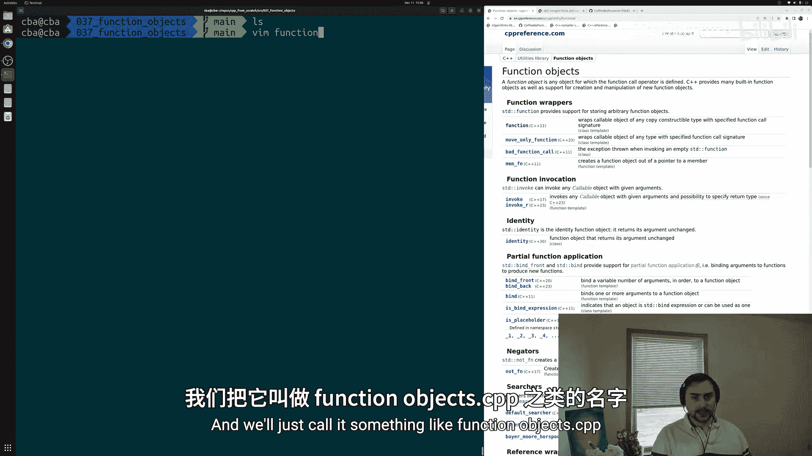
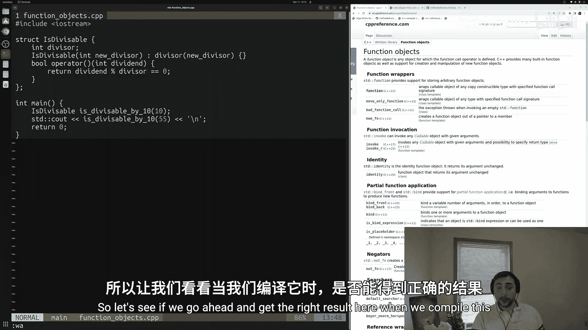
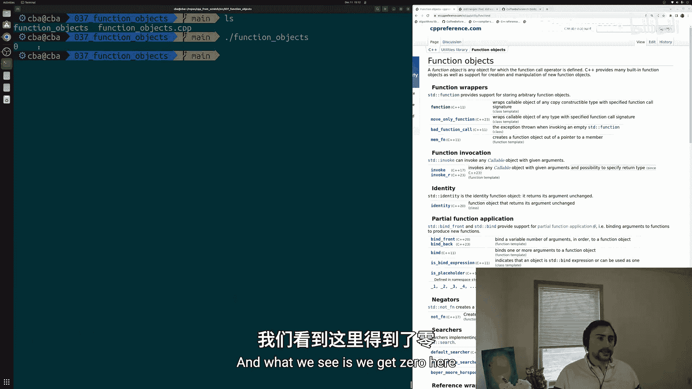
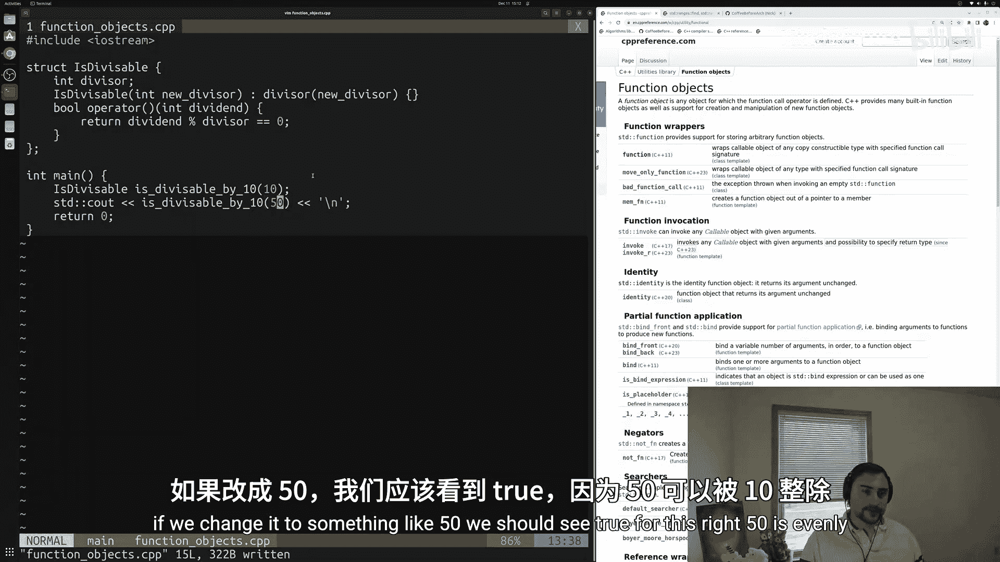
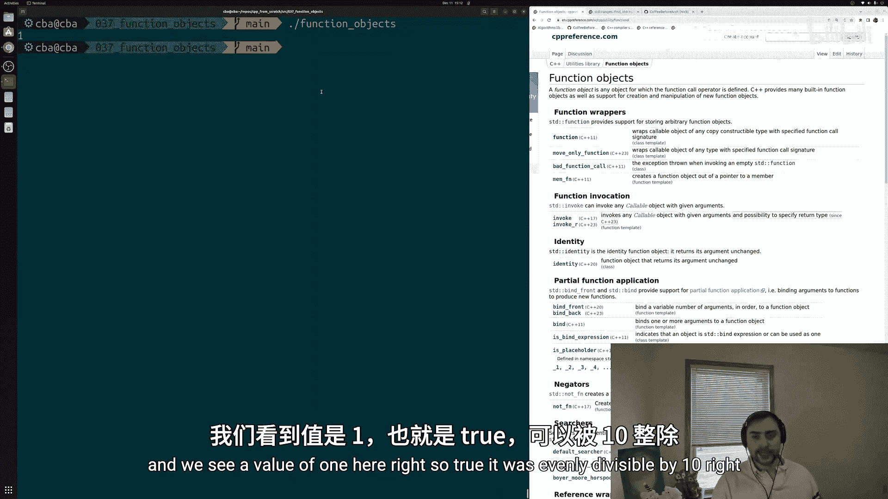
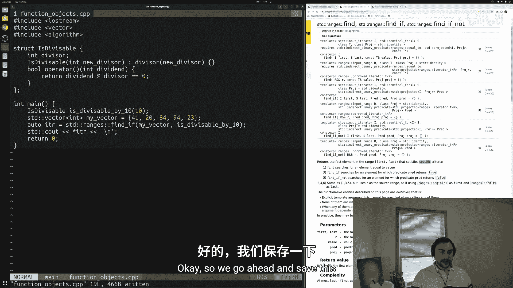
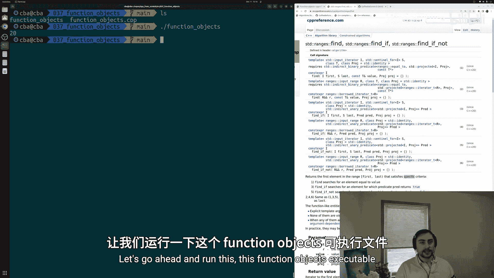
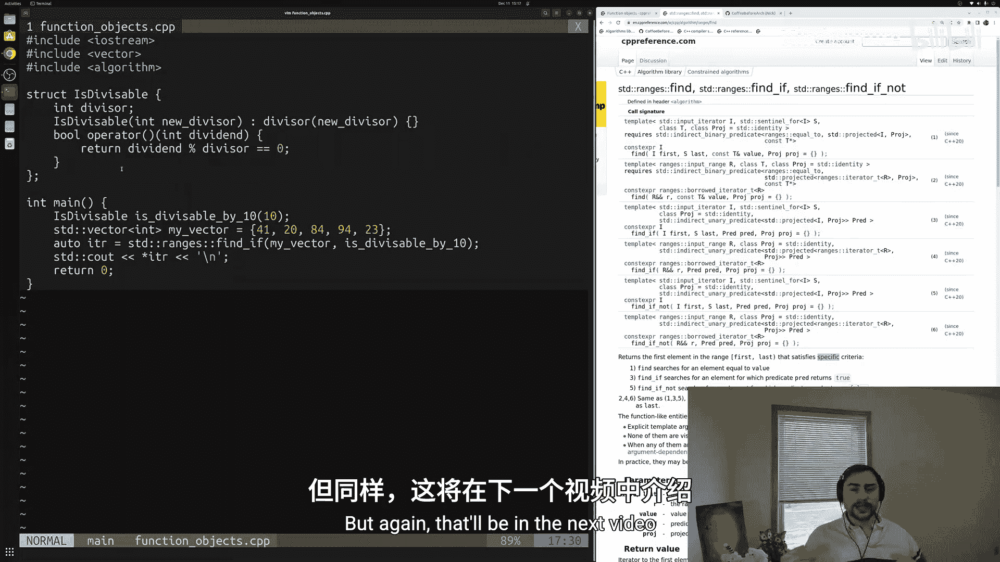
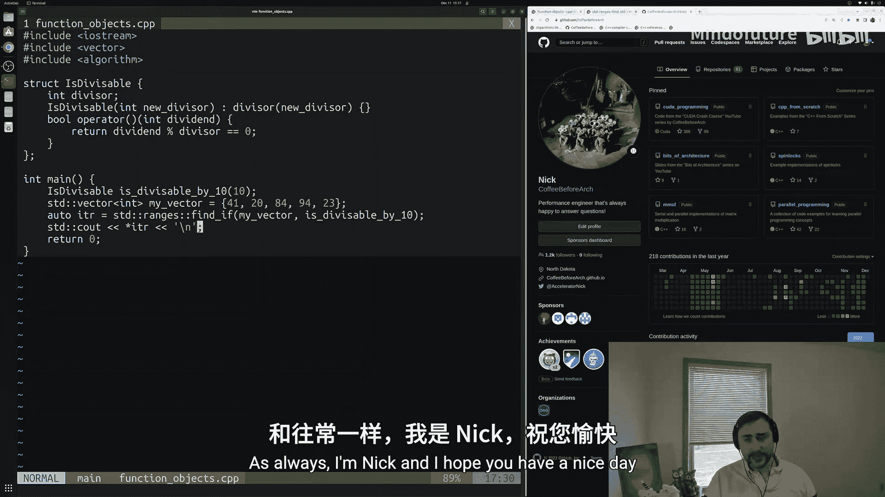

# C++入门教程｜CoffeeBeforeArch-p38-P38-Function-Objects--BV1nbRUYSEUu_p38-

Hey everyone， I'm Nick， and this is C Plus Plus from scratch。 So in this episode of the series。

 we're going to be talking about function objects。So in a previous video。

 we looked at the basics of how we can overload the operators inside of ourstructs in our classes Now one of the operators that we can overload is this function call operator and when we do this we make a function object。

So if we look on the right hand side of the screen here。

 I have the function object page from CPP reference up。

 and you can see that it says that a function object is any object for which the function call operator is defined so we can basically call our objects like we can call our functions。

Now one of the nice things about this is it gives us these functions with some state associated with it。

 and this state is going to be all of those data members associated with our object。

 and now we can call them like functions。So what we're going to be looking at today is kind of the basics on how we can define this call operator。

This function call operator that is for objects to make these function objects and how we can use them in the context of。

 say， a standard library algorithm。 So something like stood find if。

So let's go ahead and get started and we'll open up a new example here。

 and we'll just call it something like function objects。

That c。And we can start off by just including Io streamam so we can do some printing。And of course。

 we're going to need a main function。So let's go ahead and define say some struct that we have the ability to call。

 so let's say we want you to fly， say some object right to check if some number is divisible by another。

 so we'll create some struct。And we'll call it say is divisible， right？

Then inside of here we can add， say a data member here， which will be our divisor。

 so we want to check to see if some number divided by our divisor has a zero remainder。

 so it's evenly divisible by some divisor。So we'll have some integer divisor here。

And then we can go ahead and initialize that with a constructor here。

 So we'll run our constructor for is divisible and this constructor will say take say a single integer。

 write the divisor that we want to set。 So it'll take， say， some new divisor。

And then we'll use our member initializer list to go ahead and initialize divisor here with new divisor。

 and we'll go ahead and just have an empty constructor body here。

Now the final thing that we're going to implement for this simplestruct up is our operator。

 this function call operator， so what we want to do whenever we call。

 say objects of this type is divisible is we want to check to see if whatever number we pass in。

 our dividend is evenly divisible by our divisor here。So what is your return is say， just a bo。

 right， a true false of whether or not the number is divisible by your divisor。So return a bull。

 then what we're implementing is this function call operator。

 so this operator open and closed prints here。Then like all of our other member functions。

 we can have list of parameters in this case， the only thing we need to pass in is our dividend。

 right the number we want to check to see is if it's evenly divisible by our divisor。

So we'll just pass in some integer dividend。And then we can have our function call body or rather our member function body here。

So inside of here all we need to check is， you know， we're going to return if our dividend。Modullo。

 our divisor。Is equal to zero。So we use this mod operator to do Integer division but to get the remainder from Integer division。

 so we're checking to see if we divide these two numbers， if we divide dividend by divisor。

 we check to see if the remainder is equal to zero here， that's all we're doing。

 We're checking to see if this dividend is evenly divisible by our divisor。Alright。

 so that's our implementation for our struct up here with this call operator。

 so when we create an instance of this is divisiblestruct。

 we can call that object it's a function object。So let's go ahead and try that out。

 So down here we'll create an object of type is divisible。

And let's give it a name like something like is divisible by 10。

 So say we want to use this object to see if numbers are evenly divisible by 10。

So we'll initialize it with our constructor here with our new divisor equal to 10。Okay。

 then let's see how we can call this object， right， like we can our functions。

 So let's just do something like stood sea out。And then we'll just print out is divisible by 10。

 right， and we'll check to see if some number like 55 is evenly divisible by 10。

And let's print a new character afterward。So what we should see here is a printout of zero， right。

 55 is not evenly divisible by 10， there's a remainder  five here。

So let's see if we go ahead and get the right result here when we compile this。

So we can go ahead and compile function objectsjects。

cdp with G++ and call our output executable just something like function objects。Okay。

 we have our executable here， let's go ahead and run it and what we see is we get zero here。

 so the boolean falls here， right 55 was not evenly divisible by 10。

Likewise， if we change it to something like 50， we should see true for this， right。

 50 is evenly divisible by 10。

So we can recompile and try that out and run it and we see a value of one here， right， so true。

 it was evenly divisible by 10 right， but we have the ability here we're calling an object likely would a function because it implements this function call operator。

Okay， so that's a simple example of you know writing and using these function objects。

 but let's see how we can use them in the context of something like one of our STL algorithms。

 so say one of our constrained algorithms like stood ranges find if。Now。

 if we go ahead and look to see what this algorithm does， it returns the first element in some range。

 first to last， that satisfies some specific criteria here and we can specify what that criteria is using something like a function object like this is the visible object that we've created here。

So let's go ahead and see how we can do that through say a range of inkt js inside of a vector。

So let's go ahead and include a couple more headers here。So we'll go ahead and include， say vector。

And we'll also include algorithm， right， so we can get access to this constrained algorithm。

 the student range is fine if。So let's say we want to go ahead and create a vector of integers。

 As some stood vector of integers。 We'll just call it something like my vector。

And then we'll set it equal to say， you know a couple values here， so 41， 20， then maybe 84， then 94。

 and then let's go ahead and say you know 23， something like that。

And what we want to do is find the first element that is evenly divisible by tin here。

 so we could write that entire implementation ourse through something like a for loop。

 or we could just use our stood ranges find if here。So let's go ahead and see how we can do that。

 So it says that it returns the first element in this range that satisfies our criteria here。

 And what it really does is it returns an iterator to that element。So we can say， you know。

Auto iterators， we can use automatic type deduction for this。Is equal to stood ranges。Find if。

And we can pass in a range of values， which is our my vector。

 and then we can pass in on predicate here。Right and we can for a predicate。

 we can use our is divisible by1 function object down here， right。

 it's something that will tell our algorithm， whether or not you know the element in our vector you know matches what you know what we're looking for here。

 we're finding if some condition is true right and to get that you know true or false here。

 we're using our function object， this is divisible by 10。

So let's go ahead and pass that in as our predicate， so this is。Divisible by 10 here。

And then we can go ahead and just print out whatever was at this iterator， right。 Now， in this case。

 what's going to be at this iterator， well， we should see a value of 20 here， right。

20 is the first element that is divisible by 10。 So we should see that as a print out here。Now。

 what you should probably do here， for doing this in a more general case is you should check to make sure this iterator isn't equal to my vector dot n。

 so it's not all the way past the end of your vector。Okay， but let's go ahead and print this out。

 we should see 20， so we'll just dereence our iterator here。To get that value。

 and willll print a new line character afterwards。Okay so we go ahead and save this。

 let's go ahead and recompile this function objects。

 cP and you can see that we get error here so again。

 because we're using these constrained algorithms， these are something that are part of C++ 20 so you'll need a relatively modern compiler and generally you'll need to specify you know that the standard is equal to C++ 20。

Okay， so that gets us past our compiler error， Let's go ahead and run this function objects executable and you see we get the value of 20 here so we were able to use our constrained algorithm here and our function object here to search our vector based on some condition and our condition was using this function object that we defined right this is divisible struck。

😊。

Okay， so that's gonna to be the basics of function objects and that's going to go and do it for today。

 One thing that we'll be looking at say in the next video is this idea of anonymous function objects with lambmbdas and how they really simplify these simple conditions and get rid of a lot of this boilerp code that we need to write but again that'll be in the next video As always you can find any of these examples at Github。

 co s coffee before arch So right under the cP from scratch repository here on this page。

 But like I said， that's gonna to go and do it for today。

 as always I'm Nick and I hope you have a nice day。😊。

