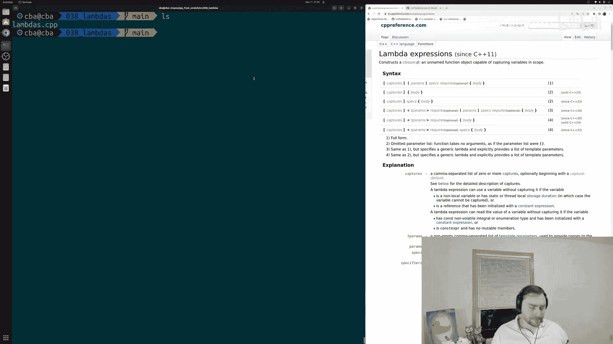
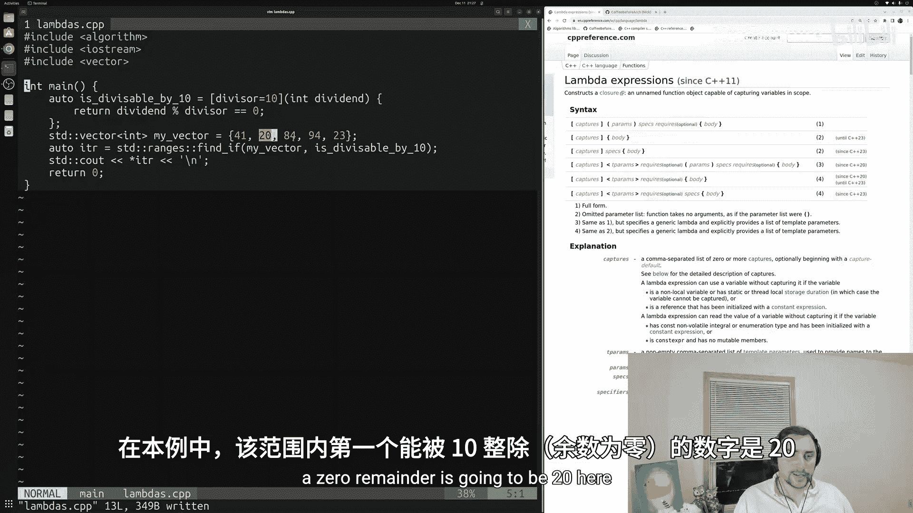
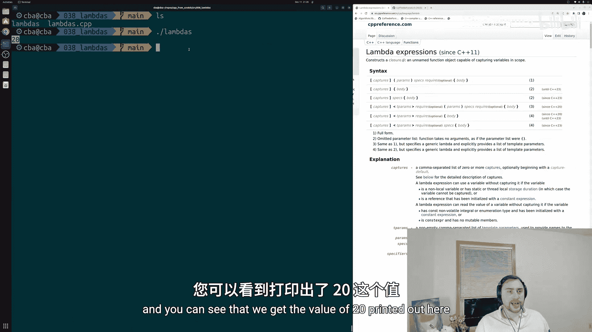
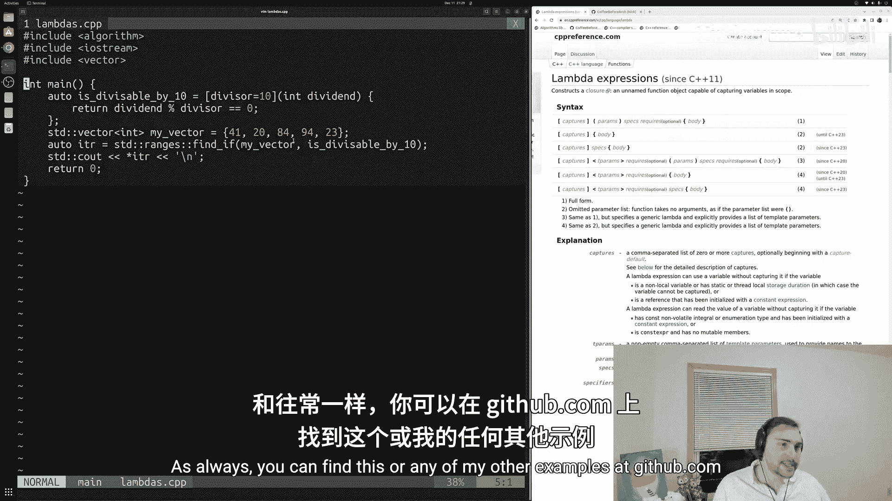
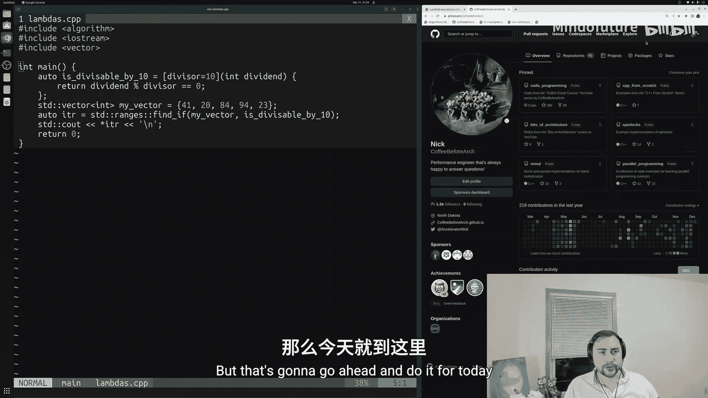

# C++入门教程｜CoffeeBeforeArch-p39-P39-Lambdas--BV1nbRUYSEUu_p39-

Hey， everyone。 I'm Nick。 and this is C++ from scratch。 So in this episode of the series。

 we're going to be talked about Lambda expressions。 So in the last video。

 we looked at the basics of function objects。 So we saw how we could overload the function call operator for astruct class that we had to find。

 Now， inside of that video， we saw that there was a decent amount of boilerplate code we had to write just to get this function object。

 So we had to define something like a struct， we added， say a data member in our case。

 we added a constructor， and then we also added， you know。

 that overload for that function call operator。 Now， fortunately， since C++ 11。

 we've had a nicer way of doing this in many cases。

 And that's going to be through these Lambda expressions。

 So these Lada expressions allow us to create an unnamed function object capable of capturing variables in scope。

 So basically allows us to create a function object without having to define something like a struct or a class。

 So let's go ahead and see the basics on how we can use these Lambda expressions。

 By looking at our same example from last time， right and replace。😊，Our isdiisible function object。

With just a lame expression。

So let's go ahead and open up this Lambda CBP here。 and we have for example from last time。

 So we implemented thisstruct is divisible that has some divisor。

 We set the divisor inside of a constructor here， this new divisor， this integer。

 and then we overload this function call operator right And as a parameter we have our dividend and what we're checking here is to see if our dividend can be evenly divided by our divisor。

 So when we do this integer division， we have a remainder of 0。

 that's what we're trying to check here。So let's go ahead and see how we can replace this function object that we created here from this is theisible type and see how we can convert that to just being a lambda expression and see how much simpler it can be。

So the first thing that we can do is get rid of this is divisible type and we'll just rely on this unnamed function object because it's this unnamed function object。

 we'll use this auto type， right， we'll rely on our compiler to figure out this type for us with our La expressions。

Then what we can do。Is we can send it equal to this Laed expression here and a lamb expression really has three major parts。

It has these square brackets here that says what we want to capture， So these will be the variable。

 say from our scope that we may want to include， either by value or by reference。

 we could even create new variables inside of this captures brackets right here。 Then we have。

 you know just like a normal function or member function here。

 We have these prints here that says the parameters that we want this function object to take。

 So it's just a list of parameters。 And then， of course， with these curly brackets。

 we have a function body。 So those are the three major parts so we can start with captures here。😊。

So in our isdiisible function object up here， we had some state here， this int divisor。

 so we can do the exact same here with captures and we can just say something like divisor is equal to 10。

 So this is similar to creating a variable， but we don't even need to use auto right to specify a type here。

 or specify that this is an integer type。 It'll automatically be deduced because we're setting equal to 10 here。

😊，Then we can go ahead and add a parameters using these prints。

 so just like our know overloaded operator here that takes a dividend。

 we can just specify that this takes some int dividend， right？So this is what we're going to divide。

And then we're going to have our curly brackets， right。

 this is going to be the body of our function that we're defining for this unnamed function object。

So here， right， we're just going to use the exact same body as we used for our function call operator from our isdiisible class。

So here we'll go ahead and just say we're going to return dividend。Mod divisor is equal to0。

 so we're just doing integer division here。 We're dividing our dividend by our divisor。

 using the module operator to get the remainder， and we're just making sure that the remainder is equal to 0。

 right。So look at what we've done here。 we've written these this three lines of code right and this line of code down here is really just a semicolon and we were able to completely replace this entire struct up here that we have defined。

 and we have the exact same functionality implemented。

So we can go ahead and completely remove this is divisible。 We don't need it anymore。

And we can go ahead and use this labed expression for the rest of this example here。

 So in the rest of this example， what are we doing。

 We're creating a vector filled with some numbers here。

Then we're using find diff right to find some value or the first instance of some value in my vector where this condition is true。

 So we created this is divisible by 10 Anous function object using this lambmbda expression。

 So we're just making sure that some number divided by 10 has a remainder of 0 here。

 So we're just going to find the first case where that's true using the stood ranges find diff from C plus plus 20 In of the range。

 my vector here。 And we're using a lambda instead of our function object that we defined last time。

 right， through thatstruct。😊，And then we're just going to print out that value here from this iterator returned by stood range is find if here。

 So in this case， the first number inside of this range that divided by 10 has a 0 remainder is going to be 20 here。

So let's go ahead and save this and let's go ahead and minimize it， we can compile this lambmbdas。

 CBP with G++ and we'll call our output executable， just something like lambmbdas。

 and because we're using this range base or this constrained algorithm。

 this stood range is find if we're going to have to specify that stood equals C++ 20 and you'll need to use a relatively modern compiler that supports these constrained algorithm。

Okay， so we went ahead and we generated an executable here and we can go ahead and run it and you can see that we get the value of 20 printed out here。

So we can see that we got the exact same functionality from this incredibly simple Lambda expression as we did with thatstruct that we define that overloaded that operator。

 So Lada can be a great way to make our code a little bit more concise and clear， right。

 rather than having to define these dedicated structure or classes to have function objects。😊，Okay。

 so that's going to go and into it for today， that's kind of the basics of using these Lambda expressions and creating them with a simple example that shows how we can pass it even to find if here。

 like we did our regular function object to be defined through a structure class As always。

 you can find this or any of my other examples at Github。 co s coffee before arch。

 but that's going to go and do it for today， as always I'm Nick and I hope you have a nice day。😊。

