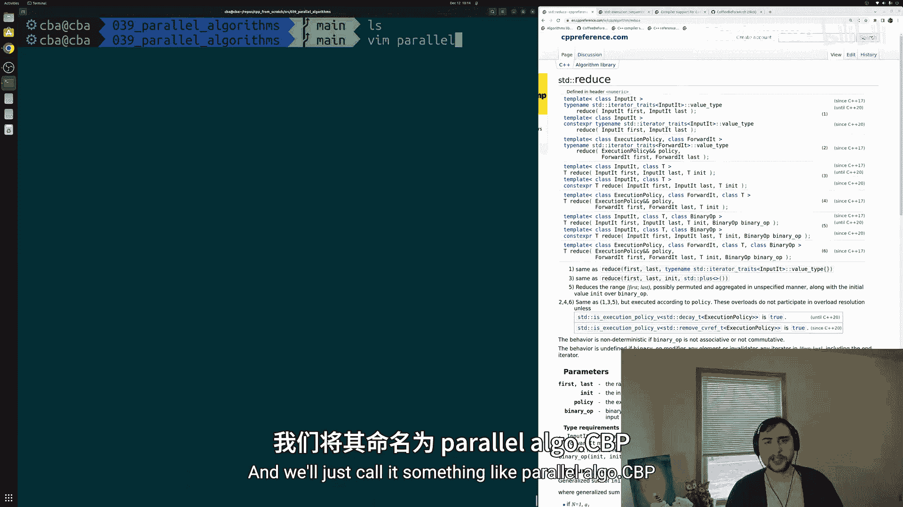
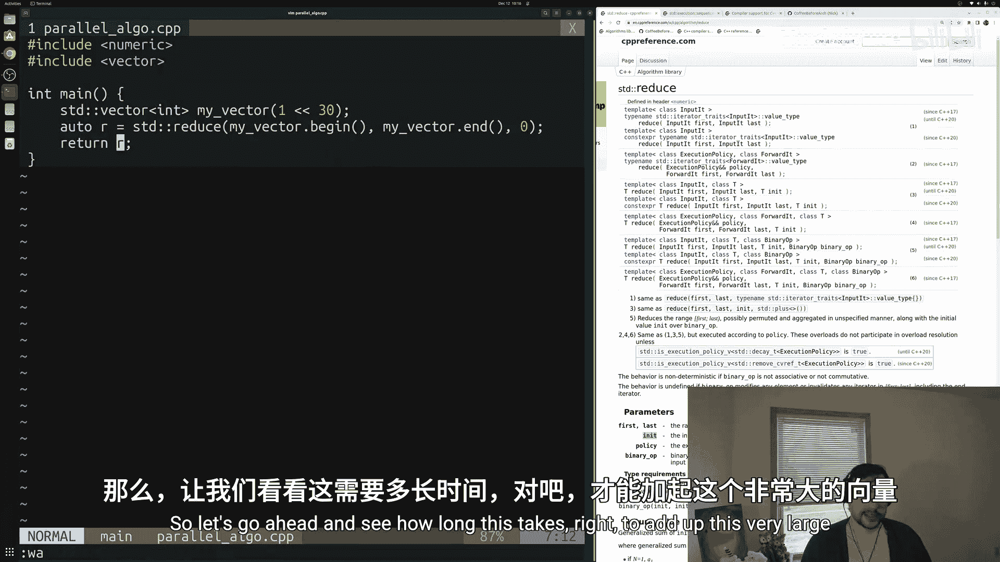
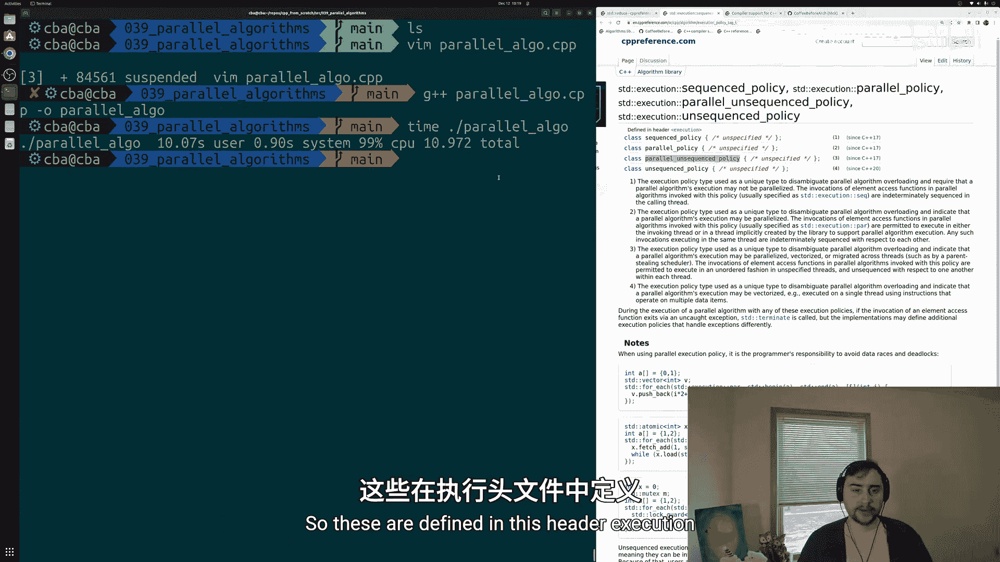
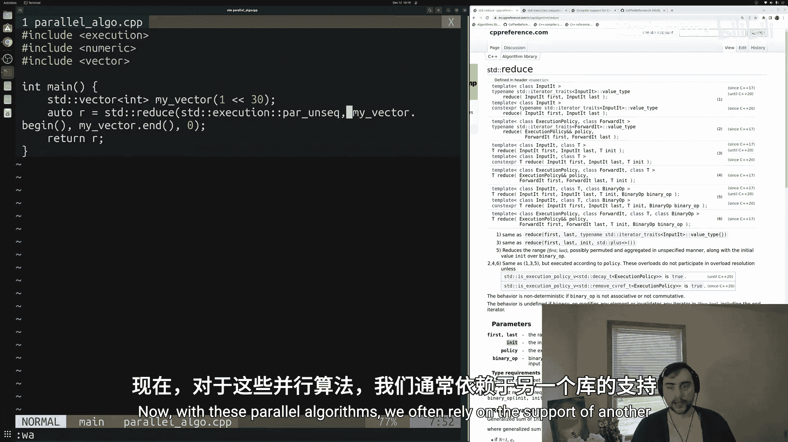
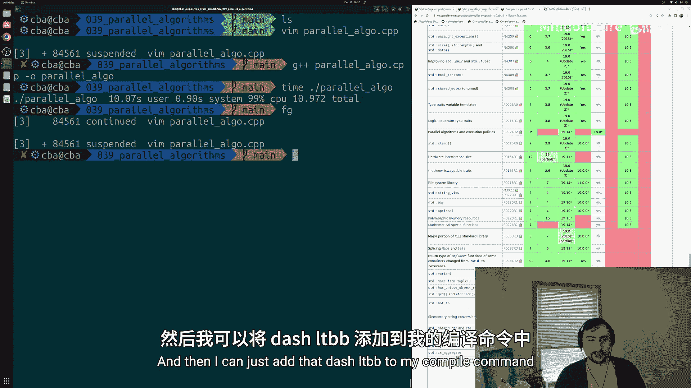
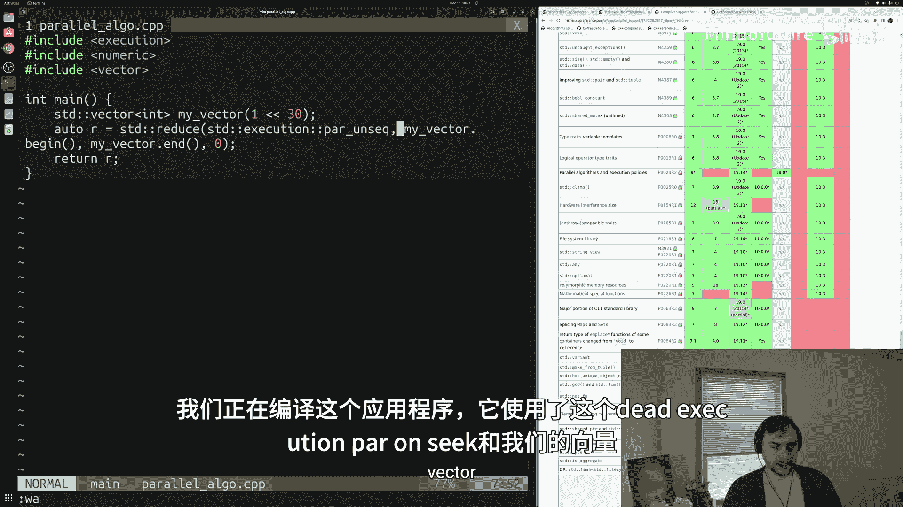
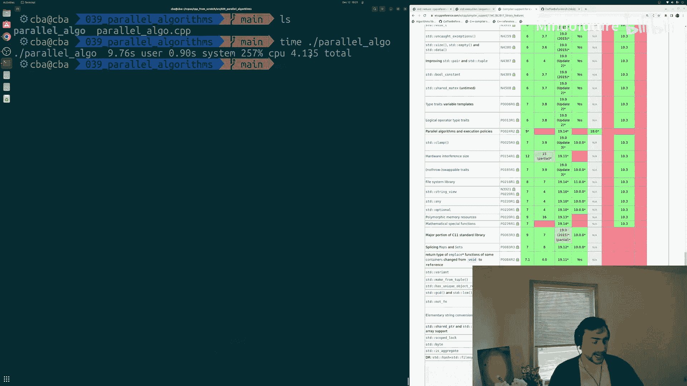
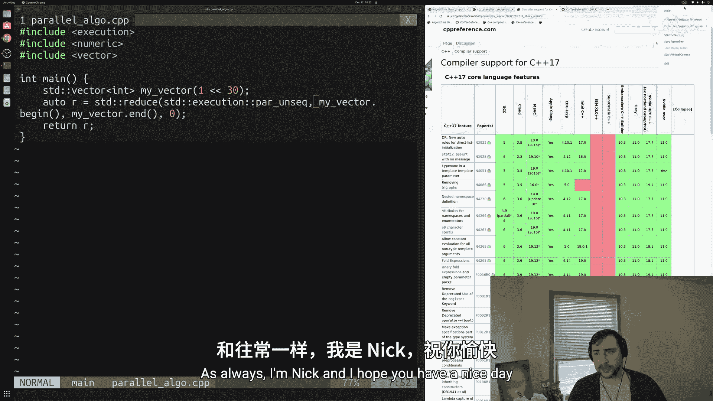

# C++入门教程｜CoffeeBeforeArch-p40-P40-Parallel-STL-Algorithms--BV1nbRUYSEUu_p40-

Hey， everyone， I'm Nick， and this is C plus Plus from scratch。 So in this episode of the series。

 we're going to be talking about parallel STL algorithms。Now， up until this point。

 we've been largely concerned with writing functionally correct code with C++。However。

 another very important part of programming is performance。

 so not only do we care about our executable generating the correct results。

 we care about them generating these correct results in an acceptable amount of time。

And we really care about performance at every single level of programming。 So， for example。

 you know even with Hello World， you know， we would be very unhappy if it took two to three minutes to run some simple Hello world program。

 So we care about performance a lot， but how much we care depends on our specific applications。

Now what we're going to be looking at is the basics on how we can get some extra performance out of our programs through parallelism。

 so we have these very complex CPUs today filled with multiple cores and support for SMD instructions。

 some instructions that operate on multiple pieces of data at the same time and we want to be able to get some use out of these instructions in these cores on our processor and one way we can do that is through parallel algorithms so we have our STL algorithms that we know and are familiar with and fortunately in more modern versions of C++ and with the help of some additional libraries we can get parallel versions of these algorithms that we know and are familiar with。

So let's go ahead and get started and see how we can use these parallel algorithms to speed up our applications。

So we'll start by creating a new example here， and we'll just call it something like parallel algo。

cpp。

And let's say what we want to do with some of the contents of some vectors。

 We have a vector filled with a whole bunch of integers and want to add up all of those numbers here。

 So one thing we can reach for from our SL algorithms is this stood reduced defined in this numeric header。

 so we can use this to add up the content say of some vector in this case。

 So let's go ahead and see how we can do that。So we'll go ahead and include numeric care so we can get access to to reduce。

 and then we'll also include vector here， right。And of course， we have our main function。

So let's go ahead and create a vector filled with integers。

 So some sued vector of instegers will'll call it something like my vector。

And let's go ahead and fill it with， say， you know，2 to the 30 integers here。

 So we're doing this shorthand for powers of two here。 One shifted over 30 times。

 So This is going to be equivalent to 2 to the 30 here。

 So we have a vector filled with 4 GB total of integers， right， quitete a lot。 Okay。

 so let's go ahead and sum of the contents of this vector using something like stood reduce。

 So what we can pass is say the range of values through a pair of iterators。

 And then also some initial value if we want to。 So， you know what we want to initialize that sum2。

So here we can go ahead and do。Aut R for our result is equal to stood， reduce。

 and will'll pass in our pair of iterators， so my vector dot begin。And then my vector dot end。

And then you know some initial value if we want to， so something like0。

 so we're going to sum up the contents of this vector into know this initial value here 0。

 so it'll be0 plus the contents of our vector here。Okay。

 and just so we don't get say a compiler warning here about an unused variable。

 we'll just return R here， this integer。 So in this case we just have a vector filled with zeros here。

 We didn't initialize them to any special value。 We're just going to initialize everything to0 and then we're reducing all of that so we should get a result of0 here。

 but we should still do all this work right we're still adding two to the 30 integers together。

So let's go ahead and see how long this takes right to add up this very large vector。

So here we can go ahead and use G plus+ to compile parallel Algo。cP， and we'll just color output。

Roughly the same thing， just parallel algo。And then what we can do is use time。

 right this command line utility to see how long it takes to run this executable here。

 And as we can see， unlike our other examples that we've seen in the past。

 it doesn't immediately return with some result。 It takes quite a while to go through 4 gig of integers。

 So， you know， this is all just running kind of behind the scenes inside of a single thread。

 And we see that it ends up taking about 11 seconds total to run this application。 So quite a while。

😊，This is something that we might want to speed up。

 and one way we can speed this up is through these execution policies that we can add to a number of our SL algorithms。

So let's go ahead and go over to this other CBP reference page for these execution policy。

 so since C++ 17 we've had you know these three execution policies sequenced parallel。

 parallel unsequenced and since C++ 20， we've had unsequenced and these are different ways we can get or we can influence what our algorithm can do underneath the hood in terms of parallelism。

So starting out we have our sequence policy and this just says， hey。

 you're not allowed to parallellyze this algorithm。 Then we have our parallel policy， which says。

 hey， you're allowed to parallellyze this algorithm through multiple different threads so we can have multiple different threads running。

 working on different parts of say this problem at the same time。

Then we have our unsequenced policy down here and this says， hey。

 you can vectorize this you know this algorithm， meaning that you can work on multiple different elements at the same time through things like vector instructions inside of the same thread and then we can combine parallel and unsequenced to say hey。

 you can use multiple different threads and you can use vector instructions here。

 so these SD instructions， single instruction， multiple data。

 instructions that work on multiple different elements at the same time。

So these are the different execution policies we have。

 so let's go ahead and see how we can go and add this a parallel unsequenced policy to to reduced to get some speed up of this 10。

11 seconds we have for our execution time。So these are defined in this header execution。

 so let's go back into our program and let's go ahead and include execution。

This header。And then let's change to reduce here to add our execution policy so we can add this execution policy as the very first argument。

 right to stood reduce。 So let's go ahead and add this stood execution， and then。P unse， right。

 to say that we want to both paralyze and vectorize this algorithm here。

So we'll do something like that。Now， with these parallel algorithms。

 we often rely on the support of another library。 So if we go ahead and go over to CPP reference again。

 I've got the page of compiler support for different features of say， C++ 17。

 where these parallel algorithms and these execution policies came in。

 And if we go ahead and scroll down here into our library features。

 you can see that down here we have our parallel algorithms and execution policies。

 and there's a little asterisk around Gcc。 So these have been supported since Gcc 9。

 but they require an external library。 They require linking against L TBB right or TBB TBB just standing for intel's thread building blocks library。

Now you can install that on your machine right it may be different based on know whatever operating system that you're using online mine。

 all I had to do was something like pseudo app get install and then Lib TBB dev right That's really all I needed to do。

 And then I can just add that dash L TBB to my compile command。

Okay， so now that we have that kind of background out of the way。

 right we're compiling this application that uses thestead execution par on seekq。With our vector。

Again， let's go ahead and run our serial version of this reduce one more time so that we can see how long it takes right so it should take somewhere on the range of 10 or 11 seconds。

 and we can recompile this with TB thread building blocks with that parallel version。

 So this took pretty much 11 seconds on the nose Now let's recompile our parallel algorithms except this time we're going to。

Go ahead and link against LTBB。And then we can go ahead and run parallel Algo with time， right？

And what we end up seeing， Well， instead of taking around 11 seconds to run。

 it takes around 4 seconds to run。 So it's somewhere between 2 and three times faster。

 And all we really did was add one extra argument to our。

To our stood reduce here。 We just added this stood execution， par unseek execution policy here。

 So we didn't have to implement anything crazy with related to perism。 All we had to do was say， hey。

 can you please paralyze this for me。 And we got a huge boost in performance。Okay。

 so that's the basics of these parallel algorithms Now I will say there are a number of parallel algorithms out there so you can see even the algorithms page from CBP reference has an entire section on these execution policies and the different algorithms that you can use with these execution policies I'll go ahead and link below the video。

 all of these different CBP reference pages so to reduce to these algorithms library to these execution policies and then of course to this compiler support page where we can see the support for these parallel STL algorithms。

 but that's going to go ahead and do it for today as always I'm Nick and I hope you have a nice day。

