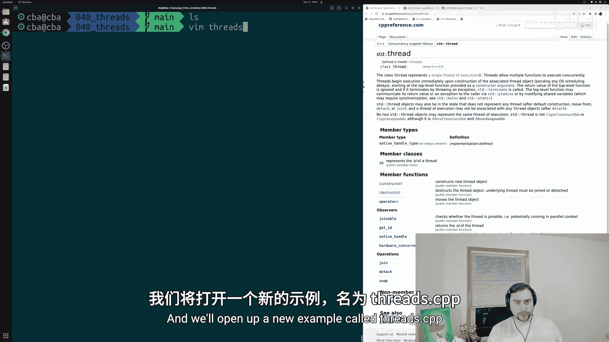
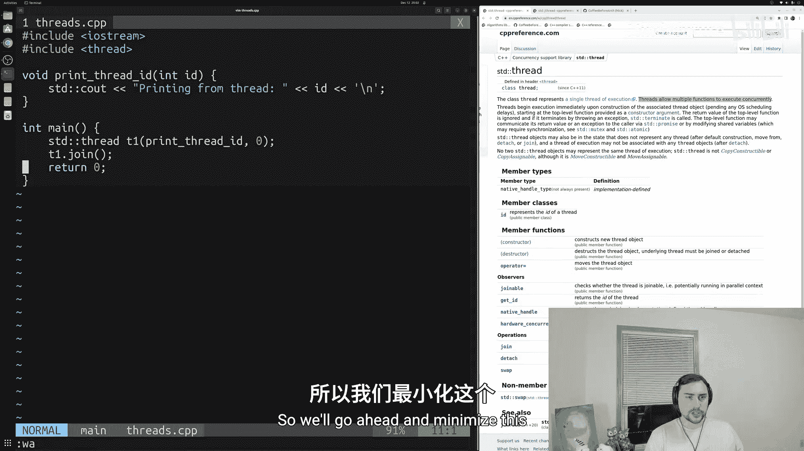
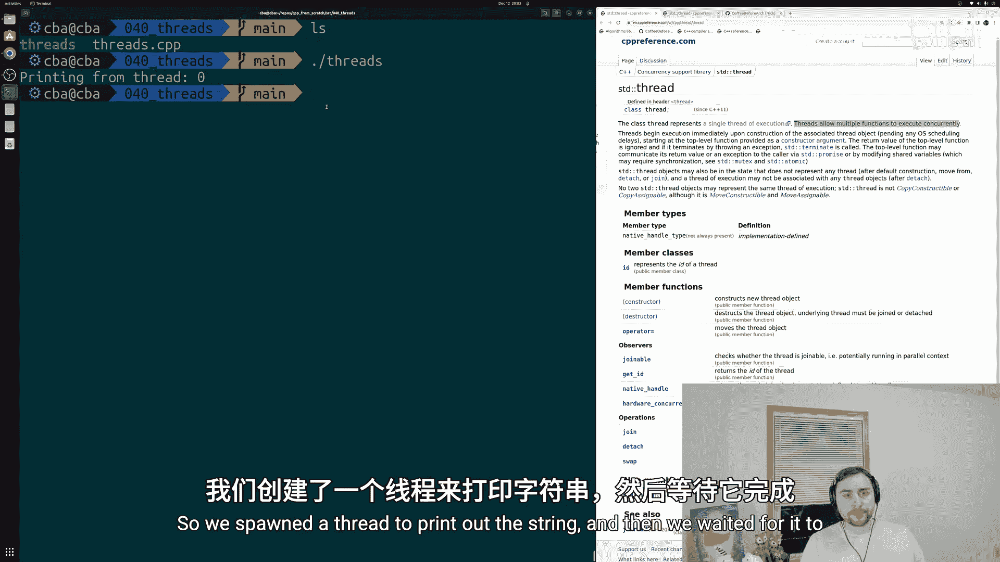
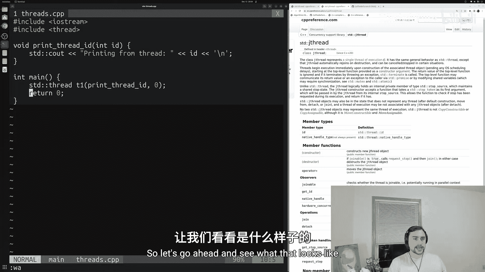
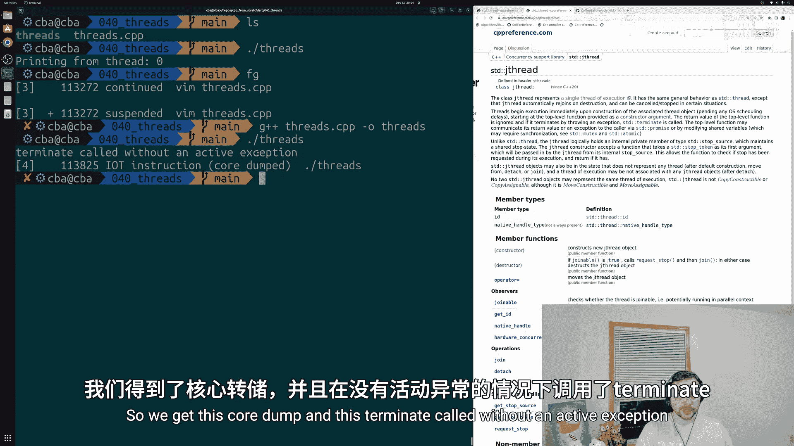
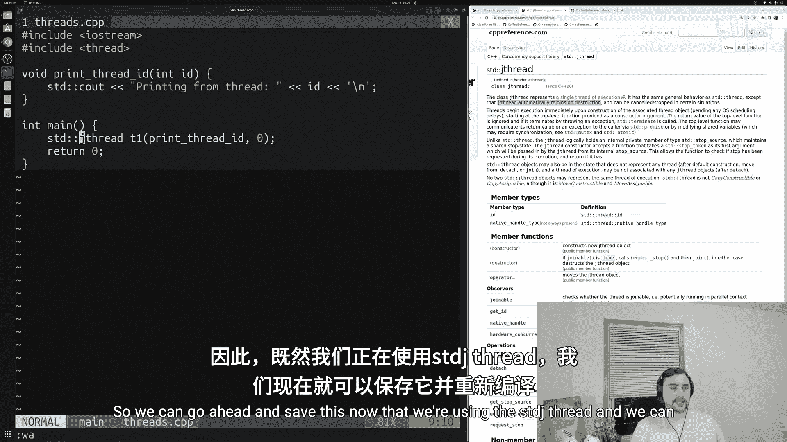
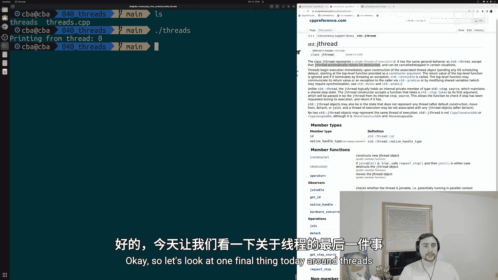
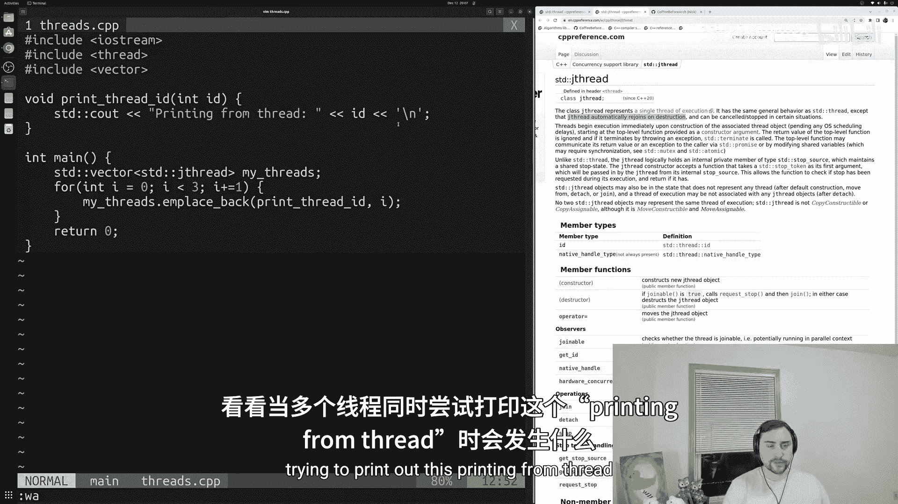
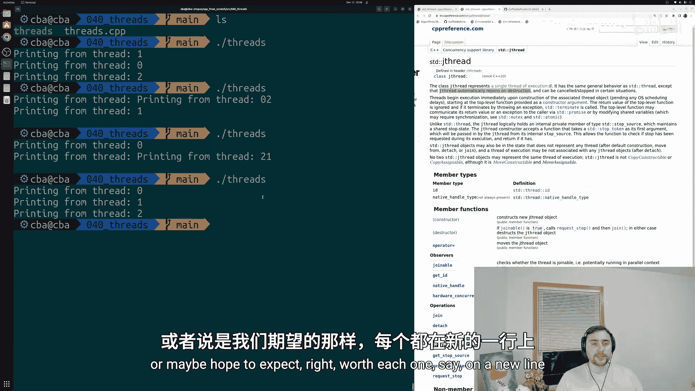

# C++入门教程｜CoffeeBeforeArch-p41-P41-Threads--BV1nbRUYSEUu_p41-

Hey， everyone， I'm Nick， and this is C plus Plus from scratch。 So in this episode of the series。

 we're going to be talking about threads。So in our last video we looked at the basics of our parallel STL algorithms and these were really nice because we didn't have to worry about the underlying details of parallelization。

 We could just use our know normal STL algorithms as we are familiar with them and just pass an execution policy like stood execution par or student execution par unse right to get some parallelism。

Now， there are going to be times where， you know， the work we're trying to do doesn't perfectly match up with some SL algorithm。

 So we might need to get our hands dirty and do this parallelism ourselves。

 And one of the ways we can do this in C++ is through these threads。

 We can spawn threads of execution in order to get parallelism。

 So we're going to be looking into basics of how we can spawn and join these threads today and just in general。

 play around with them。 So let's go ahead and get started and we'll open up a new example called threads do CPP。

😊。

And inside of here， we'll go ahead and include a couple things。

 we'll include Io streamam so we can do some printing。

And then if we look on the right hand side of the page。

 I've got the CPP reference page forto thread pulled up。

 and it says that this thread is defined in our header thread。

So we'll go ahead and include that as well。This will include thread。And then， of course。

 we'll need a main function here。So what exactly is this asto thread here。

 So if we go ahead and take a look at that reference page again。

 it says that this class thread represents a single thread of execution and that threads allow multiple functions to execute concurrently。

 So what we can do is we can spawn a thread。 tell it to execute some function。

 and that will go on in parallel with our main thread。😊，So let's go ahead and see how we can do that。

 So the first thing that we need is some work that we want our thread to do， some function。

 And this can come in the form of something like a function object or a lambda。

 or it can just be a normal function that we have defined。 So we'll go ahead and just do that。

So let's create a function here that we want our thread to run。

 and maybe we'll just call this function something like print thread ID。

 So it'll print some I that we assigned to a thread through say， some integer ID。

And then inside of the function body here， we'll just do something like print with St C out。

Printing from thread， and then we'll print out whatever that ID is followed by a new line character。

So this is what we want our thread to run right it's going to be given this function as its job。

 So let's go ahead and go back to our main function here and spawn a thread right to run this function。

So here we'll go ahead and create some object of type stood thread。

And we can just call it T1 into a constructor will pass a couple things。

 So number one will pass away the work we want this thread to do。 and in this case。

 it's going to be this function， but like I said， it could be something like a function object or lambda。

So here we'll just pass this function name， so print。Thread ID。

And then we'll go ahead and pass the arguments to this to this function。

 So in this case we just have say a single parameter。

 this integer ID simple' just pass an integer here， so something like0 or one or2。Okay。

 so that's the basics on how we can create a thread。

 so this will spawn a thread that can go ahead and run and maybe it'll run on one of our different cores on our processor。

Okay。Now， after we've launched a thread， one of the things we have to do with our stood thread is we have to join it。

 right， So we have to set a place where we want our main thread to wait for T 1 to finish。

 And we do that by calling T 1 dot join。So this tells this just says this is where my main thread is going to wait for T1 to finish execution here。

 so we'll need to do that for any of our stood threads。Alright。

 so we can go ahead and save this and let's go ahead and compile and run the simple example here。

So we'll go ahead and minimize this and we can compile threads。cppP， color output executable。

 something like threads。

And you can see we have our executable here。 Now， depending on what compiler you're using。

 you may get some sort of error related to P threads when you compile like this。

 saying that it it doesn't know。You know， you know what this P thread thing is。

 So depending on your compiler， you may also need to add this linker flag or this linker option to your compiler。

 So something like dashL P threadread and this will just link against the P thread library。

 but this very much depends on which operating system you're using and your specific compiler。Okay。

So let's go ahead and run our executable here， so we'll just run this threads。

And you can see we get this printing from thread 0。 So We spawned a thread to print out the string。

 and then we waited for it to complete。 Great， So let's go ahead and open up our example。

 and let's see how we can maybe make this a little bit cleaner using a more modern form of threads。

 And that's going to be with this stood J thread。😊。

So one of the kind of annoying parts about working with this thread is we have to manually specify this join right here。

 so we have to make sure we set a point where we want our main function to wait for this to complete here。

Now what happens if we don't include this？We don't include this join。

 So we have to remember what's going on。 As soon as we launch this thread to print out this。

 you know， printing from thread， you know， whatever the number is。

 our main function is still going to continue execution。

 So our main function after it spawns to thread， it's going to return 0。 and you know。

 this T1 object is going to add of scope。 So before our thread might even begin。

 it might immediately be destroyed， right， and that might lead to some errors。

So let's go ahead and see what that looks like。 So we'll recomple without this this call to join and we'll go ahead and run our example here and you can see we actually get an error here right so we get this core dumped and this terminate called without an active exception So the issue here is that you know we're spawning a thread here first。

 this T1。

But before this thread is able to complete， right， it gets destroyed before it gets joined。

 And that leads to this error here。Now we have a nice way around that as part of C+ plus 20。

 and that's with this stood J thread here。 So if we go ahead and look at the CPP reference page。

 it said that it says that this class J thread represents a single thread of execution。

 so very similar to our stood thread。And has the same general behavior as our stood thread。

 except the J thread automatically rejoins on destruction。So in this case， when。You know。

 our main function does this return0 here， and T1 gets destroyed so it's destructor fires。

 If we use a J thread， it'll automatically call join on this thread rather than just destroying it like our thread does。

So let's go ahead and see how we can replace that。 all we really need to do is change the type from stood thread。

 just a J thread。 Then we no longer need to call join here。

 It'll automatically join when it goes out of scope， right， and gets destroyed。

So we can go ahead and save this now that we're using the stood J thread and we can recompile。

 And since we're using a C plus plus 20 feature， we'll need to add that stood。

That dash dash stood equals c++ 20， otherwise we might get an error here because it's a very new feature。

 so we can just do dash dash stood equals c+ plus 20。Okay， so we compiled with that issues。

 and we can go ahead and run this。 and you can see that we no longer get that that compiler error。

 and we no longer get that run time error related to， you know。

 not joining our thread because we're using a J thread that automatically joins when it gets destroyed。

Okay， so let's look at one final thing today around threads。

 And that's with working with say groups of threads here。

 So instead of just say spawning a single thread here， let's spawn a whole bunch of threads。

 say in a loop， and we'll store these threads in something like a vector。😊。

So here we can go ahead and create some vector of stood J threads。

So we'll create a vector here of type stood J thread。

And we'll just call this something like you know， my threads， right？Then in a loop here。

 so we'll just do a simple four loop， so and I is equal to 0， I is less than3。

 so we'll spawn three threads。And then I plus equals one each it。We'll just do this。

 My threadreads dot。In place back right so we're going to forward the the arguments to a constructor here for our J thread。

 So what we're going to pass to the constructor over our J thread right inside of our vector will just be this print thread ID。

And then I in this case， right， So the idea of this thread， So it'll be 0，1 or two here。

And then again， because we're using J threads here。

 we don't have to worry about you know iterating over this vector again and calling join。

 right these threads will automatically join when they go out of scope。Okay。

 so let's go ahead and see what happens when we run multiple threads at the same time that are all trying to print out this printing from thread。

So we'll save this。 We'll go ahead and minimize。Recompile or executable here。

And let's go ahead and run threads。And what we see is that we get three different prints from three different threads and they can get printed in know some different order here。

 because they're all just kind of sent off to do this work。

We didn't specify an order in which we wanted them to do this work。

They just worked kind of asynchronously， doing their work when they got around to it。

 So in this case， we see printing from thread 1，0 and 2。 And if we run this multiple times。

 we might see different orderings。 And in fact， we might see things that look kind of strange here。

 So we start seeing prints that get interleaved with each other， right， along with， say。

 different orderings， right， We have multiple threads kind of going in parallel。

 but we're not really coordinating them in any way。 So they might wind up printing， you know。

 kind of as we hope right or maybe hope to expect。Right worth each one， say on a new line。

 or they might get somewhat interleaved here， which is something that we might not want。

 So we're going to be looking， We'll be looking at that。

 say in the next video and talk about how we can coordinate actions across different threads。

Okay， but that's going to go and do it for today。 That's the basics on how we can work with these threads in these J threads and spawn them and join them。

 And like I said， we'll be working with coordination in some of these later videos。

 And I'll make sure to link below the video。 Both these CPP reference pages for thread and Jthread respectively。

 And as always， you can find any of these examples at my Github page at Github dot com s coffee before arch。

 But that's going to go and do it for today。 As always， I'm Nick。 and I hope you have a nice day。😊。

