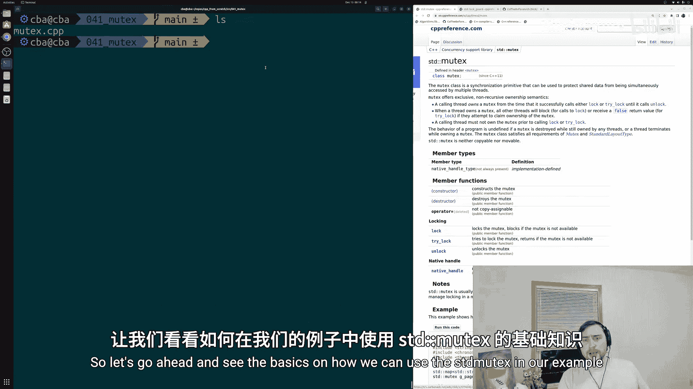
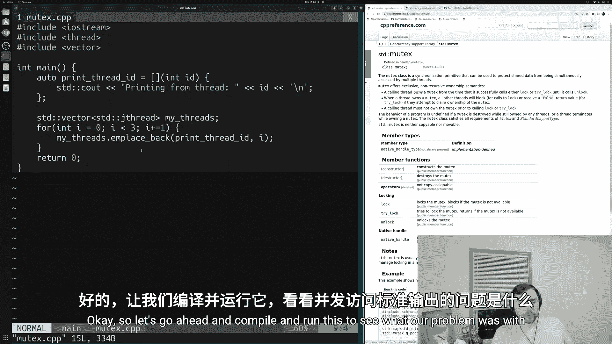
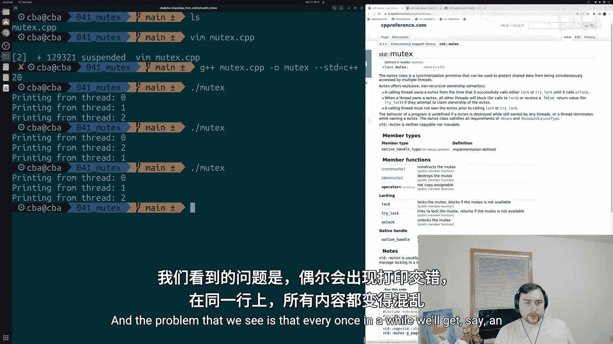
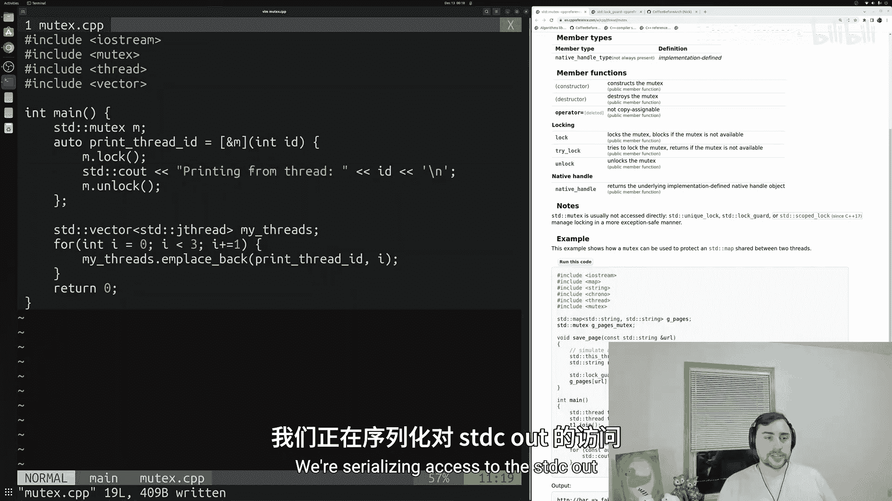
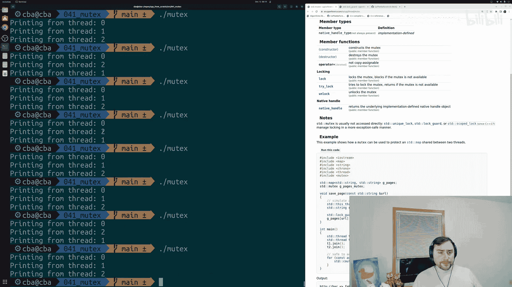
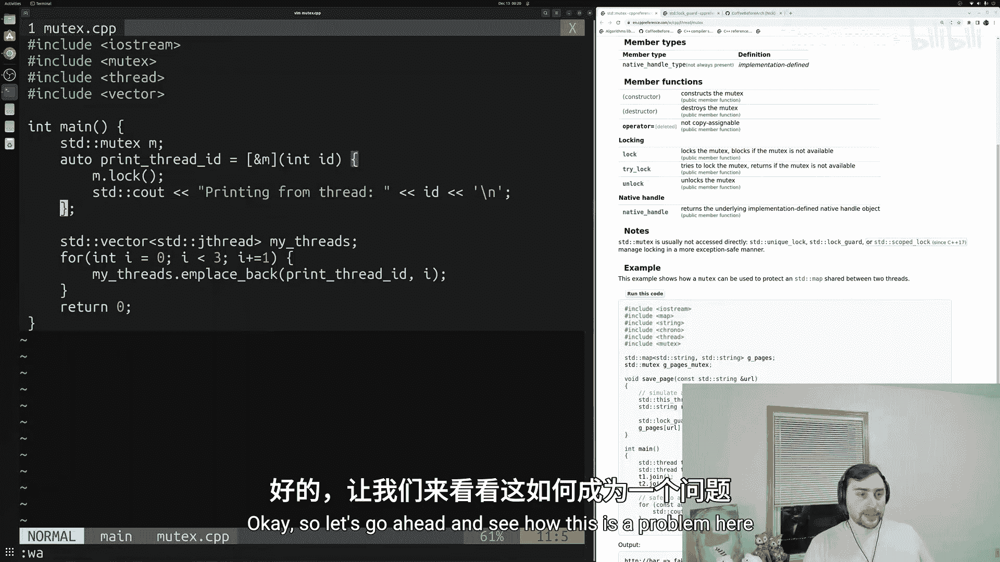
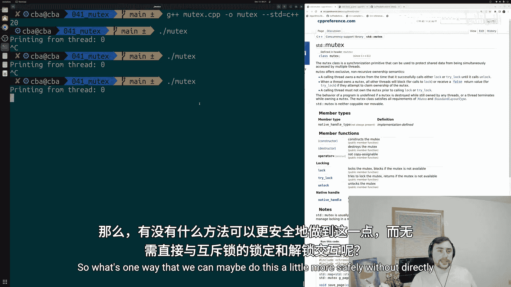
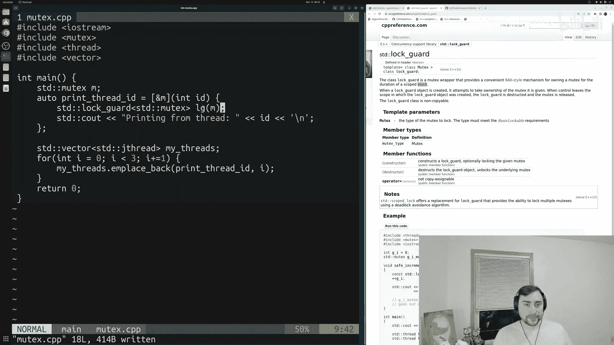
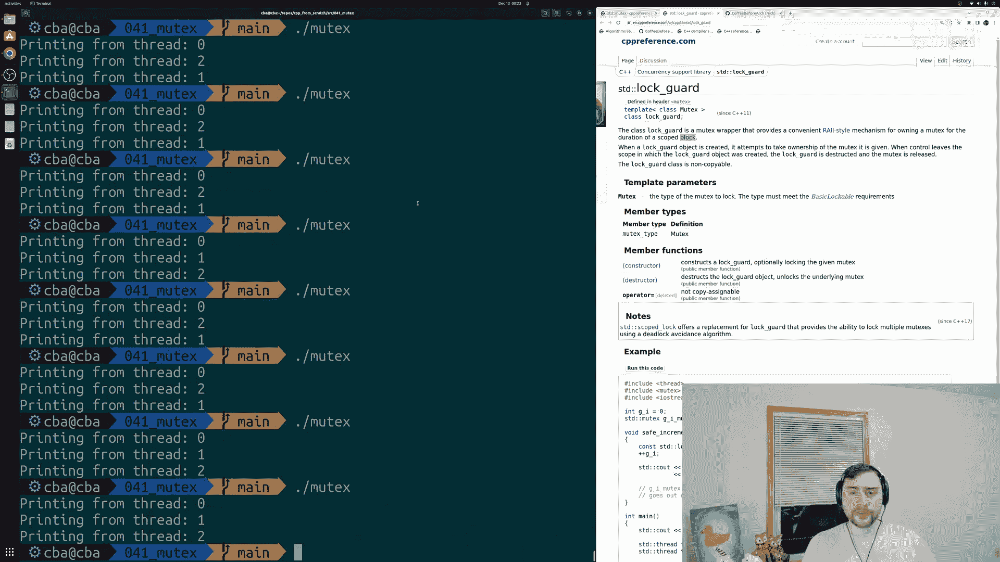

# C++入门教程｜CoffeeBeforeArch-p42-P42-std----mutex--BV1nbRUYSEUu_p42-

Hey， everyone， I'm Nick， and this is C+ Plus from scratch。 So in this episode of the series。

 we're going to be talking about thread synchronization with stood Mutex。So in our last video。

 we looked at the basics of creating and joining threads with our stood thread and stood J thread。

Now， one of the things we ran into during that example was this issue where we had concurrent access of some shared resource。

Now， in our case， that sharedd resource was our stood sea out stream objects。

 and we had multiple different threads trying to print out using stood sea out at the same time。

 and at our output， we had these you interlea prints with multiple you know。

 different strings on kind of the same line and everything was a bit jumbled。Now。

 one of the things we're looking for right in that video was some way that we could say synchronize our different threads here and maybe prevent this concurrent access。

 And one of the things we can use to prevent that is our stood mutt。

 So if we go ahead and look at the right hand side of the screen here。

 we can see that on the CPP reference page for stood mutt。

 So see that the stood Mutex class is a synchronization primitive。

 They can be used to protect shared data from being simultaneously accessed by multiple threads。

 So it sounds like exactly what we need to prevent multiple threads from being being able to access stood sea out at the same time。

 So let's go and see the basics on how we can use the stood mutt in our example。😊。

So we'll go ahead and open up this mutt。cP， and we have pretty much the exact same example from last time。

 the only major difference is that I've changed this print thread ID function to now be a Lada expression here。

 but otherwise it does the exact same thing， so it takes some integer ID and it just prints out using StudciL printing from thread followed by the ID in a new line character here。

Then in the rest of my code here。all we have is say a vector of J threads called my threads。

 We create three threads here right in the simple four loop。 So we can them back into our vector。

 and each of these threads is just going to run this print thread I Lambda here。

 And it's going to have a thread I of I。 So through 0，1 or 2。

 So these different iterations of this loop。Okay， so let's go ahead and compile and run this to see what our problem was with this concurrent access to see out。

So we'll go ahead and compile this with G plus plus。

 so we'll compile this Muex CBP and call our output xqable Muex。

 and we'll set the standard equal to C plus+ 20 since we're using J threads。

So we'll go ahead and run this。 And the problem that we see is that every once in a while， we'll get。

 say an interleaving of prints right that wind up on the same line and everything kind of gets jumbled。

 So it's okay if each of these threads say prints on a different line here。

 But what we're trying to avoid are these cases where the different prints get kind of mashed together on the same line。

 and everything just gets a bit confused。 So these are the cases where you know。

 multiple threads are accessing sea out at the exact same moment。

Okay， so let's go ahead and go back into our code here and see how we can use StMe text to prevent this。

So it says that studentt is defined in the header mutt。

 so let's go ahead and include that at the top of our file， so we'll go ahead and include mut text。

Then down here， we can go ahead and create a muttex。 So some stood muex， and we'll just call it M。

 and we want to be able to use this mutex in each of our threads here。

 So we'll go ahead and capture it by reference here。

 So we want the same mutex to be going to each of our threads here。

 So it was captured by reference here with our lambmbda。

So let's see how we can go ahead and use this mutex inside of the body of our Lambda here。

 And namely， we're going to be using these two methods。 Lock and unlock。

 So our lock method locks the mutex and blocks it the mutex is not available。

 So when each thread tries to， know， run this Lambda， it's going to first try and lock the mutex。

 If it is able to lock the muttex。 It goes ahead and goes through and it does its print。

 But if some other thread has already come before it and lock the mutex already。

 It just waits at that call to lock here， which is waits until or other thread is done with this muttex。

 and it's done with what we call this critical section。😊，Then we can use this unlock method。

 so this unlock method just unlocks a mu text， would allows some other thread to say lock the mu text。

 So here it before R C out， you know we can add this call to lock。

 so we'll just do end the lock here。So each thread will first try and lock this mut text before it proceeds to do this print。

If the thread is able to lock the meex， it continues through， it does its print。

 And after it's done with this print， it'll go ahead and unlock the meex here。

 So we're saying right here that we're done right with this sea outstream object。

 the shared resource。 Some one else can have access to it。 So we'll just unlock this metex。

 When we're done with it。 And then we'll go ahead and just return here。

 right at the very bottom of this function body。Okay。So let's go and save this。

 and let's see how this has changed the behavior of our program now。

 Now that we're serializing access to the stood sea out。

 So where different threads may print out still in different orders。

 but we're no longer going to see that case where our prints get mgled on the same line any more。

 we're serializing access to the stood sea out。

Okay， so we'll go ahead and save this and we'll recompile this new text。 cP。

And we'll go ahead and run mutt and we can run it a few different times here。

And what we see is we never get that case where multiple prints get mgled on the same line。

 So we still can get different， say orderings of these prints。 So say， you know，1，2，0， then。

 you know，02，1， then 0，2，1 again， then 0，1，2， and so on and so forth。

 But we never get that case where， you know， multiple prints are kind of mangled on the same line anymore。

 because we're serializing access to see out。 threads can grab the muttex or lock the mutex in different orders。

 but they can never get into that get past that mutt at the same time。 right。

 We're providing this mutual exclusion。 So no two threads can。

 you know get past that mut text lock at the same time。

Okay， so let's go ahead and go back into example。 and let's take a look at one more thing here。 So。

 we can sometimes run into silly mistakes whenever we're directly using new textes like this。

 So you know， directly calling lock and unlock on a mut text。

 And the mistake that we can run into is very similar to the one that we had with our dynamically allocated memory with。

 say new and delete。 So sometimes we can maybe forget to delete our memory。 So we get a memory leak。

Now， we can do the exact same thing with our locks herein， you know。

 we might forget to unlock our mutex when we're done with it。 And this could lead to perhaps an。

 you know， an even more problematic kind of error。 And that's the thing that we call a deadlock here。

 Right。 So we've introduced a situation where a thread can come in here。Lock the muttex。

 do its print and then return without ever unlocking the mutt。

 So if any other thread calls a lambmbda and lock tries to lock the muttex。

 it will never be able to get that lock because the thread that originally locked the mutex never unlocked it。

 right， And then it ended， right， It went out of scope。Okay。

 so let's go ahead and see how this is a problem here。

 So we'll go ahead and save this and we'll recompile this example where we forgot to call unlock with our mutex。

 So we'll compile Muex do CPP again and we'll run our example。 And what we see is that， you know。

 the first thread comes in。 it prints out this printing from thread。

 And then whatever the thread ideas。 And then we get nothing else。 in our program never ends。

So right now， we just have our two threads， both trying to lock that mut text and never being able to get that lock because this first thread never released it。

 So we'll have to force quit it。 And you can see that each time we run this。

 we get the exact same problems。 We have a dead lock every single time。Okay。

 so that's a bit about this problem of deadlocks here。

 So what's one way that we can maybe do this a little more safely without directly interacting with this new text lock and unlock。

 Well， we can use something like the stood lock guard。

So this is also defined in our student Mutex header。

 So we see that this class lock guard here is a mutex wrapper that provides a convenient R AI I style mechanism for owning a muttex for the duration of a scope log。

 So again， R A I I just stands for resource acquisitionqui is initialization。

 High level idea is as we get some shared or we get some resource。😊，You know。

 inside of constructor and we've released that resource and the destructor。

So what we can do is we can lock our muttex in the constructor and unlock our muttex in the deor of our lock art。

 So let's see how we can use that instead of directly calling lock and unlock。So instead。

 we'll go ahead and create some new variable， which is a stood lock guard。

And it's going to be managing some student mu text。

 so we'll use that as our template parameter and we'll just call it LG so just。

Standing for lockguard。 And then tour constructor will pass a mutex， right， So a mutex in here。

And that's all we need to do here。 So we don't need to have a call to lock。

 We don't need to have a call to unlock Our call to lock automatically happens in the constructor。

 Our call to unlock automatically happens in the de。 right。

 We can't forget to unlock our mutt anymore。 That's being managed by our lock car。

Okay， so we can go ahead and save this and we can recompile our program and we can go ahead and run it a couple times and what we see is that you know we get the correct behavior and that we have serialized access now to that st sea out and we don't have you know anything like a dead lock anymore and you know we do things a little more safely and we don't have to manage lock and unlock anymore it's all taken care of by our lock guard。

Okay， so that's a bit of the basics of this thread synchronization using a student Mutex instead Lockguard。

 Of course， below the video， I'll link these CPP reference pages for Mut and Lockcardt respectively。

 And as always， you can find this or any of my other examples at Github dot com s coffee before arch。

 But that's going go into into it for today。 As always， I'm Nick。 And I hope you have a nice day。😊。

