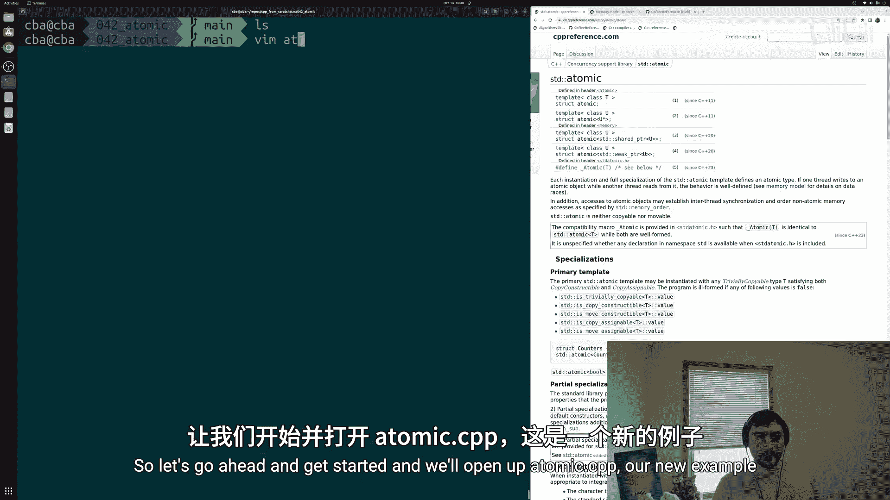
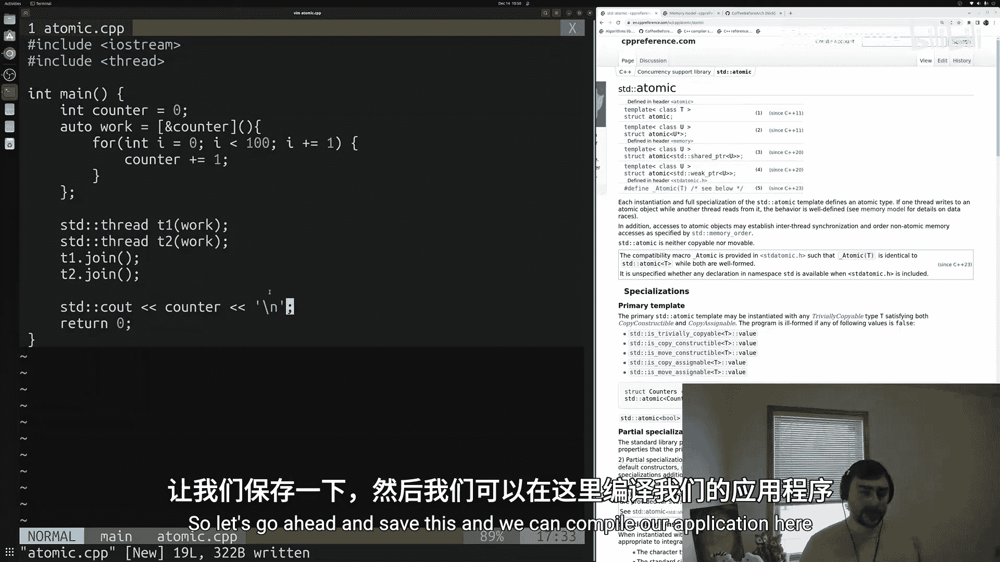
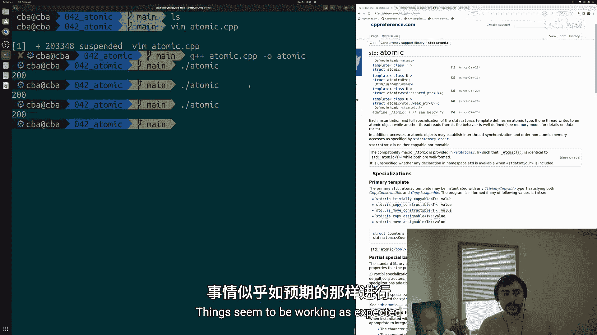
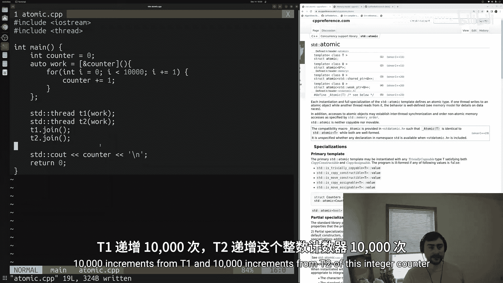
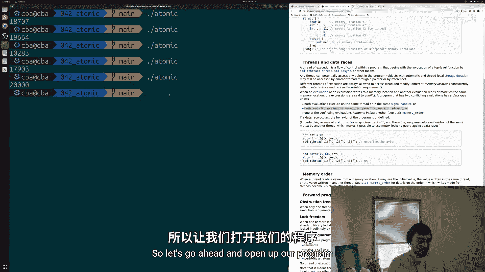
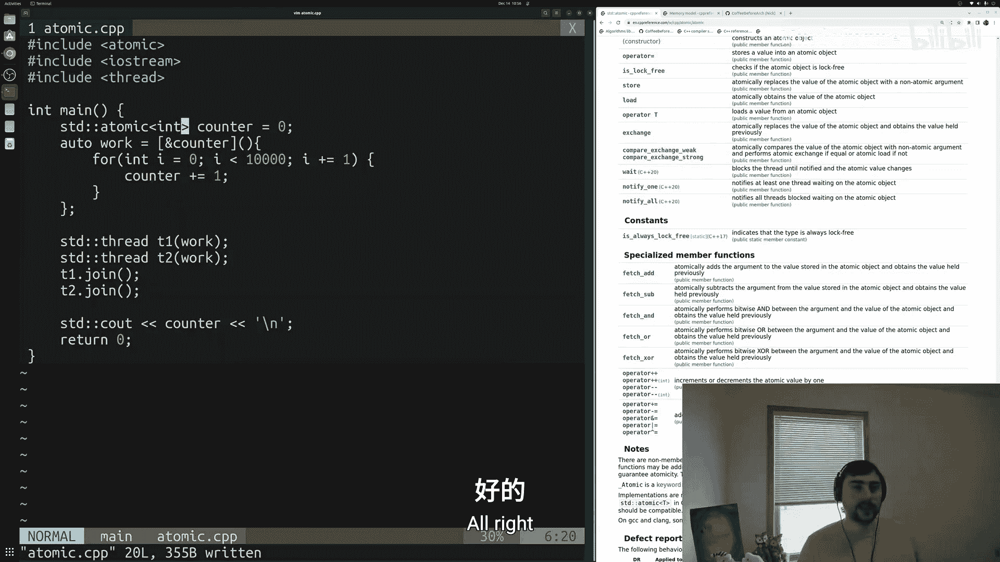
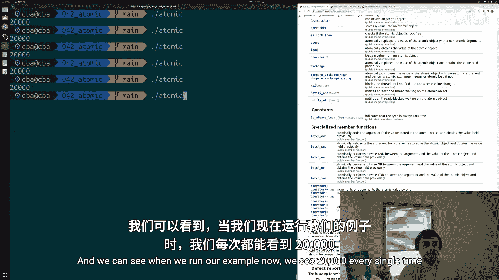

# C++入门教程｜CoffeeBeforeArch-p43-P43-std----atomic--BV1nbRUYSEUu_p43-

Hey everyone， I'm Nick， and this is C+ Plus from scratch。 So in this episode series。

 we're going to be talking about the basics of stoodatomic and atomic operations。

So one of the issues that we can run into when we have multiple threads is when our threads are accessing some shared resource。

 So we saw how this can be a problem in our last example where we had multiple different threads trying to print using Sty out at the same time。

 So we saw some nasty in her leavings of prints。Now one of the ways that we can solve this problem。

 like we saw last time is with our stood Mut， but we have a lot of tools in our toolbox and C++。

 and another way that we can help deal with this type of contention for a shared resource is with our stood atomic。

So what we're going to be looking at today is kind of the basics of the studutatomic and atomic operations in general。

 and we'll try to understand it through a motivating example and then see how we can fix say our problem using stutatomic。

So let's go ahead and get started and we'll open up Atomic docP， our new example。

 and inside of here we'll just include a couple things to start off with。 So Io stream。

 we can do some printing and we'll also include thread here so we can spawn some threads。

Now we'll also need a main function， so we'll go ahead and write that as well。Now。

 let's say we want to spawn a few threads to perform some work。 And as part of that work。

 they're going to increment some counter。 So we'll say create some integer counter。

 initialize it to 0。 And then we'll create a lambda expression。

 which will be our work for threads to do。 So we'll say auto work is equal to for first write our captures for a lambda。

 So we'll go ahead capture our counter by reference。

 So all of our threads will access the same counter。

And then we can write the body of our Lambda here， and we'll just have a simple for loop here。

So we'll say for int I is equal to 0， I is less than 100。 So for 100 iterations of this loop。

I plus equals1。 we're just going to increment this counter。

 So we'll just do something like counter plus equals1 each iteration。

Then we can go ahead and spawn a couple threads down here so we can create some thread T1。

That will run this work Lambda， and some stood thread T 2。That will also run this landda。

And right after this， we can wait for our threads to finish so we can call join on both of them。

 So T 1 dot join and T 2 dot join。And then finally， after we've done all this work。

 we can print out the value of our counter followed by a new line character。

So what should we expect to happen here， at least initially？

So each of our threads is going to run this work Lambda。

 So we should see hopefully 200 total increments of counter。

100 increments from T 1 and 100 increments from T 2 here。

 So when we print out counter at the end of our program。 Hopefully we should see 200。

 So let's go ahead and save this and we can compile our application here。 So this atomic dot CBP。

 will'll call our output executable atomic。

And we can go ahead and run things。 And indeed， we see， you know。

200 gets printed out every time we run our program。 Things seem to be working as expected。

But let's see what happens if we increase the number of iterations of this loop。

 so now we have a lot more work going on inside of our threads。

 so instead of increment in counter 100 times， they're now increment in encounter 10，000 times。

So what should we see at the end when we print out counter， hopefully we should see 20，000，10。

000 increments from T1 and 10，000 increments from T2 of this integer counter。

So let's go ahead and save this。 and we can recompile Atomic dot CBP。

 And let's see what happens when you run atomic。 And we see something rather surprising here。

 We get some different results here。 Occaionally， we get the right result。 this 20000。

 So we get some number between 10000 and 20000 each time。 So， you know，18700 here，19600 here。

10200 here and so on and so forth。 So what exactly is going on here。 Why aren't we getting。

 say this consistent result of 20000。 We're doing 20000 total increments。

 Why why aren't we seeing our counter equal to 20000 at the end of our program。 Well。

 this all comes down to data races。 So let's go and take a look at these CPP reference page for the member model of C plus plus。

 And specifically， we're concerned with this threads and data races section。😊。

So we can see down here in this paragraph， it says that when an evaluation of an expression writes to a memory location and another evaluation reads or modifies the same memory location。

 the expressions are said to conflict and that a program that has two conflicting evaluations has a data race。

Now， after this， it gives a couple ways that we can prevent data races。

 but it says that if we do have a data race， so if a data race occurs。

 the behavior of our program is undefined here， so because we have evaluations of this you increment from multiple different threads and we're not using any of these preventative measures here。

 we're invoking some undefined behavior here or rather a program or the behavior of a program is now undefined。

 so it's acceptable for you know us to see 18000 or 19，000 or 10，000 and occasionally 20，000 here。

 because our program behavior is undefined now， because we have this data race。

So data races are things that we typically want to avoid inside of a program。

 So what ways do we have to avoid them？ Well， the first thing it says is that if we have evaluations that are on the same thread。

 we don't have a data race Great， right so if we have a single threaded program。

 we're not going to run into this problem。Okay， now another way that it says we can avoid this is using the stood atomic right and if our evaluations are atomic operations right so that's what we're going to be looking at today and then the final one it talks about is is happening or happens before kind of ordering right so one of the conflicting evaluations happens before another and one of the ways we can get this is with our stood mutex right so that's what this third bullet point is but we're going to be focusing on this stood atomic today。

So let's go ahead and open up our program and think about what this evaluation really is doing underneath the hood。

 this counter plus equals one， and this should hopefully kind of illustrate why we have a problem the way that our code is written。

So what is this really doing when we do an increment。 Well， it's doing a read。

 modify and write operation。 So we first read the value of our counter。

 Then we update the value that we read， and then we write that result back out to memory here。

 So we have a read， a modify and a write。 Now， the problem that we have when we have multiple threads doing this at the same time。

 is that these reads and modifies and writes can become interleaved across different threads。

 So let's take a simple example here。Let's say both of our threads first read or counter to be the value 0。

 So they both read the value 0。 Then both of our threads increment that value。

 So now they both increment the value that they read from 0 to 1。And then finally。

 they write their result back out to memory。 So both threads write one back out to memory。

 So you can see the issue that we have here。 We had two increments。

 but we only incremented the final value by one because we had this data race。

 We had this interleaving of the these read modified right operations across different threads。

 So even though both our threads incremented， say， this value here。

 we only saw one total increment on the other side。😊，Now。

 one of the ways we have around this is through using these atomic operations。

 so let's go ahead and go back to St atomic here。Now。

 what exactly does it mean to have an atomic operation。 Well。

 we can think about it in our context here of this increment。 What does it mean to have， say。

 an atomic increment。 Well， in our in this context。

 what it means is that our read modify right becomes one atomic unit。

 So it can no longer be it can no longer be split up anymore。

 And that's what prevents these interleavings。 So read modify right becomes a single operation。

 So when two threads do this atomic increment， this atomic read modify right。

 they can't interleave any more。 one is always going to occur before or or after the other。

 So because of them， we're always going to get， you know。

 we're always going to see all of our increments here。 So all 20000 in this case。

 because we can no longer interleave those sub operations。 the read modify and right。Okay。

 so let's see how we can use this to atomic。 So we have a number of different types that this atomic is supported for。

 So we have all these aliases when we're using these integral types like integers and unsigned integers。

 etc cetera。And we also have these different member functions that we can use whenever we're using an atomic type。

 so you know some operators like logicals like this XO and or an and or increment or decrement。

 so let's go ahead and try out using our atomic increment here for our counter。

So the first thing we need to do is we need to include our atomic header。

 That's where CTP reference said all of this was defined。

And all we really need to do here is change our counter。

 this integer to be a stood atomic integer here， right。So now， by default here。

 whenever we do this plus equals， we can see that it increment。

 we can see that our atomic implements this plus equals operator here。

 So now we have an atomic increment instead of a normal increment。

 This atomic increment is a atomic read modify ride operation。 Now。

 It can't be interleaved across threads。 We've gotten rid of our data race。Al right。

 so let's go ahead and save this and we can compile Atomic dot CBP and color output executable atomic。

And we can see when we run our example now， we see 20000 every single time。

 We no longer have this undefined program behavior。 We're always getting the expected result here。

 We've gotten rid of our data race that we saw was pointed out by our memory model over here from C plus plus。

Now， one thing you might have， you know， you noticed here is that we did get the right answer for very small loops here。

 but we still had undefined behavior here， right， So we can sometimes run into this。

 you kind of simple situation where we spawn one thread。

 It quickly does all of its work before the other thread even gets started。 So occasionally。

 we can see the right result， right， but we're not say guaranteed to get that right result。

 We still have undefined program behavior。 So we might get the right result sometimes in the incorrect result the other other times。

 So that's why these bugs with parallel programs can be rather tricky。

 We might not even know we have a bug， right， with certain situations because it might never get exposed。

But that's going to go into it for this time， I'll make sure to link below the video。

 this stoodatomic CBP reference page and also the one from a memory model。

 and as always you can find any of these examples at github。com scoffeebe arch。

 but that's going to go into it for today as always I'm Nick and I hope you have a nice day。

