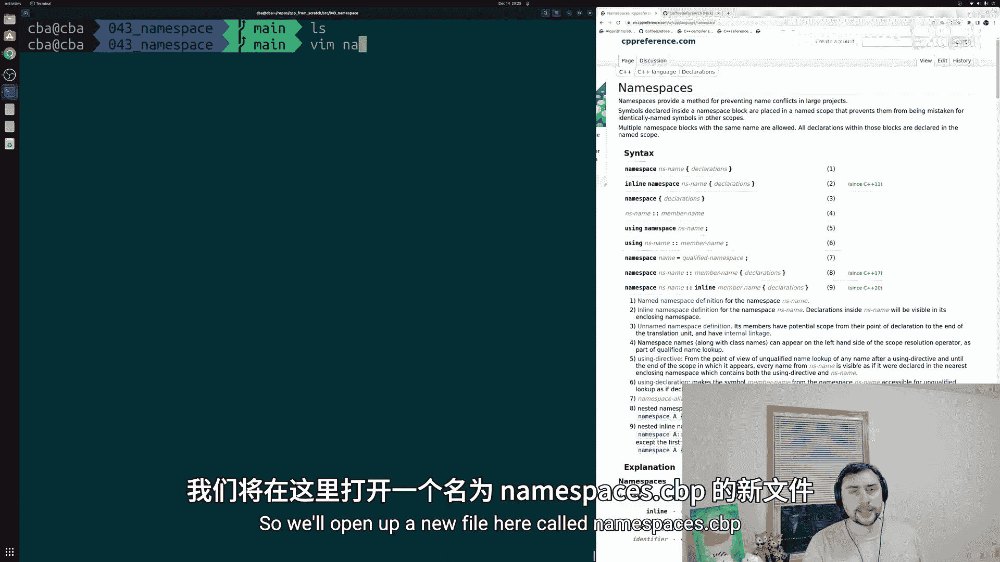
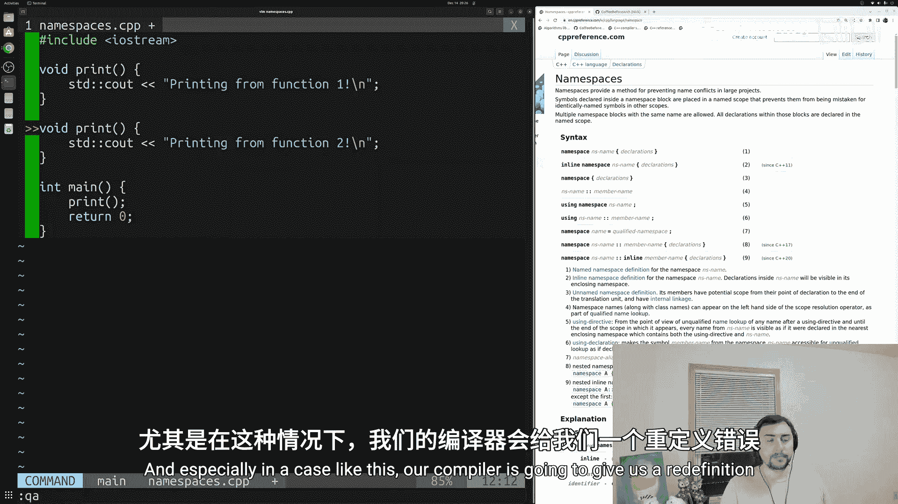
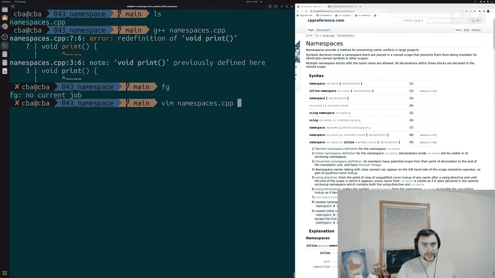
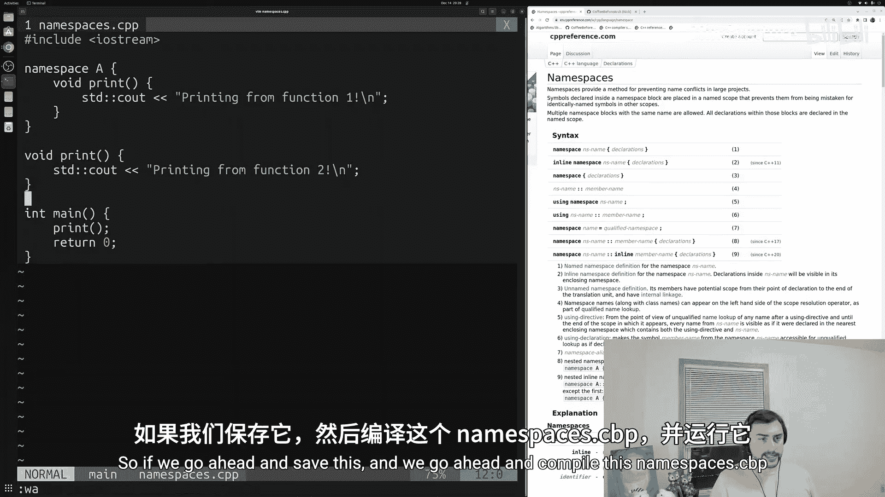
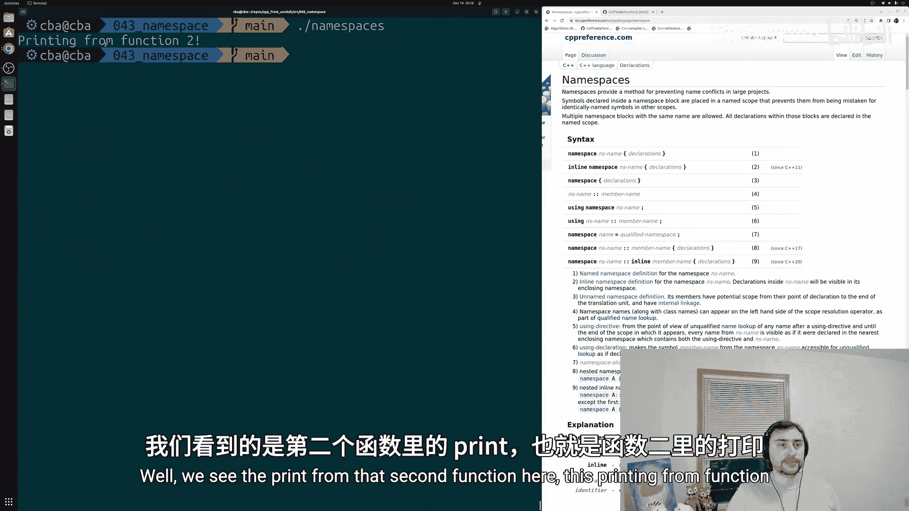
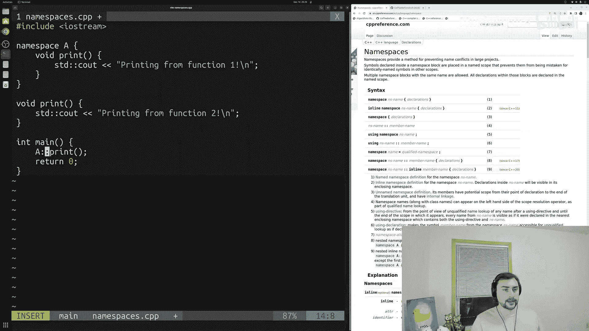
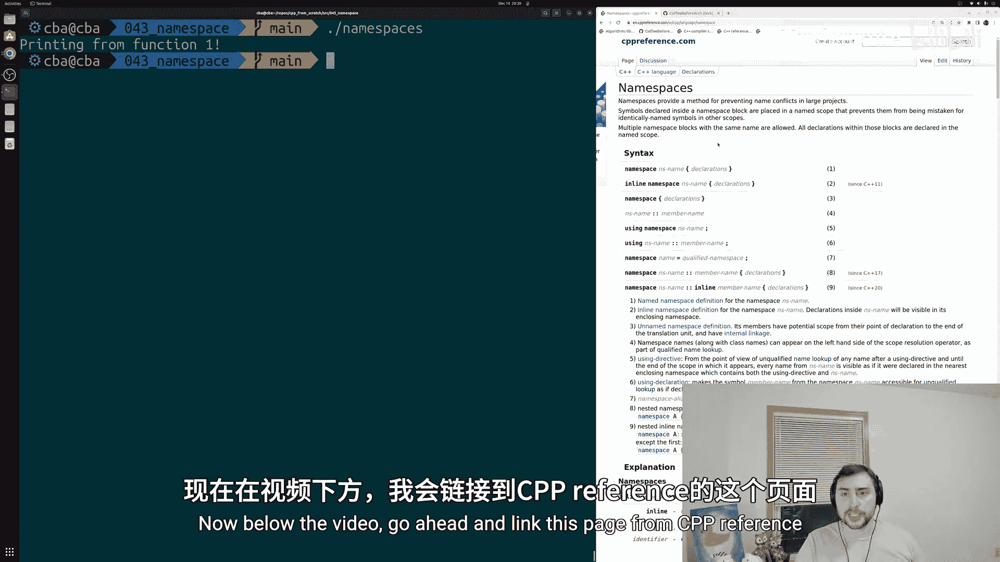
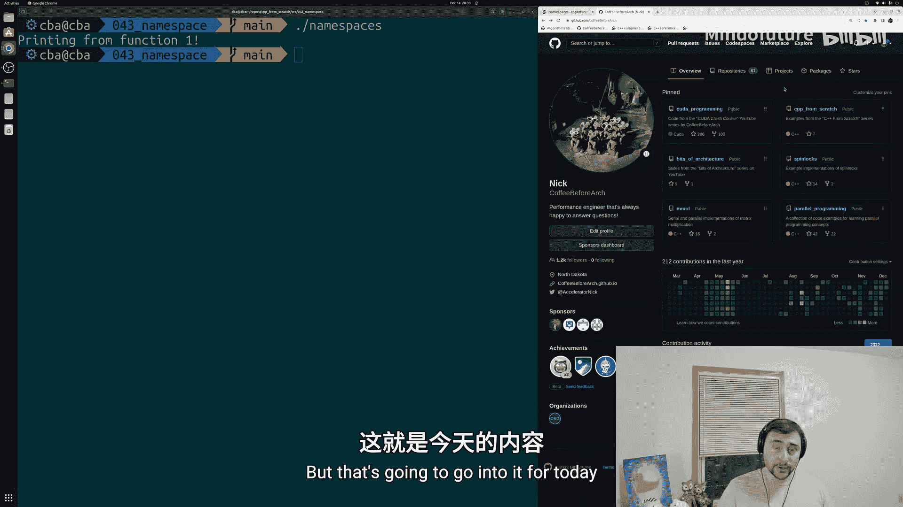

# C++入门教程｜CoffeeBeforeArch-p44-P44-Namespaces--BV1nbRUYSEUu_p44-

Hey， everyone， I'm Nick， and this is C Plus Plus from scratch。 So in this episode of the series。

 we're going to be talking about namespaces。So one of the issues that we can run into when we start working with larger projects is naming conflicts。

 so it can be difficult to make sure that we have unique names for all of our different classes andstructs and even our functions and making sure our functions have say unique function signatures。

Now one of the ways we have around this problem is namespaces so we can wrap things like ourstructs and functions and classes and even variables inside of a name space to separate them from identically name symbols inside of other scopes。

 So to understand this problem， let's go ahead and take a look at a little example here。

And see how namespaces can help us out， so we'll open up a new file here called namespaces。cbp。

And inside of here， we'll start off by including Io stream so we can do some printing。

And include a main function， as well。So let's go ahead and say we have some function inside of our code base。

 Right， Maybe it's just a function with a void return turn type called print。

 And all it really does is print out a string。 So it just says， you know， stood sea out。

Printting from。Function one， right with the new line character。

And let's say that somewhere else in our codeb， so maybe in a different file， someplace else。

 but everything's being compiled together， we have another function， right？It's also called print。

 but this one prints out a different string。So it says， you know。

 stood C out and then it you know prints out printing from function to in this case， right？

So it's printing on a different string。 Now， our compiler doesn't like this very much。

 And you can see it's already complaining at me。 And it's giving me this redefinition of this function print here。

 So what exactly is the problem。 Well， the problem is。

 is that our compiler can't tell these two functions apart。 at least from an interface perspective。

 So even if they have， say different function bodies here， they have identical function signatures。

 So if I went down in my function in my main function here， and I tried to call this print method。

 Which one of these functions is our compiler going to choose。

 I it going to choose this one that says printing from function 2。

 or this one that says printing from function 1， Our compiler can't tell these two things apart because they have identical function signatures。

 And when our compiler runs into situations like this where things are ambiguous。

 usually just throws its hands up and says， you know， I don't know what you mean here。

 So I'm not going to compile your code。 And especially in a case like this。

 our compiler is going to give us a redefinition error。😊。

So let's go ahead and try and compile this。G plus plus， and it says， you。

 we have a redefinition of this function print here。 They'd be all ready to find on line 3。

 So even though they have different， function bodies。

 they have the exact same function signature this function signature was something that we looked at in a much earlier video on functions So how exactly can we get around this problem。

 You know， there are plenty of situations where we want to keep the name that we've， you know。

 given a function because it's very expressive and it you know。

 means a great deal in the context in which we have it。😊。

So one of the ways that we have around this problem is by wrapping things in namespaces。

 so we can basically say， you know， give some more context for where this function has this certain meaning。

So let's go ahead and see how we can do that to avoid this problem。

So let's go ahead and wrap this print function inside of some namespace that we define。

 and we'll just call this namespace A， and then we can go ahead and just move this function。

 So we'll just delete it and paste it up here。 Let's also shifted over a little bit。

 So we've wrapped this function inside of this namespace A。

 So we've separated it from this other function that's defined in this global namespace here。

So what exactly is going to go on here when we call print right？ Well。

 we're just calling print from this global name space。 right。

 We haven't said we want print from a specific name space。

 So it'll just look in the global name space for this symbol。

 right this print right here with this function signature。

So if we go ahead and save this and we go ahead and compile this namespaces。cbp。

And we run this。 What do we see， Well， we see the print from that synced function here。

 This printing from function 2。

So how exactly do we get access to say， some function or class that's。

 you know wrapped inside of a namespace。 Well， we should have a little bit of familiarity with this because our entire standard library is wrapped in this namespace stood right or standard。

 this S T D colon colon， C out， right， is a great example of this。

 we're using this C out stream object that is defined inside of the namespace standard。

 So if we want to use something， say from our namespace A here。

 We would just have to qualify this print and say we want to use print coming from namespace A here。

 So it would be a， and then the scope resolution operator， which is these two colons print。

 All this is saying， as I want to use this print function defined in this namespace A instead of the one defined in this global namespace。

😊，Okay。

So let's go ahead and save this and we can go ahead and recompile this namespaces。

cbP and we can run our code and you can see we're running our first function now。

 that one that we defined inside of our namespace A。Okay。

 so that's going to go into it for this time。 It's a little bit about namespaces， right。

 and how we can use it to avoid things like naming conflicts。

 And we can do this not just for functions。 We can do it for things like classes and variables as well。

 Now， below the videoll go ahead and link this page from CPP reference。 And， of course。

 you can find this in any of my other examples at Github dot com s coffee before arch。

 So you can see I've got a repository here for CPP from scratch。

 But that's going to go into it for today。 As always， I'm Nick。 And I hope you have a nice day。😊。

