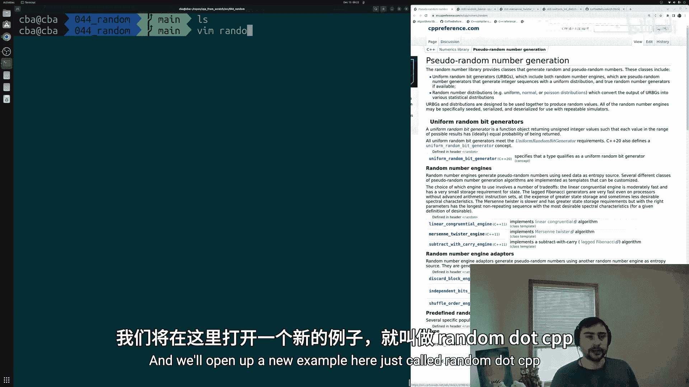
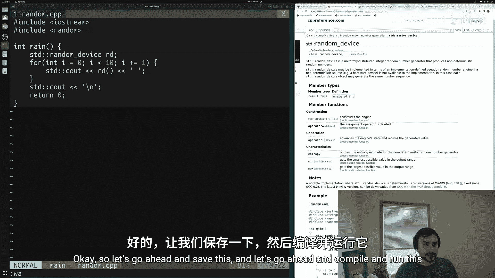
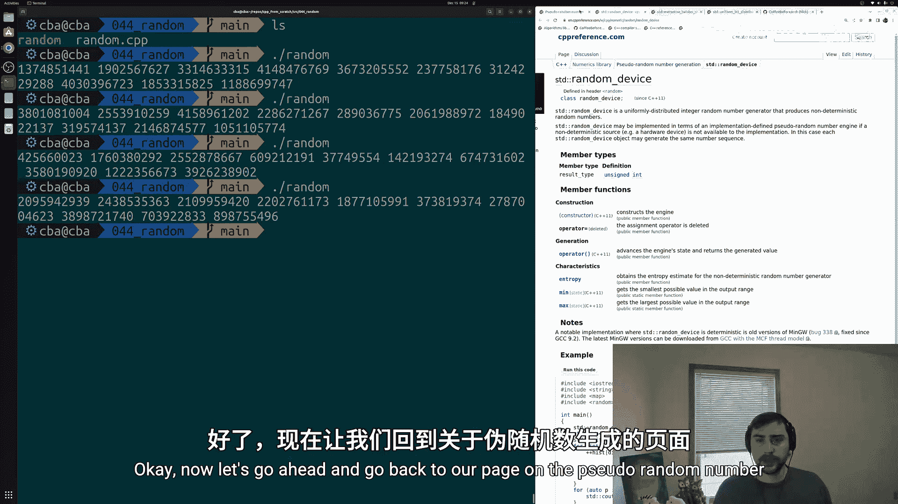
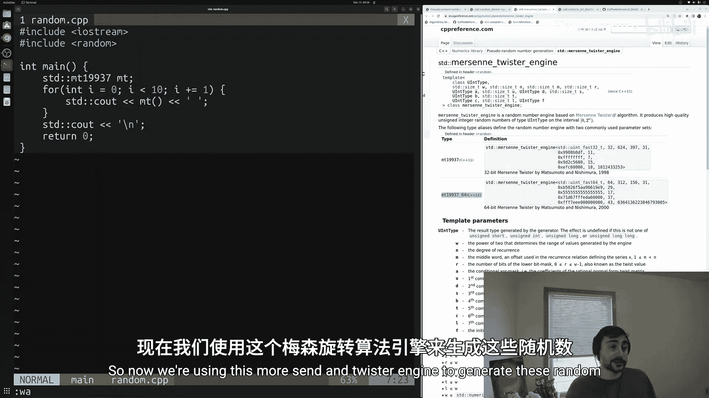
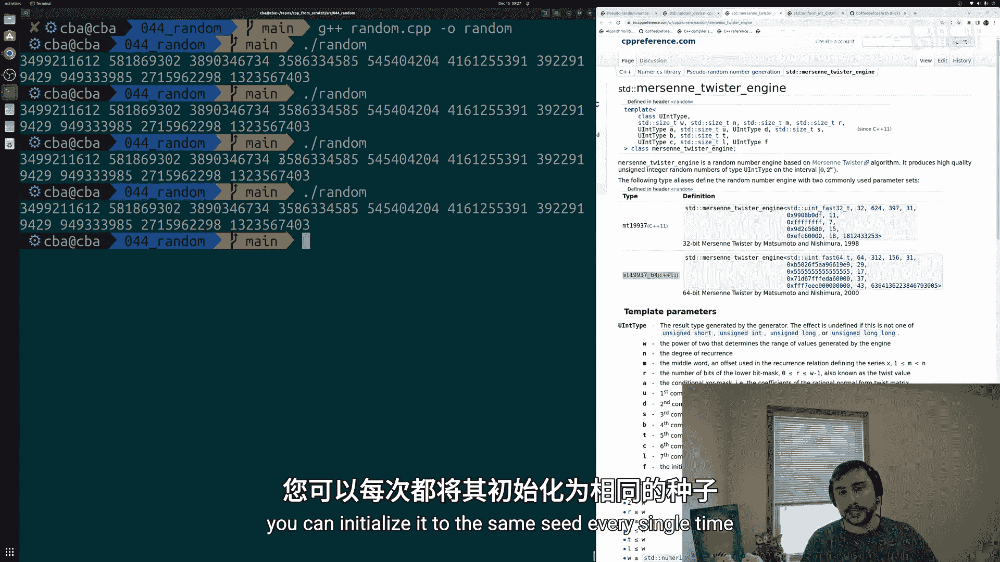
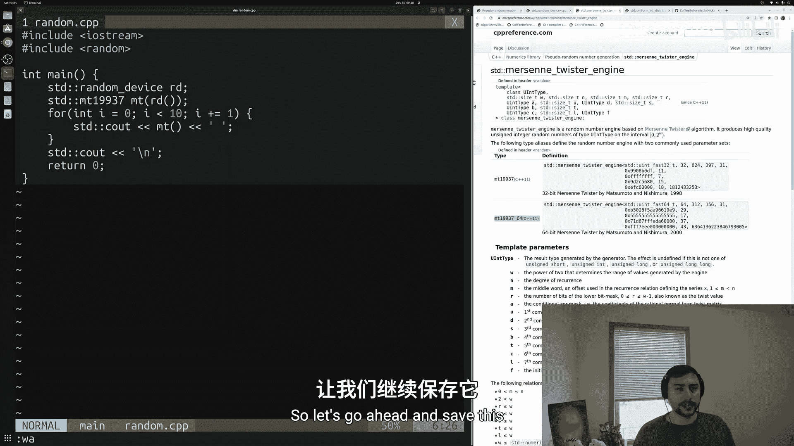
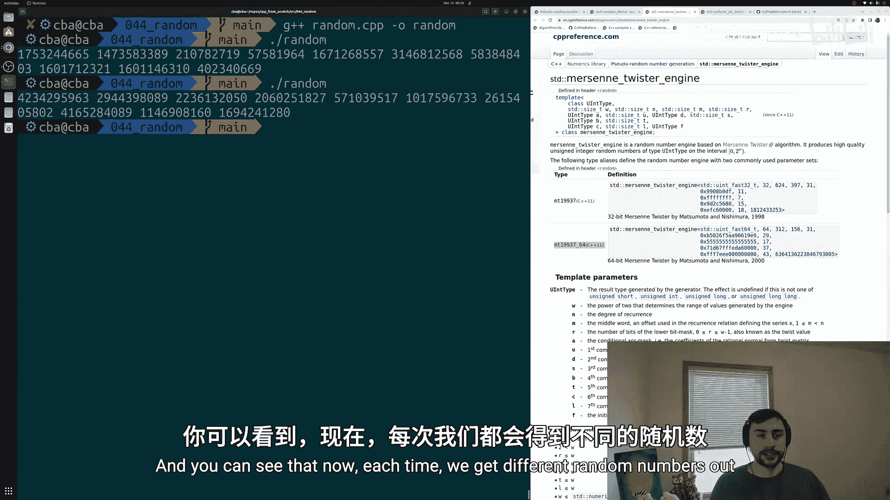
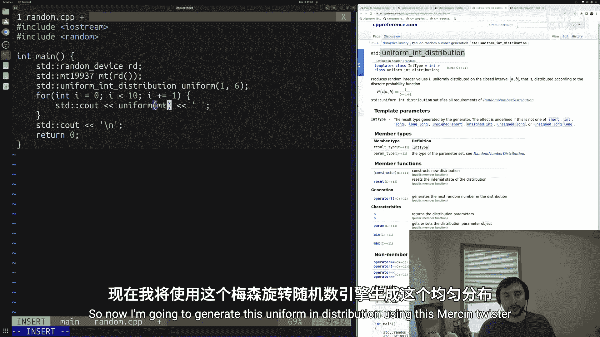
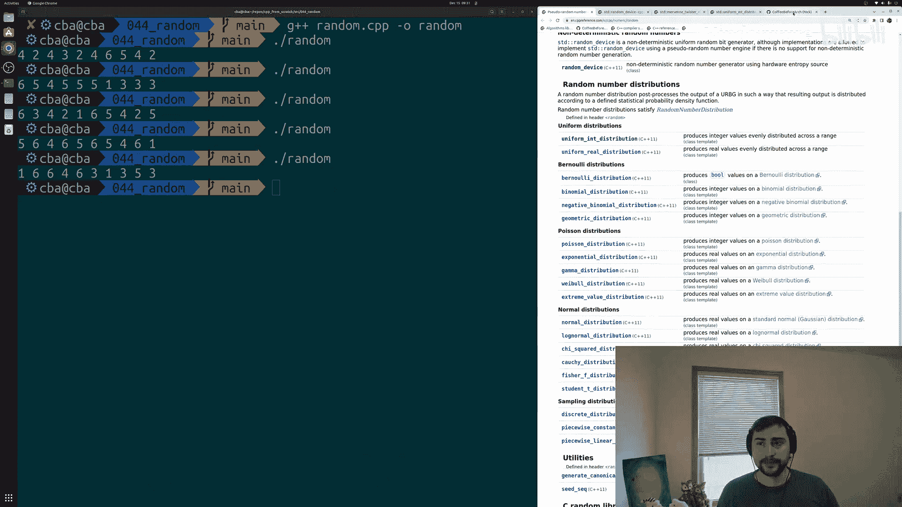
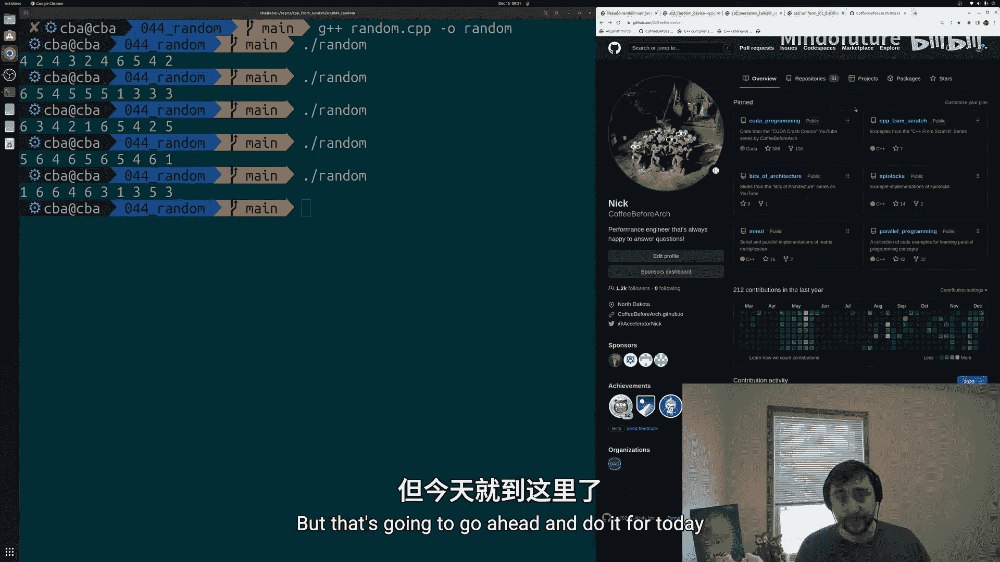

# C++入门教程｜CoffeeBeforeArch-p45-P45-Random-Numbers--BV1nbRUYSEUu_p45-

Hey everyone， I'm Nick， and this is C+ Plus from scratch。 So in this episode of the series。

 we're going to be talking about pseudoranom number generation。

So something that we often want to do inside of programs is generate some random numbers。

 So this may be because we're you know simulating some sort of random process inside of our code。

 or maybe we just want to check， say some function with some random number inputs。 Now， fortunately。

 C plus plus provides a number of different ways to create these random numbers through our numerics library。

 So we're going to be looking at the basics of this library today and how we can say generate some random integers。

 So let's go ahead and get started。 And we'll open up a new example here just called random do CBP。

Then inside of here， we can include Iio stream so we can do some printing of these random numbers。

 and we'll go ahead and include this random header。

 that's where a lot of this random number generation code is defined。

Then we'll go ahead and create a main function of course， core of our C++ program。

So let's say we want to generate some random integers here。 How can we go about doing that？ Well。

 one of the most basic ways here is we can look down here and we've got this non deterministic random numbers through our stood random device。

 So if we go ahead and go to the CP reference page for the stood random device。

 It says that it is a uniformly distributed integer random number generator。

 that produces non deterterministic random numbers， right， So let's go ahead and create。

 an instance of this random device。 So some stood random device。We'll call RD。

And then we can go ahead and you'll maybe just print out some random numbers in a loop。

 So we'll say for in to I equals 0， I less than 10。I plus equals 1。 So for 10 iterations of this sop。

 we'll just stood sea out， print out a random number。

 so we can just add this call operator to our R D， our random device here。

And then we'll print out each of these numbers separated by space。

Followed by a new line character at the very ends， we should see 10 random numbers printed out。Okay。

 so let's go ahead and save this and let's go ahead and compile and run this so we can compile this with G plus plus we color output executable。

 just something like random。

And then we can go ahead and run this executable here。

Go ahead and run this and you can see we get some random integral type numbers。

 so specifically unsigned integers。So we can go ahead and run this a few different times and you can see that we get some different results each time right so we're getting these non deterministic integer random numbers being generated。

Okay， now let's go ahead and go back to our page on the pseudoran number on the pseudoran number generation。

 you can see that we also have a number of different random number engines right。

 so different ways in which we can generate these random numbers。

So for example， we have this linear congruential engine， this Merin twister engine。

 and this subtract with carry engine here。Now， kinds these different engines have different characteristics in terms of the quality of random numbers that they make。

 the characteristics of those random numbers， how much memory the random number generators themselves take up and how how quickly they can generate random numbers of their performance So we have different tradeoffs we have to consider when we're using these different kinds of engines So a lot of times it depends on our specific task and application。

 but we'll just see how we can use say one of these engines today， so say just the me twister engine。

So let's go ahead and go back into our code and we can swap out this rim device with our Merin twister engine。

 so I'll pull up that page from CPP reference here。Okay。

 so let's go ahead and swap out RD here with now stood MT19937。

 so you can see we have these two different type aliases for this Mercin twister， this MTt 19937。

 and then MT19937 underscore 64 for 64 bit integer random numbers。

And we can just go ahead and call this say MTt。So instead of a call to RD here。

 we can just replace that with a call to our Mer twister random number generator rate。Okay。

 so that's the only change we really need to make here。

 So now we're using this Merin twister engine to generate these random numbers。

Then we can go ahead and recompile random do cP， and we can rerun our code and we can see we get some more random numbers out here。

Now， one thing that you might notice is if you swap out that random device for this Mer twister engine and you run your program multiple times。

 you actually see that we get the same random numbers each time here。

 and that's often because these random number generators take some sort of seed as an input and it will initialize kind of the state of this random number generator and it can be used to get deterministic results across different runs here。

 So if you want to make sure that across each one， you're getting the same random numbers。

 you can initialize it to the same seed every single time。

So for example， here， if we to our constructor for this Meren twister here。

 if we pass a number like 49， right as our seed。We can go ahead and recompile random and if we go ahead and run this。

 you can see that we got different numbers as last time， but they're repeatable。

 So if we run this multiple times， you can see we get the same result each time here。So you know。

 the seed can be very useful for reproducibility。 However。

 if we still want to make sure that we get random numbers every single time we run this program。

 we can use something like our S random device in combination with something like our Mercin twister。

 we can just use our random device to get a random number to use as our seed for our Mercin twister So you'll often see that pattern used。

😊，So let's go ahead and try that out。So it'll create some stood random device again。R D。

And then we'll go ahead and use RD this random device to create a seed for armors and twister right so we're initializing armor and twister with a random seed each time we run the program。

So let's go ahead and save this。

We can go ahead and compile random。cppP and we can go ahead and run this executable random。

 and you can see that now each time we get different random numbers out。

Because we're initializing that we' twister with a random seed each time we run the program so you'll often see this pattern used with the random number generators。

Now， oftentimes we we care about more than just creating some random numbers。

 often when we want to create these random numbers within some sort of distribution。

So you can see down here that C+pl provides a number of different random number distributions in which we can generate random numbers in。

 so we have uniform distributions， Bulli distributions， Poisson distributions， normal distributions。

 sampling distributions， and so on and so forth。So let's go ahead and see how we can use one of these distributions。

 so we'll just use this uniform int distributions。So let's go ahead and take a look at that page here and we can see that this uniform in distribution produces random integer values I uniformly distributed on the closed interval between A and B that is distributed according to this discrete probability function down here。

So we can set say a closed interval that we want to generate random numbers within and we'll have them generated based on this probability function。

So let's go ahead and see how we can use this say this stood uniform int distribution。

 but in combination with say， you know all of the other things we've looked at so far。

 so underneath the hood we're still going to be using our Mersin twister that's initialized with a seed based on our random device。

 but now our Mersin twister will be generating numbers in some uniform int distribution。Okay。

 so let's go ahead and create this uniform in distribution here。

 so we'll create some stood uniform int distribution。

And we'll just call it say something like uniform， and then we can set the interval here。

 that A and B value so we can say one to6， so we want to generate numbers between one and6 in a uniform distribution here。

So now inside of my code down here。What I can do is I can make calls to uniform now so I can get random numbers within this uniform distribution。

 but then I can pass it my Mercin twister here， right， this random number generator， right。

 this Mercin twister that we created based initialized with the seed。

 So now I'm going to generate this uniform in distribution using this Merin twister random number engine。

So let's go ahead and save this and let's go ahead and recompile random docP and go ahead and run this。

 And you can see that we get these random numbers between one and6 now inside of this uniform distribution here。

 So what we're basically doing here is kind of a classical example of rolling a die， right？ So。

 you know， a die has six faces that have the numbers one through6 on it。

 That's basically the random process that we're simulating here。Okay。

 so that's a little bit on how we can generate these different kinds of random numbers and C plus plus。

 And， you know， as you can see from， say， you know。

 just this top level page pursuit suit of random number generation。

 there's quite a few different things you can get into here。

 So we'll go ahead and link this below the video。 along with all the other pages that we looked at。

 And， of course， you can find this in any of the other examples at Gitthub dot com s copy before arch。

 So there's a C P from scratch repository right on the front page。

 But that's going go ahead and do it for today。 as always on Nick。 And I hope you have a nice day。😊。

