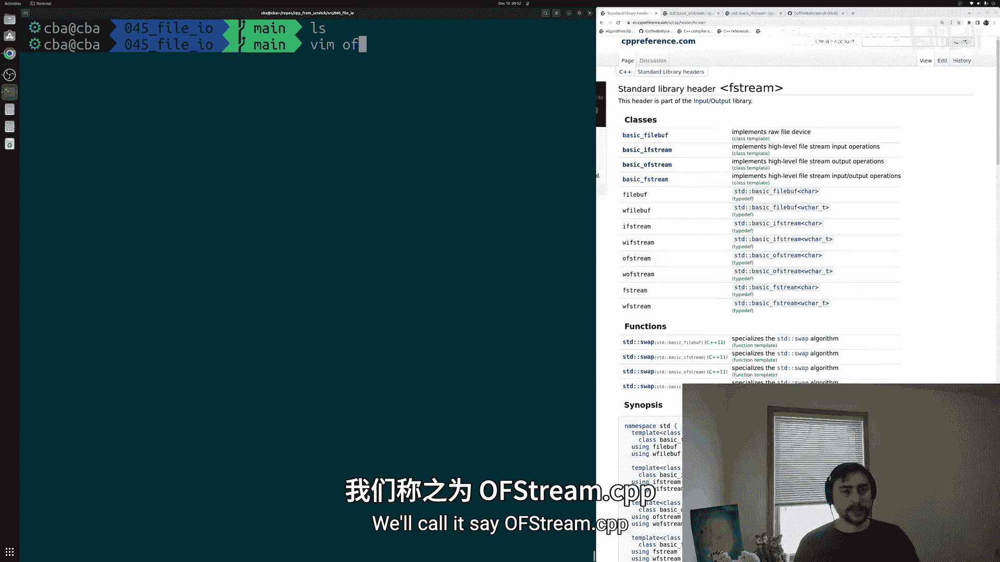
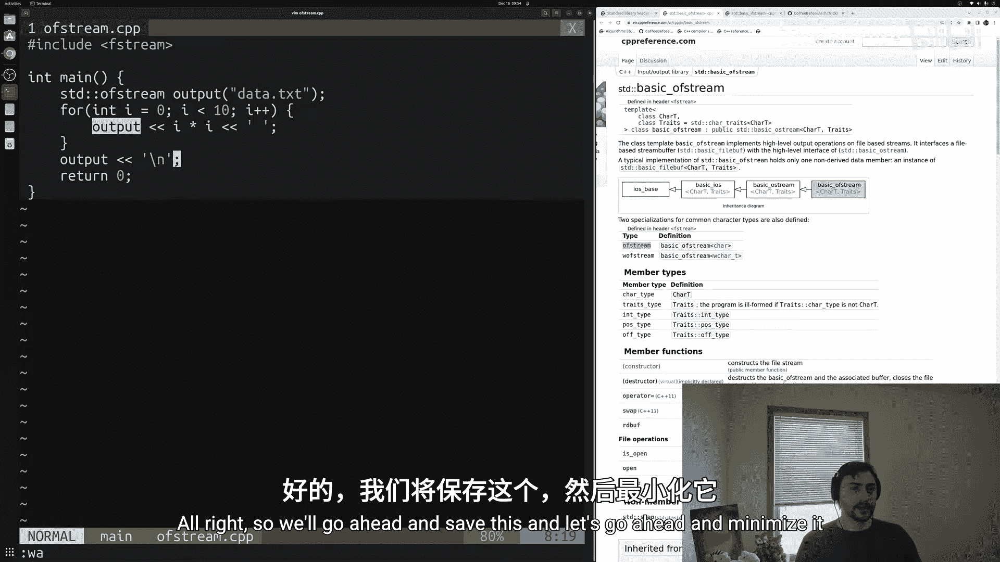
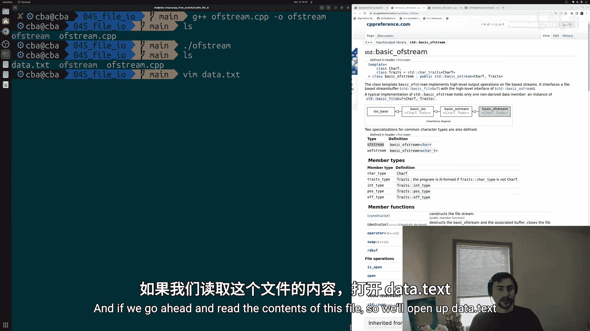
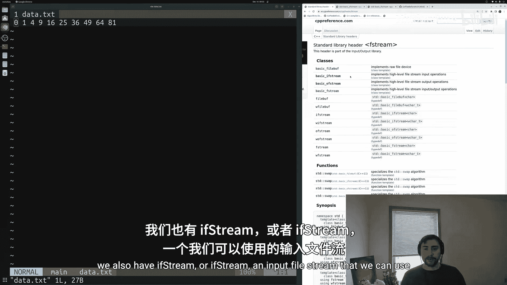
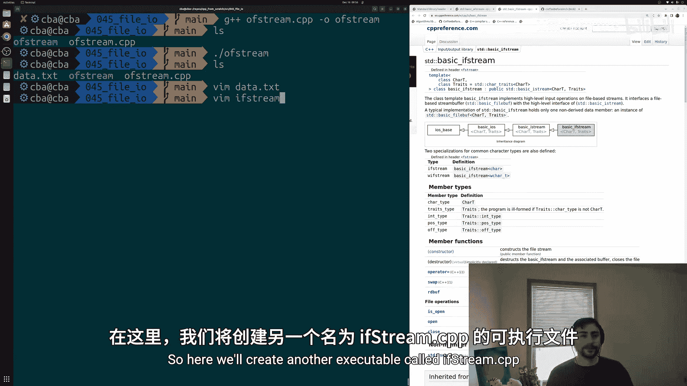
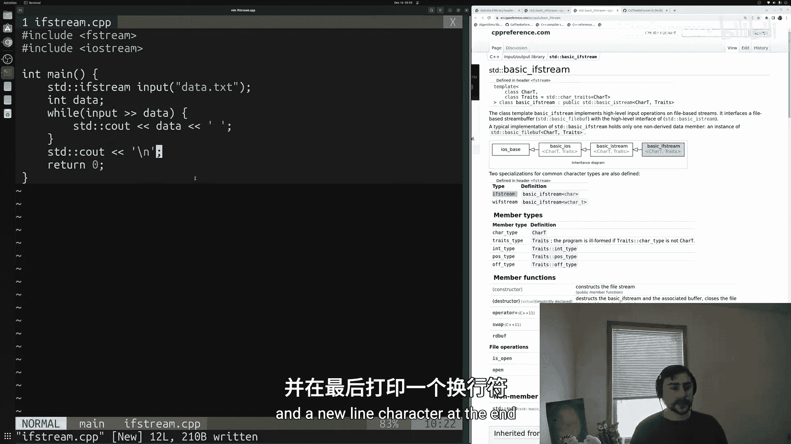
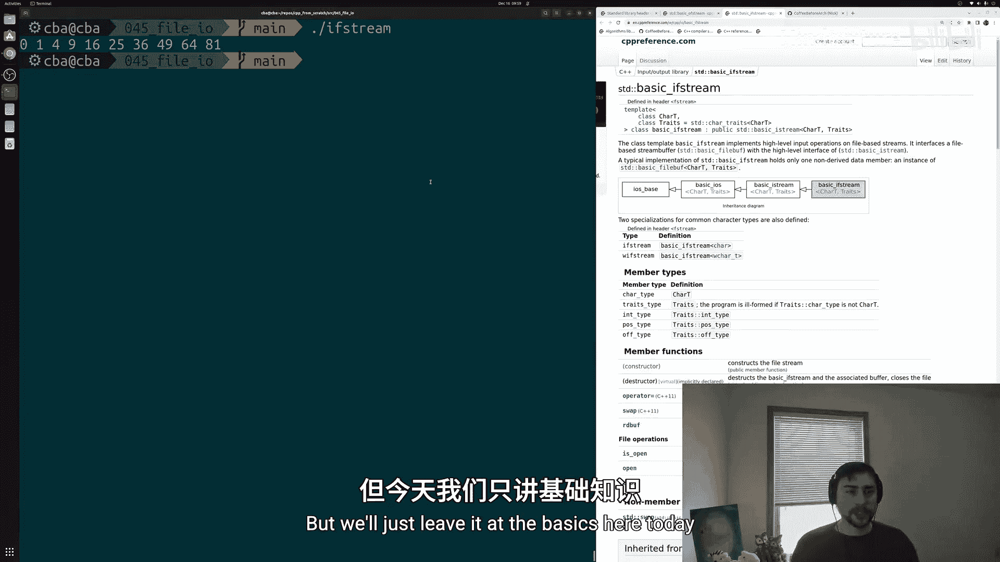
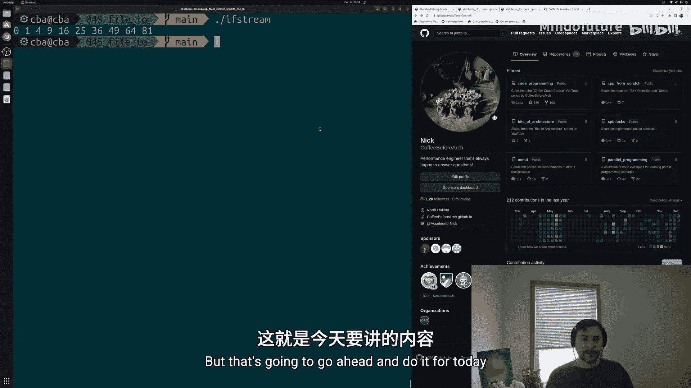

# C++入门教程｜CoffeeBeforeArch-p46-P46-File-I-O--BV1nbRUYSEUu_p46-

Hey everyone， I'm Nick， and this is C++ from scratch。 So in this episode of series。

 we're going to be talking about the basics of file IO with Fstreamream from our input output library。

So oftentimes inside of our programs， we want to read data from some external source。

 or we want to write out something like logs or data from a program to some file。

Now what we're going to be looking at today is kind of the basics of how we can do this with Fstreamam。

 which is part of our input output libraryr and standard C plus plus so we'll look at a simple example where we first say write data out to a file。

 so we're generating some say data set and then another example where we read data from that same file using these file streams so let's go ahead and get started。

So we'll open up a new example here and we'll call it say O stream。

 cP So we're standing for output file stream so if we go ahead and take a look at the right hand side of the page here。

 we've got the CPP reference page for the standard library header F stream and as part of this F stream we have this OF stream and basic OF stream which is for this implements highlevel files stream output operations so let's go ahead and open that up and as part of this we have this output file stream where we can write things out to files。

So we'll go ahead and start with including Fstream here。

 right that's where all of these things are defined。

 and then of course we're going to need a main function。With a return 0。 Now。

 let's say we want to write out， you know， some squares of numbers up to some files， So 0 squared。

1 squared，2 squared， so on and so forth。 So how would we go about doing that， Well。

 we can start off by creating some output file stream that we want to write to。

 So we'll create some stood O F stream， and we'll just call it output。

 and we'll initialize it with the file name that we want to write to。

 So we want to write to some file called data dot text。Then inside of a loop。

 so we'll loop for say 10 iterations here， so we'll say  four int i is equal 0。

 i is less than 10 i plus plus。We're just going to write out to this output file stream here。

 and we can write to this file stream in a very similar way that we would print things out using stood C out。

 that sea out Stre object。So we can use the exact same operator so we can do output and then this less and less in sign。

 and then what we want to print out to our file or save to our file。

 So here we'll just print out I times I。 So squares from 0 all the way up to 9。

 So 0 squared 1 squared 2 squared all the way up to 9 squared。

And then we'll have these separated by some space here。

 so we'll print out or save some instegers and then separated by a space。And then finally。

 we'll just write a new line character to the file so that it ends with a new line character。Okay。

 so that's kind of the basics of how we can write the files here so we can treat this output file stream object。

 much like we would something like students see out。Al right。

 so we'll go ahead and save this and let's go ahead and minimize it and we'll compile this output file stream。

cbp we'll call our output execute cubeable just something like O stream。

Okay， so we went ahead and compile that。 We have our executable。

 Let's see what happens when we run this so we can go ahead and run this output file stream and you can see we get this data dot text or data dot txt generated。

 And if we go ahead and read the contents of this file So we'll open up data dot text You can see we have all of our squares of I So zero squared one squared all the way up to9 squared separated by spaces in a new line character at the end right exactly what we sent to that a F stream。

 that output variable that we created。 Okay so that's the basics on how we can say write some data to some file here。

 But how do we get this data back into our programs。 How do we read it back in。

Well， just like we have this basic OF stream that's part of this standard library head or F stream。

 we also have IF stream or if stream， an input file stream that we can use。

So let's go ahead and open up that cP reference page and see how we can read data back into our C++ programs。

 so here we'll create another executable called ifstreamam。cbP。

And inside of here， we'll include F stream again， right， If stream is just another file stream。

 so it's defined the same header。And then we'll also include Io stream。

So we can just print out the data that we read back into our program。Okay。So from here。

 we'll of course， need a main function and what we can do is we can start out by creating some if stream object right。

 so you know what we want to use to read in data right from a file， some input file stream object。

So we'll create some stood if stream， we'll just call it input。

 and we'll initialize it with the path to the file that we want to read from。 So in this case。

 our file is in the same directory so we can just put data do TxT or data dot text。

 This is the file we're going to open and read from。So inside of the file。

 we have a whole bunch of integers， so we'll read out our data into do some integer that we'll just call data and we can read out this data inside of a loop here。

So we'll go ahead and use a while loop for this and we'll say while。Input。

And then we'll use another kind of write is double Cheevron double less than double greater than sign。

 and this time we'll use this double greater then to say we want to get some input or get some data from our input IF stream object and we want to read that out into our data variable here so just like we use the double less than to signify where we have some output。

 we use this double double greater than sign to say that we have some input from some stream object。

So we're getting some input from our input if stream object。

 and we're putting that input inside of data， which is an integer。So， you know。

 the nice thing about these input file stream objects， right， they can help us out。

 we don't have to handle you know， in a special way the spaces and the new line characters we have in our programs。

 right， at least for a simple example like this。So then this will just keep running until we've read all of the data from our program。

 so when we run out of data， right， we'll break out of this Y loop， right。Okay。

 so here let's just go ahead and print out whatever we read in from our input file stream object。

 so we'll just print out whatever data is our anteger。Separated by a space。And then we'll of course。

 just print out， say， a new line character at the very end。Okay。

 so that's kind of the basics of how we can read data in。

 So all we're doing here is creating some input file stream object when we're opening up some file named data dot text right。

 this is the path to a file。 Then inside of a while loop。

 we're reading data from input into our data variable here， which is an integer。

 we have integer data。And then we just go ahead and print out all of that data right inside of this loop and a new link character at the end。

So we'll go ahead and save this and then we'll compile this ifstream。

cppP and we'll just call the output executable just something like ifstreamam。Okay。

 so let's go ahead and run this if stream executable。

And we see we get a printout of all of the data inside of our data dot text file。

 right we read that data back into our program。Okay， so that's gonna go into do it for today。

 That's kind of the basics of using this OF stream and ifF stream。

 this output file and input file stream objects and C plus plus Now these things can be configured in many different ways so you can say write in different modes。

 you can append to files instead of overriding files you can see locations inside of files and so on and so forth。

 but we'll just leave it at the basics here today。 Now as always。

 you can find this in any of my other examples like Github do co s coffee before arch So right down on the front page here you can see the CPP from scratch。

 but that's going go ahead and do it for today as always， I'm Nick and hope you have a nice day。😊。

