# C++入门教程｜CoffeeBeforeArch-p47-P47-Constexpr--BV1nbRUYSEUu_p47-

Hey everyone， I'm Nick and this is C++ from scratch In in this episode of the series。

 we're going to be talking about compile time programming with Cont Exppert。

So we often care about the runtime performance of our programs and one of the tools that we have in our toolbox to improve this performance is by moving computations at runtime over to compile time。

 so the intuition here is that we often compile a program once and run it many times。

 so we'd rather pay a one- time cost of doing those computations at compile time rather than every single time you run an application。

Now one of the ways we have to accomplish this in C++ is with this Cont Exp Specifier so if we go ahead and take a look at the CPP reference page for Cons Exp。

 we can see that this cons Exp Specifier declares that it is possible to evaluate the value of the function or variable at compile time so we're doing this tradeoff here where we're moving overheads from runtime over to compile time so let's go ahead and take a look at a simple example of where we can use say Cons Exp in our programs。

So let's go ahead and open up some new file here called contexpert。cppP。

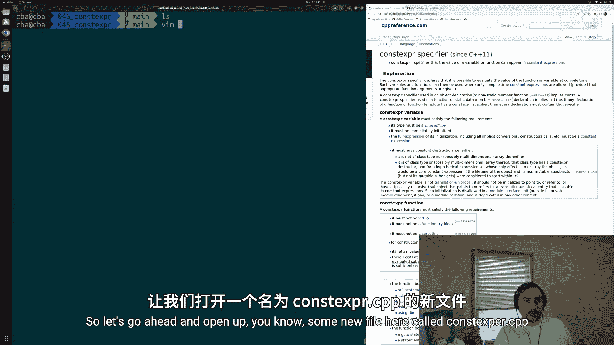

And inside of here， we'll start by including IO stream so we can do some printing。And then。

 of course， we're still going to need a main function here。

So let's say we want to implement some function that calculates the factorial of some integer n right So this is going to do the product of all the positive integers from n all the way down to1。

 So for example， the factorial of5 would be five times 4 times3 times 2 times1。

So let's go ahead and write a simple function to calculate that。

 and we can solve this with recursion。So let's create a function that returns some integer。

 which is our factorial。And then our factorial function will take some integer in。

Then inside of this function， right， we'll have our base case where we check to see if n is less than or equal to1。

 If that's the case， we'll go ahead and just return one。 Otherwise， we'll do an else case here。

 We'll return n times factorial of n-1 here。So that's how we can implement a recursive version of factorial。

Okay， so let's go ahead and go down to our main function and use factorial。

 So we'll create some integer result， which is equal to factorial of say 5 here。

 So we should get the result of  five times 4 times 3 times 2 times 1， which is 120。

 And then go ahead and print that up to the screen using St C out。 So we'll just print out result。

Followed by a new line character。So this is all kind of standard C++ that we've seen before。

 just functions， variables， and then printing using C out， so let's see this is our baseline。

 so we'll save this and go ahead and compile this Cont expertt at CPP and call our output executable。

 just something like Con Exp。

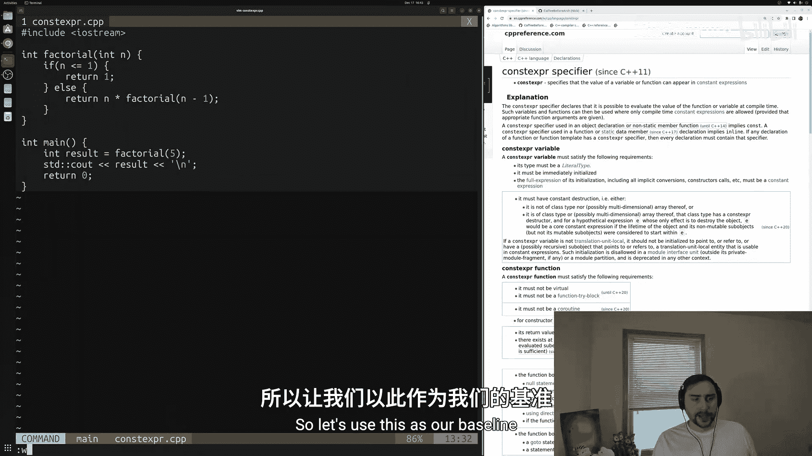

And we can run this and we see we get the correct result here， so we get 120 for the factorial of5。

Now， because we're moving computations from runtime over to compile time。

 these really arent things that we can see from a very high level。

 except through measuring time or by looking at our underlying assembly。

 So you know what we're changing is what we're doing at runtime right So let's go ahead and take a look the assembly of a program to see what our program is actually doing underneath the hood。

 So one way that we can do that is through a tool like object dump or objecttump right to dump the assembly for this executable so we can do Obd Dc to disassemble a program and demd the names and we'll pass it this constant expert。

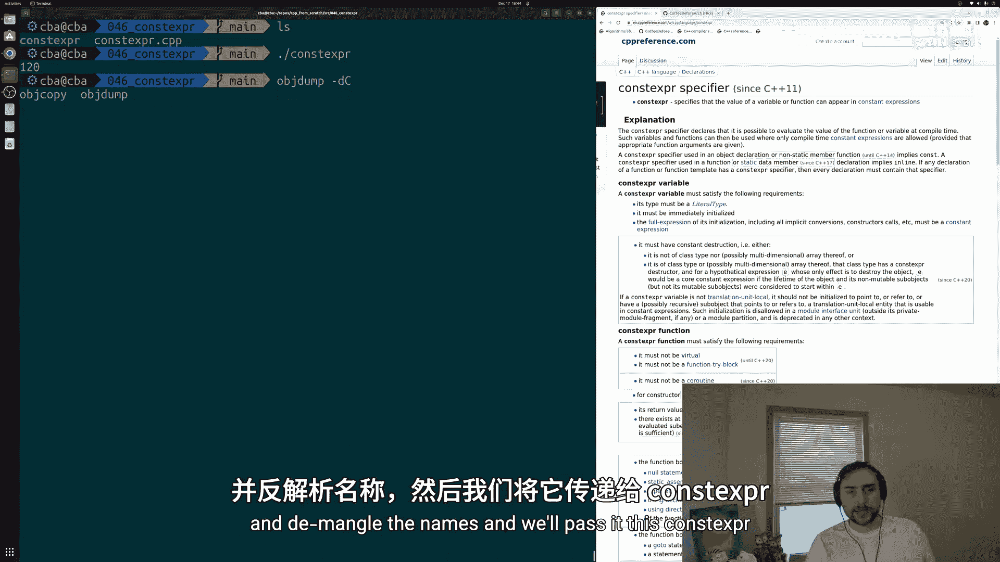

So you can see we get a whole bunch of know instructions here that are the low level instructions that our processor is executing。

 But if we go ahead and scroll up a little bit， we see something that looks like our main function here。

 And in sight of this main function， you can see that we have a call to our factorial function our factorial function that takes an integer。

 So every time we run this program， we end up calling this factorial function。

 and you can even see our call to say the stood O stream operator less than less than right So this is our stood C out where we're printing some integer here。

😊，Okay， so that's we're doing it runtime in this kind of baseline case。 Now。

 let's say we want to move this computation from runtime over to compile time。

 so I don't want to see a call to say factorial at runtime。 I just want to have the result。

So let's go ahead and go back into our program here， our source file。

Instead of just having this normal function here， we'll mark it as a con expert function。

 So itll be this constant expert int factorial that takes some integer。 And again， right。

 this is just marking that it's possible to evaluate the value of some function or variable at compile time。

 So we're telling your compiler you can evaluate， say the result of this function at compile time。

And we'll also go down to our main function here， and we'll make this result。

A constant expert result as well right so we're saying that or we're telling our compiler。

 you're allowed to or you can evaluate the result right whatever this value should be at compile time so you can use this constant expert function to set some result here instead of having to wait for run time to call say factorial。

Okay， so let's go ahead and save this and see how our output changes making this when we're using Con Exp like this。

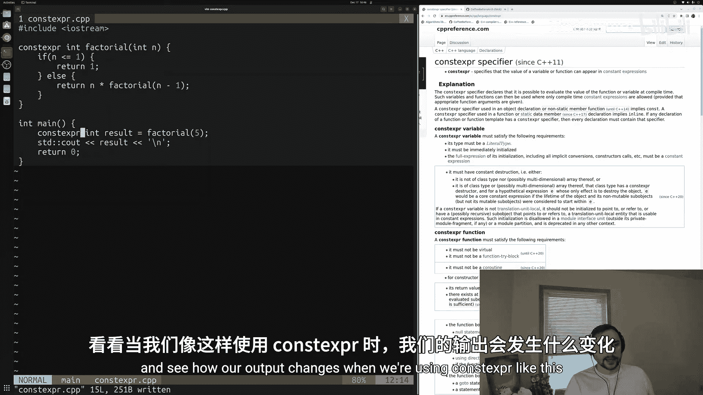

So we'll save this and we'll go ahead and recompile conext CP And you can see that when we run our code。

 we get the exact same result。 So whether it's con expert per or not， right。

 our function is still doing the right thing。 We're getting a result of 120。

 But let's see what happens when we look at our underlying assembly now。

 So we'll use this object dump again to look at our assembly and we'll scroll on up and see our main function here。

 But we see something a bit different this time。 we no longer have a call to this factorial function anymore。

 In fact， we just see some moves of this value。 know hexadeimmal 78 here。

 So if we go ahead and right click on this， you can see that this result。

 this hex 78 is equal to 120。 So at compile time， we generated the right answer。

 And we just have the answer inside of our code here that we're working with that we end up printing out。

 We don't have to call factorial at run time to calculate this factorial right。

 It's already happening at compile time。

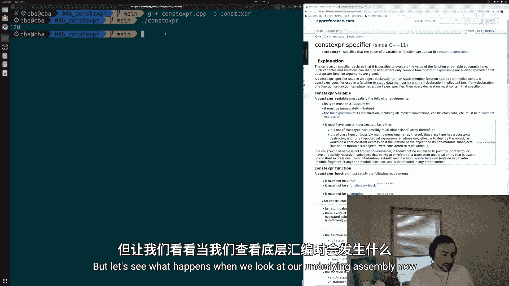

So for example， if we go back into this program and we've changed say factorial 4 to be something like factorial 3。

 so that'll be three times2 times 1， so just a value of 6。

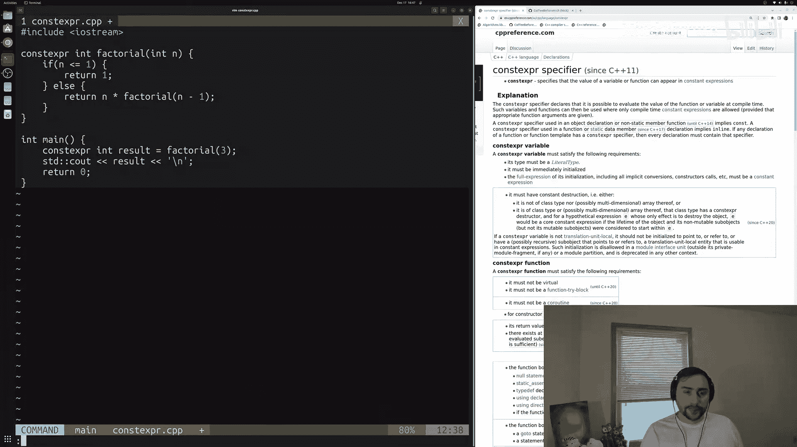

And we recompile a program and we run it， we can see it run time。

 we get the correct result printed out6， but at compile time。

 if we go ahead and dump this assembly again， you can see our compiler already figured out this answer。

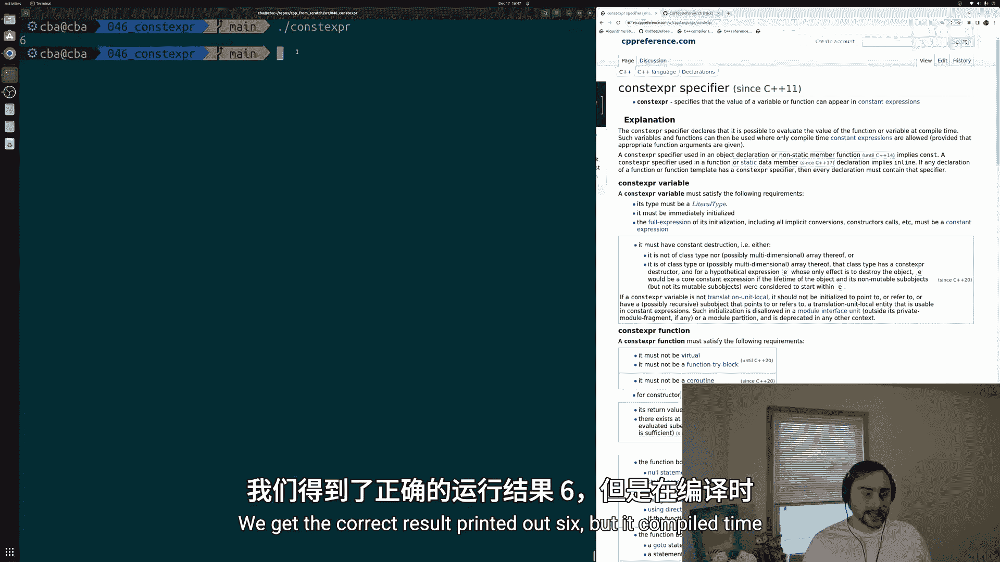

So you can see here we now have the value of 6 that we're moving around right so this is hexadecimal 6 right here。

 So we're removing computations that normally would have happened at runtime right that called aial and it's now happening at compile time。

 so we just see the results inside of our final code。Now like I said earlier right。

 this declares that it's possible to evaluate the value of some function or variable at compile time。

 but in the case of something like a concept per function。

 we can still use this function at runtime as well we don't always know every single value that we're going to pass to a function at compile time so we still want to be able to maybe calculate factorials with runtime data so let's go ahead and see an example of that。

So we'll go ahead and include random here。 So we'll just generate some random number at runtime。

 So down here inside our main function。 I'll go ahead and create some stood random device So generate a random integer。

 So we'll just call this random device Rd and then to effectial we'll just call Rd here right。

 So generate a random number。 And then we'll do something like modular 6 to make sure we don't you know create too large of a number。

 So something that would say overflow an integer。 Now the one problem that we run into doing this is that we can no longer consider this integer result to be a constant expression here。

 So you can see our compiler is already complaining at us right here。

 So let's go ahead and see what that error actually is。 when we compile this。

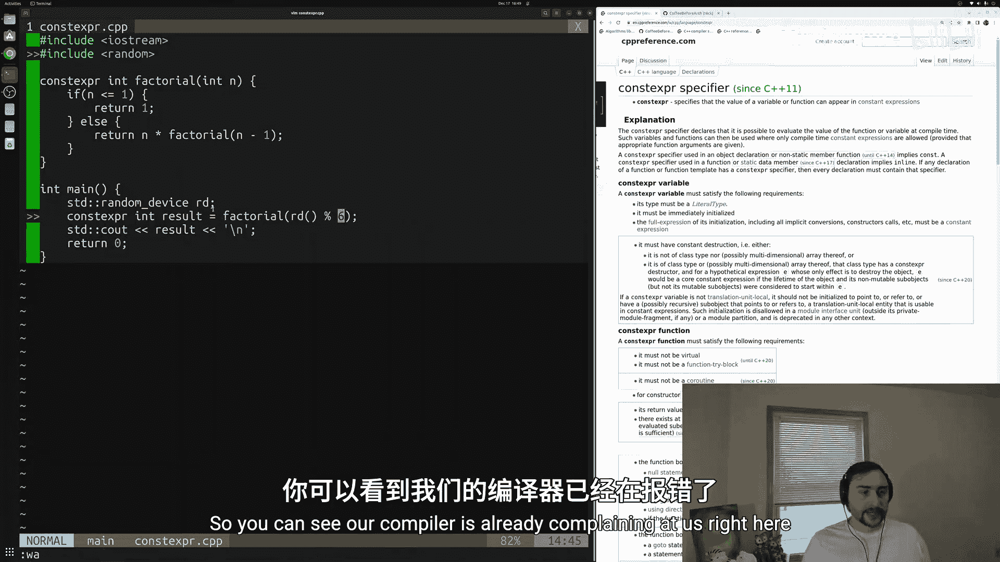

So you can see that we have a call to a noncons expert function， which is our S random device。

 you know this call operator right， so what we're using to generate this random number right here because that's not Con expert our result here can't be Con expert right this random number can only be generated at runtime right not a compile time like this。

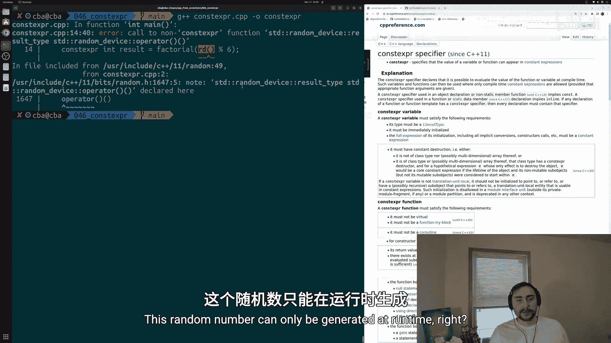

So in this case， right， our int result here， this can't be con expert anymore。

Because we're relying on this runtime random number generation。

But our function here can still be marked context expert。

 so we can still use it in other contexts per contexts。

 right where we do know say some argument ahead of time。

But let's go ahead and save this and we can compile this cons expert。

cdp and we can go ahead and run our code and you can see that you know for different random numbers we generate。

 we can still use that cons expert function and use it at runtime。

 so it's not just for compile time computation， it can be used for both。

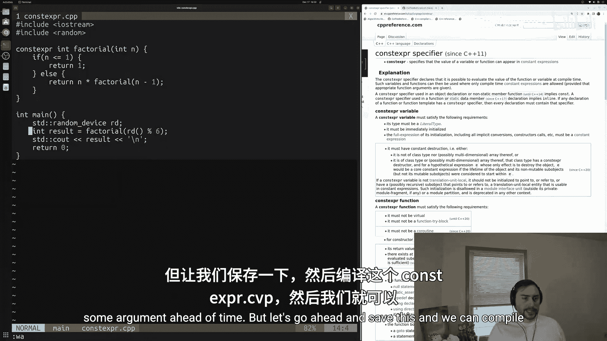

Okay， so that's going to go ahead into it for this time。

 it's an introduction to this compile time programming with Con Exp so we can have these contact expert variables and functions that we can define and it can be incredibly useful for moving。

 say runtime overheads over to compile time。

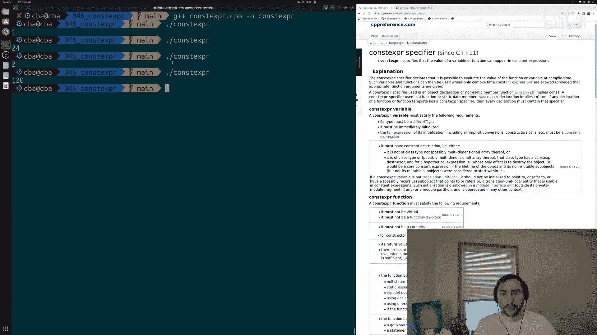

Now as always you can find this in any of my other examples at Github。com/coffeeberearch。

 so on the front page here you can see the cP from scratchch repository。

 but that's going to go and do it for today， as always a Nick， and I hope you have a nice day。

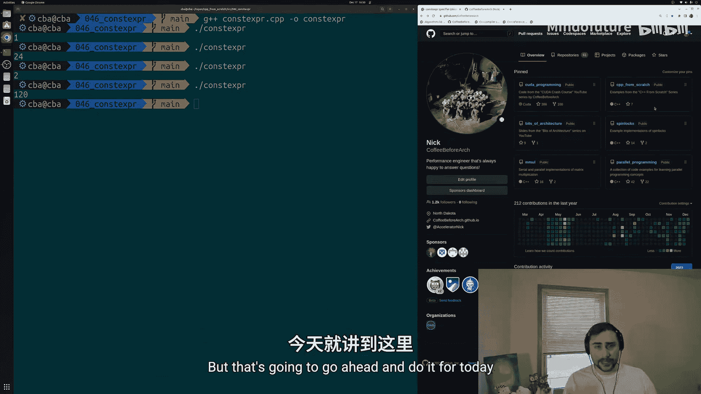