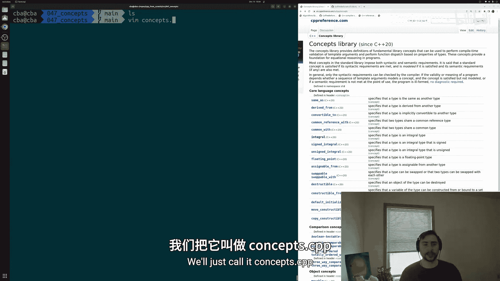
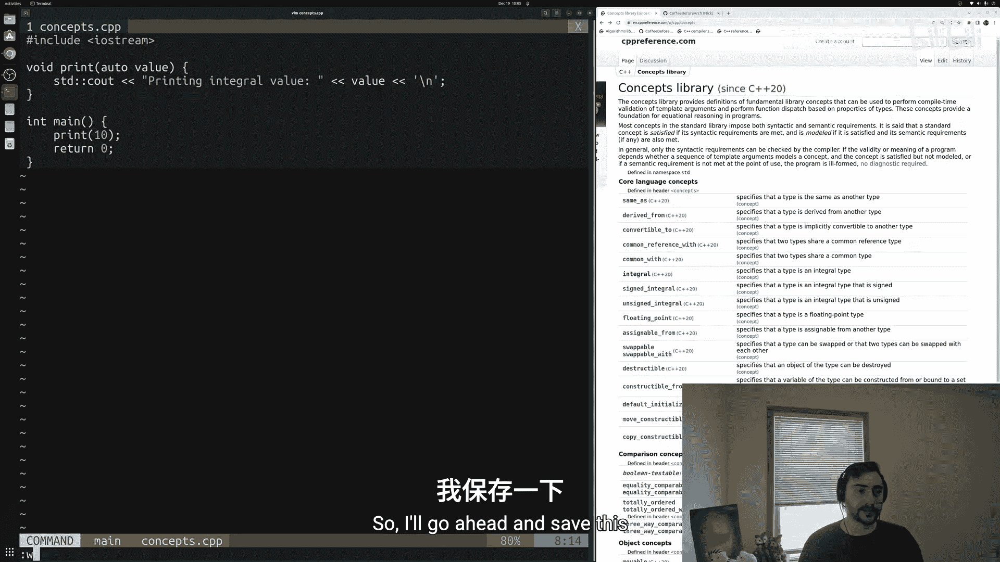
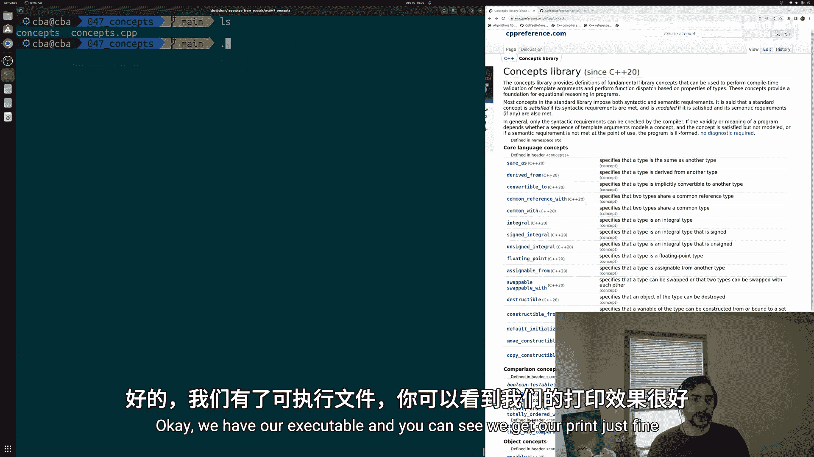
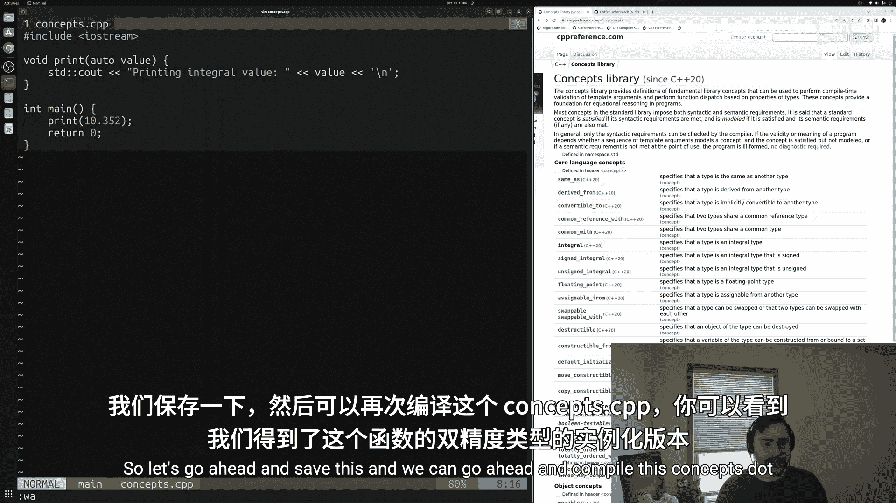
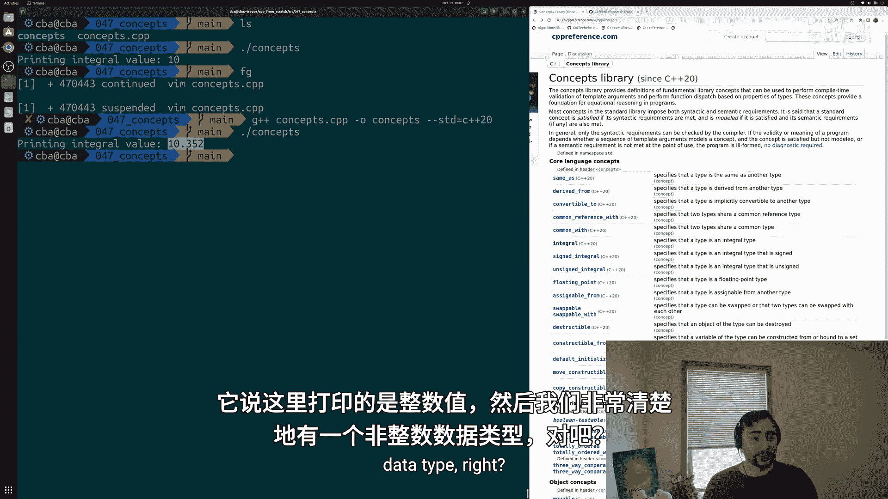
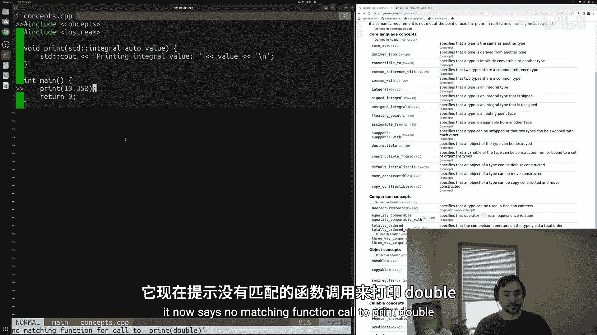
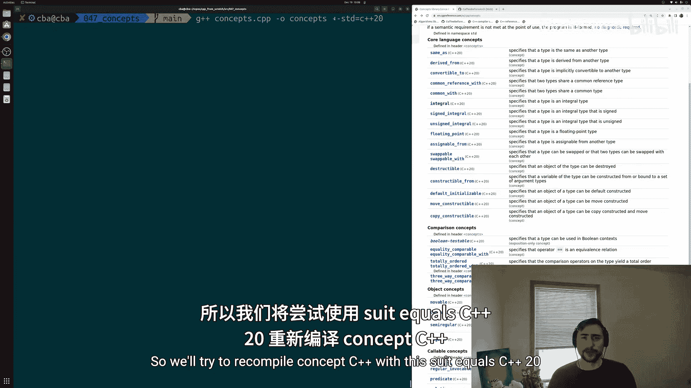
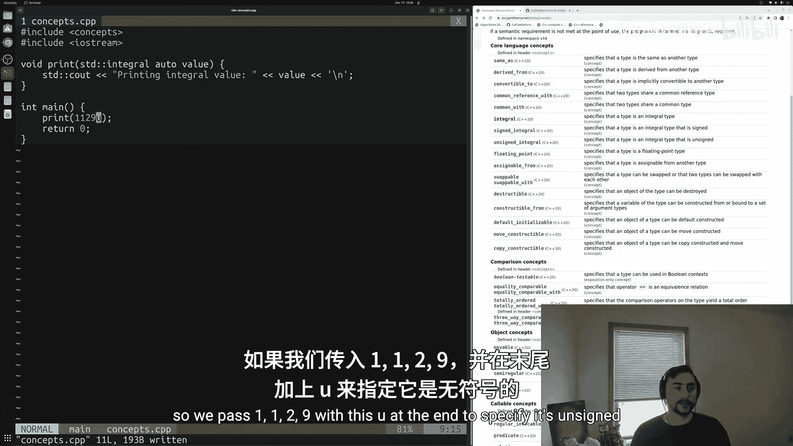
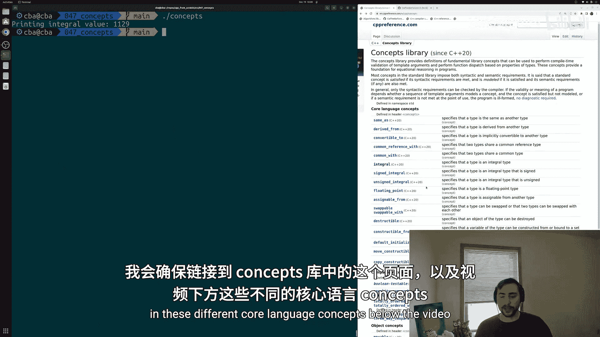
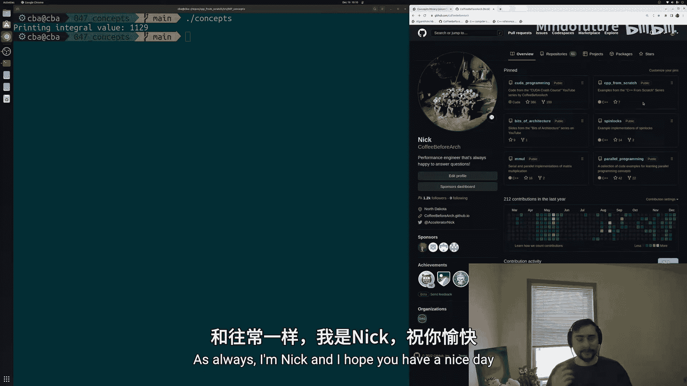

# C++入门教程｜CoffeeBeforeArch-p48-P48-Concepts--BV1nbRUYSEUu_p48-

Hey everyone， I'm Nick and this is C Plus Plus from scratch。 So in this final episode of the series。

 we're going to be talking about concepts。So oftentimes。

 when we're defining something like a function template。

 we don't intend for it to be used with all possible data types。 For example。

 we may just design this template。To be used for different kinds of integral numbers。

 So maybe 8 bit 16 bit，32 bit and 64 bit integral data types。

 but not say floating point types or some user defined structure class。

 So it' would be really nice that we had a way to express this to prevent the potential misuse of our template We don't want someone trying to use or instantiate a version of our template for a type that it wasn't intended to be used for。

 Now a way that we have to do this in modern C plus plus is through concepts。

 So we can see on the right hand side of the page。 the CBP reference page for the concepts library and it says that the concepts library provides definitions of fundamental library concepts that can be used to perform compile time validation of template arguments。

 So it's exactly kind of what we're looking for here。

 So let's go and see the basics on how we can use these concepts。

 So we'll go ahead and open up a new example here。 we'll just call it concepts not CBP。

 And inside of here， let's go ahead and include io streams so we can do some printing。😊。

And we'll also create a main function here。So let's say we have some simple function template here。

 So here I'll create a simple function called print here。

 and we'll use our abbreviated template syntax。 So we'll just pass in some auto value。

 and let's say we only expect， you know， integral data types for this template。

 So we'll just say print out using Stsy out。 you know。

 printing integral value and then followed by whatever the value is。And a new line character。

So this simple templated function will work perfectly well for our different integral data types。

 so I can just do something like you know， print， and then I can pass and say an integer number。

And I'll get the version of this print function for integers， so go ahead and save this。

 we'll go ahead and minimize concepts at CBP and we'll compile it with G+ plus call our output executedecutable just something like concepts。

 and we'll set our standard with the C++ 20 because we're using that abbreviated template syntax。

Okay， we have our executable and you can see me get our print just fine。

Now， the issue here is that we've done nothing really to constrain this templated function here。

 right， Some could come along and try to create an instance of this print function for whatever type they really like。

 So， for example， here， someone could come along and create an instance of this function for some double precision number like 10。

352， we haven't done anything to prevent this from happening。 right。

 we just have a templated function up here。 So even though we only intended for this to be used。

 say with different integral data types， we're accidentally using it here with a type that we didn't expect or in tin。

 So some double precision number。 Now， in some cases。

 this will lead to a compiler error that could be rather long and tricky to figure out or perhaps even worse。

 it could just lead to some unexpected result at runtime， right， some strange behavior。

So let's go ahead and save this and we can go ahead and compile this concept。 cP again。

 and you can see we got this instantiated version of this function for our double precision type。

 even though we only intended for this to be used with integral data types right it says printing integral value here and then we very clearly have a nonin data type right we have a double precision floating point number。

So let's see how we can kind of constrain our template and this parameter value here using something like a concept。

So on the right hand side， you can see we have a number of core language concepts that are all defined in this head or concept。

And you can see we have some that look like exactly what we're looking for。 We have concepts for。

 say integral types， signed integral types， unsigned integral types。

 floating point types and so on and so forth。 So let's go ahead and add a concept for say integral types for this print function。

 So at the very top of my file， I'll go ahead and include this concept header where these things are defined。

 and then I'll go ahead and constrain this value to being some stood integral type right So it has to be something that's integral。

 And you can see I now start getting a warning or an error right inside of my code。

 So if I go ahead and go to this print line where we're passing in the double precision number。

 It now says no matching function call to print double。

 So let's see what the full compiler area is when you try to compile this。😊。

So we'll try to recompile concept C++。嗯。With this suit equals c plus plus 20。

And you can see we get this know error， no matching function call for print that takes a double precision number and you can see that you know it goes through this process of seeing oh there's a candidate。

 but it requires this integral concept here So if we go down here at the very bottom from this concepts file it says that some expression is integral with our type equal to double evaluated default false so our double type is not an integral data type so it ended up failing this type substitution here so it just went ahead and said okay you don't match the concept you're using this function Tt in correctly so it kills our compilation here。

Great， right。 So we had a fairly clear error message saying， you know， why， you know。

 some type couldn't be used here， right， it failed because we did not， you know。

 whatever the type we passed in was not of this stood integral concept。

 So if we go ahead and go back and use some other integralteger here， like 1，1，2，9， we of course。

 don't get an error because this is an integral type。

 Sam thing if we did say an unsigned integer here as we pass， you know，1，1，2。

9 with this U at the end to specify itss unsign。 right， all of those things will work just fine。

 But we had a way to put some guardrails on this function to prevent things that say are not integral data types。

Okay， so that's gonna go ahead do it for this video。

 which like I said is the last one in this series。 I'll go ahead and make sure to link you know this page from the conceptcepts library in these different core language concepts below the video and you can find this and any of my other examples from this series at Github co s coffee before arch。

 So they're all under this cP from scratch repository on this page。

 Now this won' be the last say video and C+ we'll be making。

 we'll be starting up some new series soon on both C software development So we'll be looking at things like more advanced C+ plus usage as well as things like debuggs compilers and build systems and we'll also be having a series more cater towards parallel programming topics。

 So there's a lot more C+ topics to get into。 but we'll go ahead and leave this series as is is kind of a checkpoint for an intro series to C+ So that's gonna go ahead and do it for today as always a Nick and I hope you have a nice day。

😊。

