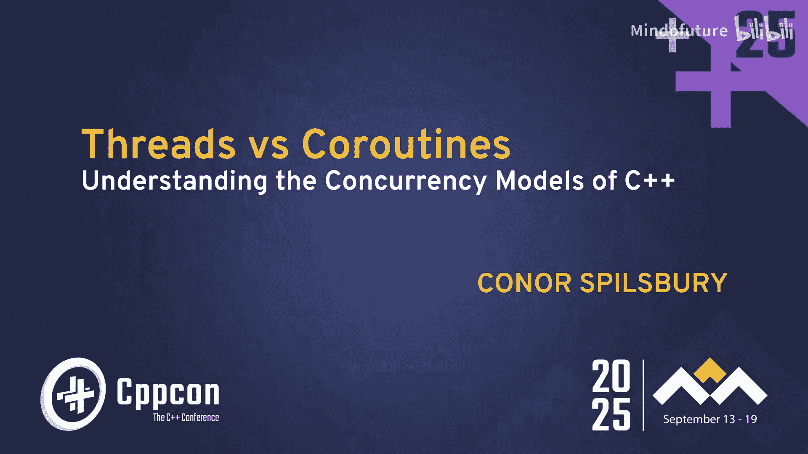
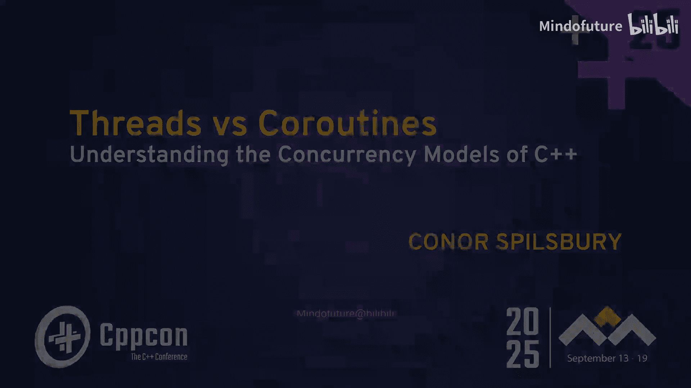
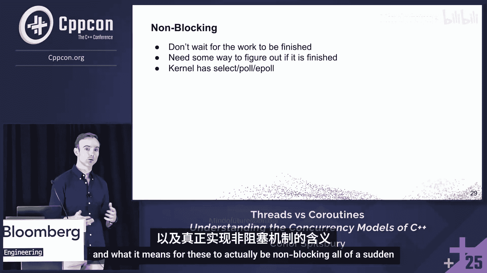

# Cppcon-2025-｜-C++-｜-C语言--｜-汇编-｜-编译器-｜-操作系统-｜-Linux-｜-Windows-p01-P01_线程与协程——为何C++拥有两种并发模型-Conor_Spilsbury-CppCon_2025--BV1wyPBzrEeu_p1-

🎼All the presenters， everyone that attends this conference is so friendly， so willing to teach。

 so willing to learn from you too， so it's not just watching these videos。

 it's kind of getting that insight afterwards and around at dinner at drinks。

 like all the other aspects of the conference besides just like that technical information。😊。

Okay， then good bus， so I think we should be ready to get started。

My name is Connois Spllsbury。I work out Bloomberg and I work on a group of teams with high volume client driven applications。

As I've been in design discussions around these applications。

 it's not always been clear in these as to what our application actually needs to look like to handle the amount of work they need to go and do。

😊，It can become a bit of a puzzle at times。And can take some discussion to actually work out。

And so if we understand the foundations of concurrent design。

We're all going to benefit from it and we're all going to be able to use these tools much better。

And so today I'm generally going to approach this as if we were working together back at the office with a whiteboard and we're all just diagramming on it。

 standing around， discussing things。😊，It means heavier illustrations and diagrams a little bit lighter on code。

😊，And so that does mean that this talk， it's not going to be a complete reference by any means。

 we're mostly going to focus on the behaviors of threats and courage in。

But it's going to give you the jumping off points for when you encounter some of these in practice and you need to go and dig deeper。

So that when you're faced with an application that's receiving thousands of simultaneous messages or like an application that is constantly making external IO or to get some data or just crunching that data。

😊，We're going to use that to go and look at how far can we actually take multi thread。

Or then have a perspective shift and look at。嗯。in which we'll go and lift scheduling out of the kernel and back up into our app itself and what we need to do here and where coine are going to help us with this with Proed multitasking。

😊，And we'll have understood that the type of work that our apps are trying to do matters and how the shape of our problem is going to impact what we use between threads and curtains。

 and taken together this should all give you the intuition as to the behavior of the concurrency we'll see in our applications and how to adapt to the shape of our problem。

😊，So。Let's say we are going and designing our application。

 we're standing around of the whiteboard or we're already going and writing our code。

Probably the first thing we're going to try if we know that we're going to have to do a lot of work is just throw threads at the problem。

It's going to be what's most familiar with us。And we can go and create the thread for the message。😊。

We have the number of threads on the X axis here and we can go and plot that as we increase the number of threads。

 our throughput so I task is going to just increase fantastic， easy。😊，Job done， high fives around。

 call it either。But na， not so fast。We're engineers with thinking about scaling here。

 We need to see how far we can take this before this is something that we want to go and release the clients。

 we probably want to stress test this， see where those limits actually are And of course。

 we're only a couple of minutes into the talk。We're not just going to end here。So let's keep going。

 let's just add more threads， keep going， see what actually happens。😊，Cool， something happened。

That througher that was scaling so nicely hit this inflection point。

 and it's not just a plateau or diminishing returns at this point。

 it's actively getting worse were losing performance。😊，So we can add thousands of threads。

And end up bispinging no better than if we only to use few threads。So they think about this。

Why is this something that we see？Well， let's start by going and looking at where our applications running。

😊，We're up here in userspace， this is going to be a sandbox environment。

 it's isolated from direct hardware access and is where our code can execute but can't directly touch files。

 sockets or physical memory。😊，When our code needs to access any of these things。

 we have to go to the kernel。😊，And that's the same when we create a stood thread in our code。😊。

There's a lot going on underneath that call itself。

We're actually going and making a request to the operating system。

Which is going to create an OS thread for us that's going to be managed by the kernelnal itself。

At this point， we need our threads to actually run somewhere， we need some hardware beneath it， CPUs。

 GPUs， whatever。If it was as simple as having an individual thread per CPU， then this would be easy。

😊，But in practice， we're always going to have more threads than hardware CPUs and hardware threads available to run。

And that's why the kernel has a scheduler。It's responsible for taking those threads and getting them to run on our actual hardware。

😊，And it's great for making it look like lots of things can be running at the same time。

 like we've spent many， many years with single core machines and still user interfaces trying to do a lot。

 was doing a great job of multitasking。😊，But this does break down when we have a lot to do。

We've given the responsibility of scheduling to the scheduler。

But we need to know when to take math that responsibility as well。And so。At any point in time。

 these threads can be in one of these states， they can be actively running on the CPU itself。😊。

It can be run a bull just on a queue on the CPU waiting to be picked up and to be run。

Or it can be blocked， it'll be in a weight queue somewhere， it'll be off the CPU itself。

 somewhere else， just waiting for the resource to become available。

And it's the scheduler which is going and moving the threads between these states。

 it's deciding who runs when and for how long。😊，And so there's a classic example of this within our application where we can create two threads in our application one after another。

 thread A， thread B。😊，From our perspective， it looks serial， which is created them one half another。

 but as soon as we've created them， we've passed that responsibility over to LeCne all over to Lechededa and that's going to decide which one is actually going to run。

😊，Not just first， but also it's going to go and determine whether or not there should be any interleaving of execution。

But you could start first。 It could stop。And then， A could run。And then we could go back to B again。

And that interleaving。Ist it called context switch？And it comes in two forms。We have preemption。

Which is what when the kernel is going to make these decisions for us based on， for example。

 time slicing。And then we have voluntary， which is where it's driven by our application and our decision to go and block on a resource。

So taking these one at a time， let's start with preemption。Scheduls， such as like Linux's CFS。

 completely fair scheduler， they're trying to aim for some baseline fairness。

 it means that each thread is going to get some amount of time on the actual CPU itself。

When the thread's time is up， this Je is going to perform a context switch。

 we're going to switch to another thread。And that context which is going to go and store the state of that thread and he register any state associated with it and then have to go and load the state of that next thread。

😊，This is concurrency。It's that interleaving of work， we start one thread then before it's complete。

 we switch to another vice versa， we've got threads being swapped in and out。

This is where concurrency comes into our actual scheduling itself。

And think about what will happen if the number of threats we have just explodes like we were seeing on that diagram earlier。

😊，If every thread needs time to actually be running on the CPU and is's going to be some sense of fairness to make sure that each one does get a bit of time。

 the more threads we have， the more context switching we're going to have and experience as each thread tries to get its own go on the CPU。

😊，Let's look at the second type。Blocking on i o。就。Imagine we have this function， so with'll read。

You don't need to know how it works or anything， but it's just trying to get data out of something。

 in this case， a file descriptor。When a thread calls a function like this。

 which blocks until that data is actually available。

The scheduler is going to mark that thread as blocked。When it does get blocked。

 it's going to get taken off of the CPU itself and it's going to be put over into a dedicated weight queue for that resource。

😊，Meanwhile， on CPU is originally on， something else entirely could be running。

 could be different if they're at a different job。Eventually， when data is ready。

 the kernel is going to go and wake up after thread again。

And so at that point it's going to mark a thread onable， it's going to add it back to a queue。

 and then at some point that's going to be picked up on a CPU again。😊。

And note that it doesn't have to be the same CPU as on the foot， it could be a different call。

Now if the data had been available immediately when we first tried to get it。

 then we just return immediately， the thread wouldn't block， we would just continue as we were。

And this is really where what cost is really coming from。😊，The operating system。

 it can only handle so many threads before context switching and the overhead starts to dominate。😊。

We're just wasting time creating， destroying threads for short lived thread， short lived work。

If every message was to get its own stood threat。😊。

We're going to spend just a considerable amount of time context switching instead of actually doing work。

😊，This is over subscriptionion。We're trying to do too much with too little。

So what can we do to try and prevent over subscription。

 something to constrain the number of threads we create so that we don't go past that inflection point in nano graph？

Well， that's why we have threats。When many threads are becoming runable together。

 the colonels deciding who runs where we start having threads competing for CPU time。

We can start to fix that by limiting the number of threads we have at any point in time。

Often fixed to one thread logical CPU core， but can be more and some thread poolers even have a great policy。

We push work items into acute queue。Then workers in that thread pool are going to pick up that work and execute it on our court。

In this way we can multiple all of the work we want to do in our application or the many tasks onto a smaller number of OS threads。

😊，In doing this， it means that we're limiting the number of runnable threads at any point in time。

And therefore， we can prevent over subscription。 We've moved from hundreds of threads being able to hundreds of threads competing to just end。

Thread's busy and then a queue of tasks behind them。But of course。

 we've still got the same amount of work to do。Just a few threads to do it on now。

So we're going to be nowhere near the same level of threeput as we were before。

But we've amortized the cost of threads by reusing them and bounded the number of threads to control the actual resource usage。

 but we've made it so that only n things can be in flights at any point in time。

Because not only do we have a fixed set of threads running on a fixed number of core。

 but we're now no longer getting the same amount of concurrency， we bounded our concurrency here。😊。

Previously we were having all of this interleaving going on。

 the scheduler was going and taking responsibility for that。

 making sure that each task got a fair amount of time to run。😊，And this is critical route。

 like threads are a great for providing parallelism up to the number of chords。

 and then we get some concurrency beyond that because the schedule is going to preemptively start switching tasks in and out of those hardware threads。

😊，We've just seen the problem is that the sheding starts to slow us down。

 and so the thread pool helps us stay below this。 But at best we're just going to hit that throughput peak depending on what values we set and prevent over subscription at worst。

 We're pessimising the amount of work and the amount of concurrency we can actually achieve。

Our problem fundamentally requires us to scale beyond the inflection point size of a throat pool。😊。

And so we've lost something yet that smart part of preemption that Shedman at the colonel was doing for us。

 That would let us have many more things in flight。 We would start one job。

 if would switch out to another job when it was ready。 Instead， in our threadpo。

 we have a couple of things in flight and then everything else in a key behind them。😊。

And this is like really important， so I just want to take in my matic。😊，Get these definitions down。

Paraism it' all about multiple tasks running at the exact same time。It tends to be a hardware thing。

 So they're going to be running at the same time in different courses。Concurrency。

 it's about multiple tasks in progress during the same time period。

 but not necessarily running at the same instant。😊。

And this is achieved by interleaving that execution， that time stising we was saying。

 we can start one task while it's in flight before it's complete。

 you can switch over to and working on another task。😊。

So we solved our O subscription problem with our threadpo， but now we have a concurrency problem。😊。

And up to this point， we've been delegating the responsibility of scheduling to the kernel scheduler because it is often good enough。

 we can get a very long way from it。But if we want to be able to go and handle more complex use cases and handle more volume perhaps。

 then we need to look at what we can do to take back more of that responsibility。

 bring it into our application and make our applications do what we need for the scheduling aspects。

With a thread pool， we don't know when things are ready。

 we have to wait for things to complete before we can process the next message。

So what else could we do to try and solve that？Event loops are w brick。

This is the start of trying to lift that scheduling out from the kernel and into our user space into our application。

Instead of the OS managing threads。Thousands of block threads or our threadpo。

 we can instead in our application， again， multitask， many tasks。 But now just on a single thread。

 which is running in a loop。And you may have seen these in places where you need massive numbers of connections cheaply。

 something like No JS and Gen X， who sta you they all do this。Because event loops。

 they're just a single loop in which we're waiting for something to happen。

And then dispatching that to something responsible for going and handling that。Once it's done。

 it returns to waiting。The goal here is that we're trying to do more work。

 but without the thread doing the scheduling for us。

We want to take on more responsibility as it could be cheaper if we do ourselves and relying on the scheduler to do it for us。

And so we end up with a queue of ready tasks in our event loop。Just a quick slide piece of code here。

 but we end up with， yeah， we've got a queue here and we have some function running on a thread which are just popping tasks from the front of it。

 And these are all small non blocking work。There's no waiting。But with the event loop。

 we're trying to get that feedback feedback loop in place when we move to a thread pool。Well。

 we started to lose and we couldn't have more work in flight。

We don't want to put something on a thread until that's actually ready to do some work。

We need some way to indicate to the event loop that our task is ready。

 that is if you go and take me up to the queue， I'm ready to immediately continue。

 I'm ready to immediately go and run。Actually， if something useful to do。So instead of blocking。

 we can go in， for example， RC operating system， please tell me when this resource is ready to use。

And readiness means that the operating system is guaranteeing that if we go and try an operation like reading from a socket。

 it won't block。 There's data waiting。 It was soon as we try and read it， it's going to be there。

 remember our threading diagram familiar as it went through the different stages and saw the thread get blocked。

😊，This is exactly what we're trying to avoid it。 We're trying to not have to pay that cost of waiting in our application。

 Instead， we're going to wait for something to tell us when is that socket ready and when can we start reading from it。

And so the event loop is just a thread that is repeatedly asking the operating system what is ready right now。

 then it dispatches the corresponding callback to actually go and pass it to the handler and then it goes back to just waiting for another event to happen。

If you want to learn a little bit more about exactly how we can turn things from being non blocking and readiness and all that。

 one of my teammates at Bloomberg， Philip Gilman， he gave a great talk at ATC a few years ago calledWhat I Learn from Unix Sockets。

😊，Hi， you recommend it。But。Well， non blocking I avoids idle blocking。

We're now forced to express our program with Kvax and all of these handlers。

We're no longer writing code and straight line logic anymore。We've got callbacks。

 things that the event loop is going to call later。And this is the trade of。

We've taken with taking responsibility from the scheduler back into our application。

We've been relying on the kernelel to be smart enough to recognize what we were doing and yielding our threads in the past。

 But now that's something that we have to be doing。

 And that's why it's so important that what we're calling is non blocking。Remember。

 this was one of the problems that we had with the threat bull。

It removed the smartness as to when we started to bound our concurrency。

 and we no longer had that preempting。And so we still need something which we can go and get a signal back to our event loop and say。

 hey， I'm actually ready to go and schedule this because there's something useful that I can go and do。

😊，And that's something we're going to have to go and do ourselves now in our application。😊。

And that's where cors come in。😊，They're going to let us write blocking looking code without actually being non blocking under。

😊，So let's dive in。So what even is a character。Well。

 the typical definition is it's a function that can suspend itself and then be resumed at a later point。

So in C++， we can do this by coaing something。This is going to yield until the underlying thing。

 they think read in this case is ready withs some data to get out of it。😊。

At which point when it's ready， we can then resume again and continue from where we left both。😊，And。

Let's remind ourselves ourselves of this diagram familiar， where our application is actually running。

We've seen how preemption can reduce our performance and really any time we go from our application and cross this boundary into the kernel。

 it's an expensive system call， so the fewer of those， the better。😊。

We want to experiment be able to express everything up in user space。

And so with kotes looking a little bit like functions。

 let's start by going and looking at just how we call regular functions。😊，When we do call a function。

 we get a stack room that's going to contain things like the parameters for that function。

 local variables， snapshot of any registers。T an address frame points it。

the lifetime is tied to the stackt frame itself。Once the function returns。

The frame is poppedpped off the stack。いつか？But see plus plus 20 curoteines， they're Stas。😊。

There's no separate dedicated stack， like an ordinaryary function that we've just seen。

What this means is that on our first call。We're going to get a curine frame。

It's a heat allocated object that's going to hold our local variables or arguments。

 and most importantly of all， this the su spend point where we're going to actually resume from when this gets called again。

😊，And in turn， we get a cor handle in the place where this has been called from。

In that curine handle， it's just a pointer to that curoteine frame。

And so once we've gone and we've done。😊，That curoteine frame is' going to go and live on。

 even when the curoteine is suspended。And this is where tasks， promise types， waitables。

 all of these things come in。I'm not going to go and go into any of the code of them here。

 but Deep Marco， he gave a great talk at ACCU one year again on implementing the promise type and I highly recommend that for understanding the machinery here。

😊，Our cur frame itself。Just really going to hold some value。

 which is then going to tell us where to resume the co routine from when it resumes That's the whole state machine parts of this if you've evert heard that in。

Reference to kotes。And this means that。When we are going and suspending。

 when we're going and moving from。Um， one quaoteine to another or elsewhere。

 we don't need to go and save CPU registers， kernel stacks or deal with switching threats like we were before。

We're just storing the current instruction position， returning control to the cooler。

And resuming is equally cheap， we're just jumping back into the。Into the frame itself。

 it's all comparable to just calling a function。Vastly cheaper than effort to deal with the threats and the context switching。

And it's all up to us when we go and run our kote team as well。

 it's not something that we have to wait for the scheduled look to go and decide when it runs。

It's up to us。And just to try and draw a parallel to what we had before。

 the scheduler in the colon was going and being responsible for taking our threads through these states of running to block to spend them back to runable again。

Atcurotes， we sort doing a little bit of this ourselves。

 just as now it's us doing it in our application as we're going from running our curoteine to dispense to suspending it。

😊，And then marking it as reumable。 at some point， I'm going to be adding it back onto a queue。

And so if we go back to our event a Luke familiar， this is roughly what it might look like in the actual calling code itself we。

Even loop been main and we're just posting some work， which ends up in the queue inside of it。Well。

 this is how we can just simply schedule proteins as well。So if we start at me。

 we've now got something which is calling our katine function。

 and it's taking a reference to the loop itself。Inside our coine function。

 we're going to coate something。 It's waitable。And that's going to suspend the current。

In the meantime， the event loop is going to keep on running。And we have this awaitable thing here。

 which is it's going to tell us what to do when our curine is ready to resume。And so in this case。

 where it's taking a reference to the loop。This is suggesting that， okay， when it's ready to resume。

 it's going to be put back onto the queue in that event loop。

Now not all proteins they don't need to be expressed this way。

 it's just like an example for illustration in terms of how to scheduleulum。

 like in practice libraries like CPP， Coo， folly， Ao， they are kind of doing this for us。

 they're doing they've got their own waitable types and。😊。

There were just treasures like there robot that's all they're really doing。

 they're just an example of having gone and moved that scheduling from the kernel up into our application。

And so this is combining like the non blocking scalability of event loops。😊。

While still having the straight line readability of threat。But what's wrong with this？

I shouldn't have left the co weight on this slide， but。

We've already seen that for our event loops to run successfully。

 that we need to have non blocklocking APII calls where we dispatch some work and eventually we get a result。

And that's exactly the same execution model we need here in a Cur team as well。LikeRemember。

 one of the things we have lost from moving from the scheduler and moving that into our application is the fairness aspect in which previously it would be the scheduler would go in context which jobs offer the CPU to make sure that each thread had time to run。

Now that we're show this in our own application。There's nothing to do that for us we have to make sure that we're all playing nice that all of our participants or our tasks are going to be being fair as well。

 they're not going to block the event loop。There's no preemption。

 nothing's going to stop them from discontinu continuallyly running。

And so what this also means is that the type of work we're trying to do is going to matter。

If it's something that's going to execute without yielding and take a very long time to run。

 then it's just going to hold up for the work。That blocking call for our cooteine。

 if it was something that was CPU having and running for a long time， it would just block tasks。

And we can generally categorize the types of work into two things，'ve got Io bound work。

And CP Bo work。So for our IObound work， this is all where bottlettleneck is just waiting for data from outside the CPUU itself。

If an application was just doing everything serial， just one after another。

 then the amount of time just spent waiting would be cumulatively adding up。

 while one message is being processed， our application would just be sitting there not doing anything。

Be waiting for a response。 And meanwhile， other applications would just be stuck behind this one。

 waiting in a queue before even being run。But with non blocking IO。

 we're thinking about how can we make better use of that time we spent waitinging and that's where proteinss and non blocking are perfect fit。

With the CPU itself， it's not doing much work at all。 It's just the stalled。And so for example。

 this could be reading right into a soet that example we saw earlier that was blocking。

could be waiting for a database query to complete， or it could be calling a remote API over the network。

 any of these things that just rely on our application doing a lot of waiting。

Eco them to really excel here as they can just coerate the IO application operation and instantly and cheaply suspend until data is ready without wasting CPU cycles。

😊，And so we can go back and compare that to our threads from the floor。😊。

We've still got logical concurrency on the X axis here and the throughput， essentially on the Y axis。

Whereas threads had the inflection point and started losing performance relatively yearly on compared to this。

😊，Carotes just are far and away， outpacing them。But notice there's a very interesting caveat here。

We mentioned that threads work well up to a certain point at which the overhead comes too much and we ever subscribe to the CPU。

Well， look out for a sufficiently small amount of logical tasks。

 the performance between threads and curoteines is actually remarkably similar。

The throughput increases at the same rate。And I've intentionally not put any values on the X axis。

 since I don't really want to open up Pandos box as to well what value is the inflection point and what you'll be using when。

 but it's going to depend on like your own machine and how much else is going on。

 It's generally going to be in the hundreds， if not in the thousands。And at some point。

 there is going to be that switch from where threads work best to where co geness are。

And that's because we took all of that expensive stuff that the colonel was doing。

 and we're now doing that ourselves。It does mean that there is going to be an inflection point for curoteines at some point。

It's just now that that inflection point for kotes is so far away because it's so cheap to go and have a context which incurotes。

And I should point out in this graph， these curings。This is just a single threaded whiplip as well。

 There's only one threader。But we could also contrast this to if we were to try and do CPU bound work without that curs。

Really， there's not much difference between threat and carotes on this。

 we're not going to gain much performance at all because there's not really an advantage to going and using them here at all and in some cases。

I think the performance had actually end up being worse。And so that's where with CPU bound work。

We're still going to need threats。Thread pools and the bottleneck is just going to involve computation。

 we're going to have to have a threads getting dedicated to time on the CPU just to keep crunching through data and run。

And so this could be things like working with large memory。

Data sets or passing or compressing a large file。But in practice。

 probably end up with applications that have a little bit of both。

 we might have coine which are going in doing some IO operations。And then at some point。

 you might go and hand that off to the threshold。So we might end up something like this。

 we'll have we'll be co weight on some IO。Then we might take the data from that the result we get and go and schedule that on a CPU。

 perhaps。At that point， when we get result from that， we can go back to doing Iu again。

 we can chain things together and this way。And that's why I wanted to also mention in C was 26 and stood execution here as well。

This isn't the talk to into details of Asec itself。

 but it's one of the things we get from because our applications。

 we do have a mixture of threads and curoteines and we need to express where we want to schedule the work and how we want to schedule at work。

It lets us compose IO bound work and CPU bound steps in one pipeline。

 making explicit where each piece of work actually belongs。And because koteine themselves。

 they don't know where to resume。The executivecut's room stood exec on there letting us say。

 when I'm ready， resume me on the right resource。That's how we can avoid accidentally ending up doing CPU work on our event loop thread or spinninging up the thread just to wait for。

And so， to sum up。Threats， the great when。哎Well。They're Great for CPU bound look。

 the OS is going and deciding which threads to go in ro on which CPU。

They're a necessity for parallelism， we're going to get parallelism up to the number of cores we have and then beyond that the schedule is going to start introducing context switching and we're going to start getting some concurrency from that。

The result of that is。That they just don't scale， and they're expensive。

And so that's where we start to see more of advantage from our curs and from using curins。

Because we've taken responsibility for that scheduling， brought it back into user space。

But we've had to make sure that。Everyone's playing fairly。

All of that complexity that the scheduler was doing for us and all those responsibilities it was doing。

 we've got to be going and implementing that ourselves。😊，And that's where。It's all cooperative， said。

 we need to be the ones making sure that tasks are yielding。

And ultimately the glue to go and put that together on the current inside is where we have how executives and church of us like our event loop and more complex patterns as well。

😊，And that's everything I had。Final things on here， Bloomberg is hiring。

 my team itself is hiring as well that's the second Liberg I'm also very proud at Bloomberg to be part of our internal C fors community。

 It's a fantastic place to be with some fantastic people from all corners of the company and we recently published an article on our blog as well discussing that community so feel' free to go and take a look at that as well。

😊。

Yeah， thank you。Any questions。一这个的。Over the scheduling。I well hit。要。スけ。

Some of the examples that I found。Often come from when we've tried to。

We've tried to give something too much responsibility。

 so a function might have started off small and it might have had a very specific purpose and what it was trying to do over time as the needs of the application has evolved and it's just doing more it's more complex。

😊，Things start to creep into that function a little bit more。

 it start trying to do more in that place just through convenience。

 that's where data is perhaps that's where things need to run。

And so it tends to be that sort of scenario where I see in practice where something that was originally。

Well all behaved has over time slowly degraded is more and more has been added to it and it's one of these things that occasionally have to keep in check and make sure that we're maintaining good quality code and everything。

😊，There's not a static way because all of this is going to be run time depending。It could depend on。

The sort of abstractions you've got in your code itself， though。I think if you've made it very。

 if you've got very clear abstractions and delineations in your code as to where you hatch are scheduling some sort of CPU bound work to any like IO things or you're making all of your code go through a standard IO handler or something in the same for CPU work。

 then maybe you can get something which you're going actually definitely check。

 but for the most part， I think it just takes discipline。Just like。So you had。's right days。最初。是。这た。

Right。So for that example， it was。I think that we're still going and just creating threads and leaving them run forever Well。

 not necessary forever， but until their work was actually done and it's just a fact that at a certain point once we keep adding threads because each one needs to go and get time running on the CPU。

😊。

It's going to take longer for that piece of work to actually execute。

 so the thread and lifetime is just going to get longer longer as it has to wait for everything else first。

で。Essentially， you had。Single breath。Maade right。算。just like。Makeま。

Absolutely yeah they're so cheap to go and create the same cost is like a function call。

 so that's where we get so much more scalability from our curs cheap to create very fast We don't have to pay that overhead cost as well At some point we will start to see an inflection point like we did at the threads but it's just so far out there。

😊。

Couldn't fit up the same graph。I keep very up。For basically switching between nerve routines。

How are you in chat？Very easy。Yeah， yeah。Specifically because you more sandwich。就这样。

It's a great point。Definitely go to Michelle's talk after this to learn more about caching。😊，Yeah。

 this is one of the things like as we are going and running jobs on one cache sorry on one core。

 any data that we need is going to be pulled into the caches specifically for that core。

 but if we're going and well firstly， if we're then going to go and block on that thread。

 we could end up running on a separate core afterwards where whichre is not going to be anywhere near that cache but also in place of that original thread for example。

There's going to be a new thread running， even if we're just going and preempmpting。

And at that point， there's going to be some cache ratioing as well because we're going to be them pulling in the data we need for that thread。

And so you can work around that。With being able to go and， for example， pin threads to certain cores。

 or at least make a strong suggestion that， okay， this thread should always be executed on this core and you can use your。

Threadful to go and get a very long way with that。With cooteines。

Because we're generally going and multixing a huge amount of these onto a smaller number of threads。

😊，You're less like to go into the case of like a cur and that's thread being on a different CPU。

 still entirely possible。But I guess you trying to go and。Pin it to a certain CPU， generally。

But we're going to have so many of them that we're going to be。

Your cash and performance is going to be like the same it's going to be going and just having a huge amount of data going in an now any point in time as well。

😊，Great talk。 Thank you。 Just wondered， are there any need。

Standard library features that would help you make co routines more usable or improve。对。

Today execution。PR has its task。That is that is the main thing that is going get us there for it being more all this part of the standard itself like stood execution。

 the things that tasks coming in C+ 26 before then we've got libraries like CBcoro Folly。

 Aio and like Bo Covat are great as well they can do a lot of lats for us at a certain point we need these types。

 but we also need the scheduler itself and so these these libraries are going providing both the types。

 the tasks， promise types， everything and then also all of the schedulers like the glue to go and go up to go and say okay where should this be running？

😊，And where should it be resumed， so on。Thank you。😊。

Thanks a lot for the talk you mentioned that proteins are stock and that the protein pregnancy heat out。

 but also that proteins are very cheap。You also have to consider the cost of that allocationation in spawning your protein versus just a rate。

Yeah， it's a good point。It's a very small heatap allocation， so in practice。

It's not a huge amount of overhead to it And there are ways to go and try and optimize that a little bit more。

 so already going and having a dedicated texture of memory， which you can go and pull from for that。

 there are ways in which it can be alled as well I think it's sufficiently Venetian rare that it can be alllighted that off the top of my head I can't remember the exact criteria for it。

 but at a certain point。And the same with like threads as well， like memory is going to come into it。

 I think with threads where it's like each stack as well like。😊。

makega bitete or something with kotes， they're going to be so much cheaper because that frame just needs to hold a few pieces of data。

 just like the where we're going to resume from and any local variables that need to be kept alive throughout pausing。

 suspending our koteine and then when it was resumed again afterwards。H。

Thanks for talk so you follow like the presentation。Would。just smell work。

So we address the problem and increase it。was。あウ。Pll up on the third and then throw crewies of the whole in the cens that we get gotten much better。

So the past， so if we assuming all the IO API would use a thumbvol。Is there still a value in having？

So the real that's a single threat。Most on like what really。Here。Yes。No， it's a great question。 Yes。

 we will still start to see some increased performance。

 So we have our curine teams running on their own pool with however many threads as well。

 It's not exactly going to go and like。😊，Double this， so it's going not going to be exactly like。

Yeah， twice the size of this line is twice a throughput。

 I think I did have a graph on here in this talk at some point where I was going up to a thread called of size 8。

I think I deleted it so I don't even have that if I go back and exit the slideshow to see if it's still there but yeah there's definitely possible as well it's not going to give you huge improvements in your actual throughput itself and I think from the most parts。

😊，A single thread will get you an incredibly long way before you start needing to actually deal with that。

 but if you find that your application is going to go and need that then by the names。😊。

Also talking up this graph。C。What was actually running in these code like what is being tested？

So in these proteins itself， I was going and making some cool。

 which was then going and going and yielding。And then going and。Having another call coming in。

 going and trying to do some work， which and then going and yield again。 So these kotes themselves。

 they're just constantly going and kicking off something， kicking off some work and then yielding。

 going back to our event loop， letting a pick the next event and then eventually at a certain point when that data is ready or that event is ready。

 they're going to come back and continue again。O， so。Were they actually like blocking on our？

喺 guess你都唔会办。Right， okay。Great talk thank you， what are the implications of hers being staless？

Do we not get access we end up popping up and the staff and then resuming？

We use access to data that was on。嗯。It's not necessarily about losing data that was on the stack itself。

 if there's anything that the koteine frame itself needed to continue execution。

 then the compiler would really make sure that that is safer than that katine frame itself。

There are implications in terms everything from like memory usage it's come with the same stack it's going to be more expensive。

I'm going totentively say that I think the performance are still generally pretty similar in terms of what you'll actually see。

 It's been a while since I've gone and probably benchmark two in comparison， but but yeah。😊。

Thank you one more question， are mechanics exposed also potentially？By additional。

It is there ability you can do that out？So this is one of the big things with C 20 curities。

 And I think one of the reasons why there's been so many talks on just heres how of write a promise type and everything is' because they're so customizable。

 That's I think， where a lot of the。Complexity and sort of like intimidation factor of them comes from just the fact that there's so much you can do to customize how they behave and at the moment of we prece verse 26。

 it's stuff that we have to implement ourselves。😊，Once of the emerge。这候。It's almost like a step。

 So you add one and。当时。Just子。We。What are you referring to Sir？Its a。Fs。Yes。

 so if you look at the drop the。Between these two points， it's also a step function。

Which means that we essentially have one。One。嗯。再少啲。And I'm just wondering how it wise up。

In the case of like the actual rate， which is， it's increasing。😊。

Yeah， you look like a step function so there's some dis。Probably。You N to impulse one。

 And then you can see it jump。Yeah。我敲他了。Like can。You know， the infection point。

 and I can understand that the point。 but this seems relatively consistent。フス。

So that could be things like， I mean， earlier that was mentioned of caches as well。

 this could be just a little bit of noise in the data generally。

 I think it'd be hard to necessarily read。Too much into specifically what is causing that pattern。

 I think it's just going to be the fact that。Yeah， there's all of these other factors at the same time as well。

 like。The preemption in contact switching is part of it。

 but whatever else is going on is also going to play into it and add to those costs as well。

 like caching or anything else。被叫咗。I'm just curious who's providing。Are you commiting them？

So great question。 You can implement themselves them yourselves， but you probably you don't want to。

 You probably want to have some library or something which is going and actually wrapping them。

 There's a few。Functions that the actual kernel exposes called select poll and EpoL。

 which are all ways of going and registering interest， our application。

 registering interest on a set of file descriptors set of resources。And then。

Go us going away and doing our own thing。 And then the kernel itself。

When something is ready for those father scriptures will come back and let us know。And。Generally。

 the record number libraries which are go and take care of all of that for us。

 they're going to be implemented in some one of these。

 It's not something you should really have to to write yourself。 I think with all of this。

 like the more abstractions in in our code and nicer it's going to be to work with。

 But those are the underlying mechanics of it。 And I think are referenced here。My teammate。

 Philipy gave a talk on this a few years ago， it's on YouTube and I think it's called what I Learn from Unix Sockets and the premise of that talk is all about concept of readiness and what it means for the to actually be nonbing on the sudden。

😊。

Cool， I think we I think that's it。 Thank very much。

