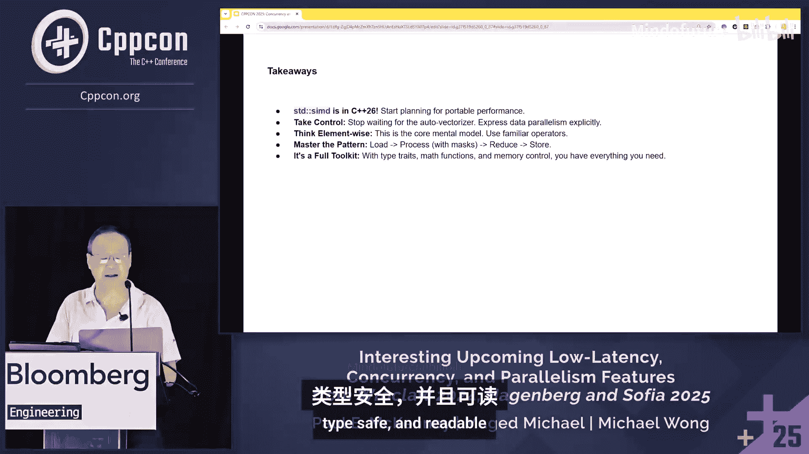
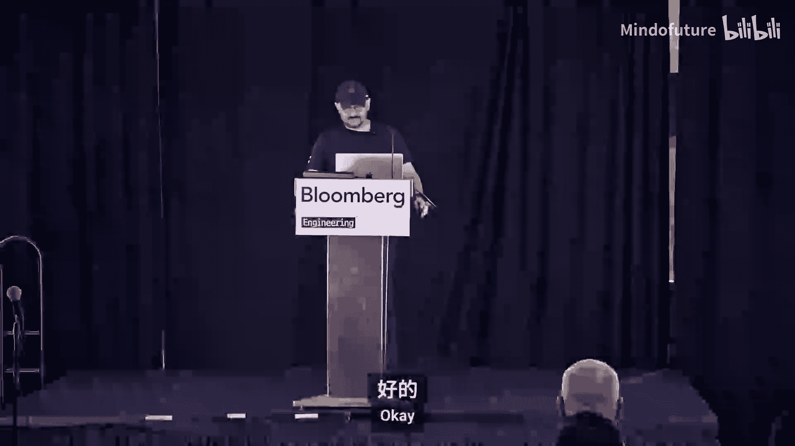
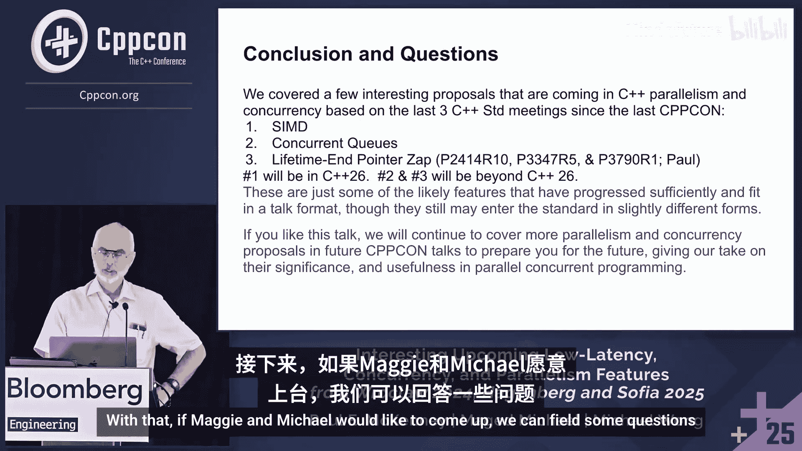

# Cppcon-2025-｜-C++-｜-C语言--｜-汇编-｜-编译器-｜-操作系统-｜-Linux-｜-Windows-p02-P02_即将到来的有趣低延迟、并发与并行功能-CppCon_2025--BV1wyPBzrEeu_p2-

OK。I think it's time。Welcome to this session of the interesting and upcoming of the interesting upcoming low latency。

 concurrency and parallelism feature session from especially the last three C plus plus standard meeting。

 The three of us have always been working very closely in low latency。😊。

Concurrency parallelism， ever since we've been together at IBM。 And this has continued。

 My name is Michael Wong， and along with my colleagues。Paul McKinney and Mag Michael。

 we're going to be talking about。These three things we're gonna cover。

 we pick these because they are interesting。 Some of them have a good chance of making it into a standard in the future。

😊，And they're quite size enough that they're good for a presentation。

So I'm going to talk about Cindy。 Mag is going to talk about concurrent cues。

 and Paul is going to come up and talk about lifetime endpoint to Z。 Now。

 the first one is already N C plus plus 26。 That's going to get being voted on right now。😊，Okay。

 the second one concurrenring cues。It's making a has made a lot of progress after being stall for many。

 many years。 and maybe it will enter the standard in some future time。

We think that theres a lot of room for growth because concurrent queuees is can be can be a big mess。

 You know， there's many different kinds。 And we welcome anyone who has suggestions about how to improve it。

 or even if they own about their own concurrent cues。😊，And lifetimetime Endpointers app。

 I know you've been hearing the story since 2019。We're finally coming to an end。

And the end sounds like it's gonna be something that is doable and understandable for a lot of people。

 Okay， so let's get into it。 Okay， so how many of you， I'm gonna talk about Cdy。

 How many of you have written platform specific Cdy code。Anybody written platform specific C code。

 Now， keep your hands up。 If you enjoy maintaining it across many different architectures。

 The key with is you enjoyed maintaining it。 Okay， a lot of ads went down fast for years。

 our CPUs have had these powerful parallel processing capabilities， But accessing them in a standard。

 portable way has been difficult。 which。😊，With C plus plus 26， that's about to change。 And today。

 we're gonna to explore how C plus plus 26 St Simdy finally frees us from the pound if that game。😊。

Now， here I had to really squeeze it down。 I've been working with CD for years because I used to work at IBM。

 then I work at Intel。 and then I， and then I did Ri 5 for a while。 So it 1997， M M X， SSE，1999， Uve。

 That's when I started。 Yes， I'm that old。 S that was the power PC generations。

 And then you have the SSE 2，3，4， then arm came in with neon。

 And then Intel AM M D combined to create what's called A V X。😊，A V X 2， finally， A V X 5。

12 has been the most recent。 And then， of course， the most recent variance of that is the。

The one from risk 5， which is called scalable vector extension， which is can scale from 1，28 to 2048。

 Fundamentally， a concept of C D has evolved significantly over the past few decades with each new generation。

 There's a widening of the vector registers and adding more powerful operations。

 C D library is this that we're going to talk about for the standard is going be designed to provide a portable abstractions over these different hardware instruction sets。

😊，So if you've ever found yourself staring at a critical loop。

 just hoping the compiler would vectorize it， you know the pain。

Auto vectorization is a fantastic technology， but it's fragile and offers no guarantees。

 On the other hand， diving into platform specific intrinsics leads to an unreadable。

 unportable mess and pound of depths。😊，We've always needed a better way with C plus plus 26。

 That way is here。 St， colon， colon， C D。Offers the promise of writing clean standard。

And portable C plus plus gets that gives you the explicit control over the powerful Cindy hardware that's inside every modern CPU。

 I know I get it most of the time I come up here for the last 2010，15 years。

 I talk about software parallelism。 for the first time。

 I actually driving home that there's hardware parallelism in your CPU。

 and most people are not accessing。 Alright， so here's the core principle。

 The core principle is still Cdy is simple。😊，It's just element wise operations。

 You create a SD object which holds multiple values。

 When you apply an operator like plus or multiply， that operation happens on every corresponding element in parallel。

 Here we multiply。 So fundamentally， the CD type behaves like a scalar。

 but every operation is on e to all the elements at once。 These are what typically call the lanes。😊。

We have stut colon colon Sim D of T， which gives you a vector of n elements of T。 We have stoots。

Simdy underscore mask， which gives you a vector n Booleions， typically from comparison。

 So the C plus plus code here， we multiply all four all four prices by the tax rate all at once。

 The key takeaway there is that you write code that looks familiar。

 but it expresses data parallelism。 comparisons are also element wise。

 and they don't return a single bull。 They return a Cd mass。

 which will use for conditional logic here in this case， we look at the。

 you know which one of these is expensive。 The first two are false， They're not expensive。

 The last two at 39，99 and 49，99 are very expensive， especially in today's world。 Allright。😊。

Working with different data data types is common。 the most important rule。Is to keep the vector with。

All the number lanes consistent。 And the key to doing that， ladies and gentlemen。

 is the rebine underscore。Cim D is your tool for doing this。 It lets you create， for example。

 an integer vector that has the exact same number lanes as your floating point vector。😊。

This is critical because operations between vectors of different sizes are compile time errors by using rebin underscore C D。

 You ensure your types are compatible， allowing for efficient conversions and operations without performance pen。

 So with coherence is the key to C D performance。 Use trades to create compatible C D type。

 So you have C D of T， or you could use native C D of T。

 which just automatically use the compilers recommended native width for type T。😊。

And then you can say photo。 you can say s D of T of n， which allow you to specify a fixed width of n。

Or you can further say re and underscore C D of T of U and V。

 which change the element type from V's type to U， but keeps the same width。

That's the real secret sauce here， okay。So。Now we get into one of my favorite topics。

 branchless computations， which is branchless control flow with C Select。😊。

When I was a young programmer I wonder the first thing we were told was don't use the if statements in a C D class。

 and what you could。 If you did， that would be very bad。😊。

So you can't use it because what it would do is it would force all of your parallel lanes down a single path。

 The solution， therefore， is what's called branchless computation。 So the traditional。

 if statements create branches。 So we use mass to fake conditional logic without branching。

 This is the S underscore select clause。 The pattern is。😊，First， create a mask with a comparison。

 then use S D underscore underscore select。It's the Cdi equivalent of the ternary operator。

It's just a question mark colon operator。It takes the mask and two values。 And for each lane。

 it selects from the true value。 If the mask is true。And the false value， otherwise。

 this happens without any code brancheshen， keeping the hardware fully parallel。

 blasting all the way through。So the next thing we got to think about is reductions。

 This is very common。 even one of in my days when I was CEO of Open MP。

 we were trying to figure out how to create the reduction operator。

 and it has exactly the same syntax。 So what happens in your workflow after you've done your parallel work。

 you often need to aggregate the result into a single。😊，Number， accumulated。

These are called reductions or otherwise horizontal operations。

 Stt reduce is going to be your primary tool for doing that。

 This is a classic example is a dot product。 You multiply two vectors， element wise。

That's the vertical operation。 Yeah， then call reduce on the result to sum all the products into one scalar。

 That's the horizontal operation。 What you do across。

 So the library also provides other common reductions， like reduced men reduced maths。

 as well as helpers to mask。😊，For mask， like any of to check if any lanes was true。

 So here you can see the all the typical reduction of the reduce。

 which is a general purpose tool for some product， reduce men， for finding minms。😊。

All of any of reduced count of the mask， which says for analyzing mask。 Alright。Getting close。

 the syntax is actually pretty simple and very spae。 Find the， the last thing I want to do。 Yep。

 I think this is the last thing。 Second last thing I want to do is the memory that now you got to figure out how to get data in and out。

 which is talking about basic computer science problems here。

 So your data usually starts in a standard container like a vector or span。

 and the typical C D workflow is to loop over the data in chunks equal to the C D with the library provides。

😊，Los and store functions to move data between memory。And simply objects。

Partial load is important because it safely handles what happens when youre at the end of an array where you might not have a full vectors width of a data。

 You need partial load。 Make sense。So all this is just officially loading from and storing to memory In vector size chunks。

 You've got loading for Sd unchecked loads， for F chunk。

 partial loads when you don't have enough Storing Cd unchecked store and partial store flags give it a compiler performance hint like is it aligned is can you convert things like that。

 So this is the last thing。 and it's a superpower。 Its one of the library' killer features。

 You don't need to find special Sd opera versions of math functions。

 The entire C math library is overloaded。 S cosine square root。

 They all work outer the box with Cd types。😊，That's magical。 That's a superpower。

 because it means you can translate。😊，Complex mathematical formulas directly into readable。

 high performance C plus plus code here， we're verifying a trick identity on an entire vector of numbers at once。

 The result is a vector of ones， providing that the identity holds for all our data points。😊。

So does it work。Absolutely， the benchmark show consistent。

 significant speed up across different domains in and our hardware platforms using the exactly same code。

 This is from the paper。 image blur five times faster。 matrixtri multily， about five times faster。

 ray tracing， six times faster。 audio processing four times faster。😊，But there's an important caveat。

 power， Cim D units， especially wide ones， like A B X 5，12， are power hungry。

 runningning them flat out can cause your CPU to heat up and automatically slow down。

 throttle down to stay within is thermal lemon It just call thermal throttling。 Now。

 this is really bad because not only is it thermal throttling your your C D units。

 It's thermal thling all your other instructions as well， too。😊，You can manage this， however。

You if you find your application is throtling。Which will happen if you run S flat out for a while。

 not like for a blip or something like that。 Some toy test case， you have to control。

 You do have the control to request a smaller vector width。 That is the answer。 That is the solution。

 This lets you trade peak instruction power for a higher， sustained clock frequency。

Which can sometimes be a net win。So one of the big questions that people have always asked is。

 how does how do you compare CPUU C D and GP CT on C D， Now。

 I came come from the land of writing code for GPs heterogeneous computing。 So I can kind of。

 I can definitely give you a perspective about how there's the same and how theres they're different So a quick but important clarification。

 St C D is a CPU technology。 While GPs also use C D principles in the hardware。😊。

Their scale and the the software programming is called S T on top of C D。

 S T stands for single instruction multiple thread。😊，these are fundamentally different。

 CPUs are about using a few smart cores to reduce latency。

 Gs use an army of simple cores to maximize throughput。 So the key takeaway there。

Is that Cimdy is the right tool for accelerating tasks on the CPU for GPus。

 You're gonna have to go some to some dedicated framework。 We call them Kuda Seco。

 which is what I used to be the chair of， hip。😊，That's why you need those massive frameworks。

 So at the hardware level， you're right。The computational units of GPU cause are， indeed， C units。

Very similar in principle to those that are in CPUs。

The CT model is the programming interface that's built on top of this underlying C architecture。So。

 let's me put it in some。Anay， CPU Cd makes fast calls faster。 GP Cds。

Uses many slow cores to achieve massive parallel through depends on your use。

 The answer in computer science is almost always， it depends。They are not competing technologies。

 but rather complementary tools designed to solve different kinds of computational problems。

 The CPU analogy here。 Let me try it。 Think of a master chef in the kitchen。

 The chef is incredibly skilled。 He he is basically a powerful CPU core and can chop four carrots at once with a special knife。

 a Cdy instruction knife。 I love to see this on Amazon someday。😊，4 carrots chopping at once。

They can quickly switch between complex tasks， boiling some water and versus making lasagna。

 I don't know。 I'm not a cook。 And not and I'm not slow down。

 If one carrot needs to be handled differently。 The GP， however。

 think of a assembly line with thousands of workers。 A supervisor might shout one command。

 turn to screw and all the workers do it simultaneously。 The line is incredibly efficient。

 if everyone does the exact same thing。 But if one worker needs to follow different instruction。

 the entire group has to wait ba significantly slowing down the overall process。

 This proposal is designed for an optimized exclusively for CPU C and is not intended to serve as a direct programming for GPs。

 which。😊，Both architectures exploitd。While they both exploit data parallelism。

 the execution models are too different for single abstraction like C D to efficiently targetable。

 And these are some of the reasons why that architecture is different。

 So if youve experimented with experimented with the parallelism T， S。

 you'll find the final C plus plus 26 version a significant improvement。

 The APIs can simplify complex A tags are now hidden behind easy to use aliases。

 the confusing word class is gone。Replaced by a much clearer Cdy select function that I talked about。

 Nas are more consistent， and type conversions are safe by default。 It's a polished。

 powerful and final product。😊，Here are few best practices。

 Structure your main loops to iterate in chunks of the vector width。

Use rebinine at DiscM to create sets of types。That work together seamlessly always prefers Cdy select over branching It says if I haven't been that host。

Bad enough， but I will。 I will keep beating it。On the flip side。

Be careful not to mix incompatible withs。 The compiler will stop you and be aware of preconditions。

 especially for functions like reduced min index。😊。

Which requires at least one true element in the mass to be valid。So let's put it all together。

 This function applies a gamma。Correction to an image。 It follows the classic pattern。

 It loop through the data in Cdi sized chunks。 It uses Cdi underscore partial load to safely grab data。

 Even at the very end of the span。 It uses the overloaded power function from C math to apply the formula to all the pixels in the chunk at once。

 And finally， it uses Cd partial store to write the result back。

 This is what real world Cdi code looks like。 It's clean， readable and fast。

 Let's go through it little bit line by line。 Start the function signature gamma underscore correct。

 This defines a function named gamma underscore， correct， that takes two arguments span float pixel。

 which is a nonowning， mutable view of a contiguous block of memory containing floating point。

 Pixel values。😊，Float gamma says the single scalar gamma value that's going to be applied to all pixels。

 Now， we're going to do tight aliasing and broadcasts。The float V equals stewards。

 Col and colon and C D float。Says this creates a convenient type alias float V。

 the types S D float V， sorry Cd to float represents a vector that can hold multiple float values。

 The exact number of floats it holds。😊，The float V size， if you will。

 is determined by the compiler based on the most efficient register size on the target hardware。

 usually 48 or 16 floats。The con slow V underscore gamma equals gamma says this creates a constant S D object named V underscore gamma。

 The single float value。 gamma is broadcast across all elements of V underscore gamma， for instance。

 for example， if flow V holds four elements。 V underscore gamma is going have gamma gamma gamma gamma。

 This is required to use the gamma value in element Y S D operations。 Then we have the main loop。

 The four size。😊，I equals 0， pixel size I plus equals float v colon colon size。

 The last bit is important。 The loop anyways over the pixel data。

 But instead of advancing one element at a time like I plus plus it advances by a full Sd vector of I plus equals flow v size。

 This allows the code to process the data in large parallel chunks。 That's the secret。

 There's little bit more below。 Now we got the loading data。 I'm not gonna go to that。

 But notice that we have pixels subpan in thatd partial load that creates a new span that the memory starting from the current index I。

 Then we have the partial load that reads values from that memory location into a Cd object name pixel chunk。

 the partial in the function name is absolutely crucial because if the sub span at the end of the loop contains fewer elements and the Cd width the function is going safely load only the available elements。

 And initialize the remaining ones to0。 this prevents reading of array。

 Now we get into the magic of the parallel computation in one。😊，I haven't said you stood thread。

 I haven't used open MP。 I't used anything。 I said， pal。This is the one parallels processing。

 And power is one of the many Cmat functions that are overloaded to work with C D types。

 It performs the power operation element wise， applying the gamma correction formula to every pixel in Pix chunk simultaneously using the corresponding broadcasted value from V gamma。

 Then I saw the data very common pattern。 The partial store says takes the Cdy object。😊。

Corrected chunk and writes value back into the memory location pointed to by pixel subpan。

 And just like Sdy partial load， it safely handles the end of the array。

 making sure that it only writes the valid number of pixels per chunk。😊，I am done。

 So the big take show to summarize Cindy is a game changer for performance critical C plus plus low latency code。

 As long as you know the filmmo caveat， and it's official in C plus plus 2026。

 And it gives you the power to finally take control of your CPUs hardware in a way that's portable。

 Tsafe and readable。 Thank you very much。 I'm gonna invite my next colleague， Nagan Michael up。

 where he is going talk about。😊。

👏Thank you what he's going to talk about。What's going on with concurrent cues？

And there are so many of them。1 too， many， many too， many， many too。Well， hi everyone。

Can you hear me。Can you hear me？Okay， so I'll talk about the progress of concurrent cues in the committee。

 So the proposal for concurrent cues started almost like 10 years ago。

 and it was a lot of like twist 10 turns along the way but in the past one year。

 there was so much progress happening that there were 109 revisions in one year and the proposal progress to S you1。

 the concurrency started group and L E W G for the interface review and the next step will be the wording review。

 So it missed quite a lot of progress along the years along the past year。

So I'm going to go through what's the interface for the proposed concurrent queue and what features are supported and what features were dropped along the way。

 So there's a basic concurrent queue concept and these are the basic operations are what you would expect of like flavors of push that are know copy。

 move and construct in place and they all return true if successful and false if the queue is closed So that's kind of and they would block if the queue is is full and and then I will talk more about what happens with closed cues that like when when they are waitinging push operations。

The pop operation returns an optionality that is the type of the queue elements ands if it returns then nu opt。

 that means the queue is closed if it returns an element of type T then that's a success of the pop operation So these are like the basic operations for the more complex concepts of concurrent cus。

 there's a need for more complex status So of the one of the big parts of this proposal is to provide status in U of the Q states and of course one of them will be success that's like the expected kind of case but then an empty and full and closed are what you expect but then there are two more states that busy。

This one might be internal synchronization。 so you might like some operation might be blocked on an empty queue。

 but then an element gets pushed in， but there's synchronization happening to to actually complete that push。

 and then if you have a nonweighting operation。 It needs it cannot wait and that's where we can have something like busy。

 there's busy async， which I'm not getting into that too much detail。

 but it's probably will be dropped when theres more improvement in executiveecutor interface。

 So it's a problem of you're doing a nonweighting operation that will unblock an async operation。

 but that will involve scheduling and now you don't know that scheduling will block or not so you don't want a nonblocking operation to block So you enter your return busy async as in I can guarantee。

ThatThis will be nonweighting。 Okay， so we we'll get to these like states as we encounter them in the interface。

 So the next concept， the second concept is the concurrent cu concept。

 and that's kind of it adds it has a nonweighting interface。 So for that。

 you have different flavors of trip push or try in place and one flavor of tripop。

 and they all so the the push the push the tri push operations they return a status。

 So they return success on like when they are able to push the the element。

 and then otherwise they return different status if the the queue is full or busy or async busy。

The operation， the TriPop operation returns unexpected。

 so that can be like it's either expected of type T that's when it's successful or the unexpected is aQ status and so these don't include success。

 they include the other you know empty closed busy or asInc busy。So these are。

 this is the the non waitinging interface。嗯。Okay， there is the asynchronous interface and that there is like asnc push and asynnc in place for pushing and asyn pop for popping elements。

 they all return senders if youre I'm not going get into that much detail。

 But if you're familiar with the sender receiver model they all return senders that will eventually call a completion signal or completion call back。

 and if it's successful， it calls you know set value。

 So the push will will call set value voids as in okay it's successful。

 there's nothing to return other than you know that's like a successful state whereas the pop sender when successful。

 it will call set value T like you know the element of。

type T if the the closes if the queue is closed， then there's the the these operations they call set error and I'm getting to the close queue in in a minute so to differentiate between the different cases there is also support for cancellation they would call set stops set stop。

Close queues， there is a function close。 It closes the queue。

 the the model of like closed queue that is supported is just like once and it never gets reopened again。

 I mean， there were along the way there were you know under consideration options to reopened queuees and that was found to be too complicated。

 once a queue is closed， you cannot push in it， but use can still pop from it if it is not empty。

And if there are waiting operations that were blocked on。Like an empty queue or or a full queue。

 they will be unblocked immediately。 And then if it is a push operation。

 it will return false like as we removed from the the basic interface or if it is a pop operation。

 it will return unlock locked。 So that's kind of the closed queue operations。嗯。

One thing is about like failure handling the the proposal P 022 60。

 It takes the approach that nothing really an error as in like。

 it's difficult to differentiate between what is like something like， like say as a close queue。

 Is that an error to it like to say it's closed or is that an， you know。And， you know， it's， it's a。

 it's a failure of like pushing or popping， but it's not necessarily an error。

 So they that approach taken by the proposal and and this interface So a pop operation that finds the the queue is empty and close。

 it would return empty optional push operation that finds a close queue which returns false Tri push returns the Q state tripp returns Q state as an unexpected。

 if unsuccessful。 acing push and aing pop returns send that calls set error with a status。 then the。

For for exceptions the queue may throw exceptions thrown by the element type T if it does throw and move or copy。

 it also can if it allocates it can throw storage allocation as we'll see the only type thats supported so far will be the bounded queue so that will only be at construction time and also synchronization exceptions depend on whatever the underlying synchronizing technique so let's say there's a mus and deadlock detected then it could throw that otherwise it doesn't throw anything else。

嗯。So there is， so actually all what I talked about。

 there are like the concepts are they are not enforces except for the concrete type that is will be supported and that's for starters There is one one Q template that will be bounded and it will support all the three concepts that I mentioned。

 and the constructor takes a maximum number of elements。

 that's like the the bound of the queue it may allocate will it will need to allocate at construction time and that's the only time that it should that it may throw for。

Like bed alloc。 it will be。 So the， the， the element type is movable， copyable。

 but the queue itself will be not movable， not copyable。

There was debate about the memory order of the queue operations and。The。

 the committee decided that it's like。It's more important to be intuitive for。

 for the first kind of the first supported concurrent queue than to be high performance。 and。

 and the the rationale here is that you could get unintuitive outcomes like。

 like this case of basically have。Two threads they are both pushing into two different queuees and you would get the outcome。

 let's say it's pushing first in the main queue and then logging and say I pushed the number one and then another thread will say we'll push two and then it pushes to in that main queue you might get an inconsistent result with a release memory order that's taken from the paper or based on example from the paper P0387 that is like basically saying that to be in we have to support sequential consistency and the approach taken by the committee for now personally I think it's just as long as it doesn't shut the door closed on performance then that's totally reasonable decision。

So there were along the way， there were a lot of features that were abandoned and they would have complicated things a lot and probably blocked the way towards the higher performance and yeah。

So these were like allowed push front in addition to pushing back and pop front reopening close cues So it's kind of you might have that happening concurrently luxury in strict theoretical sense thats of a niche requirement that we don't want to impose that early on there was like streaming iterators where you can move elements from one queue to another and the storage iterator was like in aquiescent queue you would iterate over the elements there was like giving cus names and all these like got kind of consensus narrowed down to what I presented So in summary the proposal p0260 has made a lot of progress in the last year and if things go like if it gets adopted。

Will introduce the status in U of the Q states， three concepts exposition only and one concrete concurrent cu that satisfy the requirement of the all three concepts support sequential consistency and it leaves the door open for high performance down the line。

 I'll hand it off to poll in a second。Thank you。I have a favor to ask all of you。

And it's something really important。I need you to make sure not to tell my wife that we spent many minutes flashing the audience。

Yeah。Anyway， I'm going to talk about lifetime endpointers appap。

 and I guess we've had some zapping here。嗯。And I need to find the page down button or something to advance and like oh there we are。

 it just took its time and it'll take time and there we'll get there we' got three papers that we're talking about here。

 2414 is the original solutions paper and it is atomics and volatile。

 we'll talk about tightening invalid behavior。I can see it because I'm looking at my maggot's laptop。

I'll tell you what， you know we can do this。嗯。All right。

 did anybody remember to bring the opera glasses？😀Yeah。😊，Okay， there we are。

 I can you broadcast it out to Polo media so the rest of the audience receive？I can， if you want to。

 No， did not。Anyway， I'm sorry。So。be on the recording。 Okay， great。

 So the slides will be on the recording。 will'll just actually。

 this is also very appropriate to the subject matter。

 We're going to talk about pointers that flash in and out of invalidity。

 So you're getting practice with the previous things for that。 And obviously。

 somebody forgot to put a new call in here。 And so we're kind of stuck for a bit。😊，Anyway。

 we'll proceed along here and see how things go。 The first question is。

 what is lifetime andpointers app， You won't actually find that in the standard。

 they call them invalid pointers just to promote diversity。 C calls them indeterminate pointers。

The same concept with some slight variations， I'm sure。But the key point is。

 and this came as a massive shock to me， I mean I first programming a semi language back in 1973。

 and so this bit about compilers making pointers invalid wasn't something I was prepared for。

But the thing is， a pointer has bits all right。And those are real。But if you have a program。

 which I could show you here， except you can't see it anyway。呃。And it has a point of P。

 and it allocates into P。 So P equals new of something。

And then we pass P2 a function that might delete it。

And then we allocate Q and we're going to all right。

 and we're going to allocate from and put it in Q。 So we've got a load into P from new。

 We've got a function that might delete it， and then we have a load into Q from a new。 Now。

 if the function in between actually did a delete。 It's entirely possible that the address of those two objects is the same。

Okay， I mean， we could get back the memory we just freed， could have it。But。The thing is。

 the pointer consists of more than just the bits in memory。There's also something that in the again。

 I don't think you find this a standard yet， but in the communities around us is often called provenance。

And the fact those two pointers came from different new statements。

Says that the compiler can keep extra information in its own head， not in the bits， that say， hey。

 these pointers are different。So if you compare the pointers， if P equals  Q， E P equals equals  Q。

 the compiler within its rise just to say false。I'm not going to even load those planners。

 I'm not going to compare them。 They can't possibly point to the same object。

 They came from two different new calls。Allright， that extra information the compiler is keeping about which new call which pointer。

 is this provenance。And the trick is that when you delete an object。

All pointers to it suddenly become invalid。And they've been zapped， if you will。

 and that happens instantaneously， which is another shock to a concurrency guy like myself that deals with laws of physics。

So there are things that can go super luminly through your machine。

 okay and the compiler can make that happen for you。

 So you know figure out a way to convince the well priceze committee that that's real and you're set。

Now。Why， again， for me， this was a big shock。 But the reason for it is that it enables a bunch of optimizations in this case。

If you compare two pointers and one of those pointers is invalid， the results are at best。

 implementation defined。And the fact that comparing a valid pointer to an invalid one means that even though the bits are the same。

 the compilers within its rights say those can't possibly be equal。

So the fact that the pointer is invalid and the fact that any operation whatsoever。

 including like loading and storing it， any operation on a pointer that is invalid is again。

 at best implementation defined find。Okay， so this allows some aliasing and some points to analysis and other things like that。

And this is going to be a little more challenging because I'm showing the concurrent life will push algorithm for an atomic non blocking stack。

All right， is Spock here， I need to do a mind build with the rest of the audience to help this out a bit。

嗯。And。So， but in any case， this is a very simple， very powerful algorithm。 It basically it has two。

 it's a class， if you will。 It has two operations。 You can push an element。

 So you've got this element that's been gotten from somewhere Who knows。

 You push it onto the stackatomically。😊，And you pop all of the elements off the stack so that you have a private copy of the stack。

 And now the stack is empty。 It has a null pointer in it。 So we're talking old school pointers here。

 right。And that means that the push， all it has to do is have a comparing exchange loop where it picks up the point of the head of the list。

And then it puts it in the next pointer of the thing it's been handed。

And then does a compare and swap， if that next pointer is still equal to the top， then we succeeded。

 And now we've got the element strung onto the list。If it fails， well。

 somebody else did something in the list while we were doing that， and we try again。

 load it again and go around again。 Pop all is straightforward。

 You just do an atomic exchange of null with whatever in the head pointer。

 So the head pointer gets a null and you have the list。Okay。嗯。Yeah。So。😀Yeah。😊。

We're going to do an example here。 and I'm gonna， I mean。

 I know you guys in the back can't see this very well。

 but it's probably even better than me trying to hand wave these diagrams。 All right。

 maybe not much better。 but， you know， we take who we can get。嗯。Yeah， I， I guess this is， let's see。

 So if I do like that， that's probably the best angle。 And now， if I do like that。

 I can see it sort of。So what we're going to do is we're going to assume a simple compiler。

 and that may be just dash O negative one or something， or maybe you're writing in a semi language。

 which is a fairly common thing。And what we're going to do is start with a stack like this one。

 We got the top pointer， and we got A And B there。 And there's a task 1 that's going to push a new element C。

And then there's another task， too that's going to do a pop all followed by a push of a new element D。

 allright。There we are。 And so let's say that the task 1 does its the first phase。

 So it's picked up the top pointer。 It's stored in D C。 Soceia points to a。And it is also。

 excuse that it has done those two things， picked it up and it' stored at A。

 and so we have the diagram looking like this， the stack is still here and task1 points to C。

 which points to A， which points to B， so C is not yet on the stack。

 but it's all prepped and ready to go。Did I hit that once or twice， I hit it twice， at least twice。

 Let's try it just once this time。 There we go。All right。Now。At this point， task B does a pop all。

 the task 2 here does a pop all。 So top is now null。And。Task。2 has the full list。Now。

 task2 might naively think it's got it privately， But C the pointer from C Fo A， and it points here。

 Now， that may seem really problematic。But that's okay because if task one were to go and do us next step。

 the compare swap， the compare swap would fail， This is an null point or it's not a winner to A。

And so it would say， and it would fail。 It'd come back， load top again。

 get an null pointer in life would be good。So this is really kind of okay。

 The compare swap is going to save us。Unless。Task2 now goes through and processes A And B and frees them。

 deletetes them。 And so they're on the free list here。

 And the pointer next from C now points in the free list。 This is a really bad idea。

 I'm sure most of you are very well aware。 And we're coloring it red。

 which unless if you got really good vision， you might be able to see that because it's invalid pointer now。

So this pointer， the lifetime of the thing is pointy who has ended。 And so it's， it's done。

Except the point you're still there now。Task 2 was going to push D。

 so it allocate some memory and it gets this A off the free list and becomes element D， same address。

And that means that we have what we call a zombie pointer。

The pointer to an element that's kind of come back from the dead in some sense。

 and Meg is going to help us out with the audience and close to him。

 And thank you very much for that。So right now， we've got this thing where D is the only thing on the stack。

 but we have the zombie pointer。Now， the thing is， compare and swap。

Is defined to work only on the bits of the pointer， it knows nothing about Proance。

So this comparing swap that this task is going to do is going to succeed。And so once D gets on there。

 we got the zombie pointer still， we do the camera and swap， and we got the zombie pointer in there。

That means the poorer process that pops all the stack again is going to find element C and is going to have a zombie pointer。

 an invalid pointer that the implementation is permitted to do whatever it wants with implementation defined at best。

 And dereencing an invalid pointer is probably undefined behavior。All right。So this is not good。

But if you were write a Sunday language， it'd be perfectly valid。And from a bits and bys viewpoint。

 it's a perfectly reasonable thing to do。 This algorithm has extremely good for progress properties。

 It's used really heavily。 Okay， so it' would be really nice if we could express it and C plus plus。

 That's my opinion anyway。 You know， feel free to disagree。 I'll just laugh at you。 It's fine。😊，Okay。

 so how do we get here， right how could this happen。

 We got this thing that's used a lot and we can't express it in C++ in any reasonable form。Well。

 in 1989， the C standard actually was born essentially with this pointer invalidity concept because they wanted to optimize and C plus plus。

 Brna explicitly wanted C plus+ to be like C and this is part and parcel of that right So here we are。

 And then but that was okay because both language were sequential。 There was no concurrency。

 So you couldn't express concurrent algorithms within the standard at all。

 much less the lifeful push。 So life was still good。

 aside from people like me who were abusing C to write concurrent algorithms of that time。

 but that was my fault， not theirs。Anyway， in 2001。

 there was a defect report 260 that reaffirmed pointer invalid validityating how it acted。

 And then in 2011， CC plus plus got。Concurrency， and suddenly， we had a problem。

Everybody had a problem， not just me。 And the problem is。

We don't know when life will push algorithm was invented。

Maghan Michael did some really impressive software archaeology and found a reference to it。

And a patent filed in 1973。Interestingly enough， a few months before I wrote my first line of code。

So lifeel push has been around for a long time。 It's not a new concurrent algorithm。 Not only that。

 it's something that gets reinvented all the time。And people don't necessarily reinvent a nice template library。

 They often reinvented open coded in the middle of some other thing because they don't even think they're doing something abstract like that。

 And that may be a failure on their part。 I won't argue， On the other hand。

 we don't have any way of finding all of them。We don't have any way of finding them and fixing them all。

Alright， so it'd be really nice if the standard could support that in the way it's naturally written。

😊，So we're tracking progress there。 We're relying on a paper by Davis Herring。

And the trick he've always been able to do is take a pointer。

 convert it integer and later on convert it back。 and the compiler is supposed to give or take a few bugs it still exists。

 Last I knew is supposed to pick the object that that pointer might reference right now and make that a valid pointer to that object。

 regardless of what has happened between the time was converted integer and then converted back to a pointer。

The problem is， as you saw， there was a bunch of stuff happening at the same time and there wasn't any real way to keep the thing safe over that time period。

So what Davis is proposing。Is that the compiler selects not just from the objects that exist right now。

 but also from objects that are created incurrently with that conversion to pointer operation。Okay。

 now， if the object is created after。Definitely after the conversion operation。

 the compiler is within its rights to do whatever。All right。

And we tried the more aggressive approach last year and got shot down early this year。

 so we're trying again。All right， yeah， thank you。👏Yeah。👏That's what I'm talking about。帅哥。Yeah。

Little excitement。 as I said， you know， we were illustrating pointers app in Slideware。😊，Okay。

So we're basing some things on Davis's proposal。 And one of them is that if you have an atomic or a volatile operation。

 it acts kind of like a conversion to indigerent back。 In other words。

 aomic an atomic variable is kind of as if it was stored as an integer。

Has the same symbas going in and out and by the way， that includes the old reference。

 the old pointer passed by reference to a successful compare exchange。

 this successful compare exchange doesn't actually change that pointer， it doesn't have to。

 but our request is that the compiler forget about any provenance and might have known about that pointer that was passed by reference to Comp exchange in the success case。

All right， now that doesn't solve the whole problem。

 We started with one paper and have had to split it for various reasons。This。

 the problem doesn't solve is that you can't even load or store an invalid pointer。

So it doesn't help for it to be okay when it gets to compare and swap because you have to pass it as a parameter that involves at least conceptually load in the store。

 so we have to do something about that。So that's what this is doing。

 We want to tighten the implementation divine behavior from valid pointers。

 So if you have an operation that is not comparison， it's not arithmetic and it's not a dereence。

Our request is that that be defined。In other words。

 if you have an invalid pointer and you load it and store it， it might still be invalid。

 but you get the same bits。Alright， and that means we can pass an invalid pointer as an argument to a function light。

Atomic loader， atomic store。And if we have those three papers， Daviss and those two of ours。

 then life of push becomes defined， as you would normally write it。

Which is nice because we don't know how to find all the stupid things to change in in anyway。

 Allright。😊，Now there was another paper。And that one is for non concurrent。Applications。

 and there' are things like debug things where you use the pointer as a key in a hashmap or something like that。

 because youre trying to figure out who freed it when you expected to still be around。

And now there there are tools that do that automatically address sanitizers than like。

 but sometimes those are too much of a performance pen。

 Then you have to do it by hand for some little piece of your program。

And making it so that we had a way of expressing that nicely is a great economic aid to people who were in the middle of the night trying to debug this stupid thing and don't need pointer indity whacking over the head Now we can't do it with straight source code we're proposing adding a la puter bits and a puter bits template class that have the effect of maintaining a pointer and ignoring invalid。

 just get the bits of the pointer and no provenance comes into the picture。Okay， with that。

 if we can get the first three， as I said， Life of F becomes valid C plus plus no source code changes required。

 The last one allows us to use these to have these debugging use cases supported by the standard with some source code changes。

 but something fairly natural， not storing things as integers and have and losing type checking and everything like that。

With some luck， maybe we get this in C plus 29。 We remain optimistic because it's been a long journey。

 We first presented this in 2019 here。嗯。With that， if Na and Mike would like to come up。

 we can field some questions， we've gone through Cdy and concurrent cues and lifetime and pointers out from2019 to 2029。

So we've talked about three things， Sdy concurrent cues and lifetime endpoint to Zap。 number one。

 we'll be in C plus plus 26， and we're going to be voting for that actually right now。

 number two and number three will likely be beyond C plus plus 26， maybe 29 maybe a little longer。

 that all depends Are there any questions。Clil。No questions， please。

 I just want to know about Cindy and so。For platforms that may not have as sophisticated CM。

 such as like being able to assumeD operations on signine and cosine and those type of things。

 what would we expect from a library， would it just simply fail a compile time or would we get some other sort of behavior？

So your question is if a CD operation used signed or so I signed or unsigned for sorry。

 sign or basically if you have any CD operation that isn't supported by your hardware。

 what does the standard say about how that？啊。and they are quite quite a bit right。

 So so obviously we have we， we have standard operations that standard operations gets gets translated by the compiler to the local native platform。

 And if it doesn't， if it doesn't exist if it doesn't exist。

 then it'll have to it'll throw a compile time error。 Okay。

 so no like emulation or anything like that。 no way。 Okay， understood。

s one more question about concurrent cues。😊，Oh， that's over we here。I， for a while。

 I've heard about concurrent cues and theres one area that I'm not， I don't fully understand。

 what is the value of the closing operation。 So all the APIs have bull on them。

 So we have to check to see if the queue is closed。

 Why not have them all be void and just and remove the ability to be closed。

 So we don't have the ability to reopen them， right， So what's the close useful for。

the question about he wants to know why we have a closed operation on the key。 Oh yeah， I mean。

 closed is useful in some cases because you wantna signal that we're done and usuallyll put like。

 you know， an item that has a certain code。 And this makes it kind of more formal as in closed。

 like so it's called of you know， there are operation where you're streaming things and and keep extracting elements and this thing were done don。

 don't try where， you know， you can you can safely close the operation that nothing will come after that。

Undersod， thank you。M。There's actually Sdy question。 So every year you ask me an impossible question。

 what would it be this year， Well， so you know， at the beginning， you asked， okay， you know。

 how much did you suffer or something， How much did you like， know， making seem de portable。😊。

The answer was for me， actually， not that my wasn't a big deal until I got to the arm。Whi S V， yes。

 and S V， So， and then I was looking at your slides okay。

 I don't actually understand how does that work with S V looks like like there's a aesthetic a there。

 There is something colon size。 S V types are We incomplete types。 can't do any of that right。

 And it's because of the special characters of scalable vector extensions。

 Yeah And I know what is because I help design that in risk 5。And I honestly don't know。

 I don't think it's going be ready for S VE to be quite honest， because it's the， the。

 the big thing of S V is it's extendable。And it's changeable。

 And the same compiled code can have different widths it turns。

 So you notice that the SV is the last entry on my long list。

 And I think I worked like five of those， right， but S V， I I designed it。

 I never got to implement it。 And I just don't think this proposal is gonna be ready for that for that risk5 extension yet。

 I could be wrong， But I need to look into it， but you're right。 youre gonna ask the impossible。

 I haven't haven't dealt with risk5， but I ran into it on grace。 Yeah， which has it right And okay。

 what do I do Yes， yeah， S V is a bit of a different animal the because the differences all the other ones have always been fixed with。

😊，Okay， they don't change。 They don't say changing with。 But SVE does。

 And that's the the big thing in the in the risk5 community。I have two question on Cindy。

 The first one， What happen if I set a size that is not supported by the architecture。

 Would I get a compiler error。So you can set aside size that is not supported by the native。 Yeah。

 you can。And I trying to recall through my mind from the due whether it's going to give you a compile error。

Because it knows all the native sizes。 So I I don't dont I have to check。

 but I'm pretty sure it will give you a compile error。

 So it means that someone writes the code and I compile it on my machine。

 even why's why I'm putting a caveat。 I'm not totally sure of this because I have to remember what the spec does。

 but the thing is that if you don't say anything it's gonna give you the optimal size。

 but it is also it also allows you to figure out what is the best you know you know whatever the optimal size is。

 what's the visible by it。There's only some end that's going to fit。

 it has to be all divisible by what is the maximum size， that's really the equation， right。I， I can。

 I mean， from a compiler generator point of， still really。

 you could compute that and figure that out。 Yeah， So why， why not， right， if you don't。

 there has to be some other reason that I haven't thought of。 Okay， okay， does that make sense。 Yeah。

 makes sense。 Thank you。 And the other question is， what is the performance penalty or partial load。

 the partial store， Will they compile it unroll the last duration or is gonna do a mask load every single time。

 I believe it's gonna unroll。Okay。Is it no mandated by the standard， No， Okay， it is not。

 cannot mandate unrolling unrolling the loop that way。 Yeah， okay， yeah。

 so you may get different platforms with different compilers。 potentially。 Yes， okay。 thank you。

 Thank you。Qu question about concurrent cues。 I've implemented my own concurrent cues because I can't wait for C plus plus 29。

 but what I saw is that one of the things I'm glad about your proposal is the word close because that's also the thing I'm using not E not something else close but what I'm sad about is that I don't see an operation of a board inclo the pop can wait I mean。

 that the if there are still elements， the pop can keep going but with a board。

 I think that's also necessary even if there are still elements inside the queue and aborted queue should not be allowed to to have popped anymore and of course push shouldn't be allowed either。

 So is there any reason why a board is not in a way you can think of a board that is if you're using the async interface you could do set stopped can do that so you there the stood stop token for example you can do。

The completion signal we set stop。 Okay， got。 Yeah， thank you。哦，Mmhm。I can give it to you。Sorry。

 Ill just。Just said it's part of the standard receiver framework。

 so as V said here basically the As corporation are collaborativelaborating with that so that's coming from there sorry I lost my。

I have a question about CD can there be side effect of partial load that fills0 when there is not sufficient elements。

 so for example， if I have a vector of size 3 and let's say I want to do a by B where A and B are two different vectors and if you fill those last elements by0。

 then there could be divided0 by0 kind of issue。Okay。

 I'm going have to echo back what I think I heard。8 a divided you talking about a divided by B。

 Yes and A and B are both vector of three sides， which are loaded to Cd So the last elements we are like refilling with a0 but can the last elements are infinity the last elements are So the vector had three vector of size3 but if when we are loading that vector to Cd and it's a partialel load So which means that we are to fill up the remaining elements by0 but when you do a by B。

 I had valid elements in my vector for a by b to be valid for each elements but because we filled0 it would be divided by0 on those7 d。

Z divide by zero， the wonderful god。Yeah， typically we， we， we go to， you know， with。

 with the standard， these， these things goes to a nan。Okay， there is no infinity。

 There's no way you can do zero divided5 by zero Okay Yeah， but basically my data was valid。

 but because I loaded in Cdi， it became invalid So no I get it I get it because you paded it with zero because the partialsha load padd it it with zero。

 right。The the spec， again， this is like really specific spec stuff。 And I have to actually recall。

 and I really prefer to look it up。 My professional belief is that it has to return in a nan whenever it has to do those last bits that are actually all at as zeros。

 okay。I think we're getting Sam for ticket it offline。 Oh， we got to take it offline。 All right。

 So thank you very much。😊。

