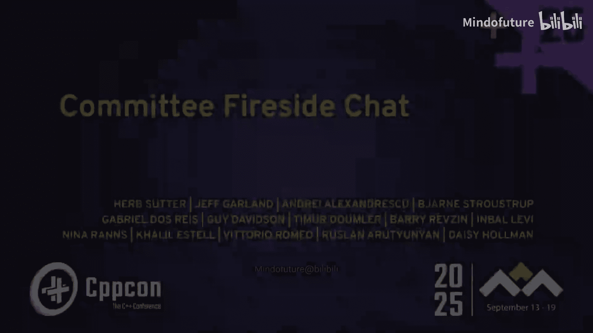
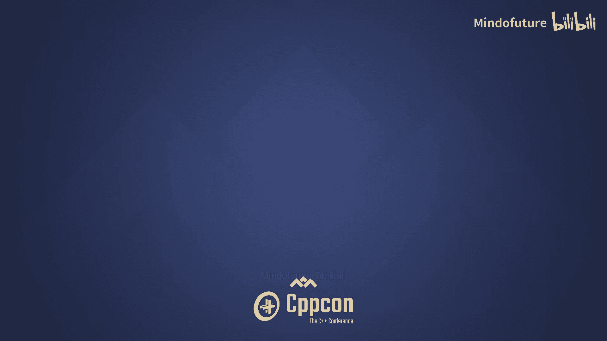

# Cppcon-2025-｜-C++-｜-C语言--｜-汇编-｜-编译器-｜-操作系统-｜-Linux-｜-Windows-p03-P03_ISO_C++_标准委员会小组讨论_2025-主持人_Herb_Sutter-CppCon_2025--BV1wyPBzrEeu_p3-

Well， welcome， everybody to our first evening panel。

 How have you enjoyed the first day of CPP con so far。 Have you had a good time。😊，We have。

 glad to hear it。We already know your dedicated slash。

 There is something wrong with all of us for a panel that starts at 8，30。So we。

 we admire your resilience。 and I think it's gonna be a very interesting panel。

 This is not the biggest panel we've ever had。 This is actually the same size as the very first grill the committee panel。

 It was then called Gr the committee at the very first CPP con back in 2014。

 And it's great to have a range of panelists， all of whom are active on the Standard Committee。

 Some of them have been active for a long， long time。😊，You might know Bna， the second from the left。

 in case you're wondering。And there's others like Andre wave Andre at the other end of the panel。

 who has been doing C+ a long time， but has only recently been participating regularly in the Standards Committee for the last few meetings last couple of years。

 And we've had chairs， subgroup chairs， chairs emeritus。

 people who are very have never chaired a subgroup but who regularly work on proposals and have a major impact。

 for instance， Barry， I don't think you've ever chaired a subgroup or assistant chair。 G X Oh okay。

 my apologies。 but still has it doesn't take away that you've written a lot of great papers on reflection and language and evolution features。

 So we have an eclectic range。 I'm going to leave this slide up， which tells you who everybody is。

Here's the format we're going to use。 In past years。

 we've had like 80% of the questions from the audience because we want audience participation。

 We are still going do that， but we're going to start about halfway through。

 And the reason is is because some of the questions are the same each year。

 And then we get feedback saying， same questions as last year。

 So what we're going to do is I'm going to start with some questions to drill into what's in C plus 26。

 and other timely topics except AI， because AI has its own panel tomorrow。

 So we're going to try to defer most things about AI to that。 we might still mention it。

 But that's why that topic will be has its own panel tomorrow。😊。

And that'll give us a sense of who these folks are。 And then we invite your questions。

 I'll give you the signal。 the microphone will be right here for a queue for you。

 But just to get started， we have the summary of everybody。 I'd like to just go through everybody。

 Maybe we can start with Barry and do each row。 maybe say a couple of words about who you are。

 But the question， I'd like each of you is we are now at a point where C plus S 26 is about to be ratified with major features like reflections。

 stood executions under receiver。😊，What would you each say is the single most transformative thing that。

The audience that developers should know about the standard。 and maybe Barry， you can start us off。

I think this is kind of a。😀Yeah。You know， we all like red。But like。Thank you， Ruland。

 please introduce yourself。Yeah， my name is Ruth Lai。

I like leader of the Para Als Library that we're doing and also Co chair of HG1 concurrentency andism。

嗯。From the， you know， groundbreaking future， despite Ico share of concurrency。

 Pre least my belief it's reflection， honestly， because you。

Like you guys basically build the language within the language。

And it's like the whole new world that we need to learn and you know think change the way we were thinking what we can do and how we can do that。

 And I know it's already very powerful。 It's going to be more powerful hopefully for C++ 29 so we can have like all code generation even like without see out as like what's your example that you brought up but really with the facilities of the reflection itself。

 So it's just。endless capabilities of doing something at compile time。 That's great。Thank you。

 And Gabby Dusres， who's our chair emeritus of S G12 and many other things。

 designer of modules and other credits。 Yeah， so at Microsoft， these days， I work on safety。😊。

UAnd a few other things， C plus plus26 looks to me like a Christmas tree。

 everybody has something on it。嗯。I guess the thing that I'm looking forward the most is the library framework of student execution。

 sends， receivers， having programmed a lot about it。

 I've asked my colleagues like Gore or friends like Vi who have done work with and they all singing the wonders of the library Lib Uniifx。

whichch being used in the fields and they all tell me oh I can do these things without worrying about the race and other stuff。

 so I'm looking much forward to that so that I can spread the words within the company and the community。

Thank you。 Next， we have Gu Davidson。 And before you talk， let me just give you a breaking update。

 So today is Tuesday，6 days ago， last Tuesday， the our parent committee of the C plus S Committee。

 S C 22， which is all programming languages。 was selecting a successor for me as convener because I've done it。

 Some people say， well， are you stepping down now， So because。😊，The question isn't that。

 It's like why why have you stayed around so long。 It's been 22 years。

 And so I still am going to be very active in the committee。

 but I want to do more technical work and let somebody else lead。

 And so there was a decision that Guy is going to be the next convener or chair of the C++ Committee starting in January。

 but we're already going to put him to work six weeks from now at the Koa meeting because I want a lighter low。

 So I'm going to make him do work So thank you， incoming convener WT21。😊，Well， thank you。 Oh。

 and before I forget， we had several， several qualified candidates。

 including John Spicer and including Jeff Garland。 Jeff Garland also happily volunteered。

 and I think maybe hopefully will continue to take a role in addition to what you're doing with the library working group。

 So definitely want to acknowledge it's always great when you have multiple qualified volunteers。

 That's assigned sign to the healthy group。 So sorry to interrupt you there， Gu。😊，Now， that's fine。

 I emotional I' be getting a lot of data over the coming years。M。No。I'm sorry。

I know I signed up for this。 My national body signed me up for it， in fact。Hello， everyone。

 My name is Guy Davidson。 I work for a company called  Six Imposible Thingss Before Breakfast。

 I am a game developer。😊，And my company or the company I work for is making a game engine。

 We're in stealth mode， which is why you've never heard of anything that we've done before。

 but do look out for it。 there's so much in 26。 So I'm going to take a slightly tangential response to the question。

 what would be most transformative。 And I think that you should make it your New Year's resolution。

To read the front matter， the first few clauses of the C plus plus standard。

Are enormously accessible and will explain a lot of things。

 You don't have to read the whole standard。 No one's done that。 Not even the editor。 I'm pretty sure。

 surely， Richard Smith， Tim back to back， the whole thing。

I suppose these are the people I'm associated with， isn't it now， right， O。Barry O， I。

 I withdraw my prior comment， but I still say you should try reading just the first few clauses of the standard。

 It will teach you an enormous amount。 You don't need to be some。😊，Legalally professional。

 It's really worth reading。 That's what you should do。I agree。And Daisy。

 you are our rangers chairir Aerta and also have helped with other groups。

 You are now doing a lot of AI stuff。 Tell us what you're looking forward to in C 26。😊，Yeah。

 hi Daisy Holman， I'm at Anthropic， and I work on cloud code for the past six months。 And yeah。

 I was the ranges chair before that worked on a bunch of other things。

 But I I mean it's going to sound like a broken record here， but definitely reflection。

 although if you go back and check the tapes。 I believe I said that the last three years on this panel maybe before。

 So I was saying it before it was cool。 So I'm just going claim that。

 but I really do think reflection can be transformed the language。

 and I think we're going to see a huge amount of use out of it。

 We're gonna to see a lot more dry C++。 we're going see a lot less ver both C++。

 and this is gonna be very good for the community。😊，Thank you。 And Khalil， please introduce yourself。

 Testest 1，2，3。 Oh cool。Hi everyone， I'm Cltll， I do research on exceptions on embedded systems。

 I do firmware and system development and stuff like that。

 and I do also custom electronics and things within that realm。If I had to say the obvious answer。

 I think， for this question is obviously reflection。

 but there was one more thing that came to my mind， which is I talked to students。

 I talked to people who were like， I'm not part of the committee。

 I'm not part of any standardization， but I'm just a normal guy trying to do work in C++。

And what I really want is to be able to play with corines。

 and I've been waiting for standard task and standard generator for a long time。 And now I have that。

 So I'm really excited about that。 So that's the thing that I think is second best。😊，嗯。And。

 and Kelly， who's who's this guy next to you。Alright， so hi， everybody， I'm Andre。

 and I've been sober for。Alright， so you should know that all I due to my position relative to the speakers。

 all I could hear up until now， it was like So I， I don't know exactly。

 So what's the best feature of C plus plus that's gonna come， Yeah。

 I'm gonna bore every my reflection of course。😊，Al right。 why don't we continue with Jeff。 Yeah。

 So I'm Jeff Garland。 I'm a Co here at library working group。 Also Beaman Project lead。

 also executive director of the Boos Foundation， which will become the C plus plus collective very soon。

 We are renaming the the collective， the collective。 Yes， you know the joke you're gonna to get。😊。

I'm not sure I do。Sa it。Oh really， you're right， I didn't know that joke win wink Okay sorry。

 I'm naive so please please continue so but as many of you probably of are aware boost has decided as a community to have a different funding mechanism so the collective will continue to fund C++ now。

 the conference and many other things in the Beaman project has become our primary you know。

 initiative for getting better libraries， getting access for all of you to the libraries before they come to the standard or during while they come to the standard so that's really the focus over there at this point。

😊，So I'm going to take a completely different track from the other people。

 reflection and all these things are amazing。😊，But suddenlytly， behind the scenes。

Stuff you don't see。 hundreds of bug fixes have been made in both the library and the language。

 which means that you face less corner cases when you port code from one compiler to another。

 for example， also and by the way， I'm going to just make a call out， you know。

 because it was 1998 and there was 2003。And 2003 was， I don't know。 Brianna，na probably tell me。

25 bug fixes。 It was a small release。 Many people appreciated that release very much because it was just fixing bugs that were a real problem。

 But， many people don't know the Standards Committee does this all the time。

 We are constantly on a weekly basis trying to solve bugs that will become corner cases and problems in your code。

 So。😊，There are also many， many small features that improve the consistency of the library。

 These things mean that you're going to call， oh， I can get， you know， a a string view out of。

 a string stream。That kind of thing， right， Small， tiny features that mean your ergonomics are actually better for the average programmer that's just doing things。

 And obviously right。 So I'm going to call that out。 There are dozens of them。

 And you can talk to me afterward if you want to know more。 Excel。

 we have a vote for bug fixes as a feature。 Hey。😊，Always absolutely。 always Timor。 Hi。

 My name is Timor Duler。 I'm the cochair of S G 21， which is the contract study group。

 So I believe the most transformative feature will be reflection。

 But other people can talk about this。 I want to talk about the second most transformative feature in my opinion。

 which is contracts。😊，Which for the first time in the standard will let you tell the compiler when you consider your program to be correct。

And you can also tell the compiler what your program should do when it's not correct。

 that's gonna to help you find bugs in the program。 And it turns out that is a very， very。

 very powerful thing to do this Portably scalably， and in a way that's just very configurable。

 That is a very， very powerful technique to make your code better， safer and more correct。

 And I think that is going to be a very transformative thing because with reflection， you know。

 not everybody might use it directly。 People might use the libraries that we can build with it。

 which are going to be amazing。 But not everybody might use reflection directly in their code。

 but I think assertions， contract assertions something everybody hopefully will write directly in their code。

 And that's going to change quite a lot of things， I think。😊，Thank you。 Inbal， please。

 And by the way， I I still haven't gotten over that I forgot you were the S G 10s share。

 I'm so sorry， Barry， I owe you a beer。 Inbal， please。Okay， so hi， everyone。

 it's great to meet you all。 to see you。 I'm really excited to be here。

 I haven't been here in the past year and the year before。 So I'm really happy to come back。

 So I'm in library evolution chair。 That's the group that is in charge of standard library features and as you know。

 and been mentioned， Jeff is also we collaborate on having the wording for those features go into the stands。

 I really appreciate our collaborative work。 And I don't know if you are aware of the hard work that been done to deliver a lot of major features for C4 26。

 including reflection。 but others as well。 So first of all， I wanted to thank for this collaboration。

 So yeah， I would also want to say。😊，W along the lines of with reflection that weve mentioned here already came a lot of constant expert programming that was not there before。

 So， for example， we now have constant expert exceptions。 And that is。

 that might sound a bit revolutional at first。 But if you think about it。

 That's actually a very good mechanism for us to have better error messages from the compiler。

 So the idea of those is that they're not linking to runtime。

 That's actually Hannah the sacrificevis proposal that she yeah， let's give around for。

 Shes done so much work。And she's been doing a lot of contact for things。

 including contacts a lot of parts of the standard library。 And I， almost all， yes， it's amazing。

 And I I really just wanted to， to like also salute to this effort， because I think people。😊。

Do not understand the power of like contact per and and compile time programming is one of the strength of C++。

 And this is something that we highly put a lot of effort on during this version。

 including contracts is an example of what you can actually achieve， but。

Reflection and context per programming is amazing。 Just want to also highlight one more thing that was not mentioned before。

 Sidi， which is also an amazing。 And Ruland here was a contributor for that。 And also Mattuchche。

 so you can also talk about this。 yeah， sorry， Mathiias。

 But Siimdi is also amazing because you now get to write regular， relatively regular code。

 but you get better performance。 So， yeah。😊，I think that's。Thank you。

 I haven't even mentioned student execution， but I just。Nina， so I'm Nina Rz。

 I'm the committee secretary。 I'm also the chair of the subgroup that does the communication liaison between the C and the C++ Committee。

I am also implementing contracts in Gcc。So I think you， you know where my answer is going to go。

 Refflection is almost certainly a game changer。 Like Barry is right。 There's， there's。

 there's no denying that's the biggest game changer。But I'm also very excited about contracts。

 We have been working on contracts for a long time。 I think it's。

Probably a decade since we started a conversation on contracts。

 And this is the first time that we actually have something in the standard。

The story is not finished。 We have a lot more work to do。

 We have a lot more discussions to have and solutions to find。 But at least we have something in。

And we can now start making， start playing around with it。

Gathering experience and having a more informed decisions in the future。

And let me just call out since we're coming to you， Brna。

 thank you to Brna and Gabby and lots of other people who helped with Cons Exp。

 including lately Hana， But you two started this。 You two started the Con Exp paper。

 the fact that we can now take for granted that we can run most of C+ compiled time。

 This was not a given when just editorialize for one minute。 15 years ago。

 Ih The question was we clearly want to do more compile time programming in C+。 look。

 we're abusing templates to do it。 We wanted that badly。 Oh my goodness。We need a language for this。

 What should the language， the compile time language for C plus plus be。

 It was not obvious that the answer was C plus plus itself。

It could have been some scripting language， some one off thing that did some things and was yet another thing to learn。

 It is remarkable that we have made C++ its own compile time language and are now shipping essentially a C++ interpreter inside every C+ compiler。

 So thank you。 But back to the question， what is the most transformative thing you think people should know about 20。

 to comment to people here who wasn't around when we got constant。😊，That it was not easy to get in。

 It was， It was not easy to get in。 There was groups in the Standards Committee that loudly proclaimed it not only impossible to implement。

But also useless。We've come a long way since that。I think。I。

 I have to express a certain amount of concern about C plus plus 26。 I am not。Very excited。

 And I am worrying about the committee。I see too little concern about coherency and different parts of the language working together。

 We are still not fully integrating coal routines。Which。Without cool change。

 we wouldn't have been here because they were my bread and bought for 10 years。

So I worry about how things work together。 We are not designed by committee。

 We are designed by a fedederation of committees。 We have as many。Committees and committee chairs。

 as we had members when we started。And this worries me。

 A lot of people don't really understand the whole language or care about the whole language that I worry about。

 and I think we should work on coherence and direction and focus on end usersrs rather than the pleasure of expert committee members。

Okay， so I'm going to comment about features。 and I guess I voted with my feet this morning。

By showing the use of static reflection。But even there。

 I worry that static reflection is getting too complicated， too involved。And I worry whether it will。

Open more possibilities for safety and security problems。

 It solves a lot of stuff I wanted about couple of years ago。 I wrote a paper about six use cases。

 I wanted covered if Id gotten those and then waited to see what was happening afterwards。

 I would probably have been happier today。Next， we get the。The ex executor model。

 I have not been able to for for follow up on it。In all details lately。

 because there's this overwhelming amount of stuff that is coming from the committee。

 and we have trouble getting the details right， trouble getting enough experience。

 trouble getting interaction between different features。

 and I'm next looking forward to seeing how the coal chains work in that framework。And then， finally。

 I think that。Contract should not be in C plus plus 26。 It opens possibilities for O D I A A， O D。

Our violations。 it has many， many things that are。Implementation defined。

It is not obvious how it works together with modules。

 It is not obvious that it had been tried out in a sufficient range of applications。

 It is incomplete co routines， pointers to functions。

 class hierarchies and the promises of it being fixed in the future。I am not sure。 I see the。

Things being done right。 I see the experience for the three languages。 I know that use contracts。

Python。Eiffel and Ada has not been learned or relied on。 So I'm very worried about that。

 I think it is too soon。Not enough experience， sorry。Viorio， last but not least。Oh， somehow we。

 we migrated。 There we go。Heest test。 hi， my name is Victoria。 Nowadays。

 I'm an independent trainer and consultant。I， you know， Brna's words are very impactful。

 I I have a lot of concerns， especially regarding reflection。

 I love what you're can do with reflection， but even the idea of being able to drastically change the meaning of code just by changing the name of a variable is something that we have to get used to and like having an annotation that might change the meaning of some code that in some other place is something that excites me in a lot of ways。

 but also scares me。I also wna draw my attention to the things that make reflection a little bit more usable。

 And I'm talking about some nice utilities that we have， for example， with pack manipulation。

 We can now index a pack with square brackets like any other kind of sequence， which is really。

 really convenient。 We can now destructure pack infrastructure bindings。

 or we can do comp time loop loops with expansion statements。

 So all of these things are really appreciated a lot meta programming。 And I that makes it simpler。

 I think is a win in my book。😊，So you've already started on some of the later followup questions I had。

 So let me just jump forward to contracts since we already talked quite a lot about that。

 You've answered。 Can we get the monitors turned up。

 I can't hear anything back here if there's anything we can do to make it easy can hear each with the monitors。

 they may not be able to move them。 but if we could do that right sound is a little Thank you so much。

 sorry about that worries So with contracts， one followup question is contracts are in the standard。

 Not everybody's happy for the audience， What is the one thing concrete thing that makes contracts worth shipping today。

 or if you delay what exactly is missing， So ber to answer the last part already。

 what about the first part， what makes contracts worth shipping today。

I am unsurprised to see teamwork hands up。I think there's a lot of stuff。

 But if I had to point out one feature， it's that unlike a search like Cert。

 which is the contract facility we have today， you can put pre and post on the declaration of a function。

 which means。It is no longer in the body。 It's on the decoration。 It's in the header。

 which means the human can see it。 The I D E can see it。 It can display nice bubble。 You know。

 these are the pre and post conditions of this function that you're using。

 The static analysis tool can see it much more easily。

 And it's gonna give you much more meaningful errors if you do get something wrong。

 And the compiler can see it。 And so that just makes it a lot more powerful and a lot more scalable Then assertions it the way we have them today。

😊，Gaby， you had your head up as well。 Yeah， and then Da after you，So like I said earlier。

 C plus plus 26 looks like a Christmas tree。The part that worries me is I have no clue whether as a whole。

 it's coherent。A。The early indication of getting is most likely not。

 And one of the sort of incurrency kind of。A disappointmentappoint is included contract。 But， you。

 I think。Most people here or the community already knows that。

I've written extensively on the topic and why the， we should all be concerned and worried about the current state of contract to be extremely clear and remove any ambiguity。

 I am。Very much in favor of the notion of contracts。 a matter of fact。

 I've been working on it in the committee since at least 2014 or 15 and have a lot of paper paper trails to to prove that。

So I'm not against the notion of contract。 What worries me is。The current specification。嗯。第。

For I know， a lot of people have。Extensive experience with using。Implementing。

Contract implementing simple S in general， like someone like John Spicer。

Who is the chair of the story group that produced the contract spec or someone like David V De Woods。

 long time contributor， who contributed a lot to static reflection。

And other people doing actual static analysis for a living。

Have expressed grave concerns about contracts， the way it is currently specified。

 And even when we're in Hegenberg。The， the person who tried to demo， like， get us to。

 to be excited about it， actually had to add extensions to clang just to make it usable。

 And he explicitly stated， with these extensions， I'm unable to use it。😊。

And heres to showed how you could add contract to the standard library， for example。

 And if you remember， one of the concerns I had back in Tokyo was， hey。

 we should probably try this thing on the standard library to see how it works and。I worried。

That hasn all been fixed。Daisy and then Brna。So anyone who has been on the committee long enough knows that there are certain features that you have to just trust your committee members on and contracts long。

 long ago is one that I decided I am just gonna trust my fellow committee members on。

 I'm not gonna get involved。 I'm not gonna take a side and that all changed about six months ago when I started to get into AI and coding assistance。

 And I think it is the single most important feature for that area。

 I know I'm not supposed to talk about that tonight。 We're talking about that more tomorrow night。

 But I， I will say this。 having spent。The past six months really focused in on what does it look like to evolve programming languages for AI assistants and for agents。

 I think the consensus across the industry is that across all languages。

 contracts is the most important feature。It is a very compact expression of the intentions。

It comes in the declaration and not in the definition。

 And so you can pull in a lot of information without pulling in implementation details。

 You can assume things that are going to be stable because theyre at the declaration site and not at the definition site。

 These are all things that are very important for the way that agents at least currently work。

 We don't know how they're gonna work a year from now。 But like this is all very important。

 This is public knowledge。 So I can say this。 This is， It is so important to us that we。

Literally hired the person who was in charge of contracts for rust。This is a very。

 very important thing for agent environments。 And we need to get something out there。

 And it doesn't have to work that well， because we can train on it。It doesn't have to work that well。

 but it needs to come out before 29。Just to clarify。

 it sounds like you're describing just the fact that they're on the declarations so that the AII can see them。

Is more important than the actual enforcement details and the actual intentions that they express O and the constraints that they express that are not implementation dependent necessarily。

Brna， Nina， and then we're going to go on to a different topic because other we do have other topics。

 but I'm glad we're talking about contracts because it is something that is an ongoing discussion point。

What Daisy said about what's good about contracts is completely true。

I proposed it for C plus plus 20。And it was voted down for reasons。 I didn't appreciate。

The problem I have is that we don't have enough experience with a current design。

It is incomplete as late as the shipment of the the mailing last week。

 There was a paper saying that it is a security hazard。

I worry that I don't understand a piece of code that has。Contracts in it。

 And how can I use the standard library if it has been implemented using contracts。I am very。

 very worried。 It is premature。And I fear that a lot of。The concerns I've had。

Have been claimed to be solved。But by patch upon patch upon patch， as opposed to coherent design。

And Nina， please。I'm going to take a slightly different look at all this。

I think contracts and this discussion that we had here is a very good demonstration about how the committee works。

When people say， why are things not in C+ plus， it's because things are hard。

I think we all agree that contracts need to be in the language。

 We do not all agree on what those contracts should look like。

 We do not all agree on what those defaults are。 We do not all agree on when the contracts should go into the language。

But this is exactly how the committee works。 We have people who disagree with things who raise concerns。

 who keep us on our toes and who keep bringing the conversation back。 So we do not make。

Grave mistakes。It is true that we do not have enough experience with contracts。

 We had contracts in C plus plus 20， which was pulled out。 We even had an implementation in G C C。

 which still exists。No one has been using it。Until it's in the， until it's in the standard。

 the compilers are not going to provide it。 until the compilers are provided。

 we're not going to get any experience。 It is not complete。

 There is so much more work that we need to do。And I think。Despite the fact that it's incomplete。

And it's not perfect。 I do not， In my personal opinion， I appreciate。 we will disagree。

 We have not made anything that we cannot undo in the future and that we not cannot fix and make better in the future。

 And that's the fault。 thats， that's the point of that。 That's。

 that's the point of getting this out now。 So we can gain experience and make it better。

 So thank you for the breadth of perspectives。 And I I want to jump to a question。

 And I think there's some hands I haven't seen as much。 Maybe Barry and and Khalil and Andre。

 for example， Maybe you can chime in。 Feel free to raise your hands。 I invite you。

 I'll take you first， if you do。What requests are you all hearing from real world users that aren't strongly committed in the Standards committee's proposals currently？

Your name does not start with Andre or Barry， so Barry， go ahead。Yes， I guess I'll follow up。

So just like in the committee， when I try to not pay attention to contracts or follow any of the discussions。

 I， I also do that here。 So I'm living up to to that。 not not everyone can follow everything。 So。

 so one， one of the things that you know， I see people complain about a lot is like the ergonomics that we have。

 especially like our standard library ergonomics， right， and。You know。

 when when people start to use Ross， for instance， like one of the things they notice is like how nice the standard library is by comparison。

 like it's it's like it feels more batteries included as。

 as compared to ours where like we have all these like nice genericary programming facilities。

 But then like， you know， we didn't add starts with and ends with to string until like C 20 and contains until 23。

 I think， right， And we still don't have like， you know， dot split or dot join on string life。

 that kind of stuff。And so what programmers use strings。 Yeah， apparently， I'm told。And so。

 you know one of the things and so one of the reasons I'm excited about reflection in particular is that while someone someone mentioned that you know not everyone's gonna like write reflection code。

 that's certainly true。 but I think what's likely going to end up eventually becoming true is that everyone's going to use libraries inflection。

 And so in the same way that you can see with rust。

 know what's the percentage of people in rust that like write procedural macro like that's gonna be a very small percentage。

 like how many people use clap as their command line argument pars how many people use certain to do serialization。

's like everybody that's the thing you do And so the ability to start actually writing more ergonomic libraries it used to be the thing right where every two months someone would post a new command line argument par and C plus And and it turns out that like you just cannot write a very good ergonomic command line parser because the thing that most people want to do most of the time is like I have astruct with like five things。

 I want a command line argument。Or out of it。 just like do the thing for me。 And that's。

's like hard to do orgonomically right now。 And it'll become extremely easy to do。

 And so I think at least on that front， we will， at least start moving the deal a little bit。

Andre Kahalil are there things that you all hear from people that you don't see represented well in the committee。

 People would love for us to do。 not to put you on the spot。 But oh no。

 it's more that like Barry did a really good job of explaining like the ergonomics issue。

 I guess if I was gonna add one more thing to have a lot of people who are like。

 it feels somewhat painful。 A lot of times。 I've actually had a lot of students being oh is great。

 It's is fine。 I'm doing a great job until they hit a really obscure air And they hit me up。

 And I was like， hey cool， I spent like last three hours trying to fix this air。 And I was like。

 okay， let me take a look。 And then I spent like a good 15 minutes trying to figure out how to fix this air。

 And like， oh。😊，This， this over here was actually a copy。 You didn't want that。 You wanted。

 wanted to move here。 And they're like， oh， I see。So in a way， actually。

 something that we encountered recently。 I made this thing as the span of a span。

 We can talk about that later。 But for the most part， a lot of memory issues ensued。

 So I would say if there's any other thing， it would be safety。That's a big one。

 Just ergonomics of safety and getting good results from like， oh。

 this is obviously from a single T U， you can tell this is not valid code。At Nmvidia， there's。

There's a large demand for cogen。In terms of source code generation。

We have files that carry AI literally on their shoulders。 and there are 30000 lines long。

And they consist of code， that is repeated。Literally， hundreds of times。Same code。

 There is one little tibit， a little unor character that's different。

And it's repeated across for a variety of types， sizes， size combinations， data shapes， etc ceter。

 making sure that that code is maintainable is an absolute chore for for any for anyone so if if if you're interested just look at the cutless library。

 if you look at sort by by you know the do the trickcaroo in the Uni command line sort by number of lines decreasing and your hair is gonna you know。

 is gonna to become really stiff。In a second。Even yours。

So code a facility to make that code tractable is is in we're in di need of that at Nvidia。

 We're absolutely in di need。Second， everything in air is about tensors。 It's about matatic tensors。

 And we manipulate tensors by means of tuple。 But before long。

 So tensors are multidimensional tus with with kind of an interesting deep structure。

 And it's the way tus are working right now， they make it even they make it very difficult to manipulate when。

 when they model tensors。 So some better support for packs tus and that kind of stuff is also in we're also in di need of that kind of stuff。

 And I'll also mention， too。 So I' wna， you know， destroy my time budget， but。Cilation speed。

 everybody seems to like kind of got， you know， essentially like we， we are right now。

 We we're like relegated to we're never gonna getil comp compile speed。

We're never going to get modules that work。We're never essentially we're gonna our compil times are out the window。

 Nobody cares about them。 So I'm not sure what's gonna happen with that。 I'm not very optimistic。

 Thank you。 by the way， so we have guy next and than Brna。

 you reminded me when you talk about generated code。

 which is very important and we're gonna do more with reflection。

 especially as we add things post 26。 But it reminded me of debugability even now of context per code。

 because so I happened to see And I didn't read the whole article。

 I saw an announcement today about a jet brains shipping Cons per debugger。 So yay， more like that。

 I've been preaching that for a decade that we are going to have demand for more and more of that。

 And we are gonna have demand for debugging generated code because we have to see it to debu We have to step into it。

 We have to see even as we're doing the generation to make sure So those are all kind of related to what you said。

 but let me go to Gu and then to Brna。Pro harking back to what Baron Kil was saying。

 The thing that I'm hearing most of all is， can't you make it easier。You know。

 can't you make this easier，'s， it's such a big language。 There's so much to it。

And we are making it easier。 I think we're making。 we are increasing the ergonomic value。

 But I heard a talk today about。Upgrading a code base from C plus plus 14 to C plus plus 20 and。

The error they had made， if I。Excuse me for this。 But the error they had made was that they built。

They， they， they'd used a permissive command line on the Microsoft compiler。

 And so they'd written non conformformant code， and they'd put themselves in for a world of pain。嗯。

I have a similar story in that I had to upgrade a game that was written in Visual Studio 2005。

 So was on C plus plus 0，3。 I had to upgrade that to C plus plus 17。

But I had written conformant code all the way through because I'm particular like that。

And it was a much easier job。 And also， you know， it doubled the frame rate of the game just。

 just by using a new compiler。And I think。这明定。I might not have heard you correctly。

 Could you say that again。We doubled the frame rate just by using a newer compiler。And we could go。

 you know， we could go back and and slash and burn stuff and lose that backwards compatibility。

 But I think that's really important。 It does。 And I think it does make it harder to learn C plus because you have to say。

 well， we used to have this thing called hashing include。 now， you know， now we're on modules。

I think teaching in general is still a problem。 It'll be great to see proposals with。

And how will we teach this proposal， How will we teach this feature， I think teaching materials， we。

 we can do better。So Brna is still in the queue。 And then we'd like to start。

 So if you want to start queuing for audience questions。

 let me insert a question before we get to you because now two panelists have referred to modules。

 there was a post again on Reddit today， and there regularly are How is modules going。

 And that relates directly to Billpeed， because that's one of the things that we we were hoping for。

People regularly ask， so what can we tell them about the progress of modules。

 the C plus S 20 feature that people really want to use。I，I do have something to say about this。

 and I'm going talk a little bit more in Wednesday morning， open session at 8 o'clock。

But the Beaman project is definitely interested in being modules first。We would like to get there。

 We have been working on this， and we have some experiences to share。 There's a lot of details。

 I think that。My sense。 and I I'm on tape saying this now。 So I'm going to be， you know。

 committed if it doesn't work out。 I think in the next year。

 you're gonna see the modules breakthrough because I think it is now happening with GCC 15。

 actually getting it in。Thank Gabby， you are Mr。 modules。

 So I'll I'll give you priority if you want to answer。 And then we have in on that。

 But then I do want to get to berna。 Okay， yeah， sure。 so when we went with modules。

 we knew that this was changing dramatically how we organized source code。

 it dependencies became more explicit and from there many benefits come out and we have been seeing them。

😊，The would， we have been dealing with a an ecosystem that has grown over 40 years。

So for some reason， let as you see happens to be the first to get modules in user form out followed by clk。

 And this year in spring， GCC 15 came out with。In a shape where， for example。

 you could say st import st。So the tooling ecosystem。Has been slowly improving。

To allow people to take more dependency。 So I'm looking very much forward to the work that's going on in the Bman project。

 because I think given the reach of your。😊，You know， library。

That will penetrate a little bit more because now people will take more and bold dependencies。

 Then we we could see some of the benefits。 I want to just take a few。 So the first thing is。

 have better good organization。 I know we we also pushed to talking about AI tonight。

 But one of the things that it's not， it's not， you can't mention it is just like， lets。

 there is a whole panel for that。 So yeah， okay， I'm not going。😀Yeah。😊。

So one of the things that I did promise back then and is still we realizing is that if you improve the code organization。

 you could improve tooling。Right， so right now everybody's like it's a a race like well get there first。

If you're training your your model on C plus plus and your base model is include fire like include model。

 you're going to burn very， very quickly， your token window。

 the number of tokens that you get because things get paste。

 So now you get back to this kind of work around where you're telling this system。 Oh。

 this thing just look like that other stuff today， you have models。

 I will tell you when you see a block of code， oh yeah， that's include vector。

 They will minimize that for you。 But if you were using modules。

 You think that is explicitly disrus code is say import for example， that is known with。

Well known semantics。 And that's one of the reasons， for example， Like。

 if you look at the models for Python or C sharp， they。

 they perform little better than than C pluswise， right。The other thing is。The themons。

They are very good at doing。Firstly pattern matching。

 the very allowsusy after doing arithmetic and logic。If you have a language， that is interesting。

 like C plus plus。 where just to call it function。 you have to do like a lot of computations。

Or right。Where you do a lot of competitions， too， Then it becomes a little bit more of a challenge to react to the models。

 They want to be most advanced ones that are around。

 I've been playing with them because they have to do competitions and logic。Right， right， I Im。

 I'm getting there。 So to， to， to get those models to be more performing。

 What you want is you want to augment your sequence of characters with the semantic description。

 hears something said earlier about contract。 Oh， yeah， we can summary the declaration。

 But what you really want is you want the semantic description。 You get that true。 for example。

 when you implement modules。 You have a semantic representation of your interface。

 That's another advantage of the tool。 So we have been ahead of the curve for， let's say，10 years。😊。

Maybe so as you were saying those things about AI， I saw the person to ti your right who knows a lot about AI。

 I I noticed that there is a I think you should expect a rebuffle coming to with someone who disagrees with what you said。

 We'll find out about that tomorrow。 no doubt Ba。 and then I want to get back to B Ar on the previous question。

 which is what do you hear from users that's not represented in the standards Committee papers well yet。

 So I actually that's really good that you brought it up I wanted to address models。

 but I also wanted to address the previous question。

 I wanted to so you heard quite a lot of concerns coming up here and an open issues and things that we have we want to think about。

 I also wanted to to give you a bit more like wider scope of what's happening。 So first of all。

 regarding models。 I actually not referring to the implementation right now。

 but I do think we did had discussion。And effort to standardize to go more toward tooling aspects through the standards committee we actually thought of considered an additional standard to address tooling。

 and I actually think that models in a way，If we use this right and we also encourage our users。

 and we also encourage modern technologies such as package management， etca。

We could actually tackle a lot of the problems that came up here， including compile times。

 including other things as well。 Mos we could deliver。

 or we could also standardize or look at standardizing the information about the model including A B version。

 for example， those kind of things can actually solve a lot of the issues that came up throughout the committee for a very long time。

 So I think we actually stepping towards a better future。

 know and I just wanted to give you this also this aspect。

 because we did hear about a lot of problems but I also think that there's a lot of solutions going on。

 another thing that I wanted to address this Bna was concerned about about coherence。

 And I also agree with that。 And we are a large committee and we are trying to also do this for our users。

 We want to give you more features。 But for the coherence aspect。

 I've actually been working on this framework of policies that we are trying to do。

Some kind of Korean agreement among the committee of what is important for us。 And， and by the way。

 argue。Sorry like usability is one of those。 So the last thing I wanted to say about and actually address what Herb have mentioned about what user wants more。

 So I think actually good documentation and we are working on this and this is important for us and I think maybe more in the recent years than previously I haven't been in the committee for all the time that it existed。

 but I definitely at least personally seen a lot of value in that and that includes talks like the one that you see on these conferences and that includes CPP reference being updated with the latest and the latest features when they're been delivered and this is something that we emphasize and work on and its not it's not by itself。

 it is something that we actually put effort on and and also ergronomics as been mentioned is' also context that I mentioned before is part of that。

 So I just wanted to give you this also kind of more wider perspective。

Of the fact that we are working on those things。 but， but yeah， on different aspects of them。

 And now， finally， well get to be honest。 But remember， we would like your questions。

 So the microphone is right over here， Please start queuing up if you have a question for our panel。

 just wanted to say， just wanted to say that the reason modules are great。

 I that they more directly expresses what it is we are trying to say。Include files， the heck。

It was a hack that was put in because they couldn't do anything better back in 1974。

 And they knew it was a hack。 We knew it was a hack。

 It's just hard to figure out all the things people say here follows from the fact that we are now saying what we mean to say。

 rather than using work around。😔，Secondly， you mentioned the speed up when youve got a new compiler。

 I have seen exactly the same in financial software。

 getting a newer compiler means you use your hardware better。Okay。

 what I hear most is complaints about the complexity of C plus plus。And。

Whenever we add a new feature。People complain louder because what is new is considered complicated。

Probably wrong， and probably slow。All of which tend to be wrong。

But that's the way people see it and they keep using the old stuff。

 they keep using sort of code the way they were writing it in C in 1978 or thereabouts。

 and that drags down the performance， it creates bug opportunities and such。

We've been working on core guidelines， guidelines are good， they're not good enough。

 you need enforced guidelines and that's what we call profiles we fail to get them into C++ 26 if they had come in I would say they were the most important because it allows us to save people from getting into the dark corners to focus on better code people think it is simply something to do with with safety as security the best way of getting good safety is to get better type safety it is also the way to use the language better and simplify the code people right we cannot simplify the language we keep extending the language we keep extending the library what we can do is to provide simpler subsets of the language。

For people to use and the profile philosophy is first you extend the language with more ideal facilities and then you subset the result。

That's the way to address the problem I hear the most both from users， expert users。

 novice users and from students and from teachers， this is a very broad spectrum thing。Thank you。

 So it looks like we have a brave volunteer。 Please let us know your question。

 feelsel read more of you to queuee up。I want to go back to earlier in the discussion。

 a number of you expressed some unease with this state of C++ 26。Brna in particular， I think。

 mentioned a couple of features he felt were not well implemented and some other ones that weren't complete。

I just want to point out。Earlier， C plus plus standards have introduced features that were prone to misuse。

 Like auto pointer is a great example of that。 And there were other features that， in my opinion。

 like were not complete when they were released。 like parameter packs came along in C plus plus 11 and were annoying to work with until C plus plus 17 when we got fold expressions and so on。

 So I guess my question is。Or， are the concerns that for those of you who have concerns about C++ 26 are your concerns about it sort of on a higher level than stuff like that。

 And have you ever felt the same level of unease with earlier C+ plus standards if I can just inject that open source was not always the case for earlier standards。

 there was also features that been implemented in closed source because open source is not like is's not always been existing there。

 So that's also。Something that we need to keep in mind。Rlan， you had your hand up。 Any others。

 Please raise I've got Yrna， Gabby， any others over there。 Yeah， I think4 plus plus 26， we have。

A lot of complex features being shape like as the one standard。

 We have something similar in C plus past 20。 I guess when we had like big four like ranges。

 core routines， concepts。 And I forgot was was what was the first one modules exactly。 Yeah。

 we were talking about that。 How could I forget。 Yeah， Yeah， and we still have like problems like。

 I think more problems with modules。 we had some problems with ranges。 those were there。

 there was a library for like almost decade， I guess but we still fixed those things。 And I mean。

 did this successfully， in my opinion。 A lot of people now use ranges。 And。You know。

 there is no like draw some improvements coming， but it's kind of iterative process。

 despite like how many， how much experience we have with this or that。

 there might be still some concerns on or over oversights because like we cannot think through everything。

Again， C plus plus 26。Is going to deliver like very complex features like state execution and reflection and contracts。

 maybe because like people still raise concerns about those。 I'm not that， you know。

 scared about team D， for example， or like parallel algorithms that shape like they are。

 they should be like more or less pretty straightforward， but still， you know。Yeah。

 there are some problems。I think we still can。Ship them so people start using them。

When we have some concerns， we will think how to address them And also， like。

 if we believe that something is incomplete。 I mean， if we already identify some problems。

 we might limit the scope of this or that feature， we still have time frame for that and deliver something later。

 if we believe this is broken for now。 But if we believe it's in a workable shape。

 let's deliver and let's see what the feedback will be。Did I see a hand on the far side。

 I don't this one if there was one。 I think that's the near side， But I just want to make， Yes。

 you're also in the queue。 Okay， I didn't。 So Gabby， I think and then be it。 Jennifer you can。

 you can already cue yourselves。We know。That we can't do a perfect large feature without feedback to see how it fits into the rest of the language and see how people use it。

 This was why when we started for the three year release cycle。

 we were thinking there would be a major feature coming in。 And then the next release would。😔。

Make the。Use of it easier。 fix any incompletenesses。

 F any interactions with other parts of the language that we hadn't anticipated。On the other hand。

I see the thing people think about like context and modules。 There was a clear model。

 semantic model for。What was going to go on， which we have more or less followed and the only place where I saw we put something in and we were fundamentally wrong。

 was something called external templates， which was an early attempt to do something like modules that didn't have a good。

Coherent design， what I fail to see for。Contract exactly is the overall plan。

 the overall coherent model， and it feels like a patchwork and that I worry about。Gabby。

 and then we have another question。 So did I miss somebody。 okay。

 Gabby Tor and then we have another question。 I think that's a great question。 So to be clear， I'm。

 I'm not concerned because I think this is not perfect。 That's absolutely not the case。 Okay。

 first thing is， very， I don't think the rule for us is， oh， just put it in there。

 And if it doesn't work we can always take it out。 that's。It's， it's not a good way off。

Having an international standard， It may be a perfectly good way of doing some kind of continuous delivery to。

 you know， writing your mail app， just updated as work you wrote back， but。😊。

A programming in international center for a programming language。

 I don't think that's a good model for it。 Now， I'm going to give you concrete examples， right。

 So Jen mentioned X template earlier。 That was right before I， I started doing， you know。

 evolving plus plus standardization。 I studied in 97。😊，We had garbage collection back in in in Koan。

 It was this agreement that I would say for political reasons just to keep peace。 So oh， yeah。

 well put it in there after decade and a half。 Nobody really implements okay， take it out。We。

 when we put in there， we made a promise to the community。 And then we just like， and take it out。

AndAnother example， for C plus plus 20， when we had spaceship operator。

And it wasn't exactly how I designed it。 But I also thought that whatever the problems were。

We should be able to fix them。 And as a matter of fact， my colleague， Cameronron de Ka。

 worked just like his。 I worked with him tirelessly。😊。

To come up with restrictions to the design that went into plus plus 20。Implement it， test it。

 and then talk to all the other implementers。 So there is this big paper that we wrote to fix spaceship operator。

 That has just about all the C plus plus compile implementers。

 So that's an example where I thought this is， it is not right， but we can write it。 So okay。

 we'll fix it。😊，For contract， it is very different。 It is the way I say， it's fundamentally broken。

 and， and Ive been talking to other people。 It's like， I may be very wrong。

 I'm not saying I have access to the truth。I may be very， very wrong。

 So I'm talking to other people who have experience implementing C plus other tools that will be needed。

 like linkers。 I've heard a lot of magic stories about linkers will do this。 will do that。

 And none of them would like， you know， it is not workable。😊，And Hgenberg， like， oh。

 to to be able to use it for this thing。 I needed these other extensions。

 Those are just like evidence that something is fundamentally broken。 That is why I'm concerned。

 and think you need to be delayed。Tor， can you keep it concise so Then we can get to the next question I'm gonna try and concisely make two comments on the things that have been said。

 The first is that there were claims that there was this no consistent or coherent model behind contracts。

 I beg to disagree。 Lisa Lipincott gave a talk last year here at this conference called Perspecs on contracts。

 which talks you through the overarching mental model that is behind the contract design。

 I believe it's very coherent and very beautiful。 So I encourage you to check out that talk。

And the other thing is。You know， the the criticism about this is not working。 or that is missing。

 So we have to deliberately design this in a way that we can address all of the concerns I'm aware of currently as pure additions to what we're proposing for C 26。

 So we won't have to take anything out to change anything。

 but we can address those things like doesn't work in virtual functions。

 or there's no way to say this assertion must have this semantic across different to use。

 All of these things can be addressed as pure additions to what we have in 26。

 which we can ship in 29。Thank you。 Next question， please。Whoever's next， yes。

So I want to address the contract as an end user。To me。

 this is the most useful feature of C+ class 26。I can't wait to use it。So。We could all agree。

 I think， that when lambmbdas came， they replaced bind， right， bindnd was not so friendly。Or。

If con express， con expressions replaced， for the most part， enable ifs， right， or spinus。So to me。

 contracts are at that level。And so in support of Timur who I met for the first time today。

 So I have no relationship。And。Biani， you care about end user。 I am the end user。

There are other features that I'm terrified of in 26。 one of them is through execution。A。I use it。

 I used to exact from Nvidia， but。I don't know。The only good side effect of it。

 if it gives you core routine machinery， it's really easy to spawn core routines。 Okay。

 that's a good thing。 Otherwise， it's completely uncomprehensible。 I mean， to me， as far as。😊。

Reflection， my end user opinion is that。I think I don't know， but it looks like it could be。

 we could be opening the Pandora box。My question for the committee is the following。

 Why C plus plus language is so easy to use incorrectly。 It's so hard to use correctly。

And why there is such a lack of。Good default， right。Things that are easy to use。

And there are other system programming languages， right。

 which are breathing at the neck of C plus plus。 One of them is rust。One of them is Zig。

 So I have a question for the committee。 How many of you actually played with Zig。

For at least two hours。Okay， good。 So， but， but that was your second question。

 So let's make sure we get。 Yes one， too。 this is the point， right， Well。

 the point I'm trying to make is that you have one guy。Right， and he has this sort of reflection。

 which is very easy to use。The compilation， right， like your runtime code and compile code is just like exactly the same。

Like Spman had an interview with Dave Palmer recently， right。And I think。

It was spoken in front of hundreds of thousands of listeners that Zig is fasted in C plus plus and there was some numbers thrown the around。

 right。 So and it's really much easier to use， in my opinion， right。

 C plus plus grows in complexity exponentially It's becoming more and more uncomprehenible。

 So the question is， what about usability And we have at least one hand already。 So Jeff。

 why don't you get us started at answering。 And then we have Daisy and Barry。 Your problems actually。

 But let them get get a shot。 and they'll do their best to answer your questions。

 This is gonna be fast。 Your problem goes back to see and all the bad conversions that Brna demonstrated this morning And other things that are related to see compatibility that is a huge problem in C plus plus that makes all kinds of nonsense compiled that shouldn't And it's not really with the newer features。

 It's with the old ones。Daisy Berry， oh， we have more hands， vitorio， Barna。Yeah， I mean， I。

 I don't have much to say either I've been off working with a lot of rest standards people for the past six months。

 and they don't have everything figured out either。Like。

 this is it it's you're seeing it a lot more because we're more public facing in terms of like our。

 our papers and everything。We are not a software project。 We are a standards project。

 So that's a little bit different。 Theres a lot of other things going on， but like。this stuff's hard。

Very yeah， so I will continue to not comment on contracts。

 But so so I think Zig is super cool as a language。 for those of you that came to my talk today。

 I was inspired by a zig talk， actually， And so one of the things that I think Zig does very well and one of the things that we do very poorly as Jeff mentioned。

 because we inherited from C。 is our general like syntax scheme， right。

 like what are the things that you declare in the programming language you have types。

 functions and variables and obviously in C plus plus two of those are ambiguous with each other。

 So that's kind of a problem， Like you start when we were like working on like reflection。

 So if you start getting into like， what is inparparen mean。😊，Oh， yeah。 Well， of course。

 it's a function that takes no arguments and and returns in。 Oh， did you think it was0。 No。

 that's not，'s how it works， right， So and this kind of stuff like one， that's like。

 obviously very hard to learn。 These kinds of issues are very hard to debug when you like get into like all this kind of syntax of issues。

 But I don't think it's unchangeable Like I I don't think we're， we're stuck with this forever。

And so like， so one of the things that it does very well。

 It's just like it has very uniform declarations for everything。 right。

 It's a little jarring to read at first because pointer to T is spelled star T and not t star。

 but like you get over it。 And then it's consistent for everything And it's nice。

 And that is something that like we could potentially do one of the things that like Baxter showed us in circle is like。

 well， you could come up with the schema where we just like hash pragma syntax that doesn't suck at the top of your file And we just come up with like like it doesn't have to be like a radical redesign。

 It just like you know， move around a couple things make know variables and functions not ambiguous with each other。

 put the arrays on the correct side of the name like stuff like this。

 these are all like very little things。 but I think they pay a lot of dividends So I hear declaration syntax M So yes。

 I understand that the。A involved。 I think I haven't missed anyone。 So I。

 I wna echo Barry sentiment that this is not something that cannot be changed。

 I've been trying to do this with my epos proposal quite a few years ago。

 and I feel like there is quite a bit of similarity in overlap in the intentions and in the methodology also with profiles and also what you're doing here with your CP front。

 The idea is。We know that we have this historical baggage， this legacy。

 but we do have the opportunities to constrain some parts of the language。

 given some new notation or some sort of which on a per module basis to change the the default or forbid constructs that may be you know。

 dangerous， like implicit conversions。 And I'd really like to see you know。

 more focus on this in the committee and trying to see how we can effectively change something in civil plus creating a dial because that's what we're gonna end up doing without changing you know how the language feels how people approach it。

 but still making it a bit safer a bit easier to use and reducing the surface area。

 because adding more things on top to simplify what's already there。

 is technically adding something which is simpler。 But it is increasing the surface area。

 And the main complaint I see from people is that it keeps getting bigger and bigger And now you're gonna have to learn more and more things。

 So we need to find a way to reduce the surface area in some way or form。Bna inbound。 So you have。

In things you don't like。And you add another one to solve the problem。

 And now we have n plus one ways people are doing things。 There's an X K CD about that。Yes。

 I know that。This is why I'm trying to address it through profiles where you can decide。

What kind of facility you want。And that is a subset of a superet question。

And I'm channeling Barry here。 I think Barry might be thinking the question。

 can I have a profile that is called syntax that doesn't suck。I very strongly am against that。

I just wanted to be very clear about that。 I want the token sequences。

 I want the language to be the same， the semantics to be the same if you enforce。At profile。

 you know， you're using a proper subset of a super of the language。 If you don't check it。

 you get exactly the same meaning。 It is standard C plus plus。

I'm not suggesting we change the syntax。 I'm not suggesting we change the semantics。

 I'm very strongly against the same code in different places。

 having different meaning like contracts have。And I think profiles is the answer to the complexity。

 It is the enforced version of guidelines。And guidelines do simplify dramatically。

And it dramatically simplifies teaching also， which is important。

In Ba and then please have we have another slot for another questioner。 So I'll just be quick。

 So just a few things that you said， first of all， you said C++ C++ is a language being developed for over 40 years when you compare this to newer languages I would argue that you should compare newer standards to newer versions newer languages because I really think that yeah。

 as Jeff here said in others that we have history and that history makes sense and actually what brought us to today。

 but you also need to like take this under consideration when you ask those questions because comparing a language that exists 10 years。

 for example， to something that have been exist 40 years and ignoring the development process of it is is really yeah。

 second thing I wanted to say I also and it kind of continuation of that。

 I also agree with what Brna have said， I also have I。Support the idea of profiles。

 And the reason is that I gave a few， few years ago a talk that talked about abstraction layers。

 and in C plus+， you can do a lot of things and you can dive deeper into your code if you need to but you don't always need to。

 And when people are falsely doing this。 or for example。

 you could use containers from the standard larvae and that would be great and you can have a very clear understand code and if you're gonna start using pointers for some reason。

 because you've decided you need to， then obviously you're gonna have things that are complicated that our conflict。

 So I think that when you talk about this language。

 you need to talk about different abstraction layers and judge them accordingly because if you need to manipulate memory using pointers you're doing a completely different thing。

 then if you need to create data and iterate over and print。

 So and the third thing I just wanted to say during my preparation for my talk on reflection I looked at rust reflection。

 for example。 And again， I think。I is a great language。

 I think all the languages actually have a space in and are good for certain things。

 but specifically for reflection， Ru， what I've found in what I've seen is they have a library to manipulate A S T and the abstract string text。

😊，Basically， directly， reflection we have is I， in my opinion。

 is better is a better syntax is more understandable， is more user facing in the logic is more。

 So I just， I would just ask that whenever those kind of claims come up。 you， you know。

 please look at the facts， please observe facts and try to compare those things and， and have that。

 you know， information and， and facts when you consider those things and not just go by reputation or that's it。

 thanks。we're gonna go to our next question。 But I saw Kahalil would react to what you just said about about comparing the。

 Can I， can I， can I just say， Oh， okay， never mind can， can I just say one quick thing。

 And that opinion about rust reflection is not mine。 actually。

 I found a blog post written from a ra person saying we should look at s past reflection。

 They've been doing a really good job。 So its not my opinion。 That's sorry。😊，1，1 super quick one。

 And then we'll take a question。 Ras， I have a wrap up question。

 I'd argue that Ru doesn't have reflection because in Ras。

 you have to mark the type that you want to generate code for immediately。

 but you cannot do that on a third party type。 Its not real reflection。

 You're saying I'm defining astruct and a part of the definition also gonna generate， for example。

 that printing， but you cannot do it on another type。 reflection is much more powerful than No。

 I'm talking about the sync library that actually manipulates A S T which is in advance。

 is's not real reflection。can I say something about contracts and O D I violation from standard library implementer point of view。

 And is is it a question， please， Well， I'm trying to debate against Bonne。嗯。🤢，youre very brave。

 Yeah， I'm a， Im kidding。 I'm a implement of Li purpose Kans standard library。

 We've been shipping a hardened standard library for years。 Basically。

 is a hand road version of contract with ugly macros everywhere。😊。

And we haven't seen any bug reports about ODR violation。 Of course。

 we have our own like solution for ODR violation by A B I tagging every single symbols in our center library。

And。And we use the compiler flags to make sure every like the different。

 different contract mode will generate different symbols。That's but。

And do you have a question We now I'm talked enough about contracts。 Do you have a question。

 question is， look， why， why do you think that we don't have any deployment experience of standard library。

 I will answer that。 Otherwise， you will get 13 answers。

 It has not been deployed widely at scale because it's not in production compilers yet。

 And that's where we're gonna stop on totally disagree。 He's actually right。

 I those flags in production， Because I'm talking about I'm talking specifically about the C plus 26 design。

Sure， that's very analogous。I don't know who's first。 let's。

 let's go with Nina because is I'm gonna go priority queue with who has her talk the least。 I'm。

 I'm going to try not to trigger a more controversy。 I just want to do a little bit of advertisement。

 We now have implementation in GCC， we have in inclined K to。 Eric is somewhere around here。

It hasn't been upstream yet。 We are working on upstreaming it。

 but it's definitely available on a branch。 It's available on a compiler Explorer。

 We do have not just SQs plus 26。 We also have additional compilation and flags for certain possible extensions in the future。

 So please go around， play with it。Get some experience。

 Give us some feedback If you need details on G C Yan and Kang。Eric is here。

 but you can just contact me， and I will put you in contact with， Eric and。Play with it， please。

 So far be it for me to try to shut down discussion， which is impossible with this move。

 But let me ask this。Please respond concisely if to say something that has not been said already。

Yeah， okay， so Gay here as an implementer。 I work a lot on GCC。

 G C has been shipping the assertions for a long time。 Kang has been doing that。

 M VC also has been doing it and the hidden version of the standard library C plus 26 has now been implemented by all the three major compilers。

 including M VC， and all three of them have it under a very specific set of macros。

 And you might think this is quiribbling， but it is now this is the fundamental part of it。

 when we have macros。 the exp to set set of text that is。Subject to all the interpretation。

The contract version is the one that is poing problem。

 So whatever experienced deployment we have with all these three major compiler does not apply here if you want to know more because Herbie is looking at me concise。

 And so I'm going to say there are at least three papers in the mailing that goes in detail about these things including one thats fromll who already published not before。

 but one that is now in the tunnel in the in the mailing。

 that example is no new've discussing like half year ago。

 that be I something something new and short。 Yeah。

 new and short what you brought up have been were aware of this that was part of the discussion on standard Library Hardening which voted for and that was actually one of the things we brought up。

 So yeah， I just want to make sure that know there are different。Voices， which make sense。

 But we are actually taking this under consideration。 So but for everybody's per。

 you're getting a a glimpse into the， the give and take as we've noticed before in the committee。

 So there are concerns where， for example， something will come up。And some people respond。

 We've been talking about that for two years or six months， or we've had papers on that before。

 And that may or may not be true。 Sometimes it is。 sometimes it's not， even when it is。

 it shows there are sustained concerns。 Well， we your answers have not satisfied us。

 Let us try to say it again with more examples。 And this is part of the robust conversation we regularly have。

 So welcome to the committee。 and you can be part of these robust conversations。

 If you join us at our meetings。I am now going to notice that we are at nearly at time。

 but I would like to end with a forward looking question。

 and I won't make it a lightning round because it'd say like 10 words or less。 But。

 but I am curious as to what you all think。😊，C plus plus 26 is nearly done。

 What do you each see as the biggest priorities that you would like to see that you think are most important for C plus+ 29 and beyond。

We can go in order or shall we try an order。 already there。 not contracts。

 I would say code code generation。 Ts has 26 only has one very narrow code generation facility。

 which is just to aggregate。 And so expanding that to like full proper code generation would be incredible。

 to be clear， you're not talking about binary code generation by an optimizer you're talking about re generated code as if you would write it yourself kind of thing。

Brislan。I personally have more ideas about like parallelism。 I think we have a lot to do。 I mean。

 CMs here， but we have a lot of improvements， how we can make work make it work together with like the rest of the C plus plus standard library for about for example。

 like random number generators or like some parallel algorithms， for example。

 also we can further improving our parallelism that we have already by adding ranges。

 numeric algorithms that we don't have yet since C plus plus 20 and also like including parallel version of those and also。

I think that we need to focus on the safety of the API。

 and I want to acknowledge that we already did like were moving to this direction。

 like doing some good job， I think in improving the usability like again。

 CMD and in place vector have some checked versions unchecked versions the same for parallel algorithms。

 with the new set that I'm gonna talk more in details during my talk on Wednesday come and see it。

 So5 just advertisement of my talk。 So basically we also added some balance for the output。

 So do not have do not have like memory overrun and all of this stuff。 So yeah。

 we should focus on improving what we have and you know。

 in building everything like basically making priorities。Oh， okay， C plus plus 26。So for me。

 first and foremost is improve the safety and the usage of the language so that by default。

 when you have newcomers， they are more excited to write by default。

 the correcting than having to step on blind minds。 So the first thing， second thing is more。

Conce to the language。 like we， the I said earlier now， we have a federation of committees and。

 and it。The spec that we ship is shoes like a， you know。

 we're shipping the all charts of the committee。 We need something more integrated。 Third is。

 I would like the committee to take time to fix many of the bugs that we have and not just， you know。

 pile new features of features， but you know， fix the bugs。 like we did or3。 That was bug fix to 98。

 That would be great thing。😊，Next is。 no， no， no no， you say priorities。 So from now on。

 there is a limit of three per customer three。 I'm gonna move along to Gu because we're running out of definition。

 And you know， okay， you get a fourth doesn Okay， next is we need to find ways to bring the rest of the community with us。

 like upgrades like put more on tooling so that you can how is it to。😊。

Is it how easy it is to move from 17 to 2023 and 26 and 29。I have a microphone。 Thank you。

 The A P crew have homes to go to， and I would prefer to remain impartial。 Awesome， Daisy。I mean。

 I think if I get one， it's key arguments or named arguments。 I have been。

 opponent of that for years and years and years。 I think there is a very solid justification for that with the way that agentic。

coding assistance process information。 And I think that there's， there's。

 it's the time to finally pull a trigger and do something very specific， syntactic about that。

 I know we're getting something。 We're getting the ability to， in theory。

 do it as a library feature with like more iteration of reflection。

 I think we just need native syntax for it。So。I heard a reaction in the room as soon as you just had named arguments by applause。

 How many of you would love to see named arguments， is he P。嗯。

Which of you are going to write the paper， I kidddding。 but you're welcome。

 It's harder than it sounds。 We've been trying to do it for a very long time。

 But I think we finally need to just put aside our differences and do it。😊，Khalil， allright。

 So actually， Daisy， I completely forgot about named arguments。 I see them。

 I want them every single day。 but I'm like， don'll never happen。 And then I forget about them。

Theres just to be a little bit weird。 There's like this one thing that like I've can't stop thinking about。

 I actually wrote or built up my own new exception format。

 purely to handle the case of co routineouts and how they handle exceptions。 And I can't think that。

 I keep thinking that there might be some way to improve that the issue that I'm talking about is that each co routine has an implicit。

 Try catch。 So you must always when you prop through a co routine。

 If you're gonna let it go through each one of the sequences of your co routines。

You to drop back in the co routine， Go back into the catch。Save the exception pointer。

 and then you traverse that wherever we need to go。

I feel like there might be a way to keep everything within the unwindder。

 So things that I'm thinking about， things that I think that might be interesting into the future people haven't considered。

Andre。Generative reflection， Everything else is a waste of time。

I'm gonna go with safety and security， fixing the bad defaults and making。C++ much safer than it is。

It's never going to be perfect， but it can be much better。So I also will say safety。

 but I will be a bit more specific。 I think what we need to do is we need to stop。

Plugging particular safety holes or like applying case by case improvements。

 as we have done over the last many years。 And instead， we need to have a holistic strategy。

 Look at all of the U B and all of the other safety that we have everywhere in the language and。

 and figure out how to address it systematically And we are now working on this。

 We have a paper P 3100， which has been， I think， very well received by evolution。

 So I very much hope that we're going to have a complete and consistent story there for CB 29。

 I think that's the single most important thing。So to not repeat things that we said here。

 But there was this little thing that called Internet is very， very common。

So I actually think that networking would be great to have。

 And that's actually something that we're building upon send the receivers。

 That's another thing that we will work on。 And I am very helpful for。😊，Long I。

 I can't believe I'm going to say contracts again， but something that。

I am excited about is a way of expressing contract semantics within the code。

 and one option for that is labels， which is one of the proposals we have coming up。

 So I'm kind of hoping we are either going to get labels or some other way of expressing semantics within the code。

 which I think is going to address some of the concerns that people have with contracts。

Profils for safety and simplicity of code。And if we don't get them。

 everybody will do incomplete and incompatible at。Appaches to the problems。

And I do think we can get perfect type and resource safety。Without any apologies。

I want to see the language shrink。 I want to see unsafe constructs become opt in， not opt out。

 whether it's profiles or something else。 That is the goal。

 And then please relax the restrictions on designated initializers。 Let me put them out of order。

 We not I know what I'm doing。 They're just aggregates of things without constructors。

 Let me put them in a different order， please。So Victoria would like to see the language shrink。

 And the first thing that I thought was。After a whole long day of sea。

 I would like to see a language shrink。Different meaning or string。 Oh， good。 That actually worked。

Thank you very much。 You want to thank all the panelists for sharing their expertise and participating today。

😊，So we hope you found that insightful， useful a glimpse into the many faceted thinking going on among experts that all bring their different specialties and strengths together。

 This is day one of a full conference。 So be all rested up。 Don't stay up too late。 Pate yourselves。

 and be ready， bright eyeed and bushytailed for tomorrow's talks。

 including by some of the folks on this stage。 We hope you enjoyed today。

 Thank you for coming tonight。 Now， go have a beer and then rest。 Thank you for coming。😊，安子。

Thank you。😊。

