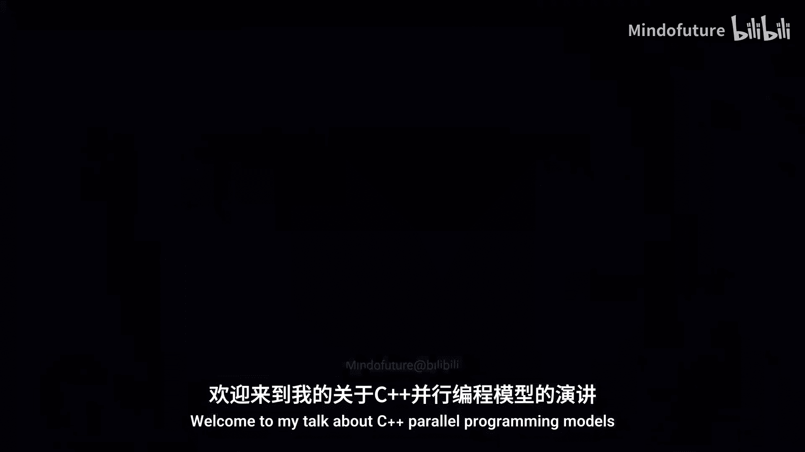
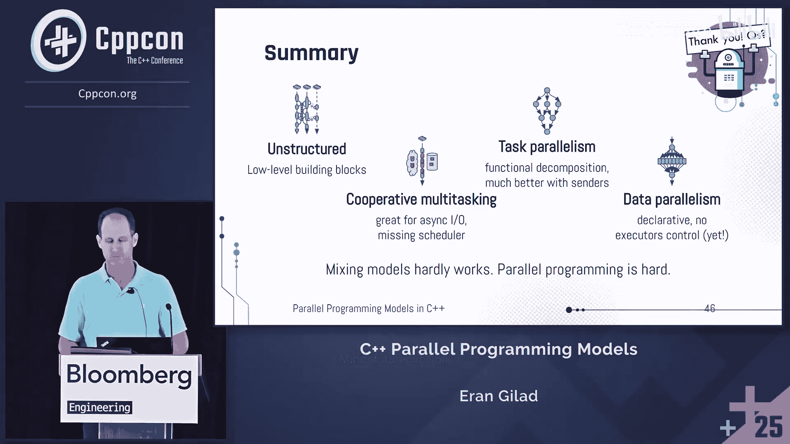

# Cppcon-2025-｜-C++-｜-C语言--｜-汇编-｜-编译器-｜-操作系统-｜-Linux-｜-Windows-p04-P04_选择正确的C++并行化工具——底层与异步与协程与数据并行--BV1wyPBzrEeu_p4-

The fact that you can talk to people who have had some impact on your career。

Kind of listening to how they think， you know， how down to earth they are is just you know， great。

Hello everyone， welcomelcome to my talk about C+OS+ apparel programming models。

A little bit about myself in my day job， I'm a database internals developer in a startup called Reggata Data。

 we're building a database， a distributed database that can handle both low latency transactional processing OLTP and large scale analytic processing。

OU and we're doing it using C++ and we work on the full stack from the lowest level storage up to distributed transaction management and everything in between parallel data processing and so on。

 so in general， if this is if you're looking for a very interesting field for interesting with interesting problems。

That can be solved using C++。 I highly recommend data processing。Besides my day job。

 I'm involved in a local C++ community， this is my first CPPCon。

 but I'm a co organizeer of the core CP++ conference。

 which will take place for the sixth time next month in Tel Aviv， Israel。嗯。Besides that。

 I'm a cor of a local meetup called the Haifas C++， located in Haifa in the northern part of Israel。

During Covid， since I'm not a big fan of the online event， and I was missing the community activity。

 I opened a。What's a group called Talk C++？Which has been active since with over 500 people。

This is like another dimension of community activity。

 which I also highly recommend if you're looking it as this kind of community。It's fairly active。

 mostly about C++， but not only， and it's nice to have this kind of aspect。So to the point。

Why do we care about parallel programming？ So the obvious reason is performance。

 we have multi core hardware hardware， and we want to be able to use it to the full。

Another reason is to be able to hide IO latency， if we send some IO work。

 then we want to be able to do additional processing while that IO is taking place and to a lesser extent。

 we might want to be our application， if it's user facing， we might want it to be more responsive。

Why is art。Parael programming is notoriously nondeterministic。

 it involves data races and deadlocks and so on， and having some kind of structure really helps in dealing with those issues。

So a programming model provides us some structure for our program or our algorithm。

 and this allows useful abstractions。This means that the user can better understand what's happening in the program and reason about its correctness。

 and on the other hand， it can allow the live video framework to provide useful features and abstraction that help the user。

And at runtime。We can have a runtime that operates according to a certain structure and it can optimize scheduling and so on。

 so both of these aspects， the way you code and the way the program is executed are crucial in parallel programming。

Now， if you're assuming youre familiar with C+ person。

 you came across these married of parallel programming facilities， and this is a very partial list。

 of course， and like they might look like a strange mix。

But if you look closer and this is what I'm going to talk about now。

 they are actually parts of different programming modelss。So what are these four programming modes。

 the first one is kind of a nonmod or and structure which I had to put in Sun bin。

 and it includes the most basic facilities that are mostly been provided in C++ 11。

 and that includes thread and Ux and the atomics and all those low level and small scale operations。

The next model is task parallelism。 it used to include or includes until。For the upcoming year。

 mostly stood ASInc， which was introduced in C++ 11 and starting from C+++ 26。

 we'll have sender that will significantly extend and improve this model。Next。

 we have cooperative tasks or cooperative multitasking， which is based on co routines。And lastly。

 we have data parallelism， which relies on parallel algorithms that were introduced on C++ 17。Now。

 these four models are not different abstractions levels。 They're not built one on top of the other。

 They are completely different ways to structure your program。So in this talk。

 I'm going to go over each one of those different。Different programming models。

 and then I'm going to talk a bit about mixing them。And this talk is not is about the forest。

 name the high level programming malls。 It's not about the trees。

 which means the particular facilities that are covered。Discussed briefly in the talk。

So first model is what they call unstructured parallelism。

 which is basically an ad hoc use of the parallel facilities。

 which are built from the lowest level building blocks provided mostly by C++ 11。嗯。

It it provides like the minimal overhead。suming giving you're using very low level obstructions and if done right。

 it allows the maximum utilization of the parallel hardware on the flip side has everything with C++。

 the lower they go， the riskier you are， they provide minimal safety and so you must have the most expertise in order to use them correctly。

So the major components of this model are first at the lowest level， the memory model and related。

Classes such as atomics and friends。Barriers and such， and third local。

 which also represents the memory。And then we have higher level facilities such as the ability to create a thread and the basic synchronization primitives such as muttex。

 condition variable and the ones introduced in C++20， such as semopho and naturalgen barrier。

And slightly above that， we have a few convenience utilities， such as all the RAII log wrappers。

 coal ones， J3 and so on。So the exclusive use cases for kind of this model is mostly to construct higher level facilities。

For example you can create a threadpo， you can implement a spin lock using komics and so on。

 creating concurrent data structure is also a typical use guys instead of putting a big fat lock in front of a standard container。

 you can implement certain data structure based on either locks that allow finite grain access or even make it lock free and provide a higher level of concurrency。

Then another typical use case would be allowing long running services that are running in the background。

Now， one thing that's missing in this model that relies on thread basically。

 is a way to communicate between threads。Basically。

 when you have a code that runs on a thread and it wants to communicate with another thread。

 then it has to do that through shared state， state that is external to that both threads and Villa and exist in shared memory。

So one way to achieve this kind of synchronization is via atomics which avoid data races。

 but atomics are very fine grain so you can communicate very small amounts of data using them。

Another option another possibility is to lock complete standard containers。

 but then the locking is very coarse grain and you might eliminate the parallelism in your program。嗯。

So having efficient concurrent data structures can solve this problem。

 there's nothing as of C++ 23 mean 6 plus 26 will hopefully get RCU and hazard pointers are which provide building blocks for concurrent data structures and concurrent queuees in the works。

So a little bit about the pros and cons of this model， first the obvious pro。

 we have a maximum amount of control and if done right， we have a maximum amount of performance。

On the flip side。We have a very complex memory model and it's hard to make use the ideal use of it。

 and it's obviously prone to database races and deadlocks and all those issues。Now。

The thread abstraction represents a CPU or a processor， okay？It gets some entry point， a function。

 and it starts to execute it， but the thread itself has no function of semantics。

 there's no thread object that does this and thread object that does something else。

 okay the thread is a facility。And this means that when a thread executes a certain function and that function has to synchronize with some external state。

 then it has to include the function itself， has to include the synchronization facilities within its code。

 so instead of focusing on the functionality itself that the function provides。

 it has to also interleave synchronization operations。

And this is possibly non ideal if we have a higher level of abstraction and more involved runtime。

 then we can do less work， we can have less bugs and we can hopefully get better performance。

And this leads us to the next programming model， which is task based。 And in this model。

A task represents a limited amount of computation， which is mostly independent。

And ideally gets some input， provides some output， but does not have any side effects， namely。

 it does not change any external state of the program。

 typicaly tasks would be functions or lambda expressions or loopiterations and so on。

And good the nice things thing about tasks is that they can decouple the functionality from the execution so we can have one thread that executes many tasks and one tasks that migrates among different threads and the task itself doesn't have to worry about the execution context and the。

The accesses to share data， which is protected by the runtime。Now tasks are inherently asynchronous。

 otherwise you can just run functions sequentially。

 they are designed to run somewhere somehow by the runtime that manages the tasks。

And whoever created a task can ideally continue to do some useful work until that task completes the way that color accepts the output of the task is either via a future object。

And which we'll see in a minute。 Or if the model allows that and the runtime is。Efficient enough。

 it can chain the output of one task and to the input of another。

So the existing way of implementing tasks in SQ++ is using student acing。

And what ASync gets is a Lada expression or a function and it returns a future which represents the outcome of the task execution after calling AcInc。

 the task go and goes on and execute， the caller can continue to do whatever it wants。

 and then when it needs the results， it calls the get member of the future and obtains the results。嗯。

Now。The execution of a task using stood aInc can have a few with schedulings。

 one is and they are determined by the when parameter that is given first。

The first is using if we specify launch ASInc， then the task or the Lada or whatever is executed as if on a different thread。

 okay so whether it's on a newly spawn thread or on some preexisting thread pool。

 that's like an implementation detail provided by the runtime。

But it's not executed on the current thread， on the collar。Another option is deferred。

 which means the task is executed only once the result is asked for。 So only onces we call get。

And if we don't call it， then the task isn't executed。And lastly。

 we can combine them with async and deferred。 And in this case。

 it's up to the runtime to determine whether it wants to execute the task on a thread or on demand。

So the limitations of student a tasks are first， there's no composition。

 you can't schedule one tasks immediately after the other or await multiple tasks and so on。

 this has been proposed in the past but didn't came to fruition。

There's no way to configure the execution。 so you can say。

 I want this task to run on this thread bull and another task to run on something else。

 It's all up to the runtime。There's no scheduling options。

 you can't stop an existing task that's being executed or yield for a while。

 and this is basically a frozen facility， no progress since people supposed to live in。With C+ 26。

 we get sender receivers， which offer a much richer model。 They are composables。

Which means you can chain tasks and you can split tasks or change them into multiple follow ups and you can await one or many tasks and so on。

 you can use configure any kind of schedule you want。

 whether it's based on threadpos or CO routines or GPU or what have you。

 it has built in support for stopping and for error reporting and it's coming up soon。

ToTo get an understanding， if you somehow haven't seen a talk about send receivers。

 this will this is a very simple use case for senders。 So we define。Firstly。

 the auto tasks defines or is a variable that will hold the graph of tasks。

 which will include first adjust just defines just a value， it doesn't execute anything。

 it just emits a value for the rest of the chain， and then the pipe and then。

Moves the value emitted by the first task into the next task。

 which combines the world with the hello。And returns that from the second task。

 and this the return string is automatically chain or。And piped into the last the third task。

 which prints it and returns nothing， so we have this creates like a chain of three tasks。

But it doesn't execute it until now， it doesn't do anything。 and when we call sink weight。

 then the color blocks and the task graph starts to execute until it completes and then the color can continue。

So senders are the future of ASIync C++， okay， they are extendable， they allow many options。

They provide flexible test graphs， as we've seen like the the。

The graph I show here is actually possible using centers but not using ASInc。

 and in general they are a common infrastructure for any asing operations。

 not necessarily as part of a task based model。So this brings us to the third。Model。

 which is cooperative multitasking。It is related to the previous model which is also based on task。

 but it's slightly different and we're talking now about tasks that are either a bit longer or can potentially block and the use case we care about is having a number of tasks that is much larger than the number of course because if we have like fewer tasks than course。

 we have plenty of compute work we don't care for task blocks。嗯。So in this case。

 we want to be able to you do something useful when a task is blocked。

We want to be able to continue executing， doing doing useful work on the on the compute resources resources we have without stalling until the the。

Stall the block task， continue。Now if， for example。

 we have a task that blocks on some muttics or some synchronous IO operation。

 then if it were threading based execution model， we have a lot of threads and the operating system manages those threads and one thread executes until it's blocked by IO or by a log or whatever。

 then in this case the operating system will move the block thread aside and schedules some other thread。

So this is how the operating system handles thread scheduling。

But we are now talking about task based scheduling， and tasks are a user mode concept。

 They are not something that the kernelel is aware of。So in this case， if a task gets blocked。

 then the kernel can't help us。 It can， in general。

Deschedule the thread that's running the current task and run something else。

 but that's something else might not be part of our program， and this is not what we want。

 We want to be able to utilize the compute resources that we have as much as we can。

And this is where corines come in handy。So quas introduced in CQL+120 are functions that can be explicitly suspended and resumed from within your own CQLwa code。

 this means there is no operating system involvement， there's no assembly required。

 there's full language support， well defined state management， error handling and so on。

So for example， we define a simple core routineine， which first prints something。

 and then co weights， we'll discuss that in a minute。Thus。

 doing so suspends itself and returns the control to the collar and once it's resumed。

 it burns something else and so on。And the behavior of this corrant is defined by the core underscore T type。

 which is a complex type that's beyond the scope of this talk。

But it defines a quaoteine and the semantics of its suspensions and behavior。And when we call this。

This chine from a main。 Then first， we create a corine and start to execute it。

 It will go ahead and print before wait。Then there's a hole 2 co08。

 which suspends the corrantine and returns control to the collara。诶。

And then the color prints whatever and resumes the core。

 which returns control to the quaine for the last print， and once the quaine completes。

 the control is returned to the main function to the color。

Now the key element here is the co weight part， co weight takes an expression and evaluates it and the evaluated expression should return an available object。

And that available object is the scheduling point okay it has three functions， first the await ready。

 which indicates whether the corine can be suspended at all or should be suspended at all。

Then a way tospend， which。Whi actually actively supends the quaine and returns the corine handle and following and finally await resume。

 which is called after the quarantine is resumed。Now， when we call coweight Fu。Then the first。

 the full function is executed and it returns the。The available。

 which determines whether the court should be suspended or not。

And this is like the scheduling point the point where we should that is determine whether the quaine continues or is moved back and some other code is executed。

So coweight by itself does not create any parallelism。

Performs a user level contact switch between the current core routineine and some other core routine over the color。

And。It is up to the program。To track suspended corrants unless we have like one quarantine that you go back and forth as I saw in this little example。

 but if you have a lot of quarantines that can be in a suspended state at the same time。

 then it's up to the runtime of the scheduler to track their suspension and to recognize when those suspended corrantines ready for reexution and to figure out when they can be executed and resumes their run。

And what we need for all。Reasonable task base。runtime that can。

That is actually useful in a task based execution that uses coreine is first and foremost。

 some sort of parallelism。If there is no parallelism， we have just a single core running everything。

 then we get nothing from task based execution like this。 It makes sense in other use cases of qua。

 such as generators， which are a different story andre to this model so we do need some sort of parallelism。

 and we need a schedule。Now。Just clarifying the point about having some sort of parallelism。

 if we have none， which means we have a single CPU okay。

 processing everything and we get two tasks to。Then they are both executed on the same processor。

 they can be interleaved， but that doesn't buy us anything in the end the time it takes to execute is the sequential time of both tasks to execution。

If we have multiple CPUs， then we can leverage。Many CPUs to run many tasks。

 and we get faster execution。And if we have some parallelism that relies on the IO。

 we can also get parallelism， this means we can get IO parallelism from the， say the disk device。

 which can process reads and writes in the background in as synchronous way and we can get parallelism when we perform a network call and have some other remote machine do the processing while we continue to do other stuff。

So a simple example of how it would look like when we。When we do。

Courtin-based multitasking say we have a corine task scheduler that starts to execute a certain tasks at some point that task invokes asnc IO operation now the fact that this is an as IO is important if that IO isn't asynchronous it's blocking then the whole thread will block and this is a problem okay because then we can schedule anything else because the whole thread is block our scheduler can't be executed。

But if we start an asnc I operation， we don't want to just wait until it completes。

 We can tell the scheduler that we need to be。Deched， we can move back。

 And this is the cooperative scheduling part the。Cin suspend itself。

And then the scheduler can switch to another task， use that CPU。 when the asInc I O completes， then。

The scheduler has to be notified in some way that the operation started by this particular task has completed。

 and this is something that has to be implemented， the scheduler has to be aware of the IO system and vice versa。

And the scheduler can then mark the task as ready for re executionution and when possible。

 resume its execution。So， when we build。Quourine based scheduler。

We commonly want to have one threadbaer in a cord， there's no really need or it doesn't make a lot of sense to have multiple threads per ch if we are going to manage our schedule it is going to manage the tasks on its own。

 then a single thread court is the ideal way to go。嗯。

This also means that suspended tasks can move among cores if one is suspended on a single certain core。

 it can be resumed on another one， and this can provide a lot of fun events if that quatine uses a thread local memory or grabs a log in a single thread and tries to release it from another。

And this means that。Any synchronization objects in case there's a need should not be the native operating system。

 synchronization objects such as themtics and so on。

 if you're going to skip to lock use locking in a quaoutinebased tasks environment。

 then you want to have a quaoteineware synchronization primitives。

 you want to have your own implemented coroteine lock that just suspendense the coroteine instead of just blocking it and holding blocking the whole thread。

Now。This all requires a pretty involved schedule。 Okay。

 it has to track the suspended tasks and new tasks。

 it has to get signals from different places and so on。 So the schedule itself is not easy。

 it's going to be。Complex to include complex data structures， concurrent data structures。

 It's going to be implemented using the unstructured building blocks。But once that is done right。

 then the coring basic tasks are freed from worrying about all these implementation meetings。

So one last thing about this distinction between threads and tasks。So threads are， as I said。

 parallelism abstraction， they represent a CPU， while tasks are mostly concurrency abstraction。

 they represent a certain function or a piece of functionality that is pretty independent and can be executed as a whole in different places。

And。Threads are suitable as background services， long running things， worker threads and so on。

 while tests are usually supposed to be short and independent， and their number can be very。

 very large。Threads can be used to perform long running complex parallel operations。

 while tasks are usually suitable for smaller scale more local operations。And finally。

 when we do run a thread or thread based workload that does a lot of processing。

 we want to make sure that the amount of work that each thread gets is。

About the same to ensure load balancing。While in the test based model。

 since we're talking about mostly small scale dynamically executed tests。

 then we get load balancing pretty much for free。Now。

 one other concept that is related to both threads and tasks and corotes is fibers。

 also known as user threads or green s threads。嗯。And those are a slightly different beast。

 They are basically stackful proteinss。Which means each coroteine has its own stack in conventional standard corrs。

 each cortine has a single stack frame， which is the corine state and that's it when the corine is suspended its state is placed in that stack and that's it and this means that corrs can only be suspended from within the cortine function itself。

 but not from functions that the corine calls and in the case of。Stactful quarantines or fibers。

Then that's not a problem， the fiber can be suspended from anywhere， like in a nested call。

 any level of nesting， it can suspend itself and that's just fine because the whole stack moves aside and the following fiber will use its own stack。

And and this actually allows fibers to be more of a。

An execution echogene execution context like threads。 Okay， we said that threads can take a function。

 any function and execute them。And it's the behavior of the function is separate from the thread itself。

 and the same goes for fibers since fiber can be suspended at any point。

It can also be like a generic execution context that can take any function。

 a fiber can take some function， start to execute it and be suspended at any point。And。Now。

 similar to what I said about qua， synchronization objects such as mutes。

 same goes for fibers if you want to。If you want to use synchronizations with fiber。

 you don't want to use the operating system level synchronization object， but rather dedicated。

 custom made synchronization objects are tailored for those fibers and can inform the scheduler that the fibers has been suspended。

嗯。Fibres are not supported in C++。 I have no idea if there's a plan or not。But they。

 I can say that they are heavily used at least somewhat used in the real world。

So this brings me to the final model， which is the data parallelism model。嗯。in this model。

 the parallelism stands from the data itself， we're talking about massive processing of large amounts of data。

 which is mostly independent， like the data elements are mostly independent。

And the processing operations are ideally fairly small and simple。So， the。

Pall algorithms introduced in C++ 17 have， in general， the following form。We have an algorithm。

Which is called from some some。Like some call sequentially。

 the invocation of the algorithm is sequential operation。

We then have an execution policy which defines what kind of parallelism behavior we allow。

 and this dictates what the runtime is going to do。And finally， we have the container。

 which determines what's the data who processing we actually want to accelerate。

So this is a high level abstraction。 Okay， it doesn't。 It doesn't give us a lot of control。

 We can say。What are the safety semantics that we require， but we can't say much more than that。

 other than that we don't have any control over the amount of parallelism。

 the thread pool that will be used， how load will be balanced and so on， this is up to the runtime。

But since we don't have a lot to say， then the runtime has a lot of freedom， given our。你。

When we specify our requirements， then the runtime has a lot of room to optimize the execution。

And when this is done trial properly， then we get no data races， no dead logs。

 and we can utilize very parallel machines or even CPUs or GPUs。So let's see some examples。

 Here we have this。And。Container that holds a massive amount of data。

 which we want to execute in parallel， we want to sum all the numbers。

 so we call a reduce operation and give it an execution policy。

Whi we'll see soon what kind of policies we can get。嗯。

And then the what's executed is apparel algorithms or not。

 It's up to the to the runtime to determine whether its。

It's reasonable to parallellyze this kind of massive processing or not。

If it does run things in parallel， then the complexity of the parallel algorithm can be more。

 it can have a slightly higher complexity than a sequential algorithm because parallelization sometimes requires that。

And the actual implementation is indefined， it's only the semantics of the synchronization， okay。

 a certain implementation， as I said can execute a parallel algorithm on the GPU and so on。Now。

 we have in the language for policies。 The first one is sequenced。

Which means the parallel algorithm is going to be executed on the current thread and only on the current thread。

 which means it's not going to be a parallel execution。

 and it has some minor differences from nonpar algorithm without this policy。And lastly。

 the policy parameter is a type on its own and this means that each pearl。

A policy has a different type。 And this means that the behavior is determined at runtime。 Okay。

 this isn't just a value that can be determined at front time。

So we have to determine the parallelization we are good with at compile time， which makes sense。

The second policy is a parallel policy。 And in this case， the the。

Pllel algorithm can utilize multiple threads and perth threads。

 its like it's being executed sequentially okay like every thread execute single operation at a time。

 it does not execute multiple operation at the same time interlaving between them and now if we put some land expression that does some nasty stuff we can cause data races。

 that's possible but we should ideal not do that。😊，嗯。The next policy is parallel unsequenced policy。

 which differs from the previous one by allowing。It be a a single thread to process multiple data elements at the same time。

 namely inter relieve processing of multiple elements。

 and this allows in practice the use of C operation and networkization。And lastly。

 we have a Syus+20 edition， which is the unsequence policy。

 which means the execution is going to be on a single thread again。

 but now theres no requirement that it doesn't execute multiple。O in an interleaved way。

 So it executes on a single thread， but it can do use Cdi operations to speed up the execution。

And in addition to those four standard policies， vendors can provide additional ones that can let you execute the parallel algorithms on different kind of processors。

 GPU of PGA or what have you。Now， parallel algorithms does not mean parallel containers and C++ algorithms and containers are a different thing。

And。We can't have containers be thread safe by default。Because that has an overhead。

 and this means that if we execute just regular sequential parallel algorithms。

 then we will pay a price for something we didn't ask for。诶。

So parallel algorithms can generally modify the data itself in their target and container but they can modify its structure because that would be a non safe operation。

嗯。And if we do run some parallel algorithm on a sun certain container。

Then the algorithm guarantees that there are no databases， but if our own program。

Aes that container from another third， then we might cause a dataverse， and that's our problem。

So the last thing I want to talk about is mixing models。 Okay， we discussed four different models。

 what happens or how can we and when should we mix and match。

So first thing is when our program mostly uses unstructured parallelism。

 which means the basic building blocks we describe， it has some custom use case for it。

 or custom utilization， maybe a server that uses some worker threads and so on。

If our program utilizes most of the cores。Then we can。

 we don't have a lot of room for additional parallelism。 So we can use corouts for anc I。

 But other than that， not much else to do。 We don't want to。

Invoke or create more parallelism because we don't have the， the capacity for that。On the other side。

 if most of the courses aren't used。Our program has some parallelism only for say some background process services。

 or whatever。 Then we have。Enough resources to do other kinds of parallelism。

 use tasks or parallel algorithms。 The impact of that is。You know， it depends。Because the。

Run time that provides the parallel execution for， for task based executions and for parallel algorithms is unaware or potentially unaware of the threads we have created on our own。

And of course， in this case， we have to be careful with shared state。Yeah， that I mentioned。

So next use case is when we are using task based parallelism either based on aInc or sender receivers。

And again， we're talking about the case where most of the courses are being used。And in this point。

 this case， again， we don't have a lot of additional resources for additional parallelism。

 There's no point in creating new threads。Or using parallel algorithms。

 we won't have the compute resources if we're using some task based model using。

Core routines for additional operations， It's kind of awkward， maybe it makes sense， in some case。

 maybe it doesn't， but it would be best to just use the existing task based system in this case。

If most of our cores aren't being used。We only use。Task for certain AC facing operations。

 UI worker or whatever again we can use parallel algorithms assuming we have enough compute resources from within a task to accelerate some computation。

 creating a thread doesn't make much sense because tasks are short livedved。

And we have to be careful with using synchronization mechanisms such as the musics as says。

 because they might block the task。The next case is when we have a core routine based execution。

 and in this case if most of the courses are used， so we have a scheduler that runs spreads。

 multiple threads and schedules， tasks that are based on core routines and in this point in this case I really no reason to use any other。

Forms of parallelism。And if most core aren't being used。

 say we are only using those tasks to run some IO operation。

 then again we can use parallel algorithms， but it will block the core routines and that's like a nasty situation。

Similarly， using acing or。Send the receivers tasks。

 assuming they are run within the context of another task。 It doesn't make much sense。 And again。

 task。Usually， it's too short to create a new thread threads。So not a lot of options there。

And lastly， if most of our parallelism relies on parallel algorithms。Then we can， maybe。

do more work using the lambdas that take place in the parallel processing。

 but that would be really awkward to use any kind of any other model。

 no point in spawning aInc tasks while we're using the parallel threads it would be a wrong place to use cor and we certainly don't want to use。

Any synchronization mechanisms as much as we can avoid that， like blocking on muttices and so on。

 because that will kill the parallelism of the parallel algorithm。So in summary。

We've discussed or covered four different parallel algorithm parallel models。

 the first is the instructord one， which is based mostly on the C++ 11 low level building blocks。

The second is the task parallelism， which。Achase or provides functional decomposition of the program we want to paralyze。

 it used to rely on stood async and now it will be much better with senders and receivers。

The next one is cooperative multitasking， which relies on。

User level scheduling based on cor routine routines。

Wwhich is is great for for handling with Haing operations。

 but the standard does not provide a scheduler for this model。And lastly， data parallelism。

 which is designed to accelerate the processing of large amounts of data in a mostly uniform way。

 this is a declarative API， it's very safe and can be very efficient。

 but we don not have a lot of control over the resources it's going to use。And as we've seen。

 mixing model hardly works， and that's because parallel programming is hard。That I'm done。

 and happy you to take any questions。

The project that I work on does parallelism with a lot of processes rather than threads。

 what can I do to convince them that it's worth moving on to threads？

I'm guessing you have a very good reason to use processes and so threads， I mean， made 25 years ago。

2。Then。I think。I mean， it's a different language，s you know I think it makes sense to move on because 25 years ago Ss didn't support threads。

 we didn't have all these convenient facilities。Using processes。The communication is nonstand。

II I think there are too many reasons to to， to move to more standard implementation other than the fact that。

You probably have to invest in that。Hi， thanks for the great talk。 My question is。

 I have an application which。Has a blocking IO thread。Is there any way to。

Have some parallelalism in that scenario。Or I have to have the thread， if the IO is blocking。

 then you want a thread based parallel。Because then the operating system is aware of the fact that your current threat is blocked on the aisle and it can deschedule it and schedule something else。

 So that's a use case for parallelism。 that's based on threats。嗯。In many cases。

 you can just switch to Async。I use an ascing API， and then you can switch to to one of the other。

Api is， one of the other models。So there will be always a blocking scenario right I mean even with CPU the OS coming back。

 it would still be we will still block on the thread。

 the CPU is still going to keep on blocking if if you're using the blocking hear but in this case the operating system knows that your thread is blocking on some I operation so it will it can move the thread aside and have some other it would be like polling for the threat to complete the operation or how would it know it's the operating system scheduler it's aware of the IO operations。

Allright， thanks。Thank you， the task parallelism async。

 he said you can't compose them right to make the graph。can you just pass the futures in？

They're like nest。So in your own code， you can。诶。Start an A C cooperation， then wait for the future。

 and then start another A corporation， but。The control will have to go back to your function。

 And then again， and so on。 it doesn't flow automatically。

 So it's kind of building your own infrastructure or your own chain。

And that's less efficient and more cumbersome and more work than a model that provides this kind of chaining and graph creation in a built in way like sendnders。

Thank you。Okay， so thanks all for being here。

