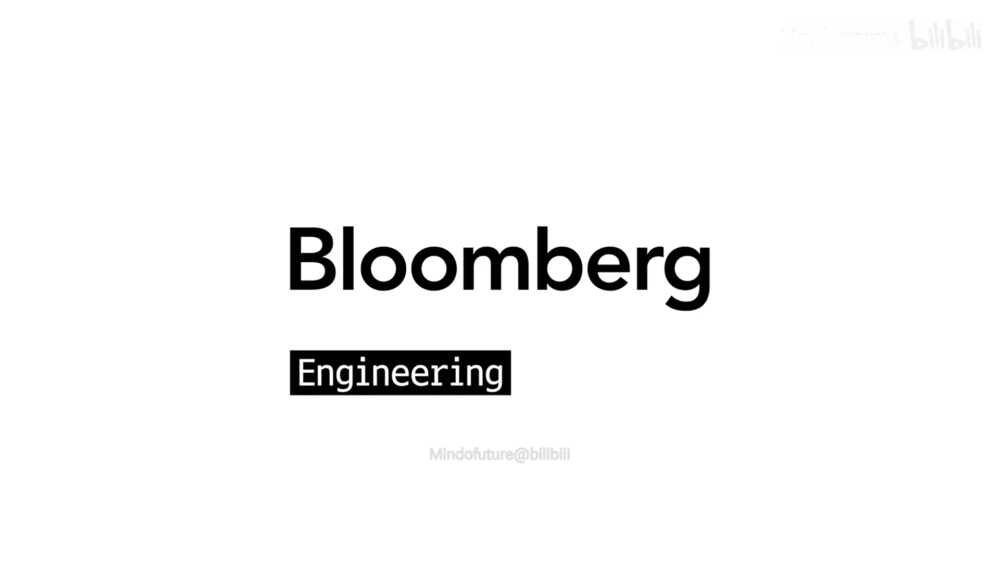
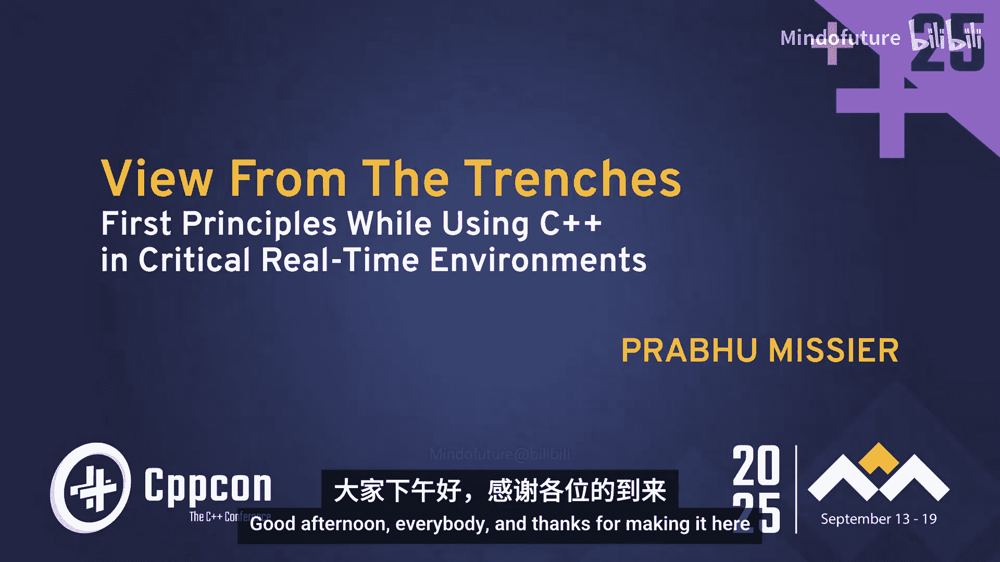
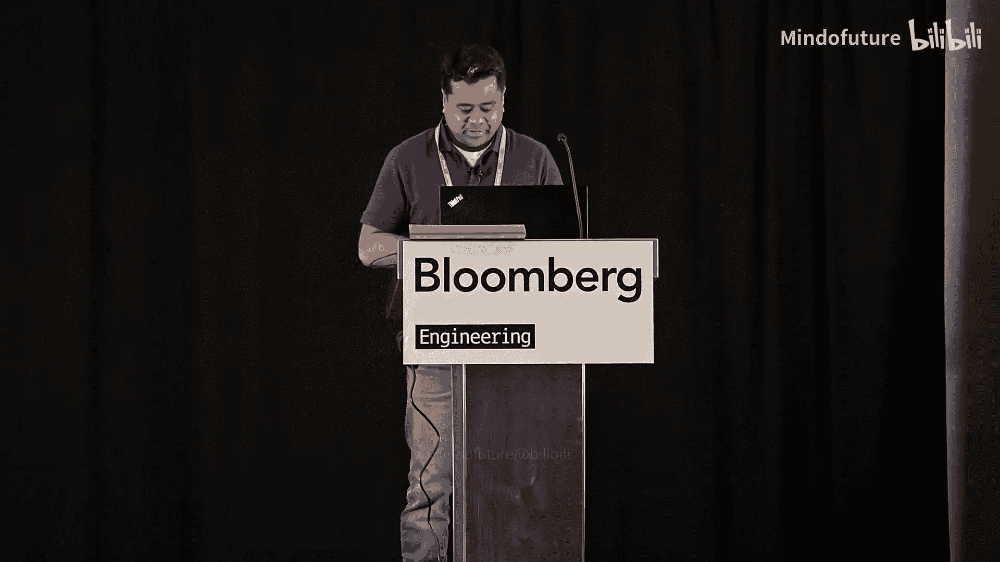
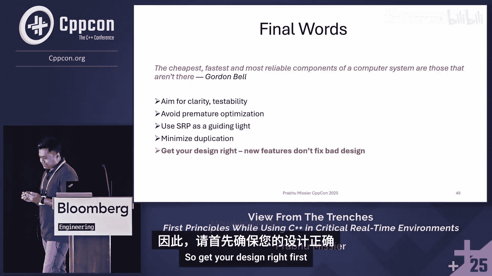
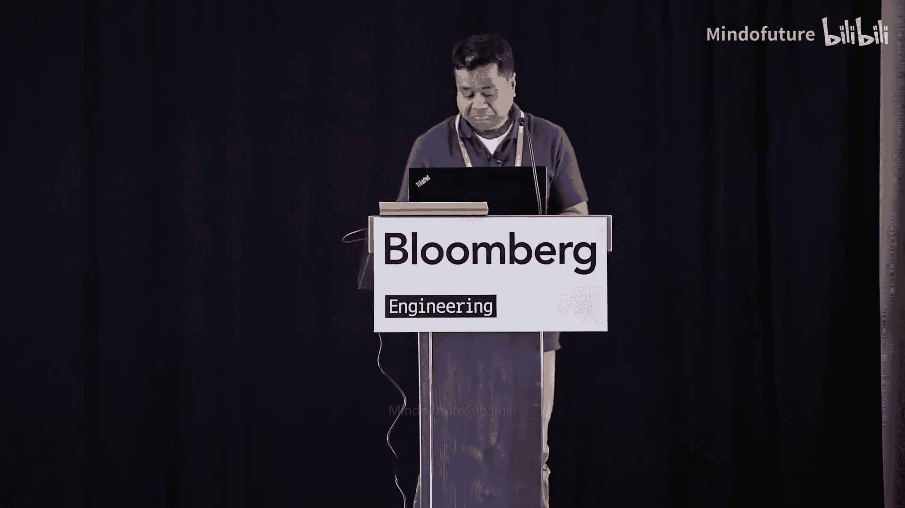

# Cppcon-2025-｜-C++-｜-C语言--｜-汇编-｜-编译器-｜-操作系统-｜-Linux-｜-Windows-p06-P06_设计C++应用程序的第一性原理-Prabhu_Missier-CppCon_2025--BV1wyPBzrEeu_p6-

Good afternoon， everybody。 and thanks for。

Making it here， I know you know there are lots of。Smart speakers out there， in fact。

 I'm missing some of the decisions that I wanted to attend as well， so thanks for being here。

呃。So， view from the ts。First principle， So I'm going to be talking about first principle is going to be a refresher of sorts。

Let's。Now get to it。 quick intro about me。 I'm not really you know。

 a fan of doing these self introductiontro。 So when I say view of trends view from the trendss。

 you got to know you know where I'm coming from。 So the trendss that I've worked in avionics automotive electronics you know。

 data management network security work with a whole bunch of firms there。

 You can see that I currently run a couple of software development studios。 they do various things。

 my day job is of course， managing software development at Ba systems， I'm you know across。

Pretty much。Anything to do with software there。Apart from that， I。

 I live in you know South Australia。And I love trickk there。 A fun fact。

The world's most beautiful city。Voted by， you know， architects a digest is in South Australia。

 So I'll leave you guys to， you know， Google that and find which city that is about。

Cook few pointers。We'll reserve some time for Q and A at the end of the talk。

 I should be able to get through and have some time at the end if in case we don't get through。

 I'm always available outside。 and CPBcon has a Discord channel specifically for this talk so you can continue the conversation with me there。

So code snippets that I'm going to be showing are purely illustrative。

 They're not really production code， right， and they'll be available on my Github at the probably by the end of the week。

Cool， just give some context。You know， based on my experience with real time。Applications， you know。

 many of them are safety critical。 So， for instance， you know， avionics。

 those of you are from the avionics side will know D 1，708 B， right， has different software levels。

 So level a。Is catastrophic。 So let's So， for instance， engine。

 the software which controls the engine of the aircraft。 right， If that fails。

 it's going to result in loss of life。 So that's like level a。The flight management system。

 which you know， the airplane and pilots use inside the cockpit， that's level level B。

So that's the kind of criticality that we're talking about here， right so。Reliability。

 maintainability。Extensibility， testability， scalability。 Now， all these right equal security。

 of course。 and you know theyre as important as performance meeting， you know。

 hard real time requirements。So software design is really paramount。

 You've got to get your software design and software design， as you guys know。

 is not really a science。 It's more of an art， right so。

This talk actually be focusing on first principles on all these elits and and there's a lot。

 but you know I really can cover everything， but I'll try my best right。

 So most projects have worked on。 they use older versions of C plus plus So c plus plus 14。

 So it's not that you know we can't move to c plus plus 223 or 26。

It's not a decision that we take lightly， right， So we're not looking for the latest and greatest features here。

 What we do is we deliberate a lot， right， because， I mean， these are things which concern。

 as I said， laws of life， Def of the country， things like that。 right。

 So we can't use a feature just overnight。😊，A lot of testing goes in。

 a lot of deliberation goes in even before we actually move from C plus plus 14 to C plus plus 17。

 right， So and it somehow like say B Strt says。😊，Hes not really comfortable moving。啊。

A certain feature into C plus plus 26， right， I guess， you know， which which I'm talking about。

That's got a huge impact。 And we are going to be deliberatelibrating on that。 right。

 So we tend to take the tried and tested path。 And that's with good reason。 So before I jump in。

 I'd like to acknowledge the works of all these great gentlemen here。

 My approach has been influenced to a large extent by what they do。😊，Cool。

 so I'll be covering design patterns。Not everything is' a whole lot of them， but as many as。

 you know as possible。 memory and resource management performs some performance tips。

 how you handle globals， some gentle tips。Alright， let's start with design patterns。

So you all know that adding types right with C plus plus classes is going to be easy。

So this is just a pedagogical example here。 So you got class shape， right， and you got class square。

 you got class circle。 It's pretty easy to keep adding types。But what about。

You know adding operations。Now when you try to add a new operation。

 youve got to modify your base class， you've got to modify the complete inheritance hierarchy right you've got to modify yourcycl class as well。

How exactly can you you know go about doing this in Europe in an elegant。And。What can I say。

 Seeless way， right？ So that's where the visitor pattern comes in。So what you do here is。

 it's a behavioral design pattern。 And clearly， it's a separation of concerns， right。

 So in the previous snippet of code。You have all these operations rotate， pivot and transform。

If you look at the visitor implementation， you separate the operations into a hierarchy of its own。

RightSo you got visitor shape visitor you got rotate as a separate class so similarly you know you can have pivot as a separate class so you clearly separate the abstraction of you know what the shape is from what it's actually going to be doing right so thats succeed using the visitor implementation you separate the operations into it separate hierarchy。

😊，Now， you know， within the shape abstractions， you。

 you can see that I've got an accept function there。 it can be any name。 It it， it， it's。

 it's not really。A must that you should have it as is that name， right so。

You basically call the visit function。From within your abstraction， right。

 And you can see that there's double dispatch happening here。Right， so at run time。

 you can decide what kind of operation are going to happen。 what kind of operations is going happen。

 And you can also decide at run time， you know what shape you're going be asking that operation to be carried out on。

 right， So this basically separates the concerns， right。

 So you can actually completely go on a different track without being influenced by your shape abstraction。

Right， so。This is the classical way in which you implement， you know， the visitor pattern。 And。

 you know， you can see there's a lot of runtime polymer Office virtual functions coming here。

 So the modern tech。C plus plus 20。 sorry， C plus plus 17。呃。Offers， you know， the variant。

It offers the S TD visit， the bottom right， the main function。 as you can see， I've got a S TD visit。

 right。 So this may basically makes， makes it really easy to implement the visitor pattern， so。

You can see there are several advantages here， right， So rotate and pivot previously。

 I I had to have like a hierarchy there， but rotate and pivot here can be separate classes of them。

 There's no need to actually have， you know， base class。

 You're not restricted by any base classes yet。 So once again。All that's all that's taken care of。

 You know， the double dispatch is handled by C SDD visit there。And you can very easily add types。

 so youve got to change your variant there。😊，You can easily add operations。

 you just keep adding classes。And it's pretty easy to just call the visit function， right， so。

This is a great feature。Terms of， you know， performance。

 this is definitely much more perform than the classical implementation， right。

 because you're not having version functions。 They're not having anydirect calls here。

And it's loosely coupled。 It's elegant。 It's performant compared to the the。

 the classical visitor solution。Now， there is obviously a downside， you know。

 and you know there has to be a certain level of recompilation， which has to happen here。Right。

 let's。Let's move on to the next one。 So when you think of adding new operations。

 think of the visitor pattern。Alright， let's look at this bit of corddia。

What do you think is wrong here。Any， I mean， just have a book。Youre virtual。Sorry。

It looks like a pure virtual function with an implementation。So， that's definitely one。

Red flag there。And as you can see the hierarchy is pretty unwily， right。

 there's a lot of inheritance happening here。And like a friend you pointed out。

Actually take off weight in the base class。 the aircraft and by the way， this is。

This is from my avionic states。 So takeoff rate is just one of the one of the functions that we actually。

 what you say encapsulate within the aircraft。So。Calculate take off weight is supposed to be a pure virtual function。

 but there's a concrete implementation as well。So that kind of， you know。

 gives the indication that the author of this class didn't really intend for it to be a base class。

 right and。As you can see， theres， there's you know， regional jet。

Class reason of jet on the left panel。That's。Also， making a call to the aircraft to calculate takeoff it。

That's what am I pointing？Okay。There's class regional jet on the left panel as public it is inerrtrating from public aircraft and your。

 It's also calling the base class implementation， right， So these are fundamental flaws。

 You don't really use inheritance。To reuse code。That's not the way you use inheritance。Right。

 this is a very wrong way in which you use in E。 And I mean。

 like this is what probably a lot of us may have done over the years。And the other thing is。

 of course， there's like a very nested， deep hierarchy where it can lead to a very complex hierarchy。

Right， so the key thing here is calculation of takeoff weight right。

 So calculation of takeoff weight is something that's got to be accomplished here。

 That's that's what can you say。😊，That's basically what each of these classes is trying to do。

And regional jets， regional jets like， you know， the various regional jets out there。

 they have a different way of calculating takeoff weight。

 whereas the big airliners like Abas and Boeing， they have a different way of calculating takeoff way。

 So that's what's trying， that's what's， you know， represented here。Now。

If you're trying to calculate take off weight， say for a regional jet。

 you got to have a strategy in place， right， The strategy of how you calculate takeoff weight for a regional jet is going to be different from the strategy that you use to calculate takeoff weight for a。

You know， large that， so。You strategize。And that's whats。The strategy pattern is all about。

You pull out the strategy as to how to calculate take off weight。

Into a separate hierarchy of its own。So， as you can see。This is all mixed up。 It's all mixed and。

 you know， matched。Now， you pull that takeoff weight separately into a hierarchy of its own。

 So you got the takeoff weight regional strategy class。

 You got a takeoff weight long haul strategy class， right， So that's what you do。

 And that's exactly what the strategy pattern is all about。

 So it allows the addition of a new implementation of algorithms， right。

 So for takeoff weight calculation， you have a separate set of algorithms。

 And it also allows you to select that algorithm。 right。

 at runtime without actually modifying the client score。How do we do that。

So all let you do is actually， you have。A pointer that gets injected， right， So regional jet。

It just basically uses a strategy that it wants to use， right， So it's not really going to be。

Bed about， you know how。A long haul that calculates weight。

 It's all all that iss bothered about is its own strategy。 So that's what is you know。

 that's what you see here。 So you've got like， you know。

 class reasons they're actually taking a point or two。The regional weight strategy class。So。

Going back to my initial point， saying that， you know。

 inheritance is not really inheritance can be misused。

 and it was misused in that previous sniper of code。

 So youve got to prefer composition to inheritance。

 So don't needlessly inherit when there is an absolute necessity to inherit。 That's when you inherit。

 you do not really， you know， just。Use it willly， right。

 And all that you did need to do here is just simply em the point of the strategy。

 And then you just call the weight calculator， which is implemented in the strategy class。

 So that gives you control of the strength of the coupling， right， So you， you your。

Able to enact a certain level of loser coupling here， right， and obviously shorter compile times。😊。

So once again， clear separation of concerns here。 There is， you know。

 implementation details can be abstracted out， right。

 So multiple operations will need obviously multiple strategy based classes。 So that's。

 that's a bit of a downside， but it's manageable。Now， let's look at， you， the modern take。

The modernern text is， you know， and there's no ready made pattern。 like， you know。

 the visitor implementation。 There's no ready made pattern here。 But， of course， you know。

 you can use concepts。 You can use ranges SD function， right， So you can use SDD function to store。

Calls to lambmbdas， function pointers。And the like。

 So that's basically how you come out with the strategy pattern。 It's still relevant。

 So whenever you think of maybe how you want to implement something specific functionality。

 you want to come out come out to the strategy， right， So that's when you use the strategy pattern。

Okay， let's move on。 This is， this is an example from my days with the medical imaging side of things。

 Those are C T images， computerizedtmography images。 And so we have multiple views， right。

 So I I think this is the spinal cord。 I can't remember。

 So you've got different views gott the anterior view。 The posterior view。

 Lateral view cross sectional view。 Whatnot。 So。😊，You've got all these views。

 and you've got to display it on a screen。On one screen。So what's the knife way of doing it。

You create threads right， So post to display， you create a thread。Laterral display。

 you create a thread and display， you create another thread。Once again， question。

What do you think is wrong here。Okay， so。It's kind of related to what I was talking about previously。

😊，So as you can see。You got your thread management logic mixed with your display logic， right。

Once again， that's breaking the single responsibility principle。You guys have heard of solid right。

 So youve got the single responsibility principle。 Now， that's broken here。

 So you've got all your display logic mixed with your thread management logic as well。 That's。

 that's not good。Right。This is what we should be doing。

Your thread basically doesn't need to know what it needs to do， right， You just give it a task。

 You just command it to do something， and it's supposed to do that。 It's just a worker thread。

 Why does a worker thread need to know details about what it's supposed to do。

 That's the key key idea that needs to come out here。 Alright， So as you can see。

 there's a unique pointer to a command。 So you just command your thread to do something。

And that's pretty much the command pattern。So you need to separate your thread management logic from。

They actual command that the thread is actually trying to。Carry out， right。

 So that's nothing but the command pattern。So。Your guiding principle here is once again。

 the single responsibility principle。You issue a command to the work at read。And you ask you to do。

 you know， maybe paint a display whatever。 So it really is a dumb thread。

 It doesn't really need to have intelligence。 So there's a decoupling there on skin。

 And that's where you use the command pattern。So as you can see。😊，That's the。

Hiererarchy that I've kind of come up with。 So you've got like a command abstract interface。

 you got the post display command。Anteror display command。 You got its own hierarchy。

 So it's got its own hierarchy， right， And then from， you know， your main function。

 all that you need to do is you just schedule the thread。

 you inject which command you want the thread to execute。So。Once again， pros， as I said。

 you're separating what needs to be done。 cons， yes， obviously， runtime performance overhead due to。

 you know， the additional interaction allocation of polymorphic objects。

 This can result in fragmentation of memory。 All those are there。No。呃。

The attitudetute ones among you will notice that， you know。

 there's a very subtle difference between the strategy。Strategy pattern and the command。But on。

 right， so。This is something that's， you know， got to be a talk of its own， but。

Pretty much all design patterns， you know， there。Stucturally the same。 It's the intent。

 which actually differs， right， So now if you have an object。

And you really don't need to configure this， the other abstraction with this object， right。

 So in this case， the example that I gave is the thread really doesn't need information about what operation it's going to be。

 you know， working on in order to。You know， exists as a thread。

 It doesn't need to know what operation it's going to be running， right。

 So that's when you talk about something like the command pattern。

 So you just basically issue a command。 So to give a very simple example， think of a calculator。

 right， The calculator has like add， subtract， multiply。You can add hundreds of the。Right， you may。

 maybe you wanna， you wan to say， you know， play candy Cru add that is another command to your calculator。

 Now， the calculator still exists。 whether you have those commands or not。

 So all that it needs to know。Is what command it needs to implement。 So you add a button there。

 And that's， that's basically how this command pattern。Works， right。

 So you don't really mix both these abstractions。Allright， once again。The modernern take。

 there's no ready made solution like ST TD visit with the visitor pattern。

 There's no ready made implementation here。 But once again， as you as you guys can see， you know。

 you can use smart pointers， you can use SDD function to kind of， you know。

 move away from older versions of C plus plus and make the implementation。A lot more elegant。Right。

So key takeaway， whatever needs to be done to execute a piece of work。

That's when you think of the command pattern。This is pretty much， I think。

 something that all of us would have encountered。 I didn' and， you know。

 include this sake of completeness So integrating incompatible interfaces。 So as you can see here。

Dcom images。 So this is an example from my medical imaging days。

 And those of you from the medical side will know that C， T ultrasound images。

 These are stored in Dacom format， right， So we are a third party image provider。

They stored the images in a different format， now。Both these had to interact to each other， right。

 incompatible interfaces。 So as you can see， Dacom image has store image， retrieve image。

 The third party image has something similar by a different interface。 Now。

 how do you actually get these two to talk to each other。 Very simple。

All that you need to do is that that's where the adapter pattern comes in。

 We basically wrote a wrappper， which calls the third party implementation， right。

 So as you can see that proprietary mas adapter。The store image function。 and that that's。

 that's that's overwrittenden from the Dacom image class。 right。

 that basically calls the third party image function。

 the T P image dot right to disk function that you see。 That's what。Actually。

 let me use a laser pointer here。Yeah， so the tip image right to disk。😊。

That's the third party implementation， right， So its basically written just a wrapper wrote it。

 And this is， this is nothing but the adapter pattern。So think of， you know， two pipes in real life。

 So you had one pipe with， you know， maybe a 1 mm bo and another pipe with， you know，05 M M Bo。

You've got to connect these two pipes， right？And that's all what the adapter patterns about。

 So you just try to connect to incompatible interfaces。 So it's a structural design pattern。

So structural patterns actually talk about how classes can。You know。

 objects composed together to form something different， form a different entity。Al right。Let's。

I think it is all the way。So different types， different ways of actually writing an adapter pattern。

 you got the object adapter where you actually encapsulate the object in your implementation。

 or you got the class adapter pattern where， you know。

 you actually try to inherit from the class that you're trying to， trying to adapt， right。

 So that's not very popular。 And that's， that's not recommended as well。

 The object adapter pattern is composition is what is preferred。So pros of this。

 you easily can integrate third party implementations， right you get。

 you get a lot of flexibility in like mixing and matching stuff。 cons， of course， as as always。

 runtime performance considerations， you can overcome this to a certain extent by using static polymermorphism right templates。

 function adapters and stuff。😊，Once again。诶。There's no ready made implementation in modern C plus plus where you can say S TD adapter。

 There's nothing like that。 So but C plus plus 20， it offers ranges adapters， right。

 So as I've worked with rains adapters。 I don't。 How many of you have worked with rain adapters。

Right， so there's a transformation， which happens， right， So you can actually use SD views。

 transform。 You can adopt， adapt a certain a range of elements by applying a function。

 So that's basically they they are。 That's how they use the adapter pattern。So， yeah， once again。

 this pattern is。It's pretty popular， it's still relevant。So it's good to know how to use it。Alright。

 let's move on。 So this is。When I was with the network security side of things。

 So this is a this is a pretty bad representation of endpoint management。 So by endpoints。

 I refer to like it could be laptops。 It could be your hand devices。 It could be you know， servers。

 anything。 So endpoint management talks about actually managing all these devices。 right， So we。

 we get to monitor these devices。 So we got to receive events from these devices。

 And then we need to take a。A call， right， so。We basically try and observe all these devices and endpoint managers sit at。

 you know， different levels of the hierarchy。 So you could have endpoint managers sitting maybe at a data center。

 you could have endpoint managers sitting at maybe at the land level。 So they do two things。

 They monitor as well as， you know， you can push down policies from an endpoint manager。

 you can push down policies too， say maybe your laptops。 I mean。

 like that's pretty much what happens in all our organizations today， right。

 So we have policies pushed down from。You know， a certain team restricting us， you know。

 from proudly certain websites or stuff like that。 So that's endpoint management。

 So I think should be pretty obvious what pattern I'm talking about talking about the observer pattern。

Right。And。There are two types of observer patterns here。 So you got the push observer。

 and you got the pull observer。What's the push up over？So you got the observed endpoints， right。

And you got the manager sitting on top now。If a whole bunch of events goes up to the manager and the manager basically doesn't really。

Doesn't really， you know， hasn't really explicitly asked for something。

 It's just getting a whole dump of events。It's just getting anything that's being pushed to it。

 That's the push ups of a pattern。The pull observer is when。As a manager。You ask a specific endpoint。

For something specific， you ask for some specific state。

 That's when you're pulling specific information。 That's the pool observer。

So we used a hybrid a hybrid approach where we use push observers at a certain level and pull observers at a certain level。

Depending on our use case。So once again， this is a behavioral pattern。 And as I as you can see here。

 now， the push observer， there's no， there's no， there's not much。

 There's no coupling because pretty much any event gets pushed up same way， the push sorry。

 the observer， the manager doesn't really get to。It doesn't really control what the observed person is sending across。

 right So there's no coupling there。On the other hand， for a pool observer， as you can see。

 look at the second function there。 So you got like virtual void update。😊。

So this is what I'm talking about。This is how you would。 this is a very simple。

 simplified version of it。You specify which end point you're actually trying to observe。

 and you also specify the property that you're trying to observe。 So that's the pool observer。

 So that's definitely a certain degree of coupling here。 It becomes。Tightly coupled。Now。

 with the push observer， the problem is that you have to filter the events。

You're getting a whole bunch of events， you might get， you know， millions of events。Flooding across。

 right。 So you got to write a filter to filter the specific events that you want to look at。

Modern take， once again， has already ready made solution to implement this observer pattern。 But。

 you know， you can use modern features。5 TD function， Sha and weak pointers。To manage， you know。

You can use core routines as well。 Co routines are also to a certain extent。

 you can manage asynchronous events and callbacks， right， So using core routines。

So usually the the the observed object， the endpoint， that holds a shared pointer to its state。

 and the manager holds a weak point or two。The object that's being observed。

So you can dereence that weak pointer to know whether that shared object or sorry。

 that observed object is still in existence。 So you use a weak pointer to understand that。 So that's。

 that's basically， yeah， I me say modern C plus plus just gives you the tools。

 Youll have to know how to implement this pattern。co the let's move on。Optimizations， yeah。

You can implement it as a class template， but then you need a certain concrete implementation as well。

Let me go back to this example from avionics， so。We speed calculators。As you can see， there's。

 theres the two classes here。 So FAA and T A。What do you think， what， What are the problems here。

 So like， let me give you some background。 The FAA actually handles avionics。

Aerospace in the US and the J no longer exists right now。 I think it's， it's been you know。

Suppositioned by some other organization in Europe。 But at that point in time。

 there was the J and the FAA way of doing things， so。We speeds our， actually。You know。

 an aircraft is supposed to attain。 So， you know， there's a certain speed at which an aircraft can take off。

 There's a certain speed at which it can land。 So the F A had a certain way of calculating this。

 The J had a different way of calculating it。 Now it's all harmonized， right。

 So there was a time when there was like， there was a disparity。So looking at these two classes。

What are the problems that you can see。The same functions。Easy and misuse。It's easy to misuse， okay。

As是。I don't know what太。Because it's maybe been that negative。Yep。That's， that's， that's yeah。

 that that is one of the problems。The other thing is。You can see that， you know。

 the FAA as stream FAA clouds。Anyone opening that header file。

Is going to see the physical dependency on the FA V speed calculator， right， Similarlyly。

 the J A class。 So， I mean， yeah， it's all， it's all private。 but then。

It's private just only to the compiler。 I mean， like private only at that level at the binary level。

 But if someone opens the set of fine， they're going to see that physical dependency。

And they're going to get to know that， okay， this class uses the FA V speed calculator。

 This class uses the J V speed calculator。😊，Now。The other thing is so we have an abstraction which is for an aircraft。

 which is also encapsulating the we speed calculation， right。😊，That's once again， bad。

So the two two problems here。 once again， it's not， its。

 it's breaking the single responsibility principle。

 Data hiding is lost because I'm to a certain extent， not not data hiding。 I mean。

 not really an ideal way。 As I said， there's a physical dependency。 That's the key thing here。

Little physical dependency on those two。Specific implementations， which is not really good。

And just imagine， like， you know。Multiple types of aircrafts。 These are just only2。

2 aircrafts that I've shown here。 So asstream。Is a type of aircraft。

 I'm kind of played around the words here。 Those of you who are from that side will know what I'm talking about。

 So that multiple as。And each of these actors have unique P speed calculations。 So just imagine the。

The， the flurry of classes that you're going to have， right， with multiple types of a。

 So that's gonna be and and like a friend pointed out here。Theres going to be duplication of code。

Yeah，1， one side effect is thats using the same name。Which is not really good。 I mean， enough。

 from a maintainability point of view， you're gonna have duplicate code。 I mean。

 just imagine what problems you could have。So， and like I said。

 the physical dependency on the we speed calculator。Alright。Now。

 how do we get over this problem once again。Pull the abstraction out。 right， So we speed calulator。

The araft knows that it needs a we speed。So。This is not a case like， you know。

 not like the thread example， which I gave you。 The thread didn't really need to know what operation is carrying up。

 but this is different。 The aircraft needs to know what we speed calculation。

 It's actually It knows that it needs a we speed calculation。To exist as an aircraft， right。

 no aircraft can exist if it doesn't really have a V speed to take off a V speed to land。

 So it does know that it， it needs something like that along those lines。

 The key thing is that you've got to separate。Its into a different hierarchy。

 and that's what's done here。So， as you can see here。If look at the as dot H file。

It's just now taking a unique pointer just to the base implementation of we speed calculator。

 So anyone opening that head of file is not going to know whether I'm going to be using an F A way of calculating we speed or J version of calculating we speed or。

 you know， maybe an Alaska way of calculating we speed， whatever。All it knows is， hey。

 I've got this we speed calculation to be done。😊，Now you go into your actual implementation。😊。

That's asstreamam。cP。The lower right half。That's where you modify your implementation， right。

 So you can actually point to a specific。We speak calculator。 You sorry。

 you instantiate a specific Wespe calculator that you want。So clearly， a separation of concerns here。

 And this is nothing but the。Bridge pattern， you're creating a bridge between the aircraft and the we speed calculator to。

 to kind of independent entities。 You can't really say independent， codepend entities。

You you are creating a bridge between both these entities。 So a very simple way of looking at it is。

You separate the abstraction from the implementation。Right， and and， and the most。

Simple and elementary form of the bridge pattern is the pmple pattern， the pmidium。

 Well come to that later now。So like I said， you separate the we speed calculation。

 you put it into a different hierarchy。 You can easily change implementation details， right。

 So because you you are not bothered about the head of file。

 You're not going to be modifying the head of file。Now， no one can actually see which what you what。

 what type of V suite calculator you're using as well。

 So there's no physical dependency or remove that physical dependency。

So there are similarities once again between the bridge and the strategy design pattern I'll go into that I won't waste your time now on that if you have any questions around that I'll be happy to answer later so。

Once again， there， there's a downside。 Perance can be affected。 So how do you。

 how do you improve performance here。 So what you can do is this。This， the。

 the concrete implementation， whatever is。Frequently used， right， that can come out。

 And what is not that frequently used can actually hide behind the pointer。

 pointer to the implementation。 right， So that's called the partial pmidium。 That's。

 that's one way in which you can actually try and improve your performance。 Once again。

 the modern C plus plus doesn't offer any ready made solutions。 Of course， you can use modules。

 right， modules actually provide that compilation firewall。Yeah got， smart pointers。

That can also be used。So that's pretty much it。 That's the bridge pattern。So when you think of。

 you know， decoupling from an implementation。You think of the bridge pattern。 Alright。

 let's look at a few additional patterns， right， So， you know， our virtual performance。

 virtual function performance overhead。 This is something that friends in the low latency side of things。

 Game developers will always crribble about。 So how do you actually overcome that， I guess。😊。

Many of you' have heard of the CRTP pattern。Now， CRTP actually replaces the runtime relationship between a base class and its derivatives。

You know， using virtual functions， you don't use virtual functions with a compile time relationship。

 So that's， that's CRTP。 It's pretty involved how you actually implement it。

 I won't go into the details of how we do it。 But there are some cons as well to CP， right。

 there's no common base class， everything， everything that comes in touch with CRTP becomes becomes a template。

 And unless until you're actually dealing with static types。

 it really doesn't make sense to use CRTP everywhere。 Okay， so。

C plus plus 20 concepts could potentially replace CTP。 I haven't played around with it too much， but。

Yes， you can use a concept to define requirements， right？ you， you can restrict。

 you can restrict the functions。 You can say， you know， you define requirements for a set of types。

 and you can actually restrict the functions that， you know， only those types can actually。

 which meet those requirements， will come into play， right？ Now， the next thing is。

 do you really need inheritance。This is something that， you know。

 not many of us think about when we design classes， inheritance is。Is a very powerful concept。 And。

 and we just。Need to put in a lot more thought before we try to use inheritance， right。

 So you just can't inherit for the sake of inheriting code or reusing code。 And there's a。

 there's a really nice stock。 It is old。 It's from 2013， but it's still very relevant。 So Sean Par。

 some of you， I mean if you have already watched this talk。Okay， go。And。It's a nice quote。 know。

 and that's from Sean Inheritance is the base class of evil， so。

Think of this before you inherit again。 And actually， the type erassure pattern came out of his talk。

 right， so。That's a nice idea to bear in mind。And you got to remember that， you know， the titleless。

 the tightest coupling relationship is friendship。Inheritance， inheritance comes second。

 So you've got to really think twice before actually using inheritance。So that's that。 right。

 So what have we covered so far， we've covered the visitor strategy command pattern。

 the adapter pattern， observer。Bridge。Concepts typeura。 Yeah， so alright。

 there's some general class tips now。Okay， once again。

 I go back to my basic going to get sick of this。 But there's a calculate takeoff weight。

Public interface here， right？ And there's also an implementation happening here。 Once again。

 my question， what do you think is wrong here。Okay， so two things。

 One thing is it providing a public interface。 And it's also trying to do the implementation。This is。

 this is something that， you know， as I keep saying， you've got to separate concerns here。

When you' are providing a public interface， you've got to be really careful because your clients are going to be using this code。

😊，Now， if you bring in your implementation details as well。

 it's going to be really difficult at a later point in time to change the implementation。

 to change the interface， right， So you don't really do this。

 So if you're providing a public interface， it should just do only that。Shouldn't I also。

Doing you know， bits of the implementation。 And that's what that's what is done here， so。

While it's two principles， more than one responsibility。

 and you're also not really hiding your implementation， right this might seem pretty contrivete。

 but there are cases where I've seen this happen。Allright。

 so all that you need to do is you just provide a pass through from your public interface to maybe a private implementation that private implementation can be virtual。

Alright， so this， that's what I'm talking about。 So you all。

 all that you need to do is provide like a very dumb public interface， right。

 depending on your use case， Just provide only what your client needs。

 do not provide anything more than what's required。 And that's what's done there。 So as you can see。

 that's the public interface。 The double get takeoff with retain a double。 right， It's not virtual。

 It's just dumb。 public interface。 That's it。Now， you can hide your implementation。

 All that it needs to do is just needs to call。The virtual implementation， which is protected， right。

 So that way you， you' are decoupling your implementation from your public interface， right so。

Both things can evolve separately at different rates。So you make public functions。

 non virtualr virtual functions， nonpub。 and you provide a public interface and a private protected customization interface so that。

 you know， both can progress independently without actually breaking user code。

 So that's the key thing here。 So once you actually have a contract with your user。

 It's difficult to break the contract， right， So it's easy to start with something like this。

 And then， you know， you change your implementation。

 And that change is actually transparent to your customer。

 So that's this is nothing but the non virtualrtual interface， E Dm。😊。

So when you provide an interface， always ensure that it is。 I mean， not always。 it's。

 it's good to actually provide a not non virtual interface。 depends on your use case。我知道。

The next one is the pm idioium。 This is what I was talking about。The simplest form。

 the bridge patterns of pm paliddium。 This is nothing but。

Separating your abstraction from your implementation。 So if you can see this bit of code。

It does have knowledge about， you know， the protocol analyzer module。

 It does have knowledge about the implementation， the packet inspector implementation。

 All it does is that's a forward declaration。 So the implementation is actually not in this file。

 So it's out out separately in a different translation unit。

And you just have a pointer to the implementation。 So once again。

 your implementation can proceed at a different rate on a different track。 So why is this useful。

Shorter build times， right， Obviously， your build times are going to get really short。

 You're decoupling the implementation。 The other thing is。By actually hiding the implementation。

 you're preventing。What can you say。Names from being， you know， a mix up of names， right。

 So there's no name hiding going to happen。 So like。

 you're not actually going to pollute the space by having multiple names， you know。

 probably names are like colliding names which are identical。 So name hiding is avoided。

This is a very straightforward straightforward pattern。 Now non member non friend functions。

Once again， another question to you， I think should be obvious by now。

Why do you prefer nonbe non friend functions。We have a lowest couple sorry， lowest coupling， yeah。

 awesome。So better encapsulation， right， So there's no dependency on your private protected implementation。

 So that's no coupling with that。 So， and if you do not know what those private protected。

Stuff is going to be。 You're going to try force yourself。 It forces you to write generic code。

 You're going to write code， which is not dependent on the implementation。 So that's， you know。

 I mean， like， these are things that sometimes I， I didn't know in the initial days in C plus plus。

 you know， you always start off by writing， say member function， Member function。

 You don't really think， hey， why do I need a member function。 really need a member function， no。

First， you know， this， this should be on the top most of our minds。

 So you prefer non member and non frame function。 So that basically ensures that there's better encapsulation。

 You don't really get to peek into the details of the implementation， right。

 So you also break monolithic classes。 Your classes are not going to be bloated。Right。

 so that' that's another key thing to badmin。This is actually implementation that's out there somewhere。

 It's， it's， it's a single function。 And it's， it's a really bad example of how not to implement。

 I have a bad example of how to write a function， right。

 So you can see a lot of duplication of code there。 You can see the the ifel ladder， you know。

 there's， there's a lot of laddering happening there。 So don't write a function like this。

 So one function， one responsibility。 be very cohesive when you write a function。😊，Alright。

 this is my favorite slide。As I keep on saying， follow the single responsibility principle。

 You build high level abstractions from low level abstractions。

good example of how not to design a class。So。Can anyone identify what this is， I mean。

 like all of us have used it。Which library am I talking about， yep。

So this is a very good example of how not to design a class and you know with due respect to the designers of the string library。

 they designed it at a time， I think that considerations are different。

The string library was not supposed to be included in the S T L。But。This is really， you know。

Horrible way to design a class。 So you've got  hundred0 plus member functions， right。

 It duplicates many of the standard algorithms， right， So because， you know。

 we have the string version of find and you have the standard way of doing a find。

Doesn't stick to indexing。 You can actually index into a string。 You can use iterators。 So you know。

 it provides both。 So those are not really good ways to do it。

 So minimal class is what you should be actually targeting。 It's easier to compred。

 easier to maintain， easier to deploy， right， So you don't really do too many things。

 If a class tries to do too many things。 You， you're actually headed down the wrong wrong track。

 So monolithic classes。They try to do classes like this， like the string class。

 They try to do too much。 they don't do it well， so。And also， obviously。

 risks breaking encapsulation。 Youve got 1 hundred plus member functions。

What exactly are you hiding in your classes implementation。

 right that's that's really an open question。Okay， what am I talking about here？

 What's that imojiable。Any guesses？So' a very sad analog， right？So it's downcast。

 So I'm talking about downcasting。 And as you know that the part that I've highlighted in red。

 there's actually the。That's the part which is in question。You've got this。

Pointer to the base implementation。 But then， you know， your。

 your dynamic casting to the concrete implementation。

 So this clearly shows that your base class abstraction is incomplete。 right。

 And I've seen this happen several times。 So as you can see， you got the C master view class。

 which just only has an L section and a C section display function。Okay。

 these only these two functions。 And then this derived class， you know， adds its own implementation。

 It add it adds some of functionality。 And if you look go further down， this adds some function。 Now。

 this clearly shows that this base abstraction is not really sufficient。 It doesn't really you know。

 meet the needs。 So this is bad。 And you should actually be relying more on compile time checks。

 And that shows a better design right， So you should be relying like this on runtime。Casting， right。

 So that shows it。Your design is not really going to， I would say。It's going to be brittle。

 this is a very brittle design can break it any time。😊。

So you should be using C plus plus' type system， it shows that you're actually working in tandem with a compiler。

 you have like a consistent view of what's actually intended right So this is once again a very bad way to design a class。

Right， let's move on。Perform steps ss。Yep， and this is what everyone knows。

 Don't really use out of n square algorithms。 Don't use anything that's like， you know。

 gonna be exponential。 Good examples are like logarithmic complexity， set map operations。

 linear complexity。 you have for each vector answer。 And this is， I think pretty straightforward。

 I don't have to explain anymore。😊，Okay， let's look at this snippper of code。What could be。

Improve you。So take a look at the if part right， so we've got if my string equal to hello。Right。

 so this is an implicit conversion， right， So that literal has to be converted into a C string。

 So the key thing to do is to actually provide as many oldloads as you can so that you know， you。

 you're actually helping。😊，This to move along fast as youre avoiding that implicit conversion and implicit conversions。

Create temporaries， right， which is not really good。So you provide the required overloads。

Any time you're working the sequence， you got to prefer vectors， why。Picks of all this， right。

 vectors。 when you're talking about sequences。 I'm not talking about the other。 I mean， like if。

 if you need a map， then we are go for a map。 but when you're talking about sequences。

 always prefer vectors for these reasons， space overhead is very low， fastest taxi speed。

 And theyre almost most certain to have the fastest iterators。 right， So that's another thing。

 Let's look at this is where。 insert in a loop or insert in a you know， range insert。

 What do you two， which would be better。So if you look at the first one。

 if you actually try and insert in a loop， that's going to， you know， it's order of n。

 each insert is order of n。 But when you do it in a loop， it's going to become order of n square。

 right always prefer the range insert。 That basically actually tells the compiler what you what you intend。

 and that's going to make it easier to optimize， right， So that's more performant。Alright。

 so let's move to this one。 Resource acquisition is in initialization。

 This is pretty much a very standard algorithm that's used。 We have a resource， right。

 We have a resource， and then。We control the lifetime， the resource。

 We actually initialize it in the constructor， and we。Destruct it all， you know。

 destroy or close the resource in the deor。 That's what the Rm is all about。 So how does actually。

 you know， the language help us use unique pointers， use Sha pointers。

 you are working with multi thread， use lock cardss， C plus plus3 20 offers， the J3。

Let's look at this。 now， compiler behavior。啊。How exactly is the compiler going to behave here。Right。

So you've got ShadPoer。 you have open D P connection。

 and it actually tries to initialize2 point two ports。Now。

 what could go wrong here is there's no defined this， this is not really， you know。

 it's not really set in stone。 So basically interleaving can happen here。

 So memory can be allocated first。 So like the new can fire for both the ports， right。

 And then after that， the constructors can start start getting executed。 Now。

 if one of the constructors fail。You already got allocate memory allocated for both the postss。

 and that could result in a memory leak if one of the constructors fail。 So always do this。

 have explicit resource allocation in your own statement。 And that kind of， you know。

 gives the resource and gives the resource immediately to the owning object。 So that prevents any。

 any memory leaks from happening。😊，Well for the sake of completeness， always use smart pointers。

 And if folks of working with C code， don't mix malloc with delete new with free standard things。

Alright， let's talk about globals。So you got here in different translation units I defined O S of defined a global logger。

 And then right at the bottom there， I call OS do initialize。

 So there's something called the static initialization order fisco。

 Now you don't really it's not defined in what order it's going to be you know， defined。

 so to say So if let's say O S is not initialized。 O S is not created。

 this could result in a crash right So one way to actually get over this is to use something called the first use idm。

So instead of actually， depending on， you know， when it's going to be be initialized or defined。

 you explicitly call O S initialize it。 And then after that that。

 that should ensure that it doesn't break。 or otherwise。

 you C plus plus 20 use C plus plus 20 modules because I mean， header fileses just go out the window。

 right， if you use C plus plus modules。 So that's another way to actually get over the static initial initialization out of fiasco。

Alright， so if you must have globals and static objects， initialize them carefully and。Obviously。

 static objects， global objects increase coupling the if youre multi trading。

 you got to use the primitives to avoid data races and stuff， right， so。If you can avoid， and。

 you know， you come from the distributed systems world， obviously， everything is， you know。

 using pub or message queues。Alright， some some general tips。啊。This code actually crashed。

 It worked a few times， and it， it crashed sometimes。 So， let's look at the if loop there。

What actually was the problem here is that it's not really a logical and there。

 which we are talking about that the logical and operator was overloaded。

 So then this becomes a function call。 And C plus plus doesn't decide。

 actually doesn't define the order of evaluation of arguments。 So what happened in this case was。

Pam dot start， right？ That got called first， and Pam was not initialized。

So what I'm talking about here。 So the logical land was overloaded。 Pando start got evaluated first。

Pm was not initialized。 It crashed。 And actually， this。

 this resulted in network filtering not happening。 Now， this doesn't happen 100% of the times。

8 out 8 or 9 out of 10 times。 it might work。 But， you know， different rail versions， sorry。

 different O S versions， different Gcc versions。Argument， dependent lookup these。

 all these can influence actually how this gets evaluated。

 So don't depend on the order of evaluation if you're overloading it。

 So don't overload the logical land and logical law operations。Alright， let's。Keep going。Yeah。

 this is almost similar to that。 You really can't say， you know， which count is going to be 6， right。

 So don't do something like this is pretty。Straight forward， maybe silly。 but then， yes。

 it does happen in production code。So it's still it's still not there。 I mean。

 function argument evaluation order is still unspecified even the latest version of C plus plus。

 Of course， C plus the 17 argument sub expression always happens left to right。

 but still don't depend on， you know， the order of evaluation。 do something like this。

Make it explicit。Right， once again， what can go wrong here？ How would this quo behaved。

Look at the main copy that。That's， once again， not a very good thing to do。 right。

 So you have constructors which actually construct objects in a certain way。

 Destructors which disruptstruct objects in a certain way。

 Constructors have knowledge about virtual virtual functions。 your V tables， your V pointers。

 Mem copy is pretty dumb。 It doesn't know anything about it。

 So if you're going to mix mem copy with code。Right you've got to be watching out one defined behavior。

 So just avoid using mem copy on。Non play old data types， all right。

 so that's that's another thing that I learned over the years。

Always compile the highest warning level， right？😊，In my mind line of work， we just， you know。

 just don't ignore any warnings。 If you have warnings from a third party。

 always use hashtag masss disabled warnings。 if you know what's happening。

 I'm not really recommending that you disabled warnings。

Know what you're disabling before you actually go ahead and disable the warning。 Co。

 I think that's pretty much it。 My two favorite authors。 They say， keep it simple， right。

 So remember that my， my take on it is do one thing at a time。😊，Do it well。Alright， final words。

 I like the quote from Gordonville。 The cheapest fastest and most reliable components of a computer system are those that aren't there。

😊，Obviously， will be all out of work if you follow this， but then。The the， the， the essence is that。

 you know， you've got to。Write only if it's needed， write software only if it's needed。

 do only what's needed。Don't write anything unnecessary， right， So aim for clarity， testability。

 avoid premat optimization。Single response responsibility principle who have been， you know。

 talking about this right through my talk。 That should be your guiding light。 minimize duplication。

 So get your design right， right， You got all these latest and greatest features C plus plus 20326。😊。

But new features are not going to get， you know， not going to fix your software doesnn't really fix if youve got bad design。

 Alright， So get， get your design right first。

Cool， that that was all I had。 Thank you for your time。

