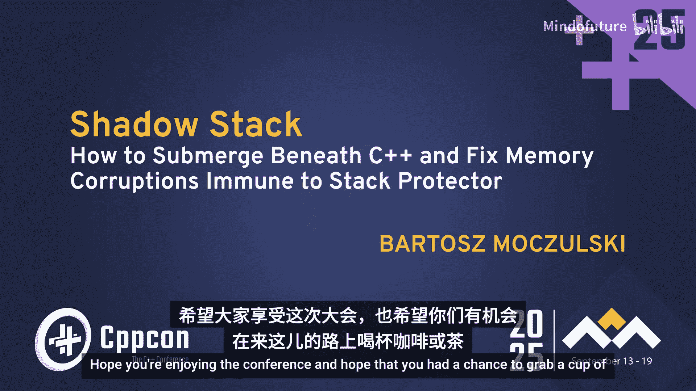
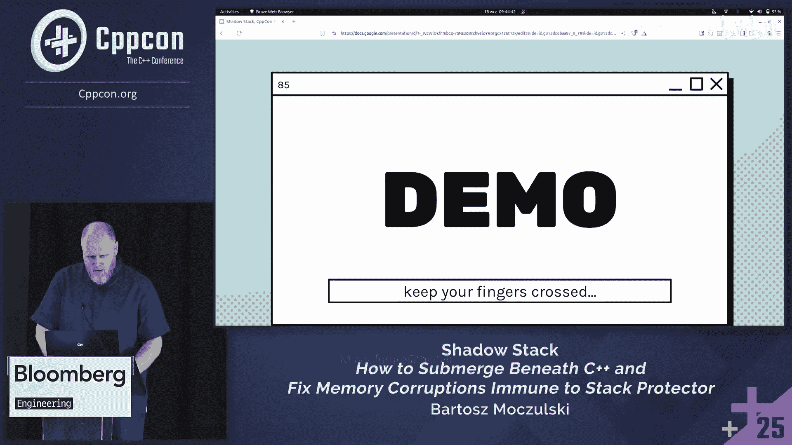
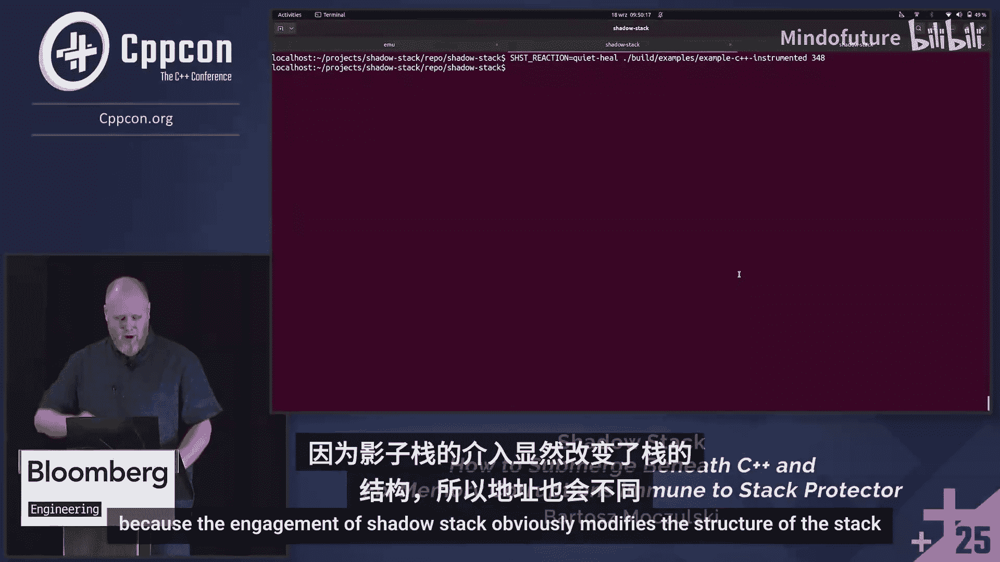
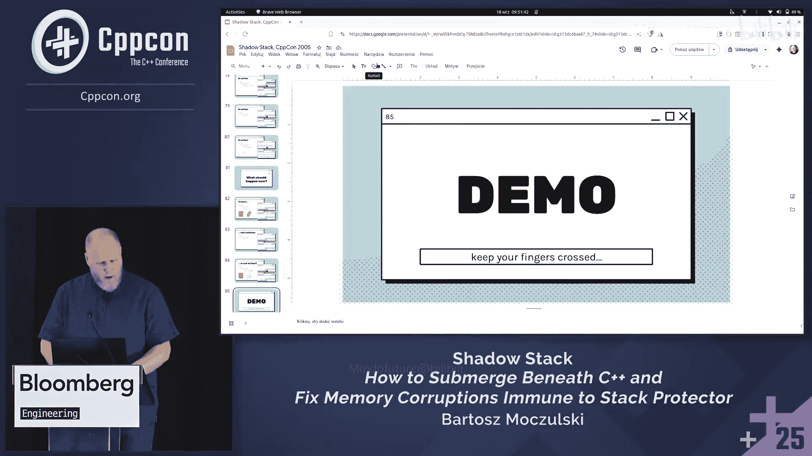
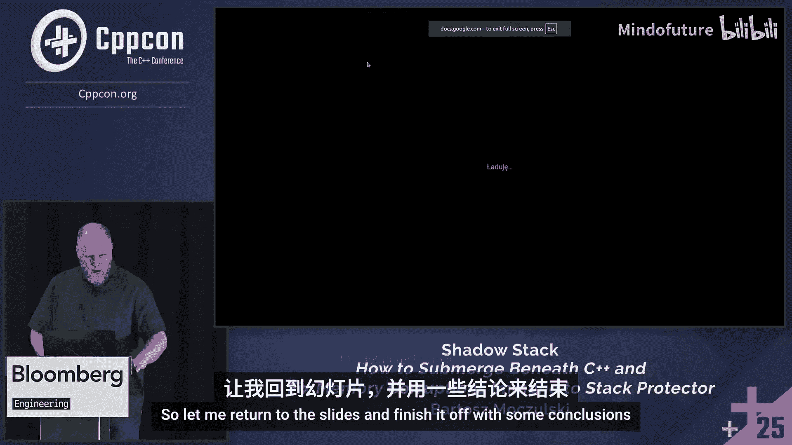
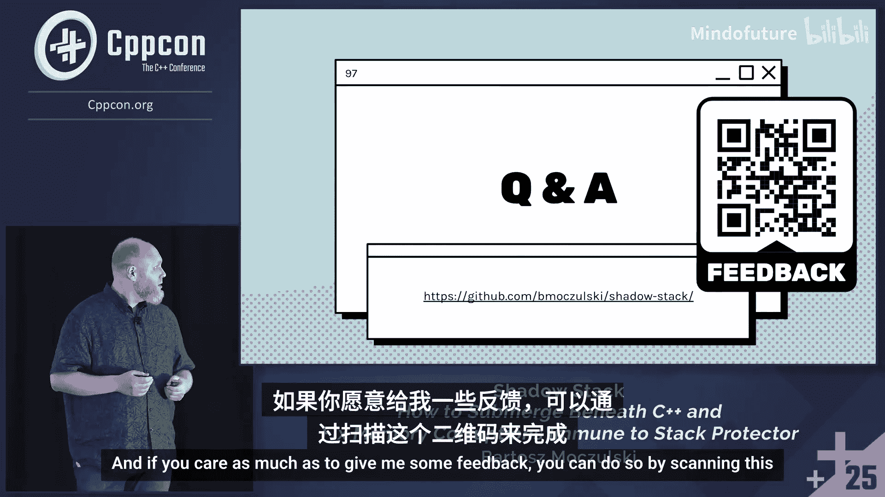
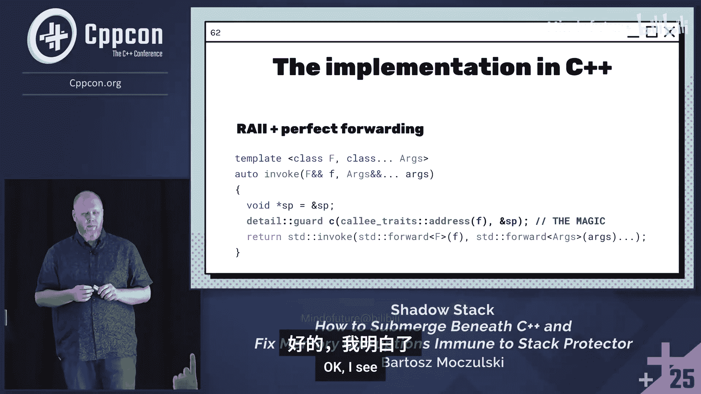

# Cppcon-2025-｜-C++-｜-C语言--｜-汇编-｜-编译器-｜-操作系统-｜-Linux-｜-Windows-p07-P07_使用影子栈库修复C++栈损坏-Bartosz_Moczulski-CppCon_2025--BV1wyPBzrEeu_p7-

One of the benefits of coming here in person is people are always being hired from CPPCon。

 companies are here looking for the best in the world and good talent。

 so whether it's career or networking or just building up your technical skills。

 most of those you won't get from just the video， but that you can get from being here。

Good morning， everyone。 Hope you're enjoying the conference and hope you that that you had a chance to grab your cup of coffee or tea or whatever float you boat on your way here。

😊。

My name is Bartto Morowski。 I'm here to talk about Shaowt。But as you can probably。

 as you can probably infer from my name and sur name， I come from Poland。 And on several occasions。

 I've noticed that my name can cause a bit of confusion to English speaker across the world。

 So I'm going break it down for you really quick。 and I will go on record。

Imagine there is an H instead of a Z in my name at the end， because that's what we do in Polish。

 We write s as S plus Z in English is S plus H， but the sound is exactly the same。

 So my name is Bartosh。😊，And if it so happens that some of your ancestors were pirates or Vikings。

 you even stand a better chance of pronouncing the R more closer to this Polish pronunciation。

 but no worries， I think the off is and and as good as it goes。Yeah。

So you may want to use it later on if you want to address me any questions。

If we follow on and apply the same trick to my surname。Plus， one more。 Why does it not proceed。

There we go。 So again， we replace Z with H and U with double O because Polish has never undergone the great vowel shift。

 The surname sounds Moulski。 And that's who I am。And this was Polish phonology 1，01。

 Thank you for attendance。 Yeah， so dismissed。😊，Just kidding， of course。

 you came here for Shaowt and Shaowt you will get。And before I start， I need to ask you a question。

 How many of you have a TV set at home。Okay， almost everyone。 That's what I expected。 Now。

 do you sometimes use it to watch streaming services like perhaps Netflix or Hulu or whatever。😊。

Still， almost everyone perfect。I'm really glad to hear that because I am the man who works tirelessly behind the scenes to make your TV playback work so that you get to enjoy your telly at the comfort of your couch。

😊，That's what I do。 And for the last 20 or so years。

 I've been involved with digital TV industry and mostly focused on making firmware for set boxes。

 all these small devices that you connect to your TV。😊。

You have to receive the signal from O below maybe satellite operator。

And if I know one thing about video playback。Oncept the boxes and other embedded devices。 It is that。

啊，很 Kong。Why does it just work。啊啊。It's such a shame。 Yeah。

 it's that it can crash for no apparent reason， like my presentation right now。は。Who knows？

There we go， yeah。Crush like so。啊。So my talk is actually about one such case that I encountered and had to analyze and had to fix。

 And I'm going to tell you all about it right now。😊，Yeah， so bug fixing。 back fixing is pretty easy。

 right， there we have a generic recipe。 You first need to encounter a bug， Then you embrace it。

 And finally， you can eliminate it， hopefully。😊，啊。Because until you know that a problem is occurring until it has manifested itself and you observe it and for it。

It doesnt。 I mean， it's not broken。 Just don't touch it。

After you actually notice that there is an issue， you start analyzing。

 you start gathering the evidence， and you start thinking about what and how happened。

And by the time you finish the analysis， you stand a good chance of fixing that bug rather quickly。

 most of the time。However， not always， because memory corruptions。

EI wonder how many of you had to fight memory corruptions in your career professional。

 almost everyone。 of course， otherwise， you wouldn't be here and。😊，Was it yeah。

 was it by any chance to start corruption。If， a few last hands， yes。

 because heat corruptions are far more popular than star corruptions。Yes， so have I， in fact， I've。

 I've been dealing with all sorts of errorss in my career， not only memory corruptions。

 also multi threadreading， logic arrow， resource leakage。 you name it。😊，Integration whatnot。

 because frankly， every software has a bug in it。 the moment it is written。

 And in the history of I T and software development。

 there will only ever be two pieces of software that will be back free。

 These will be tech and meta font。And if you know why。

 I guess we all hope that it will take as long as possible for them to remain backful。啊。Yeah。

So in practice， I'm often a Linux detective。 And that's for two reasons。

 First one is that Linux is a primary development environment for embedded devices such as SD Bs。😊。

And second is that while I sometimes get a chance to write some code， sometimes a new code。

 sometimes expand existing functionality。More often than not。

 I need to investigate issues and fix them。And。I often succeed。

 So that's why I adopt myself as a detective。Before we dive into。

 I want to underline your takeaways from the talk。I divided them into three categories。

 First of them is just entertainment。So maybe， just maybe you think that memory corruption doesn't apply to you。

 And you've already replaced all your raw arrays into st arrays， and you've used st span everywhere。

 and it's just a problem solved。 Fairair enough。 I will take it。 sit back。

 bring your popcorn and enjoy the stock。😊，And watch the rest of us be tormented because it's always fun to see someone else suffer as long as it's not yourself。

😊，Yes， but realistically we to become aware of of these issues because they' are not going anywhere。

 And these are like the cornerstone of computer science。 So if。

 if it so happens that you were not aware of the mechanism I'm going to describe today by the end of of my talk you will。

 and that is my success。 and it is your great success。So awareness is already a great step forward。

But obviously， you wouldn't stop it to that， right， would you。

So you come here to learn why these things happen and how these things happen and obviously。

 how to prevent it and fix them if they already happened。And that's what I hope to help you with。One。

 clarification， I'm talking about T。Obviously， it's not that stack。 It's not the stack。

 although this is like a great library， very useful。 However， it's not the subject of of the talk。

I will be talking about the CPU stack， of course。 And this is the one that where your local variables end up and the one that CPU use it to call subrouts。

Right， so they told you， like。The encounter is the first step for dealing with the bucks。 And indeed。

 it so happened。 So the other day， I get a message on Sla from my colleague。

 very experienced senior engineer。 And he says something like that。😊，Look， Barto。

 on on that new streaming application that your team has been working on。

 and we are about to launch soon。They say， yes， what about it？You know。It crashes。I say now is a way。

 we've been testing it thoroughly for the last couple of weeks。 I mean， we haven't noticed anything。

That he goes on， and he says。Yeah， but it only preciouses when you watch live channels。I mean。

 fair enough but， yes， this has been tested and nobody reported anything。But he persists。

 And he says。You know， but it only crashes for me every so often， like maybe once a day。

 at most twice， no more。Okay。That's becoming interesting。Obviously， we have been testing that。 Yeah。

 we've undergone scrutous tests， like for lasting many hours， Man。 So I guess we should have noticed。

AndBut he comes and says that it crashes。he goes on and gives me a final bit of detail。

😀It only crashes on sports channels， live sports channels。😊，So you can imagine。

 I'd see if you are into sports， picture yourself， for instance， watching football。

 Maybe it's the FiA World Cup finals。And your application crashes in the middle of the match。And oh。

 yes， you can， you can like navigate to the main menu and restart it and find this transmission again and start it again。

 And it even keeps playing。 crap fine enough。 But you've lost the precious minute of， of your match。

😊，So for for those of you with whom this doesn't resonate， maybe you。

 you follow the other football more the the one that you play with hands because obviously， So， yes。

 you were super Bowl。 And in the like in the middle， it crashes。 You get the picture， right。

Crushing streaming application in the middle of live sport events， causes。A lot of angry customers。

 It's like a big no no。 So at that point， I I know already that I will have to investigate it。

Alright， so the embrace。Buckle up， that colleague of mine。

 being a senior engineer and dog food our product at home。

 He had a development version of the set box。 So he， he was the only one experiencing the problem。

 So luckily， he， he was able to grab a condo for me， or maybe two of them。😊，One was， no， sorry，3。

 actually， and one was useless and the other were useful。

So I opened the code up in GDP as everyone does。And what can I see， It crashes in Pe at Mut's analog。

Now， I'm smart enough， and you are definitely smart enough to know that Peter at Mut' unlock is rock solid。

 There's just no chance It's broken because if it was。

 we wouldn't even get to the point of starting the applications。

 It would have been called like a million times before that and definitely。

Any issue would set us earlier。So it's not a pieceex unlock。 It probably is the apparent function。

 right， the do stuff。 That's how I call it for for sake of this presentation。

Can you notice anything suspicious on this slide。Yes。😊，The objects of this talk。0， yes。

 the so the other 0，0 and 0，3。 Alright， What's wrong about it。They're close together。 That's correct。

Ms。 Lyman， I hear Mr。 Lyman， Yes， that's correct。 They are misigned。 Okay， already suspicious， yes。

The zero， zero is typically。it could be a step。Yeah， so so the comment is that stuff starting with 0。

0 is rather not a stack address while the FFF， it should be。 Yes， that's correct as well。

So we clearly see that the address past to the piece smooth X analog is incorrect。 Okay， I mean。

 it happens。 We sometimes make mistakes。 So I navigate to the do stuff function。

And here's what I see。And it's like a function like mid on other functions。 It's a cliche。 You look。

 you receive a pointer to some structure。Within it， there is a mut text， you lock it。

 you do other stuff in the critical section， then you unlock it。 Nothing wrong here。And yes。

 obviously， the the motex is at some offset。I put it at offset set of like one word。

 So either 4 or8 bys， depending on the architecture。All right。 I mean， nothing wrong here。 So。

 so what could have or should have gone wrong。 Def the log function， the first one in in here。

 it worked because we ended up crashing。Sorry， we ended up crashing。Here in at the bottom。

 not at the top。So the others was calculated correctly for the first line。 And for the second line。

 it wasn't。How and why maybe， maybe the compiler made a mistake。Fair enough。 Let's have a look。

 And I'm really sorry for torturing you with this disassembly。 I hope it doesn't give you a pink eye。

 Please don't read it like from top to bottom。 we will get through every line in a bit。

 But can you at least recognize the architecture here。Arm， I can I can hear arm。 Yes， that it is arm。

 and it is specifically arm 64 beats。And from that。

 we can infer this that this pointer passed to P functions should be offset by 8， not by4。

But it was offset by three。 That's strong。So arm， arm matters。 I。

 I could have shown it on the Intellect 86， right， but arm does matter。 And to prove it to you。

 I'm going to use this gadget。How many of you have a cell phone with you today？Everyone， right？

And for a contrast， how many of you have laptop， but specifically with Intel X 86。

Like maybe half half of you， okay。There there are way more arms in the world as far as I reckon than X 86。

 And that's what I'm showing you on this assembly。 That's why I'm going to talk about arm architecture。

 right， We've already covered that。So arm， in case you don't know。

 and maybe just as a recap called convention on arm。

There are 32 registers on give or take plus some other specials， but the core one are 32。

 and they are fully interchangeible。 You can use either of them except you can because you know。

 all registers are equal， but some registers are more equal than the others。So register number 31。

 you will never spot 31 in N it is assembly。 You will always see S， which stands for stack pointer。

 Pretty useful for stack corruption。And the other two， 130 and when in9 are used to call subruoutine。

 So if your function is called another functions， these these register need to be used。And it's。

 it's not like very important， but it is a classic function co frame。

 So at the top stack stack frame is set up。 And these special registers 29 and 30 end up on the stack。

 And they are popped at the end on Intel。 it， it would look as push and pop。

And actually on the arm here， it's an equivalent。Moving on to the more interesting cr。19 to28。

These have these have a special property must preserve。

So a function being called must not change the value of those registers。 I mean。

 it can use them internally， but it has to restore the incoming values just before returning。

That's important。And that's exactly what we can see here。These two registers， the two of them。

 because this function is going to use just two of them，19 and 20。 They are pushed to this stack。

And this， this instruction， it's called store pair。 So store two registers。 And where do they end up。

At the address of the search argument。 So somewhere on the stack stack pointer plus 16。

And here at the bottom， the airport popped。Right， so the function did what it was expected to do。 It。

 It wants to use these registers Fair enough。 It can。

 So it temporarily pushes the incoming values of the stack and will pop it just before returning。

So this brings us us to the last group that is important for sake of this presentation。

X not to x 7 are input input arguments。 Theyre also used as return values because in some languages。

 you can return more than one value， so。It would go to x1， x sorry， x n x1， x2 and so on。 in CP。

 we only ever return a single value or none of them。Right， so as a recap。

 that's how how our function looks。 It receives a single argument， which is a pointer。

 and it calls re function。So the first thing it does， it。It stores the incoming x node。

 the incoming pointer in x 19。Because it it will need to， to modify the value of of x n in between。

And it calculates the offset of the mutex。 So they point it to the muex。Xnaught was 8。

And it stores it in X 20。So far， so good。So then it uses the calculated muttex address to call the Pot Muex analog。

 passing this argument in Xn being the first anomaly for P Mu， sorry， for P Muex lock。Okay。

 it returns。So it continues。 It already calculated， or maybe not even calculated。

 stored the incoming pointer in X 19。 It's still there。So it can be used to call do stuff locked。

 the critical section。And once it returns， oh， the the address of the Mutex is still in X 20 because must preserve recall。

 So it can again be copied to x n and be used as the first and only argument to at Muex unlock。

And as we've already seen。It crashes， and it changed the value in between。Look。

 there are no modifications of X 20 here on slide。 So something must have changed X 20 between this first and second highlighted line。

So it must have been this function。It's not the one that we see on the back。 It's the other one。

 the one that。Our function is calling。So if we descend into sub function。

 we can see already the familiar pattern over there。 this sub function。 again。

 it will allocate its stack frame， and it will push X 19 and X 20 to the stack and pop it at the end and return。

And guess what。It pops in the correct value。sorry， it pushes the correct value， but at the end。

 it pops an incorrect value。How come。And here's the answer。

We've got a crash over the ineachered nuex。 we are smart enough to know that that's not the root cause。

 So maybe the stuff nope。It's somewhere underneath those stuff locked or maybe within the function itself。

But it can just as well be anywhere in entire coal graph of the dustta flo。

So it's a needle in a bloody haystack。 And we need to find it。And it's not going to be easy。

And here's the illustration， how it all works in practice。 So it's no cosmic race， no magic。

 no nothing。 It's just probably out of out of bound modification of some Ary somewhere。

We start with do stuff。 It has some frame on the stack， than it calls dot Lo。

And it obviously allocate its on frame， and we continue to some other buggy function。

 And what does the buggy function do， You， you can already guess。

It modifies the one of the parent frames， not the one of its own， not some thing on the he。

 but something higher up the stack。So at that point， you， you might ask the question， Hey， Bartosh。

 but we've got stack protector， right， It should save us。Shouldn't it。I'm glad you are asking。 yes。

 the comment。more writing。どすか？I I guess I， I can get where you' headed with that。Yes， it。

 It won't save us not in this situation。 because that's what the stack protector actually does。

 before calling any function， it pushes as one additional value to the stack。 It's called canary。

 And it's called canary。 I mean the name， probably many of you will know it comes from old days of mining industry。

 where in the underground chambers， methane or other lithal gases could accumulate。

 So what the miners do， city didn't want to raise their lives。 So instead。

 they put a small bird in a cage into into those chambers。 And if the birds survived。

 the place was safe to work。 and the miners could enter。😊，If the bird dies， sorry。

 it's a sacrifice they were willing to take。To protect their own lives。So we've got canaries。

 first canary on this stack。Then just young calling our regular function。

Maybe it goes another function。 So what do we do， We push another canary。And another stack frame。

 easy， right， And the third canary。 And we end up in a buggy function and the buggy function。 Yeah。

 if only it overrote its own canary。 and then it would be easy。

 It would be detected immediately upon return from the buggy function。😊，Okay。

 this didn't happen clearly。So how about if the buggy function modified another canary。Okay。

 it will not be detected immediately。 It will be detected only after return from do stuff locked。

 So a little bit later， but still will be detected。

So the worst case happens if the buggy function modifies something in between。

Because stack protector is absolutely unable to detect such corruption。

And it's not because stack protector is broken in any way， oh no。

It's because it's designed to handle such cases， the contiguous stack modifications。

 if you go off your array by many bytes， maybe you miscalculated the arguments。

 your meet or mem copy or string copy or whatever。Many contiguous bites。 Yes， they get detected。

 Sing bites。 now they not。So。What do we do？Do you happen to not。 Yes， Yeah already already questions。

Can you increase the size of the canary？Increase the odds to catch such a error light instead of pitch one bike。

You put like a a big cat。Yeah， but still， I mean， that could work。 echo the question。Oh， sorry。

 sorry。 So the question was， can you enlarge the canary and make it bigger， like more than 1 B？ Yes。

 you could， But it wouldn't change， I think， because you can still corrupt something that is not a canary。

 And we end up where we are。Other questions， yes。Thist a hardware break。

The address for that was saved。But alternatively。できし。the function。So let me repeat the question。

 and if I got the right， you could set a hardware breakpoint for a modification of that particular address on the stack。

 Yes， you could。 assuming if you know the the exact address when it happens。 And let me remind you。

 it was happening once every few hours， maybe once a day。

 And you don't necessarily know which address is going to be corrupted。

You can also set a conditional break。Yes， so so the comment is that you you can set conditional breakpoint。

 Yes， you still can for sure。 but still， you need to know upfront what the corrupted address is going to be。

 And in my case， it was always the or。Do do you mean like a conditional break for modifying any of the old addresses on the stack。

 the conditional break。What is the stack？function身。What's the address of that next student？Okay。

 so like the conditional break point， you say conditional breakpoint based on current stack pointer。

And maybe summer。 Yeah， maybe still， you would need to know what is the offset from current stock pointer to the address being actually corrupted。

 And I didn't have that information。 Fortunately， it， it would work， yes。

But are you aware of any other tools that could help us here， I can see your right hand。 Yeah。

 I don't think it works right。Absolutely， vgri。 I went as far as checking on their web page how theyre willing to pronounce they And I。

 and supposedly it's vgri， like the Nordic。Prounciations。Yes， unfortunately， no for two reasons。

 And first one， its， it was way too slow for our case because we were running a browser like a food blown web browser on an embedded device。

 a pretty constrained environment。 So the overhead of running vibra was just not acceptable。

 And the second reason。And its like more fundamental one。

 Moification of stack is not an legal operation。 You can very well pass a pointer to an object on your stack into a function。

 expecting it to make a modification。 And this is a legit case。

So vgrens would would not be able to flag it because， hey， somebody's modifying the stock。

 It happens all the time。So for these two reasons， unfortunately not。So I was chatting。Yes。

 maybe avoiding avoid using。The stock buffer。Maybe avoid using stack buffers。

 what do you mean exactly by that， So in order to protect us from Sta corruption。

 Preing using stackg buffer is a good guide。Okay， so， so the idea is like。

 don't use variables on stock。 move them to the heat， right。Okay， and then。

 and then maybe you will be be safer。 Okay， maybe your object will be safer。

 but the stock can still get corrupted。Possibly， right， another。ことたしたい。We could use MP right， Okay。

 memory management， right。Yeah， memory。So it's a small upgrade。

So we just say that you're not allowed to。で、すね。When我。James Fritz。Yeah， so okay。

 so the protection the comment is that we could use MP U to to protect the fragments of our stack。

 and this allow other threats from modifying it。 So guess what。 It was coming from the same threat。

That would not get it。 but I not。Of the。Okay， so yeah， so okay， no。

 no I mean limit the usage of stack variables in favor of He。 Yes。

 that that could work maybe sometimes。 And it's a it's ait idea that I did consider。 actually。

 I was going as far as hey， Linux has this memory protection API。

 so I could maybe lock portion of the tag that I'm not willing to allow to modify。

 but this goes in chance of either 4 or 64 k B like in bulk。 you cannot protect single bys。

 unfortunately。So I had to do with something else。 I've got to。This space。

 you can actually use some newer。Fature called user F。FD， which can allow you。We handle page faults。

So maybe you could set up a。Whenever something accesses。That北 you。Okay。

 so the the comment is that in new Linux， there's how do you call it user fault， right。

 It's called user F or something user fault F。 Okay。

 I will have to check it up because I wasn't aware of that particular functionality。

 It sounds very useful。We were not aware。 So， so we need to consider something else。

 And I ended up chatting with with a friend of mine about it for just just a second for a few days。

 And after a bit of a rough and tumble， we we ended up with the idea。 hey。

 how about if we create and maintain a second copy of the stack and always know what was there。

And if we detect and when we detect that something got corrupted， then we can at least react。

 You had a comment。And other things， I mean is address sanitizer。EAcent。

 it might have been available。 However， does it apply to start to that extent。

It wouldn't work for the same reason as Dlving。아 그。亚瑟 so。Yeah， yeah， so the other。 Yeah。

 So the consensus is that for the same reason as vibrant， it wouldn't necessarily work。 Yes， no。

 it has a bigger guard then， so it might have worked by random luck。In general， now， yeah。

 in general now。 So maybe if we were lucky then maybe， but in general， not really。So， so， you know。

 we， we braintoed with a friend of mine。 and we ended up with this idea。 Hey。

 let's create a copy of the stack。 And let's like mem copy all the time。

And that's how Shadowt was born。 And in name， I mean。

 I drew some inspiration from the concept known in especially British politics。

 maybe not so much here in states。 But there is a concept of shadow cabinet。

 So imagine there is like a fictitious countries。 let's， let's call it like computer land。

And they have two political parties over， and they are called big Indians and little Indians。

And maybe they just had an election。 And it so happened that big Indians won。So obviously。

 they get to appoint the prime minister and the government and so。You know how it works， right？

 So what what does the opposition do， the little Indians that just have lost。

They will appoint their own prime minister and their own government。

 And they call it the shadow cabinet。And if we these folks， they are not allowed to rule。

But they are waiting there on standby， like monitoring what the。

 what the actual government does and criticizing them。

And if it so happens that some of the little Indians gets to convince。

 there's a handful of big Indians to switch sides。Y。They， they gain the majority。

 and they get to rule， and they got people ready and waiting to rule from day one。 And cybersecurity。

 we will call it from the zero day instantly。😊，So yes， shadowing。Shadow Do， I guess。

 was inspired by by， by the same concept。So that's what we ended up writing。

 And that's how we we designed it to be used。 So suppose you have a function。

Which you suspect is broken。And you wrap it in Shat invogue， just like you would with stood invogue。

 As a matter of fact， it does， you stood invoked internally。

And maybe you sometimes have a method code because， yeah。

 they are sprinkled every here and there in our coat。 And they So you。

 you just use this this the same way。 Sha stack invoke your method， and you're fine。

And it does the magic under the hood， right。That's the actual implementation。 I'm not kidding that。

 that's the actual copy from this sourceco no smoke and mirrors。

So we take the address of the stock as， as it stands right now， we do the magic。

 which I'm about to explain just on the next slide。And we forward everything to vanilla。

 regular student Vogue。They are perfect for wording。Nothing fancy。So what does this magic do？First。

 before descending in， into， into the underlying core。

It will obviously calculate the current stack address。

And will upend the missing bit to the shadow area， to the copy。And shortly before returning and also。

 just after returning from the call。It will。Drop whatever is needed。And in between。

Just before descend standing and just after returning before， before dropping the extra bit。

It will do a a M copy。And it will instantly detect， hey。

 is everything still right or my bes broken already。And if it detects things it got broken。

 then it will react accordingly。 It may print a back trace。 It may do something else。

 which I'm sure your imagination will suggest what can be done。Like。

 we were so lucky that we were interfacing with a sea library under the hood。😊，And in C， you don't。

 you don't get the perfect rewarding or anything。Or maybe you do。

But it's like nearly perfect for wordding。 And you need to do use some compiler intrinsics to achieve it and a few bit of macros。

 which we all， all love so much。It's inevitable in C， but， but it can be done。

And maybe you don't feel like modifying your code， right， because that's beneath you。

So maybe you prefer to use L preload。That's fair enough。 We've got you covered。And。Here。

 I've got an example of how to L， how to wrap function using the LD proload technique。

Where they all here is the DL S。 we get the address to the actual function。

 and we forward everything to the actual function。 be warned。 there is a shameless A BI abuse here。

 And I simply figure that out。 let's pretend that these functions。 they always take8 parameters。

 right。And I would just pass them downwards。 And if they happen to be pointers or integers。

 it doesn't really matter from the perspective of the processor。 it's， I mean， don't try this code。

 right， don't try it at home， but it does work。At least on at least if the arguments happen to be primitive types of pointers and on arm and a little bit on X 86。

 So yeah。Take it with a grain of salt。Obviously， you can also， also wrap C plus plus functions。

 There's no issue with that。And how does it work， We are in the do stuff function。

And maybe it does want to call something。Something protected with shadow stock。 So shadowt kicks in。

And first thing it does， it copies whatever was missing in the shadow area to the shadow area。

And there's nothing else。Then it makes a memory compare。 Right now， It doesn't make much of a sense。

 but it will in a second。And it lets hang on。Yes， it lets the function be called and be executed。

 And obviously， this functional it allocates its own stack frame and stores their variables over there。

 And maybe that function calls something else。 Yeah， it it wants to call another function。 So again。

 shadow stack kicks in copies the remaining bit to the shadow area。😊，Compverse， so fast， so good。

 no corruptions。So it allows the function to continue。And we've got some function。 And And yeah。

 you've seen it already on a previous slide。 It wants to call something else， So copy， and compare。

 no difference。And we end up in the buggy function。And this buggy function。

 maybe it wants to call something else and maybe it just wants to return。 here。

 it corrupts one of the parent frames。And。It wants to return， and it does return。

So right after the returntan， shadow stack kicks in again on the returntan path。And compare。

And it detects that something good broken。So we my question to you。

 what do you things should happen now。Any ideas， yes， Cor dump。 Yeah， that's a legit one。

Exception exception is the other one could be。 mind you， we are in a heterogeneous environment。

 So C N C plus plus， and actually in。In this particular process。

 exceptions are disabled to but this is just as I know。 But yes， that's a good idea。 could be。

 could be an exception as well。 Yes， the difference。 lookss the difference。 Co， yes。

 back from the shadow。 copy back from the shadow。 I've I've got all sorts of of good ideas。 Yes。

 all of them about it。😊，So it can heal， right， because it knows what should have been there in the first place。

 So it can say， Ok， I know you corrupted something。 Let me help you with that。😊，是。Yes。

 miss something， how did you know the stack size frame because you're checking not just your own stack size frame。

 but like your parents， are you checking all parents all the way to the main or how do you know how many to check？

Yes， the answer， Okay， so the question is how do I know how many how much size to checks Right pretty much。

 So I keep track of that like as we go and as we descend from this initial function。

 shadow stack keeps track of of when it was cold。 So。Right here。

 also maybe it will be more clear on the previous site。Like。Right here。It takes the address。

 current address of current of current place on the stock as we descend each time it will be like a different address on the stack。

 and it keeps track of those those until it returns and returns and returns and returns。

 So it it knows the entire history and knows how much of an area it protects。

Does it answer your question？Sort of it doesn't protect the last function because okay。

 you don't get that。 yes， it doesn't protect the last function。 Yes and no。

 And its implementation dependent because one code use， for instance。

 P API to figure out what's the original others of the stack and how big it is。 So it's， I mean。

 it's addressable。 But indeed， we like turn a blind eye to that。 And we said， okay。

 we are not protecting the first one。 So' as you said， you can modify stack variable。

This does not discern， so it will always fire。Oh， okay。 that's a good one。 I won'。 I mean。

 I was kind of expecting someone to comment on that。 The comment is。

 it's legit to modify stack variables。And we are like kind of ignoring that。 Yes， that's。

 that's true。 that's true twice。 First of all， it's true that it's legit to modify。 And。

 second of all， yes， it would like instantly trigger the the notification of the the reaction。

And my comment to that is we are aware of the situation。

 and we have an idea how to address it by by the committee exception exception of exception。 No， no。

 no， Now it's even easier。 but it has it requires a user。

 the author of the code to unnotate the areas or the variables that are being passed this pointers。

 like mark them， okay， from this， this address， the next four by are okay to be modified。

So this would require an extension。 Right now， it's not in our library。

 but it can be pretty easily added。Is it right， I will okay on this one Fair enough。

 right So this like So even comparing it irrespective of the outcome， you' are always comparing it。

 right， the shadow one and the real。One corruption also can happen in the shadow stack， right？

So how do you know which one。Is。Okay， the comment is that I'm comparing actual versus shadow。

 and it might so happen that the shadow gets corrupted。 not the actual one。 Yes， that's possible。

 However， the the issue you were trying to， to find and and pin down was the actual corruption of the actual stack。

 not just a random memory。 So we knew that it was something offset from the current stock pointer somewhere like。

Forward， it will not be on the hip because the shadow the shadow area will be on the hip that it will just be allocated and somewhere totally else。

So I still hand over that somewhere。I was just suggesting。So yes， the company to allocate on the hip。

Folks， I'm， I'm looking at at the timer here。 I'm happy to， to keep getting questions。

 but let me just fast forward a little bit。 and maybe we will save those questions for later。😊，Yes。

 so all your comments and our observations was very much valid。And where we allright。

 we can heal because we， we know what should have been there in the first place so we can like apply a patch and let the application continue because why not。

 because robustness and whatever high availability。

 there are many principles that that wouldn apply here。

And someone already suggested that now we will not which you shall not pass。And we。

 we initiate instant process termination as at such situation。

 And this thing actually that that matches one to one to contracts that some of you probably have heard of on this very conference area this week。

 So this would be like policy equals hang on and force。Enfor in in contracts。

 So dump the report and terminate。And now， please。Keep your fingers crossed for me because I have made a sacrifice to the demogogues in the morning。

And hopefully， they accepted my sacrifice。And I will show you how it works in practice。So。

 I've got a。An application。 it it matches like one to one I what I'm showing on the slide。

 So there is the stuff it logs the mutex then causes the stuff loads and all the other functions exactly as they are called in the in the on the slides。

And I'm copying that light。 And this line and。I'm here in the Q MO machine。 By the way。

 if anyone knows how QM should be pronounced， please let me know afterwards because I wasn't able to find that information。

So okay， I around it， nothing happens It seems to work。Correctly， however， there is。

 there is a feature in it。 sorry not paste。 There's a feature in it that I can force it to modify。

An address at certain offset。 And I calculated that offset carefully， and it happens to be 140 B。

And I get a segmentation fault， right？So maybe let's have a look at it in GDP。There we go。

Running in GDP， run。Seful， right？Just， just to prove to you that I'm not kidding getting down and smoking mirrors。

Yes， it do stufflo and we end up with the segmentation fault in P re text analog just as I showed it on slides。

 here's the modification of three。That that doesn't look like a valid partner。 He is the valid one。

 and plus 8 would have been a valid one。 but there is this03 right here in the middle。So let's exit。

 Let's exit。The GDP。And let's run the same application。

 but with the shadow stack instrumentation in between and let me just show you the DF。

 that is the diF， so you need to apply these modifications to a source called precompile it and run again。

And that's maybe the， the library that it calls into。Again， like small one lineness。

So I'm running the， I know， hang on。 I haven't copied it。 have I。Where is this line？So。

 I'm copying this one。And it has the shadow stack compiled in。 And there we go。

And if I scroll up over there， it shows me， oh， there is a three here。 It shouldn't be there。

 It should be double A。And it also shows me the like the history of maybe not necessarily exact stack frames。

 but shadow stack frames。 if you will， So the points where the shadow stack was engaged。 It doesn't。

 It doesn't necessarily need to be engaged at every single function on on your call stack。

 It may skip some bits for brev。And over here， yeah， we've got the full cold stuck like， hey。

 that's where it happens。Like， in the other function。Upon return or upon destruction of the guard。

 the gut is like an object in our shadowt library。 And when we were distracting it。

 meaning that when we were returning from a shadowt guarded function somewhere in the other function somewhere in this one there we detected that there is a problem。

So the problem must have been within the function being called there and the other。

Where was it like here。The other， the other O。And the other happens to call the buggy function。

 So indeed， we managed to identify that the problem we narrow down。

 not necessarily identify fully yet， but narrow down it to the buggy function。

So that's already a good progress。And obviously， yes you can run it in GDP。

 you have pretty much the same result。You can apply different strategies as。

 as we've discussed briefly。 so you can， for instance， just report and let me copy that。Copying。

 and you can just report。And okay， it's in GDP again。 So running that。

 And as you can see many reports， right， because as we return from many nasty functions。

 we get a chance to detect the corruptions on our way multiple times。

 So we get all these corruptions。 But the shadows that doesn't kick in doesn't do anything。

 doesn't terminate doesn't heal。 It's just report。 So the equivalent of observe in contracts。

So right， of course， we can heal。Let me prove it to you。 I'm just shut down， shutting down GDP。 Yes。

 yes not the letter。There we have。 We have the report， but note that。Eco dollars a dollar。

Question mark。It yeah， it didn't crash。It returns， okay。

And you can also apply so calledled quiet heel。 So please heal and don't bother me with the report。

There we go。 It works， now。NoNot that I had to calculate all of these offsets carefully for every single function call because the engagement of shadow stack obviously modifies the structure of the stack so the addresses will be different。

 but the detection will happen nonetheless。

Yeah， so here I've got I'm showing you like。Alternatives， how you could format your report。

 So maybe you just want the left part of the report， not the right part of the report。

 and maybe you only want your lines to be 8 by song not 16 as it is by default So and you can also hide the equal lines if you you don't want to be bothered with those。

Yeah， so that's it。 Aunt last。 but at least there is an L pro load。And。Yeah。

 and it obviously requires you to use dynamic loader。

 and it only applies to the points which are actually exported from your libraries。

 So it limits your flexibility a little bit。But maybe you don't want to recompile your original code because that's enough for you。

 I actually implemented this bit in my preal library。 So it shows， okay。

 we are descending descending descending retaining。 then oh， all of a sudden there is a problem。

And it's somewhere here。Yeah， again， again， we are in the in the buggy function called from the other。

And shadow stack engages and detect the problem。That said， I've got plenty of time。

 So let me return to the slides， and。

And finish it off with some conclusions。First of all， did we succeed？ Yes， we did。 Otherwise。

 I wouldn't be standing here， right。EAnd it happened to be an issue in one of the libraries that we were using。

 It's called G streammer， quite a popular one for video and audio processing。a very good library。

 by the way。 Well， however， we are all humans。 we will make mistakes。

And it was exactly what I showed on the previous slide。 It was the case of out of Ar modification。

And they had an area of size 6， and they were writing at the offset of 250 something because they forgot to validate the input data。

And at the time where we're investigating it， the buck had already been fixed in the upstream。

 So it was just， okay， we know where the issue is。 Let's just check whether the upstream people have already that with it。

 And they have。Easy as that。 Cheerry pick， ship it down。A few comments on shadow stock maturity。

 So it's not a fish。 It's not a free fish that we are giving away。

 It's also not a rod that we are giving away。 It's more of a blueprint for a ro that you have to assemble yourself。

 if you so desire。But it's doable， as you can see， yes， and it。

 it's missing this feature that where you could annotate certain areas as modifiable。

 So that has to be retrofitted。 but otherwise， it kind of works。And there is a Github repp。

 I will have a link at the last slide。 So you are free to check that later on。

 So our lessons and maybe your lessons as well。 know your canaries。

Because you should use them consciously， you should know what they're protecting you against。

 and especially what they're not protecting you against。And the second one， obviously， update。

 update your dependency or at least track your dependencies because there may be genuine improvements right there。

 and it can save you a lot of time。And the third and last takeaway is that order matters， because。

Picture this。imagineine we had a stock growing in a different direction， because why not。

Because it's totally doable。 It doesn't matter whether it goes from high addresses to lower addresses。

Or the other way， way around。And if it was indeed the case that it was growing through low memorial addresses to were high。

Guess what。We end up in the。Other buggy in the buggy function。And what does it do。It corrupts。

 the stack somewhere still does。 It's still a genuine bug。

 but it corrupts something that is free memory。So it's thebug。 Don't get me wrong。

 It should be fixed。But the consequences are far less severe。 And as far as I understand。

 more often than not an out of bound access will be behind the array， not before the array。So。

Can we switch this stock order？I will leave you with this。Question， open。 Think about it。Right now。

 Im happy to answer a few questions of yours。And if you if you care as much as。

 to give me some feedback， you can do so by scanning this Q code。

I would worry about the overhead of all the mem copies you were doing of chunks of stack and causing a lot of Heisenberg problems。

 Have you considered potentially just doing a check sum and storing a check sum that would also reduce your heap overhead for your shadow stack。

So I check some。 Yes， that would be ait idea。 It would not allow me to or maybe if I use some error correction。

 maybe it would allow me to would it。 no， it wouldn't。 Or maybe depending on the error correction。

 it might allow me to figure out the the previous value， but。We weren't worried so much。 I mean。

 we needed a hammer to quickly deal with the problems。But yes。

 that's an idea was along with kind of the check sum idea is。

In addition to being able to just check it on entry and exit of your functions。

 being able to salt throughout it a bunch of random spots to check what your values were。

 because once you've narrowed down to a big function having a problem， you know。

 maybe put every third or fourth line of saying， check the check some again so you'd kind of binary search down to where the problem was。

Yes， that's the entirely possible。 or maybe when you alternative。

 when you narrow it down to a particular function， right you can trim off all the all the parent functions。

 if you will。 So you're not concerned with any of those。

 So you're already managed to narrow down the problem。 you can make that your new start point。

 So that's also a strategy。But yes， I mean， absolutely that can be an improvement that could be developed。

Thank you。I feelel like I'm still missing something。

 could you put this slide that does the like the kind of the basic introduction that explains the guard。

Because where you like say what you ma copy on and where you take address of S P， basically right。

Can it be this one or even No， the one where you actually do take address of S P Oh， yes， yes。

 the delta in mam copy， Where does that come from， the delta comes from the previous call to shadow stock。

 So as you already alluded to， the first one is not protected， But it still memors。

 Hey the was the the entry point of the shadow stock。 And it remembers that doesn't make any copy。

 So yes， you got me on that one。 Okay， so the innermost function， The one that case do bad stuff。

 That one actually couldn't report on itself。So when you exit from that function。

 it doesn't know anything because it doesn't know how big its' own stack frame going to be。 Yes。

 and that could be improved by calling for instance， P thread API and figuring out on the first call。

 hey， how large my entire stack actually is。 So it's not like too big of a change to implement So right now。

 the situation is that we are calling Y P thread API because it can tell you where your entire stack actually starts was the address like the topmost address of the Sure。

 but you don't like what you need is to call a little function that creates another speed and parallel grabs its address and returns it。

 which would actually tell you if I call the next nested function。

 what would be the end of the stack frame and then immediately return it back。

 if I understand correctly what you're trying to do。

So you call it like a tiny function that just grabs it S， returns it to you。

 and that would be the end of your current stack frame， which yes， actually， I mean， sort of。

 but yout even get you don't even need to call any function because you just take the address of the variable that you just create right here in place that will be pretty much the same area。

I mean， not not exactly the same。 Yeah， Oh okay close enough。 Okay I mean so。

 here's the trick S pointer void pointer to S P equals address of that same S P。Okay。

 and that includes the automatic stack location， like for the saved registers。 but none of your data。

 and it relies like that's that's the capture。 Okay， I see。 Thank you。 Thank you。

Hey， thanks for the talk。 Very inspiring。 I think there may be a gap in this stack if the function takes a struck by value。

If maybe yes and depending on the size of the truck as large as track it may need to be passed through the stock itself yes that's a very very correct observation it may be the case so actually we didn't need to work with such functions therefore we didn't bother but absolutely I mean in a food blownown enterprise solution that's absolutely a thing that we should address。

Thanks。Any more questions from anyone。So let me just click through to the end。Thank you very much。

 And we are like 30 minutes ahead 30 seconds ahead of time。

