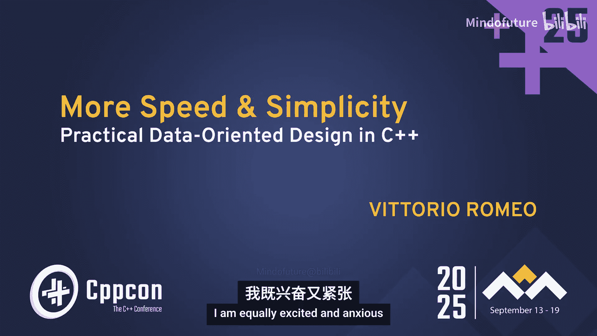
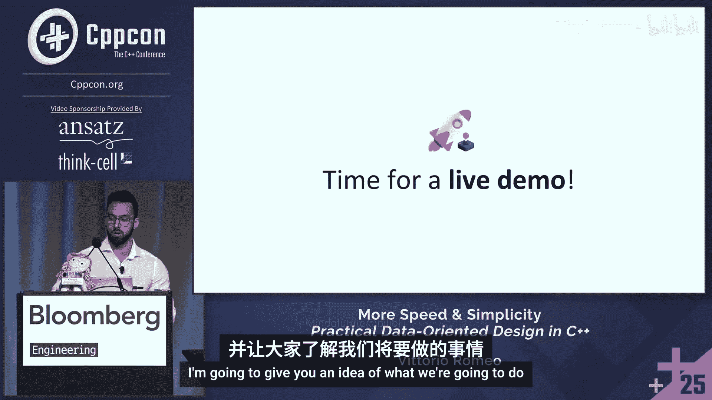
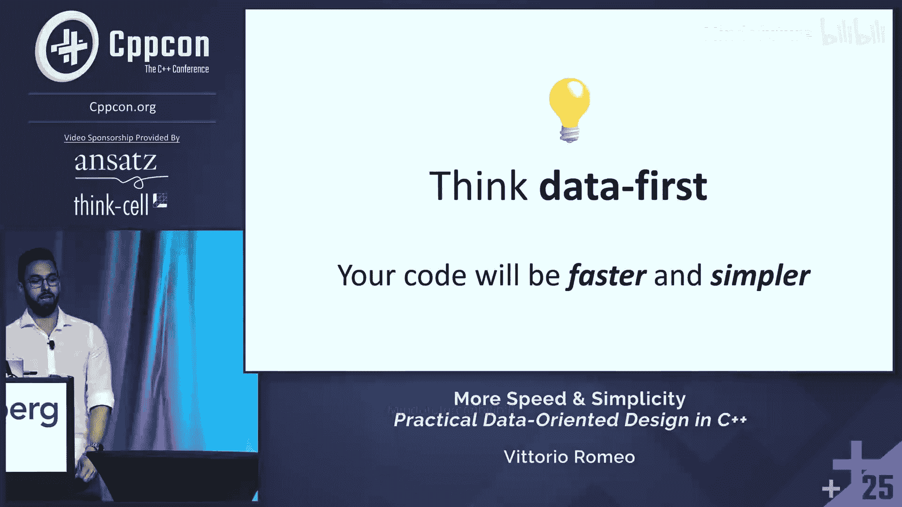

# Cppcon-2025-｜-C++-｜-C语言--｜-汇编-｜-编译器-｜-操作系统-｜-Linux-｜-Windows-p09-P09_更高速度与更简实践_C++中的数据导向设计-Vittorio_Romeo-CppCon_2025--BV1wyPBzrEeu_p9-

Okay， thank you everybody。 Thank you so much。 Jason， As he said， is my first keynote。

 I am equally excited and anxious。 You know， I usually give niche talks。

 I know people are gonna come in the room knowing what to expect。

 So speaking to a large audience is different for me。

 but I hope you're gonna enjoy the keynote today。😊。

We're gonna talk about data into design， practical data into design。 And I w to start with a photo。

This。Is when it gets there。 This is a photo of my actun giving a keynote as2014。

 That was my first ever conference。 And at the time， Mike was at insomnia games。

 and he came on stage and he challenged some of the core beliefs of C+ developers。

 And this was my personal start of my own data oriented design journey。😊。

I don't know if you recognize this individual。 That is， that is me a long time ago。

 I don't look like that anymore， right， I look a bit different。 But yeah。

 I was asking Mike a question here。 And for me， it was a career changing moment because I hadn't realize at the time that it was another entire way you thinking about code about software that was different from O O P。

 So even if nowadays， I don't agree with the conclusions that we're in that keynote。

 I would still like to thank Mike for opening a eyes。

 And I would still recommend you to check out this's keynote is very， very good。😊，Okay。

 a little bit about myself before we begin。 right now， I am an independent， E plus consultant。

 trainer and mentor。 My business focuses on delivering thesesp。

 plus training and one to one mentorship。 I am available for tech training and get speaking。

 So if you're interested， feel free to reach out afterwards or check out my website。😊。

I spent the last 10 years at Bloomberg。 I've been working on my performance C++ backcan development mostly。

 I worked on our microservice infrastructure team and our own marketed analytics team。

 and I've also been doing technical training in terms of both motor C++ and topics such as meta programming and multi threading for Bloomberg engineering。

I am involved in standardization。 If you heard of the function ref。

 I am partially responsible for that。 So you can love me or hate it for it。

 And that's gonna be since 26。 You might also know me for the epos proposals。

 which I feel like partially lives on with profiles nowadays。

 So that's also something else you might have heard before。

I am quite passionate about games and game development and open source in general。

 I'm part of the SFML team。 I was the person that LED the modernization of the library to target sales plus 17。

 So I strongly advise you to check it out。 We're gonna use it today for our demos。

 but I also contribute to other libraries， including SL。

 and I have two commercial games release on steam， which are also open source。

 so you can check how the sausage is made。 And I also like virtual reality。

 I contribute to several mods for games like halflife2 and Quake。😊，Last but not least。

 I am the co author of this book， Embracing Motopa Safely。

 I wrote this book with my friends and colleagues John Lakes， Russell Lapenniov and Ali Meredith。

 It's a reference of all Mospa features that covers all the pros and cons in detail。

 So if you're interested in that， again， feel free to ask me afterwards。😊，But not about me。

 let's take a look at today's goal。 today's keynotote and what we're gonna do。

So the goals for today are， I want you to discover a new mindset。

 I don't know how many of you here are familiar with it or enter programming。

 Can we have a show of hands。 so quite a bit of you and quite a bit of you are unfamiliar with。

 which is good。 So this， if this might be something new for you。

're gonna learn how thinking in a data first way changes the way you design a system。😊。

At the same time， we're gonna have a bit of a refresher on how hardware works。

 especially in memory and how it communicates with the CPU and why that matters for the design of your software。

We're gonna do this somewhat interactively。 We're gonna， you know， build this little demo together。

 I'm gonna show the demo first。 and we're gonna gradually build up to it。

 And we're gonna see how changing the way that the data is laid out without actually changing the operations we're doing on the data can really make a difference in performance。

😊，At the same time， I don't really wantan to just focus on the performance aspect of D OD。

 but I also w to make a point that it can make your code much simpler and much more maintainable than O O P。

 which might sound counterintuitive。 But I'm gonna to show some examples where I find out to be true。

And also， this is maybe where I feel a bit differently from the rest of the game dev crowd。

 I think that there still are places where O O P makes sense。 We're gonna to discuss that later。

 And I think that the use of high level Sil plus abstractions can actually help achieve your goals and there are places where when use judiciously can help you get better performance and more maintainability of your code。

😊，Okay， so I'm just gonna dive straight into the demo。

 I'm gonna show you the thing that we're gonna implement。

 And I'm gonna give you an idea of what we're gonna do。

So for this keynote， I chose something which is quite simple and， you know。

 somewhat visually interesting。 So we're gonna have this demo where we have this rockets flying around。

 Let me just yeah， zoo meeting。 And every single one of these rockets and smoke particles and fire particles you see on the screen。

 Everything is its own entity is simulated。 It has its own physical quantities and you can refer to every particular single thing that you see on the screen through some sort of identity。

😊。

So to make the requirements a bit more explicit， we want everything to follow laws of physics。

 So we have basic motion model with position， velocity and acceleration。😊。

We should be able to customize these effects， particles and emitters of different types with different opacities。

 scale and rotation that change over time。Everything is an actor。

 So if I care about a particular rocket or a particular particle。

 I should be able to be able to to have a handle to it and do something with it。 As an example here。

 every rocket entity has some attached emitters that are kept in sync and spa the particles。And。

 finally。I want to design this in a way that it is extensible。 It should be easy to add new effects。

 should be easy to add new actors， new particle types and so on。 So it is somewhat of a toy program。

 but I try to make it a bit more realistic by having this requirement of being able to attach entity water entities。

 And I feel like it isolates the performance principles quite well。 And the lessons you learn。

 even with this toy program are applicable to real world code。😊，Now。

 if I jump here and I open up this menu， you will see that we have some metrics regarding update and draw performance。

 And if I actually start spawnning some new rockets。 the rendering is out the sync for some reason。

 You will see that as the rocket spa the frame rate kind of tanks and it doesn't really become playable anymore。

 I can zoom out as well， I can show that we have a lot of them。

 And here you can select the data layout that we're gonna use。 This is the O implementation。

 But if we switch to something like Aos over here。 you will see that we have a dramatically nicer frame rate and it just becomes much more playable。

 And you can play around with this stuff， you can try other memory layouts and so on。

 But the point is we have this demo， we can play around with it。

 the operations we are doing are the same。 What changes is just the memory layout that we use。

 And as you can see makes a dramatic difference。 And now we're gonna see how that actually works。😊。

hom， so。Excuse me。 That said， let's just get to work and start implementing this。

So we're gonna start designing this according to O O P principles。 So we have our own， let's say。

 real world model interpretation of the problem。 And we're gonna try to transfer that into code。

We know that we're gonna have multiple entities so we can start with an entity based class。

 We're gonna have anmeter class that produces particles。

 We're gonna have a rocket class that flies around and asmeterters associated with it。

 and we're gonna have a particle class。😊，The emitter can either be a smoke emitter or a fire emitter in this case。

 And the particle， in the same way can be a smoke particle or fire particle。

 What you see in light blue is a base class。 What you see in dark blue is a concrete class。 Now。

 I like this， you know， it's a nice and simple hierarchy。 If I want to add something new。

 I can just derive from entity。 If I want to add a new kind of emit or particle。

 I just derive from those things。 It fulfills all requirements seems easily extensible。

 So I don't see any particular problem with this。 Let's try to implement it。

 And let's see how the code actually looks。 when we transfer this into C plus class。😊。

So we're gonna have a struck entity here。 I'm gonna use struck just to keep the slides concise。 But。

 you know， in reality， you would use class and private and public and so on。

 I'm just gonna try to focus on the performance and memory layout aspect of things at this point in time。

Because this is gonna be a polymorph based class。 We are gonna have a virtual deor。 In this case。

 we can default it。And then we're gonna have a virtual update member function that takes the delta time。

 So the amount of time that pass between frames and uses that to advance the state of the entity forward。

 We're also gonna draw member function， which is virtual。

 It takes this thing called the render target， which is from the SFM L library。

 And it's just an abstraction that allows you to draw stuff either on a texture or a window。

 In our case， it's gonna be the window of the application。 So not very important in this case。Now。

 because everything needs to follow the laws of physics。

 we're gonna have a bunch of vector to fs here， which are just 2 d vectors of floats for position。

 velocity acceleration。 And if you want to see how that actually looks in practice。

 this is just two floats X and Y with some nice operator overloads that allow you to basically multiply add and so on。

 And again， this is from SFML， it's a nice and convenient abstractstruction over a 2D vector。😊。

And that is pretty much it。 If we want to up implement the update part of the entity here。

 We can move the position by the velocity scaled by the deelta time。

 and we can move the velocity by the acceleration scale by deelta time。

 So very simple physical integration， not the most accurate， But again。

 we want to focus mostly on the memory layout， not， not not on the accuracy of the simulation。😊。

We have a problem， though， right， entitiesities might need to know the state of other entities。

 They might need to create other entities on demand。

 So we need some sort of way of making that possible。

 So one of the things I came up with and I've seen being used in many other places。

 It something like this。 The entity knows the world it belongs to。 And through that word reference。

 It can query the state of any other entity， or it can create new entities。

 It can interact with the state of the world。 So we're gonna do something like this for our program。

 And we're also gonna have this little boolean called alive。

 which is gonna be responsible to tell the world。 Hey， this entity is done， Please get rid of it。

 recycle the memory and use that memory for something else。

 It's just gonna be used to communicate with the world that already can be that the entity can be cleaned up。

 The reason we use a boolean is that we want to be able to communicate that through the update member function。

 There might be some conditions in the update that make the entity eligible。😊，For cleanup。Okay。

 so that's the entity。 Just to show you some more code。 We have the particle。

 It's gonna have its own scale， opacity and rotation。They can change over time。

 So we also have the you know， rate of change as， as data members over here。

We can override the update number function， Use what we wrote in the entity。 again， Dr principle。

 We don't repeat ourselves。And then do the same sort of idea of physical integration for scaleopacity and rotation。

The all interesting thing here is that we set the Boolean alive to be true only if the opacity is greater than 0。

 which basically means our condition for getting rid of particles is when they fade out。

 because every single particle is gonna eventually fade out in our demo。

 This is gonna be good enough to clean them up when we're done with them。😊。

And just to show you what the smoke particle looks like， with just derived right from particle。

 We get everything for free， Basically， which is quite nice。

 And the only thing that we have to change is we want to override the draw member function and specify that we want to use that data to draw something with a smoke texture。

 And you can imagine this can be done for the fire particle and any other one that you want to add in the future。

😊，Okay， the world is probably the most interesting part。

 We have three kinds of entities here already on the screen。

 We want to store them in such a way it's convenient for us to work with them。

 So we're gonna do this。 We're gonna have a stood vector of stood unique pointer of entities that contains all the entities。

😊，So those of you here that are somewhat familiar with the rented design might already be thinking。

 hey， nobody writes code like this。 There's gonna be an not location for every entity。

 It's not gonna be very cache friendly。 but trust me， I've seen this in production many， many times。

 if you look this up on Github even with Sha pointers sometimes instead of a unique pointer。

 you have hundreds and hundreds of hits。 and you can read stories about this happening in AA studios。

 People have successfully shipped very good software that was highly successful with this design。

 So I'm not saying you cannot do this and you cannot be successful。

 But if you know that the drawbacks of the design。 you also should know that this is actually been done in practice。

 I just want to know like how many of you have written code like this or seen code like this in practice。

😊，Okay， so pretty much everybody， you know， this is not Toy code。 This actually happens。

 And I also wanna say very popular libraries and engines do stuff very similar to this。

 including the SFML libraries。 So it's something that is used all all over the place。

The update and draw member functions are quite straightforward。

 We just iterate over all the entities， and we call update and draw。

 You might see the nice aspect of this。 We don't care what update does。 We don't care what draw does。

 We just。😊，Delegate that to the entity。 So it's quite nice。 And finally。

 we're gonna do a little bit of cleanup。 at the end。 We have this call to erasive。

 which is a quite recent function in the silver bus standard。 It takes a container。

 and app predicate， and it efficiently rearranges the items in the container in such a way that they can be removed in constant time。

😊，Okay。What else diameter， we're gonna do something like this。

 We're gonna have a timer that keeps track over how often we want to spawn a particle。

 We want to have different spawn rates。And then we want do something interesting。

 We're gonna define this pure virtual function called spa particle that is gonna be overridden by the actual emitter types。

So the update function of the emitter base class will periodically call spa particle。

 but then it's going to be the derived theter that actually overrdes that and decides what it means to spawn a particle The smoke emitter will internally allocate a new smoke particle using make unique。

 and then it will push that back into the world。 So you can also see here how we are referring to the world from within the update of an entity in order to affect the state and create new things on the fly。

Okay， last thing that I want to show you， which is somewhat interesting is this。

 I mentioned that the rocket needs to have some associated emitters。

 So what we're gonna do here is we're gonna use raw pointers。 We're gonna say， okay， I'm the rocket。

 I need to know what smoke emitter is associated with me and what fire meter is associated with it with me。

 Now， because we have this implicit knowledge that the world is the owner of the entities。

 And as long as the rocket is alive。 those emitters will be alive using a row pointer is fine here。

 We， we thought about our lifetime。 So this works in our model。😊。

And this is something that you also commonly see， even in large scale programs。

 the way you refer between components of the same program is by using pointers。

 You're relying on the address stability of these objects。

 The reason why you can do that in this case is because we are alllocating them on the he。

 So even if the vector gets reallocated with all the entities， even if we move around the world。

 the address of theters is gonna be steep。When we create the rocket。

 we create the emitters and we wire them up。 And when we update the rocket。

 we're gonna move them with the rocket。 So pretty straightforward。

 And this is pretty much all the code we need for that demo。😊，So that said。

 let's see how fast this is。 So let's do a little bit of a round of Ben。

So the machine I'm gonna use is not the tablet I'm presenting on。 This is my desktopco machine。

 is fairly beefy。 It has a Intel corere I 9， which was top of the line processor a few years ago。

 pretty fast。 The D R 5 Ram。 And I compiled using Kpas plus with03。

 I disabled rendering for these metrics。 But I'm also gonna talk about rendering here and there as changing the data layout can also be beneficial for rendering and not just for updates。

😊，So with 200000 entities， we get 2。3 milliseconds，400 k，6。6，600 k，12 millisecons，800 k 16。6。

 and 1021。6 millisecons。Now， you might think this is just millisecyclones。 This is fast， right。

 Who cares。But if you're thinking about targeting。Real time applications。The budget。

In a single frame that you have to reach 60 FPS S， which is pretty much the bare minimum for a nice interactive experience is 16。

67 millisecycls。 And you can see already at 600 K， we're already blowing up most of our budget。

 And if you think about having to put in rendering on top of that。

 if you think having to put in more complicated logical algorithms。

 you don't have a lot of room to work with。😊，At the same time， remember。

 is is a pretty good hardware。 So on a mobile device， these would probably be unacceptable。

 And at the same time， I feel like 6060 F in 2025 is pretty pathetic。 Honestly。

 even mobile phones nowadays， they have 120 Hz refresh rate displays。 So the bare minimum。

 I think for a very nice and interactive experience that feels smooth should be 120144 FPS。

 And if you want to target that particular frame rate。

 your budget for a single frame is less than 7 millise segments。 So we are pretty limited here。

 we have almost no， no budget left， only 400 key particles。 And we're talking about C plus plus。

 We're talking about fast hardware。 We should be able to do better than this。😊，Now。

 we've seen in the demo that changing the memory layout of things speeds up the problem significantly。

 So the problem is not the algorithm。 The problem is not the operation we are doing。

 The problem is how the data is laid out in memory。😊，And the CPU is actually mostly idle here。

 It not doing any work。 It's just waiting for that data to arrive and wasting time do enough。

 which is， again， unacceptable if we care about perform。So let's take a detour。

 I'm gonna give you a little bit of a refresh on memory and tell you why it is important that we understand how it works internally to design our software to be efficient and make good use of our CPU。

😊，So at a very， very， very high level of abstraction。

 you can think of the CPU and Ram as being connected by some sort of bus。 and they communicate。

 and everything is fine。😊，If we peel one layer of the onion and we go one step lower again。

 at a high level of abstraction， you can think of a CPU or something like this。

 We have some core where the operations are actually being done。 Some cache。

 which is some very small but very fast bathroom memory。

 And then the communication has to go through a hierarchy。

 The data that's in run first has to go through the cache and then from the cache to the core and vice versa。

 So every operation you need to do has to follow this path through memory。 In。

 in reality of a slide later， we have multiple layers of cache， we have multiple course。

 So it's more complicated than this。 but the the main principle still applies。

 The memory has to follow this hierarchy and move forward。😊，Now， the cache。

 you can think of it like this is a very small but fast collection of rows。

 And these rows is are called cache lines。 And this is a very important concept。

 A cache line is the smallest transferable unit of memory。 So even if you care about a single bite。😊。

You still have to transfer an entire cache line from the Ram to the CPU。

 even if you get only about that single byte。At the same time。

 you can imagine that the Ram is a large collection of cache lines very， very big， but it's low。 So。

 for example， if you want to read the data at address 18。Is not in cache， or cache is empty。

 so we can identify the data being there in Ram。 and only if we about the data at address 18。

 we still have to take the entire cache line from Ram， which is a cache miss。

 which means we take the whole row and we copy that into cache。And if。

 if you imagine that we don't care about what's adjacent to this data。

 We don't care about what's next to the D here。 then we wasted a lot time moving data that we don't care about。

 which is quite unfortunate and it uses our cache ineffectively。We can keep doing this。

 Maybe you want to read some data is 26。 It is not in cache。 Again， we identified there in Ram。

 and we have to take the entire cache line and move it into the cache， which， again。

 is a cache miss and quite unfortunate。In the best case scenario， for example。

 if you want to read the data at address 19。And we identified that it is already in cache。

 You can see it over here。 Then in this case， we talk about a cache sheet。

 We don't need to do a round trip towards Ram and back。

 So we are gonna be able to read this data way more effectively。Now， why am I telling you this。

What is the impact， How much does it matter if we have to go to Ram and how much does it matter if we can stay in cash。

So I like to explain things visually。 So I made like a little animation of a race between L1 cache。

 which is the fastest but smallest cache in a CPU and the core。 And on the bottom。

 we have the Ram and the CPU。 So on the top， we're gonna see the best case scenario when。

 when our data is already in cache。 And in the， in the bottom。

 we're gonna see the worst case scenario where every single time that we need data。

 we're gonna go back to the run。😊，Now， this slide is gonna be slowed down significantly because we are talking about operations in the orders of nanoses。

 but it's gonna be to scale。 So keep that in mind。3，2，1， go。

So by the time that the data and cache has done multiple round trips， you can see the Ram still。

 you know， getting， getting there almost at the middle。 And we've already done a lot of operations。😊。

So this is actually， to scale， as I mentioned， This is actually what's happening in your program。

 So if you have all your data coming from Ram， you're wasting a lot of time just fetching that data。

In the worst case scenario， it can be up to 100 times slower。

 So doing a round trip in Ram compared to L1 cash can be up to 100 times lower on modern CPU。

 And just to give you some numbers， the amount of time that the average blink of a human takes is 100 millises。

The amount of time that an L1 cache reference takes is 0。5 nanoseconds。 So by the time you blink。

 you can have 200 million L1 cache references。In Ram is gonna be 100 times less than that。

 So it's fairly significant。 So significant that sometimes the choice of where your data is located is much more important than the algorithm or data structure that you use。

 which can be pretty surprising， especially if you are deeply into theoretical computer science。

 sometimes having a algorithm with worse complexity can perform better on real hardware。😊，Okay。

 so what have we learned。Very important。 The smallest universal variable memory is a cache line。

 So no matter how much bytes， how many bytes you want， you're gonna have to take an entire cache。

Generally， these  is 64 B on modern desktop CPUus。 Thankly。

 we have a very intuitive way of asking for the cacheline size in C plus plus。

 which is stood hardware， destructive interference size。 So， you know， you will always remember that。

 But you can think about 64 B。😊，All data must always traverse the memory hierarchy。

 So if you need something from Ram， it has to go through all the levels of cache。 And then back。

 if it needs to be flushed back into Ram。Which means that the spatial locality of data。

 So where the data is actually laid out in memory greatly affects performance。 And as I mentioned。

 sometimes， even more so than the choice in algorithm or the choice in data structure。😊。

So we can really start thinking about some tips， right。

If I have data that is related to to each other and I want to access it relatively close in time。

 you know， after access the first one。 I want the second one and the third one and so on。

 then it is better to store it together in memory， close to each other physically speaking。

 So preferring flat and continuous storage leverages the cache better and maximizes the chance that if you as you are taking those cache lines in。

 the data that you want is already gonna be there because it's part of the same cache line。

At the same time， there's also something I didn't mention， which is perfect fetching。

 Cs have this speculative mechanism that basically figures out the pattern in which you're accessing memory。

 for example， if you're in a loop and you're going forwards or backwards or you're jumping every n elements or spreaded access。

 the CPU can figure that out。 and you will already start giving you the cache lines that you might need in the future。

 even before you request them。 So also doing very predictable operations can greatly improve the performance of your program。

😊，And as I mentioned to you before， I lied to you， you know， the situation is more complicated。

 So if you w to be a bit more realistic， it is kind of what， what it looks like in a more mono CPU。

 you might have an L3 cache share between multiple core， which is larger， but， but。But's slower。

Each core might have an L2 cache， which is a bit bigger than a1， but a bit slower。

 And then you might have an L1 cache for data and a one cache for instructions。 Now。

 I find this interesting because， you know， code is data。

 When you compile your program into a binary， the actual code you generated has to be loaded into memory。

 So sometimes if you optimize your code for size and not for speed， it might actually be faster。

 And the reason is that it might use the instructional cache better。

 you might have more of your hot loops fit into the code cache itself。

 So we're not gonna cover that in this stock， but if you go deep into this topic。

 Sometimes the way that the code is aligned， also really matters for your performance。😊，Now。

 this is all I'm gonna to tell you about。You know， hardware and CPU， a memory and so on。

 I w to refer you to this nice talk from Scott Myers is from 2 14， but is still very relevant today。

 CPU caches and why you care that goes deep in detail。 And also。

 Yonata Mueller gave a talk here CP con called Ca friendly plus plus。

 which cover the same topics and it goes quite in detail as well。

 So I think if you watch these two talks。 You' gonna have a very nice understanding appreciation for modern hardware。

 And you're gonna be able to get a nice intuition of what can be fast or slow。

 I really recommend watching both dogs。😊，Just thing a little break。哦。So given that。

 why is our implementation slow， And we can actually figure that out quite easily just by looking at the world implementation。

We have this entity entity vector that is a vector unique pointer。

 which means every single entity is gonna be allocated somewhere in memory。

 likelyly not close to other entities。 gonna be scattered around。

 which means if we iterate in our update， if we iterate in our draw and also in our erasive in the worst case scenario。

 every single iteration would be a cache miss。 And we have seen how slow it is can be 100 times slower than L1 reference。

 So this probably the worst case scenario for the CPU。

 It is gonna stay there waiting for data that to arrive。😊，At the same time。

 we have other sources of overhead。 We're using virtual dispatch。

 We're using V tables and polymermorph Fism。 So whenever you access the update or draw member functions theres going to be a V table lookup。

 which had some overhead， Probably not as important as the cache miss。

 but it's something else that that we have to care about。And finally。

 if you remember the way that we spawn particles， we actually call make unique over here。

 and erasive will actually destroy those unique pointers。

 So we have a frequent churn of dynamic allocation and。

 So you can already figure out this is not gonna to be very efficient。

 We're doing a lot of extra work。 a lot of weighting on memory and a lot of overhead due to virtual and allocation in the。

😊，So my question is， why did we write our code this way。

 Why did we jump onto the O P hierarchy and with the virtual interface and so on。

And I think this has to do with the obbduent mindset。

So most people's introduction to programming actually is O P。 University books。

 whatever you learn about classes， you learn about inheritance， You learn about， you know。

 the usual shapebased class， which can be circle rectangle or the animal based class and so on。

 but also， it's， it's， it's a natural choice。 Like for humans。

 it aligns quite well with the view of the world。 We think in terms of individual objects。

 individual things。 And we have this is our relationship in our head。 It just works well。😊。

So this mindset sort of works like this， I identified four things that I think are important。

We try to model a world of autonomous objects。 We think of self contained agents with their own identities and responsibilities。

 We have a particle。 The particle has its own data。 It knows how to update itself。

 It know how It knows how to draw itself。These entities communicate between each other with the rest of the program through messages。

 The main loop。 the world doesn't know what the particle is actually doing is just asking。

 could you please update yourself， Could you please draw yourself， We don't care about the internals。

 We're just asking those operations to be done。The data is hidden， so we don't care。

 We don't expose the internals of these classes。 We hide them， We encapsulate them。

 but we expose the behavior。 We don't care how the particle gets updated。

Which might be nice sometimes because it allows us to change the internal of representation。

 which without changing the behavior。 But we're losing information about something really important about the data layout of our particles。

And also， I feel like O P tends to encourage people to plan for the unknown。

 So you're gonna try to figure out some sort of abstraction or interface that not only works for today's problems。

 but for any problem you might have in the future。 And I chose the word bet here very carefully。

 because in my opinion， it is about。 It's really hard to predict what kind of requirements you're gonna have in the future。

 And if you get your prediction wrong。Getting out of the wrong abstraction sometimes is more expensive than not having done it in the first place。

 So if you're lucky， you might save some time， but more often than not it's really hard to predict what might be needed in the future。

In contrast to this， if we set this aside， let's see how the dataiented mindset thinks about the same problems。

So we don't want to model a world of autonomous objects。

 We want to model a world of data transformation。 We look at code as a pipeline that transforms the data from one state to another。

 We don't really care about this notion of an object of identity of encapsulation is just data。

We don have messages， we operate directly on batches of data。

 So the entity itself is not in control anymore。 It's not the individual that matters。

 We have operations in bulk on the data done from the parent object。

 The world is gonna be responsible for the update and the drawing of all the entities。

 It is in control。 And I'm saying in bulk here， Because the most common case for this sort of applicationss。

 is not adding a single particle or a single entity， having many of them is the common case。

 So why are we designing it with the individual in mind when the actual real common case is having things in bulk。

At the same time， we don't want to hide data。 data is the most important thing。

 We want to make it transparent。 We want to lay it out for efficient processing。

 and we want the behavior to be centralized at a higher level that sees all the data and is able to figure out how this is the best way of actually processing the data that I have。

This is also something that I feel like is more subjective。

 but I have the feeling that this mindset tends to encourage developers to plan for today。

 You want to design for the problem that you have at hand。

 You want to prioritize performance and simplicity to solve that problem。

 and you don't want to solve any problem that you don't have or you might have in the future。

 And sometimes this might actually pay off。 Sometimes it's easier to change your code to adapt to a new problem。

 if you， if you didn't start with the wrong obstruction to begin with。

 So sometimes this might pay off even for future accesstensibility。😊，So how do we shift our mindset。

 I think you have to internalize。 We have to internalize that no matter what。

 the only purpose of code is to transform data。The focus should not be on modeling an abstract world of objects that make sense in our head。

 but on the data's journey。 So we want to get from point A to point B。

 How do we do that efficiently and in the most simple way。Data is the centerpiece。

 It's not something that we want to hide。 Why would we hide the most important part of your program that actually makes it work efficiently。

We actually want to make it visible。 understand this shape is size and access pattern。

 And those are the things that are gonna drive the design of the application。

 the operations that we do on the data。Modern computers， even the best supercomputer that you have。

 they all thrive on simple and predictable work。 So as long as you design your problem to feed computers long straight runs of contigious data。

 you are likely gonna to get good performance。😊，And finally， this is more of a， you know。

 philosophical thing。 You want to design for the machine that you have。

 You want to be familiar with the platform you're targeting with the capabilities of your hardware because an effective solution is not aligned with the metaphor that you have in your head of the problem you're trying to solve with the physical reality of the hardware。

 So this is sort of like the shift that you would have in your mindset。

 If you want to approach data a design instead of O， O P。So that said。

 how can we start optimizing our code to move towards this mindset， maybe not fully。

 but moving towards this idea。So for our first optimization path， we're gonna do a few things。

 We are firstly gonna get rid of individual hipA locations。

 which I think is the main bottleneck of our program。We are gonna get rid of inheritance。

 which is gonna flatten our hierarchy。And we are gonna decouple the data from the logic。

 The entity classes will now just be the data， and the logic is gonna be one level up。

 The world is gonna be the one that deals with all the behavior so that we can see a full picture of what we have and operate on data in book。

At the same time， we have a problem， right， before we had this nice vector entities where we could store things homogeneously。

 But now what we're gonna do is we're gonna have multiple containers。

 one per type of entities that we want to store。 In might seem more cumbersome。

 you will see what actually makes sense as we want to process these things differently。

 They have different properties at different behaviors。😊，O。So we're gonna have our emittersstruct。

 We're gonna have our particlesstruct and our rocketstruct。

They're all gonna have their physical quantities。 So we have a bit of repetition， but it' minimal。

 who cares。Dmeter is going to have its own， you know， floating point for the timer and its bone rate。

 And the particle is gonna have the same quantities as before。 But now we have a problem， right。

Before we could differentiate between fire and smoke particles because we had this nice hierarchy。

 So what do we do now。At the moment， I'm going take the easy way out。 and I'm gonna do this。

 I'm gonna say we have an inum class called particle type。 It is going be either smoke or fire。

 And I'm going store this information in both diameter and the particle。 And depending on that。

 we will do different things。This is not ideal。 We're gonna to see later how we change this。

 But so far， this is going to be fine。The other problem that we have is that in the rocket。

 we need to refer to two emitters。 We want them to be linked together before we had this nice property that we could use the address of an emitter。

 it was stable， and we can use that to communicate between these things。

 But now if we are removing HA locations。 There is no guarantee that the address of the emitters will be stable。

 The vector might reallocate we might move things around the memory。 So what do we do。

 Usually there are many solutions。 But a common solution for this is using indices。

 So you're not gonna rely on the address stability of the actual object memory。

 You're gonna rely on the index stability on the position of this object in the vector belongs to。

 You might need to change the vector a little bit。 We're gonna see how it is a common way of dealing with this。

 Other ways might be using some sort of a hash table where you store the key。

 and then you look up the object。 you might have special data structures that are designed with the in mind that will help you achieve this。

 But generally speaking。😊，The point I want to make here is that now the relationship is data is just a number。

 So it's not something specific to the hardware anymore， but it's just an index。O。

So how do we change our world to fit this new design？We're gonna have a vector for particles。

 We're gonna have a vector for rockets and an associated ad rocket function that ends up doing any wiring that necessary with the emitters。

And then we're gonna do this， which I think is quite interesting。

 We're gonna have a stood vector of stood optional of emitter。

 The reason why I'm using an optional here is to guarantee indexability。

 So you can think of this as being slots where an emit might be in or might not be in。

 And by looking at the index， we can guarantee that the emitter index 4 is always gonna be the same emitter。

 If you want to get rid of an auto emitmeter and destroy。 We just make it this lot empty。

 But we don't have to shuffle anything in memory so that the indexability is retained。 And again。

 there's other ways you can deal with this。 But this is a very simple solution that works for our use case。

😊，To go along with this design， we're also gonna have an add themeter function that given an emit will put it in the first free slot that is available。

 And then it will return the index of that slot。And all these things in conjunction。

 they work together to replace the relationship that was based on address stability by something that is data driven。

 We are working with just numbers， indices， and we get the same sort of relationship behavior as before。

We're gonna have the usual update broken cleanup。 So we're gonna see how they change。

The update function is gonna to be quite interesting， in my opinion。

 because now we can operate on all the particles in bulk。 We're not telling each particle。

 please update yourself。 We have the full view of the particles。

 and we just loop over them and perform the operations。

 And you can already start seeing how the compiler has much more information here to optimize and vectorize and do cool things with exccode。

😊，For deters， we're gonna loop over all the optionals。

 We are gonna skip these lots that have nothing inside them。 We're gonna do our updates。

 and then we're gonna create new particles。 Now， here。

 we are actually gonna branch on the type of deter。 And depending on whether it's smoke or fire。

 We're gonna push back something else into the vector。 Again。

 we're gonna see an improvement over this later。 But so far， this is fine。And finally。

 for our rockets， we move them。 That's， that's fine。 And the interesting bit is this one。

 When we want to get the associated emitters， we just look into the emitter vector with the index that was stored in the rocket。

 We check if that optional is valid。 I think it should always be。

 So maybe this should be an assertion。 But， you know， I use an if here。

 And then we are gonna set the position of the emitter to be the same position as the rocket with some offset that makes it look a little bit better。

 so that the particle goes actually spawning out of the rear of the rocket。😊。

And would do the same for the， the fireraid。The last part I want to show you is the add emitter。

 which is the function responsible for， you know， creating a new emitter。

 What we do is we loop over all those lots。If we find an empty slot that may be used to an emit。

 but now is empty， we can em our emit directly there and return that index。

 So we are reusing an existing slot。If the vector is completely full， then we just then place back。

We have a new slot available。 This might end up reallocating the memory under the hood。

 but we don't care because we are not relying on that。 We are relying on the indices。Now。

 this algorithm is linear， but you can imagine that if you want to optimize this。

 you could have a list of indices that are free， which you keep track of as you create and remove emitters。

 So you just pop an index whenever you want to create one and use that and you just push push it back whenever you're done。

 So you can make this constant time quite easily。 I just want to keep it wanted to keep it simple。

 as the number of emitters in this program is very small compared to particles and it's not really significant that we have this O algorithm over here。

😊，Okay。Last， last part， which is the cleanup。 We're gonna have an arraysive for the particles where we do the same thing。

 We remove them if they have faded away。We're gonna have an erasive for the rockets where we remove the rockets if they reach the right hand side of the screen。

 And at the same time。Inside the predicate， we're gonna take this opportunity to also destroy the associated emitters。

 So if we know that we reached the end of the screen。

 we're also gonna reset those optionals that we had in the emitters vector so that those loads can be reused。

 And then we're gonna return true to the algorithm。 Yeah， feel free to get rid of this stuff。Cool。

 so how does this change our performance， Let's do another round of benchmarks， same hardware。

 same program， same conditions。And we have very significant improvement for 200 K。

 even more for 400 K。 And as you can see， this trend keeps going on。 And on average。

 we have a 70% decrease in update time just by changing the way that we store the data。

 We haven't changed and operate any operation。 we are doing the exact same calculations on the data。

 which just change the way that we store it and the way that we process the data。😊。

I also am not showing it here， but I also got an eight times boost in rendering performance because now that the data is laid out in groups。

 I can easily take all the particles and send them to the GPU as， as one thing in bulk。

 easily take all the rockets and send them at once。 So you you're gonna see over time if you do this。

 especially with graphic develop graphics development， that the data rental layout is actually very。

 very friendly to GPus。 So the more you do this， the more you're gonna be able to send data to the GPU more effectively as a site benefit。

😊，Okay， so I don't know if this is surprising to anybody。 but， you know， probably you expected this。

 But at the beginning of the talk， I also mentioned， I want to make this not just about performance。

 but also about simplicity。 So let's see if this is actually tool。

 Let's see if it actually makes things simpler。😊，Now， the first thing I want to show you is。

 let's say we have a new requirement。For example， we want to keep track of the numbers or number of rockets specifically。

 And this is actually something I try to do for the demo。

 I wanted to have a counter for the number of entities in total， but I also wanted to know how many。

 how many of them are rockets。And I tried， but I couldn't because in the O P approach。

 it is deceptively difficult to do this efficiently。

So the first thing I tried in the O approach was something like this。

 I'm gonna loop over all the entities。 I'm gonna use dynamic cast。 And if it's a rocket。

 I'm gonna increase a number of rockets。 Now， I don't like dynamic cast。

 I hate it as much everybody else。 but it seems like a good use case for it。

 Its a statistical metric that I just want to have as a tangential thing And this is like a edge case。

 I just want know how many rockets I have。 This worked， but it actually showed up in my profiler。

 I was losing milliseconds because the dynamic cast。 So it's unacceptable。

 I would have made this O P solution even slower than it is， just to count the number of rockets。

 which I I was surprised about。 I thought it would have some overhead but not very significant。😊。

So then I realized， okay， maybe I can do something like this。 I can have my entity， have a get type。

 virtual member function that returns an entity type。

 And then I'm going avoid the amount of overhead that I get from the dynamic cast。

 But this the the purpose， right， I don't want the entity to know which entity it is through an enum。

😊，The point of O， O P is that I want to think about entities in the abstract sense。

 And I don't want an entity to tell me what type it is。 Otherwise， why am I using O。

 O P in the first place， It didn't seem right to do this。

So maybe I thought the rocket itself on construction could inform the world。 Hey。

 there's a new rocket in town。 And then on the， you could tell that I'm going out of scope。

 But this also didn't feel right。 You have more mutation of state hidden within the internals about the arrive class。

 So it's harder to see the flow of the code。 And also， I feel like this an SRP violation。

 Why is the rocket responsible for metrics。 like didn't seem right。

The world maybe could do this then。 Maybe I can have an ad rocket function that I can call。

 and I will create rockets only for of function and will keep track of the rockets。

 And in the cleanup， I will do some bookkeeping to therementes。😊。

But now I'm adding a specialized function for rockets。 So again。

 I want to think about in terms of entities。 I want to give the world an entity， not a rocket。

 it defeats the purpose， right， So I I just didn't like this。

 And there's also more complexity because of the book。 So I'm not saying this is impossible。

 You can make this work iss just。Overly hard for what I wanted to do。 So I gave up in the end。

 And you， you've seen in the demo that I just have the number of entities and I like， you know。

 that's the best I can。So what about the data rentaled approach。That's it。

 I know how many rockets I have because I'm storing rockets separately。

 So I just have a simple function called to the size of the vector， and I can get them for free。

 So I feel like many things。 This is just an example， right， And you might think it's artificial。

 But over time， as I I， as I've moved towards data oriented design。

 Like I'm not saying I'm gonna go fool date oriented every single time。

 I feel like I get this small wins more and more often。 So it does make things simple。😊。

So it is also about simplicity。 And another example I wanna want to give you is imagine you are like a new member of the team and you have to work on this demo。

 You have to extend the code。 You have to understand it。 So you're gonna go to the code base。

 You're gonna start doing a little bit of code review。

 You're gonna try to understand how all the moving parts interact。

 how it works and what you need to do to change it。😊，So you see the entity here and you're like。

 okay， this seems simple， simple。 And then you see， oh。

 but we have a reference to a world and also this extra state for the live bulloleion。

 And then you start thinking， now， every single entity might end up doing something that changes the state of other entities and to know that I have to cross reference all the files on the code base to see what's happening。

 You have to jump around the source code to get the full picture。At the same time。

 this doesn't really sit right with me， this is really annoying because we are putting the draw member function in the。

In the virtual hierarchy inheritance API， Tingy， with very tight coupling with the rendering system。

 So if we want to change from SF M L to S D L or another library。

 we're not gonna do that because we're gonna have to change 20 classes。 and， you know。

 they're very tall coupleupd together， which is quite unfortunate。At the same time， you know。

 if you look at the world， you remember， yeah， this seems simple on surface， but actually。

 it's hiding anything。 This update could end up destroying entities could end up creating new entities。

 So how do I know what's happening。 I have to look at every single entity。 So， I think in。

 in practice， this makes it hard to understand the full fit of the system。

 you need to keep into your head， all the possible the right causes that are there And what they can do at any point in time。

😊，And yeah， if you remember， this ends up affecting the outside world。 So I。

 I think you get my point。For the data into design。

 I find it nice that the entities themselves are just data。

 Like there is a clear separation between logic and data and there's nothing hidden there。

 It's completely decoupled。 And what you see is what you get。

 Like there's no special side effect in the constructor of any member or anything like that。

 to just plain data， which is simple。😊，At the same time， if I look at the world。

 I can immediately see what things are in the world。 I know I'm gonna have emitters。

 particles and rockets and nothing else。 There is nothing that could be added in from a runtime。

 from motor of derived or something like that。 You can easily see all the types。😊。

So the data is not hidden。And at the same time， in the single update function。

 I know exactly every mutation， every operation that's happening。

 I can see this stagebased approach where everything is changed on a， you know， pipeline basis。

 all the logic is there。 and I can see the relationships within all the entities in the same place。

 So I know if a rocket is going to affect an emitter。 If an emitter is going on a particle。

 everything is going start in this update function。😊，Now， for the coupling issue。

 you still have some coupling here with the rendering system。 So you still have that thing there。

 the render target appearing in the world。 But it's much looser， right。

 If I want to change rendering system， I don't have to change n classes that end up dealing with drawing。

 I can just change it in one place。 You know， do the right transformations and it's gonna be a bit easier to adapt this to some other system。

So I feel like this is much easier for somebody， especially new to the program。

 to get an idea of what's going on。And I feel like this also opens up new opportunities。

 I'm gonna get there。 I'm gonna start by adding this new requirement。

 Let's say that we want to be able to serialize the data。😊，Now， this could be useful for many things。

 saving and loading， networking and so on。 So how do we do it in the object oriented approach。

You could do something like this。 You could have your entity being extended with a serialized and decent serialized virtual member function。

 The serialized take an outstream。 The dis serial has take an in ice stream。

 So probably the second one shouldn't be coned， but， you know， slideware。😊，This my work。

 but I feel like the coupling is too tight。 I am locked into a specific format because at this point。

 I need to decide whether there' is gonna be X， M L， Json， binaryner or whatever。 And also。

 I'm one of those people that cares about compilation times。

 I have a few talks about the subject here and there。 And by doing this。

 I'm gonna make every user of entity virally include io streams。

 which is pretty beefy header and is gonna slow down compilation。 I don't want that。

 I want these things to be separated。 I want this serialization module to be the only place where I include whatever dependency I need。

😊，So one of the common answers to these kind of problems in O P is design patterns。

 We can use the visitor pattern。 We can have a nice visitor base class that deals with all the derived types。

 entity can accept visitor in this in this virtual member function。

 And then I can create a serialization visitor， decentization visitor maybe1 for JO of RexM L and so。

 nice andupd until you realize。😊，I'm listing all the types again。

 So I'm losing that benefit of O O P。 I have to think about every possible derived types in the same place。

 We lose that individual responsibility principle， which is quite nice， to be honest。

 We reverse back to point to put all of these in in the same place。😊，We also have more overhead。

 It is actually double dispatch。 We're gonna have two virtual calls every time you。

 you call this function。 Now， first serialization might not be significant。

 But if you use this pattern for other things， it my， might actually be significant。And also。

 you have to keep everything in sync with all older visitors。

 And one thing that I don't like is that something that should conceptually be a function parameter。

 De stream should only be available as a function parameter whenever I want to serialize or disize。

 now becomes state。 It becomes a member of the class， But it doesn't have to persist。

 I only need it for the duration of this transition function call。

 So why do I have to store it there。😊，And even worse， then you realize this， right。

 You have your rocket and in your rocket， you're using pointers。

So what do you do It's not impossible。 Again， you can make this work。

 but you have to figure out a mapping from pointer to something that can be serialized。

 And then you would have to figure out a reverse mapping when you disize it。You can make this work。

 But does it have to be so complicated。 I'm just trying to realizeize some state。

 and I have to do all this stuff。Okay， in the Do OD approach is just a single function。

 you have a function called serialize。 You take your world bys reading， and then you string。

 and then internally， you do your serialization。 Of course。

 you could split this into separate functions。 You could have a serialize for rocket。

 particles in emitters。 But the point is you can isolate this in its own translation unit。

 Any expensive dependency can be isolated that to you。

 So you don't have to to worry about compilation times。 and it's quite simple。 Everything is there。

 You see it and you don't have to jump around in in your source code。

 So I think it's a nice green even in this case。😊，At the beginning， I mentioned opportunities。

 So why am I talking about opportunities， Because once you do this。

 you realize that the entire state of the program is just data。 It's just bytes that are meaningful。

 There are there is no reliance on pointers or addresses。 So saving and loading。

 which is something that people dread implementing， becomes trivial。

 You literally just serial this your in a row， and you're don't。This leads to better testability。

 debaability and tooling。 If you have an interesting edge case that you want to test。

 you just save the state and you write a unit test， repeat that。

 I know of gaming companies that do this。 for example， the people behind factor。

 they store interesting edge cases in with their game。

 and then they have this unit test with it where they load the state and they run it and check that the result is exactly what you expect。

😊，Debuability， you have a weird bug that it's hard to reproduce。

 You save the state and you replay as many times as you want。

 You can check the state at at will tooling。 Now， everything is data。 You can write a nice U I。

 So during runtime， you can change relationships。 You can change the values of your classes。

 It becomes a little kind of like in game editor from your own application。

 So you get a lot benefits out of this。😊，Networking becomes easier。

 You can send a snapshot the entire state of the wire。

 and the other player or user will get the exact same view。

 And then anything on top of that can be a delta that's been that's been sent on top of the last snapshot。

 So having everything just being data helps a lot and creates new opportunities for things that are useful。

😊，Okay， what about multi threading。I'm gonna go bit quicker。 I them that much time left， but。

In the O P approach， let's say we would just wantna multi thread particles。

 We care about the particles。 The bottleneck。 We don't care about other things。

 How do we make it multi thread。Well。It's a bit difficult， right， This could do anything。

 could create new particles， could be uned on something that is not a particle， so。

It's not really easy。 I would say it's not really parallellizable because also。

 we have rights to link entities from the app data other are things。

 So you cannot just trivially say， I'm gonna take the loop and split it into chunks。

 That's gonna be data raise help。Yeah， you can make this work。

 Maybe you could filter all the particles in advance and then store them in a separate vector and then do that in chunks。

 But the overhead of doing that will likely defeat the purpose of multifeing in the first place。

With DD， you see your update as a bulk operation in your update function in the world。

 And now this is probably the most truly parallelizable loop you've ever seen。

 You can do this in horizontal chunk， vertical chunks。

 You could even get away with just open MP and you just take a pragma， open MP paralyed there。

 and is's gonna do it for you。 So I think this is like the easiest thing to parallel。 Again。

 this is a simple example But I want to show that something that is conceptually simple。

 becomes complicated。 if you apply principles that are meant to help you。

 but actually end up hindering you。😊，So my point is that data into design architectures provide many side benefits。

 It's not just performance， but you're gonna get better simplicity， better flexibility out of it。

 can we go even further。 Can we make this even more optimize， even faster。😊。

So we're gonna do a small optimization past year just to get rid of branching。

 What we're gonna do is we're gonna try to avoid branching in hot loops。

 And the way we do this is by grouping the data beforehand。

We're also gonna to take an opportunity at this point in time to try and reduce the size of compound types。

 One things that you learn very quickly is that small is fast。 The more things are canfi in cash。

 the better performance you will have。 So if you have types that are unnecessarily big。

 trying to reduce the size of types of the padding that you have inside your types will end up having better performance in the long run。

😊，But we're gonna stop here。 No other major changes。 We're gonna stick to this layout。

 which is called array of structures。 Later， we're gonna migrate to S O A structural arrays。

 And we're gonna see how that actually affects the performance。So this is what we had。

 We had this particle type。 What we're gonna do now is we're gonna get rid of that。

 So we're not gonna have that inum anymore。 We're not gonna have those extra fields。

 And I'm gonna show you that the world is going to be responsible for grouping the particles。

 depending on their type。 We make that branching implicit， if you will。At the same time。

 I realized we're never gonna have more than a few thousand emitters。 So why are we using a size。

 sizet is 64 Bs， pretty big。 but we don't need that。 So I can change this to I unit 16。

 it is more limited， you have to be a bit more careful with these values now。

 But because I know the nature of my program。 I'm gonna save some space for the rocket。

 maybe by doing so， I'm gonna be able to load more rockets into the same cache line as I'm iterating over them。

 Now， this is not gonna to be very impactful because rockets are not a bottleneck here。

 I just want to show you the idea， the principle。 if you have something which is in a hot loop。

 and you can figure out， let's say constraints about the data of the fields of the objects。

 change the data types， reducing padding， reducing size can actually improve performance significantly in some use cases。

Okay。What else。So if we look at the world here， we have to do a change， right。

 We cannot just store particles anymore because we don't have a way of knowing which kind of particles they are。

 So we're gonna have more containers。 And is gonna is another common transformation in DD。

 You end up having a lot of containers that implicitly provide information about some properties of those objects。

 So the first container tells you everything in here is a smoke particle。

 The second one tells you everything in here as a fire particle。 And we do the same for the emitters。

 and we click the API a little bit。 And this is how we actually represent the various types。😊。

Of course， if you have a lot of types， then you can think about meta programming。

 generating these things at compile time or using even a runtime generation mechanism。

 If you're loading these things on demand。 But for now， because we only have two types， it's。

 it's fine too hardco。In the update member function。

 we are gonna use little lambda here as a local function to avoid repetition。 Again。

 C plus plus abstractions， modern features and data design can coexist in opinion。

 They can be synergetic。And I'm going avoid repetition here and just have two loops。

 one for smoke particles and one for fire particles。For the emitter is the same thing。

 And I'm going to use a little higher order function here。

 So this lambda is going to take an order lambda called F spawn。

 which tells the emitter what kind of particles should be spawned。

 And then when I actually call this。 I'm going specify as a callback that the smoke emitters should spawn smoke particles and the fire emitters should should spawn fire particles。

 Again， I feel like it's a little bit of structure， a little bit of modern feature usage。

 but it's enough to avoid repetition and still keep the code very linear and simple。😊。

Without hiding what's happening under the scenes。 So I think this is a reasonable amount of obstruction。

That is it。 Once we do this。 we can do a little bit more benchmarking。

 and we're gonna see that it not that big。 There is a consistent improvement of around 5。

73% in terms of decreasing update time， which is small。 but you know， we'll take it。

 And as I mentioned， this particular optimization here wasn't very impactful because most of the bottleneck in our program is updating the particles themselves。

 while the branching was not the hot loop， but depending on your workloads doing something like this might give you a much better performance increase。

Not pictured here is also after doing this change。 I got 12% drawing improvement。

 like rendering performance improvement。 And the reason is that now the data is again laid out more nicely for the GPU。

 I know that all the particles that are fire particles are going be in one container and they all use the same texture So I can just send out to the GPU and the GPU is gonna be happy and you' can do the same with the smoke particles。

 So DoD really aligns very well with what the GPU wants。

 and it it's good to keep in mind if you're gonna do graphics development or you're gonna to use GPUs to accelerate your programs。

😊，O。Last thing that we're gonna do is we're gonna change data layout。

 So you always probably hear this idea of S， O A， S O A structure of a array。

Is that actually going to be beneficial， Is it actually going make a big difference。

 So why don't we just try it and see how that performs。The idea behind S O A is quite simple。

 Instead of having a singlestruct that represents an individual particle。You don't do that anymore。

 You have astruct that represents a collection of particle， astruct of a race。

 So each individual field of your particle is not going be an individual field。

 but it is going be a collection of fields。So you lose the explicit objective， the explicit entity。

 Now， a vertical lies over all these vectors， just like a table becomes your entity。

 So we're gonna have this particle Sstruct that contains positions， Veloc， calculations and so on。

 And the implicit invariant here is that all vectors are gonna have the same size。

 And they're going be growing and shrinking in sync。 So all of these stuff should be in sync。😊。

Visually speaking， looks like this。 The A O S layout。

 Every index is a complete object with all its fields。 The S O A layout， as I mentioned。

 is like a table。 Every index contains a vertical slices， which represents conceptually speaking。

 a particle， but you don't really have that in， in your code anymore。😊。

So if you want to do a little bit of a comparison， the A O S layout has explicit entities。

 Every object is a real entity in the code。 While the S O A as implicit entity。

 is a conceptual slice across the arrays。😊，A US might suffer from internal padding。

 if you have alignment requirements for your fields。

 the compiler might end up adding some extra bys in between them that are still gonna take space in the cache。

 So you might be wasting cash space because of padding。With S O A。

 because every container contains only a single type。

 And unless you're using some weird type that has some alignment requirements as a decoration。

 then every single type is gonna be useful。 There's not gonna be any ways of cache space。

This is very important。If you only care about a single field， for example。

 we only care about the position of particles。 We just want to find all the particles that are out of bounds。

 right。With A US， it doesn't matter。 You still have to load things you don't need because position is close in proximity in memory to velocity acceleration other things。

 So even if you only care about the position of the fourth particle。

 you might get some data from particle 3 at the end loaded in cache and maybe the velocity acceleration in cache as well。

 So if you need a subset of fields， you're gonna waste all of space accessing other things。😊，With S。

 O A， we have what I like to call the surgical field loading。 If you， you only get what you need。

 if you only care about positions， you're not gonna pollute your cash by putting in things that are not positions。

 which is quite nice。😊，A US is naturally resistant to vectorization。 The data is scattered。

 See instructions， like when the data is， you know， homogeneously close to each other。

 it is not impossible。 We're gonna see that it actually happens。

 but it makes it harder and a bit more expensive。S O A is ideal for vectorization。

 It exactly the way that seem the instructions like the data to be。

 It makes it trivial for the compiler to perform out of vectorization。

 assuming that you're doing operations on the data， which， you know， are。

 are quite simple and straightforward。😊，And I done on the slide。 But again。

 I would also say S O A also is very nice for GPus。 Gus like that layout a lot compared to A U。So。

 yeah， let's implement this。 Let's see how how how it actually behaves。

 One thing I'm gonna to do before implementation is just have a little helper function here。

 because I hate repeating things 9 times。 So I'm gonna have this function called for all vectors。

 It takes some callback F。 and applies that function F on top of all the vectors at once。

 You can imagine that if you wantna reize or reserve all the vectors at once。

 instead of copy pasting the same dot res9 times。 we can just call this function once and provide the right operation。

 Just a little helper that avoids。😊，You know， repetition of nine times the same code。

That's going to be our particle S O A。 Then we take our world。

 We change our vectors of particles to be particle S Os。 We could have done this for vectors。

 Sorry for rockets as well or emitters， Not very significant。 The bottleneck is particles。

 I'm not gonna bother。And in the update member function， again。

 I'm gonna use a little lambda here that updates a specific particle S A。

 I'm gonna get the number of particles here， I'm just using positions but you could use any vector again。

 The implicit environment is that they're all the same。

 And if youve seen Barry's excellent talk on on Monday。

 it showed you how to use reflection to create S A automatically and is stored you know。

 just a single size capacity to avoid that waste。 I just wanted to keep a bit simpler。

 but I recommend saying that talk。 If you are interested in that。😊。

And I'm just gonna loop over all the particles via index。 And I'm gonna perform these operations。

 So now you might be thinking， does it make sense to have a single loop， Is it better for5 loops。

 And each one individually just loads the thing that it needs， I've tried it in all scenarios。

 heading afuse loop was faster。 So again， depends on your cache size platform specific。

Let's say constraints and requirements in my situation， having a singlefuseed loop was always fast。

The last thing I want to show you is the emitter update， because this is not nice。

 You're gonna end up doing this。 So whenever you want to spawn， for example， a smoke particle。

 this is what it looks like。 You're gonna have 9 callss to push back where everybody is gonna be a single field。

 And honestly， I cannot defend this。 It's horrible。 But that's， that's what we get。Yeah。

 so it's pretty much the same。 I'm not gonna bother seeing the other things。

 The cleanup is the other interesting part because you're gonna find some friction with standard library algorithms。

 They are not designed with S O A in mind。 So what I did here is I defined this has negative opacity helper predicate。

 which doesn't just take the index， but also the S O A it belongs to。

 And it tells me whether that n particle in that S O A has fade away。

 And then I wrote my own erasive for S O A。😊，And I'm gonna pass in my particle S O S and my predicate to remove those particles。

Now， what is what does that look like just to show you， just give you the idea。

 It's kind of like a partition algorithm。 I'm gonna start from the left and the right。

 I'm gonna skip over all the particles that don't need to be removed。

 And then I'm gonna move everything that needs to be removed towards the right hand side by using it for each vector to perform the swaps simultaneously all 9 vectors at once。

 And then at the very end， I'm gonna reize all the vectors at once。

 And you can probably see the value of that small helper function here。 Otherwise。

 you would have to use 9 callss to reize and so on。

 which is not great and very easy to make a mistake。😊，So how much does it matter。

 How much is the improvement here。And it's quite big。 actually， we have around。

32% decrease in update time。And at the same time， I promise I would tell you about rendering performance two times faster。

 And the reason why it's two times faster is because I can simply map the fields to GPU buffers。

 and I can just send everything continuouslytuous at once， which is very， very efficient for the GPU。

😊，But if you think about it， why are we getting this nice big boost of performance。

This is probably the worst case scenario for S O A。

 I mentioned before S O A is very nice when you want to get subset of fields。

 like if you only care about position， if you only care about scale。

 But here for every single particle， we're using all the fields。 So it should be， you know。

 comparable to a US， we're all we're still loading everything in cache。

 Why are we getting this huge boost， even though we're not。😊。

Leveraging some of the nice properties of Soi。And of course， to figure this out。

 I went to the assembly and I was taking a look at the A O versus S to A。

You can see that in both cases， you get S instruction。

 We get a few multiply a for the integration steps。

 which is probably the best thing you can do here with floating points to perform that。 you know。

 integration of velocity and so on。 But for AOS， you have a few extrarop。

 You have something called gather and scatter。 So what gather does is it takes data that is laid out in a strideed way and it loads the addresses of that data into a single Sd register so that everything is contiguous。

 And then the scatter does the opposite。 it takes that data and then it scatters it back to the place where it where it came from。

 So there is some overhead when applying Simd due to the fact that the data is not laid out contiguously。

 it first need to be shuffled around a bit for to be applied on top of it and then it needs to be put back where it came from。

😊，So this is probably the biggest overhead that we get here is because of vectorization。

 There might be other other factors here that affect the performance difference。

Because the particle data in A O is all contuous per particle。

 You might have some cases where the same particle lies on the boundary between two cache lines。

 So to read one particle， you need two cache lines。

Prefecture might have a bit of a harder time with started access。I don't know。 Just a theory。

And this is actually something that might be very impactful because when we're doing the gather and scatter。

 we also need to use some registers to store those values after them be gathered。

 Then you might have a bit of extra register pressure fewer register you can use for meaningful operations as you're doing the same stuff in here。

So this is how I explain the performance difference。 If you have any， you know。

 other insightful ideas， you can let me know afterwards。What about simplicity。

 did we sacrifice simplicity。 And my answer is， with this current design， Absly， yes。

 I don't want to write 9 pushbacks。 not simple， uglyly。😊。

So the problem is that S pass has no real native support for the S O A layout。

 The language and the standard library are all built all around A US。 I would lie to use the thesive。

 but I could not have done that。 Maybe you can write some sort of proxy iterator that when you de reference and stuff like that。

 It just scatters to all the vectors。 Don't wantan to do that。 It doesn't sound simple。

 So it would have been painful。We've seen how some functional programming patterns help just simple things like a local lambda or passing a function to function can help reduce repetition significantly with very small effort。

 So that's good。 But can we do any better。 And I think， you know， it's time to reflect on that。😊。

So we have this， right， I like this。 simple， understandable。I don't like this。

 This is a manual transformation that I don't really want to do。

 I would like to work with a particle as it is on the left hand side and get all the benefits of S O A。

 So it would be cool if I had this magical S O A type。 that is a template， I can give it a particle。

 and internally， it builds up that structure that we mentioned before all the vectors for every single field。

😊，Would be really cool。And then if I had this， I could call pushback and I could provide all my fields as a particle。

 And internally， the the S O A wrapper who scatter them to their targets would be so much nicer to write that compared to 9 pushback holes。

😊，Maybe I could have a with all interface that I could use to loop over the data。

 This would expose all the fields in order as if they were an actual objects。

 but they are still gonna be loaded from several vectors。

 So it gives me that nice a US like way of thinking that the layout is still S O。

 But more importantly， maybe they could have something like this。 I could say， look。

 I only care about the scale and the scale change the rate in which the particle changes its its size。

 So please give me those two fields only load only that memory and then execute this lambda over here。

 So maybe they could have this width function。 I specify the fields that I want with some pointers to members。

 and then I provide the lambda expression to actually work on those fields。😊，Would be cool， right。

This is valid 17。 You don't need to wait until sales plus 26。 You don't need reflection to do this。

 You can do this in Cta 17。 And I've done it using boost PFR。

 which is a very nice library very underutilized， which allows you to do reflection on aggregates。

 There are limitations is not fullfledged reflection。

 I'm still extremely excited and happy that we're getting reflection in 26。

 But I think that people underestimate how much you can do even before that。

 C plus 17 gives you tools that you can abuse to get reflection for aggregates。

 And this kind of transformation is something you can actually implement yourself。

 which is quite nice。 And I will I will link you the code at the very end。😊，At the same time。

 can we do better。 If we have C plus 26 reflection， we could do this。

 You don't have to specify those things twice。 You don't have to say that you want the address of the scale field and the address of the scale change。

The reflection system could just look at the names of the parameters and the types of the parameters you specify in your lambda。

 And from those names， you could figure out which fields to load from the S O A。

I don't know how I feel about this。I think it's just， you know。

 the the initial impact that having names of things being so significant is a bit scary。

 But it is the future that we're gonna have。 Refction is going enable APIs and interfaces that heavily rely on names and things like that。

 So you better get used to it。Now， I'm not gonna implement this because Barry， again。

 had a fantastic talk on Monday。 Really good in its own regards that I strongly recommend you go and see that deals with this problem specifically。

 It shows you how to use reflection in 26 to transform an A US data layout into S O A automatically。

 I've shown you that you can do that even in 17， But with26 reflection。

 I think it's way more straightforward。 allows you to do more things。

 And I'm excited to see what people come up with in the future。

 So go check out this talk and you're gonna get all the information you want about reflection。😊，Cool。

 almost done。 Just a few more things。S， O A is not always the answer。

 I think there is a misconception， And people think data into design means S O A。No really。

 theiental design means something more important than that。

 It means that you design your architecture with a major focus on the layout of your data。

The access pattern that you're gonna use to operate on your data chooses the layout。

 not the other way around。 So you have to trust yourself questions。

Which fields are frequently accessed together。 Maybe those things should be together in memory。

Are there any cold fields that I might use only once in a while。

 Maybe you can store them separately from the rest of the fields for the same object because they're gonna just waste cache space。

What is the seemingly laing size on this platform， Your architectural choices might depend on what you're targeting。

 You' targeting a PlayStation。 You're targeting a laptop might be different， right。

But this is where probably I would disagree with the rest of the game that community。

 I like abstractstructions。 I like being able to say S a of particle。 And if I have that。

 and if I am maybe a or S O A， which is like a hybrid layout that does the same thing。

 I can experiment。 I can see which one is better on this platform And just by switching my S A to aos or to somebody or other template that does something similar just by doing that compile times which I can keep the rest of the code exactly the same and see how the memory layout affects the performance。

 I like being able to do that。 So switching between layouts of compile time will be something you can do and 26 will make it easier with reflection。

 you can implement any sort of transformation that you want that allows you to experiment and try out new layouts and see how it changes your performance。

😊，And also， D OD is not always the answer。 I don't hate O O P。 I think that O， O， P。

Is problematic when it's used as the wrong granularity。If you use O O P at a higher level。

 course sub graity， I think is a great tool。If you have an O P particle manager with a nice API that does encapsulation gives you private and public access。

 has nice environments and so on。 And internally， you use DoD for speed。 By all means do that。

 And if you do so， you can also swap strategy around time。

 you can have a particle manager virtual interface。 then you implement for you know。

 A US implementation is implementation and so on。 And because the virtual calls are gonna be just a few compared to a few million。

 it doesn't matter。 It's nice to have that possibility and that sort of flexibility thanks to the O P principles。

 So O P is not bad。 It's just is sometimes used at the wrong level of granularity。😊，Also。

 if you're working in teams and with other people， having clear boundaries and the SRP single responsibility principle can boost collaboration。

If you have large teams with novice developers having invariance and access control can help people understand how to modify their code。

 Also， we， I've worked in places where， you know， we can agree on interface beforehand。

 and then we implement that interface in parallel for two different things。

 And then we merge it later on。 Having that sort of like layer of instruction is really useful for collaboration。

You can use polymer for plug systems。 But what I recommend is a hybrid approach。 O P is the shell。

 And the O D is the engine。 So if you manage to find a nice。

 reasonable way of combining those at the right levels of granularity。

 you're gonna get the best of both worlds。😊，Almost done。 Some final takeaways。

Design for performance from the start， if it is a requirement， it must be an architectural priority。

 It's not prematureory optimization。 If speed is a requirement。

 like you need to target a certain framework or something like that。

 you must take account of it in your design。After you do that。

 then you can profile and see what the bottlenecks are in that particular design。

 But don't think about a parameter optimization It something important for the success of your program。

Flatten and shrink your data。Prefer vector of T to vector Uni pointer of T。

 You gonna avoid all that extra indirect and have stuff more contigious。

 mini set of structures using hot loops and speed away from polymermorphphy and nerves and trees for things that as more granularity for high granularity stuff might be a good idea to use them depends on your use。

😊，Group data by usage， instead of in a single container and a lot of flags and booles that you branch upon。

 use more containers。 make those flags and booles implicit by prearranging your data。

 It's not just good for performance， but also helps you see Everything that you have already laid out。

 It helps with simplicity and understanding of your code。😊，And if you have both processing。

 which might benefit from Si， consider it。 But don't think that D O D always means Si。

 as I mentioned before。 It's a mindset。 iss a way of thinking。Data drives design。Target the machine。

 It's a spectrum， not doging。 Embra Monte plus。 It helps。 And pragmatism always wins。

So just wanna leave you with this。Think data first， your code will be faster and simpler。

And thank you so much。 I will take questions。Okay， I have a question。 Yes， so you。

 you asked the first question in my talk。 and I appreciated that。 I think this talk was perfect。

 You've actually done what allocators can do by hand。

 in the sense that you've laid everything out using vectors。

 vectors don't have the same problem as other kinds of containers because as you delete them。

 and put things back because there's no internal part to it， You don't get the kind of diffusion。

 You would had you designed in in a composite world。 If you were not designing at this level。

 But in an intermediate level。 Can you see that allocators could recover much of the loss。

 Could you talk about that。 Yes， so I， it's a good question。

 I consider talking about allocators for this salt。

 I wanted to compute it a bit simpler and a bit more。😊，Philosophical， in a sense。

 But I do think that if you end up in a situation where a pragmatic way of recovering performance out of a design that is been O O P and it's really hard to change because of。

 you know， change friction and stuff like that。 allocators can help you。 definitelyite。

 I would be surprised if I didn't get a huge speed up by applying an allocator for those entities that I had before。

 So it would be something interesting to try out would be something interesting to benchmark。

 But I do suspect allocators are a good， you know， pragmatic intermediate solution to this problem。😊。

I， sorry。 I think the。An object oriented programmer would say you've lost some of the relationship between some of those objects。

 Like there was a very sort of。Clear relationship between the odd say。

 the rock and the emitter that you sort of lose in that sort of data layout。

 So I see there's benefits。 But what would you say to that。

 So I would say by looking specifically at the data itself， I can see a point。1，1。

1 comment I have to make like I I just use a plain integer for the index， but you could use handles。

 You could use strong type depth that have more semantic meaning in terms of relationship with the express。

 On the other hand， I feel like that relationship becomes much more visible when you are operating on the data。

 If you look at the update loop。 you actually see what is being done with that emitter with that rocket。

 You don't only see that it is。There is a relationship where you actually see what a recipe is for。

 So I think you， you gain more than you lose in that particular aspect。Sorry， yeah。

 I have to get used to this。H， thank you for the talk。 I really like this kind of design。 I。

 I was wondering， how would you compare the， the testability in between an O O P design and a UD design。

 Is it easier kind the， the testability yeah。😊，So I think from the OD point of view。

 you get some nice benefits。 for example， as I mentioned before， because your program is just data。

 right， you can literally store an interesting test case as data load it and try different things on that。

 I mentioned there are gaming companies that do this with complicated scenarios that I want to test out。

 They just store a safe file and they load it and so on with O P that becomes a bit harder because you don't have that easy serialerilization aspect that I mentioned before。

 O P might be nicer in some aspects， for example， mocking is one of the places that we're thinking of or dependency injection。

 So I think as long as you applied O P at the right level。 Like the high level components。😊，You。

 you should use O P， right， I'm not saying never use O P。

 I think it's just using it at the wrong level causes problems。

 So if you are doing some business logic where you have a database， you know， abstraction。

 that could definitely be an O P abstraction。 And then you could mark that into your own system。

 But then the the processing you might be doing on the data for the database。

 If you represent every row as a HA location。 that's where you lose the performance benefit。

 So I think they both have their own strengths and cons。 And if you apply them at the right level。

 you can use them also in testing。 way。 makes sense。Yeah。Thanks， really evocative and tight example。

Are there any tools or techniques to find where I have that memory pressure and where I should be thinking about applying these types of transfer informations。

 Yeah， so I had quite a good experience with the Bune profiler from Intel。

 It was able to tell me what a bottlenecks where。 how often my CPU was idle。

 And if I was using the cache properly。 I'm sure other profilers can do similar stuff In the past I've used。

 I think it was part of the v grind suite。 There is a call grind tool as well that does something similar。

 So definitely profilers can identify。😊，How much you're using， even Perth， you know。

 tells you how much percentage is being spent on actual work on cashms and stuff like that。

 So that might be an initial step。 Then something like de， which has be more precise。

 might be something that I， I would recommend。Yeah。

Thank you for the nice talk for the structure of A approach。

 What are your experiences with view views， for example。

 if you have a particle view that just has references on the data members。

Does this imp impact performance or can the optimizer optimize the survey。

 So my experience is limited。 I've tried some stuff out way ranges and things like that。

One of the things Ive noticed is that， for example， when using ranges of the zip and。

 things like that。Without optimizations enabled， you get very significant overhead and also quite significant compile time overhead。

 which I wasn't a fan of。 So I think that if you are able to always comply with full optimizations and you can ensure that the compiler is in lineing those things。

 it might be as efficient as a handwritten version。

 I find that more functional approach where you just provide the callback leads to you know。

 having less pressure on the optimizer and the code being efficient。

 even if you are not able to optimize， for example， for debuggingasiness and stuff like that。

 So I would like to see a world where I can recommend use the stuff all the time。

 But there are practical concerns with debug performance and compile times that make me a bit wary of doing that。

😊，Maybe if you。With if you， with reflection， if you enroll a very flat view that doesn't have many layers of construction and templates。

 then it might be significantly。You know， less problematic even when you the number things and stuff like that。

 So， again， I would think that single cosmetic will enable this to be more。

 much more effective with reflection。Makes sense。Thanks。哎。Thank you for the talk。

 It was really illuminating。 Thank you。 The question I have is。

 I kind of got a feeling that having a batch kind of processing is really important to get the reap all the benefits that a duty。

啊。Architecture would give you。What are your thoughts on。Non batch accesses。

 like if it's random access or you're processing only few entities that are spread out and not aligned with the caches and。

Yeah， so in general， again， it depends on your requirements， right As I mentioned before。

 there have been very successful games and applications。 don't care about any of this， right。

 It just allocate all over the place。 It works。 They don't have to reach high frame ratess and stuff like that so they can get away with it。

If you are in a situation where your data is naturally graph shapeped or something like that。

 it becomes a bit trickier to do this， right because the pattern that you're accessing the data in is not as as intuitive as simple as we in the demo。

 But there are layouts， for example， if you know that you're gonna do level order transfer of a tree or at that first transfer。

 you can still lay out that data in a flat array in such a way that as you're performing a transfer the leaves that that knows that you're gonna access after the pattern that you're currently at are gonna come right after。

 So again， my， my recommendation would be if performance is a requirement and you want to make sure that you use your architecture efficiently。

 think about the access pattern and think about。Potentially not perfectly aligning the data in such a way that it is following the access pattern。

 but at least maximizes the chance that it's gonna get in cash as you're loading it。

 Does that make sense。Alright， nice talk。I just had a question on on when。

 when you flattened all the data， you actually duplicated the data versus just deriving from the truck and just using the lease truck。

 is there a downside to do that， because then you have no duplication。

 And seems like the memory layout would be identical。 Yes， so I I consider Windows this。

There is no drawback in performance。 You are correct in saying that the memory is gonna to be identical。

 So it's gonna be performing the same way。It's a bit of a choice in how explicit you wna be。 Like。

 if I look at thisstruct， I wantna be able to say， hey， this thing has exactly this feels。

If you derive from that， you also have to look one layer layer up when you read the code。

 It's not a big deal， right， But it is one extra step。 you have to take it。

 The other thing I'm concerned about is once you get that inherittance。 even if it's not virtually。

 polymorphic。 Some is gonna start relying on that。 Some is gonna。

 okay I can use an entity reference here to refer to something。

 And then if you want to change perhaps the way that you're throwing physical information in the middle。

 You realize， he don't actually need the velocity in the It's always gonna be sync to the rocket。

 then you won't be able to do that。 So it creates a bit of extra coupling in that situation。

 So the upside is if you add one。 just add to one place Yes。

 I think there's pros and cons something you have to consider。 I don't think iss a bad idea to do so。

 I think there's， some pros and cons to both。 if the repetition is significant。

 I very likely do this for just three fields also still would work with thestruct array because you end up Yeah。

 you get the same layout anyway。😊，Yeah， so inheritance， which is nonpomorphineed is a good tool。

 produce repetition for sure。 I would apply the same logic I would do for functions。

 small piece of code just a few times。 maybe not worth it。 Big piece of code use all of times。

 Defitely extract it。 That's what I think。 Thank you。 you。😊，Hello， thanks for the talk。

 I'm imagining your example as more of an engine than just a standalone thing。

Say a user wants to add an update where the rockets move around， change color， rotate， whatever。

 How do you bake that in to where you are still only passing the data over once per frame per update。

So are you referring， particularly to。Changing the data layout to support more requirements。

 Or is it about the rendering。 I， I'm not sure I get the question。More requirement， I guess。Yeah。

 more requirements。 Yeah， Yeah， so I think in the end， like if the requirements change。

 you're gonna have to change the code in a way or another right。 with O P。

 if you had a nice abstractstruction that manage to predict correctly what you needed to do。

 you might to do less work to apply those things。 But it depends on your initial obstruction。

 In this case， I don't see a major problem right。 if you want those requirements to be hard coded in the binary like you want you say version2。

 I was gonna support differently color rockets。 then you might start adding a color field to the rocket。

 see if that is good enough， or you could consider splitting rockets by groups。

 like we've seen before， having a container per color or something like that。

 if you want something more dynamic， like saying users can dynamically a runtime change properties of things。

 Then I think that's where we get into scripting languages。

 So I would probably provide the basis of the entities。In， in the code base。

 I would add support for all the major sort of like fields like colors， size and on。

 And then I would have a scripting engine that runs after the update that wouldn end up allowing the user to do stuff like that。

 So I think that's probably what I would go for if you need full flexibility。 Make sense。 Thank you。

😊，First of off， great presentation。 Love the way you present all materials。

 very easy to take and very informative。 So one of the things I take a lot of flack for in my merger request is using callbacks quite a bit。

 And the way that I use them is because I prefer the machine to know what task it has to do as opposed to going through like a function pointer and then having you determine if this is here。

 if this is here， do this， I skip all that and say either do your task or do these two things first。

 example being， let's say you enable logging on your service。

 And then the function pointer approach would be execute this function。

 check if the logging queue exists a pointer to it， it doesn't exist。

 then move on if it does exist log first， then do your task。 whereas I prefer to say， hey。

 on program start， I want you to take in a lambda that just captures all these things and then sets the callback to either log or not log off the jump。

 whenever you hit your callback section， you just go， okay。

 do my task and not check if this if this then do task I there like really a。😊。

Problem with doing it in that way when it comes to thinking of the speed of your code and like avoiding lambmbda captures and whatnot I know lambda captures tend to get a bit of a bad rep done poorly especially lifetime issues。

 If a performance issues is that really much of a concern these days。 compared everything else。

 So it's， it's an interesting question。 I think I would have to get bit more context on the application performance and stuff like that。

 So when you use the Ladas is like stored as a function like you have the polymermorph。 Yeah。

 so if sit function has some of it associated with invocation because you have like the virtual dispatch other stuff。

 So if you're calling a sit function in a very loop might be a problem。

 But if you're calling it in a few places might not be a problem。 It depends on you know the。

Whether youre in a hot place or not in your in your code base。 I don't know about your use case。

 I would have to see that， but it doesn't sound unreasonable。

 If you are a situation where you can afford your adjust function。 It solves the problem clearly。

 I think it's fine。 You， you've seen in my， in my demo， I did use a lot of callbacks。

 Also with auto to avoid that overhead， I tend to prefer callbacks that are。

For lack of better world word local， like in a sense， you， you， you define a callback。

 But the place where you invoke it is close。 Like， you can see what it is。

 I've worked in code bases where callbacks can call each other from very different places。

 And it becomes pretty hard to figure out where that comes from。 So I think that's again。

 there's a little bit of art involved。 is not there's not a hard rule。

 depending on the requirement performance， full function might make sense or not。

 depending on your architecture， how far away the callback is in terms of like cognitive overhead。

 might be a good idea to use it or might be a good to use another technique。

 So if you want to discuss this further。 I be happy to later on Maybe you can show me some more。😊。

Some more context， I maybe I can give you a better advice。Yeah， good answer。 Thank you， look。Cool。

 I think we are done if there are no more questions。 Thank you so much for coming。😊。

