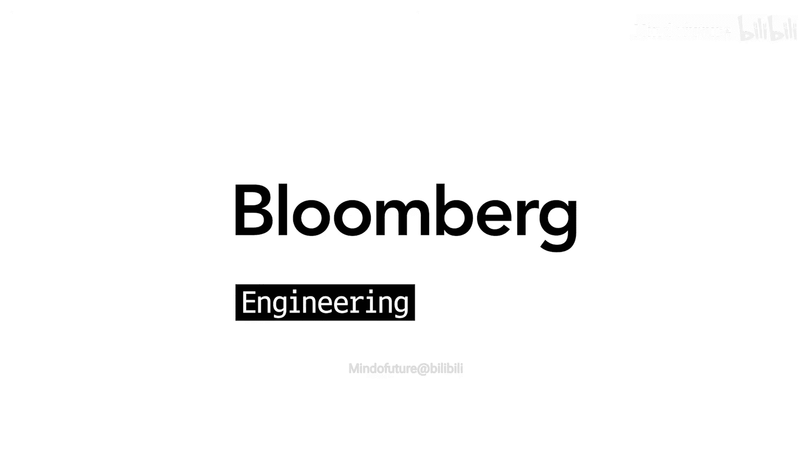
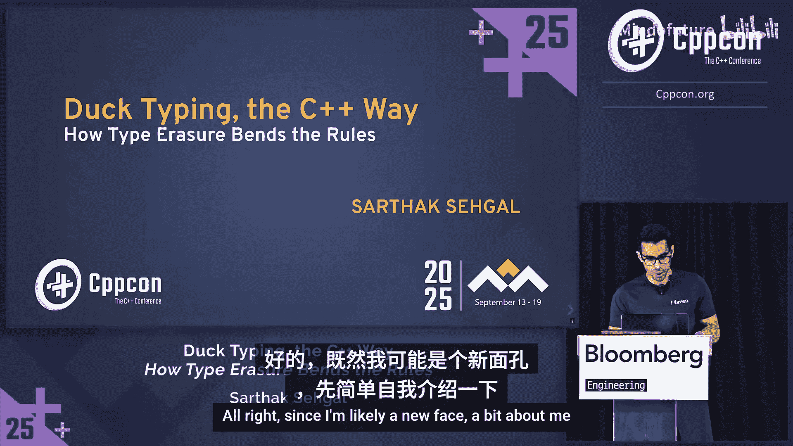
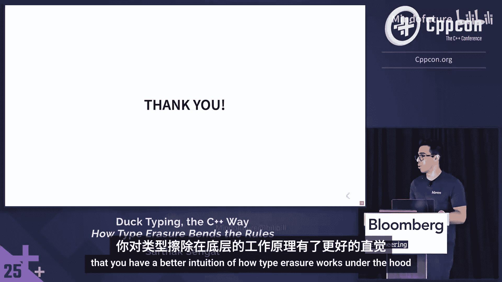
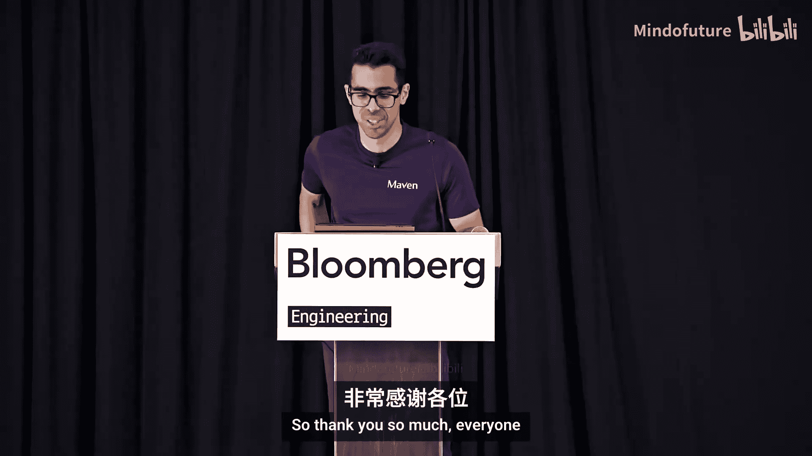
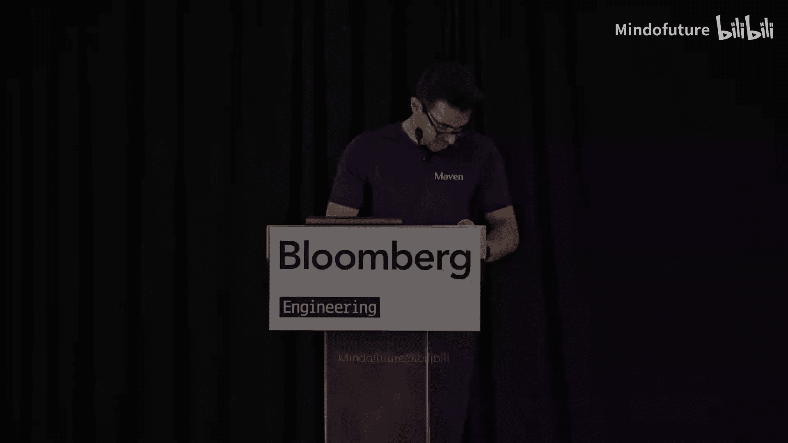

# Cppcon-2025-｜-C++-｜-C语言--｜-汇编-｜-编译器-｜-操作系统-｜-Linux-｜-Windows-p10-P10_C++方式的鸭子类型_类型擦除如何改变规则-Sarthak_Sehgal-CppCon_2025--BV1wyPBzrEeu_p10-

Hello， everyone and welcome to my talk on duck typing on pipe ratio and C+ plus。

shouthou out to those of you who made it here after the lighting talks last night。

 I it took me a lot of energy to get out of bed today。

 So I'm sure it was the same for a couple of you guys here。Allright。

 since I'm likely a new face bit about me， I'm a C plus software engineer at Maland Securities。

 which is a high frequency options market making firm。😊。

We have offices in Chicago， London and Amsterdam。 So if you're。Curious about the space。

 Feel free to reach out。 And this is my first talk at CP P 1。 So I'm quite excited about it。😊。

All right。Over view of the talk before we start。 So this talk is going to be about the fundamentals of type azure。

 how type Aure works under the hood， specifically， I'm going to be focusing on stood function for most part of the talk。

 Why we need like a type is component like stood function， how a stood function works under the hood。

 but all of this can be extended to you creating your own type era classes's it's not specific to stood function at all。

😊，Then I'm going to talk about the specific implementation that I'm going to show what the runtime cost of that implementation is and briefly then I'm going to talk about any stood any and another approach to type ratiosure。

 a different approach to type ratio that addresses some of the runtime costs and at the end if you have some time I have some moon slides about shed type ratio and shed pointer。

😊，So with that， let's get started。Consider this extremely high level overview of a trading system。

 We have an exchange on the left side。 The exchange provides market data。

 and then we have two different trading applications。

 These are like two different like same same binary。

 but like two different instances of the same trading application。

 one of them say is trading S and B 500 why the other one is trading commodities。

 So different set of instruments。😊，Now the goal is that we want this market data subscriber class to be a common concrete class。

 but filter a different instruments， so like it should the client should be able to pass a call back to this class upon construction and provide a filter function for the instruments。

😊，嗯。So it's a common class that allows filtering of the instruments。

 and it looks something like this。On the constructor takes in an instrument filter function。

All it does is that like this function has an interface that has a signature that it takes instrument definition types and returns a boolean。

 whether to filter in or filter out that function。😊。

And this is quite a common pattern where we have a class which accepts a callback on like in the constructor and we were to save that function inside the class and invoke it at a later point in time。

 So in this case， this market data subscriber listens to the market data feed And whenever a new instrument comes in it invokes this function if it fills in。

 it passes passes it on to the trading trading logic like trading logic of the application。

 Otherwise it just exits。😊，The important thing to note here is that like this。

 we want this class to be fairly flexible and the client should be able to pass any collibable as long as it meets the function signature。

 So as long as it takes in a construct to an instrument definition type and returns a bullet。

 the client should be able to pass pass that function。😊，So for example， in this case。

 the client is passing a free function。Or London， in this case。And a found in this case。

So we want it to be fairly flexible for the clients to use it。

So let's consider some solutions of how this can be achieved in C++。😊。

The first thing you might come up with this， well， it's a fairly simple requirement。

 We want to store a function。 Why not just use a function pointer。So in this case。

 I have a function pointer with the same signature in the constructor。

 and I store it as a function pointer。 And like on on instrument definition。

 I just invoke that function pointer。😊，Well， this looks good， and it has some advantages。

 This allows us to pass any free function， Lambdas or static member functions。😊。

But function pointers have their own disadvantages。 Number one， the callables need to be stateless。

 so I cannot pass any any lambda， which captures some state。嗯。

This point is lack of value semantics and whenever this point is we need to deal with things like performing null checks and I mean。

 there can always be a wrappper around it to do like null check do an null check。😊，But。

It is something to keep in mind。And I have this those asterisks there because C plus plus 26 introduces stood function ref。

 which can be used instead of raw function pointers。

 And it does allow some things like calling stateful Lambdas， like Lambdas。

 which captures some state。😊，I haven't looked into the implementation。

 but I believe it does separation under the hood as well。

 I'm not going to focus on how stood function ref is implemented instead I'll talk about stood function and I believe that will provide the building blocks for function ref。

😊，Now， if you take a step back， the requirement basically is that we have a common callable interface that is any function that takes in a construct to an instrument definition type and returns a booolean。

😊，And we， we， we want to accept any type which has this common callable interface。 The first thing。

 like one of the first things that comes into my mind， my mind， whenever I hear the phrase。

 like common callable interface or like common interfaces is the use of inheritance and achieving run type polymermorphism using that。

 So let's consider the a second solution using inheritance。😊。

Now I have this instrument definition callable class， which has a pure virtual function。

 which has like this this function call operator， which is virtual function。

 it takes an instrument definition type and returns a boolean。😊。

And I've defined two different concrete classes， equity filter and bond filter。

 and they override the virtual function， and they can have their own implementation。With this。

 my market data subscriber class can now just take a pointer to the base class。

 the instrument definition callible， and the client can provide any。😊。

Implementation of this instrument definition callable class。 as long as the derived class inherits。

 I can， I can use， use it and save it as a pointer to the base class。 It is running off the slide。

 I could have used draw pointers here to ensure that it's within within the box。

 but I I know some some of you would complain。 And if I use draw pointers。😊。

So now I have this market data subscriber， it takes it has like an equity market data subscriber or a bond market data subscriber。

 and it has different implementations per derived from the base class。Well， this looks pretty good。

 It looks like almost like what we want。 and inheritance does have some very lucrative benefits。 One。

 it's a single concrete type holding different implementations。😊，That's good。

 It achieves runtime volume offensive。 And， and important thing to notice that like the。

 the function can be re reassigned during runtime。 So if I want to reassigned like the change the equity fill function。

 I can do that at runtime by having like an assignment operator。😊。

But there are some downsides number one， now all coables are bound to be inherited by the interface。

😊，number two there's nonzero overhead at runtime， I wrote nonzero only because for most of the applications a virtual function call overhead will not likely matter。

 but if your use cases is where you want to use in every microsecond of latency then a virtual function call might be some overhead。

 so that's something to keep in mind。😊，It's not possible to pass third party to find gollibles。

 For example， there's a， there's a library that provides a function with the same interface。

 like with the same signature， takes an instrument definition type， returns a booleion。

 It's not really like possible or easy to use that， because。

All the functions that you're using need to be inherited from the from the interface that's defined in your in your code。

 not that third body library。And lastly， it still use point is the client has to take care of life management。

 So it's， it's a bit clunky。 It does's not provide value semantics out of way。Now， for completeness。

 there is another solution we can consider， which is using templates。 So let's have a look at that。😊。

What you could like say is that well， we need we need to we need to store an invocable type。

 So as long as the function can be invoked using the instrument definition and like returns a bullole。

 I should be able to use it and store it in my class so you could simply template the market data subscriber on a type T add some constraints to ensure that it's invocable and I think I'm missing a copyable like I'm missing a copyable check as well here。

 So type T should be invocable and copyable so I can store it in my class。😊。

And the constructor can simply have that template type T as a parameter and store it inside the glass。

😊，This looks pretty good。 This would like achieve what we want。

 The market data subscriber can be now created using an equity filter or bond filter。

 It takes in because the concept only requires it。 Do you have an invocable type。

 It takes in basically anything that is invoable。😊，And stores it inside the class。

So it has it definitely has some advantages， it accepts any suitable callable upon construction。

 Another thing to notice that it has zero or at runtime。

 it's just going to instantiate different templates at compile time for different callluable types。

 so it's going to have zero or at at runtime。😊，But there are some downsides。Number one。

 with templates comes codeload as I mentioned， it's gonna instantiate different templates for like different types for different functions spa。

 so it's gonna be this is gonna be codeload， but more importantly it creates distinct types that are。

 for example， not easily stored inside a container What we want is to have a common concrete type。

 not distinct types。 And as soon as you have a templated type， which is like a distinct type。

 it becomes quite hard to store in a container you would you can't simply store it。

 store a list of market data subscribers in a vector you might like if you know what all functions what all types you're gonna be instantiating this type with you can have a variant of all of those and store it inside a vector but it's not easy to do with。

😊，So this is where a container like stood function shines。With stood function。

 you can like you can simply use stood function as the parameter， have the correct signature there。

 and now you should be able to pass a free function， a Lada or a function in this case。😊。

The critical thing to note here is that。😊，These these different kinds of functions being passed to a common concrete type。

 the stood function type， all these different types of functions being passed to that are completely unrelated。

 they are not bound by any sort of inheritance hierarchy or related by any means。

 they just implement the common interface which is this function call operator which takes in which has the expected signature。

😊，And somehow， these completely unrelated types are assignable to a common concrete type。

 which is the third function。嗯。Okay， a bit of a side note here C+ to 26 introduce stood copyable function which is meant to be a replacement of stood function I'm not going go into like there some consonness nainess which stood copyable function addresses I'm not going go into the details of that but you can check out the paper I think it provides a very good example of why that is。

😊，So as I just noted， the important thing to note here is that these function types that are being assigned to a common concrete type are completely unrelated。

 unrelated， and this is exactly what type era achieves with type era。

 it hides the concrete type of an object behind a uniform interface and achieves runtime polymorphism without the need of inheritance or any sort of like a common base class。

😊，And while I'm focusing on stood function， this is this can be extended to any any typease class Hope Sautter mentioned like sort of hint towards type era in a stock on reflection earlier this week and where he had like a d typease component and then he had implementations like a square circle and these don't need to be bound by any inheritance hierarchy So as long as a square and a circle。

 have have a draw methane implementation， you can use that use them and assign them to a common draw class。

😊，So the big question is how can these unrelated types be assigned to a common type。

 so function in my case， today， but any unrelated types having a common interface。

 how do we assign them to a common type？So let's take a step back。

 list down the requirements and move on to how type pressure can be implemented and how it works under the hood。

So this basically two requirements of a function like container。

 it should be constructable from unrelated types。😊。

And it should have like all these types should have a common col interface。Now。

 I mentioned before that， as soon as I hear common colible interface。

 The first thing that comes into my mind is abstract classes with per functions。

 So let's go back to our inherited solution and see what the pros and cons were。😊，嗯。

So inheritance did provide some benefits， it was a single concrete type unlike the template solution that was good。

 it implemented runtime polymorphism and it bound all the types with a common callable interface which is the second requirement but it had drawbacks when it came to the first requirement that is it was like it bound everything with a common base class so the types could not be unrelated。

😊，So let's start off with trying to address these drawbacks。 Let's start off with the second last。

 which is it's not possible to pass third party defined cols。Now。

 here I have the same instrument filter concept that I had before。

 it's a base class with a per virtualual function。 and my own library implements this is stop filter filter class。

 which inherits from this base class and basically check if if it's in equity and for simplicity for the rest of the slides。

 I have this filter instruments method， which I'm gonna be using。

 it takes in a list of instruments takes in a callbacks going the slide。

 but basically it takes when I scroll here， it's not gonna effect there。 that's fine。

 basically it takes in a list of instruments and the callable that you want to pass and it would return a list of filtered instruments That's the example I'm gonna be using for the rest of the slides。

 Now this works fine as long as it's like my own library the instrument filter concept is being defined by me。

 So any type inside my own library can inherit that inherit that and I can use that。😊。

But the challenge is。What if there's a third party library that has this magical function is million dollar stock。

 And I want to use this function to make a million dollars and。😊，How， how do I use it。

 use it inside my library， Because this is not bound by the interface that's defined in my library。

So let's try to address this。Well， the solution is pretty straightforward。

 What I need to do is simply wrap like create a new class， which innerherits from the base class。

 implements the function called operator override and calls the third party function inside it。😊。

And that's it。 I can。 I can now use third party functions inside my library。

 and I I I simply need to now pass it as a pointed to the base class。While this works。

 it's a bit clunky because now the client needs to like my library needs to wrap every third party function inside like I need a new class which inherits from the base class。

 implement like implement the function call operator overr it's a bit clunky a lot of code load there。

 So next let's try let's try to abstract this away from the client。😊，Well。

 when I said it's not possible to pass third body functions。

 I like it is possible to pass third body functions， but it's just a bit cumbersome。No。

What do the is stock filter function， which was defined in my library and the is million dollar stock filterstruct。

 which I had to define in order to use the third party function。 What do these have in common。Well。

 one， they both inherit from the common based class。嗯。2， they both。

 like as a result of theherit inheritance that both have to override the， the function， the。

 the virtual function defined。Only their implementation differs， Everything else is remains the same。

So let's try to come up with a generic class that inherits from this instrument filter concept based class and at which is constructible from any callable。

是。We we can use templates here and try to combine templates and inheritance together to address this。

😊，Here I have this instrument filtered model class which is a templated class but it inherits from a non-tempd class which is the instrument filtered concept and this instrument filter model class basically accepts any type function type I can like we can always have some constraints on it but for the sake of this example it's unconstrained it doesn't have any constraints simply it's simply a templated type and the type is fun type and it takes in that as a constructor and simply stores it inside the class as a member data member。

😊，It also has， since it inherits from the filter concept clause。

 it overrs the function coop takes in the instrument definition。

 returns a Boolean and all it does is invoke this function that was passed to it during construction。

😊，So with this I have a generic class now， which inherits from the base class and you can pass it whatever you want as long as it's invoocable by the instrument definition and its a Boolean and it's going to be able to it will behave。

Exactly the same as the different concrete classes I had。

 like the equity filtered class or the bond filtered class。😊，This looks pretty good。Now。

 all I need to do is instead of like to use a third party function like ism dollar stock。

 I don't have to create a new class anymore。 All I need to do is use this stepdd class。

 instrument filter model create create an instance of it and pass it to my filter instruments function。

 and my filter instrument functions takes list of instruments and the pointer to the base class。😊。

So this looks pretty good be we've abstracted away all the complexity from the client。

 It's still a bit clunky wherein the client each time has to create a new instrument function。

 instrument filter model and pass that。 but looks like we are almost there with what we want to achieve。

😊，An important thing to note here is that with this instrument filter model since it is templated and accepts any callable。

 my stop filter class， which was defined inside my own library does not need to inherit from the base class as well。

 I can simply pass that function and wrap it inside this instrument filter model and use it。

 So even even the functions defined inside my own library， now no longer need to be inherited。😊。

So that's recap。We have now this print。 We have mechanism such that filter instruments can now be called using any callable wrapped inside the instrument filter model。

But there are some downsides in particular。 It's the client has to pass like create a new object。

 pass in the pointer。 It's a bit clunky。 The client is still responsible for lifetime management since we're dealing with pointers。

 So let's try to address these。 It's just some syntactic sugar to address these to address these downsides。

😊，Now。All I have here is a a new class function。 No that it's not templated。 And I。

 I just moved the instrument filter concept， which was the base class before。

 and the instrument filter model， which was derived， which washerit inheriting from this base class。

 I just moved those to be inner classes。😊，So now I have this not like non templated classstruct function to inner classes and all I have to do is have a templated constructor。

😊，which accepts basically any type fun type wraps it inside inside this instrument filter model and stores the pointer the to the base class inside base class as a data member So basically the requirement was that I have like these different functions and the client needs to wrap them inside a instrument filter model and pass a to my function。

😊，Instrument like instrument filter instrument definitions。

 but all I've done is I've created basically a wrapper for all of this。

 I've created this function type which has a templated constructor so give me anything I'm going to try to wrap it in the function model for you and store it as a pointer to the base class。

😊，This also needs to provide。The the function call operator so that the client can invoke it。

 and that's pretty simple。 All it does is invoke this operator on the pointer stood。😊。

A couple of interesting things to note Now any type can be passed to this function class like as long as it's invocable by instrument definition and returns a boolean or something that can convert to boolean。

 it can be passed but this function class is not templated， so it does create a common concrete type。

 it does not instant different types， the other thing to notice that this function class like upon like on the construction。

 it takes the actual type of what is past to it。 So it has the type information on construct on construction。

 which is the fun type。😊，It wraps it around the function model。

 but it's only storing a pointer to the base class。

 So it kind of hides away the type that like the common， sorry。

 the concrete type that you are passing to it。 It hides away that in the in the。

In the filter model class， but it does not lose information of that type。And we'll see， later what。

Not losing information of the type is important for type safety in type ratio。Alright。

 so now all we need to do is call filter instruments， using any function。

 pass that into like simply create a function object and it should be usable this looks this implementationlimination is very close to I mean obviously very raw but close to what a stood move only function would look like it's move only because I'm still using unique pointers in there and as Scottmir said in his book more effective C++ when in doubt do us the ins so let's try to provide some value semantics to this class。

😊，In order to make the function copyable。All we need to do is use the prototype design pattern。

 provide a clone method inside like again， a pure virtual function inside the concept。

 the model inherits the model overwrites that and simply creates a new object of the same returns point to the instrument filter concept simply clones the current object pretty straightforward and now my function class in the copy constructor can simply call the clone method of of the model。

😊，And。Since the model does have the type information。

 like the model is templated on the concrete type。Okay。

 the outer class function has hidden away the type information。

 but the model does have the type information of the concrete object that was passed。 So when。

 when we make a clone inside the model， it will clone the actual actual object。

 which was passed to it。😊，UmBut that's just one idea did， you know？And that's it。 So in this example。

 I have an is equity filter class， which implements the function called operator。

 And you can see that when I create a new create an object F1 and invoke it。

 it calls invoke it one times。 Then I copy it。 It's gonna print。😊，The print that the AQD filter。

 I should have called it copy CarR instead of CTarR because it's not a constructor。

 a copy constructor。But。And it calls the copy constructor office is the query filter。

 So looks like the clone is working correctly， and then it invokes it again。

 And I have this static counter。 So it prints that it's invoked it two times。😊。

Let's recap what we've done so far。So filter instruments now can can now be used by any colable。

 that's great。 That's what we wanted to achieve Point is and lifetime management are abstracted away from the client。

 It provides value semantics， but there are still some implicit assumptions about the callable type that's because you can it's got like a template constructor。

 you can pass anything to it。😊，Having some constraints there will be nice。 And lastly。

 it only works for。This specific signature， which takes in an instrument construct to instrument definition and returns a Boolean。

 It would be nice to， since we were talking about functions stood functions。

 it would be nice to have it work for any， any function signature。😊，Well。

 that's just more template shenanigans here I have a function class which is templated on type T and it has a specialization which has the type R as the return type and a veryatic template arguments as。

😊，Now， I have added some constraints to the type that's passed to the constructor to ensure that it's invocable and returns the type R when it's invoked using the arguments。

And now this is how my function called operator would look like it takes the set of arguments， as。

 if the function is not is， it's not present。 like that it's， it's a null pointer。 It's gonna invoke。

 it's gonna throw an exception。 And if it's present， it's gonna。

Invoke it using the arguments and return the type R。

Everything else like the model concept remains the same。

 it's just more templates to make it closer to what a stood function would look like。😊，嗯。So， okay。

 the important thing thing to note here is that although our focus on sort function and the usage of type ratio in standard library。

 you could create with。😊，With very similar with almost the same technique。

 which is the concept model hierarchy， your own type race component。

 so you could just create a dable type race class which has this concept which implements which has a pure virtual function called like void draw and then you can have a model that stores a to the concept and as long as the shapes implement this raw method you can store it you can wrap it inside a model and and store it。

 and it's pretty elegant because now the types don't need to be bound by any sort of inheritance hierarchy you can have completely unrelated types from third party library or your own library and and have them have them be assignable to a common type。

 and it's basically what。😊，Its it's kind of whatduct typing is right so you have completely unrelated types as long as they meet this common colable interface or any common interface that you define in your type based class。

 you're able to assign them to a common type and use them so it's similar to you howduct typing is in different languages like Python。

😊，Let's talk about cost of this type racece class。Number one。

 it does some he allocation on construction。Like if I go back on construction。

 it makes like you pass a function， it creates a unique pointer。

 So it's it's doing some heap allocation here in a make unique call。😊，嗯。

Stand library has small buffer optimization， like most implementations have this small buffer for optimizations optimization which addresses this and I'm going to speak about this soon it also has some virtual function calls that have definitely some run runtime costs。

😊，And there is you could do manual virtual dispatch I'm be when I talk about stood any towards the end of the talk。

 I'm going to show you another way of doing type pressure that does not have this cost of virtual function calls。

😊，So let's start off with small but for optimization。

This is a pretty standard technique where you have a stack allocated memory up to a certain size if the size of the function is within certain threshold like for example。

 in this case， I have this storage model type， which is a function model with a specific signature I've just chosen this signature randomly but the idea is that my threshold size up to which I store this function inside the stack inside the preallocated stack buffer is gonna be up to the size of this storage model type and any function that is。

😊，That has a size higher than this will anchor a heap allocation。On line9。

 I have the pre allocateated buffer which which is going be。

 which is a bite buffer this is gonna be on thet alignment is important here。

 so that's a bit of a gotcha。 make sure that it's it's aligned correctly。😊，嗯。

The constructor is look is gonna look something like this pretty like it's。

 it's pretty straightforward if the type is， if the type of the incoming function is smaller is is up to the threshold。

 do a placement new stood construct at under under hood would do a placement new on the storage and if if the size is greater than the threshold size I've used new here。

 but basically you could just create a pointer using unique pointer using make unique and stored inside the class。

😊，啊。Cloning it now becomes a bit different。Previously。

 the clone the clone override was not taking any argument。

 It simply returned like it simply cloned the current object and returned it as a point to the base class But now when we are trying to clone it。

 it does need the access to the storage of where the object should be constructed if the sizes within the threshold。

 So now when on the on the copy constructor call， you can see that the current object passes its own storage to the clone method of the object it's trying to clone and the target object checks that if it's if the sizes within the threshold。

 I'm gonna construct construct it in place at the storage。

 otherwise it's gonna create a new create it's gonna allocate a new function the on the heat。😊，嗯。

And that's that's all I wanted to talk about stood function。 So let's now have a look at stood any。

 which is another typease component in the standard library。😊。

As per our favorite website CPB reference， student is defined as the class N describes a typeafe container for single values of any copy constructible type The important thing to note important things to note here are one it says that it's a typeafe container。

😊，And two， it stores values of it， it can store a value of any copy conible type。

 So you could basically pass anything to a stood any。

And it's gonna store it as long as it's copyconible， but it's gonna store it in a typea manner。

 So upon destruction， it's gonna ensure that your object is disrupted correctly。

 That's quite important for type Asia。 We， we， the beauty of typera is that somehow it hides the type information from you。

And yet it is completely type safe。嗯。An example of like a duing example of stood any here I here I'm assigning an inteigger to it。

 and it， yeah， you can， you can assign it anything。

 And somehow it shows the type information of that。 and you can print the type name。

 you can cast it back to the original type here Im printing the type name。

 it prints in and costs it back to you integer and prints that indiigger。😊。

I can reassign it to any other type。 It reasigns it to a double here。

 and I can cast it back to a double here。 I re reassign it to a boolean。

 And if I try to cast it to a different type， like a double hair， it's gonna throw an exception。

So having seen how typeas works and obviously I've hintndered you that st any does typera under the hood。

 let's see how a student any can be implemented using the previousvis technique。😊，Now。

 like any typera component or like like any typeist class， it's gonna have a templated constructor。

 any type type based implementation you do it's going to start off with a templated constructor and the reason is that the whole idea of typerasure is that you want it to be assignable you want it to be constructable from completely unrelated types。

 How do you construct using completely unrelated types you have a templated constructor。😊。

So here I have a template construct I've chosen similar terminology as before。

 and you'll see this in a lot of articles， the concept model hierarchy。

 it creates a new any model and stores stores it as a pointer to the concept pardon my usage of row pointers here。

😊，Yeah， probably should have usedqui this。Alright， so I'm not gonna go into soup like into too much details of this because we've seen this recommendation before。

 Now the， the common interface that I want to have within these unrelated types now is that the type information should be stored somewhere and the client should be able to access the type information using the type method。

😊，So a bit different from what we've seen in St function。

 but on similar lines there's a pure virtual function now to access the type information stood type index is just a copyable wrapper over type info。

😊，So the model inherits from the concept similar to what we've seen before。

 the important thing here again being that the model does have the information of the concrete type so it's the model that's going to be doing any type specific like the concrete type specific things here it simply gets the type ID of the incoming type and stores it inside the class。

😊，And all I now need to do is give the client access to clients access to this public member function called type and they can and simply invoke that using the pointer I have in the。

 in the class。And that's it， I mean， we've seen this elimination before it's pretty similar to what we did before insert function。

😊，But next what I want to show you is implementation of St function without using virtual function calls。

😊，So let's have a look， and I believe todayni is implemented like this in most implementations。😊，嗯。

Now， so I've I've said previously that the model has the type information。

 but obviously the class like the any class or the function class does have the type information as well at the constructor。

 It's just that after after construction， that type information is hidden inside the model and and the class does not have access to it。

 the class that you're constructing does not have access to it。 But in this case， for example。

 any the class and does have access to the type information in the constructor I to store the type is pretty simple here。

 I have a private data member type， which is M type。

 it stores the the type information of the incoming type。😊，And yeah， at construction。

 it has the type information。 So all it needs to do is store that inside the store that in the data member M type。

Well， this looks pretty good。 This was pretty easy。 Like why do all these。

 all this type shenanigans with concept model hierarchy and stuff like that。😊，嗯。This works。

 but there is an important thing important detail to note that stood any has to be type safe。

 So the challenge now is that in the destructor。well， we do have the type information in type index。

 but I'm storing it as a void pointer instead any。😊，Like I probably missed a part。

 but basically what the constructor is doing is that the class chose a void pointer to the value and the constructor simply costs like creates a new object on the heap of the same type and stores it as a void pointer to that type and separately it stores the type information in type index in a st type index type。

😊，So now my class is a void pointer。 the challenge is， how do I delete the void pointer。

 I need the I need the correct type， like the concrete type in order to delete it correctly。

What we could do is that。During the construction the type information is there so we we could store a stored function in the class which like we could create a function which is a delete and at the time of creating this function I do have the type information。

 this function takes a void pointer as the argument。

 static cast it static cast the pointer back to the concrete type and simply calls the delete on it and this class is now going to store this function this inside it and on destruction it invokes this function。

😊，So again， we've taken a concrete type hidden the information of it like the class allocates the type on the heap and allocate allocates a new object on the heap stores it as a void pointer。

 This void pointer， as as soon as we cost it to avoid pointer， It's lost the type information。

 but it also stores a delete function， which is which it uses to delete it。

 and the construction of this delete function。 It does have the concrete type information。😊，U。

And this is how we can achieve type ratio without any virtual function calls。😊，A。To recap。

 type ratio name enables the use of unrelated types with the uniform interface。

 this is superior to in superior to using inheritance because inheritance bounds the types by it by un inheritance hierarchy it does not require inheritance and reduces dependencies。

Between various types。It is prevalent in the standard library， as you see。

 we saw the example of stood function stood any， I believe I've got some time to go where stood ShaPoer as well just to give you another taste of。

😊，Type aszure。 So I'm gonna go， I'm gonna discuss that soon。 And in the cheapsduct typing。

 which is common in other languages。 As long as all it requires is that。I is。

 it's the object to have a common interface。 And as long as you pass that object， it's you。

 you can use it with your type raised class type。Now， I do have a few minutes。

 so I'll go into the bonus slides， which I know everyone loves loves to see some bonus slides。

So I'm going to talk about Sha pointer and type safety and how how shaded pointer does type Ra under the hood。

So consider this noisy flu class。 All it does is it。

It prints to standard output on construction and destruction。

 and although you shouldn't have this in production good。

 but say you create an object of that class and assign it to a void pointer and at some point later。

 you try to delete it。😊，What's going to happen， Any， Any guesses about this code。

It's going to delete it correctly。But this is not going to compile。

The leadinging avoid pointer is undefined the warning in Gcc warning in C 19 and if you have。

Mning as it enabled it's， it's not gonna compile。 The standard library says that an object cannot be deleted using a pointer of type white white star because void is not an object type。

So how do we delete this word pointer correctly， Like say you do have a word pointer。

 How do we delete that correctly， we've seen。😊，The solution already in the implementation of stood any at the time of the construction like at the time you created this white pointer。

 you did have the knowledge of the concrete type。 So just have a like a Lada as a delete and invoke it at a later point。

嗯。Let's say you try to create a unique pointer And like。

 so you're trying to create a unique pointer of this object type noisy fo and stories that store it as a pointer to pointer to word。

 Well we， we were able to do like line 7 compiles here。

 So we were able to create a pointer We were able to create an object of type noisy fo and store it as a pointer to word pointer to word。

😊，What about this， Any guesses what， what happens here in this code。Yeah， that's right。

 This is not going。 But I mean， different styles of saying the same thing can't delete a point to in complete type。

And this doesn't compile because a unique pointer actually has two template arguments if you see the signature。

 it has the type T which is the type to the pointer and then it has a delete and the delete is defaulted to default delete of the type that you pass to it so in this case it's going to try to default it's going to have the delete as a default delete of typepo and that's not defined to default delete of typeoid it's not defined。

😊，嗯。So what we could do here is that since the unique point it does take a delete as the second template argument。

 you can simply again create a Lada and pass that as a delete。But now。

Now I have a void pointer that points to this class noisy fo， and since this is a void pointer。

 I should be able to do something like this where I have another class noisy bar。😊。

And I want to assign this pointer， reassign this pointer to like another word pointer of this different class。

This should be。 This seems like doable。 Well， I have to avoid pointers。

 I'm just trying to reassign one point void pointer to point to another word pointer。 Sure， they。

 they're pointing to different objects， but this well。TheIt should be able to handle that。

 but this is not allowed。 And the reason is that， well， you're。

These are two different concrete types。 If since you have a delete to the type type fu hair。

 and then you have a delete to the， to the type noisy bar hair。

You're trying to reassign to like a unique point or two。To one concrete type。

 you're right to reassign to it to a completely different concrete type。嗯。What about this。 Now。

 all I've done is replaced a unique pointer with she pointer。Any guesses？Com'e really fine。

 there we go， Chris Chris knows it。All right，This works great。 I。

 I created a pointer like previously So I've， I've created a pointer P DR which points to an object of type noisy fo。

 It constructs that then I reassign it to a pointer to an objective type noisy bar。

 and it's able to reassign it。 So somehow it works on shed pointer。

 but it did not work on unique pointer and unique point it was creating two different concrete types。

 And if I look at the at the signature of a she the product like signature of a unique pointer and shared pointer。

😊，Unique pointer has two template arguments， but our shade pointer only has a single one。😊。

So how is Sha pointer somehow able to reassign it and destruct the type correctly。

 So when I reassign a noisy。Appointed， avoid pointer， which points to an objective of type noisy foo。

 When I reassign it to an objective type noisy bar。Share pointer is able to de fo correctly。

 So somehow it's st the like despite stor it as a void pointer。

It's saving the type information of the actual object past。

 and this is because SharePoer uses type ratio under the hood as well。😊。

So unique quantity only stores the template type information shared pointer stores both the template type information type T that you are passing and the object type information that is the object you passed to during construction。

😊，And SharePoer uses type ratio to call the correct deor。

 And this is where type safety comes in like as we saw understood any understood and ShaPoer。

So had have an overview of how a Sha pointer is usually implemented under the hood。

 it has a pointer to type T which is the template type you are passing it shows this pointer to type T shows an object of this type and then it has a pointer to the control block this control block block has various things it has a reference count a weak count and some of the data what we are concerned here is about is the custom deleteder that's what we care about for this。

😊，Se， so it has appointed to the object， which is of type T and appointed to sub control block shows the reference on some of the stuff and a custom de leader。

Let's see I'm just going to go like very high overview off how it works。

 but you can imagine that what we've seen before， how a type based component。

 how a type based class works， you can imagine it works very similarly。😊。

So the Sha pointer has two constructors to start off with like it has a lot of constructors。

 but two of them are here the first constructor line five to line  five and6 you can see that it has it templated。

😊，Like the constructor is templated itself。 So the Sha pointer， the class is templated on type T。

But the constructor is template as well。 And as we saw previously。The first thing。

 like many go on implementing a type based class， the first thing you do is have a templated constructor。

嗯。So you could pass an object of different type Y to a shade pointer as long as it's constructable。

 as long as the pointer。To y can be convert it to a pointer to type T。嗯。

So what this constructor does is this constructor。Calls like it's a deating constructor it calls the other constructor you can see the second constructor line line 10 and 11 that takes an explicit delete。

 but I guess the constructor we are concerned about is on the the first constructor and the important thing to note here is that the default deleteder is now a delete to type y which is the actual object。

😊，In a unique pointer， the default deleteder was the delete to the type that you were passing as the template parameters。

 So that would be default deleteder of type T。 But in a shared pointer。

 it's a default deleteder of type Y， which is the actual object type。

 That is how it's able to store or like able to invoke the correctly deleteder。😊。

So this delegates to the second constructor and now the challenge becomes that we have the second constructor。

 which takes in a point to y。 that's easy to store like we can the class has a member function。

 a pointer to T and we already have a constraint that the point to y should be convertible to point point to T So that's that's easy to store but how do we store this delete now。

 this delete is again again， a templated type like the constructor is templated。

 So how how do we store this delete。😊，嗯。And going back to the concept model， hierarchy。

This is what like a very simple controlled block would look like there is a control block base which is the concept it shows like the F count but more importantly it has a virtual deor and then I have this control block which is similar to a model which we saw previously it's templated on the object type。

 the type Y and the delete leaderder。😊，And in the deor it calls the it storess the deleteder and it calls the correct deder on destruction。

 so you can imagine I'm not going to go into the details but you can imagine that shared pointer creates wraps the delete into this control block and stores a pointer to the control block base inside the class。

😊，And that's it。If you。If you take anything out out of the session。

 I hope that you have a better intuition of how， how type ratiosure works under the hood。

 and you have an appreciation of how typeas differs differs from inheritance and can be superior in some cases。

😊。

Thank you。😊，if there's no question， either， I did a really bad job of it， or I did a really good job。

 And I think to， I think I， I'd like to think I did the latter。 So thank you so much， everyone。

 cheers。😊。

