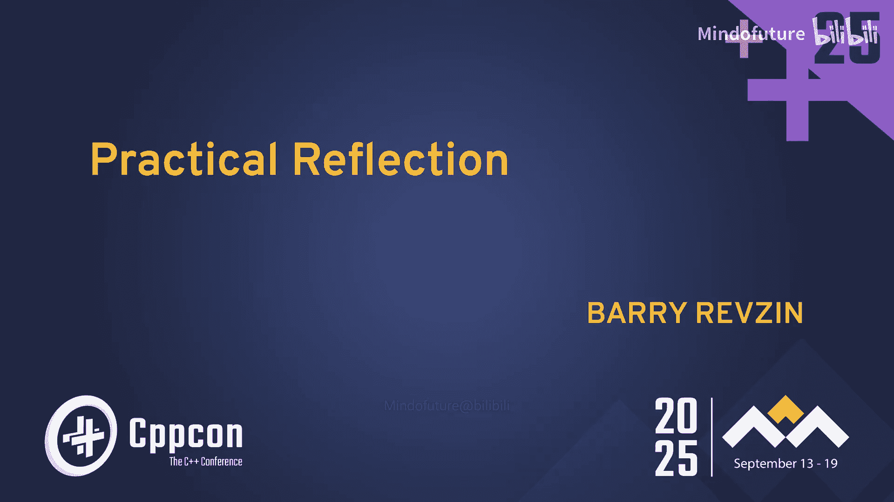
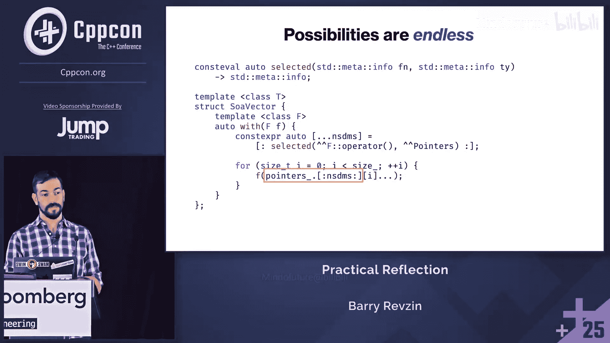
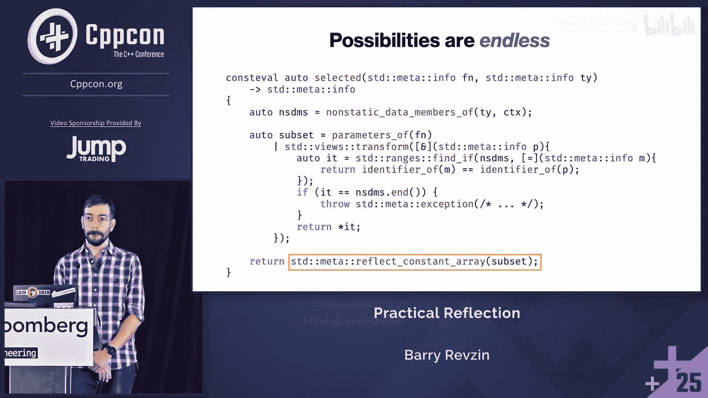

# Cppcon-2025-｜-C++-｜-C语言--｜-汇编-｜-编译器-｜-操作系统-｜-Linux-｜-Windows-p11-P11_使用C++26进行实用反射-Barry_Revzin-CppCon_2025--BV1wyPBzrEeu_p11-

Al right， so hey， everyone。 I'm Barry。 start with a quick about me。

 I'm a software engineer at jump trading， which is a research and technology driven trading firm。

 We have offices all over the globe。 It's a really cool place to work。

 As you can tell by the fact that I'm very nearly a teenager there。😊。

I've been involved with C standardization since 2016。

 I've been involved with with a lot of stuff that's made into the last several standards。

 most recently， reflection， which is what I'm excited to talk to you all about here today。

 Outside of that。 I have a blog where I write about all sorts of kind of random things that that interests me You may have seen some of the answers on stack overflow over the years。

😊，And as obsessive as I am about SequL S pluss， I'm also pretty obsessive about swimming。

 So I also write for swim Sw， which is a premier swimming media company in the world。😊，So yeah。

 so this talk has an origin story。 and that is a colleague of mine a few months ago。

 suggested that I check out this talk。 a practical guide to applying data oriented design by Andrew Kelly。

 Andrew is the creator of the zig programming language。

 And it was a really good talk with a lot of useful content。 Even if like me。

 you don't know any zig at all。 It would suggest checking it out。 But in particular。

 it had this one slide where he's talking about using memory efficiently。

 and he makes this oneline code change。 where he's switching a data structure for being an array ofstructs to astructive arrays。

 And that's all yet to do in his code。 There's no like other weird macro stuff going on here。

 there's no shenanigans just the library knows how to dostructive arrays。

 and this just works He didn't have to do any more work for it。 And I thought this is super cool。

 And this is the kind of thing that I really want reflection for。

 every now and then you'll hear someone say something like well。

 the goal of reflection is to do Eum to string。 I find Eum to string to be like a very boring example myself。

 for me。😊，The goal of reflection is to able to be able to write libraries that are this easy to use Like you don't even think about it。

 like， oh， I needed obstructive arrays， bam， I obstructive arrays。And so after I watch this talk。

 I was very excited to go and implement this right away。

 And that's what we're gonna talk about today。 we're gonna walk through how to implement Sa vector in standard C plus26。

 And I think that's already pretty cool。 But that's not that's not really my goal for this talk。

 I mean， it's a cool example。 But my primary goal is to use S vector as a vehicle for teaching you all about reflection。

 This is a very cool new language features that's going change the way that we think about solving problems。

 And so what I want to do here today is start giving you some exposure to some of these new techniques so that maybe you can become familiar with it so that maybe you can develop some intuition about how to start solving problems in the future so that you can go on and build very cool libraries yoursels to do things that I don't even think are possible right now。

 What I'm not going to do in this talk is I'm not really going talk about data oriented design。

 I'm not gonna to talk about whystructive arrays is useful when you might want to use it like anything like that。

 If you want to learn more about data oriented design。 There's this very precocious。😊。

Young engineer named Victoria， who's giving a keynote later this week。

 Theres a lot of good content in it。 I highly recommend checking you out。

 although now he's all grown up。 So he looks like that。 He's sitting。

 He's sitting in the front row over there。😊，So we're gonna start with storage。

 right like the whole point ofstructive arrays is to store things。

 How do we how do we do that properly？ So this talk is going to focus around this type square。

 It's a very simple type。 There's nothing particularly interesting about it。

 It happens to have a lot of internal padding。 So it might be the kind of type that you'd want to usestructive arrays with。

 And so if we had a vector That storage will look like this we'd have a pointer to square。

 And that's where all our arrays are stored contiguously and we'd have our size and capacity but we don't want to do that We want to dostructive arrays And so one way to do that is just to turn every member into a vector of that type We have this very simple transformation from T to vector of t。

 and we're gonna to preserve all the names。 And this is one way to do it。

 It's pretty straightforward， and it's easy to see how we could implement all sorts of other operations on vector How do you do push back。

 well， I push back the x onto my x vector。 I push back the y onto my y vector and and then I'm done right now。

 importantly， some of you might be thinking that this isn't quite right。

I'm not going to deal with exception safety in this talk。

 like what happens if the X pushback succeeds， but the Y pushback throws whatever we're not going to deal with that。

 like pretend that that's not an issue。And so this is fine。 This would work。

 This would solve the problem， But I don't like super like the solution。

 because like what can we say about these two vectors， right？ they're not。

 they're not really independent。 They're always gonna have the same size。

 they're always going have the same capacity。 So at the very least。

 we'reoring our size and capacity and times instead of once which which is kind of wasteful。

 but then it's like okay I'm going to check to see if I need to allocate when I push back the X。

 And if I don't。 I don't need to allocate for any other other members。

 but I'm going check that every time anyway know， it's wasteful。

 So know I'm not trying for the person this talk to produce like the most optimal。

 highly performant thing， but I don't want to prematurely customsimize either。

 and it's more interesting to produce the solution that's more along the lines of what you'd actually want to write。

 So instead of doing it this way。 we're gonna do all the management ourselves So it's still like kind of a simple transformation now from T we have a point T for every number and we're just gonna keep the size and capacity ourselves separately。

😊，So cool。 So how do we actually do this for an arbitrary tea。

So C plus plus 26 has one cogen mechanism in it。 It is very narrow。

 All we can do is given an incomplete type。 We can populate it with a specific set of non staticatic data members。

That's it。 But that one little thing is enough to solve a wide variety of problems。

 And hopefully eventually， well， we'll get a lot more useful， more generic things。

 And so the way that works is we declare an incomplete type。 We have a contableval block。

 which is another new C plus 26 feature。 So this is a way of having arbitrary code running a declaration context。

 And eventually， we're going to call a defined aggregate。

 passing a reflection representing that incomplete type。

 And this whole process will complete that type with data members that we provide。😊。

So one thing I also want to point out is you might notice that I'm qualifying stood vector。

 I'm qualifying stood meta info， but I'm not qualifying to find aggregate。 Now。

 this function is really stood meta defined aggregate。

 but I don't need to qualify because we say that reflections have stood Me as their associated namespace。

 And so A L will kick in and all of this will just work。

 And I'm going be very careful for the purposes of this talk throughout all my slides to qualify the things that need qualifying and to not qualify the things that don't need qualifying right。

 So there's no magic using namespace anywhere here。 Now， maybe you might prefer to qualify it。

 You know， that's on you。 But but I'm not going to。😊，And's good。

 So now what we need to do next is we need to loop over all of our nonstatic data members。

 and to do that nons data parameters takes two parameters。 It takes the reflection of the type。

 and it takes this very long thing， which is the access context。

 one of the issues we had to deal with reflection is like how does reflection cooperate with access control Do you get the private members do not get the private members And the solution that we have is you actually provide an access context。

 which tells you which members you want。 So I can use unchecked to say I want all the members。

 I can use unprivileged to give give me whatever members I have access to in the spot of code I am right now。

 But for the purpose of this talk。 we want unchecked all the time。 This is very verbose。

 So we're just gonna pretend that I have some global variable somewhere name context。

 which which is unchecked because I always want all the members and now this actually fits on online。

 which is nice。 And so for every member， we're gonna push back a data member spec。

 And this is now how we define our data member description for each member that we're trying to populate。

And that takes the type that I need and the name of the member。

 So this right here would just be identity。 I'm just copying the type and the name of the member。

 And， of course， I wanted to add a pointer。 And so we have a type trait for that。 right。

 We have stood add pointer is a type trait that we've had for a long time。

 And one of the things we did is we added a constableval function version of every type trait。

 And so add pointer is just a function that takes an info and returns on info。

 and it applies that transformation internally。😊，So now I've built up all of the members from T。

 I've copied them over。 I've added a pointer to each1， and I need to add our my size and capacity。

 So those are just fixed。 Those are our size teas。And then I'm done。

 I call it defined aggregate that completes the type。

 And so now I can just use it as if I handro all of this。 So this is the pattern。

 We declare an incomplete type。 We have a con out block that does whatever it needs to do。

 It eventually will'll call define aggregate to complete that type。 And now I can just use it。 as if。

 as if I wrote it myself， right。So this is， I think， you know。

 pretty straightforward as far as code concern， right Like there's not really a lot of tricks or she Andgans going on。

 However， it's not， it's not quite right as a solution。

 because you imagine like what if I tried to use a type like like this。

 I struck And I have a member named size underscore。 Well， what's gonna happen。 Well。

 I'm trying to add a member name size underscore in this loop。

 And then I'm trying to add a member name size underscore out here。

 And it turns out that you can't have two members name size underscore in the same type reflection is not gonna change that This isn't gonna work。

 what do we do about that。 Well， as a library author， I can just say like look。

 you just cannot have a type with members name size underscore capacity underscore a reserve for the implementation。

 that feels really user hostile， especially because there's actually no reason that I need this research at all。

 Just because I want these members doesn't mean that I have to generate all the members。

 I can just pull them out of this concept block and stick them on the outside Like we can just do it the normal way。

 and that just works now。I don't have any additional restrictions on the type。

This additionally has some nice properties because now all of my members are pointers。

 So for one thing， I can give this type a more meaningful name than storage。 theyre my pointers。

 For another thing， now I can more clearly express that the way that I'm computing pointers is just a simple transformation all the data。

 So I'm gonna just prematurely generalize this a bit。

 maybe foreshadowing that I might use this function again in the future。

 And so what I'm going to do is I'm just going take my transformation。

 which is stood meta add pointer， which now needs to be qualified。

 And I'm just going pass this through to views transform。

 And that's like the transformation that I'mly to every type of the member So Trans is going to give me a range of data member descriptions where all the names are the same as the original type。

 and I'm applying some transformation to each type。😊，All right， so I can do it this way。

 So this returns me a transform view。 and that works fine for defined aggregate which can take except any range。

 a different way that I might write it is actually like this。

 We can take advantage of the fact that reflection is a monotype design。

 stood meta infofo can represent anything。 It can represent a non of data member or it can represent a data member description。

 And so since my I have this one to one relationship between the original data members and the ones I'm generating。

 I can just mutate my vector in place and and return it like this。

 For those of you who might be familiar with range V3。

 you might recognize this as actions transform compared to views transform。

 And I suspect that it's possible that reflection might drive use of actions more as a pretty good way to solve a lot of reflection problems。

😊，So let's talk about constraints because it turns out that you can't do an S A vector on any type at all。

 There are some requirements that we do need to impose。

 and these are basically the three right what do I need to do in the implementation。

 I need to be able to destructure your value。 And because I need to store all the members separately。

 And that definitely needs to be independently destructable。 Like if I take apart your type。

 and then you delocate memory and new deor like that's not gonna work。

 I need to restructure the values because eventually you're going to want to get values out of this So vector。

 So I need to be able to produce them somehow。 And I need to put names to storage And so what I mean by restructuring like all I have are your remember。

 the only way for me to put them back together is basically using like listen initialization。

 So that that had better work。 so these constraints are basically the top push us to requiring that T is an aggregate And the bottom one is basically the T as no base classes。

Itsly， it's possible to implement this with base classes anyway。

 that just takes a little bit more work。 And so we're just gonna pretend it's not possible for。

 for today's purposes。Okay， so how do I write this。

 so these map very directly onto preddiates so we can write right is aggregate。

 We have a type trade for that and checking if the type has no basis is asking for all the bases and expecting that it's empty So this works。

 And and this is also pretty familiar right we've all written type traits and type traits have to be class templates or variable templates some kind of template。

 But in reflection that's no longer the case anymore。 we don't have to make everything a template。

 And in particular， we can write this as a function。 a regular function。 And going forward。

 a lot of these kinds of things are going to be written more as as function。

 you don't need to reach for templates anymore。 And so we can just transform that。

 So instead of as aggregate V the variable template， we have is aggregate type the function。

 you'll see that now this ends and underscore type。

 we did our best to try to preserve all the names of the type traits exactly。

 but we ran into a few name clashes。 And so the pattern there is all the type traits that start。😊。

With is the function equivalent ends an underscore type。

 So is function type is aggregate type is union type and and so forth。 but they all exist。

But maybe you're thinking， okay， that's cool for his aggregate that the standard library is providing me a function。

 But what if his aggregate was my type rate。 The standard library is not gonna to have a function equivalent of my type rate in the near future。

 So what if all I had with this like how do I implement is aggregate type for my for my variable template and you might think it's like。

 okay well， I know how to do that， I'm just gonna instantiate the variable template。

 I'm gonna splice the type to get the type out of it so that this works。 but this doesn't work。

 you cannot in order to splic something it needs to be a constant expression。

 and function parameters is not constants。 So this doesn't work。

 that's not gonna that's not gonna fly。 but fear not like we have a solution for you。

 So one of the functions in the reflection library is called substitute。

 which is I think sneakly one of the most useful functions in the entire library And what it lets to do is it takes a reflection of a template。

 Any kind of template， function template， variable template class template and a bunch of reflections。

😊，Arguments。 and it does that substitution for you。

 And so what are here is the reflection representing whatever the substitution of that template is。

 Now， you can't write that yourself。 But when you get back out of it is， is a reflection。

 And so we're not really violating any of the kind of rules around functions。

 right R is always an info。 no matter， no matter what type type happens to be。

And so now that I have this， I know things about R。

 I know that R represents a context variable of type bull。

 and I can get the value out of it with this other function called extract。

 So this this this one pattern of substitute extract comes up a lot in a lot of problems。

 And one way to think about extract is， is it's kind of like any cast。

Because a reflection is kind of like any。 like it can represent anything。

 And if you know what it represents， you can pull it out。 And if you get it wrong。

 then it's an error。 right If you， if R represents a variable in the type int， this is。

 this is gonna fail。 This is gonna throw an exception。 But， but I know it's pool so that。

 so that this works。And indeed， we can kind of generalize this and wrap it around nicely。

 can We can produce an algorithm called preed， which is takes a reflection representing any template and returns back a lambda。

 which is gonna take a bunch of arguments and does the substitute extract dance for you。

 So this is basically a way of turning any template that you might have into a unary or a binary function that you can use。

 And then we can implement isagre type as just pre of a reflection of isaggry。Which is， I think。

 pretty， pretty nice。Right， so this， this substitute of track pattern is is pretty common。

 and we'll see it。 We'll see it again a little bit later。So that's cool。 Okay， we have our storage。

 We have our constraint。And we got to actually add elements， right。

 It's not a very useful container if until then。And so if we go back to square。

 if we just have our specific instantiation for squarere， how do we do， How do we do pushback。

 So first we got to check to see if we need to reallocate。 Okay， if we're at capacity。

 we grow to some new capacity。And then well， we'll placement new R X onto the slot where the new X goes。

 We'll placement new R y into into its according slot。

 and then we'll eventually increment the size when we're done right。

And so what's going on here is you can see that。 So over here， were。

 we're kind of iterating over the members of pointers。

 And we're doing something for for every member of pointers X。 And on this side， like。

 these are the types and the members of square。 And so we're。

 we're iterating over both of our types kind of imp parallel to to do this kind of thing。Now。

 we could do this and placement news is great at all It it's the most generic of the placement news approach。

 But it turns out we also have a library facility that is a little bit more specific called construct at。

 And this this will deduce the type for us。 So I don't have to repeat it。

 So it's a little bit nicer in this context。 Since now I only need the members。

 I don' I don't also need the types。So， O， so that's what I want to write for square。

 How do I do this for like a generic type。 So the prologues gonna be the same。 Like。

 I just check my capacity and then I need to grow。 maybe， and the epilo's the same eventually。

 I'll incrit the size。 So how do I copy every member into its own slot。 How， do I do that now。

And so I can think of a lot of different ways to， to do this。

 And so rather than kind of picking one way to present。

 I'm just gonna present every way I can think of to solve this problem。 And then， you know。

 y'all can kind of pick which way you like better。 maybe some ways are more suitable to some。

 some problems than others。Okay， so option option number one。

Is so we can start by destruct pointers and value into， into a pack。

 So one of the new C So 26 features is we can now declare packs inside of structure binding。

And so importantly， so we know that this will work for pointers in value。

 We know works are pointers because we constructed it。

 and we know it works are value because we just required this off the back。

 And then we know that pointers and mems are packs of the same length each one for each member。

 And so then we can just call construct at for each pointer member pair and then fold over comma And so for those of you that have've done a lot of meta programminggram in the last few years this will probably seem very familiar because the way that you do iteration in S plus plus is of course。

 you fold over a comma now for other people， this is a very bizarre way to write a loop because it's a comma And so don't worry。

 we got you covered So one of the other things that we're adding in S 26 is a new kind of loop。

 which is called an expansion statement。 And this loop happens entirely at compile time。

 And there are several different forms of it。 But one of the cool things that you can do with an expansion statement is the variable can be con per so you can't have。

😊，A context for loop variable in a four or while or anything like that。

 But you can in an expansion statement。 And I need this to be context for because what I'm doing with it is I'm indexing into a pack。

 which also a new26 feature。 So this is the same thing that we saw in the previous option except now I'm actually doing like iteration that looks like iteration instead of dot dot do So now what's gonna go on the other side of the expansion statement So I need the numbers from 0 to N。

 And so that's views sayiota is a way of just producing that range Now that's a little bit ver。

 and it's kind of annoying whenever you're writing from0 to n to have to actually write the0。

 And then there are situations when you actually need to be careful to actually have the correctly typed to 0。

 And so another kind of small thing that we're adding into the ranges library is views indices which which handles the0 for you。

 So this is basically what range does in Python。 You just provide the upper round。So that's option 2。

Oion 3。 So when some of you might have son like， okay。

 I'm iterating over two things at the same time。 There's an algorithm for that。 That's called zip。

 Why don't I just write a zip。 So in this case， It's not a range zip， I'm doing a tuple zip over tus。

 because expansion statement can iterate over every element over tuple。

 And so I can just write a tu zip。 This is kind of a simplified implementation that does this sort of pack instruction binding stuff。

 but kind of hides it away in an algorithm。 And I'm returning a tuple of tus of references into into every element。

 And so now pointer andm here are references to those sub objectsject。

 And I can directly do the construct that。 And it's a little complicated。

 but it's possible to generalize tuple zip to support any number of arguments and also handle like forwarding references correctly。

 But in this case， we don't need any of that。 So the simple case kind of works。

This is this is I kind of nice。 We can also do a more rangebased zip and zip over the nons staticatic data members of each type。

 So this now requires us to do another class member access because now instead of having the sub objectss themselves。

 we have reflections representing the non staticatic data members that we need to do the actual access to get to the sub objectsject。

 this context per here is also a new thing in sequence plus626， because up until now。

 you couldn't actually have contexts or structured bindings to begin with and now you can。

 because we're splicing0 M。 So I need them to be to be contexts per here。 Unfortunately。

This code requires another feature， which we do not have， which is nontrans context for allocation。

So nonsted data members of returns a vector vectors allocate zip is going to hold on to those vectors。

 and that internally inside of the expansion statement is going to create。

 try to create a context per variable with that result， and that's just not going to work。

 You can't have allocation persist yet， unfortunately。 But so we do have a work around for this。

 And that workaround is called defined static array。

 This is part of a very interesting set of library functions that we're adding into the standard。

 And so what defined static array does， is it takes an arbitrary range with some requirements。

 But it takes an arbitrary range。 And it promotes that range to static storage as if you had created a static context per array with those contents。

 And then it returns you a span into that array。And so now this avoids the issue we just saw because we don't have any allocation anymore。

 Our span is just pointing into this static array。 We don't have any lifetime issues because it's a static array。

 So that this just works。 although you know you can see that I'm kind of running off the end of my slide here。

 It's a little wordy And and this seems like kind of like a magic function Like how could you like how could you do this。

 And it turns out that it's actually not very magical。

 And and we're gonna take a detourage implement it ourselves。 And so in this particular case。

 because we're implementing stood defined static array。

 I'm gonna to pretend that we're in namespace St。 I hope you all allow me that。

 And so what does defined static array look like It takes a range。

 returns a span of tcons key being the value type of the range。 And we're gonna do in two steps。😊。

First， we're going to do all the work。 We're gonna create an array of， of those contents。

 And we're going get back a reflection representing that array。 Don't don't worry。

 I'll show that function in a bit。 But array here is a reflection representing a variable。

And once we have that， we can extract the contents out of it so we can extract the pointer from the array。

 So that gives us our first element。 And we can get the length by getting the type of the array。

 And then the extent of that type。 This is another type rate that we that we have， right。

So so that's how we get the contents。 So how do we implement， reflect content array。So this now。

 it has to return a reflection representing an array。 So in order to do that。

 there needs to be an array。 So let's do that。 we're gonna create a variable template。

 which I very creatively named the array。 So it takes one template parameter， which is the type。

 and then a bunch of constant template parameters， which are the values。 And so there's。

 there's my array。 Like， give me an array of this type of these contents。 there There you go， right。

😊，And so now what reflect Con array needs to do is it needs to lift all of the contents of the range into constant template arguments。

But we've already kind of seen how to do that。 So we're going to start building up our arguments。

 We're going to start with a reflection of T for the type。

 And then we're gonna loop over all of the elements of the range。 we're going to push back。

 reflect constant of elements。 So reflect constant is a function that takes a value and returns a reflection representing that value。

Or for class types， reflection representing the template parameter objects that would be that value。

And now that I have all of my template arguments。I cost substitute。On the right。

And so this is the same one，2 substitute extract pair that that we saw earlier。

 And I put all of my things into the template arguments。

 and I substitute it into a suitably shaped template。

 And I know what that shape is that I can extract the contents back out in。

 in a form that's usable for me。One other thing that I want to point out here that that's really nice is that you'll notice that the array takes one type parameter and a bunch of constant parameters。

 So it's a heterogeneous template。 And with a lot of meta programminggram techniques。

 like heterogeneous templates are very difficult to deal with you end up wanting to deal with type lists are a lot easier And so you end up wanting to contort a lot of the way you do things by like sticking your constants into types so that all you have are types。

But with a reflection， this isn't a problem。 Like we just have。

 we can have a reflection representing a type。 We have a reflection representing a constant。

 They're all of type info。 I just have a vector of info。 heterogeneity is just a non issueue。

 It's not something we ever have to think about。 And so now you just declare a template the way you want your template to be shaped。

 And you don't have to worry about it， which is， which is readiness。Okay。

 so now now we have defined static array。 So I said that this was this was a mouthful。

 And it turns out that if you want to do something like this。

 youll tend to want to reuse these members multiple times。

 so we can go ahead and stick them into static context were members of S O A vector。

 And once we give them names， you can see that the zip code looks pretty nice。 And indeed。

 this defined static array on static data members of pattern comes up a lot。

 so we can kind of wrap that into like a nicer nicer function called NSDMs of or something。

 fields of might also be a good name for this。 And so now our zip code looks pretty nice。

 It looks very similar to to the twople zip case now that we lost the woriness of the way that we have to do the range zip。

😊，And of course， option 5 is instead of doing a zip。

 we can just loop over the indices that we can get from the members that size and then just like index into the two spans in our class member access。

 this also works。One thing， one thing we haven't done it is grow。 So how do we do grow。 Well。

 that's actually turns out to be pretty simple。 We iterate over all of our pointers。 So and again。

 in some expansion statement。 we pull out a reference to every every one of our pointers。

 and we're gonna grow each pointer independently。 This actually doesn't even have to be a separate function template because every the body of an expansion statement is a different template instantiation for each member。

 if it has to be。 And this is， this is just your basic allocation code， right。

 we allocate some new thing， we copy the old data into the new data。

 we destroy the old data than we delocate。 But of course。

 we probably don't want to copy because we're done with it。 So maybe we want to move。

 And once you see move destroy and Sws26， this is relocate assuming that persists。 And so this is。

 and now we have a complete solution to adding elements。 right， We can add elements into vector。

 So that that's pretty cool。😊，But it turns out that like， okay。

 adding elements into container is cool and all， but eventually you will want to look at them。

 perhaps perhaps do something with them。 And so the simplest thing to do with your elements is to print them。

 So let's go back to our decoration of S O A vector。 where we declare it a pointers。

 And so we're gonna add a new type here。 I'll call it spans。

 And just like pointers is a type of pointers to all of our types。

 span can be a type of spans to all of our members。

 And I'm gonna make it a con span of each of each member type。 And so for our square。

 spans will look like this will be a span of char cons named X and a span of long cons named Y。😊。

And so we'll get to the implementation in sec。 But the way I might want to use this is like。

 I'll push back a couple elements into my S O A vector。

 And then I want to print the spans spans out X spans do Y independently。

 And I would expect that for X， I'll have E and C in there and for a while， I'll have4 and 6， right。

And so it turns out that actually implementing spans is pretty easy with the stuff I've shown before。

 we just unpack our pointers that gives us all of our pointer members。

 and then we just need to produce for each pointer。

 a span of the appropriate size and then put them all together inside of our spans。Its not cool。

 We got， we got our spans。 We got access to them。 We can print them。

 But another thing you might want to print is I want to print just every element independently or in this case。

 just the first one。😊，So in order to do that， okay， we can add an index operator。

 And that looks basically the same as spans。 have to have to do the same kind of thing。

 But this is going to give me a square。 And my square is not principal。And so I can do that。

 I can make it printable。 I can write a specialize a format for square。 I can add a pars。

 I got a format， which can go through and write all my members。

 And because I want to like print them nicely， for debugging purposes。

 Like I want to make sure that I remember to put this question mark over here so that my cha is quoted。

 but not put the question mark over here because long is not debug formatable。

 So question mark is not acceptable format specify。 And you know， this is like I can do this。

 And and I did this here you go。 But like， you have to understand that like I'm lazy。

 And I don't like writing this stuff。 And you don't like writing the stuff。

 So what I want to do is I just want to slap or a bug in front of this type and have that just work。

😊，嗯。But it turns out like I can't do this。 One， this is like a preprocessor directive。

 I don't even know what's going to the dude in my code。 but。

 but I can do something very close to this。 And I can， I can do this。

 I can I can write a new thing called annotations。 Another news C 26 thing。

 And I'm gonna spell it derived a bug for no particular reason。

And what I would like to do there is I could。 I would like formatters to just recognize as an out of specialization for any type that happens to have this annotation and then have formatrs like do the right thing。

 I would like that。And so that's what we're gonna do next。 We're gonna， we're gonna implement this。

 And so none of this is in the standard library。 There's no。

 there's no derived debu kind of annotation thing。 Ha annotation is not also a function at time of the standard library。

 but， but we can write that。And so， so if we're driving debu， there's nothing special here。

 There's just like a tag types that exists purely to be able to have that spelling。

 Ha annotation is a little bit more interesting。 So we need to write a function that given a reflection that represents anything。

 There's a lot of things that you can put annotations on， It could be a nons staticatic data member。

 It could be a function， could be a namespace。 So whatever it is。

 We don't know really anything about R。 Like， does it have an annotation of this value。😊。

And so we can loop over all the annotations。 Annotations of is in the center library。

 and we can check to see， okay， if that annotation has type T， then I can。

 then I will also extract the T out of it and check to see if it compares equal to value。

 And if I find anything return true。And so it turns out we kind of thought that this kind of pattern of looking for a specific annotation of a specific type is going to be something that people write a lot。

 So there's a dedicated function for this called annotations of with type that will now only return annotations of a specific type。

 So I don't need that check anymore。But now this extract， like now I'm comparing two Ts。

 So I'm writing user to find like the quality operators to do whatever。 And you will note that like。

 I did not actually write a comparison operator for for any of these types above。

 So that's not gonna really compile from you right now。 So I could do that。

 I could write a comparison operator。 But again， I don't， I don't really want to。

 So we could do this a little bit better by not requiring that on all of our users。

 And instead of comparing them as Ts， I can compare them as reflections。

So two reflections compare equal if they if they're both values and represent the same value or if they're both objects and represent the same object。

 And so because we have this requirement that any value that you put into an info has to be usable as a non type temp parameter or constant temp parameter。

 there are already rules around how the language compares those as equal。

 And so we can just piggyback off of those rules。 and so drive this a structural type kind of trivially because it has no members。

 And so that comparison just works。 and so now we pull out the constant from a。

 We compare it to reflect constant， which we've seen before from value。

 And so now we're comparing reflections。 And this is less code that I have to write。

 And it's also gonna be more efficient， which is nice。Now。

 some of you might be thinking and then we can， we can pull expected。

 Now some of you might be thinking that like come on， this is like。

 obviously an algorithm while you're writing like a loop to do this。 And like， yeah。

 sure like we can write this as any of， which which might be a little bit nicer。

 And we can even write this as contains， which is more specific。

 which also allows me to not have to like specifically declare this。 And so this is。

 this is that thing pretty nice right， Like to do the annotations。

 We can just do contains projecting constant of onto every annotation to get to get the right。Okay。

 so let's go ahead and and implement our formatter now， right。

 like we sufficiently constrained our formater to only do match the types that have opted into this default behavior。

So let's go ahead and do that。 So we're gonna start by printing the name of the type and。

 and open brace and a closed brace at the end。 so that'll get us to square open brace closed brace。

And then we're gonna go through， and we're gonna loop over all of our bases。 So again。

 we have to do this to find static arrayray thing with， with the basis of in this case。

 my kind of cheating approach of pretending that there's a global context isn't gonna to work because now I also have this like local context thing。

 And I'm like， this is kind of a mouthful anyway。 So let's just pretend that this is just basis of two。

Naming， naming is hard。 And so we're just gonna to recurse and print every base class。Now， now。

 for our square type， we don't actually have a base。 But if we did have multiple base classes。

 And in particular， if we had multiple base classes。

 this would just like print them on top of each other without any delimiter。

 And so we need to go through and make sure that we like add comma space in between everything。

 This is like the most boring code in the whole thing。 So I'm just gonna immediately take it away。

 So you don't have to look at it。 But we're gonna remember to like conditionally print the delimiter each time。

 And then we do the same thing for our non staticatic data members， which And if I do that。

 I'll get my E4， which is cool。😊，And， and so I like， again， I have this thing where're like， I don't。

 I don't like this， but we've already seen an NSDM of。 So I'm gonna I'm gonna use that again here。

 But this isn't exactly the format that I wanted for the nonci data members。

 like bases don't have names， but members do。 So let's go ahead and add those。

And so now I will get x equals E and equals 4， which is getting， getting to be a pretty。

 pretty nice thing。 Now， you might see that here， I'm using an identifier of， but up there。

 I use display string of why the difference。Well， so it turns out that names are complicated。

And in particular， names of types can be really arbitrarily complicated things， right。

 Because once you have a type， that type could be a specialization of a class template。

 Some of those template parameters can be user to find types。

 Those types could have arbitrary members in them。 And like。

 how do you represent any of this stuff in any meaningful way to the user。

 And so we have this general function display string of。

 which is basically just give me some useful thing， hopefully Mr compiler。

 because like we can't really do anything better than that。

 I'm hoping to eventually develop this into like a more interesting library that might have some options like the。

 do you want the namespaces， know， whatever。 But for now， we'd have this function that just you。

 give me whatever。😊，But for nons staticatic data members， well。

 like we know that that name is an identifier， right？

 And so we have the specific function identifier of。

 which definitely gives you the identifier that this thing has， So like namespaces have identifiers。

 right， And if it's not something that is known to have a specific identifier， then this fails。

 So in this case， we can rely on identifier have to do a thing。

 And we need to string up for the type。However， this is not the way I wanted to format this right。

 Like I wanted my char to be quoted， and it is not here。

 And so I might try to put a question mark over there， which will work for the char。

 but it's not gonna work for the long because again， I can put along there。 So really。

 in order to do this right。 I have to write this whole other thing to wrap my arbitrary value that I want to format that check to see if that formatter actually supports question mark。

 And if it doesn't then skip the question mark that I'm providing。

 this really isn't that interesting。 But importantly。

 I'm just gonna stick it over here is to wrap the eventual thing that I'm formatting。

 And now I can unconditionally provide the question mark and how this works，And so with that， now。

 I have a complete implementation of my formatter。 And if you look at this like， okay。

 so there's a lot of new stuff here。 right， there's there's a new kind of loop。

 There's all these new， new algorithms going on。 I have reflections。 I was display， but like。

There's not a lot of tricks going on here。 right， Like， I wanted to format。

 I wanted to print the name。 I wanted to print all the bases。 I'm looping over the bases。

 I wanted to print all the members。 I'm looping over the members。It's just like。

 I'm just writing directly the thing that I wanted to write。 And I think that's。

 that's pretty nice that it ends up looking like this。And， and with that， all all this works。

 And it prints the thing I want to work。 right， So all I had to do is write。

 add my annotation onto square。 It's derived to bug。 And as the way back to works。

 I can put elements into it， I can take them out。 I can print them。 This is， this is cool。😊。

So the next kind of level up from that is like a more complicated form mutation。 Right， So。

 so it turns out that like， okay， well， what if for now， I want this to work， right。

 I don't just want to pull out a value to look at what it is。 I want to be able to write into V of 0。

And so how do you， how do you do that， Well， it would be cool if we had something like swift mutating properties。

😊，And what I could do is I could unpack all of my pointers。

 I could produce a new tea out of all of those pointers。

 then I could yield it back to the collar somehow。 And then whatever they do with it。

 I can destructure back into the elements and write them back through into my pointers This is not a language feature that exists in plus+'s not exist in plus+ 26。

 it would be it would be cool if we have something like this。 but we don't we may never。

 So the thing that we can do is we can return a proxy here and really kind of the only thing we can do here。

 And so when all you have is you know define aggregate shaped hammer。

 then every solution kind of gets contorted into looking like a defined aggregate shaped nail。

 So we got a new type here called proxy。 and this is gonna be L value references to all of the members。

 And so when I do that that gives me this type for square， I have this type proxy。

 But that's not enough to get the assignment to right like proxy is not assignable from square like。

That that's not gonna work。 Like what I need to write is this assignment operator that does that assignment and this。

 and it would be nice also to have a conversion function。 It turns out like。

 that will probably be useful for， for one reason or another。

 But I can't stick this inside a defined aggregate。

 define aggregate only accepts non static data members。😊，Okay， but that， that's fine。

 I don't have to stick it inside a defined aggregate。 Right， So like。

 let me kind of clean this up a little bit。 Well， like， let me just re proxy to proxy base。

 I'll put all my members in there。 and then I can have proxy inherited from proxy based and ad member functions separately。

 right， That kind of just works。So let's kind of look at what that assignment operator looks like is。

 well， I need now proxy bases members， right， So I'm gonna unpack proxy base into into my refs。

 and I'm gonna unpack value into my members。 I'm gonna do the assignment。 Again， for now。

 I'm just gonna to fold over the comma just for space reasons。Now。

 it would be nice if structure binding supported this kind of like nested recursion kind of thing。

 right Because I proxy proxy has one sub objectject， which is proxy base。

 proxy base has all the references I need。 So it would be kind of cool if I could like write this。

 and this would just work。 But， But it turns out actually that the way that structure binding are specified is that if all of your members are members of the same base class。

 those are the things that you just structure into。 So this just works。 And obviously。

 because all the columns line up perfectly。 it is， of course， it works， right。😊，And so。

 so there's our， there's our assignment operator。And。

 and the conversion operator basically just looks like， looks the same。 right。

 We get the refs and we constructed a T out of them。But this， this still isn't quite right because。

 of course， I want this proxy be printable in the same way。 unlike squared。

 this one actually has a base。 But when what ends up happening is now。

 now that I changed my index mutable index operator to to return a proxy， when I print this。

Like that type is not square anymore。 That type is proxy。

 and that's going to print proxy proxy base that x equals F dot by3。

 which is not what anyone wants to see this print， right。

 Like this is just like complete implementation detail。 So， so how do I fix this。Well， again。

 when all you have our annotations， the solution is to add more annotations。 And so we can。

 we can add another one。 We can add another thing called like let's say， format as。

 where format as is just a simple type that has an info parameter。

 And I'm just gonna say that the way I want proxy to be formatted is convert it to T。

 There are other ways to do this。 This is just the simplest way I could think of。

 And so what we're gonna do is we're gonna go back to our format。😊，And with。

 with all the code that we had before， except instead of this being a special specialization of format。

 we're gonna make this a new class template called derived format。

 And we're gonna have format just inherit from， from that one。

Except we can check to see what the format as type is。 So if we have an annotation of type format as。

 we're going to pull out that type。That that the user specified。 And if not。

 we're gonna format as the type that it actually is。

 And then we can change the way that we implement formatter for T to inherit from the formatter that they wanted。

 so it inherits from format as type of， of what they what they provided。

So what the sense of meaning is that。For the format of square that ends up being generated。

 we're inheriting from derived format of square。 like we had before。

 But format for proxy also inherits from derived format of square。

 which means that when we go to format a proxy， that's going to convert into a square on the way into this function。

 And then this function is just formatting square。 So it does all the same code that we had before。

And so with that， instead of printing the nonsense that no one wanted to see。

 we print the stuff that that we did want to see。And now we're done。And。

 and I think that's pretty cool。 And so if we kind of take a step back and kind of think of as like。

 you know， the， this sky is opening up ahead of you for like what， what is not possible。😊，You know。

 we we implemented Sy vector like I walked through this constableval to find aggregate pattern for how to do things。

 we learned how to format an arbitrary type。 I showed you the substitute extract pair that ends up being a pretty useful pattern。

 I talked about how to implement custom type trades。

 And I even showed you how to implement to find static array。

 And with lots of other new C 26 features along the way。

 And it's really like the possibilities are kind of endless before you can do here。

 it really changes the scope of there are now like a lot of problems which transition from being like。

 you know， that that's just not possible like you can't do that in C source today。

 Maybe sometime later， to like， you know， I don't know。Maybe， like， maybe one of you will。

 will go after this and do something that I don't think is possible right now。

 And that's what makes it really cool， I think。😊，And so since we actually have。

 have a bunch of time left over because I turns out I speak very quickly。

 I have some some bonus stuff over here， which Victoria To tweeted at me a couple weeks ago。

 And there's an API that he wants to use for， for hisstruct structure race and implementation。

 And it's called with。😊，And so what， what is going to do。In， in this version， anyway。

 is it's going look at the name of this parameter。 And it's going to see that。 Okay， you。

 you wanted that X。And so I'm going to iterate over all of all of my elements。

 And I'm going to give you all of the x's。 And so when I call it with the reference reference chart named X。

 I'm incrementing all the X's， that's going to change all the X's。

But if I rename this parameter to Y。 and I ask for all the Ys， it's gonna give。

 it's gonna give me all the all the longs And and we can， we can do that。 I can make this happen。

 And we can start by writing a function called selected。 So again。

 it's a function not a function template。 and it's gonna take two reflections。

 It's to take a reflection of a function， it's going take a reflection of type。

 And what it's going to give back is a reflection representing an array of all of the associated non staticatic data members。

 So for every parameter of that function。 It's going to look up a non staticatic data member of that type with that name and it's going to do that transformation for each parameter。

 And if there isn't one， it's going to throw an exception。 because that one doesn't exist。😊。

And so importantly， we're going to return an array down here。

 And the reason that we want to return an array down here is that the way that I implement with is I start by calling this function。

 So I'm passing it for my function， the reflection of the call operator of the lambmbda。

And a reflection of pointers， not T， but pointers， because those are the ones I actually want to deal with today。

 And I'm going to splice that right away。 And so that is going to give me an array。

 Arrays can be decomposed of structure binding。 And so I can declare a context for auto with a pack of my noncitic data members。

 And now I have a pack of all the associated noncitic data members for each parameter of the function that is provided to me by the user。

😊，And at that point， well， I just loop from id to size。

 and I call the function with the subset of members in the order that they were asked for。A。

And that's it， that's it。 like， it's， it's not actually a very complicated operation Once you figure out how to shape it correctly。

And so that's， you know， this is， this kind of stuff is pretty cool。 Like that， that all。

 all of this is this possible that that didn't used to be before。 And obviously。

 this is a pretty nice API。 Like， there's no other added instrumentation， no macros going on。

 Things just work。So I hope you found that interesting。

 and I hope you're all as excited about reflection as as I am。

 I think it's gonna really change the way that we think about sea sauce in the future。 So thank you。

😊。

questions。Yes， thanksどぞ。I don of think that。WeGo to use controltro for。I always， you know。

Need to wrap around， I guess， oh yeah， we need。Structure。So。 So in in。

Specifically to support more like。Find times。You know， a of the performance of。特。嗯。

The question that they had was like， we are， when you？😊。

what is the function of this report that will the name， which is returned to the edit。And。

Fields like homegreg members have。えま。Doest？What does it return if you have？The。The well。

 the name of the alias， the name of thes， Yeah， which is also we know is an identifier because that's the only thing it can be。

So this is an amazing talk， Thank you。 say I wanted to write something cooler。How would I do that？

So right now， the most up to date implementation is Dan Katz's fork of plan。

 it's on compiler Explorer。 thank you Matt。 And so you can find it in the dropdown menu。

 we recently renamed it。 so it's the one that's labeled Ref S++26。Go， go try it out。 It all。

 It all works out。 Thank you。Great talk， reach choose a phone。I mentioned two things。 First of all。

 I love one thing， I'm really concerned about the competition times and got a chance to benchmark it。

Have some to matter。 So how is it。this。Yeah， so one thing is。

 so Dan's implementation is the most complete one that like we have。

 and he was not concerned with compile time yet。 And what's what's crazy to me is that like he had never touched Kang before doing this。

 And he's like， oh， yeah， my first project。 I'm just going implement reflection。 Sure。

's that is how things go right And so。Some like so trying to trying to benchmark it right now is not is not very meaningful。

 There are。 so Merrick is implementing this for GCC。 he's making really good progress。

 So that'll be really interesting to see once that becomes more mature。

 But one thing we've already seen even with this implementation right now。

 is that there's a lot of stuff that you can just for instance。

 if you want to implement variance using defined aggregate instead of like the recursive union template you have to do right now。

 the code is a lot simpler and it just works。 And so like there's a lot of things like implementation will just like fall off at some size。

 and now it just works。 that that's already a lot better。

 But I do expect that like it should be really good eventually especially once people start like focusing on that。

 I like example one things that scar now the name。significant impact on what it was actually doing。

 So what I tell about that you feel like this is a good use of reflection。

 Do you feel like you're going to see more of this。

Is this good for theability of coding in general Well。

 I think that' with all things like it depends right Like it is true that you can write code to now depend on things that like there's no reason for you to depend on and like people changing random things can like break you that will definitely happen。

 But on that there's a lot of things where it's like oh no。

 that's actually what I want like I want people to depend on this and I want people to single there's a lot of examples with things like I want to do like automatic bindings for other languages and there's like。

 okay， well the parameter names are significant。 and like I could do it that way。

 if if you don't want to depend on that kind of stuff。 you could choose to write things differently。

 you can choose to use something like annotations to drive like what names you want to use。

 And then you're not based on the parameters anymore。

 And so reflection is the kind of things like you know with great power comes great responsive kind of thing Like I can now observe like everything about your program。

 And so like technically I can write something that will break any time you change anything。

 And it's like well， you know don' don't do that。Some's going to。 And， yeah， it's just。

 it's just the way things are。 Thank you yeah。はい、大丈夫。

I was wondering like now that we have this new way of generating code， what sort debugging tools？

How look exactly。です。Yeah， so that's a great question。

 So one so the only thing that we can do to generate code right now is define argument。

 And so one thing you could do is just write a function that prints out the contents of your type right And so that is one thing that I use sometimes when I'm generating types It' like okay。

 actually print the members that you produce， like print their offsets or whatever。

 I don' I don't know if there's anything better than that。😊。

Around or if anything anyone's working on anything better。

 I don't I don't really have a better answer yet。这。P off， push off， amazing as。そうそうそう。

I noticed one thing which was you introduced to the concept of adaptations。

 it's my understanding Greg that the reason why you didn to choose， I don't know， attributes that。

I the wholegno of attributes I'll be able to reflect attributes。 so so no。

 you cannot reflect on attributes。 is there is a paper that ends up being complicated for knowing reasons。

 So yes， partially the answer is like yes， we wanted to avoid the whole iorability thing。

 there's actually the bigger problem， which is so we want these things to be values， proper values。

 one of the things that you did not see in my code anywhere where I was like using annotations is like parsing Like you just get the value。

 I use the value I'd like move on with my life And so we thought that that was like a very important way to do things。

 And so in order to get a value。 Well okay， well if we want to use the attributes syntax。

 And you have something like notice card Well what value is that。 And you start it's okay， well。

 we can contrive a value for these things we can pretend that like okay。

 maybe there's like a magic stood namespace that is like where all of the standard attributes live and vendors can always do whatever。

Want with vendor defined attributes。 But then you but then like well。

 attributes names don't do look up。 So like okay， well now now you start have to think about it。

 what if someone made a variable like inch notice card equals5。 And like right after that。

 use like notice card and square bracket。 It's like， well。

 what annotation do you get do you get the which value do get。

 it's like it's like awful right it becomes like all these kind of awkward questions that like no one wants to have to deal with。

 And so we're like， well， why don't we just like pick something to like make it very clear And we picked like equals。

 And it's like kind of ugly， maybe But like， you know， you get over it。 And so it it's kind of fun。

My second question。The I have noticed that in box at least every time I with。I will try yours。

But I have never been able to successfully in respectspect。And I also find that。

That is a prequisite for any number of。I would argue very simple things。

 such as I don't know automatically generating letters incentives for given math。

Ressorting to different subtleties of that。No。你そ。啊。Can we go？

So right now right now you cannot right now they're but like you also can't generate the getters and cers either。

 So so yes， like eventually one of the things I want to work on for 29 is like more proper like cogeneration mechanisms where you can do that kind of stuff And once you get there then it's like yeah there's like an endless series of use cases for like yeah I need to know what I have so far in my class to know whatever stuff I'm going to add as I'm going and so we'll get there but right now right now we're not there。

So like we took， we wanted to get something in。 So we kind of took the。Yeah， yeah。I mean。

 don't call me on it，This isn't being recorded right now。多。

First。Thank also you。I don't want here。而 as我。打款理有。opened。The proposal itself。

 but very is one of the people that drove this and without him。happened， so I I。

Humbd second thing I wanted to say that I totally agree with you that the reflection is going to give us。

A lot of interesting like me utility that we can have and I kind of wondered also about dnotation specifically I wanted to ask you about dnotation。

 for example， format desk， should we， for example， consider standardizing something like that for if we deliver。

deliver users ways to do formats which is a utility。

 I would expect maybe for upcoming proposal to also come with specific annot for the reflection。

 for communicating the reflection aspects。Yeah， so something like so for share。

 something like just that give me the default member wise formatting is probably something that should be standardized eventually under some shape or other。

 And yeah， this definitely changes the way that you want to think about like a lot of things and so one example。

But property for， so I think where they must be like maybe。When we look at proposals in the standard。

 we can also look at the annotations that are relevant to it。

Sanizing them so that users can pick those。Assign this property for the。Yeah， so for sure。

 a really good example of that is actually like so trivial relocation is a language feature in S 26。

 but you could implement that as a library in SQ 26 also we need some way to market type to opt into something。

 that's an annotation it kind of begs the question of how we think about doing language features like a lot of a lot of language features could become library features in the future and that's really exciting because it turns out that not everyone can crack open a compiler and implement their idea and get other people to use it。

 which is even harder but writing a library that you can post somewhere that people can try out that you can feedback on that you can iterate on that's a much lower hurdle and then maybe eventually like we get enough experience with that library and that library should become a new language feature。

 but now we suddenly have all this experience that we could have gotten before which which is also really cool for me。

 And we've seen that， by the way。😊，Where there have been like numerous language features that have gotten all this experience as like procedural macros and stuff。

 And so that that also gives you confidence that like the language feature is legit。

 right because like， oh， yeah， people use this。 It's just like， oh。

 we can make the ergonomics a little bit better。 right this why have a worst reflection。But name。

Thank you for opening my mind on regarding， I'm very happy that we picked。Metain。

 single object type as because you really opened my mind in terms of how we can general algorithms for general types and still have a stormy type language。

 but have general of the algorithms similar to template。嗯。Hi， as everyone said， awesome。

To see a more practical application for the reflections。

I've been talking about this is kind of a tangential question and so I don't know if you're the right person to ask this。

 but it seems like every time you're in a talk that's like really constant per or constant bowel heavy there's always this point where they're like oh you want to do this thing and the codes super obvious that like oh wait that's right function parameters are not constant expert and so like my question basically especially for a constant oel function like it just seems terribly unfortunate that like this is not possible and so my question was is there this huge rabbit hole underneath this that I just have never been exposed to and that's why it hasn't been fixed or is it just no' fixed。

We'd fix what that parameters aren't constant。So that's like actually pretty fundamental because like constablel functions are still functions。

 And so they have to behave like functions。 So if you have a function that takes an int。

 So like a good example I want to use is like， okay let's say this function returns like stood array of int comma that bound。

 I can't have f of1 and f of two return different types。 all of a sudden。

 And so it's pretty important for functions to still behave like functions。

 like a lot of stuff actually would totally break down if if you kind of remove that。

 And I think people get suck in a lot of two things like one well， it's constant。

 but it's like not constant enough。 It's not really constant。

 But then the other thing is like I think a lot of people think of contableval functions as more like macros where it's like。

 know I just want to substitute directly into the thing。 And it's like。

 was a macro than it would just work。 But but it is still a function。

 And so it has all the same kind of rules that functions have。

 It just what constablel means is that it just doesn't。Get to Co Jen。And so it's。

 it's a bit of a different model。 And， and I do hope like that eventually we will get like a better better macro system as part of like reflection and cogen。

 And then a lot of the stuff might might change again。 But like that that part right there is。

 is like。It's pretty fundamental to the way the language works。Thank you。

 And really also like I think this is one of the things that makes a lot of reflection programming difficult and that you really need to build up intuition and get more experience with is this thing of like how do I deal with constants and which things can I do where and this is why substitute is so handy because you can get things that aren't constant lift them to constants and then put them back down and you can keep like the function interface which is a lot more convenient for people to use。

Sure。Yeah， you the talk so I have a question in the initial parts of the slidehow。

 there was something called the unchecked access content。So is the status quo today like。

 so for example， it sayI have class it has some public members， some private members。

Someone writes some reflection based score on that class also takes the private members into account。

We go of the library say I remove those or change those their code breaks is that it does' not tie into the great power grid responsibility。

It should part。So okay so so there's three context that you can use for getting members。

 you can say unchecked， which is give me all of them。 you can say unprivileged。

 which is give me only the public ones regardless of where I am even if I'm like within the class and I can see the private ones just only give me the public ones and there's current。

 which is give me all the ones that I currently have access to So this will include things like oh I'm in the class where I have access to privates like I'm in a function that's a friend。

 all that kind of stuff。 And so which one you want to use is really situation dependent。

 there are times when it only makes sense for you to want the public ones and you shows you should only iterate the public ones like if you're doing something if you're generating something like I'm generating Python bonds for my class。

 I'm gonna to generate Python bondings for the public functions right so you use unprivileged but in my example over here。

 I wanted to check that you have no base classes right So I need to see if you have any base classes at all。

 I don't care about them， like I'm never gonna try to access。

 but there need to be none in order for me to check that there' are none。

 I need to ask for all of them。 and which。You should use just depends on depending the context。Yeah。

Thank you是。I high。本と？I have a simple question in your slide。

 do you have examples where are the throw exceptions are those runtime exceptions and also can you lift them to compile tomorrow？

So these are so this right here， this is a compile time exception。 And so see this is。

 this is another new S to 26 feature。 We can actually now throw exceptions at compile time。

 We can catch exceptions at compile time。 And the rule is that if you don't catch the exception of the compile time。

 that's a compiler。And so， in this case， there's no code that's ever catching this exception。

 And so if you if like so in my example， like I actually typed X and Y correctly。

 But if I tried to pass a land name Z， I would give compiler at that line somewhere saying that like I would actually like try to provide like a useful message over here。

 And that is the message that I my compiler which I think will be pretty user friendly。

 And then then can you control the source location the is。SoYeah， so meta exception gets four things。

 it gets a message， it gets which a reflection to which thing through， oh sorry gets three things。

 a message， which reflection of which thing through and a source location。

 and so you can provide whatever you want to provide。

Thank you now。Thank you forhanna to。As usual， first of all， I want to say I share your。

visionion of a future in which reflection allows us basically to blur the distinction。

Library features and language features， it would be interesting to see who the committee handles that features whether it's。

And secondly， as to those mutation， how close are they to getting us to full meta classes？Well。

 they're not so annotations are purely something that you add somewhere that someone else can queryrry later。

 So they don't really resemble metafunctions in that way。

 So other sorry metaclass like meta classes like you do this thing and it runs code as a consequence of that annotation to do something to your class So it's a much more like an active participant in this way。

 they're also very different from like the way that rust procedural macros work where like if you put derived debug under your type and rust。

 what that does is that is going to emit that like what we would call a specialization。

 they would admit an implementation of debug for that type and would like emit all that code on the spot right there。

 whereasas the way that I is very different this is more of a poll model。

 It's like I'm adding a specialization format。 and it's checking to see it right So like annotations are completely pull based versus metaclass are like push It's like do this。

 do this now kind of thing。う？A fight placing anation。 And it results in。a bunch of stuff added。

To your class。Yeah， so that that is like one possible direction is like what what we do is like we add on annotation types and like if an annotation has like a specific kind of like。

Function named like， you know， oncompte or something。

 What that does is after the type is complete and emits some code or like something else。

 But like right now， we don't actually have any other code generation mechanisms。

 So there's nothing interesting to do there。 But eventually， I hope there will be。 And at that point。

 we can talk about like what what that interface ends up looking like。Or concerts。Zhi。啊，没就。

