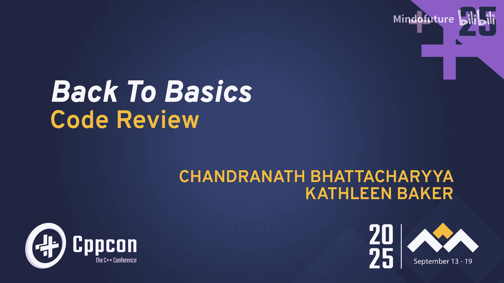
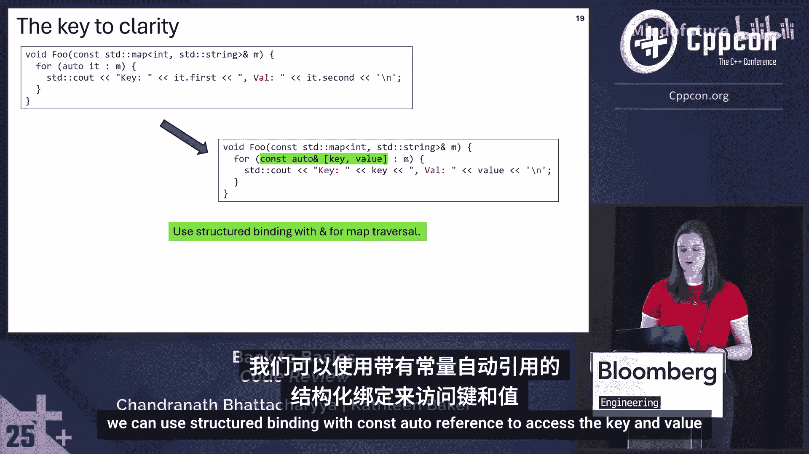
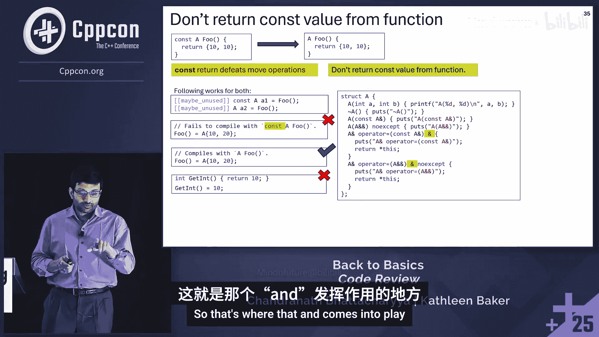
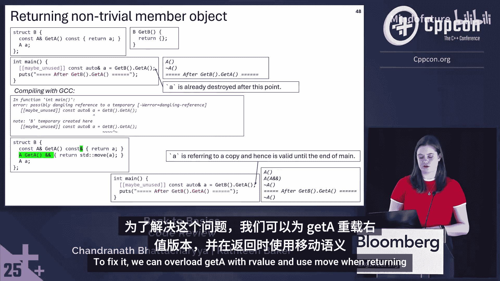
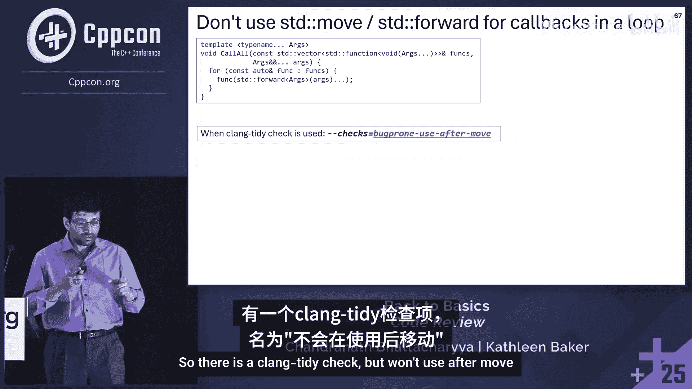
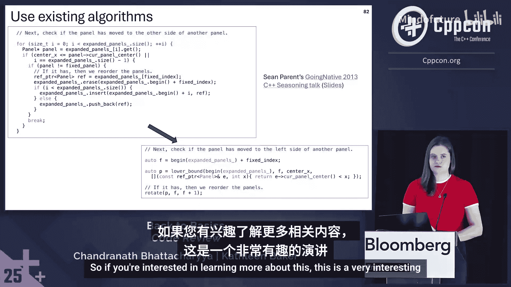
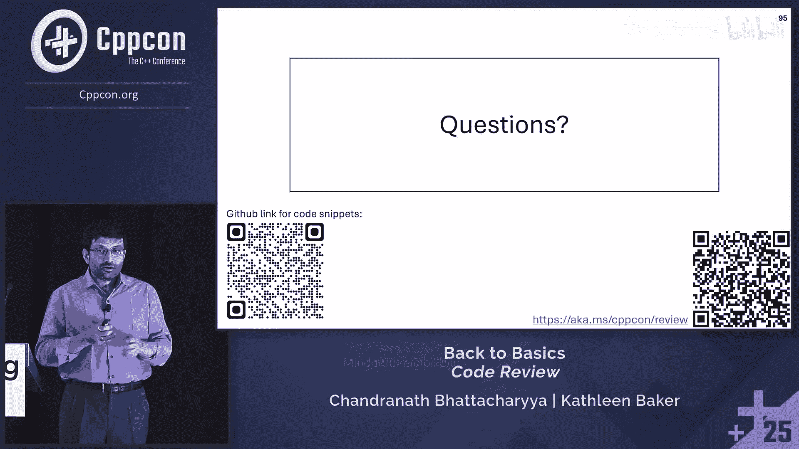
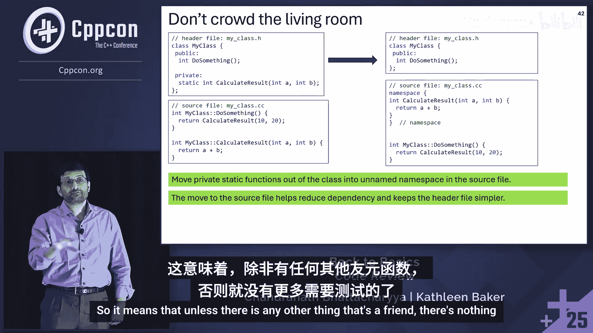
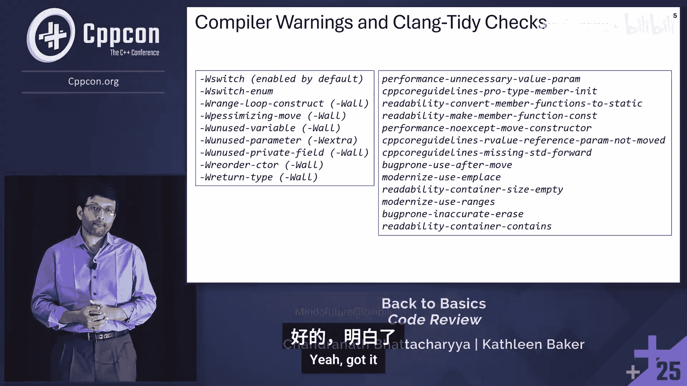

# Cppcon-2025-｜-C++-｜-C语言--｜-汇编-｜-编译器-｜-操作系统-｜-Linux-｜-Windows-p12-P12_回归基础_如何改进C++代码审查-Chandranath_Bhattacharyya_Kathleen_Baker--BV1wyPBzrEeu_p12-

🎼，Thanks everyone for coming to our talk today。 I'm Kathleen Baker。

 I work at Microsoft on the Edge B right now I'm working on commercial features in the browser。

 This is my first time at CPPcon。 I'm very excited to be here and I'm here with my colleague Chandra Hey I'm Chandra I'm a colleague of Kathleen working in the Microsoft E Brow team。

😊。

I've been programming C press Oneanda for more than 20 years。 This is my first time attendingcon。

 so I'm really excited to be here。😊，All right， just before we get started。

 note that there are slide numbers on the top right of each slide， so if you have a question。

 please make note of the number and we'll come back to questions at the end。

So motivation for the talk， we work at Microsoft on the Edge browserrower。

 which is a currently based C++ project。Based on some frequent code review feedback Chandra put together a team Wiiki page and then we turned that wiki page into this presentation so it contains guidelines to follow in code reviews。

 the goal is this can be used as a reference when reviewing code on your own team。

And this covers top issues found in PRs on our team。

Many of the topics are from the C++ report guidelines or the Chroium C++ guidelines。

 some aren't part of either guidelines， but they're still important to consider。

And just due to time constraints， these are only the top issues we found we have more examples in the appendix as well。

Also note， even though we're talking about chromroium C++ guidelines。

 it applies to most other C++ projects as well。So a bit more info about what we work on。

 as I said we work on a Chromium based browser， we use C++ 20 with no exceptions， and we use Kang。

We also work with hundreds of engineers on the same team。

 so it's really important we follow coding guidelines。As we go through the presentation。

 each slide will have what's hopefully a slightly fun cryptic title about giving a clue what the guideline to follow on that slide is。

 there'll be an example with some bad code， an example with better code。

 and then the guideline to follow。We'll also be using printf puts see out for creating snippets of code。

 so you can ignore those when following the guidelines in your own code。

 they're just for making examples。And some guidelines we'll talk about will have compiler warnings or clean tidy checks to use to identify the issue in your code。

 so we'll be talking about all of these here。So the first topic， scope。So variables on the loose。

 what does this mean， We have a struck sum class and has two member functions and a function fo that return some class。

Before this if statement， we're creating an instance of some class is not used outside of the if statement。

So instead， we can scope the variable to the if statement。

Reducing the scope of variables reduces the risk of bugs caused by unintended modification。

 and it improves readability。It also allows the same variable name to be used after the Fs block。

So the title of this slide was variablesable on Blue。

 and that's because our guideline is to restrictstrict variable scope。Here we have an enum class。

 subeneum， astruct sum class and function food that again， return to some class。Here。

 we're creating some class before this switch statement， but again。

 it's not used after this switch statement。 So instead we can initialize S in the switch。

 and this again， restricts the scope of the variable。And we can also do the same for four loops。

 so you've probably seen the good example of this code in your own code base。

So instead of declaring I before the loop。You can declare an initialize eye in the for loop。Again。

 it allows the same variable name to be used later on in the code。Next is enums。

Case of the missing case， we have an EM class result and it has three values。

We're using the enum in a switch statement here with a default。

 so this is fine if we pass in failure 2， it has the default returns failure to and it works。However。

 if we add a new value， the switch will now return a wrong value for failure 3。

 so if we pass in failure 3 it's going to go to the default and return failure 2。

So we can remove the default and add a case to handle each value in the Eum。

 so now we're using all cases in the switch。At the end here we have a macro to make sure that all cases are used or all values in the EM are used。

 so this is not reached chromium macro， it annotates unreachable code and if it's hit。

 it causes a non-exable crash and creates a crash dump so you might have something similar in your own code basease as well。

So kind to know if you're missing an enum value in a switch statement。

 here we're missing failure three。W Switch will detect it if you don't have a default in your switch。

And if you do have a default， W Switch enum can be used instead。The type that bit back。

 we're defining a Ctale enum file status， and it has two values open and closed。

We're initializing an instance of file status and implicitly converting it to an int。

 so this isn't good because it can lead to unintended behavior。 Theres no type safety here。

If we define another email with the same values， this won't compile。

Open and closed are already defined。If we tried to forward to clarify file status， then a header。

This also won't compile。So to fix all these problems， instead define file status as an enM class。

 and now you're not allowed to implicitly convert to anint。

We can define door status as another EM class and it can have the same values。

 so it doesn't have a name class anymore。And we can also forward declare now。

ENEM class provides better type safety， prevents name clashes， and allows for declaration。Here again。

 we have two sea style enum and we're trying to compare them。

We'll get a warning that this is deprecated since C++ 20。

So it's safer to define it as an EM class instead， and now this won't compile if we try to compare。

Next， name dropwa style， we have an EM class with a long name and a namespace as well。

We're using it in a switch statement， but this is kind of hard to read。

 there's a lot of words here with the enum， the long enum name and the name space so instead。

Before this switch statement， we can use using Enum。

 and this just makes the code cleaner and easier to read。Next topic is iteration。

No more index games we're iterating over a vector of ins using a for loop using a subscript operator。

Be similar here with lists， we'iteerating。With iterators we're iterating using iterators to access the elements。

Com。Instead， we can use a range base for loop， this just makes it easier to read and use。

Another way is to use ranges for each for each is easier if you're trying to apply a function on each item。

 so for example， if you're printing each item，And then just a little fun fact about how we're using St Ire here。

 using St ignoreNR out of St T is supported by compilers。

 but it actually was only standardized in C++ 26。Don't clone what you can borrow。

We're iterating over a vector of strings。And we're creating unnecessary copies of each string in the for loop。

Instead， we can use Con of reference or affording reference for vectors of nontrial objects。

We can use the warning range loop construct if like this issue。

 range loop construct is included in WL。Next， the key to clarity。

 we're using an iterator to access the key and value in a map using first and second。

To improve readability， we can use structured binding with Conto reference to access the key and value。

And I'll pass it off to Trora。

Thank you， Kathleen。So we'll start this section， which has examples for passing parameters。

So for scenario。Something was wrong with the clicker。Okay， don't clone the elephant for a walk。

So let's look at an example。 So you have this function print， which takes a string by as an argument。

 And then in the body of the function it just interestinging。 So what can be wrong over here。呃。Okay。

 I have to keep this clicker in this direction。Okay。

 so if we look at the body of the function over there， right， we are just reading the string。

 We are not making copies or not exting it， right， So。

 and then we are passing this thing as a by value。A string is not a cheap to copy kind of type。

 So since we are passing it by value。The copy construct can get called。

 and there can be memory allocation。 So what should you do in this particular case。

 a better alternative is to just pass the string by a con transfer over here。

 So which becomes our guideline。That pass nontri read only objects as constant reference to prevent unnecessary copies。

 Now， how can you detect this in your code so。There is a useful clkide check performance unnecessary value parameters。

 which can be used to kind of flag the decision。Now， before moving on to the next slide。

 just wanted to note this point that the example print actually showed st string。

 but the guidance said past non trivial random only objects and did not mention strings。

 And the reason is string is special。So we'll see some alternate strategies for stringing as argument in the later slides。

Moving on to the next example， con without context is just noise。 So for that。

 let's create a simplestruct point。 It takes and y。And then create this function， print point。

 it con point。What can be better over here。So suppose let me drop the con。

So the point to note over here is that cont here is not part of the function signature。

 So both these declarations above are exactly the same。If you go and add a pointer and a reference。

 then those are different。 So those are now part of the function signature。

 So it brings us to this guidance that cons is not needed on value parameters in function declarations。

So if you have code like this， where in the header， you have the print point function。

 which has a con point taken by value。 Then consider converting to this。

 Just remove the cons over there。Moving on to the next one。Feaer is light。 Let it fly。 Okay。

 let's see some code。So we have a print in which takes an int by a con reference。

 so as the clue gives it its light， so int is a lightweight type cheap to copy so you know there is no need to pass it as a con reference just pass。

😊，Similarly， let's look at this particular stock that I show saw in the last slide。

If you are creating a function like this where we're passing， this is a constant。

 This is also not necessary。 We can just convert this to pass well。 Now。

 why is it useful to pass this way hello， Because， you know。

Passing trivial objects by value is preferred because passing by reference can prevent certain optimizations。

 for example， like。If you are passing with al， then that I above and then x Y variables inside the point。

 all those can be passed in registered registers by by the compiler so we have to don't have to rereference memory inside the function itself。

Okay， so pass cheap to copyright。Next scenario scenario， the final definition deserves a shocker。

So you have astructee， which has a member variable of switch string。

 and then you have a constructor which takes a con string as a reference and then ensures the member variable。

😊，We also have a sync string function， which takes a con string as a reference and then assigns that to a number variable。

 So how can this be made better。Well， we can convert that into an R reference over there。

 And this comes directly from the CPP code guidelines， which says that for we move from parameters。

Pass by our def and then stood move the parameter。 Keep this in mind。Okay， next scenario。

 don't hold the book to read the title。 I told you， I'll come back to string。

 So this is the swing example。 So who， and then we are passing a construct as a reference。

 which were are supposed to do， right， That's what is showed。Few sets back。

 So what can be better over here。 Okay， so the point to note over here is that again。

 this is not making any copies。 this is grading it， right， In this particular case。

 it's better to try and convert that into a string view。

So why is it better to convert into a string view， The reason being the string view can handle more cases。

 So string view can be called with a string with a conscastar with a con star and the length。

 So we don't need to create different functions for handling each of the scenarios。

 and also it does not do any kind of hip or memory allocation。😊，Let's look at some code。

 So what I can see over here is the first one， F， hello。

 So that one actually creates a temporary stream。The other three course below full better with hellello and full better whispering and for better with the pointer and the range。

So those don't actually create any， any string。 It just creates a string view over there。

 So there is no allocation going on。 So that's why a single function can handle all these different scenarios。

Moving on， look， don't touch the collection。 Okay， for this， first of all。

 we have to introduce a special strap a。So this is nothing special about this This is just a placeholder for a nonch object that we used for most of this presentation the print statements in the special member functions help us understanding whether they are getting called for example。

 like if the copy construct is getting called you will see this getting printed。😊。

We' try to see that can we get move constructed called even better。 Okay。

 can we get an in construction。With thats said， let's move on to the actual example。

 We'll just compress our type and let's look at this piece of code。Christy。

 the who is taking a con stood picture as a reference， right， O。

What if we convert this into a sportsspan。No， what's the difference。Let's look at some code。

So here we have an area of type A with three elements。 And then first of all， we are calling P。

 which calls the the vector one vector function and the other is vector calling the span function。

Let's look at the output。 So as we can see， when we call fo， we have to create a vector。

 which means that we are creating three different objects with copy construction and then having to destroy them。

 All this are temporaries， not necessary。 F better creates no temporaries。 right。

 So that's why span is useful。😊，So use span instead of vector or array or you don't take container in cases to prevent vector creation。

Let's look at some more examples of span usage。 So this is the same function that we have。

 And here is us using span with all these possibilities， like we had using it for Ct array， vis。

 two di and also with iner list。 Same function can do multiple things。😊，Before moving。

 I just wanted to mention that。 Okay， this one actually creates extra objects。

We have app slides in the appendticix to explain the scenario。Okay。Next section。

 returning from functions。First scenario was success with substance。 Okay， let's look at some code。

So。Soarrow function， get name by Id。It returns true when it succeeds。False when it fails。

 And when its true， it uses the second parameter that's it passed。

 which is the name to pass in the string。And here is some code calling that function。

 So how can this be made better。Okay， for starters。

 can we actually merge those two types of return file with the boolean and the string into a single argument。

 Of course we can do that。 We can do that Twitter optional。

 It's just written for this particular purpose。 So we just use this student optional string as a return type。

😊，And then as you can see the code actually becomes simpler。

 that particular variable is now constrained to only the scope to the Es log。

 so which being successful the guideline use stood optional as a result type when the function can bold to indicate success or failure along with some value only for the success case。

Let's move over to the next scenario。A result with the story。 Okay， this is a little big function。

 Let me explain。 So parse it， it takes a string as an argument。

 and then it tries to parse it with StuI。 If it is able to parse it。

 it just returns that true and then sets the second argument， which is value to the past integer。

 If it is not able to parsse it， then it turns false and then sets the thought argument error to the error string。

😊，And here is some code which calls that person function。

 and heres a actual code with different arguments。 As you can see from the output over here。

 the first string is  hundred， which is fine so we get an output 00。

 the second string is 00 ands so it starts with a number which again gives a number100 and the third one has no number so that's why it fails。

 There is no conversion。😊，How can this be made better。Okay。

 we have this three different return types， right， bull in string。

 Can they be combined together into a single return type， Of course， they can be done with C plus 23。

 we to expect。😊，So then the int becomes the success type。

 the string becomes the failure type and the code becomes simpler and as you can see in the block over here。

 the variable is no scope to the ets block only switch which brings us to the guideline use to expected to converge the returnten types for a function appropriately。

Next scenario， premature relocation is costly for that， we bring back ourstruct a。And then。

 we have this code。If we create an object of type A。 and then before return， we just call a move。

Is this good， Let's look at the output over here。Residency， we have a move construction happening。

 a temporary is getting created， right。What if we go and just remove the move statement from there。

Has the output。 So as you can see in this particular case， there is no temporary。

 We get an in place construction over there。So。Exquisit call to Sttbo defeats the interview。

 which is the name written for optimization。Hence， the guidance don't use to move for such cases。

Now note， interview is not required by standard， but most compiles implemented for such scenarios。

So how do you catch such a problem？ So there is a flag in Kang W based magic move。

 So when you use that， it actually catches this problem。Okay， next scenario。

 which is very much related to this， Eli the middleman。Let's look at some code。

So this is the code that we saw on the last slide， right。

 which was supposed to give the correct output。Okay， how can this be made better。

What if you name remove the name of the type，We obviously get the same output。

 but it's definitely definitely better because。This is guaranteed copulation with C for 70。 Okay。

 the previous one was in our， which is like。May be done by the compiler may not be done。

 but this one is guaranteed by the compiler， okay。It is also known as deferred temporal materialization or also unmetteralized falloppain。

Now， so that becomes of guidance that prefer using copulation instead of depending on interview。

Why this is also important is because named object。

Can cause compilation errors for non copypable and nonmovable types。

Copyulation works in this about the scenarios。Moving on， next example。

 a seal envelope noordsm for this， we just broad to construct a and then just updated the constructor to have two intes。

And then， we have this code。Fu， which returns qua a。Here's this code using fo。 So we have a vector。

 and we are then pushing back fo into the vector。And then creating an object of I A and then assigning P to that A。

 okay。As you can see who texts been written is a temporary right And let's look at the output over here。

 So with the temporary， we expect the move constructor and the move assignment operator to be called right。

 But here we are seeing the copy version is getting called。😊，Okay。

 what if we make a small change and then remove the cost over there， right。

And then we get what we wanted to get right。 We get the move construction and the move assignment operation。

 So what is happening over here is that。Coantst。Return defeats move operations。So hence。

 the guidance don't return cost file form functions。So let's dig a little bit more into this one。

 So this piece of code， this actually works same both for the con straight and the non constant。Now。

 then the question comes of why does a developer want to write you that way。

 I it just copy pasting code， is it ignorance or something else， Let's dig into it a little bit more。

😊，Let's look at this code。 So this one returns a constant a， and this code does not compile。

 So who is equal to a 1020。 This one does not compile， okay。However， if we have the other version。

 which does not return con， this code compiles。 and why is this distinction significant in any way cause。

PO data behave in this manner。So if we look at integer it doesn't need to be cost。

 but it behaves in this manner。 So if this behavior is important to you。

 we can achieve that with plus 11， We just we just to make a minor tweak to the S operators。

 So what we need to do is that we just need to ensure that they are only defined for。All helltypes。

 So that's where the ant comes into play。 And once we do that， we get the par。

Okay。Handing it off to Kathleen for the next section。哎呦。So now we'll talk about class design。

First off， in it to win it， we have struck size and we're initializing member variables in the constructor。

Instead， you shouldn initialize them at the point of declaration。

This reduces mistakes missing out on initialization。For example， here。

 we're not initializing height in the constructor。There's a cl tidy check， CPP core guidelines。

 Pro member in it， and this will catch it。Next， list it or risk it。

 we have a class person and again we're initializing in the constructor。Instead。

 we can initialize in the member initialization list， so this is a style change。

 but it can also reduce unnecessary calls to the default constructor if it's a nonre bill type。

And then another bonus when using the member initialization list here。

 member A is declared first and member B second， but in the constructor we're initializing member B as member A+1。

 so member A is not initialized yet。But we don't get a warning and this compiles fine。

 so the code is hiding a problem。If we use the member initialization list instead。

We can use the warning reorder constructor and it will point out the issue。

So using the member initialization list forces us to ensure the correct initialization order。

So we should reorder the list and have member A first。Detached duties。

 we have a class blogger with a public function print hollow。

It doesn't access any member variables of a plus。So we can make print hell static。

If member functions don't access non static member variables or functions， you can make it static。

In some cases， it could also be moved out of a class into a namespace if it's not conceptually tied to the class。

You can also use the clean tidy check readability convert member functions to static to point this out。

Next， don't crowd the living room， my class has a public member function and a private static member function calculate result。

In the source file， do something called calculate Re。However。

 calculate result doesn't use any of the member variables or functions of the class。

We can move the private static function out of the class and into an unnamed name space。

 so now the header file will no longer contain the declaration for the function。In the source file。

 we define the function now in an unnamed name space。

This will reduce dependencies and simplify the header。Next， the redundant ritual。

We have a header file here and we're declaring an X my function and we've defined it in the source file。

It's better not to declare the function as ex。Extern isn't required。

 as functions already have external linkage by default， so this is redundant。Themutable intentions。

 class point here， we've defined a print function， and it outputs X and Y。In Maine。

 we're creating an instance point and calling print， so this works。

If we make the instance of point cons though， this no longer compiles。This is because P is cons。

 but the print function is not consed。So how to fix this。

We'll mark all member functions to your cont because they are read only member functions if the member function isn't modifying any other members。

 it should be made con so we can make the instance appoint constant in main as well。

What claim tidy check use， there's readability make member function cont， it will catch this。

 so we'll suggest making all three functions here cont。Handle with reference。

 we have another class book member function get title returns member variable title。

 which is a string。Instead， we can return a con stringing reference to title。

Returning nontri member variables can be inefficient， so return them as cost reference instead。

Here's another example returning cons reference， we havestruct B with a function get A that returns a con reference to member A。

 So A here is the struct that we've seen before that prints when the special member functions are called。

We also have a function get B that returns an instance of B。In Ma to get a constant reference to A。

 we're calling get B， which returns B and then calling get A on that， so this compiles fine。

 but if you look at the output， there's something suspicious going on。

So a is destroyed before the logline。If we compile the GCC。

 it says this is possibly a dangling reference。To fix it。

 we can overload get A with R value and use Move when returning。

 so you can see in the output now that a is destroyed after the pin line。

And then I'll pass it back to Chandra。Thank you， Kathleine。 So in this section。

 we'll consider spatial functions of a class。Let's start with the first example。

 don't panic while moving。So with as we again， again， have our start back E。And let's at some code。

So in main， we have a vector of Taipei， and then we are running a follow loop with four times than then imping back I four times。

 Yeah， don't consider itself for the moment。 It should be done。

 but that is not specific for this particular example。 Okay， so what is wrong over here。

 Let's look at the output。So as you can see that， even in the presence of the move constructor。

The copy constructor is getting caught during this size。And why is that。

The reason being these non trivial objects， move considerably is not no except。

So if you just make a minor change over here， just add that no except block over there。

This gets the of constructions happening。Compared to the previous。

So consider making move constructive work。Now， suppose we have this case。

 which has a raw no exception of constructor。 There's a clang tidy check that can help us flag and find this particular scenario。

Moving on to the next example。Don't suppress the sh shield。 Okay， what can that be。

 So we have our stock A， And now we create another new stock B。

 which has only a member variable of type A。 And then you have to user different constructs which just print something。

Now， here is some code。 We create an object type B， And then later we do B B2 equal to move B。

 so I tend to。Create B2 with the move construction of B， right。Let's look at the output。

 So as you can see over here。It's calling the copy constructor。So ideally， with a move。

 we would have wanted the move constructor of A to be called， right， So what is happening。 So first。

 let us try to lose the deor。And then see the output， as you can see in this particular case。

 when we don't have the user different instructoror。The boom construction is happening。So。

A user defined nontri Disor suppresses the more operations。Which brings us to a guidance that。Sorry。

😔，I don't know how to。可可。Slide 53。唔。Sorry， technical problems。hos。Oh， great。OK。Great。

 let's come back here， so。Guidances ensure that all special members functions of a class are defined appropriately。

So now if we wanted， if we wanted to have our user defined instructor， what do we need to do？

So we need to to move， So we need to at least default all the other special member functions and to do that。

 we get the output that we want。No，um。It's a little tricky job to ensure special member functions。

 So I took this table out of Howards presentation。 It actually gives us all the scenarios。

 So on the left side， we see what the user declares。

 And on the top row we see okay what the compiler implicitly declares based on what the user has declared So in the previous slide we the user declared the deor。

 which means it affected this two columns move constructor and move assignment cement operator and then they become not declared which led us to a predica So that's why be very careful to ensure that you are defining all the special member functions of course appropriately。

 and this brings us to the course guideline guidelines also it says that if you can have defining any default operations do so。

😊，If you define and or delete any copy， move or Disor functions， define or delete all of them。

 and finally， make the default operations consistent。With that said， let's move on to the next topic。

 which is less is more， okay， what can there be？We have astruct with four different member variables。

 and we have an equality operator and also a not equality operator。

 which is implemented using the equality operator。 And why do we need that。

 Because we want to use it in code。 And this is the code that we have。 Everything is working fine。

 so。😊，What can be better。O。We can lose。 We can totally lose the naut equal to operator， right。

 because in C plus plus 20， it is generated from the equality operator。 so we don't need that。😊。

Is that all we can do， We can do even better。So essentially we have to notice that in this particular class right since all the member variables were being used to do the comparison。

 we can default it out completely。😊，So。This is a good paradigm to fall。Next scenario。

 the Trident of truth， O， what can that be。We have a class point which has equality operator defined and also all the companies and functions because we want to use them in this way。

 all the comp and functions being used。😊，This code works just fine。 Okay。

 how can this be made better。With C+ to 20， we have the spaceship operator。

 which can help us generate all the other functions， so we don't need to have all this other code。

And in this particular case， since all the member functions member variables will be compared。

 so we can totally use the defaulted version of the spaceship operator。😊，Okay。

 moving on to the next scenario， selective crust winds，Let's to customer call。We have a class pool。

 which has a private member function set secret。Now we want class bar to be able to call that function。

 so that's why class bar becomes a friend。And which is why classbar can do this。

 it can call full set secret and here is some 4 dimension main which does that and there is the output。

😊，Seems good， O， but what can be the problem。Look at this。This one。

So though we wanted to give class bar access to only that set secret function。Because it's friends。

 So it connect all the private variables， right， So it can do stuff like this。

 which we definitely don't want。 So what can we do to prevent this problem。

 We have to introduce a different pattern over here。 So we introduce this basket pattern。

 What we have done over here is that we have moved the set from private to public。😊。

And then instead of making bar the friend to fo， we have made bar the friend to the Pasque。Function。

Pasky class。 And then the parsky class becomes the second。Now， since Barr is a friend to Pasky。

 it can actually call that Pasky to call said Se， but it cannot do anything else。

 It has no other access。So consider using pass pattern instead of making a class friend because it allows us to ensure very targeted access for only specific class functions。

😊，Moving on to the next section， which is moving forward。First scenario。

 our traveler needs a send off， we get back orstruct a again。

 and then we have a My class My class has a E as a member variable。

 and then we have a constructor which stick a as an R value defer and then just initiales the member variable。

And here is some codes of what can be done over here。 Let's look at the output。

So what I see is that we are getting a copy construction。 We would have liked the move， right。

 So what is happening。 Let's look at the tangang output over here。 It says that。

Our value difference parameter A is never moved from inside the function body。

 So what do we need to do。We not to call move and once do that。 we get this output。So the guidance。

 consider using student move for RFL's insight functions to take ownership and applicable。

If you recall there was a slide before where I was trying to do a converting a constant string reference to a art value reference。

 And there I should move over there。 So this is a similar example over here。Okay， next scenario。

 pass it as it came。Let's look at some code。 Okay， So this is where little daunting Collet makes way。

 So have my class again， and we have a string member variable。😊，Now。

 we have three different constructors to create strings in different ways。

 So the first one is a constantca reference。Conska star， which is creating the string。

 Second is a con string reference， creating the string with a copy constructor。

 And the third one is the article refer to string， creating the string with a move constructor okay。

😊，Now we have another function called C， which is just creates some make unique。

 just creates a unique pattern out of it， so it gets a hereic number of argumentss and passes it to make unique to create that object。

😊，Let's look at some code。So here is us creating my class in four different ways。 So the first one。

T a conscaster， the second one takes an a value difference。 This is a PR value。

The third one sector is string reference L value， and the fourth one again。

 takes an arbitrary reference。 This an exp because of st move happening。Here is the point see。

Which we don't want right， because this ones ideally wanted this one to be called， right。

And this was not getting called。 This concept was not getting called， okay。So what do we need to do。

So this was the problem。 How do you fix it， Very simple。 Just go and put the forward over there。

Compared to this。 And once you do that。You get the proper move construction happening over you。

So the guidance is you straightforward forward when dealing with forwarding references。

To have unnecessary copies。Okay， now let's go back to this code that was not correct。

 So there is a clang tidy check。Co core guidelines missing stood forward。 If you use that。

 it' will point out this particular issue。Now， let's look at a very related scenario the next which is don't drain the well repeatedly。

Okay， there is a lot of code claim。 So you have function call。 It takes two arguments。

 The first argument is a vector of functions。😊，Each of the functions written void and takes avariing number of arguments。

The second argument to call is a very parameter pack。In the body of call。

 it runs a for loop on all the functions in the vector and for each of the functions just calls the that function with the varieding number of arguments which us stood forward。

What kind of functions are we using here are to examples， Fk1 and fun2， both of them take。

Spring by value， and spring the string。And here is me setting it up Hol up in the main we vector of funk 1 and fun2。

 and then calling call with funks， the vector and then passing the string at the second document。

 So what can be wrong over here。 Let's look at the output。As you can say something is wrong， right。

The second one is printing empty string。So what is happening over here is that the call to funk1 is doing a string move。

 which is why funk2 is printing an empty string， which is incorrect。How do you fix it。 Okay。

 So instead of forward， remove the forward the way。 Okay， and will do that。

 make it the correct output。It it becomes a guideline that if you are calling multiple functions using various developments。

 then consider removing straightforward。Now， obviously， as you can see。

 this version actually makes copies。The copies of strings are been made。

 How do you remove those copies， So you have to write more code essentially。

 just tag all of them as cons。And once you do that， your copies not。Okay。

 now let's come back to the back code。Like this。And C， So there is a plankardy check。

Backbone news after move， which can be used to flag this particular scenario。 With that。

 let me hand off to Kathleen for the next section。Thank you。

 So now we'll talk about standard template library containers。

So first avoid the detour， we have a struct a defined that has a constructor that takes an int and outputs in each special number function again。

 we're creating a vector of size two and using pushback to add elements to the vector。

The output shows the movement instructor for A is called so temporary objects are being created here。

We can use the claim tidy trick， modernize use in place。

 and this will tell us to use in place back instead。So we'll try that out。

And now we can see temporary objects are no longer created。

So use M playss back instead of push back in this case。

It also applies to many other containers like deck forward list list stack you and set instead of push or insert。

 use and place instead。And if you're interested in learning more about reducing unnecessary objects。

 you can come to the talk that my colleague Pritthy and I are giving tomorrow afternoon。Okay。

 ask the right question， we have a vector and we're checking if it's empty using size。Instead。

 we can just call empty。So this is more readable and clearly shows the intent of the code。

It also works for other types， and strength has length as well。So is there a clean tidy check？

We can use readability container size empty， it will give a warning that empty should be used instead。

And this also works for other STL classes as well。Next is algorithms。The range revolution。

 we're trying to sort a vector and we're using stute sort and passing in the begin and iterators。

Instead， we can use st range of sort。So this is more concise， readable。

 and reduces the chance of making a mistake。So is there a clean tidy check？

You can use modernized use ranges and they'll say to use the Rs version instead。

And these are all the algorithms that can catch， so it's a pretty useful check to use。Esse the drama。

 We have two functions， remove odd and remove number。

 We're using ase and st remove or remove it and remove The intention is remove odd。

 removes the audience and remove number removes a specific end。Here we're using the code。

 we have a vector of5 in， recalling remove odd and remove number two。

 so we would expect only the value 4 to be remaining。But actually， that output is 4，4， or 5。

 So we have a bug here， what's going wrong。Remove and remove it reorder elements in the vector。

 so the elements we're keeping are now at the front of the vector。So in remove odd。

 the even elements are at the front。Remove if returns an iterator to the new end of the vector and then we're passing that into the vector orse function and it's removing the element at the iterative pastton。

 so remove OD is only removing one item after reordering elements。To fix this。

 there's an overload of arrayse that takes two iterators and roofs the elements between or in the range。

 so now we're passing in the vector and iterator as well。And now we get the correct output。

But an even better way to do this is to use the non member functions due to race if and a race to avoid making this mistake。

And there's a cling tidy check you can use， bug prone inaccurate erase， we'll point this out。Okay。

 containtainment clarity， we have a function that checks of a set contains a value。

 it's using stewed find。We have another version using sted Rs Find。And a third。

 using set find member function。So all of these work， but they're doing the same thing。Instead。

 we can just use this set contains member function， and this simplifies the code。

Contains as present for all associative containers。

 and it was added in C++ 23 for some other types as well。And what check can we use。

 there's readability container contains， it also catches usages of count。So for example， here。

 we're using count to see if set contains three。We can just use containss instead。

Custom isn't always clever。Hereric， we have a function that checks if a span contains an indivisible by three and uses a range based for loop and an if statement。

Instead， we can use st ranges any of， and it replaces both the for loop and the if statement。

And both actually generate the same code， so it's better to use the existing algorithm here。

This example is from Sean Par's talk in 2013， he simplified some code using existing algorithms。

 so if you're interested in learning more about this， this is a very interesting talk。

And then I'll hand it off to Trora for the last section。

Thank you， Kathleen。So we move on to another last section， miscellaneous。First example。

 build where you stand。 Okay， let's see。So we have our type A that we created。

 so now we are creating a tooth pair A and A in this particular manner。

We are creating an optional of for typee in this manner。

We didn expected of our typeP as a success type in this particular manner。And then。

 we are also creating。We are also creating variant of a type A in this particular manner。

 And so what is wrong with this one。 So let's look at the output。So as you can see。

 in all these cases。Temporuras are being created， right， So how can you remove those。So for PR。

 we can go and use the Pwise construct constructor for optional， we can use make optional。

 which actually uses the input place construction of optional。For expected also。

 there is an impress constructor we can use and for variant also。

 there is an impressed construct constructor。 So here's the output， as you can see。

 the moment we use those impress constructors， we get in construction without temporaries。

 which becomes the guidance。😊，Use and press constructor for various SDt types。

Moving on to the next example。A unified identity。Okay， there is a lot of code over here。

 but let me have highlighted the important ones。So my class can either represent an integer or it can represent a screen for this purpose it's storing both of those as separate member variables in optional。

😊，It has two constructors， one text in int， which initiates the int optional。

 the other text in string and initiate the string optional。 So how can this be made better。

Can we use a single type to represent both this， Of course。

 we can do that variant was meant for this particular purpose only。 So instead of two optionals。

 we have just one variant with an nteja and。😊，So the guidance is avoid juggling multiple variables for type alternatives。

 use stood variant when you have them under a single type of container。

Though will not mention this one anytime you see an union in your code， right。

 try to convert that into a variant because it actually improves safety and also maintainability。

Moving it to the next scenario， a placeholder， not a pretender。Okay。

 so I'm creating a visitor because I want to use it with a variant。

And then there's a test variant function， which is called visit with the visitor for the variant that it passed in。

 and here is the actual code。So you have an int man which creates a variant of intennder string and then calls test variantient on it and then finally changes the type using employeess from integer to string and then cause test variantient again and here is the output that youve seen so what is wrong over here。

😊，If you look at this code， right。So it's using 0 to detect unsai state， right， which is not correct。

 So what can we do better。We can totally use monost。

So mono state can be the first argument type to denote un it and the code also becomes simpler。

 as you can see we can detect un it and it prints correctly。Which becomes a guide。

 considered using mono state to represent Ances state in a sve。Well。

 this also comes handy for one other scenario where。

You have a type which has a no default constructor。So in this case， with a no default construct。

 the first code that I commented out so that will not comp。

Because that one has the type has the first parameter， first type， no default constructor Okay。

 So you have to kind of change it。 and then we are creating the variant and later inlicing the no default constructer into that。

 And here is the output。 First was the string。 and second was the no default。

Monorate comes handy here too， because that is the one that can use the to set the onset rate and then the code becomes simple。

 we can detect ancesstrrate and this is what we do。Okay。

 if you were worrying about what is that is variant。

 it's a very small concept that we define to detect variants。One more scenario。Don't let it drift。

 okay。Next's look at this score。So we have a function。

 simple function which text radius as an argument and then has a constant pi and then creates a circumference and cprit scenario and then prints those。

We have one more function。Which which creates a file path in data and string data and does a lot of dumping out of those。

 right？Now， if you squint long enough at the functions， you will see that。In the second function。

Once those variables file path into and string that are initialized， they are not modified again。

 right， So it may be easier to。Help explain， right The moment you actually tag those with cons。

 it becomes easier to understand that code。So consider making local variables。

 which are not modified after initation cost to help with readability and with comprehension。

Next scenario you， snap short on arrival。Okay， so heres some code for。 a lot of code。

 But what it's doing is that it's just trying to initialize final value with a lot of conditions。Now。

 the question is that， with this present。Can you make final value constant。

We can do that by using and immediately invoke Lada。So that kind of becomes the guidance that。

Consider using immediately invoke Lambda to create con variables when applicable。

 most of your cases will not be discontinuvoluted， but many attempts you have two or three different conditions which are used to initial a variable。

 and then we create a non con variable and then keep on ada assigning to it。

 So instead we can use an immediately invoke Lada to get a con out of it。

And this will be our final scenario， one definition to rule them all。

We have this a context but double in a header， what can be the problem with this？

Let's add some extra code。We had this function gate address of pi。

 which is supposed to get the address of that key pi variable。

We have one dotcc source file where we define that function gi address of P。

 which it terms address of K Pi。Now we have another file main dotcc， which has yet another function。

Print by address。Which prints the address of K I as main dot Ci sees it。

And then it also calls gate at supply to print the address as another dot C sees it。

Let's look at the output， so as you can see main dot CC and another CC。

 they see different addresseses of the same variable which is one definition rule violation。Now。

 this can be very easily fixed。What we can do is that we can just mark that construct in line。

Once we do that， both of them have the same address。

So the guideline is add inland keyword to head definitions to ensure that one definition rule is not violated。

Which brings us to the end of our presentation。 So some final takeaways。Scope smartly。

 minimize variable scope in conditional loops and switches to boost clarity and atsps。

Etererate elegantly， prefer range by follow， structured bindings。

 conence and forwarding references for clean and efficient traersal。

Design thoughtfully using them class stood varied， stood optional。

 stood expected to express hint and a ambiguity。😊，Create classes with care。

 initiate members only make functions con or static when appropriate， use idioms like passki。😊。

And spatially pop for control and comparison and always。

Define your special member functions correctly。Modernness with ist em ranges。

 curious contains imp our functions。And replace bar patterns with explicit and standard solutions。

And， finally。😊，Use clkted checks and warnings to help the compiler catch issues for you。

Some further resources， many of the scenarios that we presented so many more scenarios are also present in the appendix many of the quote interpretni that we presented over here are also presented on this Github page I'll show the link atator search also。

Now，There are a lot of talks by Microsoft employees at this this conference。This was our talk。

 so there are more talks on Wednesday Thursday and Friday。

Including this talk by Pat and Kathleen tomorrow。If this topic interest you。

 please go ahead and watch these talks。We also have a feedback server link and a Qr code that over there。

 So if you fill up the survey， we'll have a raffle for prizes。 as a thank you。

And which moves us to the end of our presentation So on the left hand side there's a data link for the code snipers on the right hand side is the link for the surveys。

Questions。

Oh， there's a microphone。So。How do you handle different levels of C+ plus knowledge and understanding in your team？

Ca some of these idms and solutions you presented like the immediately invoked Lambda or the I was thinking about the defining a variable in like the switch。

Statement， they may not be as readable。For people who are new to C++。

Or even for people who are used to like older style C plus plus。

And so maybe like for someone who's more used to like the modern way of doing things。

 it seems more readable and easier to。Deal with， but。For other people。

 maybe they see is more complicated。So。Like how do you deal with this situation？Yeah。

 I think that's a great question。So what I'll say is that probably。

Once you see this code a little bit。Then it becomes understandable。 That's my understanding， so。

Mostly people who come from the C background directly。

 they actually try to initiate everything on the top of the function。

 which is not the C+ way of doing things。 So what I've seen is that once you tell people to do these things。

 they seem to be able to do it and have no issues with that。

 So that's my understanding of that problem and what I've seen so。Thank you。Any other questions？

Hello， I have a series of questions the first is on slide 31。

 you talked about returning stood optional instead of stood expected when you're just returning the bull。

I was just curious what your philosophy of that was。

 especially because stood optional doesn't give you the ability to understand why it failed。

I'm just curious why you don't opt to use the expected everywhere Right， So this one right。

 Yeah Yeah， so this one actually has only one success type right， and there is only a bull。

To and false， right， So expert is a overkill。 Gocha。

 because expert actually the error type can be anything right。

 which can be an except That it like if you have just have a bo， then option is good enough。cha。

 So if it's simple enough and there's no reason to have an error code out then just keep it as exactly。

 So this was this case we turning bull。 So that is the simple case。My next question is in slide 39。

 and I want to clarify is your recommendation that you put you define the variables in the header as well as in the initialization list。

Yeah， I think we do both of those。 So So duplicate。 Yeah， first of all， like。

 if you don't need to define it anymore in the emissions on this， don't do it。 But if you actually。

 the the first guidance is definitely always initial。

 whenever you actually just declare the variable。 if you can。 That makes sense。

 And then my last slide is on slide 42。 It's about moving functions to an anonymous name space。

 I'm just curious about how you about testing When you move those functions to an anonymous namespace。

Right， so if you look at this one， right， this is a private function。

So essentially the private function can only be used by this class right So it means that unless there is any other thing that's a friend。

 there is nothing more to test。

Thank you。Are any more questions。去。Yeah， great presentation。 Thank you so much。

 So you had mentioned a number of clang tidy flags to add。

 So just curious what your take was on or or what your process was for which ones to add。

 if there's an easy like just tidy everything， I want to know everything about my source code or what tools you use to kind of manage that because it just seems tedious to like。

When you should be applying clang tidy and which ones you should pick and all that。Right。

 and I think that that's a great question。 So for us， we do have。

We do have a list of plankarity checks that we run。Some of these are actually part of the test。 Okay。

 for example， there are some some tests that we use for security and they actually start with buck prone。

 So those are programs we use。You are always welcome to kind of run with all Plank ID。

 It just takes a long time to kind of run a little more time to run。

 so you know I cannot give you a good guidance， maybe just try it out in your codeb and see whatever works because some of them actually are are not that great。

 So one of the things you can do is that there are some with CPP code guidelines which you can definitely use。

They are some with modernize。Which can definitely use。

 And there are a few others like butprone ones that you can definitely use。

 The others you have to just pick and choose。 Yeah， got it。 cool。 Thank you。 Thank you。

any other questions。Okay then。 thank you all。 Thank you。

