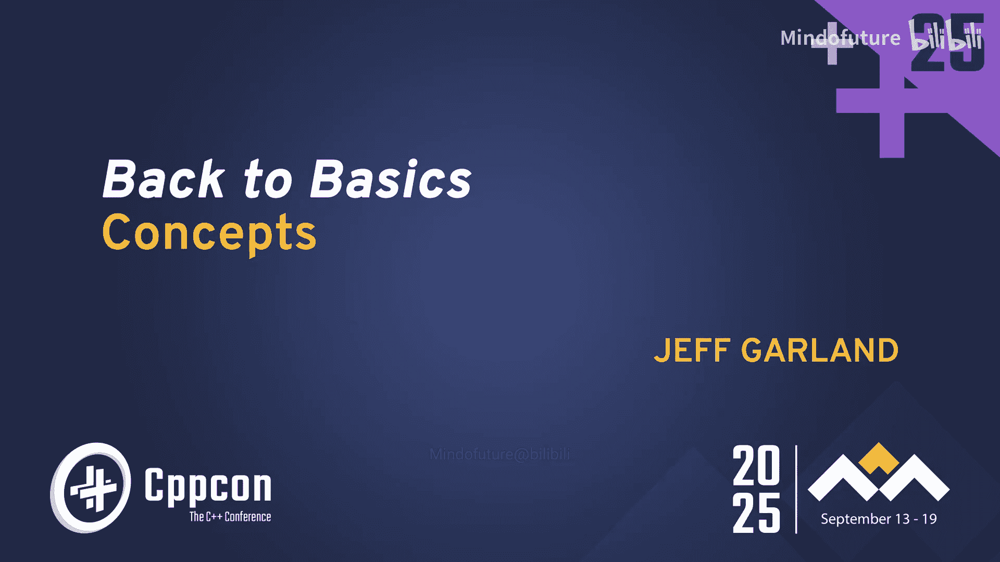
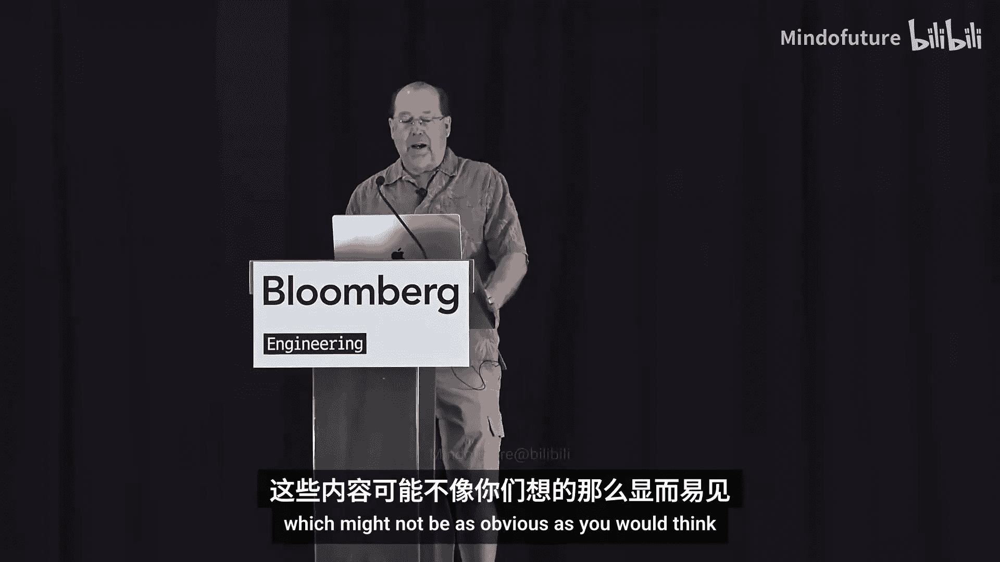
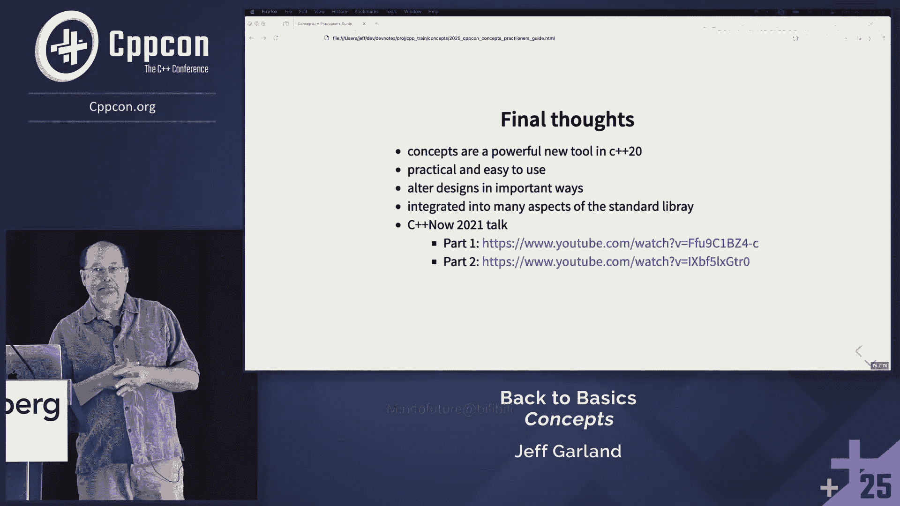
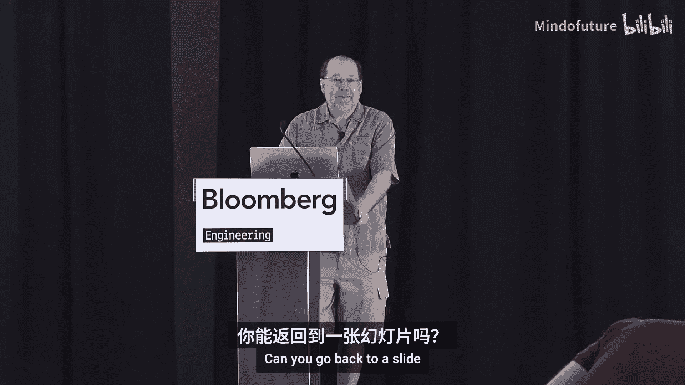
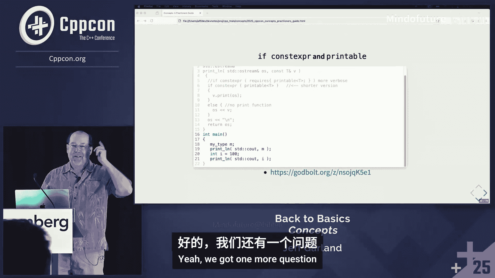
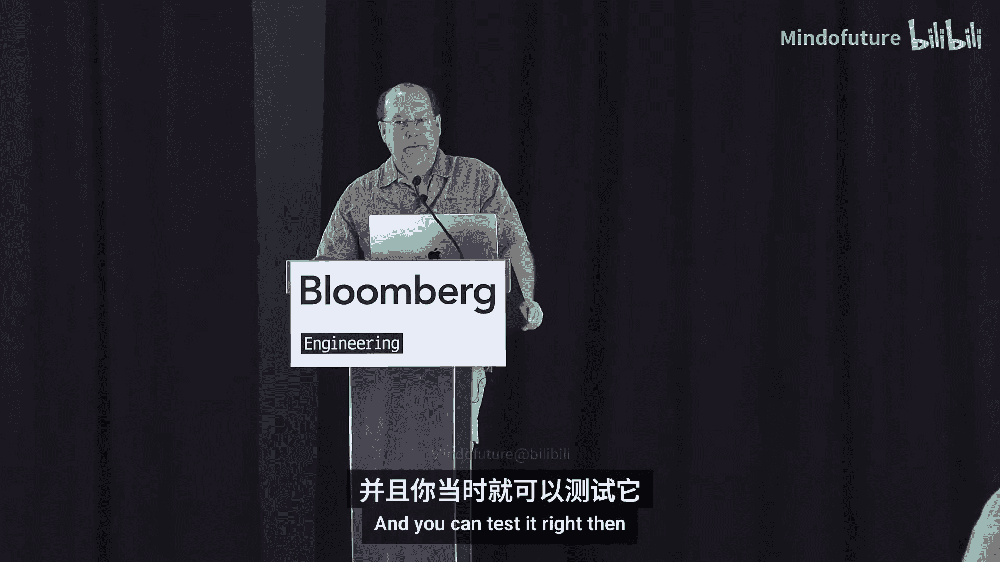

# Cppcon-2025-｜-C++-｜-C语言--｜-汇编-｜-编译器-｜-操作系统-｜-Linux-｜-Windows-p13-P13_回归基础_C++概念-Jeff_Garland-CppCon_2025--BV1wyPBzrEeu_p13-

🎼Yeah。Okay， we're at time， so I'm going to go ahead and get started。

We have a lot to cover in a short period of time， but I do want to start with a little bit of a question。

 who in the room has no idea about concepts。Has not tried them at all。 Okay。

 that's a pretty healthy chunk。Who is actually using C++ 20 and just kind of wants to get started with them？

We got a handful， very good。And who are already veterans？All right。

 well you can leave now now I'm just kidding hopefully I'm going to show even the veterans a few things in this talk。

 which might not be as obvious as you would think。😊。

So we're going to go pretty quickly， as I say this is a large topic。

 we can't do all elements of concepts justice within this period of time。

 but I hope to show you a whole bunch of techniques and also talk a little bit about design so we're going to do what I call climbing ladder we're going to start at the bottom and we're going to also you know just work our way up in complexity in essence with respect to concepts now。

I have to say it's quite luck of the draw to be the person that is giving a concepts talk after the founder of C+++ gives a keynote on concepts。

If I had that in mind， I probably would have declined。

But actually I think you'll find this talk is focused at a very different level。

 Brna kind of went right into an intermediate advanced level of discussion about things。

 maybe without showing some of the principles and things that are behind concepts in the first place。

So let me talk just a little bit about the state of concepts in general concepts is fully supported basically in all the major compilers at this point。

 my team has been using them in production code for the last five years I guess basically and they work beautifully as a matter of fact。

 once you go down this road， you can never come back because the code is just so much clear。

 so much cleaner and so much obvious and it gives you design concepts that you really didn't have。

You could have done it if you're a fancy meta programmer， many of the things。 But for this。

 you don't need to be a fancy meta programmer anymore。

For this talk you'll see there are Godbolt links for many of these things。

 so when you get the slide deck， you'll be able to follow those links and you'll be able to see the full examples。

 of course， many of the examples are sort of cut down to size for discussion on slideware。All right。

 let's get to the basics of it Why do we want concepts in the first place and again I think Brna did a very good job of expressing why we really want to be able to write this generic code in a way that stays fast has very good error messages and makes the program as understandable as possible for our other fellow programmers because really in the end the program that we write is a lot for the human。

 probably more for the human than it is for the machine。

 Yes we want the machine to be able to consume it and run it fast。

 but in a way that's really secondary when you think about it for a little while and the last part point I would make about this is that we want our interfaces to be more descriptive and we want to be able to manage the dependencies between things and I'll talk to you about how some of that can be done actually utilizing concepts。

So what is a C++ concept in the first place， it's a Boolean predicate on types or values。

 I'm going to concentrate mostly on types in this talk。

So everybody knows what a Boolean predicate is， right。

 it is something that evaluates the true or false。 And these are。Examples of type requirements。

 we could say that a particular type has to have a certain shape in terms of its methods。

 its base classes or its subclass。 those would be also part of the shape of a type， for example。

And one other thing I'll mention and you'll note the asterisk on the semantics here。

 semantics have always been a part of concepts since the very beginning。

 I'm not redoing the history here because Brna did a good job of doing that。

 but there is a long history back to the beginning of the STL those always express semantics you'll see semantic requirements in the standard for things and those semantics requirements are super important。

 unfortunately there is no such thing as a compiler that can evaluate those semantic requirements。

 so what we end up with is essentially syntactic but that is very powerful in and of itself。

So there's a number of things that come， so if you're a C++ 17 programmer。

 there's a number of new keywords， there's concept and requires。

 those are two new keywords that you'll see and we'll see lots of examples of that。

You'll also see this pattern and Brna kind of mentioned it that he didn't like it where you'll see a concept name。

 so that's a concept that's been defined， followed by auto。

 and that's used in a number of different places， but essentially what that's allowing you to do is in place of a concrete type you're basically able to substitute a concept and then the concrete type is actually resolved when you compiled with a specific type as a consumer。

There's also new rules for function overloading， we're certainly not going to try and understand all the function overloading rules in this talk。

 I'm sure that could consume an entire hour， but the main thing to know is that concepts will' show you where concepts fit in the hierarchy。

So one other important thing about concepts is they are composable。

 you can build more complicated concepts from simpler concepts you have and and or logic conjunction disjunction and at the end of the day what you're attempting to basically do is classify whether a type fits within the set or is out of the set。

 that's the Boolean predicate。So let's just drill in a little bit more on types versus concept everybody here knows what a type is right a type describes possibly a set of operations that can be performed。

 it has things like relationships， possibly to other classes， a dependent type， a base class。

 so forth， but in addition to that a type has to be realizable at runtime。

 and this is one of the fundamental differences between concepts and types。

Concepts don't live at runtime， they live entirely at compile time and so when you have an actual type。

 you need a memory layout， you need a size for the compiler to be able to put that on the stack on the heap。

 those things in the case of you know builtin types largely this seems implicit if you have a structure or class。

 of course those are explicitly spelled out。So a concept then really describes the shape of the type。

 how it can be used， the operations that can be performed on it。

 and as Brna mentioned yesterday it can also describe relationships to other types。

 and that turns out to be super important for doing the kinds of things we want to do with concepts。

So。Here's a very simple one and I'm going to use this throughout it's about the simplest possible concept that you can get and for the moment anyway。

 I'm not going to describe to you all of the syntax here。

 the concept printable equal requires business， that's the requires expression and what I'm just going say though is semanttic error what this means is that for a type T to satisfy。

 that's usually the word we talk about when we talk about concepts to satisfy this concept it will have to have a method called print that takes an Ostream and that expression would have to evaluate to true for the type to satisfy this concept。

So here I have a class， my type， and indeed this type satisfies this concept because it has a print method that takes an o string and that's it。

So the very first thing from a practical point of view you can do in your code is now check whether or not you know a particular type matches a concept so there are many very powerful uses of this idea where you want to enforce something maybe across a code base where you have many large large numbers of domain types and perhaps you have patterns for serialization or some other construct where you want to ensure without even having to run a unit test that in fact the type can satisfy those things。

 so if it doesn't satisfy that。Concept that will fail to compile。

 you will know right away and you will get an error message。

So let me go back a little bit to the concepts of concepts， so as I've already sort of said。

 concepts are always a compile time item， there's no runtime footprint at all。

 you never see this in the linker and this is part of what makes it very compatible with high performance code。

嗯。This idea of the concept name auto I'll show you in some examples in a couple minutes is sort of a bridge between the idea of saying auto。

 you know， you've probably heard the rule almost always auto has anybody heard that rule Yeah not too many okay well okay。

 we'll show you some examples， but one thing that that means right this。

Compile time presence means that for the evolvability of the program and I think this was mentioned in the keynote questions a little bit。

 you basically have to recompile the program all of the things that are dependent on a concept if it changes right so that's one aspect of using concepts。

And of course。The core reason why we've been doing this really for decades。

 mostly with you other kinds of hacks instead of， you know core language support is we really wanted to constrain the types that go into a template and that's really what we're talking about here and we'll see a little bit more of that in a minute。

O。Now I want to just focus and actually probably the majority of the talk is here on you as a user of code that is expressed in terms of concepts。

 I think that's one of those fundamental things that if you don't have a concept again。

 an idea of what you can do， you might not be so clear just trying to say consume the SQ++ standard。

All right， so what can we do with a concept， right？As we've kind of talked around。

 we can constrain an overload set， so if we have a function F。

 we can help constrain what function actually gets picked out of that set。

We can initialize a variable。 This might surprise some people using this concept auto pattern。

 And I'm going to show you examples in a second。We can use if constper。Who uses if Cont expert here？

A lot。 Yeah， this is cool。 So if Con expertper。😊，And requires clauses， as it turns out。

 even without concepts is something that's possible， and I'll show you an example in a minute。

You can do clever things like you can say， I'm going to use a pointer。

 but I'm going to only allow this pointer to be of a type that models the concept。

And I'll show you an example of that as well。 We can partially specialize a template using a concept。

 That's not surprising。 And then there's one other thing that comes along with the bundle here。

 and it could subtly go by you if you're not expert in reading concepts， but the。

T word auto has expanded its capability as we've gone along。

 And now a lot of template code does never contain the word template。

And I will show you examples of exactly what I'm talking about so what can't they do they can you can't inherit from a concept that's not an idea so you can't create the same thing that you can create with a virtual base class using concepts。

 you can't constrain a concrete type using a requires clause you can't allocate one as I said before。

 the difference between a type and a concept as a type doesn't have any runtime presence it doesn't have any size and you also cannot apply a requires clause and concepts to virtual functions。

So where can we write this concept auto thing I've been talking about。 Well。

 we can write it in a whole number of places。 Here's the list。 I'll show you examples in a second。

One place we can't write it， we can't write it as a member of a class and we can't write it as a base class。

 that's sort of the same thing。 then the template parameter case and the aliasing cases for templates。

 you'll see that we don't actually need the word auto， which makes it even nicer。Okay。

 so let's look at some basic usage cases。We have our。Same exact concept from before。And here。

 I'm going to define。A function， F。And the function F takes a printable auto。Now。

 this code is a template。If that wasn't obvious to that as template code。

 but it will only allow something that models the so I sorry I'm using the word models as well。

 and there is a subtle distinction between satisfied models those are two words that we use to express that a type actually fits into the set associated with a concept models is actually a stronger constraint because it means that the semantic requirements are also expressed which again is not checkable so sorry if I'm using those interchangeable if you are aware those terms。

So here's the other way， right， I'm going to initialize a variable called S。And it's printable。

 anybody see a problem with this code？Yeah， there's no title。There's no type。 Yeah， well。

 the guy behind you was gonna answer， but you beat him too it。 There is no type there。

 that actually will not compile， of course， because the compiler doesn't know what to do with a concept it doesn't have a size and it can't do anything with it。

 However， you can initialize the variable like this。

 it could have written a class on the right hand side there。

 you know a constructor for a class on the righthand side。

 but what it means is that you know this init something function。

 if it ever changed its return value， it would still have to be a printable type or this code would not compile。

 as long as it's printable type， it will compile， it doesn't have to be the same type as it was before。

😊，So this is where that idea of a unconstrained auto is very different from the constrained version of this。

 and actually。Let me go back and just I think I have an example later， sorry。

 that demonstrates the dangers of using auto directly or actually there are dangers in actually specifying a return value explicitly。

Okay。So function parameters and return values。 So here's a traditional template head。

 but you'll again notice that concept name printable there。

 So this is the case where we don't actually have to say printable auto。

 you can just put it in the template head， and that means that no type T。

 you know that doesn't satisfy printable will be allowed here。

 you'll get a compile error if you try to do that。Here's a return type that is flexible。

It can be any principle， it doesn't have to be a specific type。So。

I have another function down here called print2。You'll notice it has no template head。Right？

This is the exact same function as the one above。There are equivalent ways to express the same thing。

 One is obviously a template。 One， you have to understand the。

 the meanings of these autos to know that that's template code。

I don't know what do people think of that， do people like the subtle version or they want to spell out template？

Okay。It's not as discoverable for her juniors okay that's an interesting comment it's interesting in that it turns out my experience is that in the end everybody learns that real quick it's actually it actually I feel like it's better because it's just less you know semantic overhead in your brain when you're looking at code okay。

So these two are equivalent。All right， so let's talk a little bit about overload resolution。

 constraining function parameters。So I've already shown you a function that's constrained and that constraint was printable now I'm going to write a new function called print line and we're going to do this with first a template that is a traditional template it's unconstrained and again I've shown you in the comments above how you would traditionally write this。

 but then the print line here， I've just said autoP。

 this is an unconstrained template any type absolutely any type in the world will match that particular auto and so what will happen of course is that if there is not a streaming operator for that type it will fail to compile probably with 100 pages of error message maybe not this one's simple enough that it might not be so bad。

So I have a type here also called My type。And if I。Try to do this here。

 what will happen is those first two lines will compile just fine。

 right because strings and integers have streaming operators。

 but this bottom one will not compile because there is no streaming operator for my type。

So let's see what would happen if I wanted to have a print line。

 an overloaded print line that dealt with my type specifically。

 so I still have the template version at the top which takes any type and now I have another function here and overload of the function which takes my type specifically and then does something else in this particular case to print it out and what happens is that works exactly as you would expect it because the match of my type is more exact。

' more specific than the match of the template， so that overload succeeds and the template overload does not succeed。

The rules are wildly more complicated。 They get wildly more interesting when you go into this。

 But that is very logical。 It makes a lot of sense。 It's an easy rule to remember。Okay。

So I still have my printable here， nothing has changed there。

 but now I'm going to add another concept here。And this is slightly differently。Shown， you know。

 so output streamable。 and this will come up in a little bit。 Again， it's a very simple concept。

 Only basically one requirement that you have a streaming operator。So what's。

Take a little detour back to printable here and ask the question what would happen if print were not public in this case。

 Remember that we've specified here in this line here that I can say V dot print to it。 Well。

 if print is not public。That will fail to compile。 And so you will get a satisfaction error of that。

 So things like。Public， private， those things matter， on the other hand。

You'll realize that not every aspect of V dot print is specified， right。

 You'll notice that there's no constantness or。You know， no except expressed in that concept。

 and that means that this is perfectly fine that this is a con function and not specifically matching a noncon function so there are a bunch of things like this that allow flexibility。

 but on the other hand， if you're trying to pin something down very， very carefully。

 then you have to do a little bit more work at it。Okay。

So let's now create a constrained overload for the print line function。

 so we have our traditional template that we had before， and now here we have Priable auto。

 which means that anything that is printable will essentially prefer to use the template function on line 7 here instead。

Okay， so that's another example of the overloading case。And。Continuing on that same vein。

 Let's see what happened here。嗯。All right。So what happens here is we again get a compile error because this my type 2 in this case。

 which I think is actually not， it's not highlighting。 So oh， there it is。

 My type 2 doesn't doesn't meet any of the criteria for either the primary template。

 which is up at the top here， that's the primary template。

 and it doesn't also meet the constrained template for print， So that's a compile error。

 And I think okay， good。So let's talk a little bit about pointers and concepts。

 So the output of this program， you can see here， it's basically printing out a couple of things。

And what am I doing here， I have constant printable auto。Star。All right。And then I knew my type。

So my type from before models the printable concept。

 so that works just fine if I did my type 2 in that line 20 or 10， sorry。

 suddenly that would not compile and you would get an error and we'll see one of those our errors in a minute。

The next line is the interesting one， I think you might be surprised to learn that you can say Con unique pointer。

 and then when you do make unique on the other side， it needs to match printable。

 needs to satisfy printable or that line of code on line 12 will not compile。

So it's a very interesting use that allows you to say。

 I don't want to just take any kind of pointer in the world。

 I want to be able to constrain that down to a particular set of pointer types。

So here's an example of what happens when you try to do that initialization with something that doesn't model printable。

 you get a compiler error， so this whatever down here at the bottom is just an empty thing which obviously doesn't model it you can see what the error code looks like。

 to me this is pretty straightforward， but then I've spent a lot more time looking at these kind of errors。

 but the errors are pretty clear that you know you cannot satisfy you know the particular this type。

 whatever does not satisfy those constraints。And that's maybe time for an aside on that。

 One of the promises of concepts is better errors。 And after several years of experience in the field。

 I would say that。There is at least one group of people that are disappointed。

 disappointments are common in our language， I guess， but in this particular case。

 not all of the error messages are as clear and obvious as this particular case。

 we're dealing with some pretty simple examples here。However。

 my general experience with it is it's better than what we saw before by quite a lot。Okay。

I mentioned earlier that if Contexper was part of。What you could actually use concepts for。

 and as I sort of offhandedly mentioned， you don't even actually need a concept here。

Because it turns out the requires clause is actually all you need。

 that's allowing you to do this boolean evaluation directly in an ifCons experter。

 so if we take a look at this code here， another version of print line。

 yet more sophisticated version of it that does something that says， hey， if I've got a printable。

You know， satisfies the printable concept well then I'm going to do something else I'm going to do something else right and so for those of you do not know if Constex per well。

 what happens at line 6 is if that concept is satisfied the block of code that goes underneath the if Cont expertor is the part that compiles into the function and the else clause is thrown out。

 it doesn't even compile into the executable。So so that's the first half of it and in this case Pri is V dot print right so that's how it actually works and then in the else clause here we're just trying the streaming operator it would have been better to use that output streamable thing that I defined earlier。

 which maybe was what I was intending to do with that slide。Um， so。Again， in this case。

 everything works and depending on whether you're at line 19 or line 21。

 you get a different branch of the if Con Exp here。

So also in this slide I've noted that as usual there's more than one way to do things in this case what I've left uncommented is the shorter form of this。

 but you can also wrap it in it requires and you can wrap it in it requires with a complicated expression right ors ands and other boolean tests and values can be written directly there without any concept whatsoever。

Okay。嗯。Right， so I think I basically just said all that。U。Yeah。Okay。

This next little example I want to show you actually comes viaa Jason Turner who you know of course loves to play with these things and but there is precedent in other places like in the standard library for doing this and I'll show you another example。

 more complicated example later so what we have here is a little raper class I've kind of you know unhighlighted all the unimportant stuff we have a constructor here。

And then we have this you know， Dreence operator， and you'll notice that right after its definition is the word requires again。

 and then we have is pointer V of T。So if you are a programmer that uses type traits。

 you will recognize is pointer T， which of course is a boolean expression that is。

 you know from the old days as it were， but the thing is many。

 many concepts are actually defined in terms of type traits in the first place there's also in the standard library which we go over some of the standard library concepts in a minute。

 there's several places where you'll see there's a type trait that will do。

What it is and a concept that will also do a similar kind of test。

 so you have an option of how to do that， there are some good reasons to use concepts that have to do with the way the rules are propagated。

 which we don't have time to go over in this particular talk。

 but usually the concept is probably better， but then again it's all defined in terms of each other。

 it's all bullolean expressions。In one way， you should look at this and think that anytime I see a requires expression。

 A little constraint solver is running in the background of the compiler and coming up with the answer of whether or not this particular expression is true or false。

 But the effect here。Is that the operator star does not exist if is pointer V is false and so this first set of code in line 13 to 15 where I use intstar in the wrapper works just fine because the T type is a pointer type and so that function is available to call or the D reference is available to call and it works just fine。

 however， if I wrap a plain old integer and I try to call that same function。

 it will fail to compile。Okay， so。This is the kind of thing that gets to the heart of design right because a lot of design is about variation between things right it's like sometimes I want to have this variation and sometimes I don't want to have this variation and concepts gives you a very powerful set of tools to actually express those variations。

Okay。What if。I wanted to say have a vector that would be constrained。

 Can I really do it without rewriting all a vector and it turns you can easily do this。

 You basically can use a template alias with a concept。

 So you're not going to say vector anymore you're going to say vector of printable in this particular case。

 but what it means is that if I use a vector of printable whatever type is in there。

 doesn't say it's a specific type， but it's constrained by the fact that it has to be printable so that this code will actually compiled correctly。

So what if I try to put something in there that doesn't work， then I get another error message。

 a compile message like this。And。My recollection of this slide， it basically says， you know。

 int isn't going to work here because， you， you don't have the thing that's required to satisfy principle of T。

O。So。That's。you know， usability usage of concepts without explaining how how to write them。

 how to do any of that I'm going to go through this next session at Lightspeed largely the slides are here for you as a little bit of a guide and a grouping and something that you know to organize your thoughts about what is in the standard library。

 there are amazing number of great concepts in the standard library that were agonized over in a very difficult you know it took a lot of time to get this right and you know as of。

Four or five years ago， there were people saying that mere mortals can't even write concepts because honestly。

 which of course turns out to be completely in utterly false but because the struggle over the standard library of concepts was quite hard。

These are some groupings of them。 Let's go through them。 And I have to go back to type traits。

 for one second。And mentioned that you know type traits come into this whole thing because many of the standard library concepts are defined in terms of type traits。

 you might also want to do the same thing in many cases。

 okay so here's a set of things related to numerics unfortunately I think integral is the worst classification here in my lightning talk tomorrow night I'll explain why but you know here's what they are and you know the light description of what types actually match these things。

U。Thequality comparison。 So you want to know if I can compare two things again。

 you might be removing a function from something if you can't compare the two types。

 and that's the bottom one。 you'll notice a pattern here already that's starting。

 which is we get quality comparable T。 So that's comparison against your same type right and T and U is I have a different type and I want to you know tell if I can actually compare that given type。

Ordering， so this is another capability you want to know if you can sort。

 do all sorts of comparisons and ordering。And then we get object relations。

 so we've said that several times that there are these two parameter concepts that you know can tell you something about whether you know the nature of two types。

 so same as is one that comes in a lot where you want to say， yeah。

 you know you and T are actually the same type， they have to be the same type or I'm not going to do something drive from convertible to assignable from those are all hopefully pretty obvious。

And then there's a whole series of things about construction。And initialization。

And then we get down to some of my favorites。Semi regular and regular who's familiar with Sean parents talks on regularity。

 If your hand is not going up， you need to go search the web and watch talks about regularity。

 where it comes from， it comes from the original STL and it's basically saying you know。

This is a way that a type will be well behaved with all the normal things that you can expect。

 and we'll go into a little bit of an example here again。You know， in our code。

 we frequently do this where we just have a static assert in the header that says this type is regular because remember to be regular。

 you have to have move， copy and a whole series of functions。 And we want to make sure that our。

 our types are regular so that they behave well in various circumstances。

 And this is a simple way to do that。Can anybody see the problem here？

Well not enough people in the room knew what regularity is to know for sure。

 but this does not compile because this type， even though it has autogenerated constructors。

 move constructors， deor， all that stuff's auto generatedrated by the compiler you all need that but do you know all the rules for when they're generated and when they're not I mean you know there's a lot of rules to remember so I don't even ever trust myself on that even but basically it doesn't actually compile because regularity requires that you have to have a quality comparison and so when you look at the error。

 it basically tells you that and basically you have to add your operator equal equal and define it in this case we just need to let the compile tell the compiler just give me the default one that will work just fine。

And now for a second I want to talk about range concepts。

 so you may or may not be aware that concepts as a mechanism appeared at the same time as ranges。

And part of that was that the feeling was basically that ranges were not going to really work well without having actual language concepts。

 And so it was also a great test of whether the language concepts would work。

 And I think that there's no question that this has been a very good success。

 So this print in function that you're seeing on the screen。Takes a standard ranges range。

 which is a concept from the Rangs library that basically says， in essence， hey。

 you're a range if you have a begin end and you are like a sequence， basically。

 it's actually a pretty simple concept。So what does this enable us to do？Well， print ints。

Works with every single thing on this slide， vector event， array event， span event。See a rain。

Et cetera。Oh yeah， Iiota view， right， Iiota view is a generator function， essentially。

That counts to the one minus the end of the range there。

 So every single one of these are the same input in the end， but they're all different。

 all different types。If you had written print ins in terms of vector， of course。

 you couldn't reuse any of the code associated with this。

 It's a massive expansion in your ability to write generic codes。

 I think this is like the simplest example of how， you know it just changes the game completely。 Now。

 I will admit there could have been more here。 We could have actually written a more complicated concept concept that would also guarantee that the input was an integer type。

 but we didn't do that here yet。ok。We're doing okay a job time， so reading and writing concepts。

So you've already seen a bunch of requires expression and clauses， as mentioned， Boolean expression。

 And you've noticed， hopefully that right after a function declaration， you can say requires。

 and then some actual expression。The expression itself is the syntaxes you' are using to describe the Boolean constraints。

There's a little bit more detail here in that there are different variations of it in terms of you can have a sequence and on that second line line two there。

 that's the one that you saw where we're actually passing external parameters into the constraint expression。

And， by the way。The line five and six is like the simplest concept you can write， I mean。

 it's a boolean right， it tells you that it's always true。

 that actually is surprisingly sometimes handy。So here's another more expanded version of the print。

 the print。So we've got a hole。 let's see if I can make this pointer work。 That'll be a miracle。 No。

 Oh， there we go。 So if you look over here on the right hand side， we have the original thing we had。

 We have this second line 7 here， which says。I have a free function somewhere in my translation unit called format。

 and I need to be able to call format with V， So this is constraining or it's allowing or saying listen。

 this better evaluate to true， otherwise the concept will evaluate to false movable is a concept from a standard library that says yeah。

 you can move this thing and this last one here is saying that the T type itself has a dependent type declared within it called format。

So this is not really realistic， but this is to give you an idea of how powerful this is。

 There's a lot of different things that can be expressed in the constraint。

The output streamable one I showed you briefly earlier is now enhanced down here on line 16。

And you'll see SDD sameas， which was one of those concepts we flew by。

 And thatarrow syntax means that that means the return type is constrained。

 It must be an SDD O stream。 and that SD same as evaluates it。 Oh， yeah， that's actually a O stream。

 So that requires more of the return。 These other ones up top。

 They don't specify what the return value is。 It could be anything。 Okay， So the constraints。

expandpand or contract depending on how strict you want to make them。Okay。Okay。

 we've mentioned several times that you can compose constraints。

So here's an example of a concept that has only requires close that doesn't have the other things and it's got a bunch of boolean expressions。

 line two through four are exactly the same as line seven through nine。

Except for we've used the or keyword there instead of you know bar bar。

 everybody knows that or in hand are keywords in C+ plus， right？

Do people actually use them in if clauses， okay， there's a couple。

 I like to use the and and or expressions in concepts because to me it just reminds me that I'm in a context constraint context。

 I't we don't have probably hardly any code at all that uses and and or in actual traditional if statement。

 so the bottom one is an and， the top one is an or and you know I think it's pretty obvious what we're doing in the compositions there。

If you look at the standard library constraints， they're a lot more complicated， you'll see。

 you know， just to get down to regular， it's probably a dozen or more different kinds of constraints in total。

This is just some more examples of doing the same thing， and oh maybe I forgot to mention。

 did I go buy that too quickly nope， maybe that's coming up。嗯。Anyway。

 this is just more examples of similar sorts of things。 you'll notice the bottom one here at line 12。

 we've sort of lifted the movable that is on line five out。And it's into you know， the first part。

 and then there's the requires expression that's at the bottom that contains the other two。

 They're basically the same thing。I'm going to skip over this one， and this one。啊，In。For time。

So I've been talking already about ranges and concepts a little bit。

 and I want to just show you a real world concept definition。

 That's a little more complicated to give you a flavor of how fast this gets into， you know。

 something that's a little more complicated。 Now you'll notice here where we have ranges filter view which evaluates the Lada there when it and in the for loop here as you iterate over it right。

 you're only going get the even values right， That's pretty straightforward。

 Everybody knows how to read that code， there's no。😊，Template parameters， no concepts。

 There's no presence of anything， right， It looks just totally like normal code。嗯。

This is what the template for filter view actually looks like。So there's a few complications。嗯。

So that first thing input range V， that is also a concept， right。

 we've been seeing those concepts written in the template heads。

 and that means that the filter view must have at least an input range。

There's an indirect uninary predicate， iterator T， whatever， whatever， right？ Well。

 that's saying that I've got something that's callable and the lambda fits that particular description。

 And then we see more requirements pop in here requirements。 V V and is object V。

These are additional requirements， additional standard additional standard concepts that have to be satisfied。

 and then you'll notice right so remember filter view a type now right it's not a concept。

 but it's using a bunch of concepts here to say， hey。

 I need to have an input ultimately that looks like this and then you'll notice this other thing it inherits right from another type this view interface type and it passes itself in as it。

Everybody in the room knows is what that is， right？CRTP， the curiously recurring template pattern。

 right？But what's interesting about this is that。That's an association obviously with another type and that type here is also a constrained type。

 so to ultimately you know instantiate the filter view type itself。

 it's constrained not only on the types that are directly the types that are going into the interface are constrained not only on the primary template。

 but also its base class template。Okay。So view interface is actually a very interesting thing。

 here's another example like the pointer V case where we now start to subtract a particular part of the interface by using concept constraints in view interface。

So view interface is a base class。But。Any view that inherits from view interface。

 which is a lot of the views， by the way， in rangenges library。

Can either have this you know braces operator or not。

 and that is constrained on the fact that it must be a random access range。

 which makes all the sense in the world right， if you've just got a plain input range。

 this will not work。So this is a little bit more complicated if you start looking into C++ 26 ranges parallel algorithms。

 your head will explode。You will not be able to expand the constraint set in your head， you know。

 I sat and read a lot of these and I can tell you I can expand it。

 there's only two people on the planet that I'm aware of that can actually expand it in their head and they make mistakes。

So at a certain point， you actually need that constraint solver compiler to actually tell you how the constraints all expand。

 which means that it does get difficult to write some of the complicated cases。

 but then there are a lot of patterns that you see over and over again when you start dealing with things like ranges。

Okay I'm going to quickly talk about designing with concepts， we've got 10 minutes left。

 so hoping we'll leave a little bit of time for questions。Designing， what is design anyway， so。

There is another version of this talk that took three hours， okay。

And this section of the talk took an hour by itself。

You're getting the TLDR version okay and there's a reference to the other talk if you want to go see the second half of that talk。

 I go into a ton more detail about what this stuff means but we have all these different paradigms and what does it even mean and the real thing here is at the end of the day most of the design comes back to divide and conquer some form right like we need to take a big program split it up into smaller bits and those parts will then have to interact by necessity right but those smaller bits can be reasoned about。

 they can be tested about in a simpler form and we can get their correctness right and you know allows you to separate out the pieces that don't really logically belong together？

Well， then we get into a divided program and we've created a bunch of dependencies and what that typically means is design paradigms appear to help you deal with the fact that you're dividing up the program in certain ways。

Okay， and that's what's on this slide is what I just said。

So concepts and dependencies what can concepts do with dependency for us Well one thing is that we can move a dependency between specific types into an abstraction that is a concept and then we can depend on that concept instead of the specific types I've basically already shown you examples of how that is done。

Does that solve all the problems， well， of course， as soon as you've done that。

 you've moved the dependency to a different place， you've moved it to a concept， as mentioned。

And that means that it will have to be reevaluated at compile time。

If in fact you change the concept now I think this is basically the question that came up in Bernna's talk is。

 hey， if I change the concept， doesn't that mean like you're going to break people's code。

 and the answer is possibly it depends， but the main thing here is you're going to have to recompile。

 so you know that that isn't necessarily the case， if in fact you're directly dependent on a specific type。

 even if that type changes you might not have to recompile。

 especially if it's just an implementation change。So， you know。

 you can either get the case where the type evolves and no longer matches the concept that would be one possible thing that can happen。

 or the concept can evolve and you have to recompile and see what fails。Now。

 my contention about this is that that's exactly what you want。

If you change a concept or you need to update a concept to make it tighter。

 then you want the stuff that doesn't match that concept to not compile anymore so you can go find it。

 It's also possible you're loosening the constraints and making them easier to satisfy to allow other types that would not previously compile to do it。

 so it's not a binary option in this case， it depends on what direction the change is made and what effect it's actually going to have。

嗯。O。So let's talk about code readability。This is a slide I alluded to earlier。

 So line one is unconstrained auto。The return type is whatever some function is。

 if some function changes， it'll change to whatever that return type is and continue to compile now whether stuff downstream of it will continue to work is another question。

On the second line， we've constrained it to be exactly an integer。What could go wrong？Any thoughts。

 well。Sorry。Bgo。Ason as I change some function to be a long return。

 this will still compile and it won't work right。That's brittle。

So there's a good argument that maybe having the exact type there isn't always right。 Now。

 maybe they're under certain compiler options。 you might see a warning， but I don't know。

 That's for my lightning talk tomorrow， too， time duration here in this case。

 is a concept which I didn't define in the talk only in the longer version of the talk did I define this particular thing。

 But it's interesting， right， Like because that tells you something concrete。

 Like I can go to the definition of the concept and say， what's a time duration， what you know。

 shape does it have。 And if some function now returns something that doesn't match that shape。

 it won't compile。 I think it's actually very interesting balance between almost always auto and a constrained auto。

 essentially， And I think it's a good practice potentially。😊，Okay。So I think I said all of that。

In words， and I'm going to bring this slide back up。mBecause。The title is。

Breaking the grip of the type dependencies， right， So it's always one， one off in computer science。

 right， Like there's just one， you know， one more level of abstraction。 And the problem is solved。

 And in this case， it actually is and。You're doing it with zero loss of efficiency。

 All of this stuff will compile down to the metal。Just as good as putting the specific type in there。

 because the compiler will resolve the specific types at compile time。Okay。So final thoughts。 Yeah。

 it's powerful。 Once you go there， you can never come back。Largely what I found with my team。

 some of whom are former C programmers working in a world of C++ 26 now is that they adapt to this extremely easily。

 There's no friction or overhead。 I find them writing concepts to constrain templates that we have in various places So the idea that no one it's a mere moral can do it is just completely incorrect in my experience。

 don't get me wrong。 I have a very good team but you know it's not crazy hard to learn it's integrated into many。

 many aspects of the standard library now。 I encourage you to use ranges。

 don't listen to the stuff about ranges being bad。 remember half the ranges library is actually just algorithms that are constrained by concepts to give you better error messages。

 you don't have to use a view to use ranges use algorithms that are constrained They're better and they will give you better error messages if you violate it okay that's all I have。

I've got three minutes or so for questions。

So is there any use for enableeth？You largely don't need it anymore， that's what it yeah， exactly。是啊。

Yeah， because and actually just to expound on that a little bit right。

 so if you look at the standard library specification you'll find a clause on function definitions called constraints。

And that clause is usually a set of concept requirements effectively that define that， hey。

 this thing is going to fna out if it doesn't meet these constraints。Other questions。Apparently。

 I did a good job。 There's no question。 Oh second。Can you go back to a slide where the bottom requirement was checking the O stream ref was being returned？

아。O stream。Oh， let's see。Like you had sggly brackets and then an arrow pointing to， I think。

 a concept check， I couldn't tell， let's see here。支持。You didn't happen to know what slide that was。

 perhaps。唉。一距。Is pretty late， okay， well。I didn't see it yet here。Sorry。

 this was the one with a pointer。 or man， I was checking the you were using the O stream that the print would return the O stream ref。

 So do you reference me。Yes， that。I'm sorry，s it's fine。Okay， let's go to the next question。

 I'll see if I can find it while we're doing that。 So more of a comment at the start。

 you had says at the two things are equivalent that I can say template， type name of something。

 and then I can just say concept auto。There's one small difference。

 If you need to have something about the type T you had in the first place。

 then you can do this quite easily。 if you just use concept auto。

 then you have basically using tea declaration type and then have to remove the constant and reference and everything else。

 So that's send a little bit more verus。 Yes， so there's a small difference。

There are small differences。 Yes， sorry， was this the slide you were talking about。No， not this one。

 okay。All right， we have any other questions？I think we're technically out of time。

Come up and we'll find it。And and I'll answer your question， yeah， we got one more question。

Right， is， is there any tooling or like possibly compiler features that would。

 Let's say I already function that takes a parameter。

 And it's like a some concept auto and then the parameter name。 And then inside this function。

 I then use some feature of this type that's not actually declared in the concept。 So basically。

 having clearly communicated in the。Signature what I want from the type is there anything that could like catch me like doing the wrong thing in that Well the compiler will catch you more than likely。

 you know because if you ever pass a type the problem is that it's not going to catch you if you don't pass a type that doesn't have that function right so yeah so that's a whole part of the other talk where I talk about some things about well。

 you know how do you get to a good concept design in the first place。

 which is I think in my experience if you're doing something that's not sort of mildly trivial I'll call it you know just composing several other concepts together for example。

 if you're from first principles trying to build one it can take some time to do well and in part that's because of exactly what you're talking about right like you need to understand。

What the function itself is going to do and what all the downstream functions on that particular type are going to require from that type to really bring it all the way up to that concept and be able to say。

 oh yeah， I've actually covered all the ground that this thing is going to do Now there's another thing here。

 though that that impacts， which is you might decide that the downstream functions that are being called on that type。

 maybe aren't the set you want。 you might want to redesign some of those downstream functions。

 So it becomes a very iterative process when you start trying to specify them。Thank you， y。Hey Chris。

 on the question for tooling， people should check out CPP insights by Andreas Fertig。

 it will expand out all the stuff as it's compiling and tell you what is being compiled and why That's a good point。

 I haven't tried it with concepts， but that probably is there's a direct link from it in Godbolt if you're trying something in Godbolt。

 you don't know why it's working， hit the link and will'll bring it up and you can test it right then。

All right， thank you， everybody。

