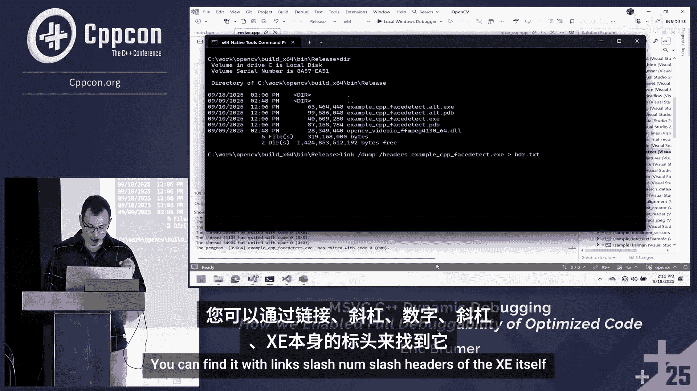
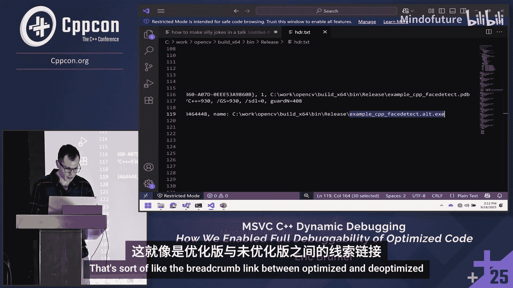
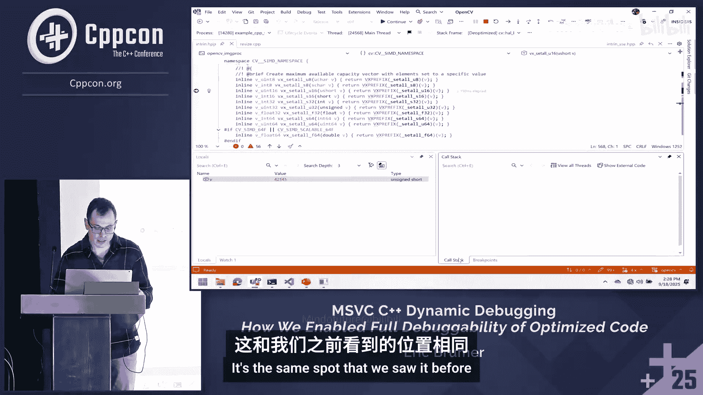

# Cppcon-2025-｜-C++-｜-C语言--｜-汇编-｜-编译器-｜-操作系统-｜-Linux-｜-Windows-p14-P14_你的优化代码可以被调试——MSVC_C++动态调试方法-Eric_Brumer--BV1wyPBzrEeu_p14-

Just coming here made me realize how much better an in person conference still is。

 it doesn't even compare so it's been really great being here again。

All right hi everyone， my name is Eric Rumer， I'm an engineering manager on the Microsoft C++ compiler team。

 I work on cogen and optimization。

Okay， at show of hands， Who here Zbus optimized code。All right， that's almost everyone cool。

 and a couple of like So I do。 And when I debug optimized code。

 I'm regularly hitting that variable was optimized the way message when I step like either step over or step into oftentimes it doesn't go where I expect。

 And overall， it's just kind of a pain to get the information know that I want in my debugging session。

 When you think about it， it's kind of by design。 right。

 like the point of the optimizer is to optimize your code。

 and that sometimes means optimizing your variables away。

 oftentimes it means optimizing entire functions away。 So the you know。

 the challenge here is the things that make our code go fast Also make it hard to debug。😊。

And so we have to make trade offs right sometimes you're examining assembly code to figure out where variables might actually be Sometimes you're stuck trying to sort of fiddle with the optimizer and put like pra optimize off in your code and then like stopping your debug session building and having to reddebugging them So our solution for this is called C+ plus dynamic debugging。

So this is available right now in the latest visual studios。 So Vi Studio 2022， version 17。 14。

 that has it and Visual Studio 2026 insiders has it as well。

 You turn it on by throwing this switch slash dynamic deOt to seal dot Xy Lib ont Xy and link dot Xy the basic idea of the feature is when you throw these switches you know we build your code as normal。

 fully optimized but behind the scenes， we build a second set of your binaries。

 the alternate binaries that are built with optimizes turned off。When the debugger starts。

 we start the optimized code。 So your binary is running， know at full speed。

 But when you put a break point on a function behind the scenes。

 the debugger is going to redirect execution for that function from the optimized binary to the unoptimized binary。

 So your break point actually gets hit in unopimized code。 And once you're in unoptimized code。

 you can view all of your locals and stepping works the way that you expect。m， so you know， that's。

Your code runs fast， and you get full of bugability。

Best way to show you this is going to be with the demo。 because that's what we're going to do first。

 And after that， I'm going to show you how we did it。 You know。

 all the extra details of what's going on behind the scenes is going to enable you to debug your optimized code you know。

 more effectively and faster than ever。Okay， so let's just get right into it。Let's get。Right into it。

 All right， give me a second。 I'm going to unplug and replug。I swear I did this earlier。

 and it worked。Okay， here we go。 So here's my code。 It's open C。

 It's an open source computer vision library。 I've cloned it from Github。

 and I'm building the face detection sample。 And first we're gonna run this in debug mode。

 So I'm going hit F 5 members is gonna be unoptimized code。

 while this starts the only change that I've made to the code is I forced openCv to be singlethed。

 It just makes it a little easier to see in the call stacks。

 So here is face detection you can sort of tell what it's doing。

 it's grabbing you know the video feed from my camera and it's putting a circle around my face。

 the eye thing works better without my glasses and it put circles around my eyes。

 And I think it's like super goofy。 I absolutely love this demo。 But the problem is。

 it's slow right like you can see me moving。 but like the video is going kind of slowly here。

 And we print out how long it takes to actually process each frame。

 And we're talking like between a third of a second and half a second per frame。

 And let's say for our purposes that is too slow。😊，So I'm going to stop debugging。

 and I'm going to switch to release mode。 So this is release mode without dynamic debugging。

 And I'm going to go ahead and start this。And here we go。 because it's the same code。

 but it's running optimized。 And， you know， hopefully， you realize it's faster， right。

 It's almost real time， not quite real time。 And you can tell those detection times were less than 100 milliseconds instead of half a second。

 Hooray， our code's faster， great。😊，So， so it's goof。

 So let's go ahead and actually start to buggging。 Remember， this is without dynamic debugging。

 This is just regular release mode。 So I'm gonna put a break point like， you know。

 somewhere deep in the guts of open C。 And if I look at my locals right， bam， it's right there。

 Va is optimized away， right。 And if I needed to know what those variables actually where the debugger isn't just not going to tell me right。

 It's just not there。 So， you know， another example right， we've got this V S Z variable here。

 you know， maybe I need to know what this thing is。 I'm gonna put it in the watch window。😊。

Identifier， undefined， like， you know， tough luck。Next up， right。

 we've got this function called V X to set all U 16。 I would love to step into this function。

 So I'm gonna hit the step into button， and it didn't step into it。

 It actually just seemed to have stepped over it， And I know this thing is a function。

 I can right click on it。 and I can say go to definition and the functions right here， And you know。

 all of these functions。 Like I would love to be able to put breakpoint on them。

 But the debugger just won't let me write in visual studio。

 It won't bind if it can't bind a spot in your source code to a breakpoint。

 It puts that sort of like hollow red circle with that like orange yield you know caution icon。

 and it just won't do it。😊，So like， all right， we couldn't step into that V X set all U 16。 Hey。

 maybe we'll at least be able to see the return value， right， Nope。

 that variable was optimized the way。 that's not super useful。Let's do some more stepping。

 I'm going keep clicking step over。 And what I expect from step over is it actually steps to the next line。

 And like， it's not really what it's doing。 It's sort of kind of moving forward。 But every so often。

 it's jumping backwards。 Sometimes it's way backwards。 Sometimes it's a little backwards。 It's just。

 it's not what I expect。 And that's an issue。 You know， here's this V X， L U T pairs。

 Let's try and step into that。Whoops， definitely。Okay。

 so this is like totally representative of what it's like to debug optimize code。 Hopefully。

 this rings a bell。 Hopefully this rings a bell with you。Okay。

 I am now going to go into the visual studio settings and turn on dynamic debugging。

And then I'm going to rebuild the project。And then I'm going to start the debugger again。Alright。

 here we go， actually hang up before that。 I'm going turn this break point off。

Because that is useful as an illustration。 So now we're in release mode with dynamic debugging。

All right， first item。Coodes fast。 It's just as fast as it was before， You know。

 just about real time， lesss than 100 milliseconds。 The code that's running is fully optimized。

 Let's go ahead and put that break point in that same spot that we had before。O。

So if you look in the call stack window， we will tell you for the frame that got hi。 hey。

 this thing is de optimizeimd。 So this is the indicator to know that it actually broke into a de optimized。

 de optimized function in a de optimized frame。 When you have that， you can view all of your locals。

 They're just， they're all there。 They're just there。 no other way to say it。

 right That Vec S Z that I couldn't see before， I can just hover over it。 Oh， yeah， it's the value 8。

Cool， right， V， X set all U 16。 Let's try step into that。Bam， here we are。

 I can actually step into this function。 So if you look in the call stack window now。

 I've stepped into it。 Any frames that you have break pointss on。

 get de optimizeimized and any frames that you step into also get de optimizeimd as well。

 The idea is anything you're actively debugging is going to get de optimizeimd and everything else is going to stay optimized again for maximum speed。

 So that's pretty neat。 let's go back。 I'm double clicking on that frame。

 I'm gonna right click here and say， run to cursor， which is a great feature。

 that actually where super reliably now because it's a de optimizeimized frame。 Additionally， hey。

 that v source0 variable。 Yeah， I can see it now。 it's a vector。 I can do whatever I want with it。

 All。😊，Okay， step over works exactly as you expect。 I'm going keep clicking step over。

 and it actually steps to the next line。 It's so nice。 Here's that V X， L U T pairs。 again。

 I'm going to step in。 And then that's another call。 I'm going to step in and another call。

 I'm going to step in。 And eventually， I realize， hey， this thing at the end of it。

 The end of the day is just calling this intrinsic。 our E P I 16。

 And I've got this sort of trail of de optimizeimized functions that。😊。

You know that that that I've stepped through like。And for each of those， I get to see all the locals。

 all the parameters。 It's all just there。So I'm going to at F 5 and go back to my original break point after rendering one more frame。

 There's one extra feature that I want to mention here。 So like I said。

 we deoptimize functions that have break points on them。 Or if you step into them。

 and all the other functions， they optimize。 right if we want your code to run as fast as possible。

 that's sort of the point。 So if you go to one of those frames higher up in the call see this one here。

 I'm going to double click on it。You will see that in that case， you know。

 there are variables that have been optimized the way because that frame is still optimized。

 If you are in this situation using dynamic debugging， you can， if you want to。

 right click on the frames affected。 You say de optimizeimize on next entry。

 And the next time that function starts or is entered， which the best way to do that is to。

Just hit that5 and then put my breakpoint again。 That frame is now de optimizeimized because you chose to have it have it de optimizeimized。

 And I can see all of all of its locals。 all of the break pointss。 So let me close that。

 I press the wrong button。 All the break pointss that you've got whether they are manually de optimizeimized or any break pointss that you actually have set are in the breakpoints window and。

 you know， when you're done。Grandma， delete， hit F5。

 and the code is back to being fully optimized again。

So everything gets redirected back to the optimized binary when you're done。

And I cannot get enough of that blue circle。 Oh my God， it's awesome。嗯。And that's the feature， right。

 That's that's the just the dynamic debugging。 That that's what you can expect from it。

 I use this myself every single day。 The debug version of the compiler is just really slow。

 And I am far more productive using the optimized build of the compiler for my own work。 And。

 you know， I'm using dynamic debugging if I'm， if Im need to look at locals or do anything like that。

😊，嗯。Alright， so that's the demo。 The rest of this talk is going to be about how we actually did it。

 There's three things that I'm going to cover。 The first is how we manage this sort of dual binary business。

 right， the optimized binary， the unoptimized binary and how they're links together in a variety of ways。

 The second thing is how we are building two binaries for you， but not doubling your compile time。

 And say that again。 We're building two binaries， but not doubling your compile time。

 And the third thing is undoing compiler optimizations and how we make some of that stuff work。

 which is super cool。😊，嗯。So first thing， let me close that window。

 The first thing is the links between the optimized binary and the unoptimized binary。

 So this is the actual like output from from the space detection demo， right。

 So the Xy here is the optimized binary。 And this alt Xy is the unoptimized binary。

 And we have a direct link from the optimized binary to the unoptimized one。

 you can find it with links slash nu slash headers of the Xy itself。 So this is in the executable。

 It's not in the PDB。 And when you look at those headers。 you're looking for a debug。😊。

Directory。Here it is。 And you're looking for DOt。 scroll down a bit。 So it's up higher。

 And it's just straight up the name and file path of the alt Xy。Right。

 so this is what the debugger is using， right， This is the thing that the debugger cracks open because we start with the optimized executable。

 It cracks open。 It looks exactly for this entry。 and it's finding the file path and the file name in order to get the unoptimized binary。

 which is why， like if you remember in my demo， I sort of like do that I'm changing settings and rebuilding that I was just changing the file name so that the debugger could actually find it。

 So like if you're using this yourself And and you're not seeing anything to de optimized。

 The first thing to look at is exactly this。So that's item number one。

 That's sort of like the breadcrumb link between， between optimized and de optimizeim。

嗯。Okay， all right， this worked。 But there's more。 So we do a lot of interesting cogeneration to make this possible to be able to sort of bounce back and forth between the optimized and the unopimized binary。

 So I'm going give this in the context of a very small source example， which is this。

 So we've got like our testt CPP file。 It's got a function called2。 that like shockingly returns2。

 We have a function called funk。 It's got a local variable X starts at one。 Yeah add2 to it。 Yeah。

3 to it and then returns X。 right， This isn't like super complicated。

 but it's good to illustrate what we do。😊，嗯。So here's the optimized assembly for function fun。

 And like， it's okay， if you don't exactly know assembly code。 like I'll walk you。

 I'll walk you through this， right， The point is there is no function call to function 2， right。

 It's been in line。 And there's no ads right， They've all been optimized away。

 So the resulting assembly code is just moving 6 into E A X and then returning。

 So that's what the optimized assembly actually looks like for function fun。 And this is。

 this is what we do。 So like。😊，Like pausing for a second。

 right if if you're thinking about debugging just this optimized code。

 like forget about dynamic debugging for a second， you're just debugging this optimized code right。

 and you have a breakpoint and function function。 And you're trying to step into function2。

 like there is no call to2 right， So like what's the debugger supposed to do if you want to step into it。

 Like it just can't do anything other than just go to the next line， right， Similarlyly。

 if you're asking you like， hey what's the value of x on on whatever line， Like I don't know。

 Like the debugger doesn't have that information doesn't even know that X exists， right。

 X has been optimized away。 it kind of makes sense that the debugger says， I don't know what X is。

So yeah， again， that's just sort of illustrating why。

 I guesss sort of a challenge challenge to begin with。 Anyhow， right。

 we might back to dynamic debugging。 So this is the actual code that you have in the optimized binary。

 It's test that Xy。 When you put a break point on this function funk。

 The debugger is going to rewrite a bunch of this code in memory。 So it does this。

 It's going to rewrite the first two B of function funk to jump back 16 B。

 it's then going to load an address and then jump to it。This is a super standard。

 like jump to jump hot patch sequence。 There's actually a board outside from someone who's done hot patching is very。

 very similar。 And this is a pretty， pretty sort of traditional technique。 And the point is， right。

 you， you execute function funk， you jump back 16 by。 and then you're going to jump to an address。

 that address is the unopimized version of that function funk。

 When the debugger has loaded the unopimized binary。And I know that's kind of a mouthful。 But right。

 So here is the unopimized assembly for， for function fun， right， that's in test dot alt dot Xy。

 And when that's been loaded into memory， right， it starts at that address， You know，7，7，7，7，1，4。

 blah， bh， bh， blah， blah。😊，So yeah， so this is what the debugger does。

 It rewrites the first two B of function funk， as well as a bunch of the padding before to turn it into a jump to jump pot。

 We have a question。 Hey， what's up。 I was just wondering。

 So you said this happens when it installs a great point。 What happens to be。保。是。

So if you've got like a data breakpoint or some non user you clicked a button and indicated you want。

 it's going to be an optimized code。 it's the same same thing as looking at functions that are higher up in the cost set。

Yeah， so it needs the user intervention， it's sort of the point。Okay。

 so this is how you get from optimized to unoptimized。

 But it's actually really important that we also go from unoptimized back to optimized。

 So like this this like going bouncing back between binaries is， in fact， a two way street。

 that's really important may have remembered like when I was done debugging that like silly like circle face demo thing when I delete it all all my breakpoints and hit F5。

 all execution needs to get back into the optimized binary。 That's very。

 very important for this feature。 And the way we do that is with some interesting codegen in the unoptimized function And what we basically do is any time we generate code for a function call。

 we emit a sequence like this。 So it looks kind of silly on disk right When you look at it。

 this is what it looks like right it's moving0 into R X and then calling R X。

 But what's special about this， it's actually 64 Bs of 0。

 And when the debugger enters this unoptimized version of fun is going to replace the 64 Bs of0 with the actual。

😊，Address of the function that you are supposed to be calling in the optimized binary。

So in this case， we're looking at the unopimized version of funk。 It's supposed to call function 2。

 And the debugger is going to replace the address to make sure that we call the optimized version of2。

 What been。That is a great question。 We support that。 I will get to that at the end。 And if I I。

 I don't， I want to make sure I don't run out of time。 And if not。

 I'll show you all about it afterwards。 Yes， no we， we do handle that case。 Thank you for asking。

So yeah， this is how we do special code gen tricks and the debugger support in order to go from optimized to unopimized and from unoptimized back to optimized。

And like if you were in the debugger and you open the disassembly window。

 you're going to see exactly this with how the debugger has actually filled in all of these addresses at Runtime。

 which is pretty neat。对。Okay， so that's it for the cogen piece。 So moving on to compile time。

 So we are right when you throw that slash dynamic D switch when you enable dynamic debugging。

 we build two binaries when you only asked for one。

 and it is natural to think that like your compile time might double but I'm happy to say that that is not the case at all。

 So here is the actual end to end compile time of that open C demo built on a 32 core thread rippper machines is a fairly powerful machine。

 we use it for like game developer game developer tests So release mode without dynamic debugging built in 132 seconds。

 release mode with dynamic debugging took 139 seconds。

 which is a 5% slowdown to get that benefit and that debugging experience that you just saw。😊。

Critically， though， and this is important， right， iteration build。 So that's where， you know。

 you modify one single file， make a small change to it， and then build your project。

 like after you've already done the full build so that there is， you know。

 a higher percentage slowdown for that， right， So release mode without dynamic tobugging。

 that iteration loop takes 8。8 seconds。 And with dynamic tobugging， its 10。3 seconds。

 And that's a 17% slowdown。 right， like， and yes， that is a double digit percent slowdown when you are making a change。

 you know， without using dynamic tobugging compared to with using dynamic to buggging。

 But it's also important to remember like in this case， as less than 2 seconds。Right。

 like that pause that I just took。 that was actually more than two seconds， right。

 And you got to think you got really like ask yourself， like。

 is the benefit that you get from dynamic to bugging worth it right for that that that 17% iteration time slowdown。

 again， for open C， that that's actually what the number was。Right， you know。

 maybe you're iterating less。 Maybe your code just runs so much faster that your overall debug time is definitely short。

 And that's the case with me and the compiler。 right。

 The optimized version of the compiler is like 8 or9 times faster than than the debug version。

 So for me， I far then make up for that slowdown in terms of iteration。

 But obviously you need you need to do it's right for you。

 And then I also have to say your mileage may vary on these slowdowns depending on the project。

 So for small to medium projects， these numbers are pretty representative。

 if the binaries are smaller， they're even faster in terms of the slowdown coming from iteration bills。

 the worst case that we've seen sorry I am before the worst case。

 common end to end slowdowns are 15% or less， usually it's like 5 to 15% very。

 very commonly on the 5% end of things if you have a powerful enough machine。

 And for iteration bills were usually know between 5 and 20%。

 we were aiming for less than 20% and for the most part。

 we hit it for small to medium sized projects。The so the worst case that we've seen are for folks。

 say doing Xbox development on an Xbox， building monolithic games。 So these are instances where like。

 you know， you got the unreal engine。 But you need to link everything into one single massive executable。

 Like these binaries are like one and a half gigs。Not the P2 Bs。

 The Xs are like  one and a half gigs。 So these things are massive。 And there。

 the slowdown caused by dynamic D can be up to 80%。 the worst case we've measured is 80%。 And， yes。

 that that is a lot。 I've got links at the bottom of every slide。

 That second one offers a mitigation that cuts that slowdown by half。

 If that slowdown is unacceptable for what you're using。 Again。

 it's really going to depend on how how much benefit you get from the future in terms of how much time it's actually saving you because you can see all of your variables instead step into any function that you want。

😊，Okay， so those are the numbers。 But the actual the meat of this part is like how do we do it？

 So I'm going be showing a compiler sort of like flow diagram here。

 boxeses in blue are gonna to be regular compilation and boxes in green are going be compilation extra compilation steps that happen when you do dynamic debugging So you know we start with the source file like8 do c and then we run the compiler the compiler is not just one tool。

 it is multiple tools。 the first of those tools is called front end。

 This is what does the parsing Leing most of the compiler like errors and warning messages。

 So we run the front end on a dot cP and it produces an output file。

 It's an intermediate language file。 I'm just going to call it a do IL for this chart。

 We then run the backend， which is what does code generation and optimization。

 which reads the output of the front end， does the actual know optimizations and generates the assembly code and stuffs that in a do Oj。

We do the same thing with B dot O Bj right， we run the front end to produce B dot IO。

 we run the backend， which reads the output of the front end and then produces the optimized assembly code inside B dot OBJ。

 and then we run the linker， which grabs those optimized object files and generates A dot Xy。

 which is the optimized binary。 This is sort of like normal normal release mode cogenrate。

So the thing that makes dynamic debugging not double your compile time is we reuse the output of the front。

 That's really the sort of the magic behind the scenes here。

 So we reuse that a dot I and B dot I and in parallel with running version of the backend that produces the optimized binary。

 we run a second invocation in parallel that produces a al dot obj。

 which is the assembly code for the unoptimized binary and the same thing with B dot al dot obj。

 that's the unoptimized assembly for B。 and then in parallel with that a dot xy link we run a second link again。

 in parallel that produces a do al dot Xy and that produces the unoptimized binary and right So the extra backend passes and the extra linker pass happen in parallel and we reuse the output of the front end。

 the idea an end to end build is actually mostly frontend time which is the sort of the saving grace is why the end to end times are nowhere near。

question yeah， it's might be silly question but is that something that we can change。ですら。Mial system。

I do see thing on。Unlike you。Yes， so there's compiler switches for that。

 That's all in our documentation。 Yeah， its， it's just compiler and linker switches to change that suffix。

 Yes， yes opposed。It usedd to be called dot debug。 but that that that actually broke our very first unreal engine build because they have dot debug dot deal all over the glass。

嗯。All right， so that's what's going on with compile time。So there's a couple of restrictions。

 And I I want to make sure I cover them。 This is visual studio only with MSVC only on Windows only that is important。

 And then some limitations， these aren't like technical limitations， permanent limitations。

 we just wanted to get the feature out in people's hands。 So this is X 64 only。

 So there's no arm 64 support for it yet it is no nonltcg only。

 So this is02 like Gl minus or just02 if you're familiar with that。

 So it's like no IPO would be the equivalent switch if you're familiar familiar with that。

 And we have other incompatibilities as well。 They're in that link am VcDD。

 we cover all the stuff that isn't supported。 and the compiler will tell you if you throw an incompatible switch。

 But the X 64 and the nonltcG I think are the big ones。We have built system integration。

 so on the left is the picture of visualual Studio IDE to turn it on right configuration properties advanced。

 and it's that U C++ dynamic debugging。 you just said it's yes。

 and that's going to throw the switches for you right C live and link We also have support built into the Unal engine thanks to our friends at Epic for getting this in。

 This is in UE5。6 which is out you just said B dynamic debugging to true and your build configuration Xml file and that's how you turn it on。

All right， last thing I want to talk about is undoing compiler optimizations。Oh question。

 I'm sorry I thought you were telling me there's five minutes left， but" hey， what's up？So that's it。

And as you see。その面倒し。Yes， this is only for Windows。 Yeah， MSVC is a Windows targeting。Only can these。

So I was just asking。That's right， yes， it needs to be the MSVC compiler。

 which means the resulting binaries have to be run on them。It does work with the remote debugger。

 but the remote target has to be windows or Xbox。Okay。

 last thing I want to talk about is undoing compiler optimizations。

 I went back and forth a lot and how best sort of to explain this， because this is， this is。

 this is a little complicated。 The best way that I've come up with is actually back in back in our demo。

 So I'm going to hit a 5。😊，Kick off my favorite demo， ever。It's so cool。 Okay。

 And then I love this function。 V X set all。 And I'm gonna gonna go to definitionfin。 Okay。

 so the debugger is running right now， right， like here's here， it's， is actually running。

 So I'm gonna to set a break point on this function right here and hurry， it's。 And it got hit。

 which is great。 I am also going to put a condition on this break point。

 And I got to be real careful about this because the the mouse。😊。

Mo scroll wheel goes and nuts yet there it went， okay。There we go。 Okay， So condition。

 This is a really small function。 And it's got a parameter。 It's the， it's the U short V。 So I'm。

 I'm gonna say， all right， we're only going break if V mod 2 equals equals 1。

 I'm going to press enter。 I'm going to close the break point settings。 And then I'm going hit F 5。

 So this break point is now only going to get hit when V is odd。 And here we are。

 V is odd right V is the value 42141。嗯。Cool。That's it。How you that was in line。

 How did you do that What's the magic Okay， so， right， and。

 so so I'm not sure if that was picked up on picked on the mic。 But like this function was in line。

 What's the magic trick that is absolutely the right question。

 And that's basically what I'm fishing for when I asked why did I put this demo in calling undo and compiler optimization。

 So yes， V X set all U 16。 Oh I'm I'm going to hyp it up a little bit before I get to the answer。

 So V X said all U 16 was in lined somewhere else， right， So idiot。

 I'll go to the call stack right it's the same spot that that we saw before。 Yes。

 we're still able to hit the break。😊。

Okay， there's actually more to it than this。 So if you look really carefully at this function， right。

 it's a small function has the keyword in line on it， and it's also defined in a header file， right。

 in Tri dot H P P， right， So a lot of functions in this case， and it is the case with this one。

 not only is it in line。 It is in line everywhere。 And this function has been removed from the optimized binary。

😊，So this function doesn't actually exist in the optimized binary。Yet。

You can put a break point on it， and the break point gets hit exactly when you expect。Okay。

 we're not quite done yet， right， because there's a lot of local state that is involved with a particular function。

 right， like all of the local variables， all the parameters， anything that that function does， right。

 that that got optimized away as well and removed as well， right， So all the locals。

 all the parameters， all the information about that。

 And the function itself are gone from the optimized binary。😊。

Yet I can put a conditional break point on a parameter that doesn't exist in my optimized binary。

 on a function that doesn't exist in my optimized binary， and it gets hit exactly when I expect。😊。

I think is's pretty cool。So how do we do it。 Yes， so the basic idea is we recorded all the in line decisions。

 right， So we know all of the places that Vx set all U 16 was in lined。

 And when you want to put a break point on Vx set all U 16。

 we will de optimizetimize all of those in line sites。 So very good。

 so that there will actually be a call to this function and the function is gonna get hit the breakpoints gonna get hit in the de optimizeimized mode。

 and exactly right， what you were thinking there。 right， like it just so happens that the。😊。

Right the call sites of that happened to be these two functions。

 So even though we only put a break point on this top line， right。

 these next two also got the option。It's slightly more general than that。

 We're not just recording in line decisions。 We're actually recording any cross function optimization dependence。

 So if the codegen of function F depends on the codegen of function bar。

 then if you put a break point on bar， we have to de optimizetimize fo as well。

 It's actually more than just in mininging。 That's how we do。Which again。

 I think it's it's pretty useful。 All right。 And that's that's what I got。

 So that's a whole bunch of internals of dynamic de bugging。

 There's a handful of other Microsoft talks coming at CPP con。 Please， attend if you're interested。

 And hopefully you've all seen now that that4 GT Lego set。 go ahead and fill out。

 we love your feedback。 And there's， you know， there's there's a prize coming today at 430。

 we also have that Q R code at right at our booth。😊，嗯。And yeah， look， thanks。 look。

 if you've debu optimized code with any amount of regularity， we'd love for you to try the feature。

 If you don't like putting pragma optimize off in your code and dealing with that sort of clunkiness。

 we'd love for you to try the feature， we think you're gonna like it。

 If you don't like sort of some of the clunkiness in like there's some build systems where some some know。

 software systems like files that you've checked out， get de optimizeimd。

 But other other stays optimized。 if you find that a little clunky is a little weird。

 We'd love for you to try this as well。 If you have ever checked in code into your repo。😊。

you actually committed pragma optimize off in your repo before。 Like， you know who you are。

 This is for you。All right， thanks， everyone。 They're kicking me out of here。

 I'll be in the hallway and right at the booth if you've got any questions。 Thank you all。😊。

