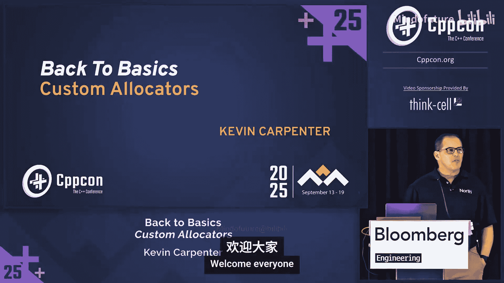
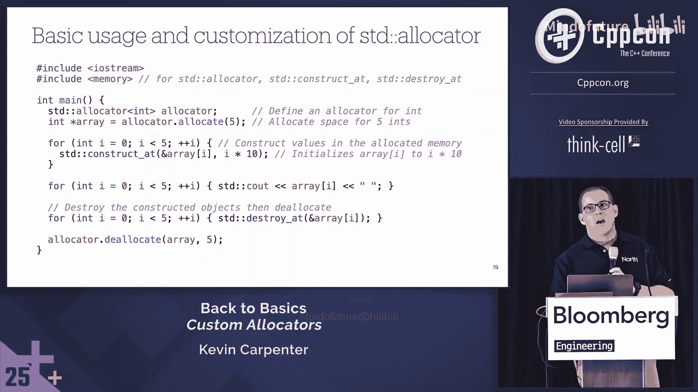
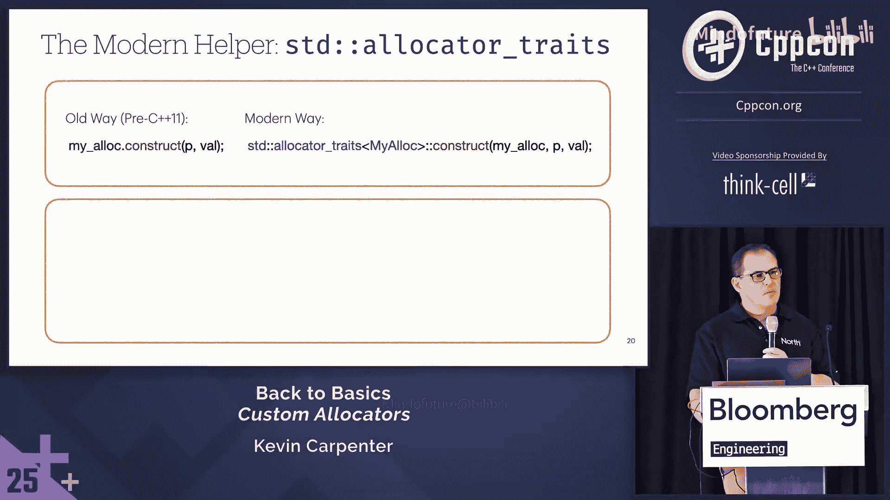

# Cppcon-2025-｜-C++-｜-C语言--｜-汇编-｜-编译器-｜-操作系统-｜-Linux-｜-Windows-p15-P15_回归基础_自定义分配器详解——从基础到高级-Kevin_Carpenter-CppCon--BV1wyPBzrEeu_p15-

。

🎼Yeah。All right， I'm showing two o'clock， so I guess we're good to go。Welcome everyone。

 Kevin Carpenter， we're going to talk about custom allocators today。

So about this talk。It's。Okay， hold on one sec here。How's this。啊。1，2。No。You want me just use the mic？

Yeah， let's just use the photo Mike。All right， can you all hear me？So。

So we're going to talk about custom allocators， this is a you know， beginning to intermediate talk。

 or at least that's how it was when I started it。When I submitted it to CPPCon。

 it was one of the flags was to market， you know， the level。 and I put beginner。

 and so I had nine people reply， there's no way you can do a custom allocator talk as a beginner talk。

 And so， you know， challenge accepted， you all can be the judge of how well I did or didn't。

So advanced， you know， I sure hope not because I am not advanced in memory management。

 I am not a C++ memory expert。But I do play one as a technical editor for PAC publishubing and so this is kind of my journey about memory management。

 I got to be technical editor for this book from Patrice Roy。

 C++ Mem Management and when I do a talk I like to play a little Game， it's called win a Book。Now。

 beings the fact that， you know， if you've never done a talk。

 there's so many places to make mistakes， so this is one of those ones， you spot a mistake。

 you call it out and you can win yourself one of the books。All right， let's see all right。

 I think weve got this now Okay so places I code I work daily for a company called DPX we're owned by a company called North and my part that I like to joke is if you're in the US there's a 60% chance that I process your credit card once or twice or more when you tap that card to the reader I do the rest on the back end and when I go out to dinner with my wife and I geek out on transactions and just just feel sorry for。

嗯。😊，When I'm not doing transactions， which is kind of cool because it's parallelism and currency。

 I've also worked on a product from a company called Sea Myers which does financial risk analysis for interest rates。

 What that means is if you can think of the silicon Bank fiasco a couple years ago is interest rates changed my own personal opinion if they'd use a product like Sea Myers offers。

 then they would have probably not had the problem but both of them have been a pleasure to work on and they or the opposite spectrums because one side is Linux and the other side is Windows MFC and you know so you're going stuff back to the 80s and stuff all the way up to C++ 20。

Alright， so today， what we're gonna to do is we're gonna do a little bit more introduction。

 Then we're gonna look at the why problems with default memory management。

Then we'll look at and understand the ST allocator model a little bit。Finally。

 we'll go over a couple popular custom allocator designs Now。

 if you do anything with memory management， there are so many patterns and so many designs and again。

 we're trying to do this as a back to basics talk， so I'm going to be going as simple as possible in the slide where。

And then we'll do a build of a practical allocator。

 the allocator will definitely be more for educational purposes。

 but it's a neat one to be able to use， I feel， to see what goes on when you're doing allocations。

And then of course， we'll conclude。When I first started writing this talk about a year ago。

 I was like， I got to ask chat chat GTP， you know， fill in the rest of the statement。

 I don't really need to worry or think about memory management and C++ because。

And I'll let you kind of read the bulk of it， but my favorite line was because of modern C++。

 just don't forget the little asterisks and ampersands lurking in the shadows。

I did a talk last year called almost Always Vector， and I think as we start off as C++ developers。

 we should depend on the standard library， a lot more people have spend a lot more time working in that than I have writing my own custom stuff and I generally feel you know 20% of the effort for 80% of the output。

 that's what we get when we use a standard library and that's a good thing。

So the importance of memory management， you know， it directly affects performance。

 stability and efficiency， you know， stability， when we forget to delete that pointer that we used and we have dangling references and efficiency when we don't necessarily make our allocations in a good way and we end up not having cash locality and things like that。

C++ gives us fine grain control over memory management compared to other compiled languages。

 so go is garbage collected， I actually do some programming and go nice language。

 I don't mind it Rus has the borrow checker， which to me is if we take our compiler and turn on all warnings and everything is errors and then you know I don't know throw in a nuclear reactor。

 the thing just catches everything makes you think twice about how to write code and Swift automatic reference counting。

 you know all compiled languages。In C plus plus， we can shoot our feet off， right。

 but with great power comes great responsibility or。Use modern C++ until you can't。All right。

 so the familiar ground。So what's wrong with new and delete I mean。

 so when we talk modern C++ no one really likes to use new and delete anymore， St pointer。

 unique pointer， all great ways to go， but if we look at this code。

 you know we're basically doing a new which is going to allocate this int on the heatap right so you know nothing really surprising there。

And so if we break that down a little bit， you know， this would be same kind of piece of code。 Well。

 there's a speed trap in new and deletete。And it doesn't really show up on something like that。

 but what if we're going to allocate a large buffer？

And we really want some space for something we're going to do。Well。

Then we're not quite being so direct because that new is probably going to call a mallocc。

That malloc is going to try to use its own memory， you know， when our program starts up。

 it kind of gets its own memory， but if for some reason the amount of memory we're trying to allocate is outside the program allocation to begin with。

 well， it's going to do a contact switch。Then it's going to turn around and ask the kernel for space and it's either going to use memory map or it'll increase the program space with BK or SBRK。

Then finally， it'll do another context switch back。Then we'll finally get our allocation complete。

After that， I'll come back and make our object creation because you know new is just memory allocation。

 there's still the object creation in it， and finally， we come back with our memory and our object。

So new。If you're thinking about it can actually be quite costly。

 and that doesn't come into when we start talking about and cache things， cash and things like this。

 this is just actually making a request from memory。 So that's our first problem。

Our second problem is memory chaos， right， you know， depending upon how you allocate your memory。

It can get fragmented。Beyond fragmentation we can go back and look at the cache issue and from that you know your CPU gets a request and if the item you're looking for is an L1 cache well then that's great you're going to get it back really quickly if it's not then it's got to go to L2 cache if there's a cache miss there now we're going off to main memory。

The thing I like about this diagram is what happens if when you allocated your memory。

 one object was allocated in a totally different section compared to another object because of fragmentation。

Now， you've got a double request， double chance for cash miss and even a farther jump for the instructions to try to grab your values out of memory。

 So memory chaos and how we can avoid it is one of those things we're gonna to cover to。

So the opportunity to C++ in our memory management is we can take control。

 So what if allocation could be nearly instantaneous。What if we could eliminate fragmentation？

what if we could guarantee the data is laid out in a way that is great for the CPU cache？

This is what a custom allocator is for。So the standard allocator is part of the standard C++ library and we're going to cover kind of two parts as this said。

 I'm going to go over the standard allocator a little bit now。

 but then we're going to go over some memory patterns that are going to be created from scratch and not using the ST allocator。

So。We've all seen， stood vectorant。That's how we all use the standard library or whatever object we want to put in there。

 but what you may not know is there's actually a default second parameter in there。

 which will take a standard allocator， or in this case。

 it can also take your custom allocator that's built off stood allocator。

So why did we get standard allocator so originally standard allocator was created so if you go way back into the day of when I got my first PC。

 we used to get a PC with 640 k Ram and then if you were lucky you might have had another megabyte or so and this was called near and far RA and so standard allocators were originally created to be able to reach that part of memory that was outside the scope of the basic system memory so way back to the days of Dos。

There's lots of great talks on standard allocators。

 so Andre Alexandrescu stood allocators to allocation from CPPCon 2015。

And then Bob Steiegel also has a great one， how to write custom allocators。

 and Alistair Meredith also has a great one about using allocation as well。

So now stood allocator is a C plus plus a standard way of controlling memory。

 It's not used explicitly in everyday code， but it is in the S TL。 So if you look in the S TL。

 you'll definitely find stood allocator everywhere。So all containers belong to Si allocator。

This is just the template definition that you would find on C plus plus referenceence co PMR we won't talk about in this talk。

 but I did want to mention it here because PMR。You know， if you stood vector。

And you start allocating memory it's going allocated on the he right so my short introduction to PMR if you don't know。

 you want to go look up on it is PMR with a monotonic buffer can actually give you a stack based access。

 which means incredibly fast access to memory by using PMR so。

If we get into more advanced topics in some other talk later in the years。

 or if you want to look that up， that's what PMR is really great for。

So the allocator contract is actually not that big， you're going to create an allocator。

 you need to make sure you have a value type which is your type T I'm curious how many of you like templates？

Oh， all right。 Well， okay， so to everybody watching， that was probably half the room。

 You're stronger than me。 I'm not a huge fan。I mean they're obviously powerful but I like sticking to the simpler ones so most of the slides that I have will most have two parameters so stood allocator you can build out one parameter。

 you have your default allocator， you're tracking your size and then you have to make your D allocatecate so it's not much。

😊，That is required to make a standard allocator。So the crucial thing that I like to remind is you know like we were talking about new and doing a new versus actually creating the object。

 you know memory versus the object， there is a big separation there。

 we have the allocation but then which is just making the memory available but then you also have that part where you're assigning the value into the memory right and so that is to steps and when it comes to writing memory allocation patterns such as stack or pool that's one of the places where we can get savings is if we can allocate a bunch of memory at once。

 well then we can turn around and reuse that allocation over and over again。

So the basic usage and customization of stood allocator。 So we're going over it here。

 We will actually， in the final example， make use of this so。Stood allocator。 You know。

 we defined the allocator for the ints。 There you can see we allocate the space for five ins。

We're looping through and doing that separate construction into the memory that was already allocated。

 you know you can see in the line the next line down where we're actually just printing it out and then we also do just the opposite where we destroy。

What we want first。And then we turn around and deallocate the memory to return it。

 and this is the standard pattern when we're using custom allocators。

 you have the part where you're going to one allocate the memory。

 but then you're constructing and destructing your objects within that memory。

So the modern helper for this is allocator traits and allocator traits actually helps us short change this a little bit instead of having to make our own custom constructor and destructor like we would have to prec plus+ 11。

 the modern way with allocator traits allows us to actually it provides a uniform way to access the allocator functionality。

It's a sensible default for the optional allocator members。

 so like if you don't make construct and destroy and max size。

 it will actually fill those in with defaults for you and you only need to implement allocatecate and deallocate。

So the allocator's job is to obey the contract， implement the value type， allocate and delocate。

Manage the raw memory。Leave the object construction and destruction to the container and let allocator trades help。

 Don't worry about implementing everything yourself。

Anytime I can depend on someone else's experience and in code in the standard library， like I said。

 I know I make mistakes in my code， so I'm going to depend on the STL first until I absolutely need to work my way around that。

All right， memory allocation strategies。Like I was saying at the beginning。

 there are so many allocation strategies we're going to focus on the pool allocator where we can recycle objects of the same size。

 this is one that I do happen to use in the day job with credit card transactions and then the stack allocator which like this burger is very fast and like keeping me filled up is probably very temporary but it has its uses right you know it has its uses。

All right， so pool allocator， we're going to go through some slide。

Where and just to say at the end of this， all of the code I have this is in a Github repository。

 therell be a QR code you can scan and you're welcome to download the code and play with it。

 But for the examples we see， if you see test object， this is all test object is。

 Now I'm also going to use some numbers to be like， okay， we're allocating one object to object。

Those allocations are going to be representative to the slides we're looking at。

 not necessarily the real amount of bytes， so you can still call me out for an error if you see it for a book。

 but just not on my measurement of bytes versus little blocks of color being filled in our memory example。

All right。Pool allocator， big pictureer 10000 foot view。

 I wanted to start with this for two reasons first， if you look at it， I mean。

 obviously it's a satellite picture， but the squares you know， made me think of memory chips。

 and I'm from Phoenix， Arizona。 That's what this is a picture of。 and incidentally。

That area there is the highest square capita of pools。In the United States for sin。

 we get one for every 13 people。So that little purple box is what we're going to call our object that we want to have a really efficient allocation for。

 and we'll just go with the size of being how much it takes up。So if this is our memory， you know。

 you can the lighter blocks are the ones that are free and available。

 the orange or ones that are taken。Again， you know， here's what our size of our object is。

So what we're going to do is we're going to make a simple pool allocator。

 And so we will do the align as T。 The T is， of course。

 that little purple box or the test object that we've talked about。 Now。

 align as how many of you know。Know why we want to align our data structures。第二。喂。In for the。

Inefficient for the CPU， I heard that one， undefined behavior， I'm not sure about that。嗯。Yes。

Jason's back there schooling me， so we do the aligns on the pool size and the size of tea。😊。

I'll not get into a line as because obviously I've missed stuff here on the pool allocator when you do an intrusive pool allocator。

 you actually use a linked list to be able to track your empty blocks we're going to do it using a linked list which is where you see the free node struck the head pointer points to null so this is how we start our pooling allocator。

For our objects， we want 56 of them stored。 all right。

 so just keep pool size in mind that it's going to be 56。So that being said。

 each of these rows going across is 14， so we have， you know， we'll say 28 blocks of memory here。

 we're going to want to store 56 items inside this 28 blocks， everything alignss we would hope。

Not the same as a line as I can hear Jason。In the back。

 so we're going to initialize this pool and part of the initializing the pool。

 you see that we have our bite。Reference to our pool。

And we are going to iterate over the pool size for the size of our objects。

 and we're going to create our linked list。What that linked list is。

 is literally just pointing to the next available space。 So just to say。

 when we were looking at the previous slide， we've allocated this memory here already when we started our code。

 it has now got a block of memory。 We allocated this all in one request。

 So if we had to go to the CPU， then we already went through and got it。

What we're doing here is we're actually going to line up our data structure to be able to fit in that pool。

 okay， and so that's where we're using our data structure and getting pointers to the location of each object where it would fit inside the pool。

In the end there， you can see that we make the last node point to null pointer。

 so we know that when we've reached the end of our pool and we set our free head to our first。

So now our pool would look more like this， we would have our separate spots。Where each point。

 each part of our link list points to a free block。

 and then we can turn around and start filling it in。So to fill it in。

 this is what our all would look like， we would first， of course， do a test。

 have we exhausted our pool， if we're at a nu pointer。

 then the pool is exhausted and we can throw back a bad alloc。Otherwise。

 we're going to grab our first entry off the linked list。

And update our free head to point to the next item。

 add to our allocated count and return that pointer。

 Now that pointer when it is returned is where we're actually assigning our value inside， but again。

 our allocation is already done。 All we're doing is manually managing the memory to put our objects where we want them inside this pool。

So after we did our first allocation， we would be in the first block like so。

So if we look at the manual allocation and we were to actually you know， link or iterate over this。

 say that we wanted to actually store 34 of these values。

 you can see where we're calling our allocate function， which we know returns the pointer。

Incrementments。Our allocation。Moves forward in the linked list and doing this over 34 times。

What actually happened， how， would it happen randomly like this？Someone raise a hand。

 I want to give a book away。They would happen in order。 Thank you， Tim。は。

They would happen in order if you've ever used Keynote to make slides。

Doing individual cell animations is fun。 So it would iterate over and it would fill off 34 blocks。

 One right after the other。 Our link list would be updated。

 We'd currently be pointing in our link list ats spot 35。 And， of course， we could keep going。😊。

But what about the de allocationlocation， So D allocationlocation， of course。

 is going to kind of go in reverse。 If we have a nu pointer。

 then we will just return because obviously that can't work。 But then we'll also turn around。

 And depending upon the pointer that we're passed when we deallocate。

 we will make sure that it is within the range of our。Of our addresses in our memory pool， otherwise。

 as you can see， when we do the pushback to free list， we will get our node pointer。

 We will update our link list。 We will deallocate you know our allocation count there。

 which is more just for our information than anything else。好，主人。O。Sorry， next slide。Sorry。

You have this second petition here。You go down。The code so cool。把サト。最初 please just。Just a advice。

So the at。Okay， so I happen to know the demo runs。Does someone want to concur and point out that I am wrong？

So what he's saying is， is that size of pool is actually returning me and correct me if I'm wrong。

 You're saying that that's returning。No， okay， all right。It was like。

I ran that example like three or four times trying to make sure that wasn't an error， I mean。

 I'm happy if someone finds one though， all right， the question or the idea was that size of pool was actually returning the size of the point or not the size of the actual pool。

 but we have pool plus size of pool， which should be returning the end of our pool size there to make sure we're doing intest in between。

So back to where we're going， when we want to delocate。

 because this is one of the benefits of a memory pool。 We're not actually giving the memory back。

 but we want to remove and be able to reuse the object， right and so。

What we end up doing in this case is we， if we are going to delocate four items。

 we're running the destructor on the object so that we clear the object out and properly close it。

 and then we'll do the deallocation， which the deallocation will do what we just showed in the previous slide where we will add back to our free list and。

Turn around and clear out the memory so we can put it back to availability for use。

And so in this case， you know， our memory comes back and available for you。

 Now one of the things about the pool allocator that is nice is that， you know。

 the objects the same size， you can delocate in any specific order。 It is still a last in first out。

 So when you go to reallocate the pointers are going go for the next available block。

 But in the case of our day at least of my day job， we get a lot of。Transactions， you know。

 hundreds of thousands。P hour。 And one of the things we can do is on some of our transactions。

 there's a lot of them that are the same size。 And this is exactly why we use a memory pool。

 interesting thing about credit cards。 I get 22 seconds to process your credit card。

 That's all the way end to end。 And a lot of time it happens a lot faster than that。

 But depending we can have a transaction waiting in a queue this way and processing through and reusing the pool over and over again instead of having to reallocate each time。

 So in the day job， that is what we specifically use this for。

So pool allocator is extremely fast oh sorry pool allocator so we also can look at using the allocator traits which we talked about earlier with the standard library and so allocator traits allows us to not have to worry about the construct or the destruct and it'll take care of it for us and so that's just what this example is showing here and in the code that I have in the repository I give an example of both we have a regular raw example of a pool allocator that we've been going to。

 but there is also one that uses allocator traits as well。All right， so pool allocator。

 extremely fast， eliminates memory fragmentation， right。

 because we allocated all that block to begin with。

 and then we're just managing the object creation and destruction using our own linked list。

But it only works for a single fixed size or roughly fixed size and when I say roughly fixed size。

 what I'm trying to say is you when I talk about credit card transactions， you know。

 you could think of it sometimes all I need is a name address， your card number expiration and CB。

If you turn around and look at some of the transactions that we have with auto rentals， for example。

 they attach on a lot more information， so you know you're going to make a struct。

 you're going to give it a certain set of values， whether're all filled in or not。

 it can hold all of the same type object。At the same time， it only works。

 so it only works for a single fixed size， but you do potentially reserve a large amount of memory up front。

 So if you are using a pool allocator， you want to make sure that your're。

Being smart about what you're doing for your code。 And， you know。 So， for example。

 if I'm only queuing up 1000 transactions a minute with a lifetime of two or three minutes。

 I don't want to be， you know。Taking 10000 times that or 10000 transactions worth of memory。

 So you still have to be smart about how you write your allocator。

So it's best for nodes in a list tree your graph。Parice。

 who does a lot of game programming had told me at one point it's great for games， bullets。

 enemies and objects。 And in the case of what we use it for systems that frequently create and destroy many objects。

 you know， credit card transactions。 I got a question in the back。这反。包括。你说是。Yeah。嗯持。Yes。自の？是8万块。で的た。

办。So what the person's mentioning in the back is that you can create a bunch of pools and you absolutely can at a power of two and then you don't have the problem of running out of space and you're absolutely right there's lots of strategies and memory where you can actually add and use two or more strategies together The thing that I'm trying to cover is as much as we can write custom alllicators and the person in the back is absolutely right。

You have to really know， I mean， I don't know about you but debugging memory errors is not always simple and we have a lot of tools。

 but you definitely， when you start going outside the realm of using a standard allocator that comes with the STL or in the standard library。

 at least for me， to your point， it's like I have to profile。

 I have to test and retest to make sure that I'm not making mistake that I end up。At 2 AM。

 trying to debug because somebody's transactions is going through。

 nobody likes when they can't charge their credit card。 let me tell you。好，不。属为被告。

How do I know that you didn't read the buffer twice？So。

You're talking about once the memory is allocated and we're going back through our linked list to see what's available or unavailable。

 if I'm going to do an allocation。Then I would be looking my linked list to see if it's been for you to allocate it。

 Now I understand the question is is how do I know that I didn't free the buffer twice and to your point that's exactly what I'm saying。

 you know especially in these examples that I'm going they're very basic and simple because that's what I was trying to go for。

 but I think what the speaker what the attendees asking is very valid and that's the part where you know I may have missed it in this piece。

 those are the pieces that you really have to double check for and watch for when you're writing this yourself。

There。我是当时。So cash alignment block， what you don't know is this is a two part talk。

 I'm just not doing the second part， and it's in the last slide。

 You want to see Michelle Fay de Sousza's talk， Cash me maybe to help answer more on the cash alignment part。

All right， next so that covers the pool allocator next up we'll look at the stack allocator。😊。

So stack allocation。We have a stack allocator， we're going to pass it in the size similar that we did in the previous and。

We get our memory back where you see the new character or size， and that gives us our bitetes。

 So in our example， we're going to play with an allocator of 35 of these blocks。

So stack allocator is actually pretty simple， you get a character pointer to memory。

 you have the total size， and then the current offset which is a pointer to where your size is at Well excuse me it's a size T to where you're at within size your allocation。

So on the stack allocator， as you can see here， the same code we had before。

 but if we're going to allocate 35 blocks。So now， you know， this is our green section of our stack。

 The memory is allocated。 we have our 35 blocks。 So if we wanted to turn around and allocate seven integers to it。

We can do that by making the call to the allocator， getting back。

Each of our assignments and each of our pointers in doing the assignment。So we're at 7 of 35。

This last line adds a checkpoint， and we'll get back to this in a moment。

 because one of the things about a stack allocator is the way the memory is allocated and freed。

So the thing that's also nice about of stack allocator is you're not limited to one object type。

 so in this case， let's say we want to add in seven more floats。So again， are I good？ある。No。

 I'm not allocating on a stack， this is called a stack allocator and it is the pattern of a stack allocation。

 you're right， we're not allocating on a stack， this is actually being done on the he， yes。这这。どうだ。

Not one that I've done， so I don't want to answer that with the yes， go ahead John。

You can cascade allocators， it's very common to have monothonic allocators， the base allocator。

 and then particular pool alligators on top of that。So the original question was。

 could you use a stack allocator with the pool， And John has。

You know added to that that yes you absolutely can you can mix I don't want to say mix and match these you can chain them together and the monotonic wasocator is your stackocator yep and a poolocator is your poolator so Johns saying a monotonic allocator is your stack allocator and a pool allocator is your pool allocator so yes。

All right， This is almost better than being heckled。

 I have people with more memory management stuff in here than I have， yes。

And I will deflect back to the okay， so the point is is that the statement is is in this。

 I am calling char with the new which is one byte and then later on in the next slides I am calling int and float and double and everything else。

 which are definitely not one byte， to that point， I will refer back to the beginning when I said in the slide where there will be spots where I am allocating things to look like blocks for demonstration purposes。

 but you are absolutely right。Any others？All right， cool。Okay， I've got to say this is。

 this is fun because this is like the most that I've， I've gotten in。😊，This is good， all right。

So where I was at， we allocated our seven ins on the stack。So we have seven of 35 of our blocks used。

We put in our marker， All right， so this is where I was saying next， if we'd want to allocate floats。

 the thing I'm trying to point out here is that with the stack allocation pattern。

 you are not stuck to one type of object， you can actually use multiple types and it is still a very fast allocation because the actual memory was allocated all in the beginning from the call and so all we're doing is actually creating these objects inside the memory that we already have。

So， you know， at this point we have 14 of 35 used， let's do one more。

 we're going to add in 10 doubles again。Bte is not relative to this。

 This is more just looking at the blocks and how they get used because I want to demonstrate the fact of how we allocate and deallocate。

So delocation。Can I delocate my ints？No， why？然后。喂。Yeah。

 so you have to delocate everything else before it。

 That's the way that is one of the disadvantages of the way a stack allocation work versus pool。

 so no， we cannot actually delocate this set of lines here。

What we can do is because we have this checkpoint marker， though。

 and you can use multiple checkpoint markers。 It does become very fast to delocate back to a checkpoint marker。

 And so that is one of the advantages of being able to free up the memory inside of a stack allocation pattern very quickly。

 So you have the advantage of。It's a fastest possible allocation we can get once the memory has already been acquired。

 there's no fragmentation。It moves a single pointer to be able to free your memory。

 the disadvantage is you can delocate individual objects you know such as the pool allocator where we can。

 and it's difficult for unpredictable lifetimes， so in the case of when we do our credit card stuff where I might have one transaction take three seconds in another take 20。

 that's specifically why wouldn't use a stack allocation in those kind of areas。Objectants。

Object destruction。啊的。Sorry， the question was what about object destruction， yeah， which is trivial。

 but it's not actually calling an actual object if we have something besides a plain old data type。

Yes。对。So in the case， yes， a container should handle that。

 but in the case of the code that I have up here， I'm not actually putting that inside the container。

 This is more of the Rossy plus plus so he's got a valid point there。 Yes。

 I'm concerned that without handling alignment in this stack allocator。I think I'm not sure。

So the comment is without me handling alignment in the stack allocator。

 he thinks the attend thinks I've written undefined behavior。You might，huh。

So the slide where I'm pretty sure does not have it in it。

 I was asked to go back and look at the code， I had trimmed some of the slides down code wise。

 I do have the example in and you can run it if you find that I'm wrong in my example， Bradden。

 you let me know and I will send you a book。嗯。No， you' yeah， you're absolutely right。Yeah。Jason。

 educate me。Making assumptions about。Yes。But according to the standard， I'm aligned author。Okay。

 so Jason's saying I'm making assumptions about ant。 Oh， he was， okay， but unaligned objects。いやります。

So。That why。わい。A lion， okay。John。I just want to say back in 2017。

 meeting C++ there's a too part talk about this that explains all of this in the most disgusting detail。

 but to answer your question， when you allocate the thing there is an alignment and there is a function on the allocator that will move the object up if a gap is needed so that it is naturally aligned。

On its。So John was saying there's a great talk with a lot of detail， 2017。

ep2017 its all of this in nasty detail you'll never want to go to another meetinget C++ 2017 two part talk that talks about alignment in great detail。

 obviously more than mine and it should answer all the questions on it completely it's fully animated in fact。

 because of what we call diffusion when the talk starts up on the older computers the PowerPoint works fine。

 but as it goes along the diffusion as opposed to fragmentation slows down and the talk stops working。

I can't。 I'm not， I agree with what John's probably saying。

 but I don't think I can get that repeated that's。All right。

 so the verdict stack allocator is great for scratchpa， game engines。

 allocating memory to handle a single frame or short lived data。Okay。

 so we covered both of those allocator designs， so on a summary of the designs。

 pool allocator allocations very fast，01 of1， stack allocators the fastest， deallocation。

 you know the pool allocators granular whereas the stack allocator is scoped。Flexibility。

 fixed size versus any size for a stack， and then the pool reasonableable objects， which is。

 you know again， what I'm familiar with for the stack being better for temporary data。So。

Looking at my time。 Allright， so let's get down to an implementation。

 So this is gonna be a tracking allocator。 I found this to be a great small example because for me。

 at least it shows how you can turn around and make that allocator that you can pass into stood vector or such and see how all really works and how it's affected So this should be a simple one here。

 So we're gonna make tracking allocator。 we have our value type。 You know， again。

 what we have to do to hit an allocator is follow the the requirements of the contract default constructor。

We have to have our equal and not equal as required for the allocator。

 so that's our boilerplate for the allocate method。So for Dallocate， sorry。

 let me go back one second here。You said that。The other operators were not necessarily in the response。

So they just became necessary here。So。The difference here on this is we're actually going back to putting something inside the STL。

 So the previous examples that I gave inside the stack。

 the examples that we gave for stack and for pool are pretty much Ros C plus plus not being passed in。

So just at the beginning， you said you need to have。A constructor。

 and you need to have allocate to deloc in the value target， that's it。And now will be required to。

The operators。Which we were fully supposed to rely on。The allocator trades。

So allocator traits should fill this in by default for the， yes。

 I'm not using the allocator traits here。I'm using just the ST allocator contract。O。嗯。

So for our allocate。All this allocator is meant to do is be able to show us with the allocations and allocations that are happening。

 If we pass this into a standard container。 That's the goal of what this tracing allocator actually does。

 So in this case， we are actually going to take whatever's being allocated。 I a line about the size。

 And then we're actually going to forward it to the。To the standard allocator。

Same thing with Dlocate， it's going to tell us what we're delocating。And called the lead on our item。

So if we end up doing this， this is where we're passing in that secondary value of our tracking allocator。

So。😊，The code is it looks is pretty simple。 When I looked at this and I first ran it。

 the part that confused me is we're pushing back one， you push back  two， you push back 3。

 and we're doing this on a vector。 And the thing that I liked about when I did this example is it took me back to my almost always vector talk。

The output of it。Is。The part that I find interesting and why I like this part for learning。

 So we push back one object。 and you see that we get the size of 4 Bs。 When you go to back to push 2。

 obviously stood vectors reallocating。😊，And then delocating its previous。 And again。

 when you do three， it realloates and delocs because it's growing its buffer each size， correct。

Per two， y。Per of two each time。And so in the end， when it cleans up， it delocateates the object。All。

So。Where the power matters for allocators， if you're writing， you know gaming。Trading。

 embedded items。There's a lot of spots where you can probably do better than what the standard library actually provides you。

 And in these cases。By all means， look at the allocator patterns and write them， scratchpad memories。

 game engines， short lived data。All right， so we looked at why the problems of default memory management。

You know， we did a little bit of understanding of the standard allocator model。

We looked at some popular allocator designs。And we built one with the practical there at the end with tracking allocator。

So for me， and as it's probably become a little bit obvious。

 as you've all pointed out in some of the things that we've shown， I use modern C++ first。

It's not that often that I've actually had to turn around and write a pooling allocator to be able to meet specific needs。

When I do， I have to end up spending quite a bit of time to make sure that when we're in production。

 stuff is stable。Carpenters's the last name they always say measure twice caught once。

 I kind of follow that line with my code if you're going to do something like this profile twice。

 Im I wouldn't be able to code at once， but the same kind of thing applies Pro and measure to make sure that you're actually getting the result that you need and want。

The default allocator is a generalist， you're the specialist and so。By all means。

 make sure you're working that。嗯。I was joking before。

 but Michelle Fata Sousza is doing a talk in a couple hours called Cashme Maybe。

You can definitely get more advanced discussion she's a Bloomberg employee and she uses cashs a lot so definitely you want to see that talk John had pointed out and Jason and I have talked before about PMR memory resource I've seen some really cool things you can do with that where you're actually you know having a vector that's all created on the stack and then also Scott Myers。

 his item10 about be aware of allocator conventions in his effective STL book is a good section that I like。

So I'd said that I'd started this talk a while ago。 and because it'd been in over a year。

 I wanted to see if Cha GT had changed its answers about using modern C plus plus。

 So I asked the same question again and and it was kind of funny。 You know。

 you don't really worry about memory management， which was similar。

But then it had the cautiously optimistic， which is I don't really need to worry or think about it because I follow best practices。

But I don't know about how many of you work in production， I liked this last answer the best。

I don't really need to worry or think about memory management and C++ because I've already accepted that if it compiles。

 it probably won't crash till demo day or till the day that we push to prod。All right。

 so modern C plus plus for the win， At least that's my perspective。

 bulk of our performance and that is baked in。8020 rule。

 So you know that part where you can get 80% of the benefits with 20% of the work or you can do 80% of the work with 20% of the benefits that 20% of the benefits can really matter。

 especially if you're running trading systems or you're doing games。

 that's what you're doing all of that work for。 be deliberate about it。

If you want to learn a lot more about memory management， I do recommend this book。

And even talking with Patrice， I'm sure there's more volumes that could be written about it。

The QR code there is for the code， if you'd like it。 And thank you。All right。

 so we have some time for questions and if someone wants to roll me back and。Jokingly pick on me。

 I have one more book here to give away。Alex， oh， sorry。Yes。go back。は。OhYeah。ゃおきし。

The point of is fast。好来。Our alignment。医院的时。イプレッシ。So the comment is that we should probably check that the pointer that we give is aligned line to T because if not。

 then we would probably break in the code， you're absolutely right。

That is the one thing I'll say about， you know trying to compress stuff on a slide。

 and even in the examples， there are more tests that are in my sample code that I just did not fit on the slide。

 but you're absolutely correct。This part。Please go to the micro。Yes。

 that would make it easier than me repeating because I'm not as concise， I'm sure。Thank you， Chris。

So on my slide 47。27 or 47。Going forward with steps is always harder。One more。嗯。それして。Yeah。

 that's Yeah。 I should have used pool slides instead of stack slides。 That's right。 Allright，47。

 So you're missing a pools too。 So double star double。も？这不是。One more time the first asterisk。陈经的。

Yeah， there we go。We was flash 19 and 33。あ。😀は。You're using。Standard construct。所以说。

I'm curious why the difference。All right， we had slide 19。It might be the。

 the placement new versus the construct at。 So as I was playing through。

It may just be a a mis online。 So construct out here。

 I want to say was because we were using standard allocators。

 the example where the other one where I'm using placement new。

Was with the raw Kelly with the allocator creator from scratch。Are there situations where。

Absolutely， I would refer to someone else to describe the differences。嗯哼。😊，I do。I was just curious。

 like you mentioned。I'm using PMR。Yes。An explosion of10 data。 How do you pass。

Different vectors we have。イize。だけ哋数字のて。也没上饭。So I'd have to defer that to someone that does a lot more。

 So John， go ahead can answer that yeah。Thanks， John。

So this was a great talk and I think it's really good for you to go through it with everybody at the very basic。

Allocators can be fairly hard PMR is there for exactly the reason that we discussed if you have a template policy for an implementation parameterer。

 you do get the explosion and two vectors of in and that different allocators are not coming。Okay。

With PMR you don't have that problem I'd like to add one more thing to find。

 which is that PMR has two allocators， one of them is a monotonic allocator。

 which is your stack allocator and one of them is a pool allocator and unless you really have a reason those two things can be combined one the other and of course should have a county allocator。

All kinds of things that you can change together， but as far as actually writing those。

 those our dooms within an inch of their lives， so I would use those unless you have a really good reason to use something。

Thank you John and I want to point out so I really appreciate that John because that was more of my point when I wrote this talk。

 you know there is definitely a lot of details in memory management that I am not the pro levelvel of what John's pointing out what I really wanted to try to show was the concise view of what some of the basic patterns were because at least for me understanding you know the way a pool works from a foundation or understanding the way the stack works from the foundation is what then ends up helping me throughout the rest of my code yes。

So on the last out， the one who had put it in containers， theres a template constructed Yes。

I don't think you mentioned anything about that。 So the templated constructor。

 I want to say where we have a type U。Yeah， so if you turn around in the and I'm looking at John to correct me if I'm wrong。

 when we have something in where we're passing into， for example， I want to say list。

 when we pass into a container， not all the containers create in the same way。

 so if you're using a list， it needs to use the templated constructor so that it can create it as a linked list versus a different type of container such as a vector。

't use the+ 11 style because it's not useful for what I do right。Yeah， okay。

 so John's saying C+ plus 11 style， which he doesn't use。

That's where the issue exists there in C++ 17 and on， it does not。

 and so I refer to the other part where I said modern C++ for the win。Dn。系嗯。

I didn't understand why are two vectors comparablep that use different PMR L。John。Sorry。No。

 I appreciate， no， this is excellent。So what we have here is we have a base class of people。

 we have one type， and you could specialize that the type of the vector is always the same type。

 so it's the vector in standard allocators vector in standard allator。You see what' saying。

 then you pass in， you build it with the PMR base files。

And then it's just standard 00 and if anybody's worried about the performance instead of having the virtual functions。

 please get over it because all of them are in line that now they're all de virtualualized where I mean you're typically creating an alligator the next thing you're doing is you're building a vector out of that alligator so everything is visible so please don't worry about performance and I stress again if you have any concerns about the value that alligators bring this please dont see the 200 oftk there are two ways at least that you can use it。

 there's this way for the first scenario is build it up tear it now and the second one which is really powerful is long running systems。

time is it's not fragmentation， it's diffusion I just wanted to write this down so I could say it conci fragmentation connotes a situation where there's not enough contiguous memory to allocate a large object。

 even if the amount of free space in total will exceed the size of the object I wrote this so forgive me diffusion implies that what started out as multiple continuousiguous sequences of locally access EG safe sized objects to grades over time into a chaotic blob of interm objects of increasing legal locality。

Okay， so really diffusion is what you're talking about because you don't need to have the fragmentation if they're all pools。

 you could still get the diffusion。Perfect， thanks， John。3。Yeah。嗯。So one thing you do care。

After using。There's all this tooling and instrument that looks into。Right。Yes。So we。B your own out。

To do that？So I will say one of the things I found interesting in the book Patrice wrote。

 he actually goes into detail about creating your own or overriding new and delete。

 so you could add your own instrumentation that way。

 but I agree with you on the fact of when you're actually using you know the tools that exist。

 we already have a bunch of tools there which also you know reverse me back to。

All of us working together as a team is obviously better than trying to roll something from scratch whenever you can。

Thanks， Sam。Anyone else？I got to say thank you all for coming。 And thanks for being a great audience。

 And thanks for keeping me on my toes。 This was really cool。 I appreciate it。😊。

