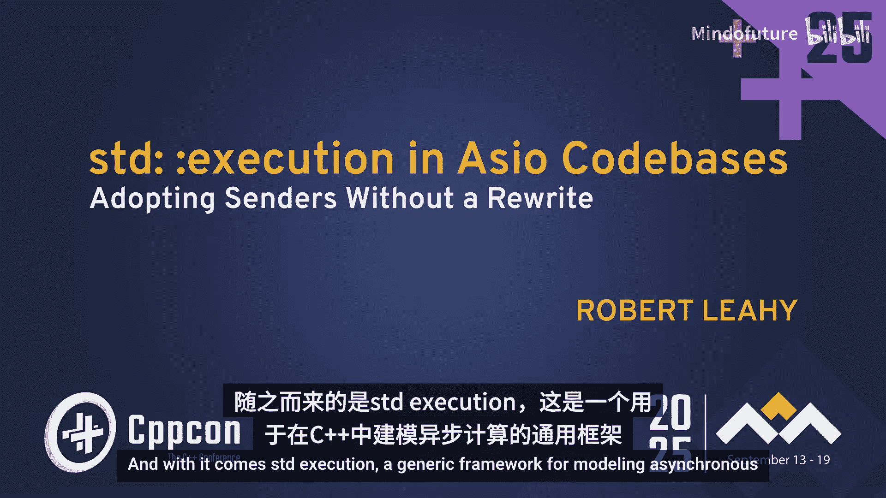
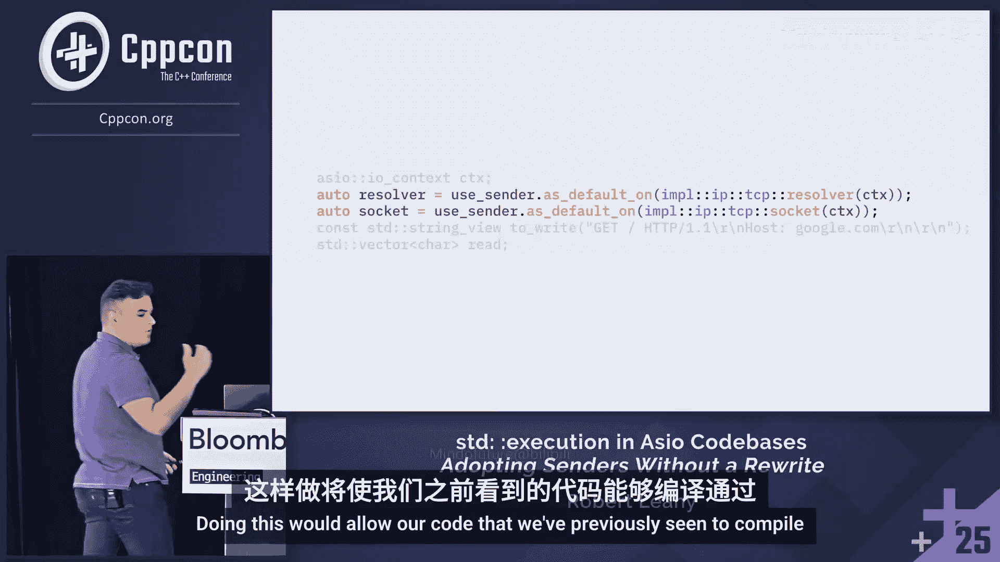
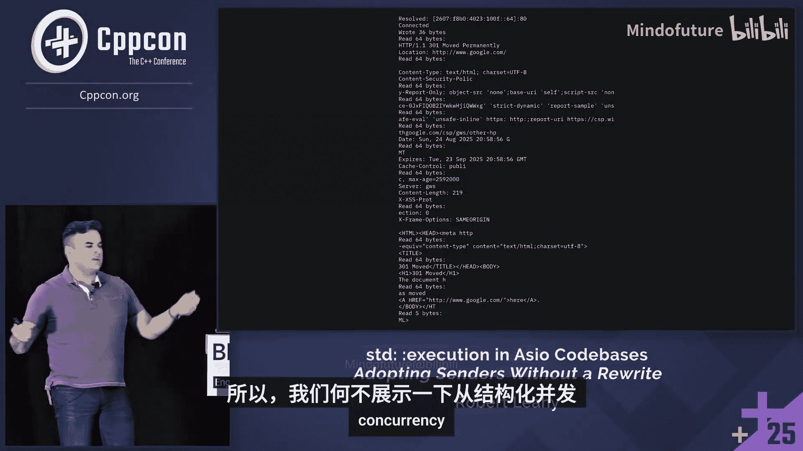
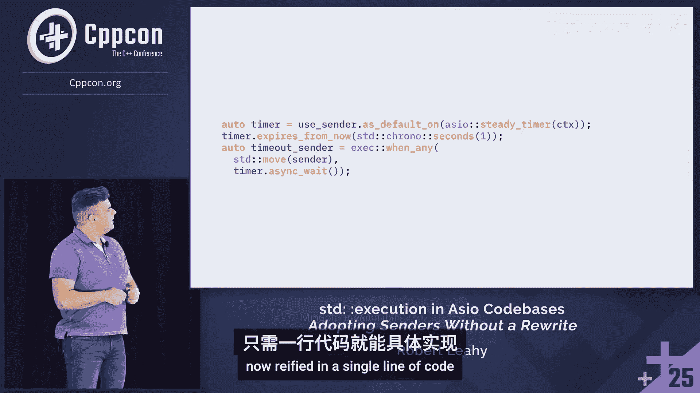

# Cppcon-2025-｜-C++-｜-C语言--｜-汇编-｜-编译器-｜-操作系统-｜-Linux-｜-Windows-p16-P16_在Asio代码库中采用stdexecution_无需重写即可使用发送者-Robert_Leahy-CppCon_2025--BV1wyPBzrEeu_p16-

C+ plus 26 is upon us。And with it comes stood execution。

 a generic framework for modeling asynchronous computations in C plus plus。

But this is not the first time an effort has been made to model asynchronous operations in C plus plus Es to do this extend at least as far back as the release of AO in 2003。

Thereafter， Asiaia was reshaped into the networking T， S and proposed for standardization。

 It became intertwined with p 0，4，4，3 unified executors。

 But then this threat of standardization died out。 St execution appeared on the scene。

 And now it is gone the whole way being voted into the working draft of C plus plus 26 last year in Saint Louis。

Which leaves us in an awkward position。 We've now adopted something into the standard that is different than the de facto industry standard for the last two decades or more。

Which leaves us with a question。 How are we going to adopt the new thing。

 We have 20 years of code written under the new model。

 We're not going to go and rewrite all of that proven， tested。

 deployed working code just because the Standards Committee took a vote。But at the same time。

 there are compelling reasons to use to execution。 We want to take advantage of those。

 So how do we reconcile these two things。What if we could have our cake and eat it， too。

 What if we could start out writing a program that looks like this。

 a form familiar to everyone who's ever written a nasO program。

 They probably inferred by now that we are writing a program which submits an HP request and reads the response there too。

But what if the familiarity to people used to writing AO could end there。

 What if we could just bootstrap on top of this functionality that we've had for two plus decades and turn around and just start writing stood execution code。

 So we want to perform a sequence of operations。The first operation， of course。

 is to resolve some host name and to do so in a way that looks familiar to people used to Aio。

 But the embedding of this is unfamiliar。 It's now embedded inside of stood execution。

 And we can take advantage of stood execution and say that after we resolve the address。

 we want to turn around and we want to connect our socket。With our socket connected， of course。

 we need to write the request there too。 And thereafter。

 we're going to need to loop to read the entire body。 First。

 reading some bites into our buffer and then maintaining the buffer and deciding whether or not we're finished looping。

But before we decide whether or not this story is plausible。

 maybe we should actually understand sends and receivers at AO。

 understand the two ecosystems we are discussing。And to do this。

 I actually want to begin by discussing neither of these。

 I don't want to discuss sends of receivers or Asio。 But instead。

 the humble synchronous function call， something we all know and love and understand。😊，Of course。

 at the core of this model is a function， but a function doesn't do anything on its own。

 It's simply a latent collection of instructions in order for it to do anything。

 It needs to be brought together with a call site， somewhere from which it is called from which the ability to make forward progress may be delegated。

But this is insufficient。 But synchronous function requires some space in which to perform work。

 It requires a stack frame to store all of the variables it has with automatic storage duration。

But this is just data layout。 And the point of a function is to actually do something。

 And so we need to move to the moment where at the ability to make forward progress is delegated thereto。

 The function runs to completion。 It returns the results through to the call site from which it's called completing the cycle on the diagram。

But there's a problem with this formulation in regular C plus plus function calls。

 we actually can't observe the difference between these bottom two entities。

 We just write a function call anatomically， from our point of view， a stack frame is allocated。

 and we jump into the function。But this conceptual decomposition still has value。

 as we're going to see in a few moments for the time being。

 let's look at an example of a synchronous function。

 something anyone who's ever written low level I O is probably familiar with。

 Sting together partial reads into one total complete read。But this is not a talk about I O。

 The particularities of this function are not germane to this talk。

 Let's focus on what's important here。 We receive a parameter。

 and it is reified as a variable with automatic storage duration。

 Then we can make use of it freely throughout the remainder of the function。

 without worrying about whether it is within or without its lifetime。

 We can assign to it over and over again。 We can use it as scratch storage to effectuate our operation。

Now， let's consider asio at the core of the asO model is an initiating function。

 A regular synchronous function with a special property。

 The special property is that upon the successful completion， thereof。

 there is an asynchronous operation outstanding in the background。😊。

But this formulation implies that we can complete the operation after the return from the synchronous initiating function。

 And so simply selecting a call site is not sufficient。

 We need to bring the initiating function together with a completion handler。

 an invocable it can invoke to pass all of the values synthesized by the operation。

With these two brought together， the result is an asynchronous operation， which upon its completion。

 of course， invokes the completion handler。But this diagram looks dissimilar from the one we just saw for the synchronous domain。

 We are lacking that free local storage as an endemic part of the model。

 But then we remember that synchronous functions also hid this storage from us。

 It was hiding upon that lexically atomic allocation of the stack frame and jump into the function。😊。

Maybe the same is the case for Asiaia as well。 Maybe this free storage is just hiding inside of the model。

 But alas， that's not the case。 Asio actually lacks this。 And as we move on to an example。

 Asio function， which does exactly the same thing the synchronous function we reviewed earlier does。

 We can see this if we focus only on the parts of the code that are important。

 We can see that I capture the stand in a lambda， I declare declare that lambmbdautable。

 And then I repeatedly modify that member of the lambda。

 The lambmbda is moved around into successive operations。

 it's not stable in memory because asio lacks this property。 synchronous functions have。😊。

Enter now stood execution at the core of its model is a sender。

 the asynchronous analog of a fully cur function。But just like a function。

 it doesn't have motive force on its own。 It can't make forward progress until it's brought together with the context to which it reports its completion。

 a receiver。 hence the colloquial name of this model， senders and receivers。

 a sender and a receiver are connected， and the output of that operation is an operation state。

 This is the asynchronous analog of a synchronous stack frame， local stable storage。

 the operation can rely on throughout its lifetime。 But critically， unlike the synchronous domain。

 we can independently observe the allocation of this storage。

 when we call connectedly get back an operation state。

 we are under no obligation to start making forward progress on the asynchronous operation represented thereby。

 Instead we can defer this for any amount of time we desire。

 But once we call start on the operation state， an asynchronous operation results。

 It drives through to completion。 and it sends a completion signal to the receiver。

In keeping with the pattern we've established heretofore， we can， of course。

 reserve a senders and receivers implementation of read。 But once again。

 the exact particularities of this code are not germane for our purposes。 Instead。

 we merely look at what we care about。 We see that I use let value to allocate a span inside of my operation state。

 This reference is guaranteed to be valid for the remainder of the asynchronous operation。

 And so I can use it with confidence in a way that is not just similar to the synchronous domain。

 but is lexically identical thereto。Now that we understand these two models。

 we can consider the fundamental question of this talk。

 How can we integrate these two together As we think about the example that we saw earlier。

 we were calling asio operations from stood execution。

 So maybe we should start this with the stood execution model。

 a sender and a receiver and an operation state， but ones which have a special structure。

 when we call start on the operation state。 It synthesizes a completion handler。

 passes it to an initiating function。 And， of course。

 in accordance that we understand about the asO model。 The result is an asynchronous operation。

 It completes and invokes the completion handler。 but we selected the completion handler。

 We synthesized it。 And so， of course， we implemented it to send a completion signal through to the receiver。

😊，Let's take a stab at raifying this in code。 Let's write a factory which makes an asio sender and accepts the initiation。

 a unary invocable awaiting only the selection of the completion handler In accordance with what I said about senders being fully cur versions of synchronous functions。

 We， of course， just cur the arguments into a sender and we return it。 This， of course。

 raises the fundamental question of what exactly is inside that sender。

 And so we peer inside that as well。 We see that it opts into the concepts machinery of stood execution by providing the needful nested type alias。

 It， of course， has a data member for the initiation。 It is curing。

 and then it's connectable to a receiver。 It has that fundamental basis operation of a sender。

But this just reorganizes our data further。 We now take our initiation and the receiver。

 and we put it together into an operation state， and we return that operation state via C plus plus 17 guaranteed R VO。

 bringing us， of course， to our next question。 What does that operation state look like。

 It opts into being an operation state once again through a needful nest to type alias。

 And now has two data members instead of just one。 Then it has the fundamental operation of an operation state。

 Start The thing that causes asynchronous forward progress to actually begin We go。

 and we invoke the initiation， and we provide it with our completion handler。 which， of course。

 takes all of the value synthesized by the underlying easy operation and forwards them perfectly down the value channel to the receiver thereby completing the operation。

😊，I've been up on stage for less than 10 minutes。 And apparently。

 we've already married A ZO and stood execution。But then we look at this code further。

We notice something curious。 I've declared this function， no except。

 but initiation is something I accept generically。I didn't establish any properties thereof。

 I didn't check to see if I could invoke it without throwing exceptions with my completion handler。

 This implementation can throw an exception and cause to terminate， which is decidedly unergonomic。

And you might think to yourself， well， of course， we will just strike the no except or we will make it computed。

But this is not a workable solution either。 Start is the point where at you transition from the synchronous domain to the asynchronous domain。

 Synchronous reporting mechanisms become unavailable to you。

 Synchronous reporting mechanisms such as， for example， throwing an exception。

It is incumbent upon the implementation of start to use only asynchronous reporting mechanisms。

 such as， for example， catching its own exceptions and directing them down the error channel to the receiver。

But while weve solved one problem， this raises another problem。Previous。

 our wrappper had a nice property。 It completed in exactly the same ways as the underlying AO operation。

But now we've gone off and we've added a new way in which it can complete through the asynchronous analog of the synchronous throw。

How do we document this and expose this to our users generically， After all。

 our understanding of the asynchronous domain heretofore has been rooted in theynchronous domain。

 and synchronous functions have a function signature。 We can look at it， and we can see the values。

 if any returned therebyby， and we can tell based on whether or not they are annotated。

 no except if they have an error channel and can throw exceptions。And so， of course。

 being a generic ecosystem， stood execution has a solution to this。

 You document the ways in which your operations complete by instantiating stood execution completion signatures。

 Here we can see an instantiation which communicates that the corresponding operation completes successfully transmitting a single integer and erroneously via the asynchronous analog ofchronous exception throw by sending an exception puter down the error channel。

😊，But in stand sheeting， a class temple， doesn't get us anything。

 What we actually want is that association。 And so now we discovered that we haven't completely explored the interface surface of a sender because senders also need to document the ways in which they can complete by providing the con eval static member function get completion signatures whose return type documents the way in which the corresponding operation would complete。

But as we look at this， we haven't satisfyingly answered the question here either。

 I've elied the template argument list of stood execution。

 completion signatures and replaced it with question marks。

And this is because of the formulation I laid out earlier。

 We complete in all of the ways the underlying AO operation completes plus set error with an exception puter。

Which raises the question of how do we generically discover the way in which the underlying AO operation completes。

 in turn。And the answer to that is the same as the answer in this domain。

 When we looked at an asio initiating function earlier。

 it wasn't actually a docnaaire conformant asioinitiating function because it directly accepts a completion handler。

 And so in order to make it conforming， make it what people expect when they are participating in the Asio ecosystem。

 We need to a form a change a variable。 We need to rewrite the function signature。

 So rather than accepting a completion handler， we accept the completion token。

But this transformation on its own hasn't really gotten us anything。

 As we can see by examining the code。 We now have a use of H。

 but we've never declared H since I got rid of it。 And the reason for this is because adding a level of indirection is insufficient。

 If you don't actually go through the indirect， excepting something that should be resolved via a customization point is useless if you don't defer to the customization point。

 And in this case， that is async initiate。And immediately， we noticed something asych initiate。

 our customization point， receives the logic by which our operation is initiated as a lambmbda。

 It can determine where and when and how it invokes the lambda and therefore。

 where and when and how it begins the asynchronous operation。But something else has happened too。

 We've received a declaration of H。 But more importantly。

 this declaration flows from the implementation of Async initiate。

 Whoever is on the other side of that customization point not only gets to select how the operation begins。

 but also how it completes。But we've gained more from this transformation because we've customized the initiating function in another way。

 We've customized the value that it returns， and we've allowed Async initiate to select that as well。

 We are no longer married to returning void。😊，And lastly。

 in our journey through this transformation of our initiating function。

 we have forced the author of the initiating function to document generically all the ways in which their operation can complete。

And so now we need to reformulate our understanding of how we're going to adapt AEO and so execution to account for this to use these completion tokens。

 which allow us to so completely customize AO operations。😡。

And so we return to our diagram of the AO ecosystem， and we update it with this new understanding。

 We now understand that initiating functions don't accept completion handlers。

 They instead accept completion tokens。And we understand the completion token is able to customize every element of the initiating function。

And so we imagine that maybe the completion token， we suggest so completely customizes the initiating function that is induced to return a sender。

And if it does this， of course， we just get the rest of the stood execution ecosystem for free。

So let's take a stab at doing this。 Let's declare a completion token type and an instance thereof for convenience。

But as I said earlier， this gets us nothing If we don't actually go and provide the implementation on the other side。

 And so we specialize async result to provide our implementation。

 We see at the very top of the slide that we're getting that critical information we were missing earlier。

 We are receiving all of the signatures documenting generically all of the ways in which this AO operation completes。

Moving into the static member function， we see we received the initiation。

 the instance of the completion token selected and arguments that need to be cured into the initiation。

 And so dutifully， we perform this Korean。 We formulate F。

 which curries the initiation down to a unary invocable。

 awaiting only the selection of the completion handler。😊，Thereafter。

 we once again curry our arguments into as sender， but that sender is enriched by transforming the asio signatures to the form expected by stood execution。

 We provided that vital context。 It was missing earlier。But this raises a bunch of questions。

 There's a bunch of code。 we're going to have to modify in order to make this work， such as。

 for example， providing the template meta programming necessary to transform those signatures at the top of the side。

 you can see the transformation for each of the Aio signatures。

 which simply changes the return return type of the function type from void to stood execution set value D。

 thereby documenting in the stood execution domain， that this is a successful completion。

At the bottom of the slide， we apply this transformation to all of the Aio signatures。 and then。

 of course， critically， we append stood execution set Er T have stood exceptionception puter。

 since we are enriching that set with the asynchronous exception throw that started us down this path。

Now， we need to walk through our code and we need to update it with this understanding。

 We need to provide get completion signatures on our sender。

 but we also provide a constrained version thereof。 recall and connect。

 We need to propagate the initiation from the sender into the operation state。

 There are certain C and ref qualifications with which this may be impossible。

 Imagine we have an initiation， but that initiation is only movable。

 But someone tries to l value connect our sender， which would require us to copy the initiation。

 This is clearly impossible， And so we detect the scenario here。

 and we neglect to produce completion signatures in this instance。Carrying on in this vein。

 we move on to connect， which still accepts the receiver and still moves data through to the operation state。

 but is now constrained to require the provided receiver be able to accept all of the completion signatures we emit。

But notice something subtle here。 I determine the completion signatures we emit by deferring to stood execution completion signatures of D。

 This， in turn， tries to evaluate the function I just showed you on the preceding slide。

 thereby transitively pulling in all of the constraints thereupon。

Which brings us back to the operation state， which remains undisturbed by this transformation。

We stare at it for a while， and maybe we notice something else。

 Maybe we decide to think about the question that set us down this path from the opposite point of view。

 Earl， we were concerned that the initiation might throw an exception。

 and this might call terminate because we were throwing into no except。

 And so we added this unconditional try catch。But what if our consumer is providing an initiation they know never throws an exception。

 Now， we are requiring them to provide an error channel on the receiver that they know will never be taken。

But then we realize something。 We take a step back and think about what we're doing。

 And we realize that we are obsessing over the initiation of an asynchronous operation。In some sense。

 that is the least interesting part of an asynchronous operation。

 We poorly reach for asynchronous operations because we want the asynchronous parts that run in the background。

 And so maybe if the asynchronous parts running in the background can throw an exception in the asial model。

 we don't need to worry about this question。 It's irrelevant whether or not the initiation throws if the asynchronous parts are always liable to throw an exception and therefore。

 we're always liable to send said error with an exception。 Puter。

And so we go back and we look at our initiating function for read。

 and we notice that the asynchronous part， which rents at the completion of each asynchronous read is just regular C plus plus code。

 This isn't some sublangu of C plus plus any C plus plus code can be written here in。

 And so maybe I look at it and I look at my use cases。

 And I decide these completions that are erroneous。 They're actually exceptional。

 I don't want to model them with error codes。 I want to be a doctrinare or C plus plus programmer and of course。

 render them as the exceptions they ought to be。But now we have a problem。

 We have an issue for initiating functions and regular synchronous functions。

 We understand very well what happens when we throw an exception。 The exception is， of course。

 propagated to our call。But now we're throwing an exception in the asynchronous part of an asynchronous operation。

 Who is our caller， Who sits above us on the call stack。 Who are we throwing this exception to。

And the answer to that lies in the way in which Asio obtains the ability to run asynchronous parts。

 It lies in executors， the place the asynchronous parts of operations run。

 a policy by which that may be obtained。And so now we need to understand what's actually happening here。

 Wed understand how the executor or the execution context that underlies it actually gets the ability to make forward progress because as we reviewed earlier。

 the ability to make forward progress needs to be delegated to something。

 It doesn't just appear out of thin air。😡，So let's consider a simple example。

 when we try to initiate a single asynchronous operation directly from Maine and drive it through to its completion。

 Of course， we know that in the AsO model， we need to get the operation started。

 And so we call the initiating function， which is just a regular synchronous function。 We understand。

 well， what would happen if this through an exception。 But let's imagine it succeeds。 It succeeds。

 of course， and returns。 And there is an asynchronous operation outstanding in the background。😊。

But what does that actually mean， It's outstanding where， who's going to run and。

 What do we need to do in order to induce it to complete。

And the answer to this in most as applications is that we need to go to the execution context and we need to delegate the ability to make forward progress thereto。

 We need to call run thereupon internally run has special structures such that it waits for asynchronous parts to be ready to execute and execute them。

And so， of course， it is run， which invokes my completion handler。

 When I throw an exception from my completion handler， it is thrown to run。

 and it is handled by run in accordance with whatever policy that execution context and executor provides。

 It may simply neglect to run the operation any further。 It may do something else entirely。

 But unfortunately， this formulation doesn't mesh with the requirements of stood execution。

Stoood execution brings us something known as structured concurrency。

 the asynchronous analog of structured programming。

 and just as you wouldn't expect calling a function in your code to cause execution to jump to some other unrelated part and resume there and never return from the function。

 so too， when you initiate an stood execution operation。

 that operation is required to report completion to you at some point。😡。

But this formulation I've just laid out of exceptions being handled in an executor specified manner doesn't mesh with this Forward progress can simply be abandoned。

 Completion can never be reported because AsO implements what is known as unstructured concurrency。

And so now it is incumbent upon us to figure out how we are going to layer the guarantees of structured concurrency on top of this。

 how we were going to implement it in terms of unstructured primitives。

Let's return and look at our call stack。The completion handler is throwing to run only because it is run that invokes the completion handler。

 What if we can inject some logic here。 What if we can inject our own call frame。

 our own rapper lambda around the completion handler。

 Then we would be able to handle any exceptions thrown thereby in any way that we want。

 We could direct them through to the receiver。 Send them down the error channel thereto。And in fact。

 we could turn around and we could say that we are the ones implementing an executor。

 and this is the executor specified way in which we handle exceptions， we handle exceptions。

 satisfying the guarantees of structured concurrency。But， of course。

 this confronts us with a problem。 In order to actually do this。 we need to write a P 0，4，4。

3 style one way executor。 And so we start doing that。 Our executor has two members。 Of course。

 it has some reference back to the operation state， because that's where the receiver lives。

And then it wraps the underlying executor because we're not interested in customizing all of the ways in which asynchronous parts execute just this one particular way about how exceptions are handled。

P 0，4，4，3 style executors must be comparable。 And so we provide operator equals equals。

 which brings us to the fundamental operation of a p 0，4，4，3 style， one way executor。

 The unary member function execute， which receives a nury invocable and invokes it somehow invokes it in accordance with whatever policies are embodied by this executor。

And so， of course， the simplest implementation is to simply defer to the executor we wrapping。

But then we remember something。 We have no guarantee that calling execute on our inner executor doesn't throw exceptions。

 The whole reason we're doing this is to cash exceptions and direct them down the error channel of the receiver。

 And so we do exactly that。But then something else occurs to us。

 The executor underlying us embodies whatever execution policy it embodies。 We know nothing about it。

 Maybe that policy is to take the work and place it on a queue and later decu it and invoke it somewhere that's not underneath us on the call stack。

 In that instance， this catch will not catch exceptions thrown thereby。

 And so it's insufficient to wrap on the outside。 We also have to intrude inside Ex execute and wrap there and as well。

😡，Of course， this is insufficient to fill out the required interface of a P 0，4，4。

3 style  one way executor。 But none of that is germane to this talk。

 And so I'm going to simply avoid it。For now， we need to concern ourselves with how this class we've just written actually gets injected into the Aio ecosystem。

 How do we tell A Zio needs to use this to invoke the asynchronous parts of our operation rather than any other executor it was going to choose anyway。

 And the answer to this is that we need to write an associateator。

 We need to associate our completion handler with a strategy for obtaining an executor so we can customize it at every level of analysis。

 Earl， we saw something akin to this when we specialized asynch result to provide an implementation of asnc initiate。

 And so now we specialized associated executor to provide an implementation of get associated executor。

But we see that this requires a completion handler type we can speak。

 which is something we're going to worry about in just a moment。For now。

 let me draw your attention to the implementation of get。

 We taken our completion handler and whatever fallback executor Asio was going to use anyway。

 We wrap both of them up into our executor and return it。

 thereby causing Asio to customize the way in which it invokes asynchronous parts at every level of analysis。

 We've now succeeded at catching all those exceptions and redirecting them through to our receiver。

Of course， this requires us to have a completion handler type。 We can actually speak。

 And so we go ahead and do that。 We extract the body of the lambda we were using into the function call operator。

 We provide a pointer back to the operation state。 And then， of course。

 this would be useless if we didn't turn around， look at our operation state actually take that Lambda and replace it with our completion handler。

 As this completion handler sinks into Asio。 It now carries along with it。 The customization。

 we just defined Asio is induced to use our executor。 Our logic at every level of analysis。

But if throwing an exception can cause AO to stop making forward progress on an operation。

 why do we imagine that throwing an exception is the only way in which AO can be induced to stop making forward progress on an operation。

And as we think about this。 and we look at deployment experience with Asio。

 we realize this isn just some arcane concern。 The modal way that I have seen well written working Asio applications effectuate shutdown is a simply stop calling run and the execution context。

 Let des run， never make forward progress on the operations ever again。

 gracefully clean up all of the resources and exit the scope。

 This isn't something asio programmers do because they are bad programmers or they write programs that don't work。

 This formulation works perfectly in Asio applications。

 I've personally written multiple Asio applications。

 which are probably running in production right now that exit in exactly this way。

 And so it's insufficient for us to handle just abandonment via exception。

 We need to handle abandonment for any other reason as well。

 And so maybe rather than it discovering the whole problem domain。

 we take a step back and we look at the totality of it。

 We look at the outcomes of any asynchronous part of our Asio operation。 Of course。

 in the happy case， the operation is finished and we don't need to worry anymore。

 In the slightly less happy case。 we were just。menting one part of the overall asynchronous goal。

 and the operation is still ongoing， and we can deal with finalizing it later。

Which brings us to what we were just reviewing。 We were just reviewing exceptions。

 but then we noticed those brackets。 We noticed that we've missed something。

 which is that we've only handled exceptions that come with abandon it。

 What if an exception is thrown and that does not indicate the asynchronous operation will no longer make forward progress。

 Imagine you have some high level asio operation。 and it's composed of two operations that it starts and allows to run at the same time。

 You run some asynchronous part， But， of course， that's only part of one of the sub operation。

 It throws an exception。 That sub operation has been abandoned。

 but the total asynchronous operation hasn't been。 There is still another outstanding operation。

 And so in this instance， it is unsafe for us to send that error immediately。

Then we have that newcomer。 We have just abandoned it for no reason。

 We need to raify this as a new kind of completion signal by sending stood execution set stop to the receiver to indicate that forward progress has been abandoned。

And so now we have to move on， and we have to look at our code through a new lens。

 We previously wrote this code so assured that we were handling all of the edge cases。

But what happens if this initiating function goes to goes to initiate two operations that only throws on initiating the second one。

 There is still an asynchronous operation outstanding in the background。

 And so it would be inappropriate to finalize a wrapper in response thereto。

And so all we can do at this point is hopelessly write down the fact an exception occurred and hope that maybe later we'll figure out what to do。

 Of course， we can't write the exception down if we don't have a member for it in the operation state。

 And so we do that。 But that is not the only place we've raified this incorrect assumption。

 We've also done that inside of our executor in both of these places。 And so once again。

 we simply write down the fact that exception has happened。

 Thr our hands in the air and hope that we're gonna to figure out how to deal with it at some point。

But handling exceptions wasn't the only thing we introduced。

 We also introduced the idea of generalized abandonment。

 And so we provide some way for that to be communicated through the operation state。

 And then for reasons， it will become only partially clear later in the talk。 And unfortunately。

 for Ben， I throw in a recursive us。😊，But before we go off and we start using the operation state。

 Willie Nilly， we need to admit the fact that the operation state itself has a lifetime。

 a lifetime which is analogous to the lifetime of a regular synchronous stack frame。

 Anyone who's ever accidentally written a dangling reference knows that when you return from a synchronous function。

 the stack frame is cleaned up。 And we've defined our asynchronous ecosystem by analogy to the synchronous domain。

 And so when we send a completion signal through the receiver that is like returning from a synchronous function。

 Thereafter， we can't depend on the operation state being within its lifetime。

 And so now we need to turn around and look at the outcome of every asynchronous step through the lens of what it means for the lifetime of the operation state。

 previously， I said the operation completing was the happy case But if the operation completes。

 we can't regard the operation state as being within its lifetime。

 And so we can't go inspect all of those needful members we've added which journal the current state of the operation。

But going down the slide in the other two cases， it's critical that we do this。

 It's critical we determine whether or not the operation has been abandoned。 But to do that。

 we need to look at a member of the operation state。

Which brings us back to our diagram of our ecosystem。

 the way that our raor lambda invokes every single asynchronous part of the operation。

Which brings us back to the analogy that I've been talking about。

 The analogy between the synchronous stack frame and an operation state。

 I'm up here obsessing about the lifetime of the operation state。 But this raper Lada。

 which we need to communicate with to tell it whether or not the operation has been abandoned is a synchronous function。

 It has a regular synchronous stack frame。 And in that stack frame。

 it can store local variables with automatic storage duration。😊。

And so maybe it goes ahead and does that。 It goes ahead and does that。

 But it tells the operation state where that variable is。

 So the operation state can now communicate with it in a way that is guaranteed to be within its lifetime when we unwind and inspect it。

But this diagram on the slide isn't canonical。 It's not the only possible call stack。

 We could have this raified reenterly。 What would we do then。 Well。

 that upper rapper Lada is also just a regular synchronous function。 It has its own stack frame。

 It has its own variables of automatic storage duration。

 And so we just make an intrusive linked list。 We let the operation state know where all of the states waiting on the outcome of the completion handler are so that they can go and it can communicate with them whether or not the operation is completed and whether or not is safe or unsafe to regard the operation state。

Let's reify this in some code。 We go ahead and we create a frame type。 And， of course。

 since what I said earlier， we need to enrich our operation state with an intrusive linked list thereof。

But that doesn't tell us what frame actually does。 And so we go when we crack open frame。

 and we can see immediately that derives from S list base hook。

 allowing it to participate in this intrusive linked list。

 It has a pointer back to the operation state。 And this is critical。

 This is not a reference back to the operation state。

 It is a pointer when we realize the operation is completed。

 And it's no longer safe to access the operation state。

 We can set it to null and make it impossible for that to happen。Since we're guarding a state。

 we go ahead and we delete our copy and move operations and we provide a convenience operator pool。

 which allows our consumers to detect whether or not the operation has ended。Moving on。

 we have a constructor， but we don't just populate our self pointer。

 We also become a lockguard on the recursive mutex。 Then， of course。

 we go when we add ourselves to the intrusive linked list in the operation state。The operation state。

 which needs to be able to notify us if the operation is completed and deactivate us。

 And so we provide a release function that does exactly this。

 We pop ourselves from the intrusive linked list。 We unlock the view text。 And then finally。

 we set self to null to ensure that it's impossible for us to go out and look at the operation state。

😊，But none of this answers the fundamental question for which we wrote this type， which is。

 how do we know when we send exceptions and stop through the receiver。

 And that logic is raified in perhaps the most complicated slide in this entire talk。

 which is the destructor of frame。 If self has already been cleared。

 has already been set an null putter， the operation has already completed。

 And so there is serptitiously no work for us to do。 On the other hand， If we do have work to do。

 We go over and remove ourselves from that intrusive link list。

 We don't want to have a dangling pointer to ourselves。

Then we compute whether or not we should be the ones to actually complete this operation。

 whether it is incumbent upon us to complain it to provide the guarantees of structured concur。

 If there are no frames left， we are the last person participating in the ecosystem。

 And so we check to see if we've been abandoned。If we have been abandoned。

 we are the last part of our ecosystem participating。 If we don't finalize the operation。

 no one ever will。 and we will have run afoul of the guarantees of structured concurrency。😡。

And so we release the lock and we check whether or not we should complete。 If we should complete。

 we check for a stored exception。 If we find it， we complete with an error。 If we don't find it。

 we send and set stop through to the receiver。But in doing this。

 we've done something that we've done earlier in the talk。

 We have enriched the set of ways in which our operation can complete。 And so immediately。

 we dutifully go back to transform signatures， and we enrich it to document the fact that we also send set stopped。

With this in mind， we can now go visit those pieces of code that we left behind earlier。

 We wrote down that an exception occurred， but we didn't understand what logic we needed to implement in order to send that exception through only when appropriate。

But now we know exactly what to do。 All we need to do is construct a frame object and let its lifetime end。

 and it will take care of everything else for us。Of course。

 this is not the only place that we did this。 We also did this in our executor。

 And so now we simply go and create two local variables。

But this isn't helpful if the completion handler isn't participating because the completion handler is at the center of this。

 And so now we need to give it bona fide constructors until you want complicated logic to construct and destroy it。

 when it's created and， of course， populates the pointer。

 But now we enrich the move operation so that only the most transitly derived completion handler has a non null pointer to the operation state。

 This is completely acceptable， because Asu only requires the completion handlers be movable。

 And so as the Asu operation moves it around， only the most recently created。

 one will have a non null pointer will be controlling over the operation state。

 All of the other ones will be deactivated and their lifetimes could end without any consequence。

Speaking of which we actually need to implement that logic。 And so in our deor。

 we check the pointer back to our operation state。 And if it is truthy， we may need to finalize。

 This is being abandoned。 And so we construct a frame。 So when it goes out of scope。

 we'll perform the finalization logic。 If any， we go to the operation state and we say that it has been abandoned。

But this is all just scaffolding around the unhappy case。

 What about the happy case when the operation actually completes successfully， In this case。

 we acquire our lockguard。 We go to the operation state and we release every single stack frame currently participating in the ecosystem。

 We tell them they have nothing left to do as we unwind with this done， we drop the lock。

 We grab a reference to our receiver。 And we know the pointer inside of ourselves there by deactivating our deor and ensuring the only way in which we'll complete this operation is on the very next line where we send stood execution set value through to the receiver。

😊，And in completing this， we've actually succeeded in projecting the guarantees of structured concurrency on top of the unstructured primitives of Asiao。

But that's a double edged sword。 The formulation I gave earlier for Asia。

 where you can just walk off and let thes run is convenient。

 You decide you're no longer interested in the execution。 You can just walk away and let thes run。

 But structured concurrency doesn't just guarantee you that operations will complete。

 It also makes an incumbent upon you to wait for those operations to complete before you move on。

 This is how we're guaranteed that operations states remain within their lifetime for the duration of the asynchronous operations with which they are associated。

But what happens if you start some operation and it runs for a long time。

 And you decide at some point thereafter， you are not interested in the results of that computation。

You now have your hands tied by the guarantees of structure and concurrency。

 Despite the fact you no longer care about that computation， You need to wait for it to complete。😡。

Anyway。Which brings us to the final piece of marrying these two ecosystems。

 the need to marry together the ways in which they raify cancellation。And fortunately。

 both of them support mechanisms for accomplishing this。 In the case of stood execution。

 This is accomplished via stop tokens。 A receiver carries along with itself an environment。

 We can interrogate that environment as to its stop token， and then on the stop token。

 we have two important basis operations。 We can interrogate it as to whether or not a stop has already been requested and we can use it to form an association between that token and an invocable such that when a stop is requested。

 the invocable is invoked and whatever action it raifies is taken eagerly。😊，Azio， on the other hand。

 realized this through cancellation slots and signals。 A cancellation signal is emitted。

 and the corresponding cancellation slot then invokes whatever handler it holds， if any。

With this out of the way， we can take a look at how we're going to glue these two ecosystems together。

 We， of course， start with the receiver since that tool we receive from our consumer in the stood execution ecosystem。

 from that receiver， we can， of course， generate an environment from that environment。

 we can source a stop token。 and using that stop token。

 we can forge an association with an invocable known as a stop callback such that we get to eagerly take some action when stop is requested。

 Of course， the action we can take can easily be emitting a cancellation signal into Asio。

 a cancellation signal， which Asio knows about because we associate its slot with a completion handler。

😊，Let's take a look at how we actually raify this in code。

 Let's take a look at what we're gonna to have to add to our operation state to realize this。

 We have our invocable structure on stop request。 And then， of course， we have a cancellation signal。

 Thereafter， we have an optional stop callback， a stop callback type synthesized by going to our receiver interrogating at its Sw environment interrogating that environment as to its stop token and then interrogating that stop token as to the type of callback that needs to be formed to associate it with our onstop request type。

Which raises the question， of course， with what that onst request type looks like。

 a simple invocable which acquires the recursive mu text and then emits a cancellation signal into asio。

And this raises the question of why we need this recursive muttex。

 And the answer to that is because Aio says so。 Unlike stood execution。

 Asio says that if you thread unsafely emit a signal with respect to all of the other elements of the operation being canceled。

 You have undefined behavior。 Fortunately， earlier in the talk。

 we wound this recursive muttex through every part of our ecosystem。 And so while we hold it。

 we know we're not racing with any of the other asynchronous parts。

 We can emit the signal with confidence。But this is insufficient for us to glue these two ecosystems together because we're relying on the presence of a data member。

 which is optional。 And so we go back to the place where we initiate our operation。

 and we enrich it with logic to populate that optional。

 to construct our stop callback by getting the appropriate stop token and associating with an instance of onstop request。

 Note that here we take advantage of that convenience member of frame that lets us interrogated as to whether or not the operation is already completed。

 If frame is falsey， star this may be outside of its lifetime and so it would be inappropriate to go and regard its members。

 Otherwise， it is incumbent upon us to do this。But this raises the obvious question。

 Why am I deferring this construction， Why do I simply set this up in my constructor。

 Why do I need to get optional involved， And once again， this is because Aio says so。

 Aio says that if you emit a cancellation signal into an operation before the return from its initiating function。

 that cancellation signal can miss and have no effect。

 All of the work that we did to ensure that we can stop operations to move on with our lives would be for naught as that cancellation signal。

 sails into the abyss and the operation runs on untrammeed thereby。😡，But， of course。

 this still is insufficient because we still haven't published that cancellation slot out to Aio。

 And so we write an associator for the second time in this talk。

 associating our completion handler type with a cancellation slot。

 Our get member function simply goes to the operation state。

 goes to its cancellation signal and returns the slot， thereby integrating this in to Asio。😊。

But Asiaio isn't the only ecosystem that has arcane requirements。

 So execution has some arcane requirements of its own。 Earl。

 we discussed at length the asynchronous lifetime of an operation state。

 The fact we can only assume it's within its lifetime while the asynchronous operation is running up until the exact moment at which we emit a completion signal。

 And the standard also requires that we raify this with respect to stop tokens。

 We are only allowed to use the stop token associated with a receiver from the time start is called into immediately before we send a completion signal through to the receiver。

 And so we want to raify this requirement as well。 It is not only incumbent upon us to defer construction of our stop callback。

 we also have to eagerly destroy it before our operation completes。

And so we go on a last minute tour of all the places we complete our operation。

 We look at where completion happens and we simply enrich it by resetting the optional。 Of course。

 we complete our operation for more than one place on our code。

 And so we go and look at the other place in our code， and we similarly enrich it。😊。

Now we've actually completed all of the code that marries these two ecosystems。😡。

But where does that leave us， I started this talk out by showing you some example code。

 And then we went off and we explored the depths of the asynchronous models of stood execution and Asio。

 What does all of this mean for that code we were aiming at for the entire talk。

 the code that we actually want to make work， the ability to call all of those asio operations natively from stood execution。

And as we stare at this code， we notice there's a problem。

 We notice the way in which we initiate all of the asynchronous operations belies what we know from the talk。

 We know that initiating asynchronous operations requires a completion token。

 but we haven't stated one here。😡，But as we go back to our setup code。

 we can enrich our understanding by knowing something else about Aio。

 When Asio selects a completion token， you can， of course， provide one explicitly。

 But if you don't provide one explicitly。 And the executor associated with the IO operation upon which you're performing the operation。

 has a default completion token。 It will simply be used。

 And so we can take these IO objects and we can red their executors to an executor which has our completion token as a default。

 Now， we don't need to state it， we can simply call the asynchronous operation only with its needful parameters and have it used to execution by default。

Or at least we would be able to， if we paid attention to the ways in which those operations complete。

 We noticed those operations all complete in the idiomatic way AO operations complete by sending a leading error code indicating whether or not the operation succeeded。

Our integration blindly sends these down the value channel， and the code we're aiming at。

 the code we want to be able to write simply ignores them entirely。 Acts like they don't exist。

 It doesn't even compile， as we've seen it so far。And that's because the completion token we've written is the bottom layer of integration between AO and stood execution。

 It only does the bare minimum to allow you to call AZO code from stood execution。

But what if someone decided they were going to slightly enrich our completion token。

 They were going to take all of the hard work we've done。 And on top of that。

 put some generic programming。 such they checked the first argument。 And if it's an error code。

 And if it's truthy， they do some special handling to send that down the error or stop channel because。

 of course， Aio errors can also encapsulate cancellation。Thereafter。

 it simply carves that argument off and sends the remainder as set value。

 doinging this would allow our code that we've previously seen to compile。

 We could put it into our compiler。 We could try and run it， and we could see that it， of course。

 connects up to Google， submits a request and prints out the response。

But then sometimes it just sits there。 Google doesn't close the socket。

 I don't actually regard the content length that。 And so it simply hangs。

 I could stand in front of you and write an HP parser on the slides， but I don't know that would fit。

 And it would be even less germane to this talk than the I O stuff we ignored earlier。😡。

And so instead， why don't we show off the power that we get from the structured concurrency and generic nature of good execution。

 Why don't we reach into our tool bag of A Zio operations and say， hey， I want a steady timer。

 I want that steady timer to expire One second for now。

 I want to use a generic asynchronous algorithm to simply stop computation when either that timer expires or I complete reading from Google。

 This implementation of a timer， which is stymied people writing asynchronous programs in C plus plus for so long。

 is now raified in a single line of code。

So where does that leave you， I've gone to the end of the talk。 And at the last possible minute。

 I've sprung some things on that you don't even know the code for。

 If you went home and you tried to write down all the code off the slides after I posted it in Discord。

 you'd be left wondering how you actually implement as default on and how you can implement you sender。

 You would be posting comments on my YouTube video that looked like this。

 commentsments I've gone previously when I wasn't able to release the code because it was part of a proprietary codeb。

 I was only able to show what is on the slides。But this code is too important。

 The ability to leverage the 20 plus years of proven operations we have in AsiaO is true。

 critical to be gated behind I P。And so I'm not here to tell you that you can use this code when I open source it on Github in a week or a month or when my manage or approves it。

 I'm here to tell you that this code has been open source in Nviddia Stticec implementation since May。

 you don't need to wait to use this。 You can simply open your laptop right now。 Stop listening to me。

 Clone Stexec and start using all of the A O operations We know and love using St execution rate now。

Because that is the conclusion of this talk。 We have a newcomer。 We have stood execution。

 It's backed by theory。 It's backed by claims that it is superior in terms of its structure and how generic it is。

 But those 20 years of history aren't going go away。

 We're not going to rewrite all of our asynchronous operations that we have deployed in production。

 and we know are working。😡，But fortunately， stood execution isn't the only flexible generic player in the game。

 The A Z O model iterated to across the course of two decades is sufficiently flexible that we can customize it to implement all of the guarantees of structured concurrency。

 We don't need to wait for people to port their libraries。

 We can simply download a single repo and start using all of the history of asynchronous programming in C plus plus from the newcomer today。

😊，I have 11 minutes for questions。Thanks， Robert。And the code of being available is pretty awesome that gives us a lot of things to look at。

 not just to be able to use AO， but for the question that I have now。

This seems like there were a lot of things that you had to really think about and consider if。

 and part of it is because of just the complexity of both components that you're integrating。

But if we have existing code that。Might not be using Aso， but might be doing asynchronous things。

 And we want to port it or integrate it with stood execution and senders and receivers。

Are we better off just throwing it away and rewriting it from scratch or。Can we use these lessons。

 Is there is there a pattern that we should apply in order to port our stuff over？ Yeah。

 so I think the pattern that's embodied in this talk and that applies to all forms of legacy。

 asynchronous programming is basically that you can take any code you have that does asynchronous processing and you can raify it as senders and receivers。

 if you can figure out a pathway to provide the guarantees of structured concurrency or you can decide that you don't care and you're willing to terminate your program Will Lily。

 That's the hardest part is the fact that because student execution provides structured concurrency and because structure concurrency as such rigorous requirements。

 some legacy systems。It's very difficult to retrofit them to provide them。

 There's a lot of legacy systems where you start an operation。 And if it never ends。

 you're supposed to be fine with that。 There's a lot of legacy system where you don't use a pro aor model。

 use a reactor model， you sign up and you get a stream of events and it's unclear how to model that in execution。

 I think that modeling existing asynchronous code in as sender if it's possible is valuable because then you get the composite power of senders and receivers。

 like the structured concurrency thing isn't just people nagging you because you didn't do the thing that they platically derived as being correct。

 It actually provides you the possibility to do things like say， okay。

 here's two asynchronous operations， both rafi as senders。

 complete when either of them complete right， that's very difficult to model in a lot of existing asynchronous models。

 And it's something that that's so confusing that in 2019。

 I gave an hour long talk about how to do withnaio。

 right And then if you have the guarantees of structured concurrency。

 you just write when my time out my operation and it just works。

 everything underneath you provides the guarantees of structured concurrency。

It'll be stop tokens and so it just works top to bottom。

 And so I think adapting existing code is very， very important。 I think that in a lot of cases。

 you may have a model that provide you some of these guarantees or all of these guarantees natively because they're valid and wrapping them up into the lingua franca that you can use to talk to other people's asynchronous operations and use the standard operations is worth it。

 I know one common pattern is people use asO as an implementation detail and they wrap it somehow。

 And I think that if they just provide app parallel interface that's aser。

 they'll find that it's much easier for them to consume their operations and they also have a lot fewer edge cases。

 One of the things that execution avoids that asO suffers from is shared puters and ad hoc reasoning about lifetimes whereas structured concurrency gives you guarantees you don't just have some socket in Maine and then say。

 okay well， I guess it's gonna be alive for the entire time I'm running my application you can actually use structured primitives like let value to have that socket be part of the operations state that's outside of your asynchronous operation And so you get all the same guarantees as when you call。

Synchronous function and provided a reference parameter。

 That is that it's going to live until you return for your function or in this case。

 complete the asynchronous operation。Any other questions？

I have a couple of basic questions because I'm familiar with AO， but not with the execution。

 So I got half of what was going on here。So the first one is if you abandon an operation。

 So you have an operation that's composed of two operations and you throw in the first one and you abandon the second one。

 Can you give an example of like of the danger of that there be something if the second one ran。

 it would release a resource or something like that Yeah。

 so a very common pattern that's impossible in Asio。

 but it's extremely common in the kind of stood execution co people are writing is that they do in one of the talks I gave I forget whether it was CP onC or C now this year。

 I have an example where I raw new a pointer and then I call start on an operation state。

 which is guaranteed not to throw and I just drop the pointer on the floor because the pointer is part of the state of the asynchronous operation because of structured concurrency。

 I know that operation will complete somehow right So the destruction that it occurs at the end will happen with Asio。

 I can't do that if I raw knew something and I want to pass that pointer into an as asynchronous operation。

De the completion may never run。 I need to write ad hoc instructorors and completion handles。

 I need to use a shared puter。 And so that's one of the big pieces of power you get for this is you're guaranteed the completion。

 And so you can do things like Kiurtchop has been working on the idea of an asynchronous object。

 which has an asynchronous construct。 an asynchronous deor。

 and you can't implement that in Asio because you don't know the asynchronous instructor will ever run。

Okay， that totally makes sense。 And the second question is， is the motivation from a high level。

 you have Asio that's， for instance， running a web server or something like that。

 and you can use its output and connect it with asynchronous operations going to a database or something like that。

 What is the motivation for gluing these two systems。 So the motivation for gluing them together。

 I think is twofold right like asziio provides a lot of really valuable fundamentals that we don't want to rewrite right if we do want to rewrite them。

 we want to make sure it's worth it you go off and use an asio operation using integration。

 you find it so hot that you don't want to pay the cost of this and you go and rewrite it。

 but you knew that you need to do that right But so we have all these asio operations we don't have a link with franca for making them work together in the common structures that we want we end up writing things like ad hoc asynchronous loops。

 ad hoc asynchronous algorithms。 whereas with stood execution。

 If you have two Asio code bases or two asio operations Now the interop between the two of them can be modeled through stood execution。

 For example， the example I showed at the very。Getting we had the async resolve。

 and that was piped in let value and let value accepted the results and then used that to perform a follow on Async Connect。

 You can do that in Asiaio， but the code becomes unmanageable。

 You do that at multiple levels of analysis。 Where the sequence I showed。

 which isn't part of stood execution， but is part of the extensions in Nvis stood Ex makes it simple。

 I write sequence。 and I pass in a bunch of senders。

 And then when I started it that're all gonna run。 I don't need to get into callback hell。

 I don't need to figure out and start reasoning about lifetimes。 It's just structured concurrency。

 And so I have the same kind of guarantees I have。 if I just call three functions in a row。

So real quick， if you have a， you're always。Enforce the model where you have a single threaded I O context。

 Do you still need muttex。 right， So that the recursive muttex。 I have a work item。

 One of the last work items I have for the integration in Studecec is to make the requirement for thread safety a parameter。

 So like if you know， like you say， though the modal Aszo application I've worked on knows that every one of its I O context is single thread。

 And I say that because I have deployed application to the past that fork out and spawn 16 IO context。

 But each one of them is threadsa internally。 And so in that case。

 you don't need the recursive Muex for now， the implementation in Stec pesizes and always creates and always acquires it。

 But it would be very possible to have a template parameter that says't don't worry about synchronization。

 I know my code is single threaded。Thanks。I have a few more minutes if anyone has any other questions。

Well， thank you very much。

