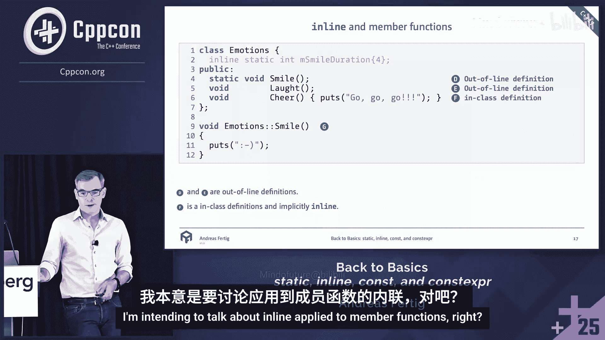
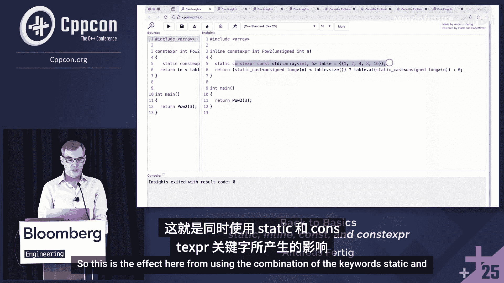
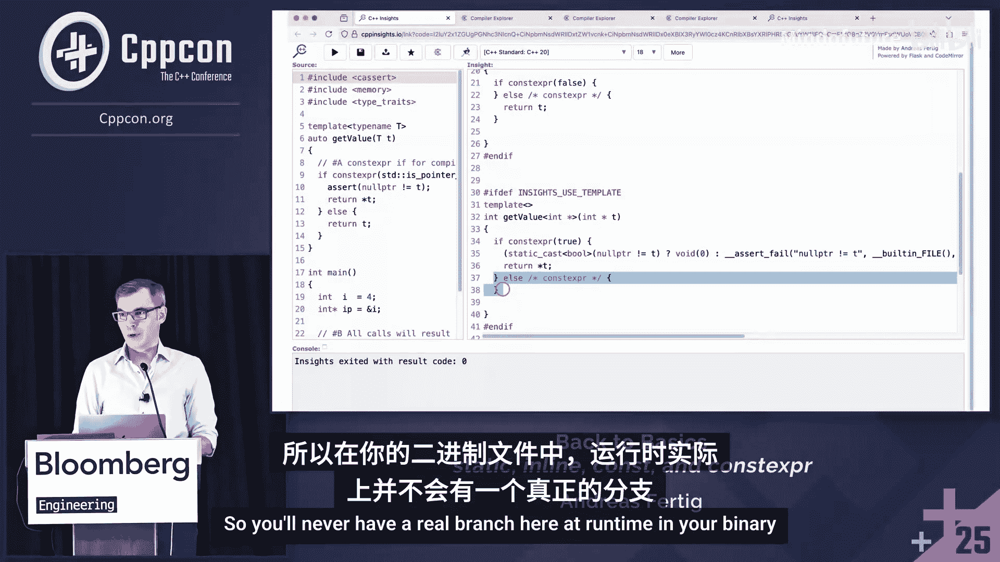
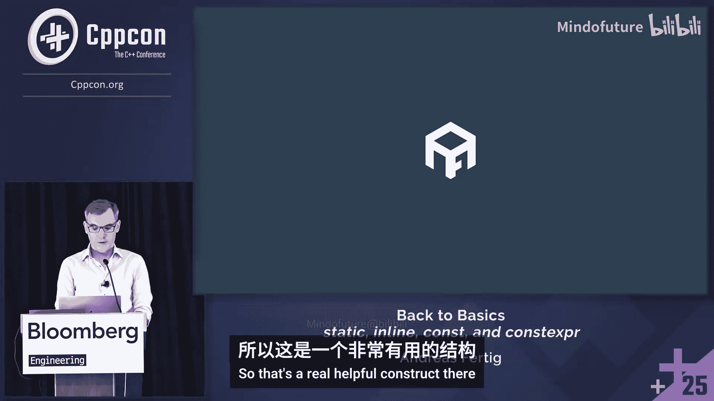
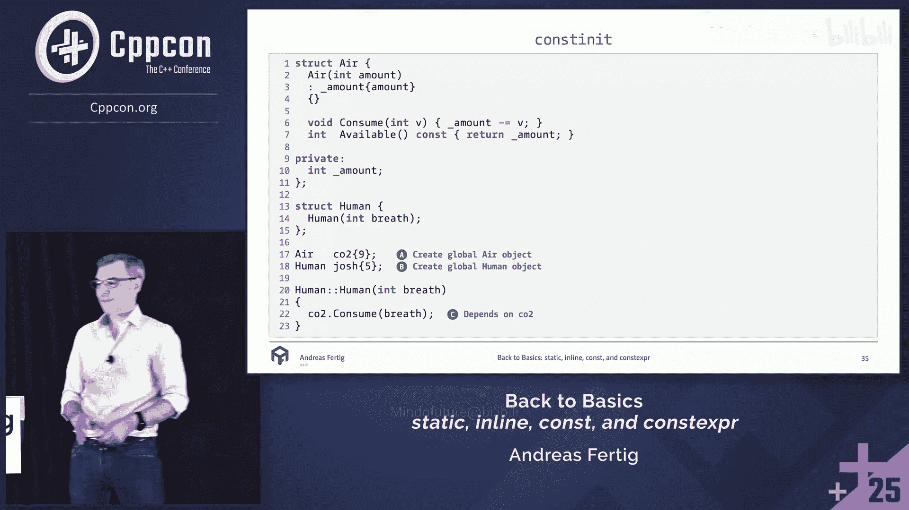
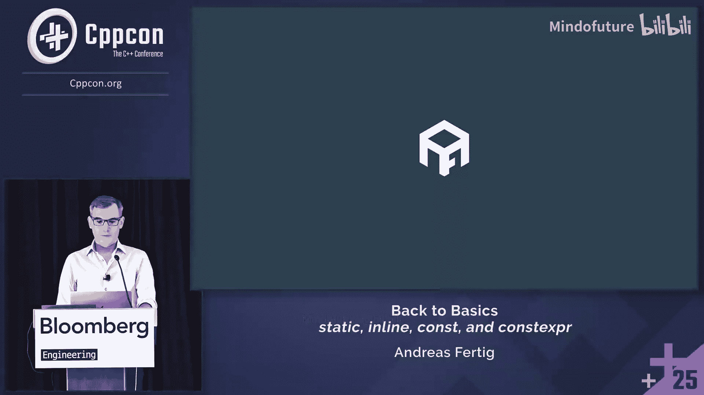
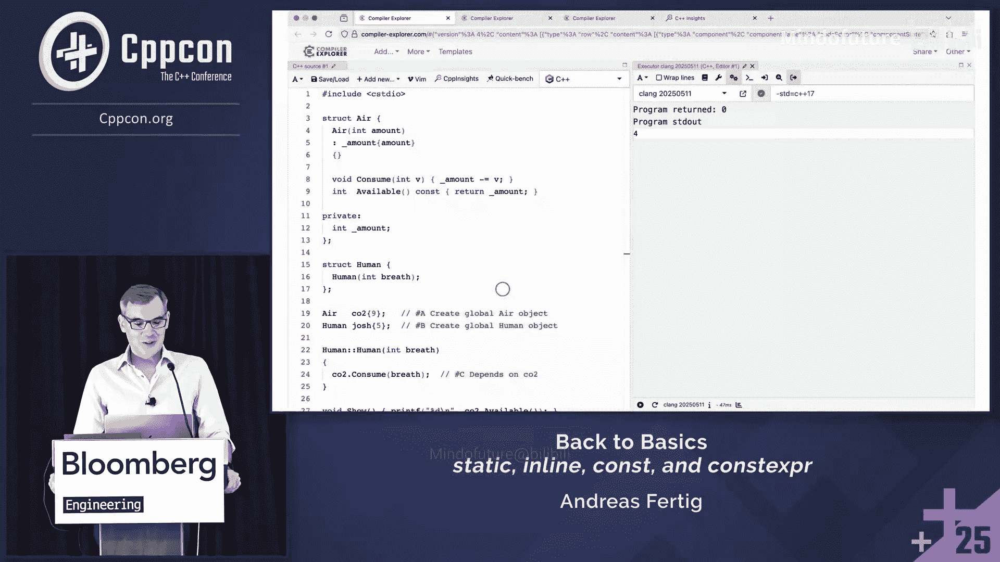
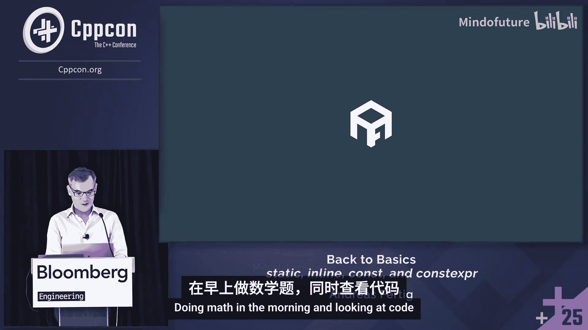
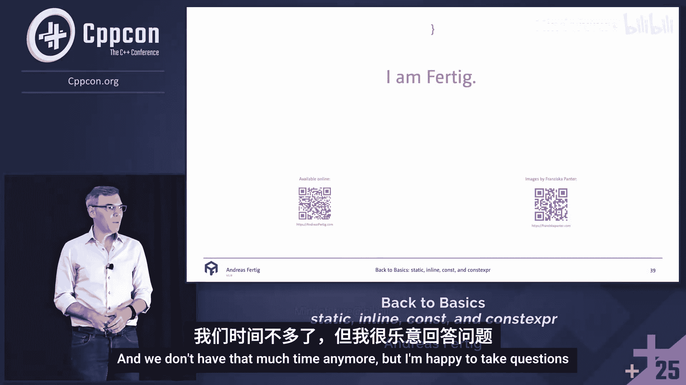

# Cppcon-2025-｜-C++-｜-C语言--｜-汇编-｜-编译器-｜-操作系统-｜-Linux-｜-Windows-p17-P17_回归基础_精通static、inline、const和constexpr_C++关键字-Andreas_Fertig--BV1wyPBzrEeu_p17-

🎼Yeah。All right。Good morning， everybody。 Welcome today。 What is it for of CPP con。

 I hope you enjoyed it so far。 I have a hard time tracking which day it is。

 But I made it do my own talk。 So I think that's a win。

 So welcome to the back to basic track about static inline constant constant expert。 And boy。

 did I get myself into something there。😊。

Well， a few words about me， I'm Andreas Paock， you might know me as the creator of C++ insights。

 just do quick show by hand who here knows C++ insights。It's a really good threshold。

 the rest of you， we should have a talk later。I'm also hosting the C++ Insights YouTube channel where I talk more about C++ I'm author of a couple of C++ books which you can of course order online or fetch at the CBP Ca here。

 they also sell Jason Turner's book and Nikol Yozs at least and Jason has a book signing later so it's not too late for you to grab his book and get it signed today。

You can learn with me I'm available for inhouse classes onite or remote。

 whatever suits you the best or your team and if you want more to learn as an individual by your own time budget at your own pace。

 you can check out my latest offerings our selfle courses。Maybe it's something there for you。

I'm German， so my last name is。Incidentally， a。Very common German bird。 I mean。

 it's not true for every German， right， but I managed to， to pick one。

 You can translate it into English as finished， Read， complete or completed。

And the sad part about that is that I mispronounce my own name since years。 I say fatigueik。

 usually if I'm not watching out carefully in proper German， it's fat。

Itslight difference people understand me， what this tells you about me is that I potentially are suck as a German tradeer。

But luckily， I'm a C++ trainer， I'm here today to speak about C+ blastO V should be fine， I hope。So。

The title contained a bunch of keywords， right。 So while preparing this talk。

 I realized maybe it's worth spending a short time talking about keywords。

So the first thing that you can realize， it says key verge。So when we are talking about the key word。

 it's usually a single word。 you will find very few。

Occurrences where we have double words like spread local。But it's not technically a keyword。

Keywords in C++ and in other languages are something very important。 And in C++。

 I often get the feedback in my training classes that we。

Tend to reuse keywords quite a lot in different places。

 which is one reason for this talk today because if you're looking at cons。

We are using it in so many places sometimes it gets hard to track what the keyword in which place actually really does。

Now， a little bit of background about that you might know with C++ star it's really hard to be backwards convert。

 right？That also means when ArabB produce a new standard and introduce a new keyword。

 we do various sort of checking。In all the code basiss we have access to so all the things that are publicly available or for all the companies to participate in the C++ standard to see whether people already using this new keyword in their code as a variable name。

 for example， because that would break your code if you upgrade it's not really that we break your code in the past but once you go in the future and we don't want to do that so。

This is the one thing where we are very cautious and which then leads to either a keyword reuse for that reason。

 the other reason for keyword reuse is because it's already a good name and we would have to come up with a combination of names to make it more perfect than things would get longer and we tend to prefer short keywords。

Sometimes we overdo it most the backwards convertattibility， but our hands are somewhat tight。 Yes。

 I'm looking at cool routine。 so you might all know that this nice， cool yield。

 cool return and cool weight。Python and other languages managed to get away with just weight and yield。

 C plus+ is a very close to hardware language， and there is at least one operating system out there still alive that has a system called called yield。

 So we。Basically， that was taken。 So this is sometimes why the keywords then end up a little bit less nice than we want them to be。

 okay。So keep that in mind so we tend to reuse them because it's hard getting new keywords in because every keyword we already have。

 we know we don't break anything， any new keyword we introduce we can break anything。Alright。

 let's start with static and the idea for this talk is I always give you an overview here， one slide。

 I'm not really talking much about that one， and then we are diving into the different places where you can apply this keyword and what does it mean。

And sometimes， of course， we can combine the keywords， which makes things way harder。

 So the first thing on the list here at the top is a pre function fund。

 which a here says it's a translation unit， local function。

 And this brings me to the next part of theory。 What's a translation unit。

So a translation unit and I'm using more Linux analogies here。 It's certainly the same for MSVC。

 but you might not see it because they hide it very good with their visual studio。

 So let's say you have a USB dot CPP file and that one includes a USB dot H and maybe other headers from the standard library。

 First of all， everything is fed in the preprocessor after that in ends in the compiler you get a dot O out H dot O and。

This piece， this CPP file and everything it includes， and the resulting that， oh。

 we call this a translation unit。And the thing is， one translation unit does not see the other translation units。

 So they are living in isolation。That means the compiler also never knows how many other translation units might come or not。

 Okay， you link all the O files together， get a nice application out of there and let it run。

But this is a translation unit it runs in isolation from everything else that also means that your USB doH might be included several times from different translation units。

 this is why we have headergars。All right， keep that in mind。Now we have this function fund here。

 and I made it static。And that implies that thisal becomes a translation unit， local function。

It also is referred to as having internal linkage。What that means is that and this is the most part I see where people are confused if you put this function in a header file。

It is translation you need local。If this heophile gets included in several translation units。

 each of them has a dedicated copy of dysfunction because it has a internal language and B。

 it's translation unit local， the others don't see it and in very bad scenarios。

 not even with link time optimization the link is able to reduce this applicationplication。

 because you said you want to have that one exclusively in each translation unit。

So this is number one of what I see what people do wrong。If you apply static to a free function。

 do it in your CPP file， because this is what you actually mean then you want to preserve this。

Function for just this translation unit。 This can open space for better optimizations。

 because the compileampala knows now it's not reachable from anywhere else other than this translation unit。

And this is what you usually want with static for a free function。The next thing you already saw。

 you can have a variable inside a function doesn't matter whether this function now is static or not。

 it just kept the code and can make that one static。If you do that。

 we say that this variable now has static storage duration。

One of the things that come out from that is this variable gets initialized。

 the first time control pioss it。So the first time you call thumb。

 this variable v here gets initialized。Since C++ 11， this is threat save。

 so if multiple threads concurrently try to do this。They all wait for the first one， by the way。

 this operation can fail and then you get rerries。But you never reach anything below this variable declaration。

Before the initialization failed。This behavior that it gets initialized。

 to first time control para is one reason why you might see coding guidelines out there like Mira。

Banning this construct， because if you remember the rules of C++ objects get destroyed in the reverse order of their construction。

But it's very hard to control the order of construction if something gets constructed the first time you're calling this function。

 You can do it， but it's not that easy to reason about anymore。

So this is one reason why coding standards bound that。If you make this variable static， in my case。

 it's a trivial type， it's a trivial initializer within that means that the compiler can lay out this entire memory during compile time。

 you don't even need con expert for that and。D啊。That blocking initialization。

 the threat safe initialization goes away because there is effectively nothing to initialize at runtime。

If either the initialr is a runtime value or you happen to look at a more complex class with constructors that are not con expert。

Then you're in a scenario where you will get the spreadSa initialization and by that。

 your first pass of this function might take a small performance hit being a little slower than the next ones following。

So this is a。So called block local static variable because we placed it in the block of this function。

 as I said， it doesn't matter whether the function itself is static or not， you can combine this。

This variable now is exclusive to this function。 It gets initialized exactly once。 And after that。

 you can change it。 You can leave it as it is。 This is what the behavior here is。

 So if you want to do that。Mostly， I would say with constant in it to have this variable initialized and use it as a constant。

Now。Classes， we also have classes， right， so we can have static data members and there are two sides to it it depends on the standard。

 so we are looking at preC plus plus 17 at the moment。

So static data members means that inside your class。

 you declare a variable data member with the keyword static。

The result of that is that this data member does not contribute to the overall size of your class。

 so would I take a size off of an emotions object as I'm showing it here， the size would be one。

The actual size of the emotions object is0， but once you're asking， you need something addressable。

 so you always get a size of one。The smile duration here does not contribute to the size。

 You can see it as your classes forming in namespace， which is what they actually do。

 And the static data member here is just a member of this namespace。

 but it does not belong to the class itself。 So if you create objects out of it。

You only have Mmi duration exactly once。You can please。

The static data member as any other data member in the private public protected parts。

 whatever you need for your actual application。And now looking at code。

 let's say in C+ plus 14 or before。You only can declare your。Static data member in your class。

 supposed to had a file， and then you have to split up the definition into a CPP file。

If you would put the definition in the header file。

 you are risking getting a duplicate symbol error if this header file gets included from several translation units。

So this is what you have to do in C plus plus 14。 You only teach to compiler in your header file and your class definition that。

There is a static data member and then later you are really initializing it consuming the space for it。

 so this is where you have to go for the out of class definition for your static data member。

 which obviously comes with yeah duplicate code because now you have to repeat the name space and the type and everything so。

It works， but we will see a potentially better solution later。Actually。

 if you make this variable con。And you have the integer， you can initialize it in the class。

 even before C++ 17 input。It's just another part。 Now static member functions。

 you can make member functions static。 if you do that。

 it once again means you have just something in the namespace of your class。

 which isn't really part of any object。So a static member function。

 you can also make it public private， protected， whatever you need。

It cannot access data of the class other than other static data members or static member functions。

So it's again， something in the namespace， it's very convenient if you need a function that does maybe some calculation。

 it's very specific to what this class does， but it doesn't require data members because you are feeding in the data via arguments anyway and you don't want it to change your data members so then you can make this member function static whenever you do that you have one benefit and that is that static member functions since they're not part of the class only the namespace。

 they don't carry the implicit diser。So basically in the background。

A static member function requires one argument less the implicit disk is always gone。

 so you might see a little speed up， but it's more for our eyes for how we lay out our code to make it static。

And for static member functions， as for non static member functions， we have the two choices。

 you can implement them in line in the class or you can go for out of line implementation。

 as I'm showing it here。It's exactly the same， it's just a question。

 does it belong to the class or does it only belong to the namespace that this class forms？All right。

 for his keyword， 15 minutes。Stic。This brings us to in line。And that's a very tricky keyword。

The name suggests， at least for me as a non native speaker， that something gets in light。Okay。

Which might or might not be happening。I have the same example as before。

 I just swapped the couple off the keywords， so a lot of the things that were static before now became in line。

And we are going to walk through that。So we have our。Suppose free function。

 And now this function is in line。So as opposed to static。

Inline is to write choiceice for free functions in header files。

 because what inline means from back in the days it was telling to compiler to inline as function。

 the inlining process is roughly take implementation of this function and put it where all the call sites are。

 removing the calls。The idea of that is。We know that calling a function is super expensive compared to putting three lines。

 copy and paste in there， but we didn't want to do it ourselves。 We let the compiler do。

So this is where in lineing came from。Issue nowadays is。I guess most of you。

Don't target only a single CPU with single architecture， a single hardware。

So once you target different platforms。Intel arm， what error of X86，64 bit？

It's no longer that easy for you to know across all your targets。

How costly a function call is and how to weight it。 So three lines of C plus plus code。

 maybe five lines of assembly is that faster than doing the function call or not for your architecture。

The good thing is the compiler knows because the compiler has to generate the code for your target architecture。

 and so modern compilers have a bunch of heuristics trying to figure out what is the best for you and you can influence that with the different optimization options and they go out of their ways to figure out is it better to inline this function for you in this place it can also decide differently in different places or is it better to place the function call because in this architecture the function call iss really cheap。

So in line。Doesn't mean the this function really gets in line is an optional step that a compiler does。

What sticks with in line。 and this is why it's so interesting for header files is。

The feature that it suppresses the one definition rule。

 So you might notice in Cnc C plus+ we can define a variable of function at most once in its scope whenever you say two times in the x in the same function to compile us as well。

 bad idea。The same would be true if you have this function in a header file and included from multiple translation units。

 the linker later will tell you， well， I see more than one of these symbols。Please help me out there。

 Now， the job of in line is it to suppress this behavior and tell the compileer， yes。

 there might be multiple instances of the same function。Just ignore it。

 pick one and use that one so this is suppressing the ODR rule and this is the key that makes the inline worthful in header files because you want to share them。

 you have them in different translation units so the symbol will appear multiple times and the compiler simply ignores this and says yeah I've picked the second one whatever it does right。

One step here is crucial。You might be very clever， but don't try to be too clever。

Inline means that the compilea expects that all the copies of this function that it sees or the linker later to be precise are 100% identical if you're trying to play cute tricks with the preprocessor and make the function body of your inline function。

 it is one translation unit different than in the other。

Your happiness might go away very fast because the compiler random or the linker randomly selects one of these functions。

 So it means you have a 50，50 chance that all the time。😊。

The wrong function was selected for this function。Okay， so you have to make sure。

They are 100% identical。If you don't， you look at undefined behavior。

 The compilei is absolutely not required to diagnose that or the linkers， so it just does its job。

 Pick one， usually the first one and press the others。Not the fun part is in an inline function。

We can have a static data static variable。Now， what does that mean if that function really gets in line？

Because then your code gets copied around， right？The good answer here is the standard guarantees you that you will end up with only one symbol be for all your translation units。

 it will be the same。Okay，Regardless whether the function got in line or not。 So you can do that。

 There is nothing you have to worry about。 It might look funny， but。It's safe。

 It's only not safe if you expect that you get exclusive variables for each。

Place where it got in light， that would be the only thing where you get a surprise。

So now inline static data members。In C++ 17 I can make my static data member in line as well and what the result of that is that you can declare and define initialize in this case your static data member in one place This is very convenient for header only libraries because yeah now you no longer need a CPP file for just initializing this data member。

You can also have inline member functions。And for those of you reading quickly and reading ahead。

 you might notice that either that guy has a bug in his slide or he doesn't know what he's talking about。

Because none of my functions here is in line， yet I'm intending to talk about in line applied to member functions。

 right。

So。😊，There is something going on with your classes when we are looking at。

Number functions。You can see we have。Basically two different cases。

Smile and laugh are both implemented out of line， while ti is implemented in class， so in line。

I don't give you the implementation for law。 doesnn't matter。

 If I do the transformation here in C plus plus insides， you can see， yeah。

 smile and laugh They are untouched by the compiler。But cheer carries an implicit in line。Came。

The reason for that is。bed。In your classes， if you implement a member function in line。

Usually we implement classes in Heer files， or they clear them in Hea files， at least。

So it wouldt mean different translation units would see this member function and its implementation。

 So it would be a duplicate error。And from the very beginning。

 we decided C++ should be the language where you have to type less than you have to do。

 for example in C， so it's a very implicit language。

 so we decided whenever you're going to implement your member function in class。

It becomes implicitly in line。 Otherwise， you would have to do that yourselfelve。

 and that would just be more keyword sprinkling。This is one behavior of just one node。

 I don't have more about modules， but this is one behavior that changes when it comes to modules because there we don't。

So the implicit in line for in class member functions goes away。So how are you doing， good so far？

Now， I have a confession to make。 I'm not sure why you' all here， but in the abstract。

 I wrote there there are as many flavors to cons or even more that your local ice cream shop might have chocolate flavors。

 And I thought about getting a ice cream truck in here。

 but thought there are a little well issues with that maybe and the top most was it might distract you and。

Meat， so no ice cream here today， but aboutia， but a lot of cons。And let's start with theory。

 first of all。What is a CV qualifier？The answer is a CV qualifier that stands for con and volatile。

 So the C in there， I'm not going to talk about volatile。

But remember that so whenever the standard or any of the expert talks about CV。

 the CV stands for constant volatile， No， we like nobody knows what CV。The rest me？Who knows？

But then you have a top level C quaifier in an indication that would be potentially thesE that's at the top right。

 so that's the one that gets picked。For C++， a top level qualifier means we as developers tell the compiler to treat a variable or a parametermeter as read only by making it constant。

You can read the top level to some decree as optional。So the top level con。Isn't required。

It's something we add to our variable to our parameter。This is very important。

So here I have a couple of variable definitions。 So the different shades of variables that are constant。

 We start with a in a， we have a simple car variable。Perfectly initialized。

 it's a read right variable right， you can change it， you know that totally easy。Now， in B。

For the second variable， that one is of Type con's car。Now， we just saw a works perfectly。

 The only issue that we might have， we might tell our colleagues and our future self that this variable after initialization should not be changed。

 This is why we are adding the optional con。Which counts as a top level qualifier becauses the same construct work before。

 obviously。So it's top level。This gets more interesting if we have a car pointer bill here and see in this case works。

What that pointer says iss if it points to the first address of an array。

 you can change where it's pointing to， you can let it point to the second address of this array。

 and secondly， it points to memory that's modifiable so you can change the memory that a pointer is pointing to。

Now Alfred indeed D， on the other hand， the Kscar star。

 that one is a pointer pointing to read only memory。And the fun part is about read only memory。

 You have two kinds of them。😊，You can't have the kind like from a CD ro。You cannot change the C Rob。

 It can also be an embedded assistance in Eprom。So some memory that you really cannot change。

And if you try to be clever and do constantcast there。

 then your operating system nowadays usually has that in a read only page and says， well， you try。

 bye bye。Okay， your app crashes。There is a second flavor of cont memory and this is the memory that we make cons。

Optional， this is why in some cases， your concast might succeed and in order。

 it might fail because there is a real cons and some top level cons in the top level cons you can cast away。

 The real cons， you cannot。 So whenever you do a concast。This is the risk that you are not 100% sure。

That you always get the optional cons fed in。 And once you get the read only， the true read only。

 you app to the crash。Now in E here in Linda we have a cast star cont。

 so that one is a point of pointing to modifiable memory。

 but it stick at the memory address it points to so if it points to the first element of array。

 you cannot increment or decreement this point， it always points to that。

This is not required in all the variables we saw before。 So this is a top level constant here。

 It's an optional constant。 We tell the others and ourselves unchangeable。

Now you can form a combination of the two， a constantst car star const。Melissa。

That one is now a pointer pointing to constant memory。And。The address is fixed。 The thing is。

The top level qualifier being the address is fixed。 You can remove that。

 You can cast that away with a conscast。 Don't advise it， but you can do it。

 But this is a top level con。 So it's optional because everything worked before。

This gets more crucial if we are looking at。The way， how could we do this better。

 So if it would have。More keywords， longer keywords， then we could say， well。

 we can have a cons by user request car。 So trying to make it more clear that this is somewhat optional as opposed to a read only data car here in D where we try to express yeah that that's really read only data right。

 this is what that roughly means。 But then if you see the combination in F where I say read only data chart star cons by user request。

Not sure if it's no longer clear to which the two apply， so this is our usual issue right。

 does it apply to the pointer or to the data that thing is pointing to but that would be one way to clearing it up。

 but I doubt that all of you would be happy writing that many characters to make it clear and I think it's still not very precise。

Now， all these things start to matter more and more。If you're looking at function parameters。

Because we can have function overloads in C plus plus， right。

 so I can form this functions from A to E here。And I thought off simple。

 I have this function that simply takes a car， Fun here and A。 And then I have a fun。In B， that。

I say the signature of the parameter is a constant car。But remember what we learned before。

The signature and B that cons car is a top level qualifier can treat it as optional。

 and your compiler will do in case of overload resolution。Because for overload resolution。

 the compiler strips all the top level qualifiers， looks only at the type。

 and that means that to the compiler for overload resolution， the two functions A and B。

 they are equivalent。So to compile is an issue， it sees two functions that are equivalently good to call。

 So it tells you about that and fails to compile。And you can form that scenario once again if we have in E here。

 a contcast R cont。Remember， the same is true for variables。 The second constant is optional。

 It's a top level C quaifier。 So for overload resolution， the compiler throws it in the trash。

 and that means that the signature to the compiler and E and C。Look the same。

 So you get yet another conflict the compileala tells you about。

So whenever you stumble over these  errors， you might have the intention to do something different in the two functions。

But you actually really can't。Because the compiler only treats the one with all the top level qualifiers as the one。

If you remove in my case， for example， if you would remove the function A。

 that of course would perfectly work。Can have only be in there。

 but once you add a top level qualifier， you have to decide for which function youre going。

Notice in the end of the Kants journey。We。Also have this entire new world since C++ 11。

 we received the keyword con expert， we can attach it to functions or variables。

 and if you are looking at functions， then the meaning here is you have a function that has some kind of a hybrid or dual nature。

You can execute a constant expert function at compile time。Or at runtime， which is our default home。

 right， but whilst the compile time part， we can now precalculate more things in pure C++ code。

 which we are usually right on a daily basis。In C++ 20 now we received a new keyword that only works on functions that's constant Eval。

 we also call this functions immediate functions because this kind of function only lives at compile time so it doesn't have the dual nature。

 The idea for constant expert to functions was we didn't want to force you to duplicate your code for compile and runtime that would be insane right。

 you want to run most of the time the same function at compile and at runtime and。

If we would have started with constant Eval， that would mean that you have to implement a function once for compile time and the second time for run time。

 So this is why Cont expressed the dual nature。 And now the new kid on the block Con Eval says。

 oh I'm solely for compile time。And you might already find a few applications in C++ 20 and 23 for Constableval。

 but this was more like a landing pad for a C++ 26 static reflection。

 because there we are doing heavy work it compile time and it compiled time only in some parts and this is where we want to have a utility to mark this function as really compiled time only it never leaks into the other world。

So， this is some。The difference between the two。In both cases。

 it means whenever you w to run the function at compile time。

All the input parameters must be known at compile time。

 either you draw them from another compile time function or their constants。Even then。

 you have to watch out what you do with the result of your constant per function。

The compiler decides with a few rules， whether it really executes this function at compile term or not。

 So most of the time you need to force the compiler in a。

Compile time context to force the compile time evaluation。

 You do that either by assign the result of a constant extra function to a constant per variableable。

Or you use one of the other few contexts like using the result as the size of an array or as a nontyped template parameter。

 for example。So just by marking that function constant expert and feeding it with only constants doesn't necessarily give you a evaluation at compound time。

 you might be fool， but。I don't have much time to go into that。Ins are special。

So whenever we are toying around， especially in presentations like this with integers。

They get eagerly evaluated at comp term， but it's only them。

Once you start using your own classes and objects， you are in the world that I just taught you。

 so you must force to compile in a compile time context。

One crucial thing that I often get questions about in my classes is。How does this work。

 So a context per function means that you have a dedicated evaluator in your compiler， so。

You can see to some degreee as a second compiler， you can also see it as a piece of code that evaluates USC+ plus code S C+ plus code at compile times so like a virtual machine for C++ code。

 the compiler knows the target architecture so it know things like how your floats are and all that stuff。

 but it never goes down to assembly。The purpose of a constant per function now is to produce a constant at compile time。

A constant at compile time， you can feed as zeros and wants。Okay。

These series and ones can be as complex as you need them to。 They can be an entire class。

 and you view the class。But at the end。You get bits and bys out。

Ready to go into your realm being read when your system needs them。

If you somehow compare it to a runtime function。They also produce。Serious and ones。

 but they end up in a register in between。For context per function。

 it's always the purpose to produce you a number of bytes that ends up in your room or gets reused by calling another function using that result。

So I had to change my silly font function here a little to make it more interesting for the constant expert part。

 The emotions class is unchanged so only constant expert keyword was added so this is another variant of this interest slide so let's right look into the power of two so the function I am having here just roughly summing up I have a lookup table basically to spare me the energy for calculating the power of two for a very small set of numbers you could increase that or you could go to then doing the runtime calculation so this should just carry enough meaning for this example here。

So this function here is constant Exp。That means you are opting in that it can be evaluated at compound time that's the first and very good step The other thing that you did by that and it's also on the slide。

 but we have it here in C++ insights as well。All context per functions are implicitly in line。

 K C plus plus insights manages to show you that here again。

This is helpful if you're putting your context per functions in your header files。

 so no need to add the in line。 In addition， it would just be redundant。

 This also implies somewhat that you cannot split the declaration and the definition between a header and an implementation file。

And since the compiler to evaluate that function at compile time is forced to see the implementation。

Splitting it and hiding the implementation details from the compiler would be not helpful。

 So you can split it in some regard， but never the full picture here。Now we can see。

There is a constant sperm。Etic variable now inside my function pal2。This is new since C++ 23。

 you can make your context per variables， block local context per variables static。And this is。

 first of all， really beneficial because if you're looking here once again at the code that I just showed you。

 which。Contains everything。You can see， first of all， a constant per variableable is implicitly cons。

So this is why you cannot change。A context variable after it was initialized because it's implicitly con。

 So it also means no need to flag cons yourself。 It's implicitly done that。Now， without the static。

If you ignore that for a moment， then all we have is a constant variable inside a function。

A constant variable inside a function， The standard guarantees you that if you would recall this function recursively。

My variable table here has a unique address in each of the calls。

It also means that this variable gets initialized if you would call it recursively in each recursive step again。

 which is potentially not what you want。So in C plus plus 23。

 whenever you have a constant local variable， it might be really beneficial to make it static again unless you really draw from that feature that。

The variable has a unique address in each of its stack frames。

So this is the effect here from using the combination of the keywords， static and context。

我想。Of course， we can also have constant Exp data members and member functions。 This time。

 no need to split it into multiple pieces。 So with constant Exp。

 you can mark your static data members， Con Exp and you can mark all your member functions， Con Exp。

 You still have the flexibility for your member functions to go for in in class or out of class definitions that's untouched there。

 If you once again use C plus plus insights。😊，For this one， then we can see a few things。

 So my static context per variable。Is implicitly in line。 So once again。

 no need for you to market in line。 It's implicitly already that if you made it constant Exp。

This is one area where you can get fooled because this happens only to static context per variables。

 So if you have a context per variable that you treat as a constant in your header file。

You have to mark that one。In line explicitly to avoid ODR violations。

And then you can see for all the other functions now， my member functions here。

 since the con expert keyword is attached to them， they are implicitly in line same behavior as for the free functions。

Okay。Now there is something that came in with C plus plus 17。 It's a new if。

 It's called a constant per if you can see it here in a and opposed to a constant per function。

 this constant per if has no dual nature。 it requires a compile time， value as a condition。

 and what it gives you in return is that only one of its branches survives compile time。

So this comes in very handy in templates like I'm showing it here。 this code without the context。

 but if would not compile。 You would have to reach for。Template specializations because。

Line number seven， return de reference T is not a valid operation for Chter pure inte。

 it only works on an instar。My context per if here was the type3 ensures that this branch is only seen。

If T is a point of time and。C++ inside can show you the result of that。

So if I do the transformation here。You can see the primary template。

 you can see the instantiation or specialization for int。

 and there you can see the if branch itself is empty， you only have code in the else branch。

 while for the instar case it's different so there the if branch carries the code and the else branch is empty。

This if that you still see here in C++ insides goes away the moment the compiler really lays its hand on it。

 So C++ inside shows a very early stage and optimizing away a constantly true and false condition is an easy thing to do for the compiler so you'll never have a real branch here at runtime in your binary So you will not only not have the code。

 you will also not have the branch So that's a real helpful construct there and it's a good way to。

Avoid template specializations because here we have all in one place， it's very readable。

 we can say like a reliF。Now。Something that was requested very often to me in the past was that people said。

 well， in a context per function。I want to know whether I'm constantly evaluated。

 So evaluated the compile time because I might want to do things differently。

And one example of that is my my zer。Super meaningful di function here。

 nobody else other than me could have written that right， it's so awesome clever。

Especially because in line number 5， I'm doing it with all the functions。 So it's brilliant。

 So my death function here it tries to carry something。I check for a division by zero。

 and if that's the case， I'm printing out a lock message。

 but that's something that's more useful at runtime。There is something else。

 context per functions that are evaluated at compile time are free of any undefined behavior。

 The compiler cannot guess or come up with some solution for you at。Compar。

So that means that this piece of code， if I do a division by zero。

 it will not compile if this function gets constantly evaluated。So I'm safe there。

 The compiler already tells me thiss bad idea。 So all that's left is locking that thing at runtime。

 Maybe loging is not the best thing， but bear with me， so。

Variable wise I would have a variable called water because it's constantly flowing so that one is a readr variable。

 and I have a stone， so that one gets initialized at compile time because I make it context。

 So I have the two paths and I want it to work。 but prior to C plus plus 20。

 you only had context per functions。 So suppose you will see the moment lock uses something like puts。

 that's runtime only function。 so you cannot have it in your context per function。 it will not work。

Now C++ 20 gave you a new function in the standard library called I constantant evaluated。

 long names by the way indicate that we don't expect you to use that too often。

Iscons evaluatedvalu gives you the answer whether this piece of code is evaluated at compile。

 time or not。Now I can now use a regular if ned result for my case here。

 if it's not constant evaluated， then have this code in。And otherwise， the compiler removes that。

So this is really helpful to get more code being executed at Comp time。

Yet sometimes we then after C+ 20 ship， we saw people well。Having good ideas， thinking。

 having good ideas because they thought， well， in this in this previous if here。

I'm not so sure whether this branch will really get eliminated and I don't want the if here at runtime。

 I'm very high performance。You showed me this context brief where it's guaranteed that this branch doesn't survive compile time or it's always there。

 so I'm using that。Remember what I told you， the Con per if requires a compile time condition。

 so what do you think happens if at compile time you ask is constant evaluated for its result？

It will always tell you true。So the puts here will never be in your code base。

 not in the compile time and not in the runtime path because you have forced the evaluation of I constant evaluated to compile time always and ever so the previous code was the correct one if you're going to C+ plus 23 we got you an even better way I like that one if cons deval。

It's a special bond。 It's tricky for all the syntax highlighters because it comes without the condition because the condition is implied。

 You are asking am I evaluated at compaldium yes or no， so you don't need to provide a condition。

 And by that， we resolve the hopeful issue that we created with the previous version。

 So if youre N C plus plus 23 technically， you don't need the is constant evaluated anymore。

 you can directly go to the if contival。 The only thing you can do there is S here on my slide。

 you can use the nod or a bank operator to negate the result and of course。

 you can have an else branch。 but nothing more than that。 So this is very clean solution here。

Oh yeah， and then we have one more kid on the block。

It's early in the morning I know and you're here to just listen right so let's see how that one works out。

 So suppose I have a class called E。 that one gets constructed with some amount of air comes with a consume function with a function available that says how much air is still there。

 Of course there' a member for that， and then we have a not astruct here。

 human and a human in its construct， the first thing it does when it gets constructed。

T takes a deep breath right， I don't have children， but I've been told this is what we are doing。

When we were born， so I believe that。 So now I have two objects。And yeah。

 I know we shouldn't do that， but I also know we do it anyway， so I have two global objects。

 CO2 air and my Josh is a human and I prayed my air with nine units of air and I say Josh big lung so first breath is a unit of five。

And at the very bottom， I'm also showing you for completeness， the constructor of humans。

 so it uses the CO2 object and consumes the air that Josh taking up。 So suppose line 24。

 I'm printing out a available from air。What is the result？

 So now you are up to even without the chocolate ice。And he guesses。

Or。4our。

So to get things going， yes，4， you're absolutely right。 So 9 minus5， right， that's four。

Doing math in the morning and looking at code that might be not returning what you expect to can take a while。

All right， so now do you know this trick players where you have all these cups and the one bowl and ball and you're having to track the ball。

 so let's try to add， which has claw， back and forth， back and forth， back and forth， back and forth。

 back and forth。You see the change。So what I changed is the order of the two global variables of A and B。

They are now in reverse order， Okay， Josh gets created first and then air。

This can happen for example， if you place the two of them in different header files or sorry different implementation files。

 and then the link or order decides which one comes first。

So you can somehow control the linger order， but it's a tough。What's the result now？Compil of 4。

9 are here。0。So the fun part here is this is technically undefined behavior。

 but it's very well defined in terms of the result。The correct answer here is9。

And the reason for that is that。The two objects here。

 they are already visible when my human constructor runs。

But the constructor for CO2 hasn't run yet because Josh comes first， so what Josh does。

 the human here， it takes a breath from an unknown value we sub5。And we。

We don't care because later then， CO2 gets initialized to 9。 So obviously， this operation got lost。

 So it's bad， but the result at least is stable， so it's always 9。the code is broken。

 there's the point here。And how can you fix that？First thing to do。

 you can mark your air constructor， con expert。This gives the compiler the opportunity to evaluate that thing at compile time。

 Remember in special。 So we are looking at only the integers here。

 And when the construct of E did run at compile time， you have remember the series at once。

 so you have everything you need to start at runtime so。

The order of the two doesn't matter anymore because the constructor of air ran always before Josh。

Now this is good to solve the problem， but it's not future proof because in the future。

 my own future self or one of my colleagues might need a different implementation for error and maybe constant in the way of that so it gets dropped and we are back in a code based that might or might not work correctly。

So this is where constant in comes in from C++20， you can apply it to function sorry to variables only to global variables or local static variables。

 so none constant in can go to a regular variable inside a function。

But this constant in it tells the compileampala。I want this。😡。

Object to be initialized at compile time and opposed to making a context per variable。

 the effect here is it gets initialized at compile time， but the resulting object。

 the resulting variable CO2 is not con， so you can modify it。

But the compiler ensures that Iide gets initialized at compile time or you'll be at a compile time error。

So by that， you can at least put that to your code and ensure that your code is stable and when somebody drops the context for later。

 they will get a compile term error and you can figure out what to do from there。

 maybe getting rid of the global variables and the dependencies would be the first thing to do。

All right， so。Then that's it for the day。 I hope you learned something。

 I hope you enjoyed your conference。 Remember there's still a whole lot of stuff to do。

 and we don't have that much time anymore， but I'm happy to take questions For now。

 let me say I' am felt。 Thank you。😊。

So we might be able to take one question， you can also come later and approach me in the hallway or so if you want to do it here。

 let's use the microphone。Hi， great talk， thanks very much， thank you。😊，Kind of new to costs in it。

 but I'm pretty familiar with the pattern that in a lot of parts of my code。

 people will mark a whole bunch of variables at the beginning that are never supposed to change at the month of them con expert。

Would you recommend that if you're using a C plus plus 20 codeb。

 we should mark them constant instead？No， whenever you want to have a constant stick with constant expertper。

 so the constant it is really for a special case where you want the variable being initialized at compile time but modifiable later at runtime。

 So this is the sole purpose and if you're talking about。

 let's say replacement for defiance or whatsoever constant expert is your go to thing。Great。

 thank you。 You're welcome。Thanks for the talk。You mentioned that there's some optimizations available on a static。

Vus not declaring the free functional static。The compiler might be able to optimize that。sorry， I。

 I didn't understand when you have a， a free function in a C file that you declare static。

 I thought Yeah， mentioned kind of offhand that there's some compiler that can happen there。 Yeah。

 are those also available if you use an anonymous name space Yes Yes。

 the anonymous namespace would be the equivalent I didn't have talk to time to， to go into that。

 Yeah， yeah， perfect。 Thank you。In in your last good talk in your last example with the constant if you make them both constant in it。

 you're back to the same。 Yes， you can only make one of them constant in it， right， right， perfect。

So thank you very much， if there are more questions， I clear the stage and you can grab me later。

