# Cppcon-2025-｜-C++-｜-C语言--｜-汇编-｜-编译器-｜-操作系统-｜-Linux-｜-Windows-p18-P18_案例研究_为实时音频软件用现代C++重写遗留GUI库（续）--BV1wyPBzrEeu_p18-

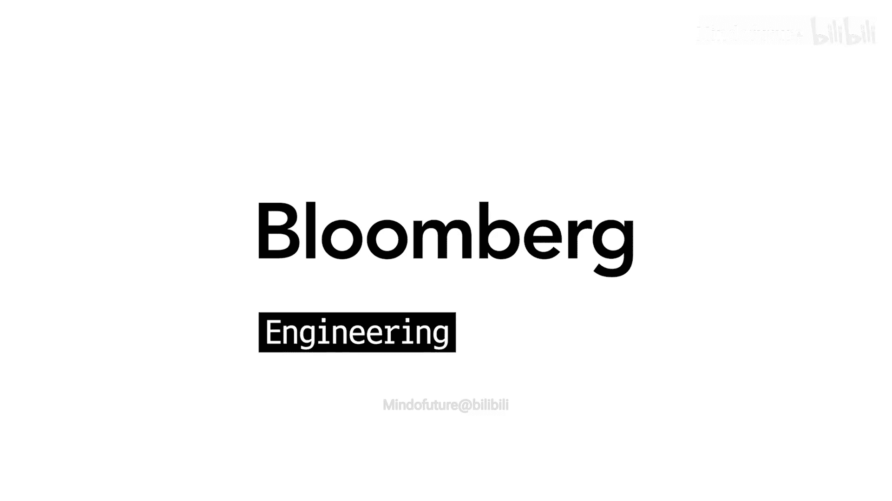

SoThanks for joining this morning， everyone。 I think there's a theme of U I talks happening at 9 AM at CBPcon this year。

 So I'm glad everyone's here hope you've had enough copy coffee to look at some templates and other stuff today。

😊。

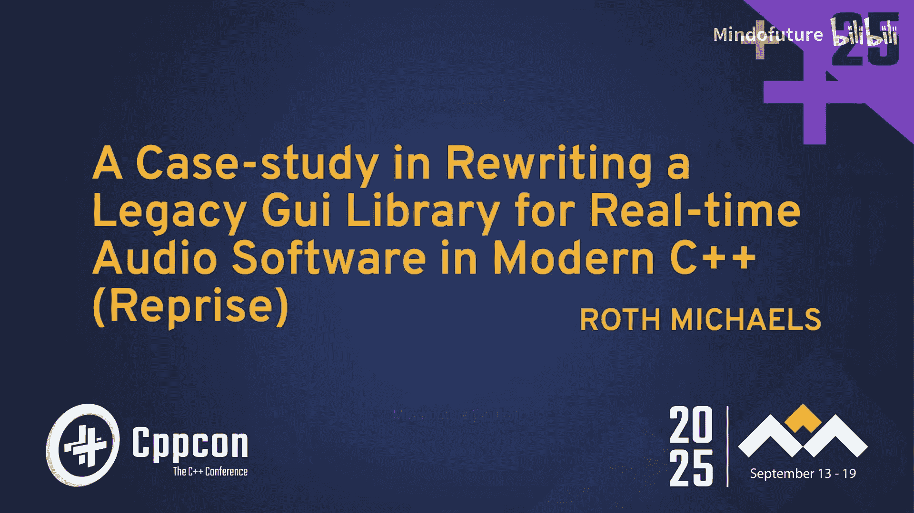

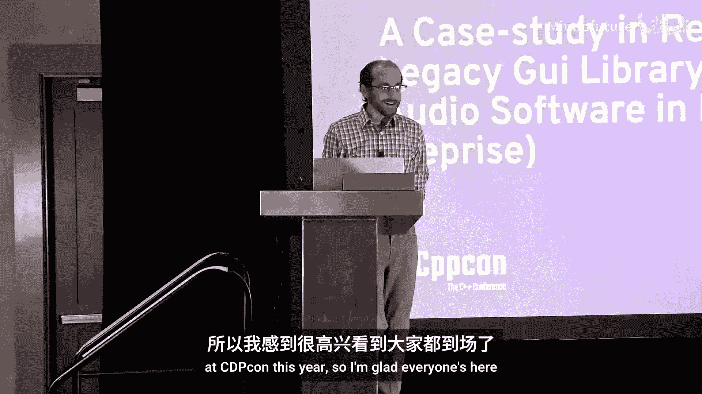

A little about me， I'm Roth Michaels， I'm a principal software engineer at Native Instruments。

 which is a big family of music companies that have joined together over the past few years， isotope。

 native instruments， plug alliance and brainworks I come originally from the isotope side of the family on the Boston team but these days work across all of the brands on various technology and codeshar topics and we make software for music and audio production of all sorts。

 so everything from DJs to software for mixing and mastering records to post- productionion for filmment television keyboards。

 synthesizers， if it makes sound or music we are usually involved in。

 but this story comes from a few years ago before the merger。

 so this is just story from the isotope side of the family and a journey through developing some of our UI libraries and how we improve some of this。

 but before we get into that something I'd like to start all of my talks off with is a。

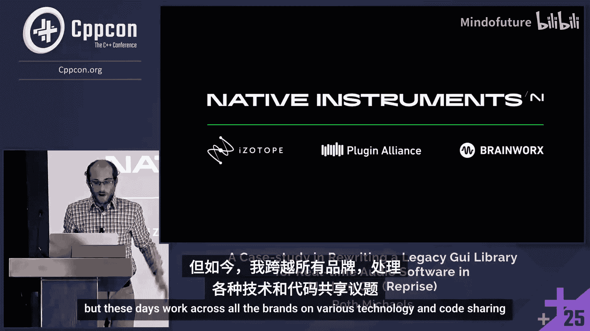

Call to action for everyone in the audience that if you see someone on stage here to be Pcon or on YouTube giving a talk。

 we're not some like magical C plus plus people that are here giving talks。

 but we're someone that either learn something or did something and wanted to share it and came here to talk about it。

 I think everyone here in the audience listening on YouTube probably has an interesting story or experience from their own either personal projects or their work to share。

 So I encourage all of you to actually consider speed conferences or and often conferences have lightning talks。

 which is a few minute talk。 and maybe it a nice easy way to ease into this。

 So I always like to encourage everyone to。😊，Try this out someday。

 And so we have a bigger community of speakers。 But back to the topic of hand。 No， this slide， oh。

 this has the wrong year on it。 It's because I gave this talk before in 2021。

 And after I gave the talk about a year or so later， I gave this comment on YouTube。

 A lot of this could have been solved with C plus plus 20 concepts。 Yes， this is true。

 And I actually almost put a slide about this at the end of the talk last time。

 But I had never used concepts for real because I did this in 2018。

 So we did not have C plus plus 20。 And even by the time I gave the talk。

 Apple Kang that we were using didn't have concepts yet either。 So I wasn't about to，😊。

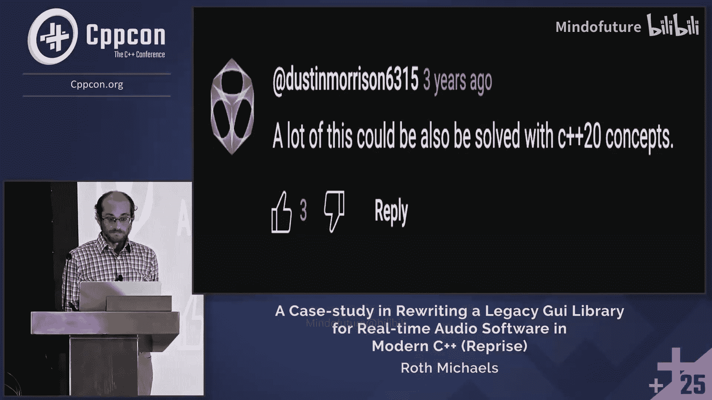

Be teaching something I un use myself yet。 so now we have the repprize。

 we'll do the same topic again。 But instead of learning about Fina and other dark magic of Temp meta programming we use concepts。

 So this will be a lot easier to explain。 And so one of the things we're going to be talking about if youve read the abstract is one part of this Gui library that we're gonna to use as an example in code today is our property system。

 And what do I mean by a property system。 I mean， a way to give objects that they have synthesized storage of member variables and synthesize giters and setters。

 And the objects will need to have some notification of knowing that oh。

 some property change I might need to do something like repaint myself or something like this。

 And also it would be good to be able to serialize these properties out to maybe XML or other ways of serializing Ui instead of just specifying everything in C plus And some examples of some other languages objective C has this ability to in the interface have an property declaration。

😊。

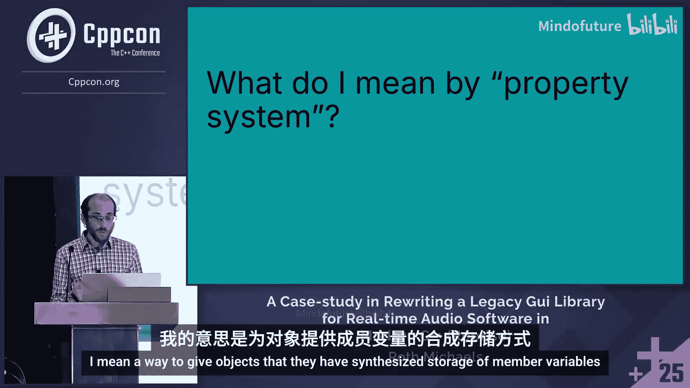

This will synthesize giters and setters for the text and background color， both the methods。

 as well as the member variable storage for this。Swift has something similar。

 a little bit nicer syntax where we can have a string and say， oh， when it's set。

 do these things and call these methods。

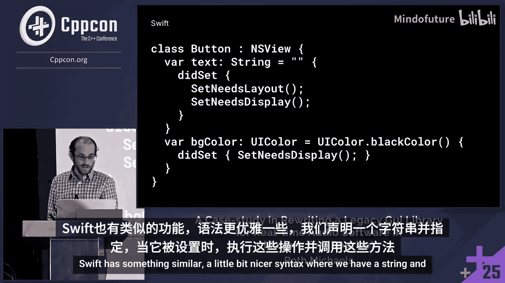

So where are we going with developing a property system like this in C++？When I started。

 I kind of dreamed of having something like this。 Yes， we have a macro here。

 but really the key here is knows all these pars。 I'm a lispper at heart。

 And so I kind of dreamed of declaring you eyes as just listsp data structures and rendering all that out is kind of an ultimate dream of've had for many years。

 But that's not the thing here today But a little piece of this wanting this very simple declarative syntax forre saying these are the properties that something has。

 and then applying those properties to a button。 and would' use them something like this。

 we can make a button。 And then this button will automatically have set property methods for that can be templated on these various properties that were described here in this declaration。

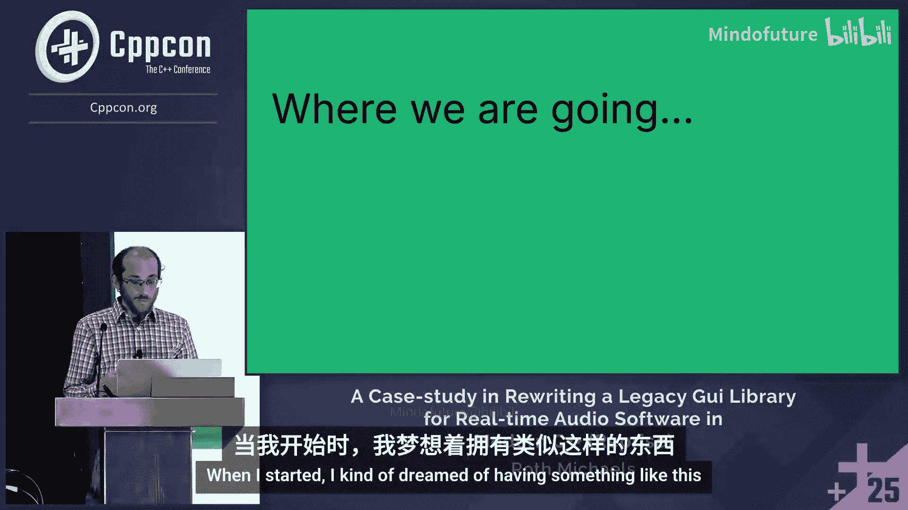

And then within the class， you might use them by in your draw function。

 You might have some box filling and drawing and drawing text。

 and then you can get properties out with the synthesized Gi properties。

And so this is a story about rewriting or version 2 of an internal UI library。

 and to understand why we're even thinking about building our own UI libraries。

 it's maybe important to understand what it is like as life as a plugin。 In my case。

 an audio plugin but could apply for other plugins where you're making code is going to run in somebody else's process。

 and there's a number of challenges with this。 you could have multiple instantis of the same plugin。

 which means global variables global state is not something you can have in your library。

 and this might impact what thirdpart libraries are possible to use because they're designed for applications。

 there might be some global app state and stuff and you can't do that in a plugin because you have to instances of it loaded。

 theyd be sharing the same global variables。 There's lots of ways that you actually get on screen when you're an audio plugin Sometimes the host application will give you a window to present yourself in Other times it will tell you to give it the window you want to dry in。

 And then there's also。

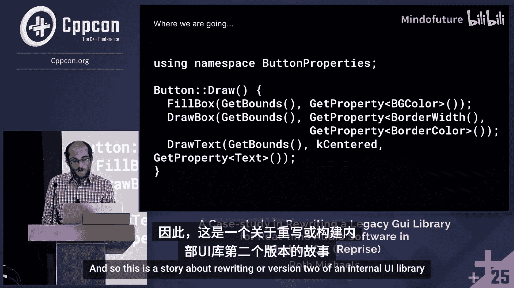

Considers we have many， many UIs running at once。 We want metering， running at high frame rates。

 ideally vnct with your displays。 you get nice smooth metering and users also need very responsive controls in the UI to be able to hear the sound as soon as they move a no。

 So this all needs to care about performance a lot and the threading model is really complicated when you work in these plugin host because there's some document this happens on this thread this happens on this thread but other API says。

 oh host can do whatever they want， call you however they want。

 There's a lot of threading complications we deal with as well。

 So this is some background in why like we had tough decisions to make when thinking about upgrading our internal libraries or adopting thirdpart UI libraries。

 So a little bit of history when isotop was founded I think we're looking into using Qt originally back in the day when they are making their first product as a win plugin but getting into proper desktop plugins Q applications and had a lot of global state does not work in plugins。

 So they start writing their own。L library called Canvas this was right before the most popular framework for making audio plugins and applications juice started to begin its life so this was not an option for us today if you're building plugins now I don't recommend you build your own UI framework start with juice I think probably 70 to 80% of the plugins out there are made this way if you're starting today if you're starting 25 30 years ago we don't have these options。

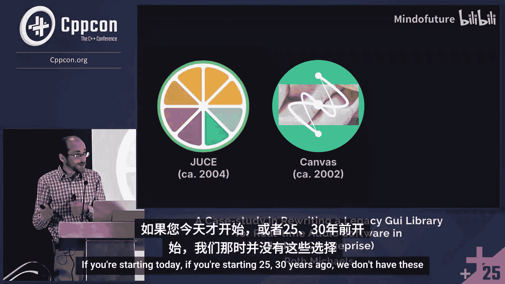

And then we did look at QT around 2014， Some work was done in QT to make it work in plugins and we were told in 2018 when we started this rewrite of our libraries that。

 oh yeah， they told us said yeah， this should work in plugins， It's not really documented。

 but you do this and this and it seemed maybe true but we didn't really believe it。

 now that we've merged with NI， we know that oh yeah， there is ways to get QT to work in plugins。

 but the reason this question question mark is here， it's still officially not supported。

 we just know how to make it work and。There's rums。 Maybe someday。

 Q T will actually officially support this。 But， you know， that's why we decided， you know。

We didn't have these other options and kind of were working in our own world。

 And starting in 2002 with the founders making this library over time。

 Canvas our UI library grew into this organic monster where， oh， I need an API for this。

 So had this one here。 and this year and this year and all of a sudden， API surface area is huge。

 There's so many different ways to do things。 It's really hard to learn lots of opportunities for bugs。

 And I'm not blaming any of my former colleagues for oh， they made some bad code。

 This is all like pragmatic decisions made to deliver business and user value for a long。

 long time and it worked great for the company。 And reasons pictures here。

 it's a blur because it was taking off a wiki of low resolution。

 but also I guess protects my coworker' identities。 But you can't tell。

 but that maybe that is me here。 And my point is some of the gross things that our old Can library I did I added in the year before we start this new project to upgrade things so。

How did we want to deal with organic monster？Initially， as propos， let's just drop it all。

 Sw to juice or Q T or something。 And there's a lot of reasons why we decided that actually isn't the right solution for us。

Let's do a rewrite instead。 Now， I know that probably sounds really scary。

 It a software rewrite project。 that's probably going to fail。 why were we。

 you bold enough to do this， We had a lot of features that we liked and wanted to take。

 keep taking advantage of。

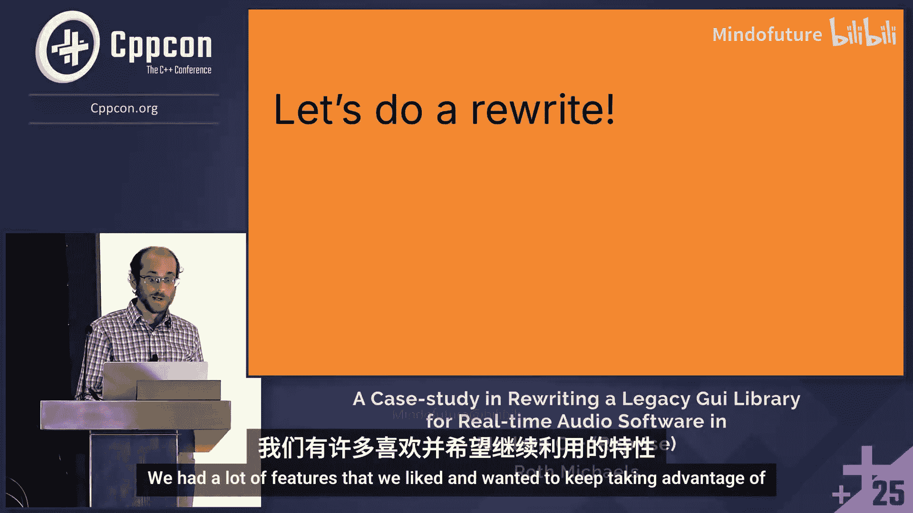

We already had a way in our canvas library to serialize and decsialize Us in an XML layout file。

 And this is really good for having designers be able to edit things and not need to deal with C plus plus We also had a style sheet system doesn't have the complexity of cascading style sheets。

 And it's Json， it's a little bit weird， but this was also useful。

 But the particularly useful thing is with an XML layout files。

 we also have an interactive debugger and layout file editor。 So you can open a running product。

 open this editor。 And you see I'm changing color values。 And this meter is changing。😊，And。

 and then speaking of metering， we also had a really nice。

 high performance vynct metering library written in this framework that we also did not want to lose。

 And then in every other library we looked at。😊，Which string do we want to use。

 We already had our capital S string in the global name space from decades ago。

 And a lot of the other U I libraries also being old， had their own strings。 We like。

 do we really want to have more。Library specific garbage or wouldn't it be nice if we had could just actually work with modern C plus plus like standard string。

 So we decided to keep these things and focus on using modern C plus plus instead of taking more legacy back like our legacy baggage plus someone else's legacy baggage。

 we decided to， you know， pursue our own library。 And the other advantage of that is。😊。

We had a very good control over Interop story because we controlled the the old library and the new library。

 and we could design this with ways to mix and match。

 So we decided to make a new library called Glas。 One of our designers named this。 It's called Glas。

 because that's what windows are made out of。😊，It's only pun for today， I think。

So and someone called that out on YouTube as well， even though I did say this and the last time I gave the talk。

 when I say rewrite， we did not actually rewrite the whole thing。

 I call this a porcelain rewrite where this is a abbreviated version of what kind of the text stack looked like for canvasva。

 we have a bunch of thirdpart libraries， AG for drawing， free type for text， Li PG。

 some other stuff like that Iybase is of our general foundational application library and on top of all this。

 we had canvas RUi library and instead of rewriting all of that。

 we decided to use that as the engine to build a new library where we could make new APIs glass and then integrate the other new features that we wanted that didn exist in glass。

 So we wanted a automatic layout engines we brought in the yoga library from Facebook with patches to get rid of all their global variables because we're plugins the Sia library from Google Chrome for drawing and this new sparkle motion library。

 we had developed for metering and by combining all of this together we allowed us to make new APIs and easier to learn。

😊，Safer and eventually replace more and more parts of the engine underneath to support new features we needed and then part of that also is this glass Pro library which we're going to talk about today that took some features in Iybase and Canvas that for our existing property system that supported the XML layout files。

 the design editor， etc。But all had runtime errors。 And so this is we're gonna talk about today。

 how we took those runtime errors and made them much nicer and easier to use and much more powerful API。

Before we get to that， just one other aside about actually how to get big infrastructure projects like this done because if have this I know。

 kind of you're finished， if you wait to finish。 And the point is maybe you should never be finishing this stuff。

 If we actually said， like， okay， we're gonna write this library and then start building products with it。

 I don't think this would have ever succeeded。 We didn't ask for a specific budget that， oh。

 we're gonna take engineering time to build this library。

 But for each product released on the roadmap， we included part of the library in that development roadmap。

 So the first product insight is a metering product。

 and it use a very early version as library glass， just a layout engine that allowed us to lay out our old UI library。

😊，And then we had vocal doubleubr and then nectar is where we really in this our main vocal product。

 we decided to put a lot of time in actually building out most of that UI in the new library we built most of the features we needed one example was something we didn't if we didn't build a slider because the initial version of the UX only had knobs so we just built knobs at the time。

 build sliders later we needed。 and then as we released more products over time。

 we would start replacing layers in that and over over time as we released more and more products。

 each release， neoverb， this one as a new reverb was basically all built in glass and at this point。

 most of our product line has made it through the evolution。

 but the nice story of that interop is we never had to go one way or the other we were still able to use any of our old widgets or meters or tools within this new library。

 So specifically talking about this property system。

 What was wrong with the system we already had in canvass the old library。

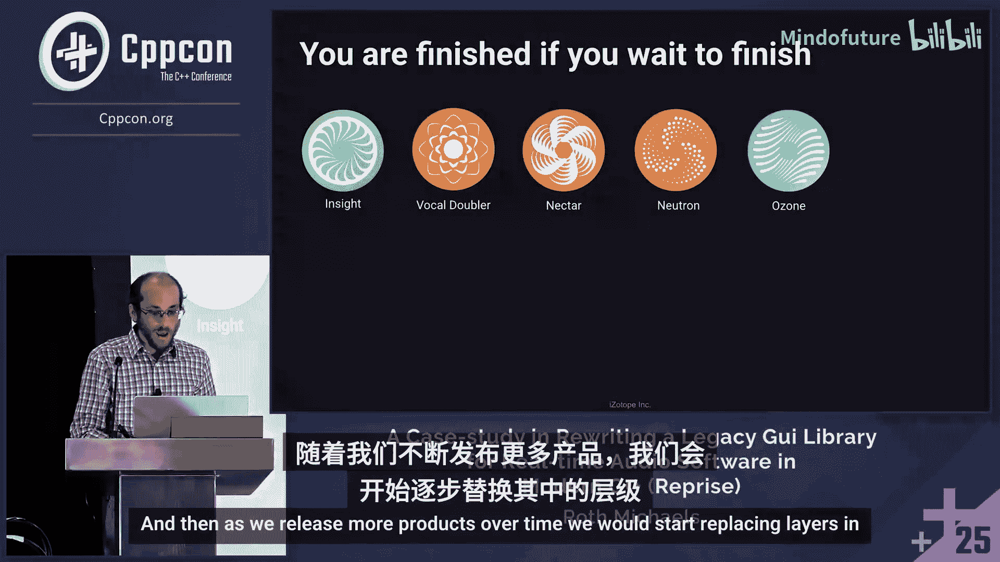

2 main things。1， it was imperative。And by being imperative。

 it meant that you could choose to do weird things。

 like conditionally declare properties and things like this。 Also， it was not type safefe。

 So there was a lot of runtime error checking。

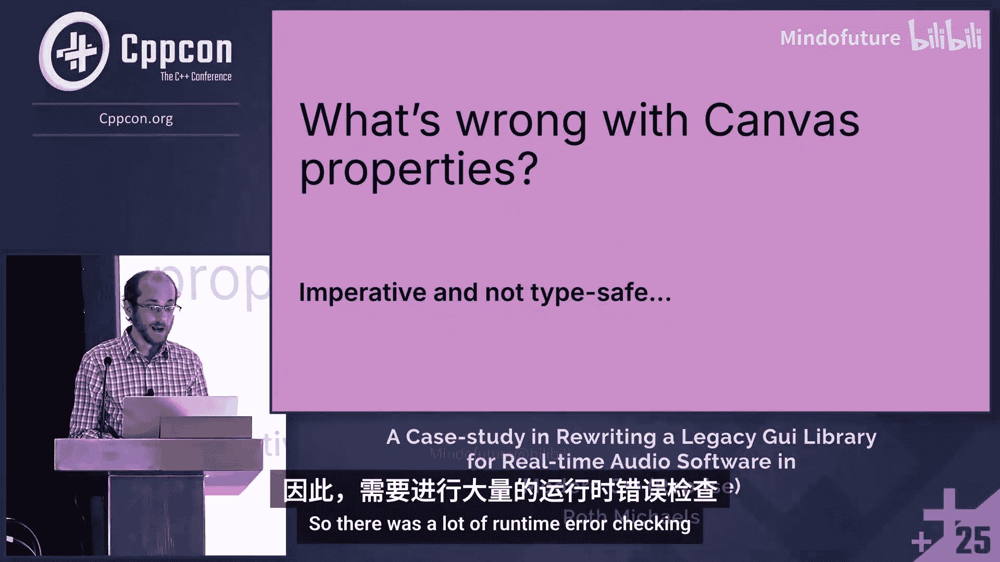

So this is what kind of looked like in the old system when you'd set up properties。

 you might have some you know， this is kind of to show you you might have some view base class from Can that inherits from something called propertyty holder untractable。

ll talk about that in a minute and then your button。

 one of the first things you're going to do is declare a bunch of constants for string names for all your properties。

And， you know， one of the kind of weird things about this is this trackable。

 That's something you must inherit from to make property notifications work correctly and actually inheriting from it could lead to subtle bugs versus having as a member。

Don't really worry about。 That's not Jermae precisely。

 That's a strange thing we want to abstract and hide away。 And then property holder。

 This is the kind of thing， which is essentially a dictionary of strings to boost anynies or standard ennies that can hold all of the properties for some object。

 And it had a less an ideal interface。 So you had something for creating a property， that's fine。

 But if you notice the Gi property returns an optional。 So like， oh， it might not be there。

 And that's because we're getting it by its string name and having to tell it what type it is。

 And if we get the type or string wrong， it's gonna be optional。

 And then set property also returns a bo。 So setting can also fail。But if you， you know。

 we know if the property is all right。 No， this should fail。 So if you look at Gi property。

 it has a number of different checks that it's doing。First， it seeing， oh。

 is it a property that matches your name， If not， okay， fail。Then， okay， we found with your name。

 did you put the right type in the template to do the anycast， If not， okay， we'll fail again。

 But if you' got everything right。Then we'll return the right value to you。

The other downside is as far as getting notifications of property changes。

 There was a public API for getting a property signal。

 which meant that not only does the class itself have the ability to know when its properties change。

 Any part of the code could listen to knowing， oh， I'm gonna be a label over here。

 I'm gonna listen to when this button's text color changes and。Every now then。

 someone claims I have a good use case for this， but it makes the code really confusing to understand。

 And you have all this spooky action at a distance。

 And so that's something else I wanted to hide away。

And then there's some other public APIs that you really don't want to know about。

 get serialized value and set serialized value。 That's to support that interactive debugger。

 No one in C+ plus should ever call these。You can， and you could do weird stuff for some use cases。

 And I admit I did it。 But again， we want to hide this away because users should not be doing those shenigans。

And then we'll get into more problemss。 like I said。

 we have to declare string constants for all of the property names。

 And then when we create the properties， you know we're repeating ourselvesself。

 We say create property。 and we say the type is a string。

And then we have another constant that is the name of the property saying string。 Then we say color。

 and then the string color。 And we're repeating ourselves here。

 And it's another opportunity on creating， setting or getting that you can mix up those type and strings and not get the results you want。

😊，And then if you look at， you know， we're actually， you know。

 let's say we connect to some property signal and we get a property and I said。

 oh we get an optional and we have to assert that， yeah， we actually， the get property works。

 And it's even worse because we weren't using standard optional to our own optional that has implicit conversions to default value。

 So in this case， what actually happens is if you pass the wrong name in for this property and it didn't exist。

This check value will implicitly convert to an empty string。

 and you won't actually know anything happen unless you're listening for certain debu asserts。

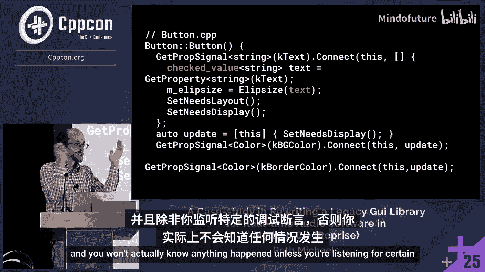

And there's a limited number of types。 Everything was essentially， these basic primitive types。

 points， sizes， racks， colors， strings， images。 And what this meant is that anything beyond this。

 it was just a string。 And then people would do their own string parsing in their class to do this。

 And and it is basically there wasn't really you could define more properties。

 But the API I didn't encourage people to do it。 And so that was the other thing。

 I wanted to make it really easy for people to make properties that aren't just a string representing some function somewhere。

 I have a properties a function pointer or any strong types。

 I want all the properties be strong types and encourage people to make it really easy to define new property types。

So again， you know， the user problems are it's imperative， runtime， tight mismatches。

 runtime declarations， confusing signal connections。If you have a property that changes a color。

 it's your responsibility to know when that changes。 I have to write code every time。 Oh。

 this property change。 I need to know I need to repaint and it didn't encourage you to make new types。

 So the solutions。 let's make a declarative AI。 put all the information in one place so we don't repeat ourselves。

 make it typeafe compile errors and only create properties on construction。

 That's the other weird thing about doing imperatively。

 you could add properties at any point in a class's lifetime， which also made it confusing。

 So when I was first thinking about how to do this。

 I did actually see herbs metaclasss talk from 2017。 I thought， oh， that would be really cool。

 that would solve all my problems。 but I need to do this in 2018。 So no。

 and then I started telling a colgue， maybe I can make something with like M4 or C macros。

 which there's many gross things about both those technologies and that's also going down the cute meta object compiler And he was like。

 no， no， Ro， please do not do this。 Can we use C plus+ 17。😊。

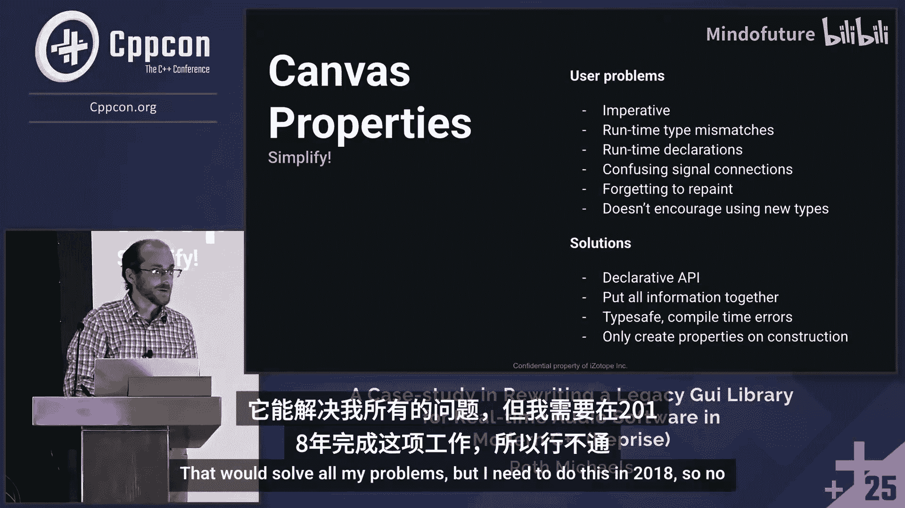

In templates instead， I said， yes， okay。 And it was a great learning experience because I basically wrote the code how I wanted to use it and then figured out。

😊，With my limited knowledge at the time of Sai and some button mashing， how did you get it to work。

 And that's actually where a lot of my deep template knowledge came from was experimenting and figuring out how to make this stuff work。

 But today， we don't need to talk about any of that dark magic because we're gonna talk about how to do it with C plus+ 20 concepts instead。

😊，Before we get to my library， just very briefly going show some slides from other concepts talk I gave just to get everyone up to speed if you've not used concepts yet。

 So the very basic level， concepts are a way to constrain templates on what types they can accept。

 And there's a number of different places you can put them。 So and everywhere I have C1。

 C2 in here a place you could put a concept。 So you can put a concept instead of type name or class in your template parameter pack。

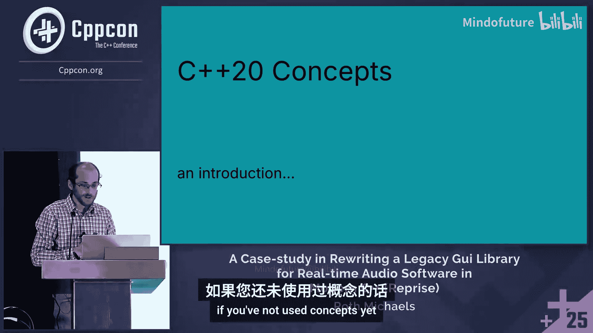

You could also have this requires clause where you put a concept afterwards。 and youll。

 we'll see some examples later where that's useful。

You can use it to say the return type has to match a concept。 if you do concept auto for the return。

 argumentsguments can match a concept if you're using concept auto。

 and then you can also have a concept required at the end of your declaration。

 And this is if you want to use things like the X in your parameter function parameters in the concept。

 you could do that that way。And they're essentially a way of creating overload sense。

 So imagine we have some， you know， functions for dividing stuff by half。

 We have a generic templated one， and then we have one of floats， doubles and long doubles。

 And the non double one does I think I did that right， like rounding math。 I just pretend it's right。

 if it's not。 And so you see， we have a template。 And then three specific implementations for those three different types。

😊，But we can start maybe make it a little better with if constant expert， we can say， oh。

 if it's integral， do this， else， do this。 But in this case。

 this is gonna have a problem because if we pass a， you know。Standard file system here。

 That also has a slash operator。 So we actually want to word for numbers only。

 So what we can do that is instead， we can use concepts and say。

 we have one function for integral types。 And that's stood integral as a concept for the standard library。

 And we have another one for floating point types。😊。

And maybe you want this to work with your custom types too。

 so we can design a new concept called Ken half。 And Ken half is something that this expression T over T constructed with two Well we're trying the same type as T and that requires capital T T that's basically saying like give me a lower give me an object a pretend object in this context of type T And so we could you know first second。

 does this expression in the braces compile， and then does it match the concept。

 is that the same as both t is the same。 And then we can use this Ken half to say， oh。

 there's a Ken half that requires integral and then a Ken half that's our generic version of Ken half。

So little bit of overview on concepts。 And please， if you have a question of confusion along the way。

 please raise your hand。 I might answer it in line， or we might save it for later as that comes up。

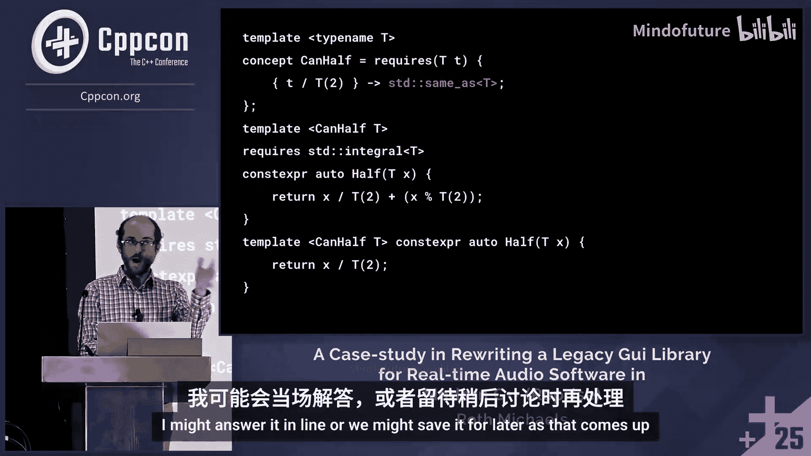

So back to the topic of hand， how are we going to do this with C++ 20 concepts？

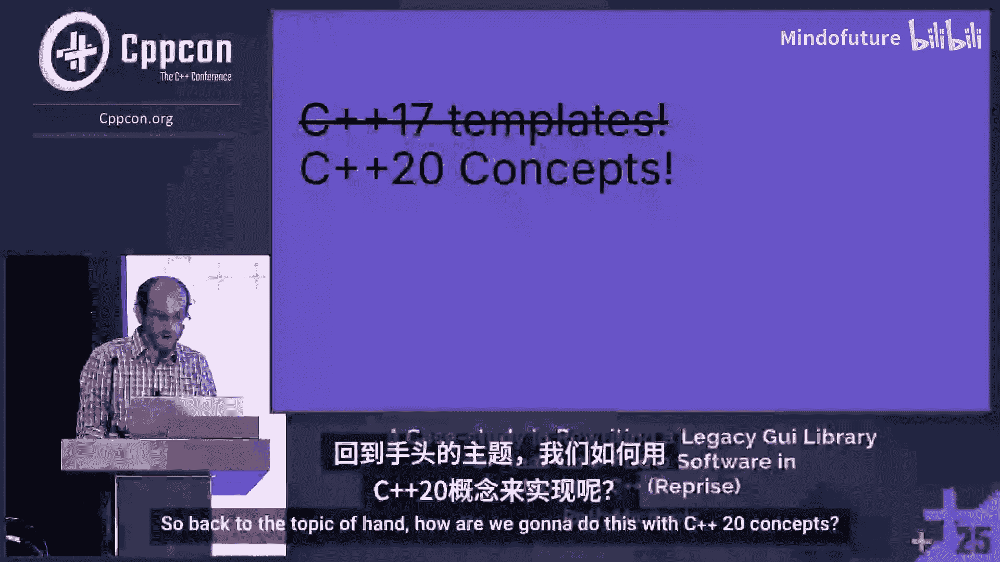

So again， I'm going to show my two favorite memes I showed to my coworkers when I think we're you know doing things wrong。

 One is this example I showed you before， where we have to get the correct types。

 forget property and the correct string to get in to make sure that our checked value actually hold something when we pass it in to this ellipse size function。

 And I screw this up a lot。 I other people screw this up a lot。 And I said if you screw this up。

 you might silently get an empty string in a release build and not realize what's going on。

 And as hell 9000 would say， this can only be attributed to human error。 So that's goal number one。

 reduce the need for human error。 The other1 I showed you is we're repeating ourselves。 Naming types。

😊。

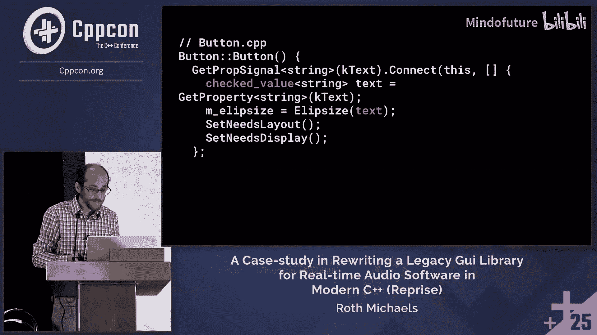

And then having string names that correspond to those types。And whenever we're working too hard。

 I share this scene with my colleagues from Metropolis。 If you've not seen this film。

 I highly recommend it。 but there's a theme of humans doing the work to keep machines running。

 And this is an example of we're doing the work here。

 We should let the machines do when we repeat ourselves like this。

 So we don't want to be this guy either。😊，And also， it can be safe。 You know， yes。

 if we decalize something from a layout file， the decalization could fail。 We know this sure， but。

We have a variant set up。 We said we know I created properties with these certain types and names。

 And so if we enforce that they're always created， as we expect。

 and then synthesize the right getters and setters。

 we can ensure that while the runtime system underneath has to do all these checks like， oh。

 does this name exists， is it the right type， bla， blah blah。

 we can write an API on top to make sure we never call it wrong。

 And then we always can assert that these optionals are all true， we get no errors。

 But know some of the ways we can have stuff go wrong is you know if that class name is wrong in XMl。

 this could give an error。 if the property type is nonsense， it could get an error。

 if we don't put in a value， we can have a problem here。

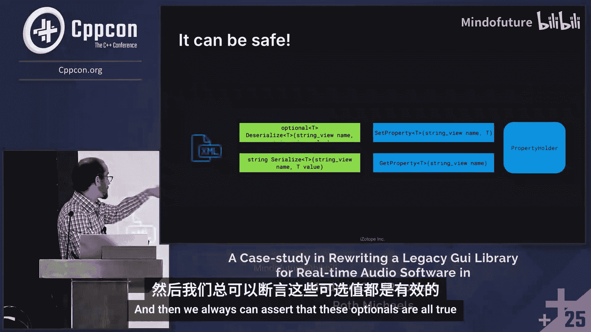

But these are all errors validating the Json or Xmls to come in。If those fail，' okay。

 we just fail and we don't set the properties。 But if all succeeds。

 then we know we're in the right types。 And then every setter should succeed。

 So this can be safe because we can now from the C plus plus side。

 we can know that anytime we're calling set property from C plus plus。

 if we can enforce that you know， get rid of these names and enforce that the name and the T always match and always found。

 these can become compile time errors。 And I'll show you what this looks like。 So。😊。

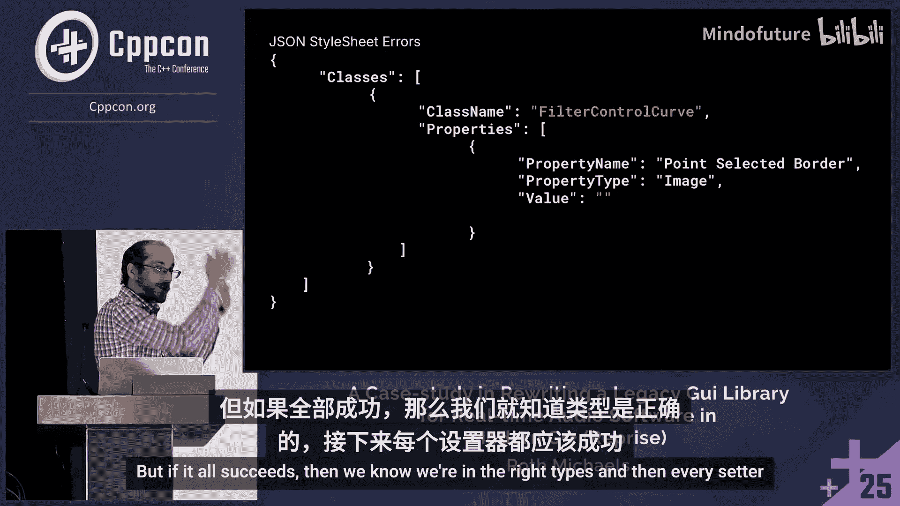

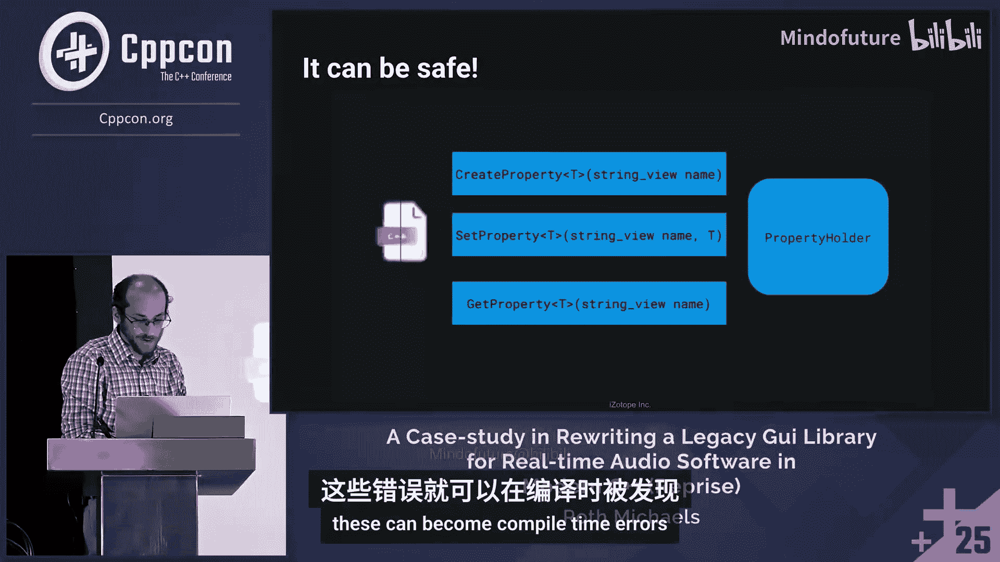

Here's where we want to end up is the way to decly describe a property of our button so we have a text property and it has a type。

 property type is a standard string， it has a name and has a default value。

 we can collect all these properties in another type that we call a property list by putting in the template parameter pack and then if our button declares some of this special has properties template or derives from it。

And passes this properties list that will take care of creating all the properties and providing only the getters and setters that need to exist for those properties and noticing that your class has a did set function。

 and also connecting that up。 So anytime you change the property， that'll be called。

 and we can see how this works。 So really， I wanted all in one place。

 But if you look these four lines， the three in the propertystruct。 and this did set。

 that's all the information we need to describe a property from the class。 And maybe not the did set。

 even if you don't care about those notifications。 And instead of having this be a bunch of imperative calls that can go anywhere。

 this is now in one place， selfdocumenting， you can look at the class， No its's properties， you know。

 they're always gonna be there， you know， get and set will always work。😊。

And so the original version of this， I started with this and figured out， okay。

 what templates do I actually need to make to make this work。Now that we're going with concepts。

 I want to actually recommend a different approach because I and get into someone more text by。

 there's sort of a TDD ish approach with concepts where instead of writing and code first。

 and then having concepts that match it。 And this is the full concept for a property description that describes one of these properties。

 instead of starting like this。 the way I like to begin is first。

 start with an empty thing that doesn't implement your concept。 and just start adding things。

 So the first thing we need， okay， a property， it has to have some type called property type。

 So we know what type it is。 And okay， tax is gonna to fail。 It doesn't have one。 So now we add it。

 okay， it's passing the concept。 But we need more than this。 We know it also needs a name。

And in this case， not just any name but a name that is convertible to string。 Okay。

 so now we can add this to our property and we have a name Sta asserts on this will pass again。

And then we also want a default value。 So again， we saying that a T will have a colon and colon default value。

 And again， we want this to be convertible to this property type。And then we can add this as well。

 But there's one kind of downside here。 Proper type is just you know， a low levell type like string。

 but it's possible， maybe string's not the best example， but you could imagine。

 you might want the same type to actually get serialized deseialized differently depending on its use case。

 And so the underlying C+ plus type and the purpose of the type are potentially two different things。

 Also， one of the other goals is have all the information in one place。

 And so where's the information to know， of course， strings easy， but how do I serialize string。

 So the fix here is we won't actually have the property type B the actual backing storage。

 but another struct that we'll call in this case we call it string property type。

 And this will be a new concept。And this and we're going build this up right now as well。

 So you see I made a new concept called property type description and when I make new concepts。

 I'll just make it say true so I can start using it and then build up the concept later。

 And now you'll see our property property description concept below instead of just saying oh。

 you have a t colon and column property type we've removed that And now we say that for T a description that T property type matches this property type description concept right now that's always going be true。

 but we're saying like okay this is not just any type it's a property type description。

 and then we still have it requires a name and a default value。

And so what does a property type look like， A property type is the backing storage。 It has a type。

 Again， it also has a name that we know for serialization。 Yep， string。

 There might probably fanci ways to do this。 But sometimes we want custom names and then a serialize and desalized function。

And so a concept for this will require a sin to have a type for the t colon colon type。

 and then it will have a serialized function that can take that type and returns something convertible to string。

 and a desseialized function that returns that takes a string and return to standard optional of your type。

 And now notice I didn't do convertible the standard optional I actually did know it must be a standard optional because Aspen in the hallway。

 we don't have time for it right now， but the template constructor for standard optional that constructs it with anything convertible to the inner type has very strange interactions with implicit conversions from other optional types and you can get some surprising results。

 And so no I don't want you to give me some type that you think will correctly convert to standard optional。

 if you want to know that horror story I can share that in the hallway。

It is another example of another property type。 a little bit more advanced in the string one for you int。

 We have a serialized。 We'll， you， use format to do this。

 and we'll use boostle little cast to go back the other way。

And things get a little bit more interesting when we might do something like， oh。

 a template to help us make properties。 like， what if we had a property type like our string property type。

 we wanted to have it be optional。 Well， we can have a template that wraps this as an optional property type。

But one thing you'll notice here is I no longer have a member variable for the name I have a function because using standard format。

 that's not context per。 And so I wanted to have this be a function instead of a context for member variable and you see that will then like call the T name on the other thing。

But now I've broken my concept because。The concept we showed。

Over here for the property description expects name to be a variable， not a function。

So what are we gonna do about this， Because you see。

 we have name here and that t colon and colon name。 we're now， oh。

 could be that or it could be a function。 So we really want something like this called gi name。

 that will be able to get us the correct name， regardless of the property declared it as a member variable or a function。

 And now， here's where I'd start teaching fe and show a whole bunch of slides about how to do this。

 But it's gonna to fit on one slide with concepts。😊。

And this is how we figure out how to get the correct name。 So we describe two concepts。

 One has name value that it has a member that's convertible to a string or has name function that has a function that if you call convertible to a string。

 And then a concept for， it has a name that it's one of those two concepts。

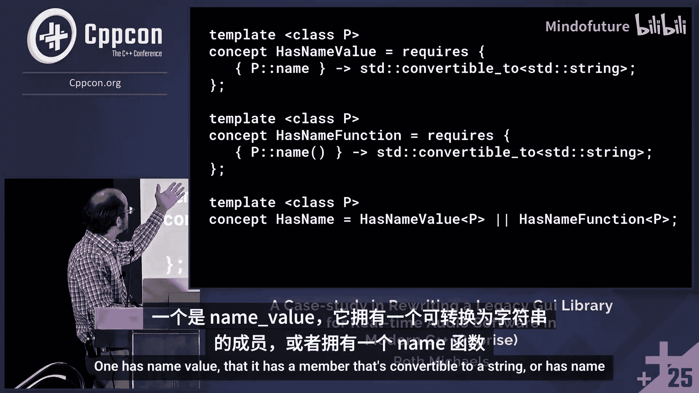

And then it's really easy to write Git name。 We can use concepts。

 We write one git name that the template uses the has name value concept on the T。

 And so this will only be available for things that match that concept。

 And then we can call T colon colon name and return to value or one for functions。 And its just this。

😊，I probably should have left the old code for this Fina in there， but it was so many slides。

 I didn't want to go through those。 because I'd rather show you new concept stuff。So again， you know。

 if we look at some button property， kind of now that we've seen what the properties look like。

 let's look at kind of a bigger example of a class。 So for button properties， we might have text。

 we might have a background color， border color， border width。

And then we collect all of these into a property list， which you could use Tple for this。

 but we decided just to use our own empty struct type for the property list。 It looks like this。

 And I thought it was a little bit useful。 be able to differentiate our property list from any sort of tuee thing just just to make sure people write consistent code。

 So one person does this use property list over here。 Tple over here。 my own empty struct over here。

And so we， you know， tokota's property list and then you know。

 pass that with CRtP into this has properties that will do all of our meta programming magic to synthesize our properties。

 One sad thing is I really wanted all these property declarations and this namespace button properties and the property list to all be within the definition of the button class。

 but that's not possible I don't I'd have to really dig in the standard understanding why。

 but essentially when you're using CRtP。When I pass that button in。At that point in time。

 other member types， like if I had that using list in here。It's not there yet。 Unfortunately。

 So that's why we have to put this in this other name space。 Again。

 meta classes would make it work how I want， But this is good enough for now。

And has properties looks like this。 It has a gi property that takes a property description。

 so you can only call it with one of our correct property types。

 not just int or something in the template。 and has this requires property list has type。

 And so this is gonna make sure not only Are you passing in something of true property type for like our button like our label text。

 but that is actually one of the property types that exists on the button in that's passed in for the property list concept P。

 And I'll show you in a minute how we implement this。 and the same thing for the set again。

 we're gonna put a requirement that you can only call it with a property description that is actually the list of properties for this button class。

 Yes， please。So just to check has properties， I would have thought has properties。

Would have been something like a concept you'd say this thing has problems you're saying， oh。

 it has these problems。It's not a sort of a query sort of。Yes， and yeah， and this is。

 And thanks for bringing it up because I it's added into concepts。

 I probably actually want to rename basically everything in this library because before the concepts has was a term this library for mixs you have a capability。

 So there has properties。 There has can focus as in can you hit tab and focus that control or has accessibility and things like this。

 And then there's is tests as well。 So so that's what has properties this thing has properties and has properties class what gives them to it But yeah I that's a bit confusing。

 And if you have confused about the names as it comes up that's why I've not open a PR for this yet。

 because I'm not fully satisfied on introducing the new names for these things。

 even though I have the more full implementation locally。😊。

And the way we check this proper list concept is pretty easy。

 We make a function that we don't define that iss templated on a list of property descriptions and takes a property list。

 And so this basically saying this property list test function， you can call the property list。

 And only if every parameter in the parameter pack。

 every type matches the property description concept because all the T S is property description。

 And then the property list concept just requires that you can call this test function。

 there might be a more elegant way to do this， but that's what I came up with。

 And then we have a check for is something in the list we have this inline bo that calls this function is type in list。

 which just uses a fold expression。 how many people in the room are familiar of use this dot dot dot fold expression syntax。

Not so many people in the room。 So this is a really cool feature in C plus plus that 17。

 And I believe it was added that lets you essentially， or maybe it was 20。 I forget17 yes， yes。

 actually right， because I remember17 talk。 I did I didn't actually use full expressions I haven't load them yet。

 But I changed the talk to use them last time because we did So essentially what this means is I had the same as or dot dot dot。

 it's gonna stamp out for every type in that L T S parameter pack is' gonna do same as T type or same as T type or same as T type or And you can put the dots before after。

 And that just is shows you where the parentheses are going。 It's a very useful technique。

 And you'll see later， you also use it for chaining function calls together。 It's pretty cool。

 basically in the past， you'd have to use recursive templates and kind of very lisppy stuff。

 which I like to pop things off one at a time and do things。

 But if you're ever doing that template recursion where you're。😊，Pppping one type off at a time。

 Try to reach for these parameter packs。 I mean， fold expressions instead。

And then here's what it looks like。 the new API。 If we're setting properties set text。

 we just say the type of the property type， text or BG color and pass the value。

 We're not no longer repeating ourselves。 So we've made that nice change We we're not gonna to make mistakes when we're setting properties affecting the type and the string of the type。

 correct。And then， because of that。These requirements on the gi and set here。

 What that ends up doing is essentially enforcing that only these specializations exist。

 It's impossible to call get property on any other type with any other type other than the ones that were in that button properties list。

 which was text B G color。And a couple others。 But you know， they don't fit on the slide。

And so how do we actually implement this， So if you'll notice a get property。

 we're going to essentially use this property hold right， which I showed you kind of the。

Not safe imperative API。 We're gonna to use that。 And we're gonna to call Gi property。

 and you use our Gi name function we invented earlier and create that property and assert that it succeeds because we know it's only gonna fail。

 that property already exists。 But since we're declared we've doing this。

 we know this is all gonna work。 And so we've kind of wrapped all this kind of Se that could possibly fail in this meta programgram that we know because we declared these things。

 is's not going to fail because we're not going declare the same thing more than once。

 And I'll show you how we create those properties later。 And the same thing was set。 know。

 that Git property。 we know it's going to be there。

 The name because we're gonna create every property we need and same thing was set we know is is always going to succeed because we're not going be able to call set because of the concept requirements on anything we haven't created the property for。

 And again， I'll show you next how we actually make sure that all those properties do get created。

 So here's our Gi and set properties。And then when the has properties are constructed。

 we call this create properties function and pass it the properties list and you'll see that create properties is templated on the property description。

 And so that's how we're going to pull out every property type in that property list。

 And from that we're going call again， use the fold expression。

 So for every type in the property list we're going to be folding over the comma operator。

 So create property comma， the first type， create property， the second type comma and so on。

 And so we'll be calling this create property function for every type in the property list。

And then this will use the property holder， create property thing where we'll call get name on the type of the property get of the property get name on the the type of the property definition。

 Pass it a default value。 of course， it succeeds because we're not gonna do this more than once for any type。

 And oh， default value。 This is kind of similar to our name example。 What if I want a default value。

 that's not contexts per。 I might need a function here as well。

 So we really want something like this again， And again， this is really beautiful with concepts。

 We don't need any crazy feeni。 We have has default value。

 has default value value requires that the default value member is a convertible to a standard string。

 Oh， that is a typo， that should be。Oh， I'm sorry about that。 That should be to the property type。

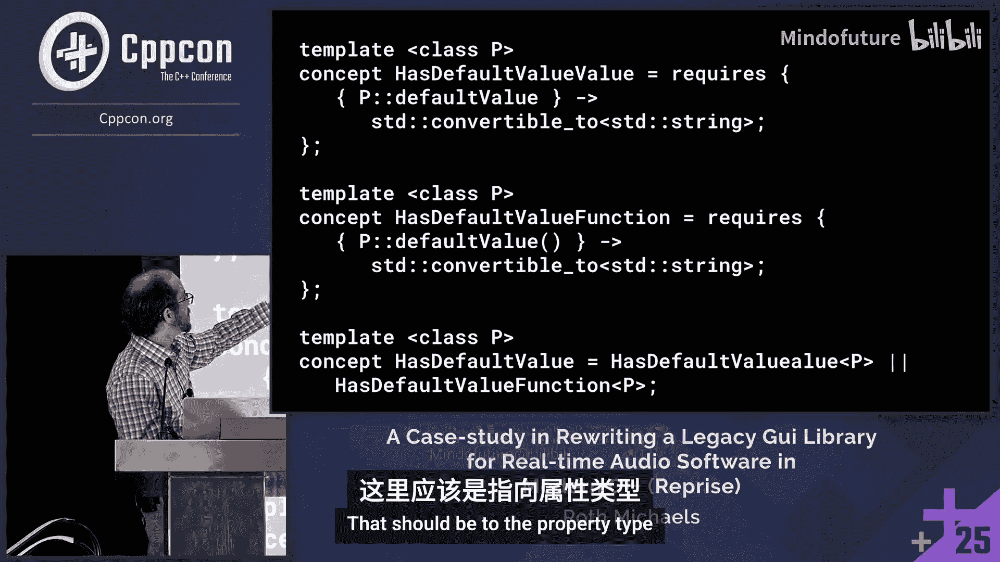

I copied a earlier step of my iterations and that was not the one I was supposed to show here。

 But imagine that says P Q call and property type type， where it says string， I apologize for that。

 But assuming those are implemented correctly， then again of this slide should。I'm sorry。 copy pasta。

 mess that up Anyway， this is get name。 You can imagine get default looks exactly the same。

 but says default anyway。And so how we use this is we can that create properties is then gonna call something called like afterre calling create properties。

 It'll call also need to set up the signal to know， oh， did this property change。

 So we'll have this connected set that's also called from we don't see here。

 But the next thing we'll addd is connected set for create property。 And then。

And we'll do a few things like， you know， So when this。

 we're connecting this thing up so that this land will fire any time the property change and we'll call a did set method。

 we'll call set andese layout， and we'll call setese display。There's a couple problems here。

 What if my class didn't implement a did set method for that property and doesn't want to call back。

 This will not compile。 What if I'm not using it in my normal view that doesn't have setney's layout。

 Seney's display， It won't compile。What if it is my normal view， but。

It's not a property involved with the display。 It might be a controller that I'm connecting。

 The controller changing itself does not necessarily mean you need to relay out the U I。

 So we want to conditionally do these things if those functions are available on this and we want to do it。

Only when actually necessary。So the didt set， we want to do if it's there， that means the class says。

 I want to be notified。 So if did sets there， we're gonna call that one。

 But for setting' layout and set's display， we want a way to say that these properties are a layout property or a display property。

 And and declare that as well in our property definition。 So a background color。

 you can declare as a display property。 And then any time you change that。That's it it will know。 Oh。

 is a display property when you must repay。 Tex could be a layout property and a display property because text could change your layout if you change a string and you might need to redraw and you combine the two concepts together with a UI property。

 And then any of your properties that we describe before， if you inherit from these。

 and I'll show an example later。You you automatically get the meta program will say， oh。

 your layout property。 Therefore， when you change， I must call layout on your or means layout on the thing that you're working with。

So what the new version of this looks like is to conditionally do this。 We'll use if Con Exp。

 If you're not familiar with some of the magic if Con expert。嗯。

You don't is not always expected that everything needs compile。 Like I said。

 the did set may not exist。 But since in this， if concept expert block。

 if we don't actually enter that block， that doesn't need a compile， but there's a trap here。

That's only true in templates。If you use， if concept for in a normal function。

 all branches must compilely。那。I don't know why。 but that's the way it is。 But in templates。

 it doesn't have to。 So you'll see you have a few blocks。

 So if con expert we'll see how these implement， we see， oh。

 does the derived class have a did set for P。 If so， in our callback。

 we'll call this did set and pass P just emptystruct to provide the over every every did set is just taking emptystruct of the property type to just know。

 oh， yeah， I'm overloading on that one。 And then we're gonna see， okay， is this property。

Something does it does the our， our type that we're working on you。

 Does it have a set needs layout And is the property something that's derived from display property。

 If so， call set needs layout when it changes。 And then again， if has set needs layout。Oh， oh， I I。

I am such a better proof reader when things are on the screen and such a big font。

 My eyes must not be good。 So， yeah， Sw those， obviously， if it's setney's display。

 you should call Seney's display。 And if it has setney' layout， you should call Seney's layout。😊。

So these two function calls are backwards。 sorry， I will correct these slides after the talk。

 I apologize and then we're checking it for if the property derived from that type says both does the type。

 the property type want us to call this。 And then can we call them the class of the two checks we're doing。

And then how we will use this stuff you see now text declares from UI property， background color。

 declares some display property border color and border width or also display properties because we're going need to repaint for those things。

 And this is where we kind of saying it's our final destination is instead of declaring all this ver both stuff。

 which you can do sometimes and you might want to because also the cool thing about this is you can also do meta programsgrams to generate properties。

 like our button class in actuality as is the Cartesian product of every like mouse interaction state of the button of hover pressed inside outside active inactive for every color and picture possible。

 So if you want to do some meta programs， you might do this by hand。

 But we made this nice little macro that will essentially expand out all this stuff。

 So you can much more concisely say things and don't even necessarily need to。😊。

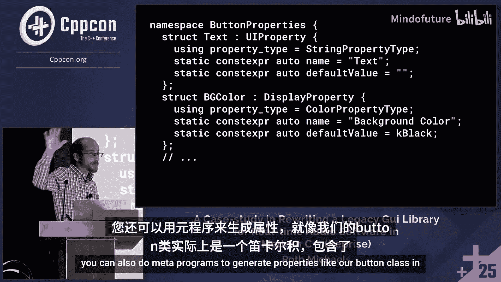

Provide names or things the macro can do this for you as well。 And again。

 Member said the did set just takes the property type as an argument for the overload resolution。

So what is next？The Mereprize。 So once we have C plus 29 and hopefully the co generation for reflection comes in there。

 then I'll probably you back a CPP con again doing this talk yet another time and。😊，This time。

 itll be the actual pretty version that I wanted using meta classes。

 And hopefully that will also compile maybe faster than this template stuff。 Too。

 I have not benchmarked the concept stuff yet compared to the template versions。

 also didn't quite seem fair because the real versions of this in our code base are much more complicated。

 Like there's not just one version of decentalized and serialized。

 but there's special magic versions that let us decalized function pointers and blah， blah， blah。

 I can talk about people are interested， but。😊。

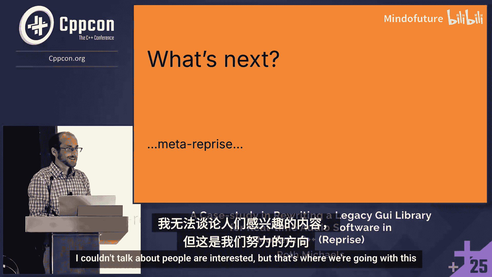

But that's where we're going this。 And just back up。

 because I didn't actually show the example of it。 You know。

 this has set these display and has set these layout and has set did set。 You。

 we implement these the same way as and these other things for having a function is just， you know。

Concept requires。Does that function compile。 And for the case of did set and setese display。

 we don't even care about the return types。So thank you very much。 What are your questions。

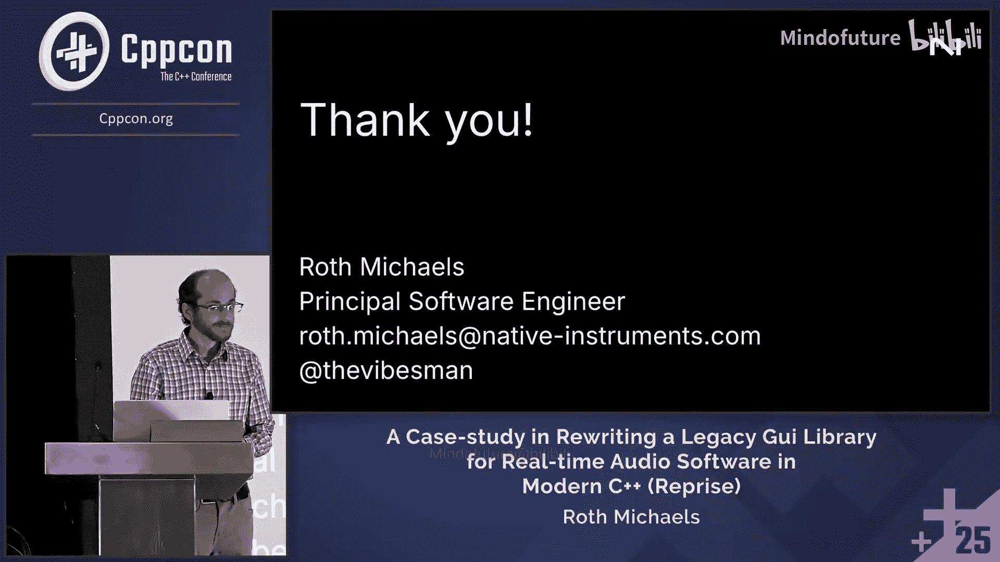

呃。Thank Ross， Roth。嗯。2 questions。 One of them， I didn't quite understand why you just needed on the set。

Value， I think it was a couple slides back。 You just gave a default value when did set happened。

 You gave just a default T。 I kind of missed that reasoning on that。

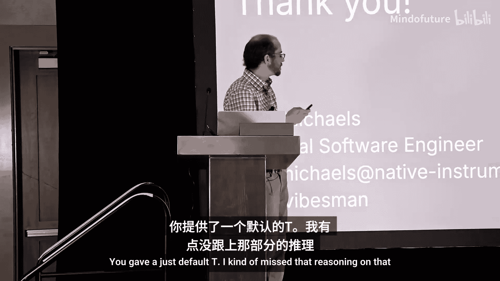

Oh， yeah， did set。 Yeah， so it probably easy。 I probably another thing about I probably should have showed an example that had more than one did set。

 but essentially， the way the overload resolution were。

 So you might implement did sets for some subset of your properties。 And they each of them take the。

 actually， let's go to the example。 Let's go back to the earlier example Does't have all that noise。

Yeah， here we go。 So in this example， we only have one did set。

 But the argument did set is the type of the property， this button properties text。

 which is an emptystruct。 And that's purely for overload resolution。

 So if I had another did set for background color So when I'm passing it's a tag。 Yeah， yeah。

 so tag tag dispatch。 exactly got it。 So， then your question was from someday I'll put numbers on these slides。

There you go。 Yeah， so we're passing a default constructed copy of the property type here to do the correct overload resolution and。

It makes sense。So second one is on the layout and other things and the setting up， how would you。

 how do you handle error errors， I saw there is an assert there and I'm like that seems。

Interesting to when you're going through each of the item， yeah， success， assert。Cool beans。

 What happens， iss there a better way to handle that or is does this work for what you're。 Oh。

 so basically， that assert is the kind of assert that we like to write because it should never。

 never， never， never， never happen because in for， I can mention the other As But in the case of C property。

 this will fail if a property with that name already exists。 But with our。啊， oh。

I should have more error checking to check。 The names are all unique。 So actually， that is a。

The fact of putting all this stuff declaratively in one place so that we have。

Like this has a void that we've ever never actually made that mistake because all the names of the properties are in one place。

 But you're right， actually， the other check that we should be doing is verifying that there are no duplicate names。

 You could do that at compile time。 And that's pretty awesome。 Yeah， yeah。😊。

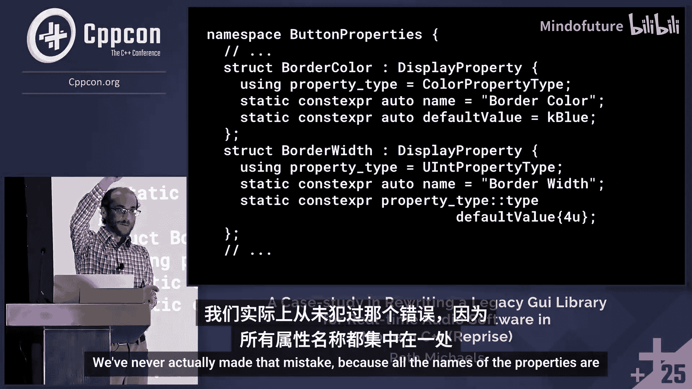

Especially if we， are using not using Si format， but FMT， and it could be all concept expert。

 But yeah， thank you， that's actually。 So the other ones for the， the gi and set。

 where we have the asserts。

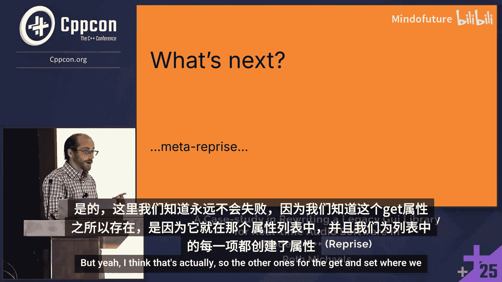

Yeah， here that we know will never fail because we know this get property only exists because it's in that property list and we've created a property for everything in that property list。

 But yeah， the duplicate name1， I don't think anyone's ever hit that assert。

 So I never actually wrote a compile time check for that。 But thank you。

 You found the one hole in my compile times error checking。 So。

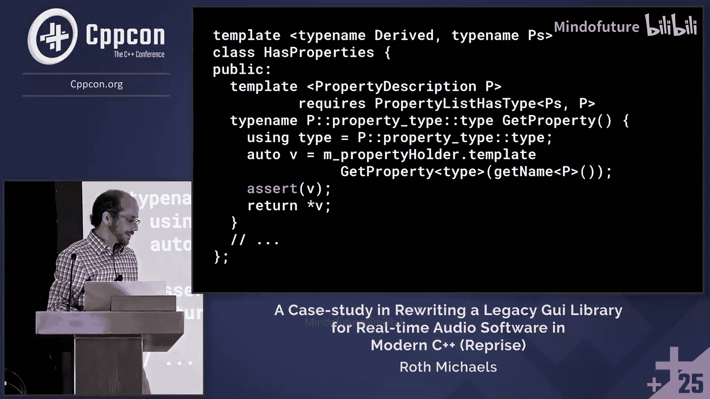

Hopefully， I'll select someone afterwards remind me to actually fix that。 Yes， please。 Yeah， hello。

 I was wondering when you do the set properties， you have to set it like in different lines。

 Have you considered of using set properties with。😊，Variable arguments。

 And then the fourth expression you would just call， Let's say all the set properties one by one。

Then in that case， you can just put the properties in any， any order。

 So the other wouldn't matter and。Maybe it's just even clear。 Yes。

 So so you thinking of using a veryatic template。 So yeah， that's interesting idea。

 So there's a like utility function that I forget exactly what it looks like that one of my colleagues made to kind of abstract away to set properties where you kind of pass it in some dictionary of stuff。

 And it called set properties internally。 And I was never a really big fan of it because it actually didn't save that much typing。

 It was just different typing。 But this version。😊，That， actually。

I think that's interesting because that that actually might be worth trying to make it less for both is that more than one property at a time。

 Yeah I think the only concern would be if you do too many。

 and there's implicit conversions between the underlying types。 like you could。

 you could put the values in the wrong order potentially。

 But but I do like this better than the other abstraction made。 So I might try format it。

 actually see what it's like。 I don't think in this case。

 the order better because let's say we'd have over overload for each set properties。

 And then they would called in sequence in the fourth expression， so。Yeah， yeah。

 I hadn't thought about that， but I do like that better than the other abstraction a colleague made。

 So I might try writing one later and see how it goes。 So thanks for the suggestion，😊。

Do we have any other questions？Alright， and I know often it says， you know。

 in my profile and bio that I work on digital audio stuff。 And sometimes I use real audio examples。

 But today， we're talk about U I。 anyone wants to talk about audio stuff in the hallway。 You know。

 I'm around and love to talk about that， too。😊，And here's my contact info， if you want to reach out。

 Thank you very much。

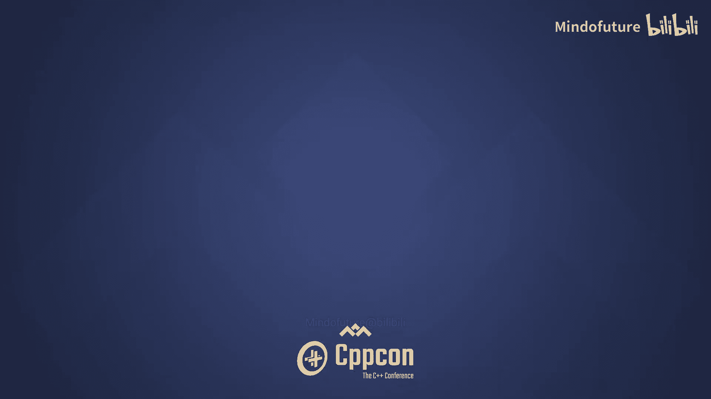